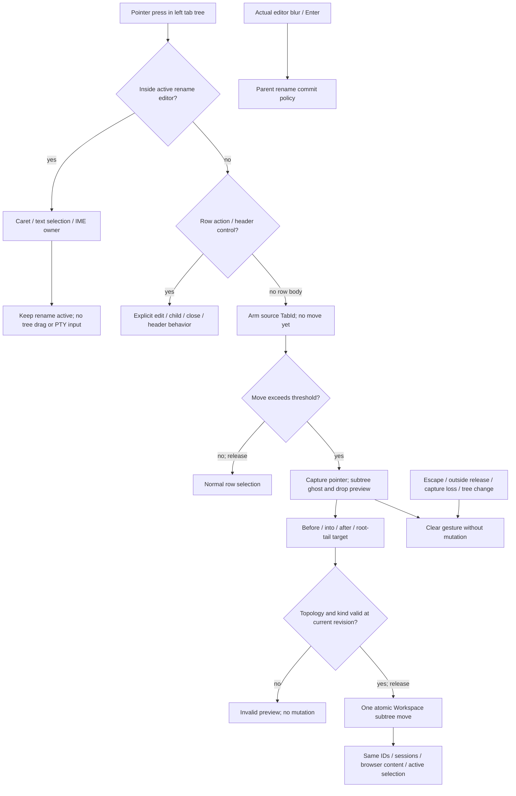

# Tab-tree drag and inline editing

Parent: [workspace and input](PRD_02_25_con_workspace.md). Sequence:
[0.2.24 plan](../plan/plan-v0.2.24.md). Status: `[-]` active for 0.2.24
after public 0.2.23. Windows host-injected rename click and drag development
checkpoints are implemented; native IME/selection and full drag acceptance remain open.

This module owns pointer interactions for moving tabs and editing their names.
The parent retains tab identity, naming precedence, hierarchy/lifecycle rules
and browser constraints. Public observations belong to PRD 26; reuse boundaries
to PRD 28. A tree relationship does not become process ownership.

## Outcome tree DAG

```text
Outcome: arrange tab branches and edit their labels without losing input or sessions
├── [-] RENAME — pointer actions inside the editor remain editing
│   invariant: inside press/caret/selection never commits the rename or reaches the PTY
│   evidence: TT-01/02 owner regression, public pointer/IME and native editing journey
│   safe failure: preserve draft/caret on rejected input; closed target cannot redirect edits
│   dependency: one shared editor geometry and existing bounded field/IME mechanisms
│   non-goal: changing custom-title precedence or opening a rename dialog
├── [-] MOVE — same-parent reorder, reparent and promote to root
│   invariant: one validated atomic subtree move preserves stable IDs and live content
│   evidence: TT-03/04 root/child/subtree matrix and unchanged session/browser identities
│   safe failure: invalid/self/descendant/missing target leaves the tree unchanged
│   dependency: product Workspace move intent and typed shared topology validation
│   non-goal: restarting PTYs, cross-window/cross-machine moves or restoring a persistent workspace
├── [-] GESTURE — threshold, preview, scrolling and cancellation
│   invariant: text selection, row buttons, row clicks and node drag have one owner
│   evidence: TT-05/06 press/move/release, capture loss, edge scroll and stale topology
│   safe failure: Escape/outside release/capture loss cancels without any move
│   dependency: MOVE and shared pointer/geometry/paint seams
│   non-goal: OS file drop, URL drop, drag-copy or speculative mutation while hovering
└── [_] QUALIFY — native input and observable state match the presented tree
    invariant: source/target/highlight/hits/selection describe one frame and stable IDs
    evidence: TT-07 native OS/ISA/scale/viewport scopes and public CLI pointer journeys
    safe failure: missing required court is BLOCKED; injected mouse is not physical evidence
    dependency: RENAME/MOVE/GESTURE and release qualification owners
    non-goal: qualifying a neighboring ISA or archived source as current
```

## Memory palace



## Reported rename failure and retained baseline

The owner reports: click the tree pencil, then click the newly visible edit
box; editing exits instead of placing the caret. Source inspection found the
matching path in `src/main.rs`: the general left-press arm calls `commit_rename`
before tree hit routing. `src/rename.rs` owns keyboard/IME but has no pointer
branch that consumes an inside click before that blur path.

The public CLI reproduced this on the signed Windows x86_64 development
checkpoint from source `10237e8e382a9c2c3d9cd3e2eaaa4e9f00e544f7`, binary SHA-256
`0dee68322b24f9de64b7f9d4b448366b459dbe50284941fc1ca4ee01315beb2a`:
pencil -> `rename={tab:@1,text:cmd}`; inside editor click -> `rename=null`.
Receipt: `target-six/v0.2.24-tree/rename-click-baseline.json`; raw public
snapshots and the replay script are beside it. The isolated GUI exited cleanly.
This is host mouse injection at 1000 permille, not physical mouse/native IME
qualification; no provider login, foreground injection or clipboard access.

### 0.2.24 first rename implementation checkpoint

The active editor's painted plate, pointer hit and IME anchor now share
`Layout::tree_rename_geometry`. Pressing inside it keeps the same TabId's
editor, places a caret and owns motion/release for text selection; an outside
press retains the existing commit-on-blur path. `ui-snapshot` exposes the
nullable painted editor rectangle plus caret/selection/selecting state; the
actual additive schema is registered in [PRD 26](PRD_02_26_con_control_cli.md).

The Windows x86_64 public GUI test
`clicking_inside_the_tree_rename_editor_keeps_editing` starts a real host,
clicks the pencil and the published painted editor rectangle, types into that
same editor and commits. It passed after the repair. Reversing the production
inside-hit guard made this same test fail at the original `rename=null` result;
after byte-exact restoration of the inverted guard in `src/rename.rs`, it
passed again. A later Settings ownership guard also passed the same test and
strict all-target Clippy. This is a host-injected Windows x86_64 checkpoint, not
physical mouse/IME, cross-ISA or exact release-artifact qualification.

### 0.2.24 drag development checkpoint

`Workspace::move_subtree` validates preorder topology, source, target,
Browser-root rule and topology revision before atomically replacing a complete
branch. Parent and depth change together; IDs, active selection and
session/browser stores are untouched. Windows x86_64 ran 17 Workspace tests;
removing the parent update made the branch-move test fail, then restoration
passed.

The expanded tree now arms on a row-body press, crosses a 6 DIP threshold,
shows source/target and invalid previews, scrolls at tree edges, and applies a
validated move only on release. Escape, focus loss and capture loss cancel.
`ui-snapshot.tree_drag` reports stable source/proposal/reason while armed. The
Windows x86_64 public GUI test
`tree_drag_commits_only_on_release_and_escape_cancels` passed click selection,
deferred root promotion, Escape and invalid-target refusal. Removing the
release commit made the same test fail; the guard was restored and the test
passed. Physical pointer, native matrix, scale/scroll pixel review and exact
artifact qualification remain open under TT-03..07.

### Correct editing behavior

- Entry seeds the visible label and selects all, preserving the parent's naming
  and bounded single-line behavior. Renaming a nonactive tab need not activate it.
- A click inside places the caret; Shift+click extends selection; pointer drag
  inside selects text. The editor stays active and owns that gesture through
  release, even when the pointer leaves its rectangle during selection.
- Double-click word selection and existing editor navigation/copy/paste/IME
  semantics use the shared mechanisms. Do not introduce a second text codec.
- Use one geometry for paint, pointer hits, horizontal text offset and IME
  candidate anchoring. Clicking a scrolled/truncated label edits the displayed
  position, not a byte guessed from the complete string.
- Enter commits, Escape restores the original name. Confirming IME composition
  cannot also commit the rename. Actual outside blur retains the existing commit
  policy; only an inside click is removed from that blur path.
- A row action or another tab is handled only after the current editor's explicit
  outside-blur decision. A source tab closing mid-edit discards stale editing
  against its stable ID, never the tab now occupying its visible row.
- Reject over-bound input atomically and retain draft/selection. No rename
  text, mouse selection or cancellation reaches the terminal, browser or Harness.

## Move behavior and drop zones

Drag from a row's label/background in the expanded tree. Row action icons,
dividers, scrollbar, header and an active rename editor never arm a tab move.
Initial intent threshold: 6 DIP of movement. A press/release below threshold
remains a normal click; a drag does not activate another tab as a side effect.
Hold a stable source ID and current topology revision, not a visible row index.

Move the entire source subtree as one contiguous preorder block. Descendant
links and internal order stay unchanged. Supported operations:

| Drop area | Result |
| --- | --- |
| Top quarter of target row | Insert source branch immediately before target as its sibling |
| Middle half of target row | Make source the target's last child, with an explicit indentation/highlight preview |
| Bottom quarter of target row | Insert after the target's entire branch as its sibling, never inside its descendants |
| Explicit empty root-tail zone below the last row | Promote source to a root and append after the last root branch |

Keep existing kind rules: the sole Browser tab remains a root; root-peer reorder
can move its branch without recreating the page. Existing terminal-child creation
accepts an existing tab parent, so kind alone does not ban a terminal from being
placed under that parent. Any drop that would nest the Browser root is invalid.
There is no implicit target-kind conversion, tab copy, new tab or page reload.

Reject self/descendant targets, missing nodes, cyclic/malformed topology and
invalid kind/depth/capacity results before mutating. A same-position move is a
no-op. Commit order/parent/depth atomically; preserve stable IDs, active tab,
PTY/session handles, drafts, custom names, browser host/navigation and scroll
state. Hierarchy is visual organization, not child-process ownership. Existing
close-parent promotion still operates on the resulting tree.

Applied order is window/process-local under the current workspace contract;
this does not introduce session restoration or cross-machine tab transfer.

## Gesture, preview and failure behavior

During drag, show one subdued source/branch ghost with descendant count and a
clear insertion line or child-target highlight. Invalid targets have a visible
refusal state. Pointer shape alone is insufficient. Hover never changes parentage
or fires row edit/child/close actions; the original dragged row cannot become a
newly hovered destructive button's click on release.

At a scrollable tree edge, use a bounded edge-scroll mechanism and recompute
preview from the same post-scroll geometry. Do not scroll terminal/history content
or select rows accidentally. No collapsed-branch auto-expansion is promised by
this feature; the existing collapsed sidebar rail retains selection behavior,
and tree dragging requires its expanded, legible tree view.

Escape, capture loss, release outside a valid drop area, view switching and
source/target closure cancel with no tree mutation. If topology changes during
the gesture, cancel the stale proposal with retry guidance instead of applying
old row indexes. Releasing the pointer is the only normal commit point. Clamp
all coordinates, scrolling and work to existing tree bounds; no paint-thread I/O.

## Acceptance and observation

| Status / journey | Required observable result |
| --- | --- |
| `[-]` TT-01 | Pencil -> inside click -> caret/edit remains active; typing changes only that label; Enter commits and Escape restores. Windows x86_64 injected click/typing/Enter/Escape passed and the inside-click guard-removal RED passed; selected native scope remains open |
| `[_]` TT-02 | UTF-8, selected replacement, bounds, native IME, selection drag and outside blur preserve one focus owner; no PTY/browser/Harness leakage |
| `[-]` TT-03 | Root/child reorder, reparent and root promotion preserve preorder/depth/IDs and source subtree internal links/order; Workspace matrix passed on Windows x86_64 |
| `[-]` TT-04 | Self/descendant/cycle/missing/Browser-nesting/no-op cases are atomic; Workspace rejection matrix passed, native session/page identity remains open |
| `[-]` TT-05 | Below-threshold click, icon press, text-selection drag, valid/invalid preview and release produce exactly the intended effect; injected click/below-threshold/valid-invalid release passed, and removing the movement threshold made the public test fail; icon/text-selection paths remain open |
| `[-]` TT-06 | Scroll, capture loss, Escape, outside release and concurrent tree change cancel safely; injected Escape and outside release passed, other paths remain open |
| `[_]` TT-07 | Same-frame geometry/hits/observations and native pointer/keyboard/IME at actual claimed OS/ISA/scales/viewport sizes; exact-artifact behavior separately qualified |

Additive observations need source ID, drag phase, proposal target/position,
validity/reason, displayed geometry and rename caret/selection/focus. PRD 26
registers the actual schema and any command identity during implementation.
The public pointer press/move/release journey must fail if commit/cancel or
inside-editor ownership guards are removed, then pass after byte-exact restore.
