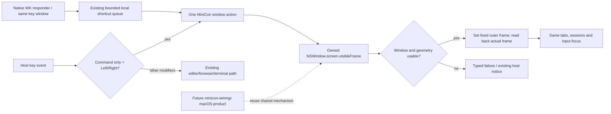

# Owned-window placement shortcuts

Parent: [workspace](PRD_02_25_con_workspace.md). Mechanisms: [reuse map](PRD_02_28_shared_core.md).
Status: `[-]` development integration after urgent owner request, 2026-10-25; selected for the current development version.

## Outcome tree DAG

```text
Outcome: move the focused MiniCon window to a predictable half of its current screen
├── [-] GEOMETRY — fixed left/right halves of the owning screen's usable frame
│   invariant: retain screen origin; exclude menu/Dock; use AppKit points exactly once
│   evidence: WS-01 negative origins/odd widths/invalid geometry and native frame readback
│   safe failure: invalid/no screen/fullscreen/nonresizable refuses; no guessed primary monitor
│   dependency: shared PixelWindow owned operation; non-goal: foreign-window management or AX permission
├── [-] INPUT — exact Command+Left/Right before local editor dispatch
│   invariant: press acts once; release is consumed; repeated presses are idempotent
│   evidence: WS-02 exact modifiers and unchanged text/session state
│   safe failure: report placement refusal through existing host notice, never terminate the session
│   dependency: GEOMETRY; non-goal: changing Command+Shift/Option/Control combinations
├── [-] PAGE — native WebView responder forwards the same window action
│   invariant: same-window/key-window/page-descendant filtering and bounded shortcut queue remain
│   evidence: WS-03 distinct physical arrow mappings and shared host action
│   safe failure: invalid focus/queue limits do not operate on another window
│   dependency: INPUT and existing native local monitor; non-goal: browser history or global hotkeys
└── [_] QUALIFY — separate mechanism, real adapter and physical-input evidence
    invariant: source/target/input provenance accompanies each claim
    evidence: WS-04 actual macOS native owned-window court and selected GUI/native journeys
    safe failure: unavailable native evidence is BLOCKED, not a passing Windows test
    dependency: preceding leaves; non-goal: migration of AgenTerm's full shortcut system
```

## Memory palace



## Behavior and boundary

Command+Left and Command+Right are window-level shortcuts inside MiniCon on
macOS, including Console, Settings and a focused native Web page. These exact
chords intentionally take precedence over editor line-start/line-end movement.
Additional Shift, Option or Control retains its existing meaning. Releases do
not reach text/PTY input. Repeating a shortcut selects the same half; it does not
cycle through thirds or move to another display.

Use the actual owned NSWindow's screen and its visible frame, in AppKit's own
coordinate system. Do not apply the Retina factor or mix Quartz top-left
coordinates into it. Placement concerns the outer window, leaving tabs, PTYs,
page state and editing drafts intact. No external-window AX path, Accessibility
prompt, system-wide shortcut registration or persistent window layout is added.

Fullscreen, a missing screen, invalid geometry, a nonresizable window or an
incompatible minimum/maximum size is a typed refusal before placement. If the
system clamps a requested frame, report the observed failure; do not claim that
no movement occurred after a native mutation. Future minicon-winmgr migration
is a separate product decision and must not create an AgenTerm product-state
or evidence dependency.

## Evidence frontier

Windows development evidence on the ca8861c source plus this uncommitted
shortcut overlay: `target-six/v0.2.23-window-half/initial-gates/receipt.json`
records fmt, default/native-auth-court all-target strict Clippy, two geometry
consumers and one exact-chord consumer passing. The initial test constructor
was corrected by source review before compilation; no compiler failure is
claimed as a counterexample. `pure-controls/receipt.json` in the same directory
records three actual original-assertion RED controls (right origin, invalid
geometry admission and Shift exclusion), each followed by exact restoration
and a passing original consumer. These are narrow WS-01/02 pure facts.

The macOS-only adapter and page monitor remain uncompiled/unrun locally;
WS-01 native readback, WS-02 public input/state, WS-03 native page focus and
WS-04 native qualification remain open. Windows compilation/pure tests cannot
qualify macOS native execution. The native owned-window example can establish actual
AppKit placement without AX/global input injection; it cannot establish physical
keyboard or WK responder ownership. Those scopes must be named separately.
