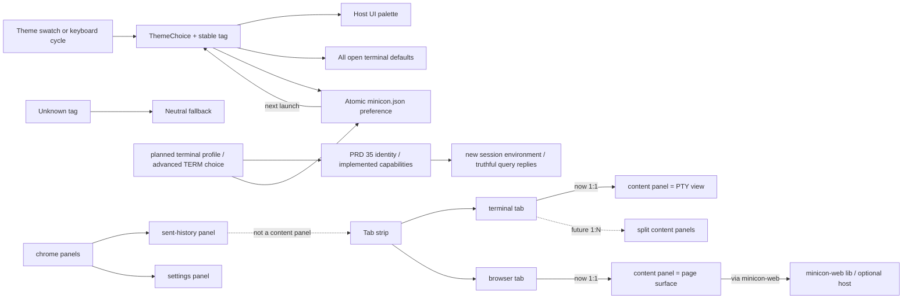
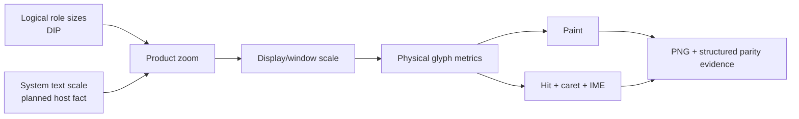

# `minicon` workspace and input

Parent: [MiniCon product requirements](../PRD.md)

This module owns the standalone host's tab tree, host UI, external composer
input, scrollbar and divider interaction, selection and clipboard behavior, and
focus ownership. Shared physical VT selection mechanism may remain upstream;
this module owns MiniCon's interaction meaning and evidence.

Legend: `[v]` shipped, `[-]` partial, `[_]` planned.

## Map

```text
minicon workspace and input
├── Terminology (Tab · Content/Workspace panel · Chrome panel · pane)
├── Tab and window naming (user name vs derived label vs OSC title)
├── Tab tree authority (stable ids, branch-local child order, close, remain-on-exit)
├── Tab kinds and content panels (1 tab ↔ 1 content panel now; 1:N later)
│   ├── terminal tab → one terminal content panel (PTY view)
│   └── [v] browser tab → one browser content panel (shell + URL handoff; page load via minicon-web)
├── Host UI (host chrome around the active tab's content panel(s))
│   ├── header tools: New · Settings · sidebar toggle · panel toggle
│   │     (panel toggle = chrome sent-history column — not a content panel)
│   ├── sent-history panel (chrome; 0.2.6) · settings panel (chrome)
│   ├── Updates section (0.2.7 check-for-updates; 0.2.8 correctness leaves)
│   └── composer + status bar
├── External composer input (exactly one focus owner)
├── Scrollbar and divider
├── Selection and clipboard
├── Configuration (minicon.json; themes; language; font size)
│   ├── [-] terminal capability profile / advanced TERM override for new sessions
│   │   invariant: choice survives reload; existing sessions retain their original contract
│   │   state 0.2.19: validated `term` config key overrides new-session TERM
│   │   (details in Configuration below); the qualified profile menu is not
│   │   offered and stays open pending capability evidence
│   │   evidence: config round-trip and validation tests (src/main.rs), seed
│   │   round trip (src/terminal.rs); actual child environment probe open
│   │   failure: reject invalid overrides before spawn; no silent unsupported capability promise
│   │   dependency: PRD 35 common contract; non-goal: selecting an OS backend by parser name
│   └── [-] Dark / 深色: winmgr warm charcoal palette; picker + cycle + saved id
│       invariant: one selection colors all tabs and survives reload
│       evidence: theme tests, settings hit tests, preference round trip
│       failure: unknown ids fall back to Neutral; existing default is unchanged
│       dependency: existing ThemeChoice/config/terminal propagation
│       non-goal: OS theme detection or changing explicit program colors
└── Native adoption gate
```



## Terminology (naming decision, 2026-10-23)

Commissioner re-nail and machine-room steer: the word **panel** had two live
meanings. This glossary is the explicit ruling. Do not silently rename shipped
chrome identifiers (`history_panel`, `panel_toggle`, `settings_panel`,
`paint_history_panel`, …) — qualify them as **chrome** when the bare word
would collide with a tab-internal layout cell.

| Term | Meaning | Not |
| --- | --- | --- |
| **Tab** | A work unit in the host strip: peer to a terminal tab or a browser tab. Stable id, open/close/switch/title lifecycle. | A layout cell inside a tab; a chrome sidebar |
| **Content panel** (alias **Workspace panel**) | A layout cell *inside* one tab. **Now:** exactly one per tab (1:1). **Future:** one tab may hold many (split / side-by-side). A terminal tab's content panel is its PTY view; a browser tab's is its page surface (`BrowserPanel` via `minicon_web`, re-exported from `src/browser.rs`). | Host chrome sidebars; the header "panel toggle" |
| **Chrome panel** | A host-chrome sidebar or overlay owned by the window, not by a tab's layout: the **sent-history panel**, the **settings panel**, and the header **panel toggle** that opens the history column. When older prose says bare "panel" for these, read it as chrome/host. Snapshot and code keys stay `history_panel` / `settings_panel` / `panel_toggle`. | A content panel inside a tab |
| **pane** (code / mux) | tmux-shaped address for a tab's terminal content area: `capture-pane`, `list-panes`, target `.pane`. **Today** pane 0 **is** that tab's single content panel (PTY view). A nonzero pane index is still a bounded error until a multi-content-panel layout engine exists. Not a synonym for chrome panel. | Chrome sent-history / settings |

Invariant: a chrome panel never becomes a content panel by renaming, and a
content panel never borrows the chrome `history_panel` / `settings_panel`
identifiers. Plan leaf:
[plan-browser-tabs.md](../plan/plan-browser-tabs.md). Mux pane mapping stays
owned by [PRD_02_31](PRD_02_31_v0_2_horizon.md); this module owns the product
names above.

## Tab kinds and content panels

- [v] a **tab** is the work unit. Terminal tabs and browser tabs share one
  strip and the same open / close / switch / title lifecycle
  (`workspace::TabKind::{Terminal, Browser}`). There is **no** system tray
  entry for show/hide/quit or for opening a browser surface.
- [v] **now (default model): 1 tab ↔ 1 content panel.** A terminal tab hosts
  exactly one terminal content panel (its PTY view). A browser tab hosts
  exactly one browser content panel (`BrowserTab` / `BrowserPanel`). Evidence:
  `workspace` kind tests; `browser::tests::a_browser_tab_hosts_exactly_one_panel`;
  Ctrl+Shift+O / `list-tabs` `kind=browser` on tip `89c404f`.
- [_] **future: 1 tab → many content panels** (split / side-by-side inside one
  tab). The layout engine is a later leaf (`Bx` in the browser-tabs plan), not
  a second windowing model and not a chrome-panel change. Until it ships,
  mux/control still refuse nonzero pane indices
  ([PRD_02_31](PRD_02_31_v0_2_horizon.md)).
- [v] **browser content panel — shell and URL handoff.** The tab shell paints
  a peer of a terminal tab and stores an http(s) URL for a later page
  surface. Ctrl+click on an http(s) token in the terminal opens or focuses
  that one browser content panel and does not call `host_open` / the OS
  default browser. Evidence: `minicon-web` `http_links_are_browser_urls_and_other_schemes_are_not_opened`;
  `tests::http_handoff_reuses_one_browser_content_panel`. The same panel
  then asks `MINICON_BROWSER_BIN --load <url>` (`minicon_web::spawn_page_host_with_proxy`)
  to navigate, with the resolved proxy hook installed on that process. Owner is **`crates/minicon-web`**; core `minicon` does not link
  wry. A missing host is `PageLoad::Unavailable`
  (`browser-host-not-configured`), not `host_open`. Evidence:
  `page_host_request_is_the_helper_not_the_system_browser`,
  `spawn_page_host_passes_the_url_to_the_helper`.
  Feature `wry-host` does navigate, inside `minicon-web-host` only. The host
  reparents into the main window on X11, follows the current content-column
  bounds and unmaps while a terminal tab is active. Run `39925651159` proves
  the native X resize and real WebKit proxy/loopback path on both Linux ISAs.
  Dashboard, preview, wasm and 1:N layout remain follow-ups
  in [plan-browser-tabs.md](../plan/plan-browser-tabs.md). Renderer boundary stays in
  [PRD_02_31](PRD_02_31_v0_2_horizon.md).
- [v] **one browser root, and the embed slot is the content column (0.2.21).**
  `add_browser_root` inserts one browser root; a second call returns `None`
  and leaves the strip and the selection unchanged. `Layout::content_column`
  is the rectangle under the tab header, above the composer, inset by the
  sidebar and the history chrome. Evidence:
  `a_browser_tab_is_a_root_peer_of_a_terminal_tab`,
  `content_column_is_the_terminal_rectangle` (macOS arm64) and the nonzero
  `minicon-web-x11` suite on both Linux ISAs in run `39925651159`. Window,
  sidebar and history geometry changes plus tab activation all call the same
  resize seam. Owner: [plan-v0.2.21](../plan/plan-v0.2.21.md) `{PANEL}` /
  `{RESIZE}`.
- [v] **`minicon-web` module (adopted 2026-10-23).** Browser content-panel
  API. Product face remains **Tab / content panel** (now 1:1, future 1:N);
  **no tray**. Chrome panels stay chrome. Path: `crates/minicon-web/` (lib +
  `minicon-web-host`); `src/browser.rs` re-exports. wry, tao and gtk are
  linked only when the host is built with `wry-host`. Core `minicon` does
  not enable that feature.
- [v] **OAuth bearer storage stays behind the platform filesystem seam.**
  The product names the `.minicon-embed/deepseek-bearer` state, while
  `minicon-platform::filesystem` owns protected-directory setup, atomic
  private publication, link-like path refusal and bounded private reads.
  Unix local evidence proves mode `0600` and refusal to write through a
  symlink. Run `39919403513` proves the Windows adapter's protected
  current-user ACL on x86_64 and arm64; run `39925651159` separately proves
  the live WebKit proxy/direct-loopback navigation on both Linux ISAs.
- [v] **chrome panels stay chrome.** The right-side **sent-history panel**,
  the **settings panel**, and the header **panel toggle** / `Ctrl+Shift+H`
  continue to mean host chrome (see Host UI below). Their evidence strings and
  snapshot keys are unchanged; only the glossary above disambiguates them from
  content panels.

## Tab and window naming

- [v] a tab is named by what distinguishes it, not by what it runs. `cmd.exe`
  reports its own full path as its window title, so taking a child's title
  literally made every tab in the tree read the shell's own full path: long,
  truncated in a narrow column, and identical across every tab, which
  defeats the tab tree this product is built around.
- [v] a title that only repeats the program is treated as absent. It tells the
  user nothing they did not already know from opening it, so the short program
  name is used instead: `cmd`. A title the child genuinely sets — `title
  deploy`, or any shell's prompt escape — is information and wins.
- [v] the window title is `<title> — MiniCon <version>`. Context first,
  product last: a title is read left to right and the part that changes belongs
  in front. The package version from `CARGO_PKG_VERSION` sits with the product
  name so a taskbar or window list answers which MiniCon is running. With zero
  tabs the native title is `MiniCon <version>` alone.
- [v] it carries no tab id. That is a machine identifier and it is already in
  the tab column and in `list-tabs`; a taskbar entry is read by a person.
- [v] it carries no font name either. The resolved face was in the window
  title as a development diagnostic, in the native window title a user always
  sees; `--status` reports it now, which is where someone diagnosing a font
  actually looks.
- [v] one function builds it. The OSC path and the activation path formatted it
  independently and drifted, so the same window read differently depending on
  which had written it last.
- [v] a user can name a tab themselves, and that name wins. Each tree row
  carries a pencil affordance that opens an inline editor over the row's own
  label (shipped in v0.2.5); the edit reuses the composer's bounded editor, so
  a rename has the same caret, selection and 64 KiB ceiling as a draft rather
  than a second text widget. A custom name overrides the derived one; clearing
  it returns the row to what the session reports, so the fallback is reachable
  rather than one-way. **A tab is created without a name and named afterwards**
  — `new-tab` takes no name argument on purpose, which is why
  [31](PRD_02_31_v0_2_horizon.md)'s `mux new-window -n` is refused instead of
  accepted-and-dropped: the tree's naming authority is this row editor, not the
  creation call, and a verb that named a tab at birth would be a second owner
  of the same fact.
  Owner note: this behaviour has no other statement in the PRD series — it was
  shipped in v0.2.5 without a requirement line here, and this entry is its
  registration, written 2026-10-13 from the source of record
  (`crates/minicon-core` workspace `custom_title`, `src/host_paint.rs`'s row
  painting).
- [v] the rename editor renders what is typed, not just what is stored. The
  0.2.10 damage model let the pencil's key and IME dispatch arms return without
  marking the sidebar damaged, so the editor advanced invisibly while every
  redraw re-presented the last frame. A black-box journey clicks the pencil
  through the real event pipeline (`send-ui-mouse` at the host's own pencil
  geometry), types with `send-ui-keys`, commits with Enter, and requires the
  sidebar's pixels to change — because the state moving without the frame
  moving is exactly the shape of the report. (v0.2.12; the journey is
  `the_rename_editor_renders_typed_text_and_the_caret`.)

## Tab tree authority

- [v] `Workspace` is the sole authority for tree order, parentage and stable tab
  identity. Closing a parent promotes its direct children instead of terminating
  them; a parent cycle is rejected.
- [v] `Ctrl+Shift+N` creates a child of the currently active root or child and
  places its row at the end of that parent's branch, before the next sibling or
  root branch. Existing children retain their order. Evidence:
  `workspace::tests::new_children_stay_inside_their_active_parents_branch` and
  `child_shortcut_inserts_beneath_the_active_root_or_child` through the real GUI
  control endpoint. With no active tab, the shortcut creates a root; a full tree
  keeps its existing capacity refusal. This does not change the root-creation
  shortcut or session lifetime.
- [v] local creation is capped at 256 live tabs. Capacity or stable-id
  exhaustion rejects the new tab before mutating tree order, parentage or active
  selection, and the release-build session store rejects duplicate ids rather
  than silently splitting tree and PTY ownership.
- [v] session ownership is a product-specific compact store rather than a
  general-purpose ordered map: it performs linear id routing over the small
  interactive tab set and may swap entries on removal because its physical order
  is unobservable.
- [v] tree depth is a `Workspace`-owned derived cache aligned with node order.
  Root creation appends its known depth in O(1); child creation scans to the end
  of its parent's bounded branch and inserts the known depth alongside its row.
  Close and direct child promotion rebuild through the shared UI-core typed
  algorithm, which remains the sole authority for missing parents, duplicate
  ids, cycles and complete topology resolution. Host UI paint borrows the depth slice
  instead of sorting, allocating and resolving every parent chain per frame.
- [v] geometry, iterative typed tree-depth resolution, tree viewport bounds and
  hit results are pure deterministic contracts covered independently of
  Win32/PTY state. An out-of-range hit or scroll safely becomes background or a
  bounded no-op, and a hit beyond the last row clamps rather than selecting or
  closing an unrelated terminal.
- [v] host UI geometry treats NaN pointer/sidebar values as the minimum safe
  bound and saturates extreme DPI padding and row-coordinate arithmetic.
  Untrusted/extreme dimensions cannot wrap a close target onto another row,
  overflow layout construction, or collapse the sidebar through an unordered
  floating-point comparison.
- [v] the header keeps only tools that cannot live in the settings panel — New
  (left) and Settings (right), joined later by the rail toggle at the column
  edge — so the row no longer overflows a narrow sidebar; help, language, font
  size and theme all moved into the settings panel. `ui.rs`'s
  `the_header_tools_are_ordered_and_disjoint` and
  `the_header_row_fits_and_the_frame_stays_partitioned` pin the layout across
  widths and DPI scales.
- [v] the tab sidebar collapses to a 44dip rail and expands again, from
  `Ctrl+Shift+B` or a third header control placed at the column edge — which is
  why the header row above is now three controls in the expanded state and a
  vertical stack in the rail. Collapsed is a narrower sidebar, not a hidden one:
  each row keeps the stable `@ID` the control CLI uses, hover floats the full
  title, and depth, branch lines and per-row close are dropped rather than drawn
  half-legibly. The terminal is re-inset to the rail width, so the column is
  handed over instead of left blank, and expanding restores viewport origin,
  width and column count exactly. The collapsed layout joins `LAYOUT_SWEEP`, so
  both states are checked at all ten size/scale combinations rather than one
  state having no geometry to check. Unreleased on `main` as of v0.1.19.
- [v] accessibility bounds use the same non-wrapping geometry policy: positive
  native coordinates and dimensions above `i32::MAX` saturate instead of
  collapsing to zero and making published controls disappear.
- [v] terminal selection endpoints are normalized once per raster pass rather
  than once per visible cell, and wide-cell/decoration geometry saturates at
  native numeric limits so malformed resize state cannot panic painting.
- [v] shared iterative tree-depth resolution sorts `(id,index)` pairs and uses
  binary lookup, preserving typed duplicate/missing/cycle failures and the
  20,000-node non-recursive test without randomized hashing. Its index replaces
  generic `slice::sort_unstable` with a shared no-allocation iterative heapsort
  that stays deterministic O(n log n) and preserves second-input duplicate
  diagnostics.
- [v] closing the final tab leaves the native window and control endpoint alive
  with a valid zero-tab workspace. The terminal/composer disappear in favor of
  a translated greeting, primary New Terminal action and `Ctrl+Shift+T` hint;
  `list-tabs` reports an empty array and `ui-snapshot.active` is null. Creating
  the next tab inherits the last session's working directory, command and font
  geometry. Only explicit window close / quit exits the application.

## Host UI

Host UI is MiniCon-drawn **chrome** around the active tab's content panel(s):
the tab tree, the header tools, and the composer. It is not the tab-internal
layout engine, and a browser tab's page surface is a **content panel**, not
Host UI. `Layout` is only the geometry of the chrome regions (and today the
single content-panel inset). See **Terminology** above: bare "panel" in this
section means a **chrome panel** unless it says content/workspace panel.

- [v] the host UI owns a vertically scrollable left tree with three row-level
  buttons on the active or hovered row — edit (rename), new child and close,
  left to right, tested in that order so an inner click never reads as the
  destructive close; the new-child button is Ctrl+Shift+N scoped to the
  clicked row (owner request 2026-10-22, evidence
  `a_collapsed_rail_never_closes_a_tab_by_a_row_click` ordering asserts in
  src/ui.rs) — and a header of four tools: New, Settings, and the pair of
  chrome toggles for the left sidebar and the right chrome panel (sent-history). A distinct bottom
  composer owns input, Send and Newline, and a bottom status bar shows a
  fixed-width `L###:C###` readout that follows the grid crosshair (the hovered
  cell) and falls back to the text cursor. Two decisions here each have one
  owner since the 2026-10-21 seam consolidation: the terminal's side insets
  (collapse-aware sidebar + history panel widths) come from
  `terminal_inset_widths` at every `configure_host_ui` call site — switching
  tabs with a collapsed sidebar used to inset by the expanded width — and the
  post-close tree-scroll clamp lives inside `close_active_session`, so
  keyboard, pointer and control closes all leave the tree without blank tail
  rows. The composer's "SEND TO @N" band and the history rows read the same
  `active_destination_label` (custom rename or program stem, not the shell's
  changing OSC title).
- [v] a tab whose shell has exited stays in the tree (remain-on-exit) and is
  visibly inert: its label dims, and the change repaints the tab column
  immediately rather than waiting for unrelated host-UI damage. A pixel
  journey screenshots the window before and after the shell exits and asserts
  the tab column changed while the window kept its size.
- [v] the tree header does not repeat the `MiniCon` product label already owned
  by the native window title. It spends that scarce row on four tools — New
  (left), then Settings and the two chrome toggles (right) — with 24-DIP hit
  targets and no permanent button borders. High-contrast, minimal marks float on
  the shared toolbar; the open Settings button uses a quiet selected fill.
- [v] the window carries the product's own icon on Windows and X11. Windows
  reads it from the PE resource `build.rs` embeds with `winresource` and sets
  it on the window class (plus `WM_SETICON` for the taskbar); X11 cannot read a
  PE resource, so `build.rs` decodes the same committed `assets/minicon.ico`
  into RGBA once and the product hands those pixels to winit. No platform ships
  a second icon or a PNG decoder in the binary. A window class registered with
  a null `hIcon` — the pre-0.2.7 state — shows the generic system default, not
  the executable's icon, so the caption and the taskbar were wrong together.
- [-] macOS shows the product icon for the shipped `.app` (the `.dmg` carries
  `CFBundleIconFile` and the packaging court proves it before sealing), but the
  **bare signed binary** the macOS `.tar.gz` ships for command-line use still
  shows the generic blank-document tile in the Dock. Setting it needs
  `NSApplication.setApplicationIconImage:`, whose only constructors
  (`NSImage::alloc` / `NSBitmapImageRep::alloc`) require `objc2::ClassType` in
  scope — i.e. `objc2` as a direct dependency of the platform crate's unix
  feature, which today is enabled only by `privilege-service-lifecycle`.
  Turning `objc2` on for the unix pixel-window feature would drag it into Linux
  builds, so it is a manifest-and-size decision for its own change, not a
  rider on this one. Recorded as a named gap, not a claim.
- [v] a collapsible right-side **sent-history panel** (chrome panel; 0.2.6) lists the newest
  lines the composer has sent and refills the composer when a row is clicked.
  The list is a view over the composer's one sent-history store — a row and an
  Up/Down recall at the same offset are the same line — and a click uses that
  same recall contract (keeps a half-typed draft). It toggles from the header's
  chrome panel control or `Ctrl+Shift+H`; both toggles read left-to-right as the
  columns they control. The chrome panel takes a real column and the terminal is
  re-inset, never overlaid; a blank area below the list is reserved for future
  `{LOOP}`/goal controls. `ui-snapshot` publishes `history_panel` and the
  `panel_toggle` rect.
- [v] the reserved area below the sent-history list became the **notes
  scratchpad** (#5, 0.2.13) — the section the reservation was held for. A
  click in the area focuses a second editable field: multiline (Enter is a
  soft newline), clipboard-complete, IME-composed, with the caret rule and
  preedit painted while focused. While focused it — not the composer, not
  the terminal — owns keyboard/IME through the same single `ConApp::event`
  routing authority the rename editor rides; Escape defocuses and saves,
  and any click elsewhere defocuses-and-saves on its way to the click's
  real target. PTY isolation is structural: the buffer's only exits are the
  clipboard and `minicon.json` — nothing a note contains can reach a shell.
  Persistence rides the config document (a `notes` key, atomic write,
  seeded once at startup with the caret at the end; the key is absent until
  first save so an untouched config stays byte-identical). `ui-snapshot`
  publishes `notes_focused`, `notes_text`, and the `geometry.notes_area`
  rect. The shipped scope is Global-only: there is no `This tab / Global`
  switch or per-tab note storage, so the full per-context scope of GitHub #5
  remains open. Deliberately not in 0.2.13: feeding a note into an agent harness
  (`{NOTES-FEEDBACK}`) — deferred with this note because the harness
  context plan's `{CTX}` leaf it would ride is still open; it returns as an
  explicit Send-only affordance when that design lands.
- [v] the sent-history chrome panel's two follow-ups landed in 0.2.9. A row now carries
  the **destination** it was sent to: the composer records the tab's tree label
  with each line (`ComposerState::remember(entry, destination)`), so the row says
  which tab a command came from even after that tab is gone; the label is painted
  right-aligned in muted ink so a row reads as a command first. And the list
  **scrolls past its capacity**: the wheel over the panel moves an offset that
  counts back from the newest entry, clamped at both ends, and a click resolves
  against the same clamped window the paint used — `ui-snapshot` publishes the
  effective offset as `history_panel.scroll`. The notes scratchpad shipped
  later in 0.2.13; GitHub #5 still tracks its unimplemented per-tab context.
- [v] the settings icon opens a lightweight in-app **settings panel** (chrome), anchored under the
  header on the sidebar rather than a centered modal. It carries four sections:
  interface language (English / 简 / 繁, the active one filled with the accent),
  font size (−/100%/+), a theme picker of four swatches (Neutral / Docs Ink /
  Paper Ink / Dark, each showing its own canvas and accent, the active one outlined),
  and the keyboard shortcuts (the former help text). Escape or a click outside
  closes it; the panel is available with zero tabs. Escape-dismiss is decided
  once, by the modifier-aware handler: a bare Escape closes the panel while
  Ctrl+Esc / Alt+Esc do not. A second, modifier-blind copy of this decision
  used to run first and shadow the exemption; the 2026-10-21 seam
  consolidation removed it (src/main.rs, single handler).
- [v] the settings panel carries an **Updates** section (0.2.7): the running
  version, and three controls whose availability is the update phase — Check,
  Update, Restart. The phase is product state, not panel-local, so it survives
  the panel being closed and re-entered. Nothing blocking runs on the paint
  thread: one worker owns the HTTP exchange, the download and the staging, and
  wakes the event loop through the same slot the control endpoint uses.
  `ui-snapshot` publishes `update` — a stable phase tag, the two versions, the
  failure text and whether macOS handed off. The check is manual and per-press
  and never runs on its own: `prd/PRD_02_23_minicon.md`, "Explicit non-goals".
- [v] the update download is verified before anything is staged. The archive is
  checked against its published SHA-256 sidecar, and the executable is pulled
  out by name with a small in-product reader for the two shapes the release
  ships (a deflated `.zip` entry and a gzipped tar member), so no general
  archive crate enters the graph. Decoding is bounded on its **output** as well
  as its input, and staging gives the new file the destination's own executable
  mode before the rename, so the file that lands is one the host can run. The
  swap is rename-aside then place-new, keeping the replaced executable beside
  the new one and — since 0.2.8 — genuinely putting it back when the place
  fails; the restart is a separate, explicit press because it drops every
  terminal and ends the `--control` endpoint. **Saying so is owed, not
  optional:** that press is currently the first moment a user learns what it
  costs, and the tab count is already known to the host. Leaf `{RESTART}`
  (now "Deferred to 0.2.9" in
  [`plan/archive/plan-v0.2.8.md`](../plan/archive/plan-v0.2.8.md)) owns naming the loss before
  the button; its non-goal is preserving the sessions, because MiniCon has no
  persistent workspace and is not getting one. macOS never swaps in place — one
  file inside a signed, notarized `.app` cannot be replaced without breaking
  the signature — so its Update control opens the release's own `.dmg`.
- [v] **the Restart press now states what it costs (0.2.9).** The Updates section
  paints one line under its status line while a Restart is actually available,
  naming the host's real tab count and saying that the running commands in those
  tabs stop. It is one owner for both readers, like the status line above it:
  `UiLanguage::restart_cost(tabs)` renders it and `ui-snapshot` publishes the
  same string as `update.restart_cost`, in the panel's language. Three arms
  rather than a template, because zero tabs is a sentence a person reads as a bug
  ("closes 0 tabs"), one tab is the case they actually meet, and N is the general
  form — all three differ, in all three languages. Non-goal, unchanged: making
  Restart preserve sessions, a grace period, or a "save your work" dialog. See
  [`plan/archive/plan-v0.2.9.md`](../plan/archive/plan-v0.2.9.md) leaf `{RESTART}`.
- [v] the update check names its **TLS provider** explicitly (0.2.7). `ureq`
  chooses its provider at *runtime* and defaults to Rustls ("the highest chance
  of being enabled"), while this crate enables exactly one per host (Unix
  `rustls`, Windows `native-tls`). Left at the default, the first `https://`
  request panicked inside `ureq`'s transport on Windows — the update check is
  this product's first `https` caller, so it shipped broken until
  `network_http` pinned the provider to the feature the build actually enables.
  The manifest's target-specific tree and the runtime can no longer disagree.
  **Found only by the opt-in real-GitHub smoke:** every default test speaks
  `http://` to a loopback server and never enters the TLS layer, so no offline
  gate on any host can see this class of defect.
- [-] the update flow verifies the release's checksum but not yet the **code
  signature** of the new binary. The in-tree inspectors
  (`adapters/{windows,macos}/app_facts.rs`: `WinVerifyTrust` /
  `SecStaticCodeCheckValidity`) sit behind the `app-facts` feature, whose app
  inventory the product does not otherwise carry, and enabling it for one
  boolean is a size decision not yet taken. Recorded as a named gap rather than
  a claim: the checksum proves the bytes are the ones the release published,
  and the publisher's Authenticode/notarization stamps the artifact as before.
  **Why the gap matters more than it reads:** the sidecar and the archive come
  from the same release, so a checksum can only ever answer "are these the
  bytes that release published". For an ordinary download that is the usual
  guarantee; for a product that replaces **its own executable** it is the
  weaker half, because the thing doing the verifying is the thing being
  replaced. Carried as leaf `{SIGV}`, now **deferred to 0.2.9** (the "Deferred to
  0.2.9" table in [`plan/archive/plan-v0.2.8.md`](../plan/archive/plan-v0.2.8.md)) because the
  fix must not wait behind a size decision; the open question there is
  **size, not mechanism** (enable `app-facts`, or expose one verify-only entry
  point behind `network-http`), and it belongs to
  [27](PRD_02_27_con_delivery.md)'s budget, not to whoever writes the code.
- [v] four defects the shipped 0.2.7 update path was found to carry, filed by an
  independent security review, confirmed line-by-line (2026-10-13) and **fixed
  in 0.2.8** (2026-10-14). All four were in code that is **already public**, so
  they could not be patched into 0.2.7; each was a leaf in
  [`plan/archive/plan-v0.2.8.md`](../plan/archive/plan-v0.2.8.md) and is the reason that version
  led with correctness rather than features. Each is marked with the test that
  holds it, since the defect in this area is always "the local gate never
  reached the line".
  - `{EXECBIT}` — a Unix in-place update installed a **non-executable** binary:
    staging set no file mode and the tar reader discarded the header's mode
    field, so `spawn` failed EACCES. Linux-only (it is the only `in_place` host
    whose archive is a `.tar.gz`; the `.zip` path is Windows-only). **Fixed by
    copying the destination's own mode onto the staged file**
    (`update::apply_staged_mode`, `cfg(unix)`, falling back to `0o755`), which
    cannot install a non-runnable file because the destination is by definition
    runnable — and it preserves whatever mode the user had, rather than
    inventing one. Evidence: `the_staged_executable_carries_the_destinations_mode`.
  - `{ROLLBACK}` — the failed-launch rollback deleted the last good copy:
    `main.rs` re-entered `commit_swap`, which recomputed and
    `remove_if_present`ed the same `.backup` path, emptying the destination.
    `{EXECBIT}` is what made this reachable in normal Linux use. **Fixed:** the
    rollback is now `update::rollback_swap`, a single rename that cannot
    re-enter the swap, and a rollback that itself fails is reported as
    `FailureKind::LaunchUnrestored` instead of being swallowed — so the one
    state where the destination is *not* launchable is the one state that
    says so. Evidence:
    `a_failed_launch_puts_the_previous_executable_back_on_disk` (asserts the
    final on-disk bytes, not that the call returned),
    `a_rollback_with_no_backup_reports_itself`.
  - `{BOMB}` — the archive decode was unbounded on its **output**: the download
    ceiling bounded the compressed input only, and the zip path pre-allocated
    the declared uncompressed size, so a crafted or tampered release aborted the
    process by exhausting memory instead of refusing it. **Fixed:** every
    reader takes a `decoded_limit` (`ARCHIVE_DECODED_LIMIT`, derived from
    `ARCHIVE_BODY_LIMIT` so there is one number and not two that can drift) and
    refuses past it with the typed `ArchiveError::TooLarge`, checked *before*
    any allocation and with the inflate loop `take`-bounded. Evidence:
    `an_archive_that_expands_past_the_ceiling_is_a_typed_refusal`.
  - `{SCHEME}` — `validate_url` admitted `http://`, and the download URL was
    taken verbatim from the release document, so a plaintext downgrade was not
    refused. **Fixed:** `update::require_secure_url` refuses any scheme but
    `https` before a request is constructed, with loopback hosts as the single
    exemption the offline test harness needs. Evidence:
    `a_plaintext_release_url_is_refused_by_the_scheme_check`,
    `a_loopback_http_url_is_the_one_exemption`.
  The review found the verification order and every network bound sound, and no
  path traversal, panic or integer overflow in the reader (the extraction path
  comes from `current_exe`, never from the entry name); that is recorded so it is
  not re-litigated.
- [v] when an update fails, the panel says what happened, **whether the install
  is still launchable**, and what to do next — in the panel's own language
  (0.2.8). `Phase::Failed` used to carry a developer `String` that was painted
  raw, in English, into a three-language UI: a bare errno was the entire
  explanation, and it was silent about the only thing that matters after a
  failed swap. Failure is now a typed `Failure { kind, cause }` over a
  `FailureKind` that states its own `InstallState` (`Untouched` / `Restored` /
  `Unknown`), and `UiLanguage::update_failure_sentence` renders it as three
  answers in the active language, naming the backup file on the paths where one
  exists; `Unknown` says the install may need reinstalling and names the
  Releases page. `ui-snapshot` publishes the raw `failure` token alongside the
  rendered `status`. Evidence:
  `a_failure_sentence_answers_all_three_questions_in_the_panels_language`,
  `every_failure_kind_states_whether_the_install_still_runs`,
  `failure_tokens_are_unique`, `the_status_line_covers_every_phase_including_a_failure`.
  Non-goals: multi-line error UI, an on-disk error log, telemetry, and
  translating the internal cause (the cause stays English data; only the
  sentence the user reads is localised).
- [v] interface language is chosen from the panel (English / Simplified /
  Traditional). Only host UI is translated; each option is written in the
  language it selects, and the active one is drawn in the accent colour, so the
  control reports state as well as offering a change.
- [-] font size is adjusted from the panel (−/100%/+) and the same zoom source
  sizes terminal content and every host UI label — tabs, header, composer,
  status bar. **Corrected 2026-10-13:** `Ctrl+wheel` is **not** a zoom entry
  point any more — the wheel handler has no Ctrl exemption and a Ctrl modifier
  no longer steals the sidebar's own scrolling — so the panel's three controls
  are the only zoom surface. The `z` / `0` / `Z` bindings this line used to
  ask for were also never wired: `Ctrl+Z` in the composer is undo
  (`minicon_core::keymap`), and no zoom chord is bound. What remains open is
  the original tracking point and nothing else: prove the default non-content
  type roles are large enough to read, from direct macOS use — the legibility
  question, not a new binding.
- [_] larger host UI text must not make the toolbars wasteful. Reduce internal
  button padding, sibling gaps, and outer header/composer margins to the minimum
  that preserves disjoint hit targets and glyph bounds. Success is paired PNG +
  structured geometry on macOS first, then Win/Lnx parity: larger legible text,
  no clipping/overlap, and no increase in total header/composer height unless
  the old height cannot contain the larger glyph bounds. Merely enlarging the
  terminal cell font, or enlarging empty padding with the label, fails.
- [v] the theme picker switches four themes at runtime — Neutral
  Ink (the historical monochrome default), Docs Ink (the website's blue palette),
  Paper Ink (light), and Dark / 深色 (winmgr's warm charcoal and amber palette) — from the panel swatches or `Ctrl+Shift+P`. The chosen
  theme is reported by `ui-snapshot` as `ui_theme`.
  Dark implementation evidence (Windows x86_64, 2026-10-18; not a release):
  `theme::tests` (five tests, including a contrast mutation red→green),
  `settings_panel` (two layout/hit tests), and
  `a_saved_choice_is_read_back_by_id_with_the_other_keys_intact` (Dark round trip).
  The native public-CLI smoke cycled/persisted all four choices, clicked the
  fourth swatch, reloaded `dark` in a new process, and checked the actual PNG's
  warm color tokens; receipts/screenshots are in local ignored
  `target/dark-theme-validation/`. Original user preferences were restored.
  These receipts do not claim the other five platform/ISA cells.
- [v] each theme also carries a terminal color scheme (the conventional model:
  default background/foreground, cursor, and the 16 ANSI colors — Windows
  Terminal / Alacritty / iTerm2 all define exactly these), so the terminal body
  recolors with the chrome: Neutral keeps the classic black console, Docs Ink a
  deep-navy console, Paper Ink a light console with a legibility-tuned ANSI set.
  Dark uses the warm canvas/text/cursor and the existing dark ANSI palette.
  Its stable configuration and snapshot id is `dark`; the default stays Neutral.
  Indices 16..256 (the 6x6x6 cube and grayscale ramp) stay standard, and a
  program's own explicit color requests are never overridden — the theme sets
  the terminal's *defaults and named colors*, not what an app paints. Colors are
  stored per `ConTerminal` and re-applied to every open tab on a theme change.
- [v] a grid crosshair snaps to the hovered terminal cell: a translucent
  row/column band (3.5%) plus 1px lines (28%) drawn over the content without
  erasing it, and the same 1-based cell written to the status bar. It redraws
  only when the hovered cell changes, and toggles with `Ctrl+Shift+G`.
- [v] **only host UI is translated.** Everything a child process prints is
  passed through untouched, and that line does not move: a terminal that
  rewrote program output would be lying about what ran. Host UI strings live in
  a struct rather than a keyed lookup, so a missing translation is a compile
  error and not a blank label found by a user.
- [v] the language is reported by `ui-snapshot` as a stable tag, so automation
  can read and assert it without matching a display label.
- [-] **cross-platform sizing follows a logical-unit contract, not shared raw
  pixels.** Layout, hit targets, and nominal type roles are expressed in DIPs;
  the host window supplies a possibly fractional display scale, and raster
  glyphs are produced at `logical size × product zoom × display scale`.
  macOS points/backing pixels, Windows DIPs/per-monitor DPI, and Linux widget
  units/surface scale are platform spellings of this same boundary. The Retina
  defect where terminal glyphs used backing scale but host UI glyphs did not is
  a regression class, not a platform-specific tuning preference.
- [v] current host UI and composer painting, caret measurement, IME placement,
  and pointer-to-text mapping consume the same scaled glyph metrics. A clamp is
  expressed in logical units and scaled afterward, so a 2× display does not
  silently halve the perceived maximum.
- [_] separate **display scale** from **system accessibility text scale** in
  the public window metrics, following Chromium's distinct device/UI/text
  scale model. Until every host adapter can report text scale truthfully,
  MiniCon product zoom remains the explicit user override; no adapter may
  invent a constant and call accessibility honored.
- [_] qualify the same host UI roles at display scales 1.0, 1.25, 1.5, 2.0 and
  product zoom minimum/default/maximum on Win/OSX/Lnx. Evidence pairs a PNG
  with structured geometry and asserts readable glyph bounds, no clipping,
  matching caret/hit coordinates, and relayout after a cross-monitor scale
  change. System UI fonts are preferred for future host UI only when all three
  hosts can preserve these metric and screenshot contracts; terminal content
  remains monospace.



Reference models: Chromium keeps display bounds in DIP alongside physical
pixel size and distinguishes window, raster, UI, and text scales; Apple treats
backing scale as a conversion between window points and backing pixels;
Microsoft defines UI layout in density-independent effective pixels and
requires per-monitor DPI relayout/reraster; GTK similarly separates widget
units from a possibly fractional surface scale. GNOME additionally recommends
relative/system text styles rather than hard-coded physical font sizes. These
are comparison contracts, not dependencies:

- <https://chromium.googlesource.com/chromium/src/+/HEAD/ui/display/display.h>
- <https://chromium.googlesource.com/chromium/src/+/refs/tags/135.0.7040.0/ui/platform_window/platform_window_delegate.h>
- <https://developer.apple.com/documentation/appkit/nswindow/backingscalefactor>
- <https://learn.microsoft.com/windows/apps/design/layout/screen-sizes-and-breakpoints-for-responsive-design>
- <https://learn.microsoft.com/windows/win32/hidpi/setting-the-default-dpi-awareness-for-a-process>
- <https://docs.gtk.org/gtk4/coordinates.html>
- <https://developer.gnome.org/hig/guidelines/typography.html>
- [v] Linux `minicon` publishes that host UI as a real AT-SPI child tree
  (`Tabs`, `Session`, `Command`, `SEND`, plus Session child `OffscreenField`)
  so `cu tree --window` is not the one-node X11 title frame. winit/softbuffer
  has no atk-bridge; the process registers itself. Inner
  `cu focus`/`click --name Command` (or `SEND`) uses
  `addressing=accessibility-tree`. Windows/macOS publishers are not claimed.
  The `lnx-x86_64` con CI cell owns a real Xvfb + session-D-Bus journey that
  discovers the named children through AT-SPI, writes `Command`, activates
  `SEND`, proves terminal output through the public con CLI, and reaps the host.
  Run `31692109556` at `007f36498502747a645e9ca5d44ddcd32870a314`
  supplies that native runtime evidence.
- [v] Linux publish implements AT-SPI `Component.ScrollTo(TopEdge)` on the
  named inner `OffscreenField` (and on `Session` as the scrollable pane that
  moves that child). Independent `Component.GetExtents(Screen)`
  (`cu get-extents --name OffscreenField`) is the proof (`|Δy|>=20`,
  `via=scroll-to`). Layout snapshots keep the unscrolled bounds; the
  publisher applies a persistent y offset. Never Action `scroll*`, XTest
  wheel, `--coords`, or screenshot.
- [v] Linux publish implements AT-SPI `Text.SetSelection` /
  `GetNSelections` / `GetSelection` on the named composer `Command`
  field. Independent `cu get-selection --name Command` after
  `cu select --name Command --start N --end M` reports that range
  (`n=1`). Tree snapshots keep replacing node text; the publisher
  stores the range separately. Never XTest, mouse-drag, `--coords`,
  or screenshot. The `select` reply is not proof.
- [v] Linux publish implements AT-SPI `Text.SetCaretOffset` /
  `CaretOffset` (`GetCaretOffset`) on the named composer `Command`
  field. Independent `cu get-caret --name Command` after
  `cu set-caret --name Command --offset N` reports that offset.
  Tree snapshots keep replacing node text; the publisher stores the
  caret separately. Never XTest, `--coords`, or screenshot. The
  `set-caret` reply is not proof.
- [v] AT-SPI actions cross into the GUI through a 64-entry FIFO and a 32-action
  per-turn drain budget, with a 64 KiB per-action and 256 KiB aggregate payload
  ceiling. Saturation drops only new actions, records a monotonic counter,
  coalesces producer wakes on the empty-to-nonempty transition, and self-wakes
  while backlog remains; `ui-snapshot` exposes pending item/byte and dropped
  counts so an accessibility flood cannot hide unbounded GUI work.
- [v] publisher actions commit their AT-SPI text/focus mirror only after the
  product queue accepts ownership. Queue saturation returns `false` to the
  caller and leaves the mirror unchanged, preventing accessibility state from
  claiming an edit the composer never received.
- [v] the default 15 logical-pixel terminal font corresponds to roughly 11.25 pt
  at 96 DPI and is no smaller than the tree labels.
- [v] the host UI defaults to high-contrast black/white/gray and the
  terminal default foreground is near-white on black; explicit ANSI application
  colors remain intact.
- [v] host UI repaint allocates no joined strings for tree labels, composer
  destination, committed input, IME preedit and cursor. One product-local text
  raster pass consumes borrowed segments and stack-formatted tab digits under a
  shared clip limit, with a CJK/non-cell-aligned pixel oracle proving exact
  parity.
- Visual styling may intentionally differ from the workbench, while validated
  terminal, interaction and robustness mechanisms are promoted to shared typed
  layers instead of copying server, Fleet or script policy into this binary.

## Design study (material archived)

The host-UI shape above came from a four-turn visual study; the raw mockups
now live under `archive/ui-design/`, and the shipped conclusions are the `[v]`
items in "Host UI". The mockups are working material, not product truth.

- **Turn 1 — structure.** Hard-border, whitespace-pane and machine-chassis
  frames, each in light and dark. Chosen: the current framed chrome.
- **Turn 2 — themes.** Neutral Ink (the then-default gray), Docs Ink (the
  website's blue) and Paper Ink (light). Shipped as the three runtime themes;
  the literal hex values live in the code (`src/palette.rs`, `src/main.rs`)
  and are not duplicated here.
- **Turn 3 — audit.** A button/geometry pass against `src/ui.rs` flagged the
  status bar, the per-row close target and a Traditional-Chinese empty state
  leaking into the Simplified variant; all three were fixed.
- **Turn 4 — toolbar reduction.** The header's seven tools collapsed to New +
  Settings, the rest folded into the settings panel. The two chrome toggles
  were added later, in 0.2.6, bringing the header to its current four.

`Minicon Prototype.dc.html` and `Terminal Styles.dc.html` record turns 1–4.
`NewAgent Create.dc.html` / `NewAgent Running.dc.html` are the parked
GUI-workbench exploration owned by `prd/PRD_02_31_v0_2_horizon.md` and
`plan/plan-newagent-config.md`; `support.js` is the mockups' runtime. Nothing
in `archive/ui-design/` is built or run.

## External composer input

The input area is a deliberate feature, not a leftover. Most terminals make you
type into the same region a running program is printing into, so a long command
and a burst of output interleave on screen and you lose track of what you have
actually typed. A separate area removes that collision entirely, which is why
`agenterm` uses the same design, and why this band keeps its permanent share of
the window rather than being hidden to save pixels.

- [v] a sent line survives being sent. Up and Down walk previously submitted
  lines, so resending or amending one does not mean retyping it — this is what
  a dedicated area can do that a terminal region cannot, and without it the
  area is a box that forgets.
- [v] entering recall keeps whatever was half-typed, and stepping forward past
  the newest entry puts it back exactly. Losing an in-progress line to a
  stray arrow key would make the feature a trap.
- [v] recall stops at the oldest entry rather than wrapping. Wrapping lands on
  the newest and reads as an entry that vanished.
- [v] a recalled line arrives with the caret at its end and no selection: it is
  a starting point to extend, and a leftover select-all would delete it on the
  next keystroke.
- [v] adjacent duplicates are not stored, so sending the same command twice
  does not cost two presses to step past. History is bounded at 64 entries and
  drops the oldest first, because recall reaches backwards from the present.
- [v] sending ends the recall, so the next Up starts from the newest entry
  rather than resuming wherever the last browse stopped.
- [v] a line is remembered before delivery is attempted: one that failed to
  send is exactly the one worth recalling.
- [v] the label names the target tab rather than only numbering it —
  `SEND TO  cmd`. Saying where text is going is the reason the band earns its
  space, and `` is only an answer to someone who already knows what `` is.

- [v] the composer has a caret, as a byte offset into its text. Typing inserts
  there, Backspace deletes before it and Delete at it, Left/Right move by
  characters and Home/End to the ends, and a pointer click places it. Before
  this the widget had no caret at all — editing appended and deleted at the end,
  so text that scrolled out of view was not merely hidden but unreachable, there
  being nothing to move.
- [v] a click resolves the pointer column against the **same window the painter
  drew**. For a scrolled line an offset into the full buffer is a different
  character than the one under the pointer. Clicking the right half of a
  double-width character puts the caret after it, which is where the pointer
  visually is.
- [v] the painted window follows the caret, not the end of the line. Anchoring
  to the end was correct only while the caret could not move; a caret moved left
  must bring the view with it. A leading marker states that content is hidden,
  rather than letting the line appear to begin where it does not.
- [v] the caret is drawn as a rule, not as a `|` character. A character occupies
  a cell and pushes everything after it sideways, which would make the column a
  click lands on disagree with the column the text is painted at.
- [v] every caret invariant exists because the offset is a byte index into
  UTF-8: it is clamped onto a character boundary, and the clamp is *stored*, so
  an edge case that returns early cannot leave a stale mid-character offset for
  the next slice to panic on. The caret can outlive the text it pointed into,
  because the accessibility bus can replace the contents underneath it.
- [v] the composer supports keyboard text selection through an anchor/caret
  model. Shift+Left/Right extend by character and Shift+Up/Down by line
  (preserving the visual column, measured in cells so CJK stays aligned);
  Shift+Home/End reach the line ends, which are line-relative in a multiline
  draft. A plain arrow collapses the selection (Up/Down stay history recall).
  Typing, Backspace/Delete, cut and copy act on the selection, and each row
  paints a highlight under the selected cells, integrated with the horizontal
  window so a scrolled line highlights the right characters.
- [v] the composer is a bounded multiline editor. The explicit Newline button
  inserts a stored soft break and immediately paints the following text on a
  real new row; it never submits by itself. The fixed-height viewport follows
  the caret row and retains horizontal sliding for long commands. Send remains
  the only submission action and converts stored breaks to terminal carriage
  returns in order. When the child enables bracketed paste (DECSET 2004),
  Send frames the draft as paste and puts the final submission Enter after
  the paste-end marker. This prevents rapid draft text and its final Enter
  from being interpreted together as unframed pasted text. Without that
  negotiated mode, legacy text-plus-CR delivery remains. The button and
  Ctrl+O use this same path; embedded breaks remain inside the paste.
  The draft is trimmed of leading and trailing whitespace (a pasted block's
  trailing newline, a recalled draft's indentation) before it is framed, and
  the final Enter is held half a second — not the earlier 12 ms — past the
  paste payload, because an agent TUI (codebuddy) applies a bracketed paste
  asynchronously and a short gap let the commit Enter win the race and submit
  the agent's own in-progress draft instead of the pasted text.
  The raw-PTY black-box `composer_send_delivers_paste_then_submit_to_raw_application`
  verifies single- and multiline drafts with exactly one final Enter outside
  the paste markers, without a second user action. This protocol check is
  not a claim of validation against every interactive harness version.
  Clipboard paste stores the same visible soft breaks as
  Newline after folding CRLF/CR to LF and dropping unsafe controls; Send is
  still the only submission, so a multiline paste does not execute until the
  human confirms. Accessibility `SetTextContents` remains single-line so a
  computed replacement cannot inject breaks the user did not see.
- [v] keyboard submission is deliberate: bare Enter inserts the same visible
  soft newline as Newline, while `Shift+Enter` (0.2.7) and `Ctrl+O` are the Send
  shortcuts. Enter no longer
  executes a command merely because the composer is focused; the button and
  both shortcuts converge on the same transactional submission path.
- [v] the two composer actions teach those bindings where they are used. The
  English buttons paint `Send` above `(ctrl-o)` and `New Line` above `(Enter)`;
  translated primary labels retain the same shortcut lines. Each two-line block
  is centred as a unit, each line is centred independently, and the smaller hint
  type fits the existing stacked controls without stealing draft width. The
  button hint names only the primary chord; the second Send chord is listed with
  the others in `--help`, the settings panel and the README.
- [v] a Copy / Paste / Cut button column sits just left of Send/New Line so a
  mouse-only user (who may have no keymap awareness) can edit the draft without
  a shortcut. Copy and Cut act on the selection and dim to the muted tone when
  nothing is selected; Paste is always live. The column is reserved only when
  the input keeps a usable width, so a narrow window hides it (zero-width,
  skipped by `composer_hit`) and keeps a typable input. Labels are translated in
  all three languages. Paired with the mouse selection below, this is the whole
  non-keyboard clipboard path.
- [v] while focused, the composer owns Space and all keyboard events instead of
  leaking ignored keys into the PTY, with one deliberate exception:
  Shift+PageUp/PageDown are declined so scrollback paging works identically
  whether the composer or the terminal has focus (they would otherwise be
  swallowed while typing). Select-all / copy / paste / cut use the **platform's
  native clipboard modifier** — Command on macOS (a Mac keyboard has no Insert
  key and Ctrl+C is not copy there), Control on Windows/Linux — so
  `Cmd+A/C/V/X` on macOS and `Ctrl+A/C/V/X` elsewhere provide select-all, copy,
  bounded multiline paste and cut semantics. Every keyboard, IME, paste and
  accessibility insertion shares a 64 KiB total-buffer ceiling and truncates
  only at UTF-8 boundaries. Its explicit send action is the only path that
  writes composed text to the active terminal.
- [v] composer focus isolation is owned by a Windows black-box journey: it
  obtains the current input bounds from `ui-snapshot`, performs a native client
  click, routes Space and `Ctrl+A/C/X/V` through `send-ui-keys`, proves the
  terminal is unchanged before Send, then proves the composed command reaches
  the PTY through `Ctrl+O` or the Send button.
- [v] `send-ui-ime` follows the current focus owner through the same product
  `ImeEvent` path as the native host. Its bounded public journey proves terminal
  preedit visibility, CJK commit delivery to the PTY, composer-only
  preedit/commit, and an explicit exited-child failure that preserves the
  uncommitted preedit. This owns deterministic product routing; the separate
  native Microsoft Pinyin journey below owns the Windows message/input-method
  boundary and does not substitute synthetic `ImeEvent` delivery for it.
- [v] composer submission is transactional: it clears text and snaps the live
  viewport only after the active PTY accepts the complete text plus its
  terminal carriage return. An exited child or write failure restores the
  exact bounded text without the
  transport `\r`, keeps focus for retry, exposes the typed error in
  `ui-snapshot`, and paints the input/send affordance with a high-contrast error
  accent. The public multi-tab journey proves `RETRY` survives submission to a
  retained exited tab instead of disappearing.
- [v] a physical composer click does not call native focus from inside its
  pointer callback: Win32 has already activated the receiving top-level window,
  and the redundant `SetForegroundWindow`/`SetFocus` chain could reenter dispatch
  and disturb presentation. A synchronous native-click plus character probe kept
  the HWND alive and visible and localized 5,921 of 6,049 changed pixels to the
  composer band.

### Screenshot/image paste into the composer — file-path fallback landed, thumbnail chip open

Owner request (2026-09-26): a long-standing want; the owner had no UI/UX or
implementation direction, so this session proposed the tradeoff and the
owner accepted it (2026-09-26). Direction is decided, and the file-path
fallback has since landed on **both** paste surfaces — the composer and the
terminal content area; the thumbnail-chip UI is still open. Tracked as `F1`
in [`plan/plan-carried-debt.md`](../plan/plan-carried-debt.md); that section
owns the progress trail and its evidence boundary, this one owns the
requirement.

Current architecture (verified against source, not assumed):

- The composer is a self-drawn text widget: state/editing logic in
  `crates/minicon-core/src/composer.rs` (`ComposerState`, string-only
  `insert`/`paste`/`selection_*`), painted by `src/host_paint.rs`, keyboard
  routed by `handle_composer_key` in `src/main.rs`. There is no underlying
  GUI toolkit (no winit/egui) — MiniCon paints its own pixels onto
  `src/raster_surface.rs`.
- **Corrected 2026-09-26** (was wrongly assumed text-only below): MiniCon's
  own call sites (`src/main.rs`, `src/clipboard_status.rs`) only use the
  text convenience functions, but the platform layer underneath is not
  text-only — `minicon_platform::clipboard` already exposes a generic
  `available_types() -> Vec<String>` (host-native type names: macOS UTIs
  e.g. `public.png`, Windows `CF_DIB`/`CF_DIBV5`, X11 TARGETS atoms) and
  `get_type(type_name, max_bytes) -> Vec<u8>`, implemented across all three
  adapters (`crates/minicon-platform/src/adapters/{linux,macos,windows}/clipboard.rs`,
  the `agenterm-platform` copy at rev `fd0adcf4c` before it moved here on
  2026-10-10). `Cargo.toml` already enables the
  `clipboard` feature. Reading a pasted image is therefore already possible
  from MiniCon today via `available_types()` + `get_type("public.png", ...)`
  (or the Windows/X11 equivalent) with **no platform-layer change needed** —
  this replaces step 1 below, which was based on the wrong assumption.
- **A Windows DIB is not a self-contained image, and BMP is the wrong
  container anyway.** `CF_DIB`/`CF_DIBV5` carry a bare device-independent
  bitmap with no 14-byte `BITMAPFILEHEADER`, so the raw bytes are not a file
  any viewer opens; and a BMP of even one screen is far too large for the
  downstream model to read. A clipboard's own registered `PNG` format is
  preferred when present (snipping tools, browsers and Office register it),
  otherwise the DIB is decoded and re-encoded as PNG, with the wrapped BMP
  kept only as a fallback if that decode fails. macOS `public.png`,
  X11/Linux `image/png` and `public.jpeg` are already self-contained and are
  written unchanged.
- Submission does not go through a structured message: `submit_composer` in
  `src/main.rs` takes the composer's plain-text draft and writes it as raw
  PTY bytes (`session.write_pty`), identically to keystrokes, then appends
  Enter. `harness.rs`/`harness_opencode.rs`/`harness_wire.rs` have no
  image/attachment field anywhere — DeepSeek and opencode-go are driven as
  PTY-facing child processes, not as a JSON/wire protocol with a content
  schema this layer could extend.

Decided shape (2026-09-26): the file-path fallback, not a structured
attachment channel. Reasoning: composer-to-PTY only knows how to type, and
an image cannot be "typed" — a structured attachment channel would require
verifying each harness's wire codec actually supports image content
(unverified for DeepSeek/opencode-go today) and a second submission path
parallel to `submit_composer`'s existing PTY-write path, for uncertain
payoff. The path-fallback degrades to "just a path string" for a harness
that doesn't understand it, but needs no protocol change and no
per-harness verification up front.

Concretely:

1. **No platform gap, corrected 2026-09-26.** `agenterm-platform::clipboard`'s
   existing `available_types()`/`get_type()` pair (see "Current
   architecture" above) already covers reading a clipboard image on all
   three OSes; no new platform-crate API is needed before this can start.
   MiniCon-owned work is picking the right type name per OS (`public.png`
   on macOS, `CF_DIB`/`CF_DIBV5` on Windows, an `image/*` X11 target on
   Linux, trying each in `available_types()`'s order) and decoding/
   re-encoding the bytes to a file — that logic belongs here, not in the
   shared platform crate, per AGENTS.md's boundary rule.
2. **Paste-only entry, on both surfaces.** Ctrl/Cmd+V when the clipboard
   holds an image (no file-picker, no drag-drop for the first cut). This
   applies to the terminal content area as well as the composer: text pastes
   as text when the clipboard holds non-empty text, and the paste falls back
   to an image's temp-file absolute path only when it does not — one shared
   decision, owned by an explicit new module (`src/clipboard_paste.rs`) so
   the two surfaces cannot drift apart again. The terminal's read stays off
   the GUI event loop (see "Selection and clipboard" below).
3. **Temp file + thumbnail chip.** The pasted image is saved to a temp
   file; the composer shows a thumbnail chip in place of path text — a new
   non-text draft-segment type in `ComposerState`, not modeled today.
4. **Send substitutes the path, unchanged transport.** On Send the chip is
   replaced by the file's absolute path and goes through the existing
   PTY-write path exactly as any other composer text does.
5. **Single image per submission.** No multi-image batching, no
   per-harness support detection or warning if the target doesn't
   understand the path — those are explicit non-goals for the first cut,
   revisited only if real usage asks for them.

## Scrollbar and divider

- [v] a high-contrast vertical scrollbar stays visible at the right edge of
  every terminal viewport. Its column is excluded from PTY grid sizing; the
  thumb maps bottom to the live view and upward to older history. It scales and
  positions against the scrollback that **actually exists**, not the parser's
  configured capacity, so a fresh session does not draw a full-length bar over
  phantom rows. Track clicks
  move one visible page, thumb drags retain their grab offset, and capture loss
  cancels the drag without emitting terminal mouse input. Structured snapshots
  expose both current and maximum scrollback.
- [v] the tab's own scroll affordances are the host's, never the inner
  program's: the scrollbar and the `Shift+PageUp`/`Shift+PageDown` paging keys
  act on MiniCon's viewport regardless of what the tab runs, and an application
  that grabs the mouse does not take the scrollbar from them.
- [v] the tab-tree divider exposes a horizontal-resize cursor on hover and a
  bounded capture-safe drag that retains the terminal's minimum usable width.
- [v] divider drag stays visually responsive without synchronously resizing the
  PTY for every pointer event: host UI follows the pointer immediately while the
  latest PTY/VT grid geometry is applied through the shared trailing-edge resize
  path.

## Selection and clipboard

- The auto-copy rule itself — a completed non-empty selection copies normalized
  text, while a rangeless click, application-owned gesture, scrollbar drag or
  divider resize must not mutate the clipboard — is shared and owned by
  the selected platform terminal runtime.
- [v] Terminal clipboard keys follow the platform, and never shadow a terminal
  control key: on macOS **Cmd+C** copies the selection and **Cmd+V** pastes
  (Command never reaches the shell, so bare `Ctrl+C` stays SIGINT and `Ctrl+V`
  stays readline quoted-insert); on Windows/Linux the terminal uses
  **Ctrl+Shift+C / Ctrl+Shift+V**. All four macOS paths (composer and terminal,
  copy and paste, plus Shift+PageUp scrollback while the composer is focused)
  are verified on real hardware by driving OS-level Cmd keys (System Events)
  into a control-socket session and reading `ui-snapshot` / `capture-pane` /
  the system clipboard back.
- [v] Windows selection auto-copy counts UTF-16 units, performs one checked
  movable `GlobalAlloc`, and encodes directly into the locked system allocation
  instead of first collecting a Rust vector and copying it. The caller frees
  every allocation before a successful `SetClipboardData`; only that call
  transfers ownership, and the final UTF-16 NUL is explicit.
- [v] `send-paste` reaches the same bracketed-paste-aware path as clipboard
  input, so scripted and human paste share one contract.
- [v] terminal clipboard reads never block the GUI thread. One bounded platform
  worker owns the native read and wakes the event loop on every completion;
  frontend delivery requires the original stable tab to remain active and the
  composer to remain unfocused. Tab/window close safely drops pending ownership,
  while typed failure remains visible in host UI and `ui-snapshot`. The Windows
  public journey drives `send-ui-keys Ctrl+Shift+V` against the real clipboard
  and proves PTY delivery plus final idle state.
- [v] Human terminal paste review shows visual line breaks. The native Win32
  editor paints a row only on CRLF, so review text is presented as CRLF after
  dropping unsafe controls; confirmation still normalizes to CR for PTY
  delivery. Pre-normalizing the review buffer to CR collapsed every paste
  onto one painted line.
- [v] the terminal paste shortcuts are scoped to the terminal content area.
  Ctrl+V / Ctrl+Shift+V / Command+V are recognized by the one predicate the
  terminal itself acts on (`is_clipboard_paste_chord`), and the host suppresses
  them when the tab sidebar — not the content area — is the region the pointer
  last pressed. A person who was just working the sidebar no longer gets a
  terminal paste review from a stray Ctrl+V; the suppression swallows the chord
  rather than forwarding a literal `0x16`. Keyboard input is otherwise unchanged
  (the composer still owns its own paste while focused), so the "exactly one
  focus owner" invariant holds. A fresh window defaults to the content area, so
  paste works before any click.
- [v] the terminal paste review's prompt carries a compact summary of the
  content — the count of lines and bytes and a truncated first-line preview —
  so a human can confirm a large paste without scrolling the edit box. This is
  presentation only; the review body, its editability and PTY delivery are
  unchanged.

## Configuration

Terminal type is configurable in the narrow, truthful sense (0.2.19): the
default stays the modern profile (`ConTerminal::spawn_pty` supplies
`TERM=xterm-256color` and `COLORTERM=truecolor`), and `minicon.json` accepts an
advanced `term` key that overrides the TERM value for **new sessions** — the
initial tab reads it at startup and later tabs inherit it through
`SessionSeed`. The value is validated on load (1–64 bytes of the terminfo-name
alphabet `A–Z a–z 0–9 . _ + -`; anything else falls back to absent, evidence
`term_override_is_validated_and_round_trips_the_config_document` in
src/main.rs and the SessionSeed round-trip test in src/terminal.rs). Changing
it describes capabilities to applications only: COLORTERM stays `truecolor`
because the implemented color capability does not change with the advertised
name, no parser or native backend is switched, and a running child's
environment is never rewritten. There is deliberately **no settings-panel
emulation menu**: a profile beyond the default is not offered until its
capability evidence exists (roadmap cross-version rule 1). Reusable semantics
are owned by [PRD 35](PRD_02_35_terminal_library.md#dependency-and-public-api-boundary).

`MINICON_CONFIG_DIR=<dir>` replaces the per-user configuration directory
for one process (0.2.20): the black-box suite gives every journey its own,
because the notes/theme/language journeys persist preferences and used to
write the developer's real `minicon.json` (a stray `"notes": "HI"` survived
between runs). Evidence: the notes and rename journeys leave the user file
byte-identical (checked by diff on 2026-10-22).

`minicon.json` also accepts a `backend` key (0.2.20): `conpty`,
`rust-console` or `agent`, applied to **new sessions** at startup. CLI
`--feature` wins for its invocation; an unknown value behaves as absent (the
`term` rule); a valid-but-unavailable choice (rust-console in a build without
`experimental-rust-console`, or any value off Windows) keeps the default and
surfaces a visible status-strip notice, never a silent half-selection. The
decision has one testable owner, `backend_selection` in src/main.rs
(evidence `backend_selection_orders_cli_config_and_default_with_visible_refusals`,
`backend_preference_is_validated_and_round_trips_the_config_document`); the
selection semantics themselves belong to
[PRD 24](PRD_02_24_con_terminal.md#pty-backend-selection). This key is also
the one-line rollback story for the 0.2.20 default decision.

- [v] the user configuration root is selected through the platform runtime
  facade: Windows calls `SHGetFolderPathW(CSIDL_APPDATA)` into caller-owned
  UTF-16 storage, avoiding both environment-path policy in the product and the
  COM allocation required by `SHGetKnownFolderPath`; Linux/macOS retain the
  documented `~/.config` location.
- [v] configuration input does not construct the output-side `JsonValue` DOM.
  One bounded single-pass scanner validates every unknown value, escape,
  surrogate pair, duplicate key and nesting budget while decoding only
  `font_size`, `cols` and `rows`; escaped spellings of known keys retain their
  JSON meaning.
- [v] **a preference set in the panel now survives the process (0.2.9).**
  `minicon.json` decodes `font_size`/`cols`/`rows` plus two id-valued keys —
  `theme` (a `ThemeChoice` tag) and `language` (a `UiLanguage` tag) — and the
  product writes the file back for the first time when the panel's theme,
  language or font controls change (the keyboard theme cycle uses the same
  writer). The write is the platform's atomic
  sibling-and-rename (`minicon_platform::filesystem_publish::write_file_atomic`,
  the same primitive the update path uses), so a failure at any point leaves the
  previous file exactly as it was; the document is built from the values in
  memory, so a key the panel does not set (`cols`, `rows`) is carried through
  rather than dropped. An absent, unknown or malformed value falls back to that
  key's default and never refuses to launch — an id a newer build wrote is an
  unreadable id, not an error. Values are stored **by id, never by display
  label**, which is why `ThemeChoice::from_tag`/`UiLanguage::from_tag` exist as
  the inverse of the `tag` the control surface already published.
  Still true, and deliberately so: `sidebar_collapsed` and `history_panel_open`
  are session-scoped **on purpose**, with the stated reason that a restart must
  not strand a user in a layout they do not remember choosing. A view state has a
  reason not to persist; a preference does not have a reason not to. Also
  deliberately unchanged: the update phase (`update` is a fact about this process,
  not a preference), and any key the panel does not set.
  See [`plan/archive/plan-v0.2.9.md`](../plan/archive/plan-v0.2.9.md) leaf `{PREF}`.

## Native adoption gate

- [v] the feature-gated native Win32 pixel host proved the platform boundary can
  remove winit/softbuffer from the linked con path without changing product
  state, and is now the Windows default while Linux/macOS select the portable
  host. Native IME preedit/commit from IMM32, candidate anchoring in documented
  client coordinates, matched pointer capture/loss cancellation, and DPI
  suggested rectangles are wired. The shared platform capability truthfully
  reports this native mechanism as available only on a displayed Windows host.
- [v] `native_microsoft_pinyin_preedit_and_commit_reach_the_real_window` is the
  explicit interactive-desktop acceptance gate. It activates the real con HWND,
  requests installed Simplified Chinese layout `00000804`, opens native
  conversion, injects physical `VK_N/I/H/A/O` events through `SendInput`, then
  requires non-empty OS preedit, committed `你好` in the PTY-backed screen, an
  empty final preedit and a non-empty native PNG. It never uses Unicode injection
  or synthetic `WM_IME_*`; ordinary no-activate CI leaves this test ignored, and
  a Windows qualification desktop runs it explicitly with
  `$env:RUSTC_BOOTSTRAP='1'; cargo test -Z
  build-std=std,panic_unwind,compiler_builtins -Z
  build-std-features=panic-unwind,backtrace-trace-only --locked --profile
  con-release-fast --target x86_64-pc-windows-msvc -p minicon --test
  minicon_blackbox
  native_microsoft_pinyin_preedit_and_commit_reach_the_real_window -- --ignored
  --exact`.
- [v] con caches the focused surface's platform `ImeStatus` on open,
  focus/keyboard/IME events and explicit snapshot observation. The external
  input header renders its bounded label (`off`, input-method name plus
  native/latin and full-width mode, or unknown), while `ui-snapshot` publishes
  fixed typed `known/name/available/open/native_mode/full_shape/label` fields.
  Status changes invalidate only the composer strip rather than polling IMM32 on
  every render.
