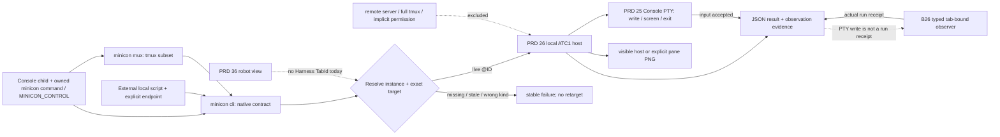

# Agent-facing CLI contract

Parent: [control protocol and public CLI](PRD_02_26_con_control_cli.md).
The tmux-shaped adapter remains owned by [PRD 31](PRD_02_31_v0_2_horizon.md);
tab identity and lifecycle remain owned by [PRD 25](PRD_02_25_con_workspace.md).
Sequence: [agent CLI contract plan](../plan/plan-agent-cli-contract.md).

Status: `[-]` contract design selected 2026-10-28; the baseline below is
implemented, while the normalized agent-facing contract is `[_]` until its
named black-box evidence exists.

## Outcome tree DAG

```text
Outcome: an agent can address, observe and drive a MiniCon tab with a predictable CLI contract
├── [-] ID — same-instance executable, endpoint and self-tab context
│   invariant: each Console child can invoke this MiniCon build; tab-targeted calls resolve a live incarnation and @ID
│   evidence: child PATH/binary/endpoint, two-instance, duplicate-title, rename/reorder, stale-tab and restart journeys
│   safe failure: missing executable or mismatched context refuses without launching or selecting another instance/tab
│   dependency: PRD 25 lifecycle and PRD 26 local endpoint; non-goal: treating environment values as authorization
├── [_] TARGET — one target grammar across native commands
│   invariant: @ID is canonical; self is validated; omitted targets have a documented active-tab rule
│   evidence: command matrix for self/@ID/omitted/stale/Browser/Harness states
│   safe failure: invalid or unsupported target has one stable error and no side effect
│   dependency: ID and existing typed TabId parser; non-goal: silently interpreting a title or row index as identity
├── [_] RESULT — machine-readable result and error envelope
│   invariant: opt-in JSON has a version, command, resolved target, outcome and stable error code
│   evidence: exact CLI black boxes for every command family and lost-reply replay
│   safe failure: unknown fields are ignorable; unknown error codes are non-success
│   dependency: existing ATC1 request ID/replay and current output compatibility; non-goal: exposing private ATC1 on the wire
├── [_] IO — bounded text, file and image semantics
│   invariant: paths have one named owner, output is atomic, and truncation/visibility are explicit
│   evidence: multiline UTF-8, large capture, PNG, relative-path, headless and error journeys
│   safe failure: unsupported capture mode refuses before writing or changing focus
│   dependency: PRD 26 capture/screenshot, PRD 33 native court; non-goal: a hidden full-history claim
├── [_] WAIT — observable completion without pretending PTY input is agent acknowledgement
│   invariant: accepted input, visible output, child exit and typed agent receipt are distinct outcomes
│   evidence: old-text/late-text, timeout, tab-close, exited-child and replay journeys
│   safe failure: unknown completion stays unknown, never reports processed
│   dependency: RESULT and tab-bound observer decision in 0.2.26 B26; non-goal: parsing agent prose
└── [_] DISCOVER — self-describing CLI and bounded tmux adapter
    invariant: per-command help and capability reporting match the running binary and selected host state
    evidence: generated catalog/help, GUI/headless and Console/Web/Harness capability matrix
    safe failure: unsupported flag/capability names its reason and next usable route
    dependency: PRD 31 mux vocabulary and PRD 26 catalog; non-goal: claiming full tmux compatibility
```

## Memory palace



## Current baseline and precise gaps

| Concern | Current source behavior | Contract decision |
| --- | --- | --- |
| Binary and endpoint | Console children receive `MINICON_CONTROL` only if the host starts with `--control`; `cli` and `mux` read it; the child receives `MINICON_BIN` and a `PATH` prefixed with this host's executable directory | Qualify the same-build mapping on other native hosts and handle a renamed binary; fail closed when the endpoint is unavailable |
| Identity | `list-tabs` gives stable `@ID`; children receive no self ID; omitted native targets use the active terminal | Export a self ID and instance incarnation as convenience, validate both against the live host, and never silently guess from title/order |
| Read/write | `capture-pane` reads visible rows; `send-text` and `send-paste` accept UTF-8 `--file`; `send-keys` targets PTY keys | Name the mode and bounds in results; distinguish accepted bytes from observed response and agent receipt |
| Paths | capture `--output` writes on the CLI client; screenshot `--output` is currently interpreted by the GUI process | Make v2 path ownership explicit and consistent without reinterpreting a legacy relative path silently |
| Results | Several native verbs return JSON, capture returns text, file output returns prose; failures are strings | Add opt-in versioned JSON envelope and stable exit/error mapping; retain legacy output during migration |
| Screenshot | GUI-attached Console pane can be targeted; headless image is open; intermittent stall has its own PRD 26 leaf | Publish visibility/capture source and typed timeout; do not claim Browser DOM or Harness pane capture from a Console screenshot |
| tmux subset | `mux` has selected verbs and flags, but mutating verbs print JSON; `capture-pane -S/-E` is refused | Keep the adapter's documented subset and deviations; add parity only with a real consumer journey |

The [upstream tmux guide](https://github.com/tmux/tmux/wiki/Advanced-Use)
defines `send-keys` as key delivery and `capture-pane -p` as pane observation;
history ranges are separate flags. MiniCon uses those names for comparable
terminal actions. It does not infer a peer's intent or acknowledgement from a
successful key write or from visible text. `capture-pane` is currently bounded
to the visible screen (default 256 KiB, maximum 1 MiB); `--file` input is
bounded to 1 MiB. These are current limits, not a promise of scrollback.

## Native CLI normalization contract

1. **Three surfaces, one owner each.** `minicon cli` is the canonical MiniCon
   machine interface. `minicon mux` translates a documented subset of tmux
   verbs and flags into it, without a second listener. A future typed agent
   event/message adapter owns run identity and acknowledgement; it is not
   inferred from PTY text. Each surface reports its own compatibility level.
2. **Resolution before mutation.** `--control` overrides `MINICON_CONTROL`;
   no default socket/port is guessed. `--target @N` is canonical. Planned
   `--target self` resolves from host-provided `MINICON_TAB_ID` plus an opaque
   process-incarnation marker, then checks the live target. Those environment
   values are context hints, not secrets or authority. Commands that omit a
   target keep their current active-terminal behavior in the legacy surface;
   the agent-facing profile requires an explicit `@ID` or `self` for writes,
   waits and captures. Browser and future Harness tab capabilities are
   discovered by kind, never routed through a terminal handler by accident.
   On a Console child, the host prepends the directory containing its
   own `minicon` executable to that child's `PATH` and exports an absolute
   `MINICON_BIN` escape hatch. If the executable is packaged under another
   basename, use an owned `minicon` launcher or report command discovery as
   unavailable; never let an unrelated global `minicon` silently stand in.
   Resolve both the binary and endpoint at child launch, not by a machine-wide
   alias, default port or last-open window. A shell that resets `PATH` can use
   `MINICON_BIN`; a missing or stale endpoint must fail rather than start a
   second instance. `MINICON_BIN` is only a launch hint and does not authorize
   control. Bare `minicon` keeps its documented application behavior; the
   instance binding applies to `minicon cli` and `minicon mux`.
3. **Additive machine output.** A global, opt-in `--format json` yields one
   JSON object per invocation. It contains `schema_version`, `command`,
   `ok`, resolved `target` when applicable, and exactly one of `data` or
   `error`. Errors have stable `code`, human `message` and `retryable` only
   when retry safety is known. Initial codes cover invalid argument, missing
   target, wrong kind, unavailable capability, timeout, conflict, transport,
   uncertain completion and internal failure. Exit 0 means the stated CLI
   action completed; argument errors and runtime failures have distinct
   nonzero exits. Existing stdout/stderr and ATC1 frames remain compatible.
4. **Evidence levels.** A send result means MiniCon accepted bytes/keys for
   the selected PTY. It does not mean the program consumed them. `wait-text`
   means a bounded visible-screen predicate matched, and must not match a
   stale pre-send screen in a new causal-wait mode. `wait-tab-exit` reports
   child exit. Only a typed tab-bound observer may report an agent run stage
   or receipt. The existing ATC1 request ID and replay cache protect against
   duplicate execution after a lost reply; the public result must still say
   when completion is uncertain.
5. **Files, PNG and scope.** `--file` names a client-side UTF-8 input path;
   `--output` must name its path owner and publish atomic completion or an
   explicit failure. A v2 normalization should make output paths client-side
   across text and PNG; transport size and streaming must be qualified before
   switching screenshots. Until then, document the current screenshot
   server-side path and require a deliberate compatibility boundary. A
   screenshot of a Console pane is a visual observation, not DOM access or
   hidden-process output. Headless availability is capability-gated.
6. **Discoverability and compatibility.** `list-commands` and per-command
   `--help` describe syntax, target defaults, output shape, limits, required
   GUI state and supported tab kinds. A machine-readable capability report
   names the running build/host scope rather than promising an unavailable
   feature. `mux` keeps its existing subset and its documented JSON-on-mutate
   deviation until an explicit compatibility decision changes it. Unsupported
   tmux flags fail clearly; no full tmux, remote server or permission policy
   is implied.

## Acceptance boundary

The first delivery is a contract and compatibility matrix, followed by
independent implementation slices in the linked plan. Every slice is proved
through the public executable: a Console child resolves the same-build
`minicon` command, its own endpoint and ID; two running MiniCon instances and
two same-titled tabs are never confused; a renamed/reordered/closed tab
does not redirect a send; a failed or detached screenshot cannot masquerade
as a complete PNG; a replayed request executes once; legacy invocations keep
their documented output. Unavailable native or headless evidence is `BLOCKED`.
The current Harness operation view is not a tab target. Future Harness tabs
enter this contract only after PRD 25 and PRD 36 own real tab identity and
lifecycle.
