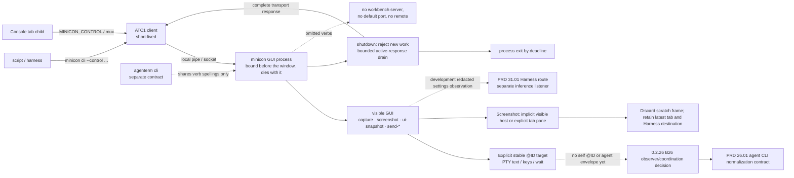

# `minicon` control protocol and public CLI

Parent: [MiniCon product requirements](../PRD.md)

This module owns the standalone host's automation surface: the public
`minicon cli` command set, the private `ATC1` wire, the bounded JSON
contract, and the snapshot/screenshot evidence products. The workbench's
`agenterm cli` is a separate contract owned by the AgenTerm repository; the two
are deliberately not the same surface.
The agent-facing normalization branch is owned by
[PRD 26.01](PRD_02_26_01_agent_cli_contract.md), sequenced by
[its plan](../plan/plan-agent-cli-contract.md).

Legend: `[v]` shipped, `[-]` partial, `[_]` planned.

## Map

```text
minicon control protocol and public CLI
├── Boundary against `agenterm cli` (separate contract; shared verb spellings only)
├── Self-description
├── Public command set
│   ├── [v] Explicit @ID cross-tab text/key/capture/screenshot primitives
│   └── [_] Agent-facing identity, target, result and I/O contract → PRD_02_26_01_agent_cli_contract.md
├── Transport and bounds (ATC1 frame; local pipe/socket; process-lifetime)
│   └── [-] Bounded completion of active replies during shutdown
├── JSON contract
│   └── [-] Harness settings observations → behavior in PRD 31.01
└── Evidence publication (snapshots, screenshots)
    └── [-] Visible Harness capture versus explicit tab capture; restore any live tab kind
```



## Boundary against `agenterm cli`

- [v] `minicon cli` is a process-lifetime local control surface, not a client
  of the workbench and not a daemon. `--control` binds an explicit local
  named pipe or Unix socket **inside the GUI process**; a second invocation
  (`minicon cli --control …`) is a short-lived ATC1 client. Capture,
  screenshots and `ui-snapshot` use that socket; `--emit-snapshot` writes a
  file with no listener. The endpoint is bound before any window and ends with
  the **process**, so it survives a `detach-gui`. There is no
  default port, no remote transport, no Fleet, mux, session persistence, or
  Agent permission model. AgenTerm's server identity may outlive one window;
  MiniCon's must not. A listener inside the GUI is the design, not a missing
  server.
- [-] Ordinary 0.2.26 GUI launches generate a random per-process native
  endpoint before any tab starts and export it only to their Console children.
  Explicit `--control` still selects the address. The unique-address unit
  court and Windows public
  `ordinary_console_child_reaches_its_automatic_control_endpoint` passed:
  the child ran `minicon cli list-tabs` and an external CLI read matching tabs
  from its exported endpoint. Removing the Console child's endpoint made the
  court fail with a missing-`MINICON_CONTROL` screen receipt. Other native
  hosts and renamed-binary packaging remain open.
  [PRD 26.01](PRD_02_26_01_agent_cli_contract.md) owns the agent-facing
  environment, self-tab and command-discovery contract.
- [v] shared verb spellings (`capture-pane`, `screenshot-pane`, `send-text`,
  `send-keys`, `wait-text`) mean the same product action in both CLIs. Where the
  standalone host cannot honor a workbench verb it omits the verb rather than
  offering a reduced impostor.
- The two CLIs do not share a wire: the workbench uses its documented public
  transport, while con uses the private `ATC1` frame described below.

## Development authorization observations

The serial authorization presentation's behavior is owned by
[PRD 31.01.02](PRD_02_31_01_02_provider_pool.md#development-join-authorization-transport-and-serial-presentation).
Its control observations use an explicit auth role in addition to legacy
known-authorization-URL detection. `list-tabs` and browser field snapshots
redact the role's URL as `authorization://private`, use a fixed title and omit
private title/error/editor contents across provider redirects. Pixel screenshots
remain observations of the actual visible page; they are not sanitized text.

`close-tab` on that presentation consumes the dismissal and leaves its Browser
node alive with the restored ordinary page. Its development success object is
`{"authorization_dismissed":"@N"}` instead of falsely returning `closed`.
An ordinary tab close still returns `{"closed":"@N"}`. This is a result-shape
extension, not an additional control command or a claim of native auth evidence.

## Self-description

- [v] `minicon --status` reports what the running machine gave this build:
  version, the PTY backend it selected and why, the font face the system
  actually resolved to with its measured cell width, and the path it writes
  diagnostics to. None of these can be answered by reading the source, because
  all of them are properties of the machine rather than of the build.
- [v] it opens no window and starts no session, deliberately. The machine that
  most needs it is the one where starting a session is the thing that does not
  work, so it shares the offline path with `--version` and `--help`.
- [v] the font line carries a **measurement**, not just a face name. A face can
  resolve and still be the wrong shape for a character grid — the failure a user
  describes as "the font is off" — and a name cannot distinguish those. Where an
  advance cannot be measured it says so, rather than reporting a width it does
  not have: "not measured" is not "measured and wrong".
- [v] the report re-runs the same questions the real paths ask, in the same
  order, instead of reading a cached value. A status that can disagree with the
  behaviour is worse than none, because it sends whoever reads it after the
  wrong thing. A test pins that the output differs under
  `AGENTERM_FORCE_CONSOLE_AGENT`, since a status that reads the same either way
  is reporting a constant rather than a machine.
- [v] `--status` is a top-level flag, not a control verb: it needs no endpoint
  and no running GUI, so it is outside the `public_commands` contract that
  governs `minicon cli`.

## Public command set

### Planned Harness observation boundary

`[_]` Extend settings observations additively for the Console/Web/Harness route,
visible field/action geometry, listener state/actual port, opaque account IDs,
readiness, selected model/binding and bounded reason codes. Never expose
credential bytes, authorization codes, PKCE material or client keys through
`ui-snapshot`, captures, logs or generic config export. Masked secret controls
must remain masked in screenshots. Account labels are not required diagnostics.
The inference HTTP routes and planned `minicon provider serve` do not become
ATC1 tab-control verbs or a second route to local tools. Freeze actual schema
and register command identities during implementation, not in this planning
change. Behavior belongs to [PRD 31.01](PRD_02_31_01_provider_gateway.md).

`[_]` The [Harness workspace](PRD_02_36_harness_workspace.md) additionally needs
an explicit active host-view identity, robot geometry/selected state, typed
Settings deep-link/return targets and opaque account/profile/request selections.
Qualify paint, hits, focus and CLI input against the same active view; a hidden
selected terminal is not an input target while Harness owns focus. Later task
observations distinguish owned built-in runs from externally observed model
requests and expose only the evidence-supported lifecycle. Freeze/register the
actual additive schema with implementation; this prose adds no public verb.

`[-]` [PRD 25.03](PRD_02_25_03_tab_tree_interactions.md) now publishes
`ui-snapshot.geometry.tree_rename_editor` as the nullable physical-pixel plate
of an active terminal tab's inline editor. The existing nullable `rename`
object adds UTF-8 byte `caret`, nullable `selection` (`start`/`end`) and
boolean `selecting` to its stable `tab`/`text`/`preedit` fields. The Windows
x86_64 host-injected pencil → inside click → type → Enter test and a
guard-removal RED establish this first rename observation. Browser-tab
geometry, physical mouse/IME and the remaining selection/blur cases remain
open. `ui-snapshot.tree_drag` is now nullable when idle and publishes stable
`source`, `revision`, `phase` (`armed`/`dragging`), nullable `target`,
`position` (`before`/`into`/`after`/`root_tail`/`none`), `valid`, nullable
typed `reason` and nullable painted `target_row` geometry while a tree pointer
gesture is held. The Windows x86_64 public GUI click/drag/invalid/Escape
journey passed with a release-commit guard-removal RED; physical pointer and
native matrix remain open. No new move verb is advertised. The retained
old-source inside-click reproduction
remains the input baseline.

### Existing command evidence

- [-] `docs/control-cli.html` is the public mirror of this section's command set
  and was owned by nothing until 2026-10-13; it is owned here now. It is not a
  second source: when a verb, a flag or a bound changes in this PRD, that page
  is part of the same change. Its download/release facts stay with
  [27](PRD_02_27_con_delivery.md).
- [v] `minicon cli list-commands` is an offline, no-window and no-endpoint
  discovery surface. Its exact command set is owned by con's machine-readable
  capability contract and checked against the running executable in CI. The
  catalog is `attach-gui`, `cancel-pointer`, `capture-pane`, `close-tab`,
  `close-window`, `detach-gui`, `list-commands`,
  `list-tabs`, `new-tab`, `perf-stats`, `reset-perf-stats`, `resize-window`,
  `screenshot-pane`, `select-tab`, `send-keys`, `send-mouse`, `send-paste`,
  `send-text`, `send-ui-ime`, `send-ui-keys`, `send-ui-mouse`, `send-wheel`, `ui-snapshot`, `wait-tab-exit` and
  `wait-text`.
- [v] the fixed process-lifetime local CLI uses stable `@N` tab IDs for `list-tabs`,
  `new-tab`, `select-tab`, `close-tab`, `capture-pane`, `screenshot-pane`,
  `send-text`, `send-paste`, `send-keys`, cell-addressed mouse
  press/release/move/click, `send-wheel`, bounded `wait-text`, bounded
  `wait-tab-exit`, logical-client `resize-window`, and process-lifetime
  `close-window`.
- [v] `list-tabs` exposes a nullable `browser` object on each row. Browser
  rows publish `url`, `title`, typed `load` (`idle`, `loading`, `ready`,
  `unavailable`), `can_back`, `can_forward` and a nullable failure `reason`;
  terminal rows publish null. `ready` records the native engine's finished
  navigation event; it does not assert application-specific page readiness.
  Windows uses the engine's success flag to distinguish its network error page.
  `ui-snapshot.geometry` on a browser tab publishes `browser_page`,
  `browser_toolbar`, `browser_address`, `address_focused`, sidebar/history
  bounds and scale. These are host geometry, not a page DOM or pixel capture.
  The 0.2.22 preview workflow adds `new_root`, `new_tab_menu`,
  `new_tab_menu_open`, `new_terminal_action` and `new_browser_action` within
  terminal/browser geometry, plus `browser_proxy` (proxy editor rectangle), `proxy_focused` (editor focus), `browser_retry` and `browser_edit_address`
  for Browser. Rectangles use physical pixels and `scale_permille` supplies
  the conversion to `send-ui-mouse` logical pixels. The snapshot's top-level
  key set is unchanged. Presence of an action rectangle does not imply the
  action is currently visible: callers also inspect menu state or page load.
  Planned 0.2.23 observation is additive: identify the focused host control,
  its draft/selection/preedit, the applied proxy choice separately from menu
  highlight, and the menu scroll/visible-row range. Existing fields and their
  units remain compatible. Field and menu behavior is owned by
  [PRD 25.02](PRD_02_25_02_browser_controls.md); this observation surface must
  distinguish navigation from dismissal and highlight from application without
  treating an internal handler return or a CLI-injected event as native proof.
  The development implementation exposes these observations and delivers each
  `send-ui-keys` chord as a paired press/release through the same host event
  router. Whole-sequence validation and the `sent_keys` chord count stay stable.
  A host-consumed press may change focus or open an exited tab; its release
  does not retroactively reject that host action as failed PTY input. Releases
  still traverse the terminal router, whose encoder owns release semantics.
  The public dismissal, keyboard-menu and retained-exit journeys guard this lifecycle.
  Paired CLI chords do not prove native focus interception, held-key repeat or
  IME behavior; those retain separate native courts and final qualification.
  On Windows x86_64 the first complete gate exposed two release-time
  `con_terminal_exited` failures in the existing failed-tab and multitab
  journeys. Correcting the host-release check made both original assertions
  pass; the complete control target then passed 25 tests with eight separately
  invoked native courts still reported ignored.
  `send-ui-ime` routes to the focused browser address editor as
  `browser_address`; it requires no PTY in that case.
  The Windows missing-runtime and local-proxy courts in
  `tests/support/browser_windows.rs` guard the native failure and navigation
  observations; execution evidence belongs to
  [plan-v0.2.21](../plan/archive/plan-v0.2.21.md).
  `close-tab` uses workspace identity for both terminal and browser rows;
  terminal traffic commands continue to require a PTY session. The same
  missing-runtime court failed at browser close before this lifecycle fix.
- [v] cross-tab read and write have file endpoints. `send-text` and
  `send-paste` accept `--file PATH` instead of a literal `TEXT`, and
  `capture-pane` accepts `--output PATH` instead of returning the text on
  stdout. Passing a payload as an argv word cannot survive multi-line content,
  quotes, backslashes or the argument-length limit, and a large capture should
  not have to cross a pipe — which is what writing into, and reading out of,
  another tab actually needs. Both are client-side conveniences: the wire still
  carries only text, never a path, so the GUI never opens a caller's file. This
  is a bounded read/write surface, not a message channel: MiniCon gains no
  server, queue or envelope format.
- [v] a GUI started with `--control` exports `MINICON_CONTROL` to each Console
  child. From inside that tab, `minicon mux` and `minicon cli` can use the
  endpoint implicitly; an explicit `--control` wins. The child also receives
  `MINICON_BIN` and a `PATH` that prioritizes this host's executable directory.
  The public `console_child_minicon_command_uses_its_own_control_endpoint`
  black box passed on Windows, including a shadow command placed earlier on
  the inherited `PATH`; removing the host's `PATH` override made it fail.
  A login shell can still rewrite `PATH`, so `MINICON_BIN` is the absolute
  fallback. Explicit stable
  `@ID` targets let a caller enumerate tabs, capture the current PTY screen,
  send literal text, bracketed paste or keys, wait for visible text/exit, and
  request a PNG of a Console pane while a GUI window is attached. This is
  sufficient for a script that knows the peer @ID to exchange bounded text
  through a PTY. `capture-pane` is the visible screen, not arbitrary scrollback;
  `mux capture-pane -S/-E` is refused. Screenshot reliability retains the
  separately tracked `{SCRSHOT-HANG}` issue below.
- [_] reliable inside-tab agent coordination needs an explicit self @ID and
  process-incarnation binding, plus a typed message/run envelope and receipt
  semantics if the product promises delivery. Currently the child receives
  the endpoint but no self tab ID; titles and row positions cannot identify it
  safely after rename/reorder. The control socket gives any connected local
  caller the existing full command surface, not per-agent authority. The
  [PRD 26.01](PRD_02_26_01_agent_cli_contract.md) owns the normalized CLI
  target/output contract; the 0.2.26
  [B26 decision](../plan/plan-v0.2.26.md) owns how a tab-bound observer and
  peer messaging can build on these primitives. The robot workspace is not
  a Harness TabId; its future tab membership is owned by
  [PRD 39.01](PRD_02_39_01_home_canvas.md).
- [v] the two public observation surfaces agree where they overlap. The
  per-render `--emit-snapshot` file (terminal state) and the on-demand
  `list-tabs`/`ui-snapshot` replies describe the same session, so the active
  tab's title and its child's alive state and exit code must match across
  them; a black-box journey settles the title and checks both sides while
  the child is live and after it exits.
- [v] `perf-stats` and `reset-perf-stats` expose frame latency plus PTY
  drain/yield counters through the same public CLI for repeatable interactive
  profiling. The counter semantics belong to
  [24](PRD_02_24_con_terminal.md).
- [v] `ui-snapshot` publishes structured UI state — including the active tab
  and whether the workspace is empty, composer bounds, text/focus/submission
  error, active-terminal IME preedit, typed native IME status/name/mode,
  scrollback extent, pending wait and screenshot counts, terminal
  clipboard-paste state/target/error, the accessibility action/byte/pending/drop
  counters, the interface language, the nullable window-scoped control pointer
  owner, and a nullable `host_notice` naming a recoverable host-level refusal
  (a tab that could not open) — so black-box journeys assert state instead of
  guessing timing or inferring cleanup only from a later failure. Unknown native
  state keeps the same field types and uses `known=false` plus `IME: ?`.
- [v] `ui-snapshot.geometry.pty_backend` reports the active opened master's
  actual backend, or null before it opens. Geometry remains null with no
  active session. The field is observation, not a backend-selection command;
  evidence: `gui_owned_console_native_window_queries_frames_seed_and_cleanup`
  and the handle-free seed guard in PRD 24.01.
- [v] `send-ui-ime enabled|disabled|preedit|commit` injects one bounded
  platform-neutral IME event through the current UI focus owner. Preedit text is
  capped at 64 KiB, its optional character cursor is range-checked, and terminal
  commit success is returned only after the complete PTY write; direct protocol
  and CLI decoding reject malformed action, cursor and payload state.
- [-] The active Harness settings panel also owns injected IME, including when
  the selected tab is a browser or no settings field is focused. It requires
  no PTY and reports the existing `harness_port`, `harness_model` or
  `harness_settings` owner. A browser-first regression exposed a preflight that
  incorrectly required a terminal; the former terminal-first fixture had
  hidden that defect. The strengthened public
  `host_harness_routes_preserve_independent_drafts_and_scroll_readable_controls`
  failed against the old development binary and passed after the dispatch
  repair, including the unfocused-panel and focused-model routes. Logs:
  `target-six/v0.2.23-provider/harness-ime-browser-before-red.log` and
  `harness-ime-browser-fixed-green.log` in the same directory. This is a
  Windows x86_64 development checkpoint; matching final artifact qualification
  remains open. Harness behavior stays owned by
  [the provider gateway](PRD_02_31_01_provider_gateway.md).
- [-] Connection drafts add `harness_connection` and
  `harness_connection_picker` input owners, plus bounded profile, allocation,
  applied-reference and receipt observations under the existing
  `geometry.harness_settings` projection. Profile/account labels remain redacted;
  no credentials, routes or headers are exported. Published visible row cells
  are the pointer authority. Behavior and the actual eight-form public replay
  remain with [connection selection](PRD_02_31_01_02_01_connection_selection.md#production-draft-form-join-in-progress);
  injected CLI input is not native physical-input qualification.
- [-] The integrated profile-verification projection adds the following fields
  under `geometry.harness_settings`. Compilation and public replay for these
  additions are pending; [the workflow owner](PRD_02_31_01_02_01_01_profile_verification.md)
  owns charging, cancellation, publication and acceptance rather than this schema.

  | Field | Bounded shape and observation meaning |
  | --- | --- |
  | `connection_plans` | At most eight objects with `profile` opaque ID, `revision`/`id` unsigned integers, ordered distinct `paid_slots` (at most 32, each 0..31), nullable typed `error`; no private fingerprint, grant, URL or headers |
  | check `scope` | `Single` or `Profile` in existing active/last-terminal objects; no additional operation history |
  | check `completed`, `total` | Unsigned counts of accepted checks within the quoted paid plan, each at most 32; existing `slot` remains a sparse allocation identity |
  | check `applied_revision` | Nullable unsigned revision of an actually published profile; separate from the initiating draft revision |
  | check `phase`, `warning` | Existing finite strings additionally allow `Applying`/`Applied` and `ReadinessStale`; Applying alone does not claim publication |

  Missing active/terminal objects remain null. These additions do not create a
  model-HTTP management API, automatic Verify, a tenth edit receipt or native
  input qualification. Named evidence remains with the workflow owner.

- [v] `send-wheel` reports the route actually taken (`zoom`, application mouse,
  alternate-screen cursor keys, or local scrollback), the notch count actually
  applied after bounds/clamps, and whether observable state or terminal input
  changed. Application and alternate-screen PTY write failures fail the request
  instead of returning a false-success receipt; physical wheel input remains
  best-effort across concurrent child exit.
- [v] `send-mouse` preserves its compatible `delivered` field and additionally
  reports the route actually taken (`application`, local selection, clipboard,
  or no-op) plus whether the gesture changed state or wrote application input.
  Application mouse write failures fail the CLI request, while physical pointer
  input remains best-effort across concurrent child exit and keeps gesture
  ownership through release.
- [v] a retained exited tab remains locally interactive: public control evidence
  captures its final pane, selects it, performs a local selection click, and
  routes wheel input to bounded scrollback without reopening or writing its PTY.
  Keyboard/text/paste remain explicit failures, so observation does not imply a
  live input channel.
- [v] direct route tests prove application mouse and alternate-screen wheel
  writes propagate a closed PTY instead of constructing success outcomes. A
  failed application report does not commit its last-reported cell or gesture
  ownership, preserving the next physical/control gesture's routing state.
- [v] press/release control gestures have one window-scoped tab owner. A second
  press, cross-tab move/release, or click during an open gesture fails
  explicitly; selecting, closing, or replacing the active tab cancels the old
  gesture and releases native capture. Native capture loss is consumed at the
  window owner before active-session dispatch, so a background control owner
  cannot survive an OS cancellation. Public evidence proves a stale release
  after `select-tab` cannot revive the cancelled selection.
- [v] `cancel-pointer` is an idempotent window-scoped recovery command for an
  automation client that dies or times out between press and release. It
  cancels the control owner and active physical gesture through the same path
  as native capture loss, returns the nullable cancelled owner, releases native
  capture, and makes a later unmatched release fail explicitly.
- [v] public `wait-text` delegates exact per-visible-row UTF-8 containment to one
  allocation-free control kernel. It preserves the existing authority: no row
  joining, newline insertion, cross-row match, hidden-scrollback scan, Unicode
  normalization, or case folding, and an empty needle still matches a visible
  row. x86_64 uses a bounded inline-assembly byte loop while Windows aarch64 and
  Unix use the same scalar contract; matrix, CJK and emoji oracle tests prove
  parity with byte-window search.
- [v] stable `@TAB_ID` values from list, new, select and close pass through one
  concrete non-inlined optional-id formatter, preserving the exact string/null
  JSON schema; ids remain `u64` workspace identities carried as typed values in
  the exact `"@N"` grammar until final serialization, and nullable parents remain
  JSON null.
- [v] fixed-schema unsigned CLI values share one 93-byte allocation-free ASCII
  decimal parser with checked overflow and target-width conversion. `u64`,
  `usize`, `u16` and `@TAB_ID` preserve leading-plus, leading-zero, invalid,
  overflow and existing per-flag error behavior; signed `i16` deliberately
  remains on standard `FromStr`.
- [v] the CLI cursor borrows argument text from the process-owned `String` slice
  and allocates only when a value enters an owned command field. Verbs, flags,
  numeric values, tab ids and mouse tags do not clone on every cursor advance;
  syntax, error text, stable tab ids and wire bytes are unchanged.
- [v] native shell parsing intentionally does not claim equivalence for
  ambiguous hand-crafted quote sequences. Standard launcher quoting, the offline
  CLI, `-e` passthrough and process-lifetime control startup are the supported
  evidence.

## Transport and bounds

- [v] the CLI connects only to an explicitly configured local pipe or
  Unix-socket endpoint. A platform-owned `IpcEndpoint::from_native_address`
  constructor accepts only those named-pipe/Unix-socket mechanisms without
  routing through the generic TCP authority parser or endpoint formatter.
- [v] the private transport is a versioned, length-prefixed typed `ATC1` frame
  rather than a nullable JSON envelope. Opcodes and field order are fixed;
  invalid UTF-8, values, lengths, trailing bytes, or versions fail only that
  request.
- [v] mouse action and button wire tags have one non-generic enum-owned mapping
  shared by `ATC1` encode and decode. Opcode 10, all numeric tags, unknown-tag
  failures and the move/none pairing rule remain byte compatible.
- [v] requests and responses are size and time bounded. A malformed request or a
  failed child may only fail that request or session; it never terminates
  unrelated sessions or the window. `send-text`, `send-paste`, `send-keys` and
  terminal-routed `send-ui-keys` reject a retained exited tab with
  `terminal process has exited`; direct text/paste and each encoded key PTY
  write failure are returned to the CLI rather than reported as successful
  delivery. Physical keys remain best-effort across concurrent child exit, and
  local shortcuts, IME suppression and viewport scrolling remain successful
  without pretending they emitted PTY bytes. Capture, local selection and
  scrollback remain available after exit.
- [v] terminal paste normalizes and frames before one checked write, then snaps
  to the live viewport only after that write succeeds. A closed PTY preserves
  the caller's scrollback position instead of presenting a failed paste as a
  delivered input-side state change.
- [v] a key sequence is validated as a whole before any of its keys is applied.
  `send-keys` and terminal-routed `send-ui-keys` parse every key first, so a
  malformed key anywhere in the sequence delivers nothing rather than a silent
  prefix of it. Previously each arm parsed inside its injection loop, which
  meant a bad third key arrived after the first two had already reached the
  terminal — an error report with a partially applied side effect the caller had
  no way to detect. Injection itself can still fail mid-sequence, and that is
  reported as a PTY write failure rather than claimed as delivered.
- [v] `send-paste` remains deterministic direct-payload injection, while
  terminal-routed `send-keys` or `send-ui-keys` with `Ctrl+Shift+V` queues the
  same bounded asynchronous OS clipboard read as physical input but explicitly
  bypasses the human review modal. A second read fails explicitly while one is
  pending, and completion cannot retarget itself after tab or focus changes.
- [v] the control endpoint uses a fixed worker pool with bounded connection and
  request queues. Its multi-tab journey floods one PTY with oversized CSI
  parameters while issuing concurrent `capture-pane`, `list-tabs` and
  `perf-stats` calls, then proves both the noisy tab and an unaffected sibling
  remain controllable. GUI dispatch handles at most two requests per event
  callback and reposts Wake while backlog remains; public request/yield counters
  expose field evidence, while a deterministic queue test proves wake coalescing,
  the fixed batch limit and backlog reporting without scheduler timing assumptions.
  One exception remains bounded and order-preserving: `resize-window` arrivals
  share a fixed 4 ms window measured from the first request and submit the last
  geometry once while replying to every caller. Input, screenshot, wait, close,
  and every other command are barriers that flush preceding resize work first.
  Saturation reports `control server is busy`, while a closed GUI reports
  `terminal window is closing`; both paths drop the rejected reply owner
  immediately instead of consuming the GUI response timeout.
- [v] closing a tab immediately cancels its pending text/exit waits and
  screenshot reply with a typed target-close error. `ui-snapshot` exposes
  pending counts, so a black-box journey proves registration, cancellation,
  worker release and clean final-host exit without timing guesses.
- [v] `detach-gui` releases the window while the process, its sessions and this
  endpoint keep running; `attach-gui` builds a window again from session state.
  Both name the state asked for, so either is idempotent. A platform that cannot
  detach answers a typed unsupported error rather than reporting success while
  the window is still on screen. This is the boundary amendment in practice: the
  endpoint's lifetime is the process, never the window.
- [_] **F2, not started, 2026-09-27: true headless render — screenshot and UI
  events without `attach-gui` at all.** Product motivation: MiniCon is built
  for agents as much as for humans (owner's stated founding intent), and today
  an agent under `--headless` cannot see or drive its own UI without first
  paying for a real window (`attach-gui`, which even under `Xvfb` connects to
  a display and creates a native surface). `windowless_command` in
  `src/control_dispatch.rs` currently splits the public command set along an
  implementation seam, not a product one: `list-tabs`, `capture-pane`,
  `send-text` (and `mux send-keys -l`) work with zero window because they only
  touch `ConTerminal`/PTY state; `screenshot-pane`, `send-ui-keys`,
  `send-mouse`, `send-wheel`, non-literal `send-keys`, and the mux verbs that
  create/select/close a window (`new-window`/`select-window`/`kill-window`)
  all fail with `"the window is detached; attach-gui first"` because their
  handlers in `dispatch_control` take `window: &PixelWindow` — a real winit
  window, which on Unix means a real X11/Wayland connection
  (`crates/minicon-platform/src/adapters/unix/window_host.rs`'s
  `run_pixel_window`), not a rendering-algorithm requirement. Evidence that
  the seam is implementation, not product: `paint_host_ui` in
  `src/host_paint.rs` already renders into a plain `pixels: &mut [u32]`
  buffer with no window/surface type in its signature — the paint code itself
  is already window-agnostic; what is coupled to a real window is (a) winit's
  event loop being the only thing that currently drives a paint call at all,
  and (b) `SendKeys`/`SendUiKeys`/`SendMouse`'s handlers being written to take
  a live `&PixelWindow` even though the state they mutate is
  `ConTerminal`/composer/workspace, not pixels.
  **Shape, not yet owner-confirmed:** an offscreen render path for
  `--headless` that allocates its own `Vec<u32>` frame buffer sized from
  `--cols`/`--rows` (or a new explicit pixel-size flag) instead of a winit
  `Window`, and routes `ScreenshotPane`/`SendUiKeys`/`SendMouse`/`SendWheel`
  and the window-creating mux verbs against that virtual buffer and geometry
  in `windowless_command` instead of refusing them. Scope this properly
  before touching code — it spans `main.rs`'s window abstraction,
  `control_dispatch.rs`'s dispatch split, and every `dispatch_control` arm
  that currently assumes `window: &PixelWindow` is real; it is not a
  drive-by addition. Do not conflate with `attach-gui`/`detach-gui` above,
  which still needs its real winit window for an eventual human-visible
  session — F2 is specifically for the case where no human will ever look
  at this process's pixels.
- [-] **`{SCRSHOT-HANG}` — an intermittent `screenshot-pane` that writes its PNG
  and never returns, owned here.** Reported 2026-10-10 during the G3 new-tab
  attempt (twice in a row, exit 124 under a 25 s cap, PNG written). It has no
  home in this PRD and no plan entry of its own — the only notes are the
  problem file `plan/problem-screenshot-pane-hang.md` — so this line is its
  owner registration. A 0.2.18 Grok session independently left one screenshot
  queued after resize; whether it shares the older PNG-written failure is
  unknown. A 30-second server-side deadline now answers and releases both
  unrendered and stalled-encoder requests, guarded by failing-first queue/retry
  tests. This is bounded recovery, not a root-cause fix or a passing real-GUI
  reproduction. Do not fold it into F2 (that is about running with *no*
  window; this is a hang *with* one).
- [v] pending text/exit deadlines have a fixed ten-minute upper bound. A larger
  syntactically valid `u64` timeout fails only that request, preserves its reply
  owner for the normal dispatch error path, and registers no latent wait instead
  of occupying one of the 32 bounded slots for an effectively unbounded period.
- [v] the GUI handoff preserves concurrent request workers without linking two
  generic channel instances: a mutex-owned FIFO carries requests and a one-shot
  Condvar slot carries each reply. Closing the GUI atomically rejects new queue
  entries, drops pending senders and wakes reply waiters rather than making them
  consume the full timeout.
- [v] **Shutdown response completion.** The active worker owns its response
  through both frame writing and the native transport's finish operation.
  After rejecting new work and releasing queued requests, server destruction
  allows at most one second for those active responses to finish. A client
  that does not consume its reply cannot hold the process indefinitely.
  A normal `close-window` must receive its acknowledgement before process
  termination, rather than relying on a retry after the endpoint disappears.
  The 0.2.21 full-gate observation and required negative controls are owned by
  [the archived plan](../plan/archive/plan-v0.2.21.md)'s `{CLOSE-ACK}` leaf; qualification
  has passed the Windows mutation controls and named serial public/full gate.
  [PRD 32](PRD_02_32_dev_loop_crosscheck.md) records the successful native
  six-platform response courts and their exact-count evidence.
- [v] six synchronous control commands share non-generic session lookup and
  terminal-cell validation helpers while preserving each command's local
  `Result` propagation, screenshot and wait reply ownership, and active-tab
  ordering.
- [v] con reader/waiter, control listener/request and the Windows ConPTY output
  pump submit boxed tasks through one non-generic named-thread trampoline
  instead of repeated product glue. Thread names and spawn failures remain
  observable, and a task panic remains contained by the unwind-enabled
  `JoinHandle` boundary.

## JSON contract

- [v] configuration, scripted interaction, atomic snapshots and public JSON
  output share one strict bounded JSON codec instead of four serde/ad-hoc paths.
  It accepts UTF-8, JSON escapes and valid surrogate pairs while bounding input
  bytes, nesting, nodes, object fields and strings; duplicate keys, isolated
  surrogates, malformed or non-finite numbers and trailing data fail locally.
  `serde_json` remains a dev-only interoperability oracle and is absent from the
  production graph.
- [v] the bounded JSON object constructor owns a field `Vec` at one non-generic
  boundary instead of monomorphizing its complete iterator/collection path per
  array length; all snapshot and control-result construction sites retain the
  same schema and ordering.
- [v] eleven fixed one-field control replies share one concrete non-inlined JSON
  constructor instead of repeating the generic object path at every command and
  wait boundary, with field names, values and ordering byte compatible.
- [v] fixed schema keys encode as borrowed static literals rather than
  allocating a `String` per field before immediate serialization. Dynamic
  terminal titles, captured text and paths remain owned values, and the typed
  configuration parser never retains arbitrary input keys.
- [v] fixed-schema numeric values remain typed `u64`/`i64` until the final
  response buffer instead of allocating a decimal `String` per field. Arbitrary
  raw decimal text is test-only, while fractional configuration keeps its
  dedicated bounded parser. Con uses its direct `itoa` dependency for final
  formatting.

## Evidence publication

- [v] screenshot success is returned only after atomic PNG output has crossed
  the platform durability barrier.
- [v] every asynchronous PNG completion path shares one panic-containment
  boundary, including worker initialization failure and queue-full fallback on
  the caller thread; a faulty completion cannot unwind into GUI dispatch or
  terminate the fixed encoder worker.
- [v] screenshot ownership is global and bounded across the pending-render and
  background-encode phases. PNG encoding and atomic publication run on one fixed
  worker rather than the GUI thread, and concurrent cross-tab requests receive a
  typed busy result instead of switching active tabs and stranding earlier
  replies. Ownership is global rather than attached to active-tab rendering:
  capture temporarily selects its target only inside render, then restores the
  latest user-selected tab. The public four-tab flood journey proves exactly one
  owner, bounded completion, valid PNG publication, stable active context across
  a select/capture race, and zero retained requests afterward. The matching
  present-side rule for the discarded scratch frame is owned by
  [24](PRD_02_24_con_terminal.md).
- [-] With the Harness destination active, `screenshot-pane` without a target
  captures that visible host destination. An explicit `--target` retains the
  existing supported terminal-pane meaning, including the underlying active
  Console tab. It does not add a native Browser-child screenshot API. The
  implicit Harness capture also works with no tabs, without a synthetic TabId.
  A scratch
  capture must restore any still-existing active tab, including Browser tabs
  without a PTY, and preserve the Harness destination and hidden drafts. The
  source regression is the extended H0 public journey owned by
  [PRD 36](PRD_02_36_harness_workspace.md#h0-local-implementation-checkpoint).
  A targeted Console image cannot be reported as a Harness image, or vice versa.
- [-] `ui-snapshot.geometry.harness_workspace` also publishes nullable
  `header_focus` (`robot` / `settings`) for the presented keyboard owner;
  it grants no activation. The object publishes the actual `body`
  rectangle, `card_pitch` and `visible_capacity` from the same layout used by
  painting and pointer hits. `resize-window` acknowledges a requested size;
  native bounds may differ. A caller checks the observed frame/capacity before
  addressing the first visible card. Native clamp and hit evidence remains with
  [PRD 36](PRD_02_36_harness_workspace.md#h0-local-implementation-checkpoint).
- [v] an accepted screenshot has a 30-second server deadline across render and
  PNG publication. If either stage stalls, it sends a typed error, releases the
  single global request slot and permits a retry; the worker's shared reply slot
  still makes a late completion exactly once. The two expiry/retry regression
  tests live in `control_pending::tests`. This bounds the control contract but
  does not certify the intermittent GUI hang as diagnosed or fixed.
- [v] the screenshot writer is one platform-owned contract with target
  adapters: Windows passes a validated clipped pointer and original XRGB stride
  directly to the system GDI+ PNG codec, while Linux/macOS retain the portable
  Rust PNG encoder. The Windows production graph no longer contains a private
  stored-DEFLATE, Adler-32, IEEE CRC-32, 64 KiB block buffering, or XRGB-to-RGB
  copy path. The independent `png` dev decoder owns color/format
  interoperability and the GUI black box owns rendered screenshot evidence.
- [v] snapshot and screenshot publication use platform-owned writer/path atomic
  file contracts: an exclusively created sibling is filled, revalidated as a
  regular non-link file, synchronized, then replaced with Windows
  `MoveFileExW(REPLACE_EXISTING | WRITE_THROUGH)` or Unix rename plus
  parent-directory fsync. Concurrent readers observe only a complete old or new
  value; pre-publication failures remove the sibling, while a post-replacement
  durability failure explicitly reports that publication already occurred.
- [v] publication distinguishes arbitrary caller-owned staging paths from
  sibling temporaries exclusively created by the platform. The public path keeps
  physical-parent, symlink and distinct-entry validation; the owned sibling path
  revalidates the completed regular file and destination type without
  rediscovering the same canonical parent before replacement. The Windows
  adapter passes those prepared paths directly to `MoveFileExW` with
  write-through and bounded sharing-violation retries instead of canonicalizing
  both paths again. Owned writers freeze their destination through a platform
  facade distinct from the public caller-owned publisher: Windows uses bounded
  `GetFullPathNameW` plus `GetFileAttributesW` directory validation before
  creating the sibling temporary, while Unix retains canonical parent
  resolution.
- [v] test-only journey JSON invokes the public commands and is not linked into
  the product.

The browser proxy editor owns injected IME while `proxy_focused` is true;
`send-ui-ime` reports route `browser_proxy` and does not require a terminal
PTY for that delivery. Editor behavior belongs to PRD 25.

The settings/candidate journey observes only host geometry and counts inside
`geometry`: `settings`, `settings_open`, `settings_section` (`console`/`web`),
`settings_console_route`, `settings_web_route`, `web_proxy_input`,
`web_proxy_add`, `web_proxy_previous`, `web_proxy_next`, `web_proxy_rows`,
`web_proxy_remove`, `web_proxy_options_count`, `web_proxy_list_start`, and
`web_proxy_candidate_focused`. Browser geometry adds `browser_proxy_dropdown`,
`browser_proxy_menu_open` and `browser_proxy_option_rows` (configured behavior
first). Array rectangles represent visible configured options, not arbitrary
page DOM controls. Proxy endpoint values are not included in these snapshots.
`send-ui-ime` names a focused settings candidate editor `web_proxy_candidate`.
Product behavior and persistence are owned by PRD 25.

## UI-only Command/Meta injection amendment

`send-ui-keys` accepts the case-insensitive modifier names `Cmd`, `Command`
and `Meta` in addition to the existing Control/Alt/Shift syntax. They all set
the existing normalized Meta bit; a Meta character carries no text payload.
The ordinary key-name table remains shared. `send-keys` retains its existing
PTY grammar and rejects these additional modifiers. No wire opcode changes.

The complete UI batch is validated before any event. Each accepted chord then
travels through the actual host event consumer as Pressed followed by Released,
with the same modifiers and no release text. `sent_keys` counts chords. This
is logical public CLI injection, not hardware input or native WK responder
focus evidence. The macOS window-shortcut owner owns its geometry/state court.
Windows x86_64 strict-wrapper execution now passes both new pure consumers,
with actual original-assertion RED for a removed Meta bit and accepted invalid
suffix, followed by exact restoration and both tests passing. Receipt:
`target-six/v0.2.23-window-half/public-meta-pure-controls-attempt-1/receipt.json`.
This pure parser evidence does not establish the macOS public GUI route, WK
focus, hardware input or release bytes.

### Selected-profile key metadata candidate

`geometry.harness_settings.client_key` is one finite object (K2 source compiled
and tested with synthetic consumers; actual public GUI observation remains open).
It contains nullable selected `profile` (opaque ID or default),
`applied` boolean (includes canonical default pre-setup compatibility), nullable
`exists`, `state` (NotCreated/Created/Revoked) and `durability_unconfirmed`.
Nullable `pending` contains positive request and Create/Copy/Revoke; nullable
`feedback` contains profile, nullable request and finite kind: waiting, created,
revoked, copied, clipboard_failed, not_copied, busy, refused, apply_first,
create_first, disabled, recipe_copied or recipe_failed. Existing default
`local_key_exists` remains compatible. New fixed visible row IDs are
key_durability/key_feedback/key_applied_binding/key_shell_setup/recipe_pi; key_actions retains
its three columns and existing recipe retains the worker setup action.
There is no secret, key hash/epoch, wire URL/header, account label or recipe text.
Behavior/evidence belongs only to the
[key lifecycle owner](PRD_02_31_01_02_02_profile_keys.md#k2-selected-applied-profile-consumer-candidate).


## Usage report observations

The report contract belongs to [PRD31.01.03.03](PRD_02_31_01_03_03_usage_reports.md).
`geometry.harness_workspace.usage` is null outside the retained Usage destination;
the existing workspace `active` bit still identifies the actual input surface.
Its finite consumer whitelist is: `period` (today/days7/days30),
`timezone_basis` (utc), `traffic` (client/probe), `group_by`
(account/client_profile/model), `selected`, `picker`, `scroll`, `total_lines`,
`visible_lines`, `revision`, `source`, `computed_at_unix_ms`, `today_utc_day`,
`group_incomplete`, `selected_label`, and finite visible `rows`.

`selected.kind` is all/other/account/client_profile/model; named selections
contain a safe ID, and model selections also contain finite provider/protocol
identities. All is never the aggregate Other bucket. Rows have safe `id`,
presented `text`, `action`, `complete`, and shared physical `rect`. Only visible
rows are returned; a wrapping row may contain its full finite label even when
partially visible, and complete marks full readable action geometry. Monetary
lexemes remain strings, with their channel/unit and missing/overflow coverage.

Explicit local-history Clear reuses this same `rows` whitelist with fixed IDs
`clear_history`, `clear_scope`, `clear_unchanged`, `clear_confirm`, `clear_cancel`,
`clear_pending`, and `clear_result`. Their bounded localized text, action bit,
complete bit and physical rectangle follow the same visibility rule. No new
top-level field, request ID, history snapshot or backend receipt is serialized.
Clear behavior belongs to the [report owner](PRD_02_31_01_03_03_usage_reports.md);
its storage/cutoff authority belongs to the accounting owner.
The source revision is accounting publication identity, not a monotonic
presentation epoch or provider freshness. UTC day and computed time are nullable;
unknown time must not be observed as a genuine zero-day/zero-usage window.

`geometry.harness_settings.monitoring` contains only `selected_account`, typed
`storage`, and matching pending request ID or null. Its sibling
`monitoring_usage_revision` identifies the same pinned local-usage presentation
used by the compact row. It does not expose threshold drafts, full metadata
snapshots, raw grants, organization/proxy authority, keys/hashes, URLs/headers,
or model content. Existing request/reply limits still apply. Computed rows and
rectangles are not proof of visible native pixels or real provider reads.
Source-bound developer evidence and remaining native qualification belong to
the report owner; this whitelist alone does not certify a target or artifact.
