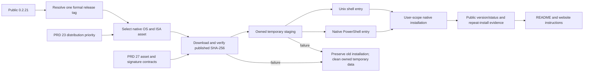

# Native command-line installation

Parent: [delivery](PRD_02_27_con_delivery.md). Product/distribution priority is
owned by [PRD 23](PRD_02_23_minicon.md#distribution-priority).

Status: `[_]` accepted follow-up, deferred by the owner on 2026-10-24 for later
coordinated AgenTerm planning. Public 0.2.21 is available; installation is not
the current 0.2.22 delivery. The [0.2.22 sequence](../plan/plan-v0.2.22.md)
now prioritizes macOS browser usability. This was not a 0.2.21 Candidate gate.

## Outcome tree DAG

```text
Outcome: users install native MiniCon with an OS-appropriate command
├── [_] Published-version and native-asset selection
│   invariant: resolve one formal release tag, then choose the matching native OS/ISA asset
│   evidence: Windows/Linux x86_64 and arm64, plus both macOS ISAs selecting universal
│   safe failure: unsupported target or missing formal asset fails explicitly
│   dependency: public 0.2.21 and PRD 27 release asset names
│   non-goal: silently substituting the secondary APE demonstration
├── [_] Verified staging and replacement
│   invariant: verify the release SHA-256 sidecar before changing the installed product
│   evidence: successful install/reinstall and negative hash/download/replacement cases
│   safe failure: remove owned temporary data and preserve the existing installation
│   dependency: version/asset selection and current signing/package contracts
│   non-goal: bypassing OS trust or rebuilding/re-signing downloaded bytes
├── [_] Unix entry point: docs/install.sh
│   invariant: Linux and macOS use their native archives/app packaging with a user-scope default
│   evidence: the published curl-to-bash command installs and reports the expected version
│   safe failure: unsupported shell/runtime/path is explicit; no partial executable replacement
│   dependency: verified staging; macOS preserves the qualified signed app/DMG path
│   non-goal: a required installer or automatic installation of system browser libraries
├── [_] Windows entry point: docs/install.ps1
│   invariant: native PowerShell installation selects the correct Windows ISA and retains signatures
│   evidence: the published PowerShell command works without Git Bash/WSL on both Windows ISAs
│   safe failure: unsupported PowerShell or failed trust/hash checks leave the old installation usable
│   dependency: verified staging and the Windows native ZIP contract
│   non-goal: changing execution policy, requiring admin or adding a service
└── [_] README and website adoption
    invariant: OS-appropriate native installation is the main user path; examples match the shipped scripts
    evidence: README.md index, README.en.md, README.zh.md and site locales agree with real installed bytes
    safe failure: retain accurate manual native downloads while an installation method is unavailable
    dependency: the public entry points and actual per-platform install evidence
    non-goal: duplicating release facts or keeping a second installer source copy
```

## Memory palace



## Entry points and public examples

GitHub Pages currently publishes `main:/docs`; `docs/CNAME` supplies
`minicon.agenterm.work`. Keep one implementation per entry point in that
published tree. The following URLs and commands are planned, not currently
available installation claims:

| User | Planned source/public path | User-facing command shape |
| --- | --- | --- |
| Linux / macOS | `docs/install.sh` → `https://minicon.agenterm.work/install.sh` | `curl -fsSL https://minicon.agenterm.work/install.sh \| bash` |
| Windows | `docs/install.ps1` → `https://minicon.agenterm.work/install.ps1` | Native PowerShell download-and-run instruction; no Bash assumption |

Additional equivalent download commands may be documented once tested. The
installer resolves a release once and keeps all downloads bound to that tag;
it does not combine independently moving `latest` requests. Native asset names
and sidecars remain owned by PRD 27 and `release/candidate_bundle.py`.

## Installation boundary and evidence

- Default to user-owned destinations and explain launch/PATH use. Global
  environment changes, privileged installation and automatic startup are not
  implicit permissions of a download command.
- Preserve Windows Authenticode and the macOS signed/notarized app packaging.
  Reuse existing package/install helpers where their contracts match. Do not
  remove quarantine or change system trust to make an install appear to pass.
- Linux browser-runtime requirements remain owned by PRD 27. An install script
  may explain missing system libraries; it does not silently run a system
  package manager with elevated rights.
- Exercise installation through the published script URL and the installed
  product's public `--version` / `--status` on all six cells. Record actual
  destinations and native-byte identity, and prove checksum failure preserves
  a prior installation. Repeating installation must have a defined result.
- Update the README index and both language files together with website
  locales after script evidence exists. Re-measure download sizes from public
  assets and use the owner's current runtime support statements; old website
  sizes and package assumptions are not installation evidence.

## Sequencing

1. Finish and verify public 0.2.21 without adding installer work to its frozen source.
2. Implement shared release selection/staging and the two OS-appropriate entry points.
3. Prove installed native bytes and failure preservation on the six cells.
4. Publish the script entry points and reconcile README/site examples against them.

This module owns installation behavior. PRD 27 owns release/delivery facts,
PRD 23 owns product priority, and README/site content keeps operator actions
and links instead of a second specification.
