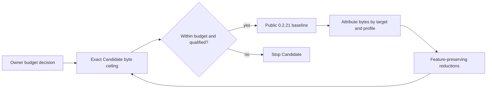
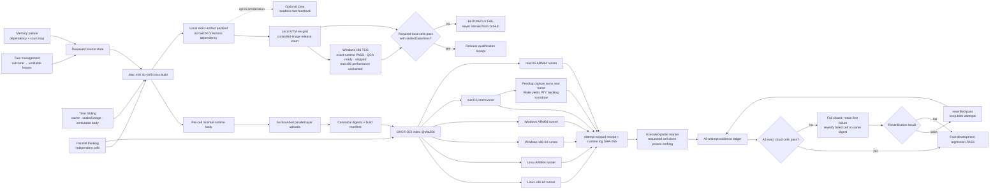
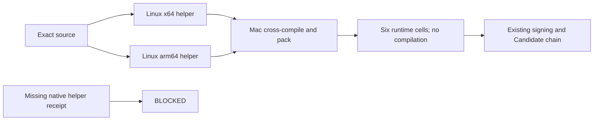
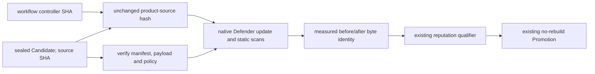
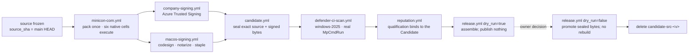

# `minicon` package, budget and delivery

Parent: [MiniCon product requirements](../PRD.md)

This module owns the standalone host's package identity, unwind profiles,
artifact budget, runtime host-memory budget, dependency-graph bans, independent
CI ownership, and its measured artifact-size history. Historical cross-product
release context stays
with AgenTerm; this repository's workflows and machine-readable contracts are
authoritative for MiniCon delivery.

Legend: `[v]` shipped, `[-]` partial, `[_]` planned.

## Current release evolution

The current public baseline is v0.2.23 (receipts in
[its release history](archive/v0.2.23-release-history.md)). The per-release
evolution record from v0.1.2 forward — cell coverage, signing-mode changes,
candidate/court/promotion receipts and the lessons each release bought — is
frozen in [the delivery-history archive](archive/PRD_02_27-delivery-history.md)
and the per-version [release histories](archive/README.md). Durable rules it
recorded, carried here so the archive stays optional reading:

- Never backfill a historical Release's missing cells.
- The repository-pinned Rust toolchain is load-bearing release evidence;
  release builders must not silently inherit a rolling `stable` toolchain.

### The public Release body is a template, not a changelog

- [-] `.github/release-notes.md` is published **verbatim** as the GitHub Release
  body (`release.yml`, the `gh release create --notes-file` step, which also
  substitutes the version string and keeps or drops the optional-APE row from
  `release-policy.json`). Its per-version Highlight list had drifted **seven
  releases behind**: v0.2.0–v0.2.6 each published with a body whose Highlights
  stopped at v0.1.26 and still described the pre-0.2.6 two-tool header — the
  sent-history panel, tab rename and mux/harness were absent from every one of
  them. Verified against the published `v0.2.6` body, not inferred.
- [v] Reduced to a template on 2026-10-13: product blurb, a pointer to the
  release histories, Downloads, verification, older-Windows and reporting
  sections, and one signing-pointer paragraph. Per-version facts stay owned by
  `prd/archive/` release histories; this file must not restate them. If a
  cumulative public changelog is wanted again it needs a named owner and a
  release-step update trigger, not a hand-kept list that silently rots.

### The public site had no owner

- [-] the published site under `docs/` (`index.html`'s download page and
  `old-windows.html`) referenced **no** PRD or plan before 2026-10-13, so its
  facts had no owner in this series. Owned here from now on for the
  download/release surface; `docs/control-cli.html` is owned by
  [26](PRD_02_26_con_control_cli.md) for the command set it mirrors. Update
  trigger: any release that changes an asset name, an archive's contents or the
  supported-OS list. `old-windows.html` has not changed since 2026-09-29 and its
  sample output still reads `minicon 0.1.2` — refresh it or date the sample. The
  pages have no generator; that gap is already recorded as deliberately not done
  in `plan/archive/plan-repo-hygiene-2026-10-24.md`.

### Deferred native command-line installation

The accepted product/distribution priority is owned by
[PRD 23](PRD_02_23_minicon.md#distribution-priority). After 0.2.21 is publicly
released, command-line installation and the matching README/site instructions
are owned by [PRD 27.01](PRD_02_27_01_install.md). They do not add a prerequisite
to the current Candidate and do not change its asset/signing policy.

## Bounded build-state lifecycle

- [v] `scripts/cleanup-build-state.py` is the single deletion authority for
  regenerable repository-local build state. It defaults to dry-run, accepts
  explicit scopes, validates that it owns a MiniCon checkout, never follows a
  deletion target outside that checkout, serializes apply runs with
  `target-six/.cleanup.lock`, and writes an immutable GC receipt whenever it
  removes anything.
- [v] ordinary `target/` expires only after 14 inactive days and with no active
  build marker. `scripts/build.sh` is the documented release/dev/check/test
  wrapper: it runs bounded maintenance before Cargo and owns the active marker
  for the command lifetime. Direct Cargo remains available but does not pretend
  to own automatic cleanup.
- [v] six-cell snapshots expire after seven days while retaining at least the
  newest three. `target-six/builds/current`, the build root named by the latest
  receipt, and every fresh `.minicon-build-active` marker are protected.
  `scripts/six-cell-qualify.sh` invokes this scope and pins its selected build
  root before fan-out, so cleanup cannot race the owning qualification.
  When repository-volume free space falls below 64 GiB, the same protection
  set remains absolute but the cache enters pressure mode: it keeps the newest
  two snapshots and expires other inactive snapshots after one hour. This
  converts disk pressure into bounded cache loss, never evidence or active-job
  loss.
- [v] cloud runtime files are grouped by the complete source-tree identity.
  They are eligible only after 30 days, while retaining the newest three and
  the current receipt identity, and only when a matching archive receipt says
  that immutable remote preservation was verified. An incomplete or
  unpublished group fails closed and remains local.
- [v] VM disks, ISO files, preparation receipts, court state, guest keys and
  runtime evidence are outside automatic deletion. Their acquisition and
  authority costs are not equivalent to a Cargo cache.
- [v] `scripts/install-macos-daily-cleanup.sh` installs the per-user
  `com.partnernetsoftware.minicon.cleanup` LaunchAgent. It runs at 03:17 daily
  with background/low-I/O scheduling, uses the same shared cleaner, and logs to
  `~/Library/Logs/minicon-maintenance.log`. Reinstalling updates the job
  idempotently; no password or system daemon authority is required.

- Routine cleanup can expire an idle `target/` after one hour under disk
  pressure. On Windows, redirecting a new build log into that eligible tree
  holds the file open while cleanup removes its parent; the result is partial
  cache removal followed by a sharing violation. Put handoff receipts/logs
  outside that cache, such as ignored `target-six/release-<version>-logs/`,
  before starting the wrapper. The existing per-command
  `MINICON_TARGET_TTL_HOURS` override can retain an active release handoff's
  cache; it does not bypass test, source or artifact gates. The 0.2.21 replay
  used the normal 336-hour retention for that invocation, restored durable CI
  receipts, and reran the interrupted selected gate. Incident log:
  `target-six/release-0.2.21-logs/cleanup-windows-log-lock.log`.

## Package identity

- [v] `minicon` is an independently owned workspace package
  (`crates/minicon`) with its own dependency graph, not a bin target of the
  workbench crate.
- [v] the Windows production graph contains no winit or softbuffer: that cell
  uses `native-pixel-window` (Win32). Unix cells use `portable-pixel-window`
  and **do** link winit/softbuffer. No cell links Rhai or a script
  engine. Native HTTP/TLS mechanisms and their product consumers are mapped
  in [PRD 28](PRD_02_28_shared_core.md); they are part of the current provider
  connection. `serde_json`, `hashbrown`/`RandomState`, ab_glyph and ttf_parser are
  absent from the Windows production graph and survive only as dev-only
  oracles where noted. A size or graph claim must name the target.
- [v] the platform `pty` feature declares its own `Win32_Security` dependency
  rather than relying on con's unrelated `ipc` feature to make `CreateProcessW`,
  pipes and Job APIs visible, so both the minimal capability graph and the full
  con graph are compile-owned.
- [v] the binary source lives under `src`, and all four
  public/alignment/throughput tests live under `tests`.
  The package has no `../../` source or test path back into the workbench tree,
  so Cargo ownership and physical ownership now agree.
- [v] official staging removes the obsolete experimental
  `minicon-native.exe` alias both before and after publication, alongside
  earlier retired executable names. `dist/minicon.exe` is the sole Windows
  con artifact users can accidentally select after a successful build.

### Native version identity

The native CLI version and status banner share one canonical LF-terminated
production literal. `loader/write-build-receipt.py` requires every embedded
numeric product-version candidate to have that terminator, then requires its
complete version set to equal the selected version. Missing, unterminated,
stale, longer and mixed candidates fail; neither prefix matching nor truncation
is allowed. Actual native `--version` courts retain their exact comparison.
`scripts/build-receipt-version-selftest.py` owns the offline producer/parser
fixtures; removing termination validation or replacing exact comparison with
a prefix comparison produced runtime RED before exact restoration and PASS.

Pack run [`40110168563`](https://github.com/partnernetsoftware/minicon/actions/runs/40110168563)
at `891ad5f4c8ff00b40bc4585a289150964dfdcb90` compiled all six native payloads
but rejected Linux ARM candidates `0.2.23` and `0.2.231`. String pooling at an
unterminated banner is the source-supported explanation; that failed run had
no sealed payload receipt and cannot establish mixed-source bytes or qualify
an artifact. The explicit producer/parser boundary requires a new-source pack.

The corrected boundary produced a clean-source receipt in pack run
[`40113102017`](https://github.com/partnernetsoftware/minicon/actions/runs/40113102017)
at `d40c4fd45543ea7e4e055d963d62bc2684a943ce`: all six downloaded native
payloads match the recorded SHA-256 and lengths. The unsigned `minicon.com`
receipt reports 15,475,988 bytes against the owner's 20,000,000-byte ceiling.
This development pack is not a signed Candidate or public release; later
source fixes require their own pack and artifact qualification.

## Load-time portability

The oldest Windows this product claims is **Windows Server 2016 / Windows 10
version 1607 (build 14393)**. That claim is a delivery property, not a runtime
one: the PE loader resolves every static import before `main`, so a single
import the target lacks refuses the whole program with a dialog naming a symbol
the user cannot act on. No panic hook, log or diagnostic sink can observe it,
and no other gate in this repository can see it either, because they all run on
machines new enough to satisfy the import.

- [v] no static import locks the product out of a supported Windows. ConPTY's
  three entry points (build 17763) and `SetThreadDescription` are resolved at
  run time instead.
- [v] a documented minimum version is treated as evidence, not proof.
  `SetThreadDescription` is documented as available in 1607 — which *is* Server
  2016 — and is still absent there, because 1607 implements it only in
  `KernelBase.dll` and the `kernel32` forwarder arrived in 1703. SDK header
  guards do not catch this. Only the target machine settles it.
- [v] **no Visual C++ redistributable.** The VC runtime is linked statically and
  every remaining module is a Windows component. The 0.2.21 same-process
  WebView2 adapter requires the static WebView2 loader; that loader pulls
  `libcmt.lib(utility.obj)` and its private static-UCRT initialization symbols.
  Windows now links the static UCRT too and calls `__acrt_initialize` after
  `__vcrt_initialize` at its custom entry. A canonical Windows x86_64 dev
  build and visible page journey prove this locally; the native ARM64 and
  release artifact courts remain open. `panic = "unwind"` is preserved.
  MSVC `vcruntime/initialization.cpp` and UCRT `internal/initialization.cpp`
  declare the initialization results as C++ `bool` (`__crt_bool` in
  `corecrt.h`), not a 32-bit Win32 BOOL. Rust's imports match that ABI;
  [unused upper return bits are undefined on x64](https://learn.microsoft.com/en-us/cpp/build/x64-calling-convention).
  `pe_entry_observes_the_crt_boolean_return_abi` loads the actual PE entry
  with true/false CRT stubs and verifies failure stops before main even when
  those unused bits are nonzero. This is native x86_64 evidence only.
- [v] a custom PE entry (`/ENTRY`) obliges the program to run the CRT
  initialization the MSVC startup object would have. `__vcrt_initialize` is
  required and is not reachable through the `.CRT$XI*` table this product walks;
  omitting it links cleanly and then dies on the first panic at
  `STATUS_STACK_BUFFER_OVERRUN`, which reads as stack corruption and is a
  missing constructor. `__security_init_cookie` is *not* required — measured,
  not assumed: the cookie is already random without it.
- [v] a gate parses the shipped executable's import table with a pure-Rust
  parser (no `dumpbin` on PATH) and fails on any blocker symbol, or on any
  module that is neither a Server 2016 OS component nor a recorded exception.
  The exception list is empty, which is what makes a future redistributable
  dependency turn it red instead of quietly widening what a user must install.
  The gate was negative-controlled — adding an actually-imported symbol to the
  blocker list turns it red — so it is not a vacuous assertion.
- [v] `scripts/diagnose-startup-windows.ps1`, published as a Release asset rather
  than bundled into any archive, answers the whole question from the target
  machine in one pass, because the loader names only one missing symbol at a
  time and iterating costs a round trip per symbol, paid by whoever owns that
  machine. It parses the PE itself (the target has no Visual Studio) and
  self-tests that a nonexistent export fails to resolve and a universal one
  succeeds before printing an all-clear — an all-clear being also what a broken
  probe prints.

Verified on a user's Windows Server 2016 on 2026-08-23: all named imports
resolve, the program starts, and `--status` reports the fallback backend and a
correct half/full-width font measurement.

## Migration records (archived)

The 2026-08-23 post-migration delivery differences and the historical
agenterm delivery contract (including its unwind/panic-containment profiles)
are migration records, frozen in
[the delivery-history archive](archive/PRD_02_27-delivery-history.md).

## Runtime host memory

Disk size is the artifact budget below. RAM is a scarce product resource, not
slack. The number is the **MiniCon host process** RSS (working set). Child
shells are the user's programs and sit outside it. One cell's number is not a
six-cell claim.

- [v] a public GUI black-box court measures MiniCon host RSS after one idle
  tab is ready, after a 2000-line PTY load, after a second tab, and after
  four extra-tab open/close cycles. It fails if idle RSS exceeds 384 MiB, a
  second tab adds more than 16 MiB, or four cycles grow the host by more than
  32 MiB. Evidence:
  `minicon_control::host_process_rss_stays_within_named_budget`. Observed
  2026-09-06 on macOS aarch64 `cargo test` (debug GUI): idle ~300 MiB, 2000-line
  load ~333 MiB, extra tab ~1 MiB, four-cycle growth ~1.4 MiB. Release GUI on
  the same host was also ~315 MiB idle. Those idle figures are named host
  observations, not a universal product size.
- [_] intended idle one-tab host RSS is **10 MiB** on each named cell. A
  terminal client that needs hundreds of megabytes, or even tens of megabytes,
  has lost the plot. Shrinking to 10 MiB is current-version work. Do not raise
  the 384 MiB regression ceiling to hide the gap, and do not treat 64 MiB as a
  compromise budget.
- [v] `archive/lab/tinygui` is the Darwin empty-window floor, not a MiniCon cut.
  2026-09-07 osx-aarch64, 960×600, no timer: ObjC AppKit **77.2–77.3 MiB**
  RSS, Rust AppKit **71.2–76.0 MiB** RSS (footprint **16 MiB**), empty
  winit+softbuffer **115.4 MiB** RSS. All three **0.0% CPU** and sleep in
  `mach_msg2_trap`. Same-host settled MiniCon release was **70.9 MiB** RSS
  at **5.2% CPU**. The 10 MiB **RSS** intent sits below this AppKit RSS
  floor; CPU idle is available from the host. Evidence: `archive/lab/tinygui/RESULTS.md`.
  Linux/Windows tinygui courts are not this receipt.
- [v] macOS idle ~300 MiB attributed to the shared Unix font raster
  `Box::leak`ing whole fallback TTC files (including a 183 MiB color-emoji
  collection) at first glyph, not to MiniCon's window stack or per-tab PTY
  state. Detail: `prd/evidence/PRD_02_27_runtime_memory.md#macos-idle-300-mib-baseline-attribution-2026-09-06`.
- [v] Unix whole-font leak repaired, shared revision `bb309e79bc351b3`
  (`fix/lazy-font-mapping`): lazy read-only mappings, fallback opened only
  after a glyph miss. osx-aarch64 debug court: idle 94.53–103.31 MiB (down
  from ~300 MiB); 384 MiB ceiling unchanged, 10 MiB target still unmet.
  Detail: `prd/evidence/PRD_02_27_runtime_memory.md#unix-whole-font-leak-repair-shared-revision-bb309e79`.
- [v] macOS frame duplication and allocator retention reduced, shared pin
  `8d8de88c9ab62709`: removed a duplicate Retina canvas and a temporary
  compatibility plist key. Final osx-aarch64 release court: idle 86.89 MiB,
  10 MiB target stays open. Detail:
  `prd/evidence/PRD_02_27_runtime_memory.md#macos-frame-duplication-and-allocator-retention-shared-pin-8d8de88c`.
- [v] Two independent baseline/increment investigations narrow the
  remaining macOS gap to OS UI initialization and presentation, not a
  single irreducible cost (native Cocoa Hello window alone is 49.53 MiB;
  MiniCon's own ASCII+CJK/tab increments are ~0.3/~1.3 MiB). Detail:
  `prd/evidence/PRD_02_27_runtime_memory.md#two-independent-baselineincrement-investigations`.
- [v] Screenshot allocator-cache growth repaired, shared main revision
  `745f52b2e169d5b4`: screenshot RSS increment dropped from ~17.9–26.5 MiB
  to ~0.3–0.5 MiB by removing two full-frame malloc buffers. Named RSS
  court idle 86.39 MiB — not a startup or 10 MiB measurement. Detail:
  `prd/evidence/PRD_02_27_runtime_memory.md#screenshot-allocator-cache-growth-repair-shared-main-revision-745f52b2`.
- [v] Remaining macOS RSS is measured, not discounted: a frozen release
  receipt closes 79.27 MiB resident into internal/external/reusable
  components; all remain in the product RSS criterion. Detail:
  `prd/evidence/PRD_02_27_runtime_memory.md#remaining-rss-accounting-macos`.
- [-] AppKit Writing Tools startup load is causally identified (idle
  78.141 vs. 60.500 MiB with/without, in a private-method-only negative
  control) but not yet a supported product repair; still exceeds 10 MiB.
  Detail: `prd/evidence/PRD_02_27_runtime_memory.md#appkit-writing-tools-startup-load`.
- [-] osx, lnx and win name host RSS through the same black-box court
  (`scripts/rss-os-court.sh`). One platform's idle figure is not a
  six-cell claim. Named release-build figures: osx-aarch64 debug
  94.53–103.31 MiB; win-aarch64 UTM release 21.46 MiB; lnx-x86_64 cloud
  container (Xvfb, not the six-cell lnx-aarch64 UTM cell) release
  **12.01 MiB** — closest to the 10 MiB intent of any named cell so far.
  lnx-aarch64 UTM itself remains `BLOCKED` (QGA file-push timeout), so
  `{UI}`'s C4 leaf stays open pending that specific cell. Windows working-set
  attribution (PE hashes, page-partition and per-module accounting) is a
  research trail, not a product change, and does not move any cell's PASS
  state. Detail:
  `prd/evidence/PRD_02_27_runtime_memory.md#osxlnxwin-same-black-box-court-per-cell-detail`.


## Artifact budget

- [v] ~~`minicon.com` Candidate hard ceiling is `9,437,184` bytes (9 MiB).~~ —
  **raised 2026-09-26 (owner) to `11,534,336` bytes (11 MiB)**; see the entry
  below. Stamped 2026-08-29 (cdx) from rehearsal raw `8,880,268` (+556,916,
  ~6.27%). The 12 MiB (`12,582,912`) figure is a rehearsal fail-closed guard
  only and must not decide a Candidate; it stays above the new 11 MiB
  Candidate ceiling.
- [v] **`minicon.com` Candidate hard ceiling raised to `11,534,336` bytes
  (11 MiB), 2026-09-26 (owner).** 0.2.0's `mux` + `harness` subcommands (network
  transport, opencode-go codec) grew the sealed `minicon.com` to `10,746,681`
  bytes, above the 9 MiB ceiling that had explicitly forbidden auto-raising
  (candidate.yml run `36217456516` failed at `seal` on this). The owner judged
  the growth a real feature cost, not slack, and raised the ceiling directly
  rather than trimming 0.2.0's scope; the previous "must not auto-raise"
  language governed that specific 9 MiB number, not future owner-directed
  budget changes. Constant: `release/candidate_bundle.py` and
  `loader/write-size-report.py` `CANDIDATE_CEILING_BYTES`, and
  `release/self-sign-rehearsal.sh` `CEILING`/`candidate_ceiling_bytes` (kept in
  sync — a static test should assert this). A unique G7 pack that exceeds
  11 MiB fails; raising it again requires the same explicit owner decision,
  not an automatic bump when a future version grows past it.
- [v] **`minicon.com` Candidate hard ceiling raised to `12,320,768` bytes
  (11.75 MiB), 2026-10-14 (owner).** 0.2.8's update-path hardening (`{EXECBIT}`,
  `{ROLLBACK}`, `{BOMB}`, `{SCHEME}`, `{RECOVER}`) plus the clipboard-image
  paste fallback grew the sealed `minicon.com` to `11,622,574` bytes, above the
  11 MiB ceiling that had explicitly forbidden auto-raising (candidate.yml run
  `38508933615` failed at `seal` on this). The owner judged the growth a real
  feature cost — trimming it would ship the 0.2.7 update-path defect again —
  and raised the ceiling directly, as an explicit, dated, recorded change, not
  a silent or automatic bump. New value sits `262,144` bytes below the
  unchanged 12 MiB rehearsal guard (`12,582,912`), which still must not decide
  a Candidate. Same four constant sites as the 2026-09-26 raise. The 0.2.7
  `minicon.com` was already only `124,472` bytes under the old ceiling, so the
  budget was due for review regardless. Raising it again requires the same
  explicit owner decision.
- [v] **Candidate hard ceiling raised to `20,000,000` bytes (20 MB, decimal),
  2026-10-24 (owner), for 0.2.21's `minicon-web` growth.** This is approximately
  19.07 MiB, not 20 MiB. The owner explicitly accepted the larger budget and
  required subsequent size optimization. The earlier unsigned baseline is
  measured in "What runs where" below; final signed bytes must still pass this
  exact hard ceiling. Raising it again requires another explicit owner decision.
  The Candidate bundle, size report and self-signing rehearsal's Candidate
  ceiling/receipt now share this integer. The size report's independent
  rehearsal-only guard remains 12 MiB and cannot decide a Candidate.
  `candidate_bundle.py --self-test` accepts the exact ceiling and rejects one
  extra byte through both real seal and verify paths. Removing either guard
  makes its boundary control fail. Local evidence:
  `target-six/release-0.2.21-logs/candidate-20mb-green.log` and
  `candidate-20mb-red-no-{seal,verify}-guard.log` in the same directory.
- [_] **After 0.2.21: optimize artifact size.** Attribute native sections,
  embedded-helper bytes and compressed container contributions at named
  source/profile/target identities before choosing reductions. Preserve the
  native product outcome, browser functionality, unwind containment and signing
  gates; the larger allowance is not evidence that optimization is complete.

```text
Outcome: bounded artifact growth with measured follow-up
├── [v] Owner-approved 20 MB Candidate ceiling
│   invariant: exact byte limit; never auto-raise
│   evidence: real seal/verify boundary controls above
│   safe failure: over-budget Candidate fails
│   dependency: the same integer at every enforcement/receipt site
│   non-goal: using the separate rehearsal guard as Candidate authority
└── [_] Size optimization after public 0.2.21
    invariant: preserve the native product and supported browser behavior
    evidence: reproducible before/after sections and compressed bytes by cell
    safe failure: retain qualified bytes when a reduction breaks behavior
    dependency: the public baseline and exact-source profiling
    non-goal: deleting release gates or cutting accepted features to fit
```



- [v] the Windows resource retains the existing icon's 16/32/64 PNG frames while
  removing redundant mip sizes: `.rsrc` fell from 90,112 to 8,704 bytes, the
  source ICO is capped at 16 KiB by the build script, and Windows shell icon
  extraction still succeeds.
- [_] ~~Every released `minicon` artifact must be strictly below 1 MiB
  (`release_budget_bytes = 1,048,575`)~~ — **the ceiling was withdrawn on
  2026-08-25**; see the entry above. What survives it is the second half of the
  sentence, which was never platform-specific and still binds: a size statement
  is not an observed development number, and every size statement must name its
  profile **and its target**. The omission of the target is what let a Windows
  measurement stand as the product's size. At the icon reduction the LTO
  `con-release` PE measured 8,704 bytes below the historical 512 KiB target,
  while the no-LTO `con-release-fast` PE was separately 543,744 bytes and is not
  release-size evidence. After the product ceiling changed to a strict 1 MiB,
  the official custom-std unwind/trace-only `con-release` PE measured 561,152
  bytes, 487,424 bytes below that current ceiling. This recovered budget does
  not permit reverting to abort or trading away backpressure, durability or
  clean shutdown.
- [v] size claims require linked-symbol, disassembly or target-specific cold
  build evidence. An incremental 484,352-byte artifact that did not reproduce
  from the same HEAD after an explicit Windows-target package clean is recorded
  as non-evidence, and future assembly or native FFI work must start from the
  same standard rather than from mechanism preference.

### APE join (cosmocc over six native cells)

- [v] `minicon.com` is a Cosmopolitan fat trampoline plus ZipOS overlay
  (`/zip/cells/{os}-{isa}/`). It does **not** recompile MiniCon against
  cosmopolitan libc. GUI/PTY/Win32/Cocoa/Wayland stay in the already-qualified
  Rust cells. The trampoline selects `{os}-{isa}`, copies the blob out of
  ZipOS (or `MINICON_COM_CELLS`) into a per-invocation private directory, and
  `exec`s it. In-process mmap (rust-ape style) is the wrong join for a native
  GUI terminal.
- [v] extract dirs are disposable: `mkdtemp` under `/tmp/minicon.com.<pid>.XXXXXX`
  (Darwin `/tmp` may be `/private/tmp`), mode `0700`, marker file
  `.minicon-extract`. Reaper uses `lstat` / `O_NOFOLLOW` / uid / mode / marker.
  SIGKILL vs non-EINTR `waitpid` failure keeps the directory. There is no
  `MINICON_CONFIG` override. Windows config root remains
  `SHGetFolderPathW(CSIDL_APPDATA)` ([25](PRD_02_25_con_workspace.md)), not
  `~/AppData/Roaming` / the user-profile root.
- [v] pack profiles are target-specific: Linux cells `cargo zigbuild --profile
  release` (thin LTO + `--gc-sections` / `--as-needed`); Darwin and Windows
  cells `release-fast`. Zig's lld rejects `-z pack-relative-relocs` (RELR);
  that path is closed. `cosmocc --version` prints a GCC id (14.1.0), not the
  Cosmopolitan release pin; the pin is the zip SHA-256 plus `bin/cosmocc`
  digest. Install is NEXT/PREV rename-swap under the same parent.
- [v] one pack, six native execute-only courts. Guests do not compile. v0.1.2
  stays three archives; `minicon.com` is not mixed into that Release.
  Promotion copies exact bytes. The 9 MiB ceiling was raised to 11 MiB by
  explicit owner decision on 2026-09-26 (see "Artifact budget" above); that is
  not the same as an automatic raise, which remains forbidden.

- [v] **Distributed zip size growth, flagged 2026-09-27 (owner, curiosity, not
  a release blocker); confirmed 2026-09-27.** Owner-observed download zip
  roughly 400+ KB on 0.1.x vs 900+ KB on 0.2.x — a bigger jump than the sealed
  Candidate's own `8,880,268` → `10,746,681` (+21%) receipt above (zip
  compresses differently than the raw Candidate payload, so the two numbers
  are not directly comparable, but both move the same direction).
  Real before/after measurement (`x86_64-unknown-linux-gnu`, `release`
  profile, `strip`, same environment, same commit, only the
  `agenterm-platform` feature list in `Cargo.toml` and one stubbed
  `harness_wire.rs` transport method changed): with `network-http` enabled,
  the stripped `minicon` binary is 5,534,288 bytes; with it removed (and
  `HarnessWire::post_json` stubbed to isolate exactly this feature),
  3,901,800 bytes. **Delta: 1,632,488 bytes, ~41.8% of the without-http size,
  ~29.5% of the with-http size** — confirmed the dominant contributor, not
  `mux`/`harness`'s own new lines. `cargo tree` confirms the graph is exactly
  `ring <- rustls <- ureq <- agenterm-platform`, entering only through
  `network-http`; `ring`'s constant-time crypto tables resist LTO/strip
  disproportionately, as suspected. Any fix to the TLS/crypto dependency
  graph itself (swapping `ring` for a smaller provider, or Unix `native-tls`)
  is still `agenterm-platform`'s `Cargo.toml`, outside this repo, and both
  read worse on inspection: `aws-lc-rs` is larger than `ring`, not smaller;
  Unix `native-tls` trades static bytes for a runtime `libssl.so` dependency,
  which conflicts with the single-static-executable invariant and needs an
  owner call. A MiniCon-side "lean/no-network build variant" gating
  `network-http` behind a default-on feature was floated here and then
  retracted by the owner the same day: `harness_wire.rs`'s
  `NetworkHttp::post_json` (DeepSeek chat) is not incidental load, it is
  `harness` calling out to a model provider's HTTPS API, which is the whole
  point of `harness` as a default 0.2.x capability
  ([31](PRD_02_31_v0_2_horizon.md)) -- a build without it is a build without
  `harness`, not a leaner build of the same product. There is no variant
  where `harness` ships and this 1.6 MB does not. **Conclusion: this is not
  overhead to remove, it is the measured, confirmed cost of the capability
  the product ships.** No MiniCon-side or `agenterm-platform`-side action
  follows from this item; it stays `[v]` as a closed measurement, not as an
  open lever.

### Linux size attribution (LTO cells, 2026-08-29)

Payload bytes after Linux `profile.release` (same numbers as the 迁出差异
entry above). These are **cell** sizes, not a Candidate APE SHA. Later
Candidate/rehearsal APE totals (for example 8,909,564) name a different
container and must not be substituted here.

| cell | bytes | profile |
|---|---:|---|
| lnx-x86_64 | 5,746,384 | `release` (thin LTO) |
| lnx-aarch64 | 4,857,552 | `release` (thin LTO) |
| osx-aarch64 | 1,613,872 | `release-fast` |
| osx-x86_64 | 1,662,232 | `release-fast` |
| win-aarch64 | 812,544 | `release-fast` |
| win-x86_64 | 867,328 | `release-fast` |

`lnx-x86_64` ELF (that 5,746,384-byte file): `.text` 3,489,366;
`.eh_frame` + `.eh_frame_hdr` + `.gcc_except_table` 1,126,960 (unwind,
required by `panic = "unwind"`); `.rela.dyn` 475,416. Darwin `__TEXT,__text`
is 916,500–1,052,784; Windows `.text` is 563,200–595,456. Linux is large
because it links **winit Wayland and X11 plus independent `x11rb`**, not
because strip was skipped. Linux also enables `a11y-publish` (`tokio`
`rt-multi-thread`, `zbus`, `atspi`, `x11rb`) so AT-SPI can address inner
host UI ([23](PRD_02_23_minicon.md)); that is a product feature, not slack.

Zip overlay of one local LTO rehearsal APE (`7,493,066` raw, under 9 MiB,
not Candidate-of-record): APE prefix 714,106; two Linux cells compressed
≈4.46 MiB (about 59% of that container); Darwin ≈1.52 MiB; Windows ≈0.75 MiB.
gzip-9 of that whole APE was 7,065,640 — deflate is not the remaining lever.

Historical Windows portable→native pixel host: 1,046,528 → 585,216. That
cut does not exist yet on Darwin: `native-pixel-window` is `windows`-only
in the pinned `agenterm-platform`; unix stays `portable-pixel-window`.
macOS already optionally depends on `objc2-app-kit` via the `window`
feature, so Cocoa bindings can be present **in addition to** winit.

### Remaining mini levers (product decisions, not v0.1.3 by default)

Linker knobs already spent on Linux: LTO, `opt-level=z`, `strip`,
`--gc-sections`. Do not trade `panic = "unwind"` for `.eh_frame`. Do not
auto-raise the Candidate ceiling (currently 20 MB decimal, see "Artifact budget")
without an explicit owner decision.

- [-] **Linux dual desktop stack is retained (2026-08-30, user).** Keep
  winit Wayland **and** X11 present, plus the independent `x11rb` side
  path (clipboard / EWMH / XTest / AT-SPI origin). Xorg-only sessions
  (XFCE UTM, `xvfb`) and Wayland-default desktops are both in-scope; this
  is not CentOS-7 residue. Do not compile out either winit backend, do not
  drop `libxkbcommon-x11-0` from the runtime set, and do not treat a
  single-backend size cut as open work.
- [v] **Linux X11 runtime boundary is versioned and product-owned.** The exact
  v0.1.3 x86_64 Release ELF (`d5b15772…`) contains `xkbcommon-dl 0.4.2`, which
  already tries `libxkbcommon-x11.so.0` before the unversioned development
  name; its hard-coded panic nevertheless named only `.so`, leaked the CI Cargo
  path, and made a missing runtime package look like a `-dev` requirement.
  Current main probes only the versioned SONAME and the four XKB-X11 symbols
  before entering winit on an X11-selected session. Absence exits 1 with
  `apt-get install libxkbcommon-x11-0`; Wayland-only startup does not acquire a
  false X11 requirement. The native import table remains insufficient evidence
  because this edge is `dlopen`-owned.
- [v] **Runtime-only court, not build-host luck.** A Debian x86_64 court with
  `libxkbcommon-x11-0` 1.7.0-2, no `libxkbcommon-x11-dev`, and no unversioned
  `.so` launched the already-linked ELF under Xvfb/DBus. Public control focused
  the composer, proved Enter retained a soft newline without PTY delivery,
  proved `Ctrl+O` delivered `XKB_RUNTIME_ONLY_OK`, closed the final tab into
  `workspace_empty`, then closed the window cleanly. Removing only the runtime
  package produced the actionable MiniCon error with no panic/build-host path;
  the same court restored the package afterward.
- [v] Candidate native package execution runs
  `scripts/linux-x11-package-smoke.sh` on each Linux artifact's matching ISA
  runner. An empty Ubuntu container owns the missing-library/error half; a
  second container installs runtime packages only, asserts the `-dev` package
  and unversioned `.so` are absent, then executes the same composer/lifecycle
  journey. The packaging jobs do not execute a foreign-ISA ELF. A README
  dependency sentence or `ldd` alone cannot satisfy this gate.

| lever | expected pack effect | cost |
|---|---|---|
| ~~Linux single display backend~~ | n/a | **ruled out** — dual stack stays |
| Feature-gate `a11y-publish` | roughly −0.4–0.8 MiB of APE | AT-SPI host UI tree becomes optional; conflicts with current Linux a11y claim unless restated |
| Darwin `native-pixel-window` (Cocoa, in `agenterm-platform`) | roughly −0.5–0.8 MiB of APE | platform work, then MiniCon unix split: macOS native / Linux portable |
| Darwin + Windows also `profile.release` LTO | roughly −0.2–0.4 MiB of APE | low product risk; the only remaining **linker** knob |
| Drop an ISA cell | one Linux cell ≈ −2.2 MiB compressed | narrows six-cell promise; not a code shrink |
| Slim the 714 KiB cosmocc fat prefix | small | pin/tooling change; already `-Os -static` |
| `panic = abort` / drop DWARF unwind | Linux unwind ≈ 1.1 MiB **per cell** | **forbidden**: containment contract |
| RELR / `-z pack-relative-relocs` | n/a | zig lld rejects it |

qjswasm-as-size-cut remains a later hypothesis
([29-horizon](PRD_02_29_qjswasm_horizon.md)), not a current lever.

## Delivery ownership

- [v] **Runner guests are test targets, not build machines.** The Mac host owns
  compilation, linking, source identity, and artifact selection. Each guest
  receives only the exact already-linked artifact tree plus the bounded test
  harness needed for its runtime court; it does not require a compiler, Cargo,
  a source checkout, or a resident development environment. This keeps runtime
  evidence distinct from build evidence and makes guests cheap to discard and
  reproduce. A guest-side rebuild is excluded because it would test different
  bytes and duplicate host work.

- [-] **Cloud six-grid runtime is the hosted execution court, not a second build
  farm.** The Mac mini links all six targets once with native Cargo,
  `cargo-xwin`, and `cargo-zigbuild`. `scripts/package-six-grid-runtime.py`
  then selects only each cell's product, uniquely named owning Rust harnesses,
  target-side runtime driver, bounded alignment inputs, and per-leaf SHA-256
  manifest; Cargo caches, rlibs, metadata, source history, and unrelated test
  binaries are excluded. `scripts/publish-six-grid-runtime.sh` publishes six
  cell bodies plus a top-level index to GitHub Container Registry and dispatches
  `.github/workflows/six-grid-runtime.yml` with an immutable `@sha256:` index
  reference. Mutable tags are upload conveniences only and never test identity.

  The workflow maps exactly to GitHub's native runners: Ubuntu x86-64 and
  ARM64, Windows x86-64 and ARM64, and macOS Intel and ARM64. It performs no
  source checkout, Rust setup, Cargo command, linking, or packaging policy. A
  runner authenticates only for package read, validates the top-level digest,
  source SHA, source-tree digest, cell reference, archive hash, and every
  manifest leaf and the runner's actual `RUNNER_OS` / `RUNNER_ARCH` before
  invoking the fixed OS runtime driver. The default
  `test` suite runs status plus functional/GUI black boxes; `status` is the
  cheapest diagnostic and `full` explicitly adds sustained throughput. Each
  cell has a 20-minute deadline, the matrix is manual/candidate-triggered,
  and failure may be rerun per cell rather than rebuilding all targets. This
  repository is public, so GitHub's standard six runner classes are currently
  free and unlimited; the bounds remain product hygiene and protect the same
  design if visibility or runner policy changes later.

  GHCR is the non-code artifact authority because Actions artifacts belong to
  an already-running workflow and product Release assets would mix test
  candidates with public delivery. Private-package access requires a normal
  GitHub Packages grant; credentials are never extracted from Git transport or
  printed. A dirty source tree may produce local diagnostic receipts but must
  not publish an authoritative cloud bundle. Local UTM courts remain valuable
  for interactive debugging, offline work and failure reproduction; optional
  Lima acceleration remains useful for quick headless diagnosis;
  they are no longer the only possible release runtime authority and never
  justify keeping six heavyweight guests resident.

  The first real six-runner `status` dispatch proved all runner labels but
  failed before execution. Command-line GHCR publication had not linked the new
  package to its source repository, so each otherwise-valid workflow token saw
  the digest as `not found`; the Windows ARM64 setup action also lacked an ORAS
  ARM64 release. Publication now adds the standard
  `org.opencontainers.image.source` annotation to every manifest. Windows ARM64
  downloads the pinned official x64 ORAS archive, verifies its SHA-256, and
  relies on Windows compatibility execution. Runtime receipts also bind the
  workflow SHA, separating test-body identity from orchestration identity.

  The operator path, from repository root, is:

  ```bash
  ./scripts/six-cell-qualify.sh
  ./scripts/publish-six-grid-runtime.sh ghcr.io/<OWNER>/minicon-six-grid test
  ```

  The publisher refuses a dirty or stale build receipt, missing/ambiguous
  harness, incomplete six-cell body, mutable runtime input, or overwrite by
  implication: every runner receives the resolved OCI digest, not its upload
  tag. Cell archives normalize tar ownership, modes and timestamps plus gzip
  `mtime=0`; `--force` must reproduce the same bytes. A fully revalidated
  manifest is reused without another compression pass. `status` and `full` may
  replace `test` only by explicit invocation.

  The first upload attempt exposed a rejected packaging mistake: Linux debug
  products and libtest harnesses each carried roughly 130–170 MiB of DWARF,
  making a compressed cell about 181 MiB even though the release-fast product
  is only 6.7–7.4 MiB. Cloud Linux bodies now select the already-linked
  release-fast product and harnesses; no semantic test is omitted. A hard 64
  MiB per-cell archive ceiling fails packaging if debug symbols or unrelated
  Cargo output leak back in. This is a test-body budget, not a new product-size
  promise.

  The persistent development goal is now this PRD branch rather than a
  conversation-only task. Four methods govern it: tree management splits one
  outcome into behavior, evidence, delivery and explicit non-goal leaves;
  Mermaid is the spatial memory palace for dependencies and court roles; time
  folding reuses incremental Cargo output, sealed guest images and immutable
  OCI bodies; parallel thinking runs independent cells concurrently and joins
  them only at reviewed manifests and receipts. A session goal points at the
  next unchecked or regressed leaf here and must upsert new evidence before it
  is considered durable.

  The runtime system has **two independent six-grid lanes**, not a serial
  twin-court pipeline. GitHub's native runners are the elastic fast-development
  regression lane: they consume no Mac mini RAM while idle, return routine
  real-OS/ISA feedback quickly, and remain especially valuable where the local
  host lacks real Intel hardware. Local UTM courts are the controlled-image
  release-qualification lane: they own clean boot, first launch, permissions,
  packaging, interactive inspection, offline execution and reusable failure
  scenes. The lanes share test contracts and may consume byte-identical bodies,
  but neither invokes, waits for, or derives success from the other. Each emits
  its own lane-labelled receipt. Local release authority is the intended final
  qualification boundary only after every required baseline is sealed and the
  integrated local receipt has no required `BLOCKED` leaf; until then GitHub's
  native result remains an independent coverage backstop, not a substitute
  claim that unfinished local images are release-ready.

  The local inventory must keep five states separate: registry slot, physical
  VM presence, installed OS, automation readiness, and sealed release
  authority. The checked inventory currently contains five UTM VM definitions,
  not six. All five are installed, automation-ready and `local-unsealed`;
  `minicon-win-x86-64` most recently crossed those boundaries after Windows 11
  build 26200, automatic desktop login, official VC++ Runtime and QEMU Guest
  Agent were proven. The logical OSX x86_64 userspace court is host Rosetta and
  therefore has no routine physical UTM VM. No local cell currently owns a
  sealed release baseline. A five-row UTM registry or a six-cell GitHub PASS
  must never be summarized as six deployed local UTM guests or six sealed
  courts. `utm-court` `tests/registry-selftest.sh` rejects reintroducing an
  OSX x86_64 planned-VM row: that logical cell belongs to host Rosetta.
  MiniCon `scripts/utm-runner-registry-selftest.sh` only checks product runner
  court IDs.

  Measured 2026-08-28, packaging reports both uncompressed payload bytes and
  compressed archive bytes per cell. The exact six-cell body totals about 151
  MB before compression and 54,973,329 bytes after gzip; individual archive
  ratios are 30.65%–42.05%. Publishing the six independent layers serially took
  207–290 seconds. The publisher now runs six bounded, independently owned ORAS
  workers, records one digest per cell, and lets only the primary process build
  the canonical index and publish its top-level seal after every worker passes.
  An isolated fake-registry test proves actual overlap, rejects concurrency
  outside 1–6, and proves one failed layer prevents both the top-level push and
  workflow dispatch. Two real measurements reduced the layer phase to 116 and
  60 seconds; the warm result is 71%–79% below the serial baseline. The final
  measured body reports 150,839,308 payload bytes and 54,984,196 gzip bytes,
  while the complete package/publish/dispatch path took 79 seconds. The first
  complete remote `test` iterations exposed and fixed build-host paths embedded by
  `CARGO_BIN_EXE_minicon` and a relative Windows product path. Run
  `33142937582` then tested the same immutable body on all six native runners.
  Explicitly installing `at-spi2-core` closed the reproducible Linux x86-64
  desktop-service gap; both Linux cells passed the identical accessibility
  journey without weakening its 20-second deadline. The first attempt also
  exposed one Windows x86-64 host/agent cleanup timing failure and one macOS
  x86-64 screenshot/active-tab race; both passed a bounded failed-job rerun,
  after which the aggregate exact-body receipt was **six-grid PASS**. A later
  exact-body run reproduced the macOS Intel screenshot/active-tab failure and
  exposed the measurement defect: the black box started its 10-second GUI
  response deadline before the newly spawned CLI process had registered a
  request with the GUI. It now observes ownership through public
  `ui-snapshot`, then races tab selection and starts the unchanged response
  deadline. Five repeated local journeys passed, and run `33144329432` passed
  all six native cells plus the aggregate receipt on its first attempt. This
  is evidence of timing sensitivity, not permission to hide it with blanket
  retries.

  Runtime evidence is now attempt-aware. Each cell uploads an attempt-scoped
  receipt plus the complete runtime log; the receipt binds run ID, attempt,
  status, log byte count and log SHA-256. The exact aggregator is itself pinned
  inside the OCI index, verified before use, groups all cell histories by
  attempt, writes a `FAIL` aggregate even when the gate fails, and distinguishes
  ordinary `pass`, latest failure and `reverified-pass`. A diagnostic workflow
  input can inject one post-test exit on attempt one only, explicitly classified
  as `intentional-probe`; it is not an automatic retry or a way to turn product
  failure green. Run `33145060107` proved the first half of this contract in the
  hosted court: its aggregate `FAIL` artifact preserved three attempt-one logs
  and classified the selected macOS Intel failure as intentional while two
  independently exposed harness failures remained `runtime-or-environment`.
  Those failures produced two further corrections: a screenshot that completes
  before pending state can be observed is fast success rather than failure, and
  the Windows console cleanup journey now tracks the exact PIDs introduced by
  its session instead of comparing a volatile machine-wide process count. The
  next exact-body run, `33147891690`, exposed a second evidence defect and a
  real scheduling failure. Merely requesting a probe for a cell was not proof
  that its post-test probe step ran: macOS Intel failed inside the screenshot
  journey before that step, yet the first aggregator mislabeled the failure as
  intentional. Runtime receipts now carry a boolean marker written only by the
  executing probe step, and the aggregator rejects impossible markers and
  otherwise classifies a pre-probe failure as `runtime-or-environment`.

  The same macOS Intel artifact then failed the unchanged 10-second
  screenshot/active-tab deadline on both attempt one and a failed-job rerun,
  while the other five cells passed. The owning journey passed locally with
  the identical x86-64 bytes, isolating the slow-host condition to sustained
  PTY Wake traffic starving a requested redraw. When a screenshot owns the
  next frame, the Wake path now yields before draining and reposting PTY
  backlog; readers retain their bytes and wake again after capture. The fix
  passed the ARM64 journey once and the x86-64 Rosetta journey five consecutive
  times without extending the deadline. Run `33148879259` then supplied the
  decisive hosted evidence on one immutable OCI digest: all six native runtime
  bodies passed, including macOS Intel; Linux x86-64 alone wrote the executed
  probe marker and failed attempt one after its real tests passed. A failed-job
  rerun executed only that cell plus aggregation. Attempt two passed without a
  marker, and the final aggregate was **PASS** with Linux x86-64 classified
  `reverified-pass`; it retained both attempt log sizes and SHA-256 identities
  while the other five cells remained selected from attempt one. This closes
  the controlled failure → same-digest rerun → retained-history verdict chain.
  Authoritative publication from a drifting or dirty tree remains forbidden.



- [v] `scripts/six-cell-qualify.sh` is the local Mac qualification owner. It
  gives every cell an isolated Cargo target directory, links all Cargo targets
  through native Cargo, cargo-xwin, or cargo-zigbuild, and fans the six
  dependency-independent build cells out concurrently. Measurement rejected
  six fully independent workers because two fresh `cargo-xwin` processes race
  while creating their shared host `clang-cl` shim. The proven graph therefore
  uses five concurrent groups—macOS ×2, Linux ×2, and one ordered Windows ×2
  group—with two Cargo jobs per group on the 24 GiB Mac mini;
  `MINICON_BUILD_JOBS` and `MINICON_CARGO_JOBS_PER_CELL` are explicit tuning
  controls. Results land in per-group shards and are merged in canonical order,
  so concurrent writes cannot corrupt the receipt. Runtime VM leases remain a
  later, bounded phase and are not accidentally parallelized with compilation.
  Cargo output lives in one stable ignored `target-six/builds/current` cache;
  a PRD or harness edit therefore gets ordinary incremental recompilation
  instead of allocating another source-digest-sized build tree. The clean
  receipt binds the current source fingerprint and hashes every selected
  artifact, so cache reuse does not weaken exact-byte authority.
  The owner runs the complete native
  macOS arm64 suite plus sustained-throughput gate, and uses Rosetta for the
  same macOS x86_64 runtime evidence when installed. Linux runtime evidence is
  deliberately split from cross-linking: `scripts/linux-runtime-qualify.sh`
  can execute the already-linked GNU artifact in a matching Debian/glibc Lima
  court when `MINICON_ENABLE_LIMA_ACCELERATOR=1`, with Xvfb + a session D-Bus
  for GUI and AT-SPI journeys. This is optional fast feedback; Linux desktop
  UTM remains the local release court. The historical ARM64
  court passes 124 host units, 38 shared-core units, alignment, the isolated
  control journey, all 22 GUI/PTY black boxes, the Linux AT-SPI journey, and
  the ignored sustained-throughput gate (33,439,744 bytes at 40,257,030 B/s in
  the recorded 2026-08-26 integrated run, with zero present failures).
  Alpine/gcompat is
  explicitly not evidence for `*-unknown-linux-gnu`: the GNU artifact requires
  glibc loader semantics that compatibility shims did not supply.

  The Apple cells acquired a toolchain prerequisite when the platform crate's
  `network-http` feature entered MiniCon's feature set: that feature reaches
  `ring`, which builds `curve25519.c` from source, so an Apple target can no
  longer be produced by a pure-Rust cross build alone. On a macOS host the
  system `clang` already compiles and links darwin and nothing changed. Off a
  macOS host the script reads `MINICON_APPLE_SDK_ROOT` and, given a macOS SDK
  there plus `clang`, `llvm-ar` and lld's `ld64` flavour, exports both halves:
  the per-target `CC_*_apple_darwin`, `CFLAGS_*` and `AR_*` triples that
  `cc-rs` consumes, and a `CARGO_TARGET_*_APPLE_DARWIN_LINKER` of `clang` with
  link args carrying `-target`, `-isysroot`, `-fuse-ld=<ld64.lld>` and an
  explicit `-Wl,-platform_version`. Every absent or inadequate prerequisite is
  BLOCKED with the reason named, like every other optional court in that
  script — a missing toolchain must never read as a skipped pass.

  Three measurements shaped that shape. First, before any of it, all seven
  Apple stages FAILed identically on
  `error: failed to run custom build command for ring`;
  `cargo tree --target aarch64-apple-darwin -i ring` proved `ring` enters the
  graph only through `rustls <- ureq <- agenterm-platform`, while
  `cargo check --target aarch64-apple-darwin -p minicon-core` still finished
  clean — so the requirement is exactly the new C dependency's, not a
  regression in the pure-Rust cross build. Second, once the C half was
  supplied, the link failed on a driver mismatch rather than on MiniCon:
  `rustc` hands the linker `-arch arm64 -mmacosx-version-min=11.0.0`, which
  GNU `cc` rejects outright; `clang` plus `ld64.lld` and an explicit
  `-Wl,-platform_version` links a Mach-O arm64 binary from Linux, verified by
  `cargo test -p minicon-core --target aarch64-apple-darwin --no-run`
  producing a runnable-shaped Mach-O test binary.

  Third, the SDK version is a real floor, and it is satisfiable. The full
  workspace link resolves everything but one symbol,
  `_proc_signal_with_audittoken`, which the platform crate's macOS process
  adapter references and which no SDK older than 12.0 declares — no deployment
  target can conjure it. The script therefore carries an explicit 12.0 SDK
  floor, reads the version from the SDK root's own `SDKSettings.json`, and
  BLOCKS the Apple cells by version when the configured SDK is older, naming
  the symbol. That floor was briefly mistaken for a permanent ceiling because
  phracker/MacOSX-SDKs stops at 11.3; it is not one. The SDK source this repo
  already names for its CI probe — `alexey-lysiuk/macos-sdk`, one GitHub
  Release per version — reaches 15.5, and `MacOSX15.5.sdk` declares the symbol
  in `usr/lib/system/libsystem_kernel.tbd`. With that SDK in
  `MINICON_APPLE_SDK_ROOT`, both Apple cells' `clippy` and `test-link` stages
  PASS from a Linux host for the first time.

  Two further distinctions fell out of that first green Apple run, and both are
  the script's business, not the product's. Executing an Apple binary is not
  the same as linking one: a Linux kernel answers `Exec format error
  (os error 8)`, so off a macOS host the suites are linked as `test-link` and
  the `test` and `throughput` stages are BLOCKED with the host named — a
  missing court, never a product failure. And the artifact check must not turn
  on which host ran `file`: GNU `file` reports `Mach-O 64-bit arm64
  executable` where macOS `file` reports `Mach-O 64-bit executable arm64` for
  the same bytes, so `inspect_artifact` requires every token of its
  expectation in any order rather than one fixed substring. With both fixed,
  the local six-cell receipt reads `FAIL 0 / PASS 23 / BLOCKED 18`, the Apple
  artifacts among the passes.

  The x86_64 GNU artifact has two complementary local courts. Apple Rosetta for
  Linux in the ARM64 VZ guest, backed by Debian amd64 multiarch libraries, runs
  the complete functional suite and sustained-output gate (33,439,744 bytes at
  20,722,500 B/s in the recorded 2026-08-26 integrated run, with zero present
  failures). A
  QEMU Debian x86_64 guest separately supplies true x86_64-kernel startup and
  logic evidence. Its full control journey currently misses the unchanged
  10-second concurrent-screenshot response criterion under TCG, so it is not
  used to weaken that product deadline or masquerade as full runtime evidence.

  The owner writes `target-six/receipt.json`; a missing runtime is `BLOCKED`,
  never omitted or promoted from link evidence to a test pass. The exact-byte
  first integrated 2026-08-26 run recorded `PASS 38 / FAIL 0 / BLOCKED 0`.
  The current-source run again passes all 38 six-cell owning stages with no
  failure and proves source stability, while the newly mandatory clean-macOS
  status/test/throughput leaves are all explicitly `BLOCKED` until protocol-v2
  is installed in that guest. The receipt itself, rather than a duplicated
  count here, is the current verdict. A Windows 11 Pro
  ARM64 UTM guest installed from Microsoft-origin media, updated to build
  26200, and equipped with UTM Guest Tools runs both the native ARM64 and
  Prism-translated x86_64 courts. Both pass status, 125 host units, 38
  shared-core units, the two-test PE load-portability gate, all seven forced
  console-agent journeys, isolated control, GUI/PTY black boxes, and sustained
  throughput. The integrated receipt's exact-source `release-fast` probes drain
  33,439,744 measured bytes at 17,729,601 B/s native ARM64 and 13,579,003 B/s
  under Prism with zero present failures.

  A receipt binds more than `HEAD`: `scripts/source-fingerprint.py` hashes the
  path, executable bit, and bytes of every tracked or unignored untracked file.
  The gate captures that fingerprint before any build and recomputes it after
  all tests; a changed worktree is an explicit `source-stability` failure. This
  makes dirty-tree local qualification identifiable without pretending it is an
  exact committed SHA.

  Functional, unit and black-box evidence uses the ordinary debug profile;
  sustained-throughput evidence uses the same tree's `release-fast` product and
  harness. The latter is an optimized delivery-performance court, not a debug
  instrumentation benchmark. Cross cells record a separate `throughput-link`
  stage so an optimized runtime pass cannot be inferred from the debug link.

  Each source-tree fingerprint owns a separate directory below
  `target-six/builds/`. Cargo may retain several hashed test executables in one
  target directory, and cross-VM copy time is not a trustworthy proxy for
  current-source identity. Fingerprint isolation prevents a stale harness from
  entering any runtime court while retaining incremental reuse for an identical
  tree. Target-side PowerShell also converts every caught test failure to an
  explicit nonzero process result; a failure log with an ambient zero exit code
  is never accepted as a passing stage.

  Sustained-output timing begins only after both producer and sibling shells
  complete explicit public `send-text`/`wait-text` readiness rendezvous. Initial
  process launch and first-seen antivirus scanning may take longer on a cold
  Windows image and are not throughput. Each marker is assembled from separate
  fragments by the child shell after one buffered send within the startup
  budget; terminal echo of the input command therefore cannot counterfeit
  readiness, while repeated probes cannot create a shell-input backlog. The
  measured sibling marker uses the same split-output rule. A bounded 1 MiB
  output warm-up drains before perf counters and the sustained-output clock are
  reset, keeping cold process/font/renderer/antivirus startup out of a steady-
  state metric. On Windows, PowerShell also constructs the fixed byte array and
  proves `PAYLOAD_READY` before timing; managed allocation under Prism is not
  PTY/render throughput. The final marker may wait longer to preserve
  diagnostics, but the verdict still requires the sibling to respond within
  five seconds while 32 MiB is flowing, full drain within 30 seconds, at least
  2 MiB/s, responsive control observation, and zero present failures.

- [v] `scripts/setup-linux-runners.sh` owns reproducible local Linux court
  provisioning: Debian/glibc, isolated ARM64 VZ + Rosetta and x86_64 QEMU
  instances, repo-root discovery rather than a recorded host path, Xvfb/D-Bus/
  AT-SPI dependencies, and amd64 multiarch libraries for translated x86_64
  execution. Proxy selection remains caller/machine configuration rather than
  repository policy.

### Reproducible runner-image boundary

#### Agent-facing VM court lifecycle

- [-] UTM automation is a reusable test-infrastructure capability, not a set of
  MiniCon-specific VM shell fragments. Phase 1 moved the facade into private
  `partnernetsoftware/utm-court` (`~/repos/utm-court`). MiniCon locates it
  through `scripts/lib/utm-court.sh` and a trampoline `scripts/utm-court.sh`;
  it does not ship `utmctl` wrappers, image recipes, or guest adapters.
  `courts/registry.json` in that repo is the machine-readable registry for the
  five VM-backed logical `{os, isa}` courts, their UTM VM identity, automation
  adapter, idle policy, and template state.
  The sixth local cell, OSX x86_64, is host Rosetta and deliberately absent.
  `utm-court` is the uniform facade: agents can
  discover and inspect courts, validate registration, start or resume them,
  wait for automation readiness, execute commands, transfer exact files, apply
  idle policy, and clone a stopped baseline without learning UTM command syntax.
  Windows adds `interactive-ready`: it re-establishes the logged-in desktop job
  agent and proves a nonce round trip before product bytes may run.
  Readiness budgets are wall-clock deadlines, not retry counts: every QGA
  command and file transfer is individually bounded by the remaining time, so
  an unresponsive Apple-event/RPC call cannot multiply `SECONDS` by its own
  timeout. Expiry is typed `BLOCKED`; it never becomes product evidence.
  `resources`, `lease`, and `release` make host memory part of that interface:
  a lease first stops every distinct peer UTM VM, admits the requested court,
  and release requires a final `stopped` state instead of treating suspension
  as resource reclamation. Registry schema 2 also assigns a logical image tag
  to every court. `image` emits its cold-image contract and deterministic
  contract digest without pretending that an unsealed mutable disk already has
  a content digest.
  An undeployed native-x86_64 desktop or an adapter without a generic operation
  exits as `BLOCKED` (code 3); it is never reported as a skipped success.

- [-] Initial usability is reached only when all three guest adapters implement
  the same black-box operation contract: `status`, `start`, `wait-ready`,
  `exec`, `push`, `pull`, and `idle`. QEMU Guest Agent owns Windows and QEMU
  Linux. The macOS VirtioFS login agent now implements product-neutral command
  and file jobs beside its compatible fixed MiniCon qualification queue: every
  operation is manifest-verified in Guest-local scratch space and publishes an
  atomic exit/result directory. Its unique-file readiness ACK carries protocol
  version `2`, so a still-running fixed-mode v1 agent cannot masquerade as the
  reusable adapter. The host facade implements the same readiness,
  argv-preserving `exec`, and exact-file transfer verbs over that adapter. Its
  updated LaunchAgent still needs installation and a real round-trip receipt;
  source presence alone is not shipped evidence. An isolated host-side bridge
  has nevertheless exercised the exact guest script and public facade through
  readiness, argv-preserving execution, and host→agent→host byte-identical
  push/pull, separating protocol correctness from pending VM deployment.
  MiniCon's six-cell owner must then call the facade rather than directly
  invoking UTM or owning per-OS lifecycle policy.

  Windows is the first migrated product caller: its runner now delegates Guest
  Agent readiness plus every artifact, generated job, result and log transfer
  to the court CLI while retaining only MiniCon's interactive-dispatch and test
  semantics. A real ARM64 Windows status court completed through that path, in
  addition to the facade's independent exact-byte and stdin/stdout round trips.
  The Windows runner has now crossed the lifecycle boundary: both routine disposable
  admission and final stop call `lease`/`release`; it contains no direct VM
  start/stop branch. A real ARM64 public `status` journey passed through the
  migrated runner and returned the VM to `stopped`. The underlying service
  black box separately proved image inspection, disposable admission, Guest
  Agent readiness, release, removal of active state, and publication of an
  immutable receipt whose outcome is `released` and final state is `stopped`.
  A later stopped→lease cold boot independently proved automatic `minicon`
  console login and a visible Windows desktop. OS inventory reports an ARM
  64-bit processor; the x64 Guest Agent process reports AMD64/X64 under Prism,
  preserving the distinction between guest ISA and translated tool process.

  The real x86_64 Windows court now cold-boots, reaches its automatic desktop
  session, answers QGA, and passes an exact-artifact status probe before
  returning to `stopped`. Its official VC++ Runtime bootstrap exposed an
  infrastructure invariant: one large QGA push produced a shorter, different
  SHA-256 file and a corrupt-container installer error, while downloading the
  same Microsoft permalink inside the guest produced the complete installer.
  Every large Guest-Agent transport must therefore verify byte length and
  digest; external prerequisites should use guest-side upstream download or a
  chunked verified transport.

  A later signing-inspector court exposed a smaller false-success class: UTM's
  file command printed an Apple-event/failed-open diagnostic for a nonexistent
  guest parent directory while returning zero, after which the desktop job
  failed only when it tried to execute the missing script. The facade now
  treats transfer diagnostics containing error/failure/timeout/not-found as a
  failed `push` or `pull` even when `utmctl` returns zero, and it never publishes
  a failed pull's temporary host file. The lifecycle self-test covers both
  directions with a deliberately zero-exit faulty adapter.

  The exact x86_64 runtime court is now qualified. Its tested implementation
  fingerprint before this evidence write-back,
  `7470ddfb354561285b4736a24ed6d0a1a325662ce2e2d6f80473bc4b4d4c9f16`
  passed 128 host tests, 38 shared-core tests, both PE portability tests, all
  seven console-agent journeys, isolated multi-tab control and 25 GUI/PTY
  black boxes; the Microsoft-Pinyin-only journey remained explicitly ignored.
  The fix did not lengthen a retry timeout or replay mutations blindly. Control
  protocol V2 wraps each request in a CSPRNG identity, atomically claims it
  before GUI dispatch, and retains pending/completed/tombstone state in a
  1024-identity, 8 MiB, ten-minute cache. Windows pipe 109/233 during request
  write or response read reconnects with the same identity; a completed result
  is returned without executing the command twice, while pending, cache-full
  and result-budget cases fail closed. The server also finishes the Windows
  reply before releasing its pipe instance.

  The release-fast QEMU/TCG probe is measured but not performance-PASS:
  33,439,744 bytes drained in 32.09 s and 32.57 s against the unchanged 30 s
  gate. That does not weaken the product deadline. This software-emulated court
  owns true-x86 kernel, desktop and runtime correctness; sustained-performance
  authority remains a real x86_64 runner. After qualification, disposable lease
  `20260828T134738Z-86066-20795` was released and its lifecycle receipt records
  `final_state=stopped`. Registry and template state remain `ready` plus
  `local-unsealed`; neither runtime PASS nor a stopped receipt means sealed.

  The macOS clean runner now uses the same UTM `lease`, version-2
  `wait-ready`, and `release` operations; its remaining code owns only bootstrap
  media and MiniCon payload/job publication. This source boundary now has real
  runtime evidence: a stopped baseline cold-started directly into the `minicon`
  desktop, the version-2 agent acknowledged readiness without human login,
  generic bridge execution returned `arm64` and uid 501, and `sysadminctl`
  independently reported `minicon` as the automatic-login user. The disk
  remains `local-unsealed` until an immutable baseline digest and archive
  receipt exist. `scripts/linux-utm-runner.sh` supplies the matching
  ARM64/x86_64 desktop contract: it packages the exact product and owning test
  executables for the requested mode, never Cargo rlibs, metadata, incremental
  state or unrelated binaries. The earlier whole-profile implementation tried
  to send a 466 MiB compressed archive for `status`; a bounded live transfer
  proved that design unsuitable for the QGA bridge and was cancelled. The
  narrowed payload verifies its archive SHA-256 inside the guest and invokes
  the existing Linux runtime owner without Cargo or a source checkout. ARM64
  now passes a real stopped→lease→Guest-Agent-ready cold start, automatic
  `minicon` GNOME login,
  root CLI execution, and key-only SSH recovery. Its one-time bootstrap ISO is
  detached; the local disk remains explicitly `local-unsealed` until the older
  fixed credential-bearing seed is removed and the stopped baseline is sealed.
  x86_64 now has the separately recorded visible-desktop and exact-artifact
  runtime PASS; its stopped template remains local-unsealed.
  `scripts/linux-utm-runner-selftest.sh` builds a synthetic Cargo-output tree
  and intercepts the court bridge before any VM starts. It proves that
  `status` contains only the product executable, `test` contains exactly its
  eight owning harness prefixes, and similarly named throughput/unowned
  executables cannot leak through the main-crate `minicon-<hash>` selector.
  `scripts/utm-runner-registry-selftest.sh` independently requires both Linux
  and Windows runners to name the four canonical `*-desktop` court IDs; stale
  pre-registry aliases fail before a VM is leased. The five-row VM inventory
  lives in `utm-court` `courts/registry.json`.

  Optional Lima fast courts expose `lima-court` in `partnernetsoftware/utm-court`
  (`courts/lima.json`). MiniCon's `scripts/lima-court.sh` is a trampoline.
  The service owns `image`, `status`,
  `lease`, `exec`, `release`, and `reap`, with the same atomic active-state and
  immutable receipt outcomes. Six-cell Linux stages call this facade rather
  than `limactl shell` directly when explicitly enabled. Default six-cell runs
  record `NOT_REQUESTED` and do not start Lima. A real ARM64 VZ lease previously executed Linux/aarch64,
  exposed and then repaired an initial missing-receipt terminal-state bug, and
  subsequently proved both abandoned `reap` and ordinary `released` receipts.
  The six-cell owner now installs an EXIT/HUP/INT/TERM cleanup boundary that
  releases every optional court and stops both MiniCon instances. A running
  instance without an active lease is lifecycle leakage, never useful idle
  state.

- [_] A reusable image has two distinct identities. The immutable template
  records upstream media digest, provisioning-recipe digest, UTM configuration,
  guest OS build, installed automation-adapter version, and a content/config
  digest; it contains no seed disk, plaintext credential, product artifact,
  source checkout, result, or user document. A routine test clones or starts a
  disposable instance, transfers an exact payload, runs a bounded command,
  pulls a manifest-bound result, and discards all guest mutations. Sealing is
  allowed only from a stopped, readiness-proven maintenance instance. Recovery
  archives store the stopped sealed template plus its manifest; live UTM disks
  and overlays never execute from cloud storage.

- [-] The 24 GiB Mac mini is a single-heavy-court scheduler, not a VM farm.
  Sealed templates and sparse disks may remain cold, but no UTM or optional Lima guest
  may reserve RAM merely because it could be useful later. A product runner
  obtains a bounded lease just before runtime evidence, starts at most one
  distinct heavyweight VM, and releases it immediately after results are
  copied out. Two logical cells backed by one physical VM share one lease.
  Memory pressure or an unreclaimable peer returns typed `BLOCKED` before a new
  VM starts; overcommit and swap thrashing are not acceptable fallbacks.

  Normal release first requests guest shutdown and waits a bounded interval.
  If the guest does not cooperate, UTM's virtual power-off event is the allowed
  fallback: it releases memory without killing UTM or deleting any disk. VM
  suspension is a deliberate short debug escape, not the service default,
  because saved execution state does not prove host RAM was reclaimed. When
  requested, Lima follows the same cold-on-demand/stopped-after-court
  invariant; otherwise it is not started. Compilation
  remains on the host; guest startup cost buys clean, reusable runtime evidence.

  The service persists one atomic `active.json` under ignored runtime output.
  Repeated calls for the same live physical VM are idempotent, so several
  product stages can share one bounded lease without multiplying RAM. Release
  moves that state into a timestamped receipt; `reap` performs the same stopped
  transition for an abandoned lease. A filesystem lifecycle lock serializes
  competing admission and release operations. These records are local runtime
  evidence, never source-controlled image metadata. The product-neutral
  `utm-court` `tests/utm-court-selftest.sh` fake backend proves same-VM lease reuse,
  cross-VM recovery, ordinary release, abandoned-lease reap, final stopped
  states, bounded hanging QGA command/file operations, and the corresponding
  receipt outcomes without starting a VM.
  Peer reclaim is restricted to `automation_state=ready`: a planned/provisioning
  VM may contain an interactive installer at an EULA or partitioning boundary
  and is never a disposable runtime peer. The fake backend keeps such a running
  VM untouched while admitting and releasing ready courts.

- [_] CLI lifecycle receipts must make reuse auditable across products. Every
  run identifies `court`, requested and effective ISA, native/translated
  execution, template digest/version, instance identity, adapter/version,
  payload digest, command deadline, exit status, evidence paths, and final idle
  state. Destructive instance removal remains an explicit caller-authority
  boundary; the initial facade intentionally exposes clone/disposable start but
  not an implicit delete command.

- [v] A portable runner is identified by an upstream image/ISO digest, the
  UTM/firmware/device configuration, a declarative provisioning-recipe digest,
  and the resulting guest OS build identity. A downloaded third-party guest
  disk without those inputs is convenience media, not qualification evidence.
- [v] Linux runners should start from the distribution's signed cloud image
  for the matching architecture and apply the repository-owned cloud-init or
  setup recipe. Debian/Ubuntu glibc images own MiniCon's GNU and GUI/AT-SPI
  courts; a small Alpine/musl appliance cannot substitute for that ABI.
- [v] Windows runners start from Microsoft installation media and a future
  repository-owned `Autounattend`/provisioning recipe. The locally installed
  guest disk may be sealed and reused on this machine, but must not be
  redistributed from the repository. Community preinstalled Windows `.utm` or
  QCOW2 files are rejected as the evidence baseline because their license,
  patch state, account state, provenance, and component removals are not under
  this product's control.

  [UTM's Windows Guest Tools](https://docs.getutm.app/guest-support/windows/)
  are not merely a keyboard/video/mouse convenience.
  The official bundle installs VirtIO/SPICE drivers and agents for networking,
  display, pointer, clipboard and WebDAV integration, plus QEMU Guest Agent for
  host-side readiness, command execution and file transport. Basic emulated
  keyboard/VGA can work without it, but a reusable automated court cannot.
  UTM documents automatic installation when the tools ISO is present as the
  second optical drive during Windows Setup; an already installed guest mounts
  `Install Windows Guest Tools…` and runs the versioned
  `utm-guest-tools-*.exe`/`spice-guest-tools-*.exe`. The upstream
  [NSIS source](https://github.com/utmapp/spice-nsis)
  installs QEMU GA through MSI and supports x86_64, i386 and ARM64 payloads.
  Windows 11 24H2+ may black-screen with some VirtIO GPU combinations, so the
  baseline must retain a bootable firmware display fallback until the first
  post-tools reboot is visibly proven. Network presence, dynamic resolution or
  mouse integration alone does not substitute for a successful QGA
  exec/push/pull receipt.
- [-] After guest tools and qualification prerequisites are installed, shut
  down the clean Windows ARM64 guest, record its OS build and configuration
  identity, and preserve it as the local sealed baseline. Routine runs must use
  UTM disposable mode or an equivalent throwaway overlay so tests cannot mutate
  the next run's starting state.
- [v] VM capacity follows its runtime-only role. Keep a sealed guest at a
  low-power baseline (normally 2–4 virtual CPUs and 4–6 GiB RAM), shut down
  when no court owns it. Raise CPU/RAM only for an identified GUI,
  throughput, or Prism-x64 test and record any configuration that affects the
  evidence. Disk capacity is a sparse ceiling rather than resident usage.
  Suspension is not release. Background compilation, permanent high-core
  allocation, and an always-on VM
  are explicit non-goals.

  When explicitly enabled, the integrated owner mutually schedules the Lima
  acceleration guests: both targets are stopped while macOS builds and Windows
  UTM courts own host CPU/RAM, then started only for their optional Linux
  courts and returned to stopped state afterward. With the default disabled
  setting, six-cell qualification neither starts nor depends on Lima.
  The shared Windows VM also discards and cold-starts a new snapshot between
  x86_64-Prism and ARM64-native cells, then shuts down after qualification.
  Simultaneously reserving memory for unrelated guests or inheriting process
  state across architecture cells is not valid evidence.

  The local Windows ARM64 target uses 4 virtual CPUs and 6 GiB RAM and returns
  to stopped state after qualification. Both ARM64-native and Prism-x64
  `release-fast` throughput probes pass at that capacity (about 17.73 MB/s and
  13.58 MB/s respectively), so it is the proven default test-target baseline;
  raising it is an evidence-specific exception.

- [-] Add a clean ARM64 macOS guest as a release/permission court, not as a
  seventh architecture cell. Host-native ARM64 and host Rosetta x86_64 remain
  the fast feedback courts. The Apple-Virtualization guest owns clean-user,
  first-launch, TCC, font/default-setting and packaging behavior; its Rosetta
  execution can exercise the x86_64 artifact but cannot claim an Intel kernel
  or Intel silicon. Keep that distinction visible in receipts.

  The local VM definition uses an Apple-origin IPSW with Apple Virtualization,
  4 virtual CPUs, 6 GiB RAM, and a 64 GiB sparse disk ceiling. The installed
  clean user and login-session agent now answer the host runner without a guest
  compiler or network listener. `scripts/macos-utm-runner.sh`
  calls `utm-court prepare-macos` then leases the host bridge; `utm-court`
  `guest/macos-utm-agent.sh` runs
  as a low-priority LaunchAgent in the interactive Guest login session.
  `utm-court` `guest/setup-macos-agent.sh` installs that agent without a compiler,
  source checkout, SSH credential, or always-on network service. The bridge
  uses UTM's `share` VirtioFS device, copies each payload into Guest-local cache,
  validates every file through `MANIFEST.sha256`, and publishes a unique log
  plus atomic exit result. `scripts/macos-runtime-qualify.sh` then executes only
  the already-linked product and exact Rust harnesses selected by the host.
  The bridge uses unique request/acknowledgement filenames instead of replacing
  one long-lived mailbox inode: Apple VirtIOFS may otherwise leave the guest
  reading the pre-replacement inode while the host sees the new file. Runtime
  harnesses that inspect repository-owned contracts receive a bounded source
  evidence bundle and an explicit runtime root; they never follow a host path
  embedded by `CARGO_MANIFEST_DIR`. Unix sustained-output generation uses base
  system `yes`, `head`, and `printf`, so a clean macOS court does not summon the
  Xcode command-line-tools installer merely to obtain Python.

  `utm-court prepare-macos` also emits a tiny read-only
  `target-six/macos-utm-bootstrap.iso`. Its single `.command` file mounts the
  already-configured VirtioFS share and invokes the same setup owner. This
  removes keyboard-layout-dependent command entry from clean-Guest
  provisioning without turning the guest into a build machine or embedding
  credentials, source, or product artifacts in the bootstrap medium.

  Apple Virtualization presents the configured UTM directory at
  `/Volumes/My Shared Files`; the login agent and bootstrap command consume
  that system automount first. It accepts either the bridge itself or UTM's
  parent-share layout containing `macos-utm-bridge/`. `mount_virtiofs share` remains only a fallback
  for a backend that does not publish the automount. Treating a successful
  manual mount of the wrong tag as the bridge is invalid evidence: the agent
  additionally requires the shared `bootstrap/` directory before advertising
  readiness.

  The integrated owner now records this court beside the ordinary ARM64 cell
  as `clean-runtime-status`, `clean-test`, and `clean-throughput`, then records
  `macos-clean-idle` after returning the guest to an idle state. When
  `MINICON_MACOS_AARCH64_RUNNER` is absent, all three court leaves are
  explicitly `BLOCKED`; host-native ARM64 success cannot silently stand in for
  clean-user release and TCC evidence. Idle defaults to UTM suspension so the
  authenticated interactive session survives between unattended qualification
  runs; an explicit stop remains available for baseline sealing or maintenance.

- [-] Add a stable glibc Linux desktop UTM release court as the authoritative
  local Linux lane; headless Lima remains an optional accelerator. The selected primary target is Ubuntu
  24.04 ARM64 Server plus `ubuntu-desktop-minimal`. The canonical ARM64 desktop
  target is a Linux guest with ARM64 ISA on QEMU+HVF, named
  `minicon-lnx-arm-64`; it owns native ARM64 checks across Wayland and an
  explicit Xorg session, real desktop launch, fonts, clipboard, IME,
  accessibility/AT-SPI, GUI interaction and packaging. Its baseline is 4 vCPU,
  6 GiB RAM and a 32 GiB sparse disk, reducible to 2 vCPU/4 GiB for static work.
  The earlier Apple-Virtualization Linux experiment is historical migration
  state, not a seventh canonical identity. After the QEMU guest proves data
  migration and cold-boot automation, archive or remove the old VZ instance
  and give the accepted QEMU guest the canonical name. `QEMU` and `VZ` are
  registry backend metadata, not suffixes in the six public VM identities.
  A low-frequency Ubuntu 24.04 Server plus Xubuntu Minimal desktop x86_64 QEMU
  court (2 vCPU, 4 GiB, 24–32 GiB sparse), named
  `minicon-lnx-x86-64`, owns true x86 kernel
  desktop startup, screenshot, input and
  AT-SPI samples; it does not own performance or the full high-frequency GUI
  suite. Existing Lima courts retain useful fast function and kernel-logic
  evidence only when requested; they are not mandatory owners or release
  authority.

  The local infrastructure outcome is six independent logical execution cells,
  not six mandatory resident guests. Linux and Windows retain stopped guest
  baselines with automatic login, agent bootstrap, exact-artifact transport,
  cold-start readiness and release receipts. macOS ARM64 retains the clean UTM
  permission/package court. On Apple Silicon, routine `osx-x86_64` qualification
  instead uses host Rosetta 2 because MiniCon is a small userspace application:
  the receipt must prove an x86_64 Mach-O, force execution with
  `arch -x86_64`, and record translated-process state. This court owns x86_64
  userspace behavior, not an Intel kernel, kernel extensions, drivers, old
  installers or old-macOS compatibility.

  The first explicit Rosetta receipt now proves `uname -m=x86_64` and
  `sysctl.proc_translated=1` before accepting execution. The exact x86_64 Mach-O
  body passed 124 main units, 22 GUI/PTY black boxes, the isolated control
  journey, 38 shared-core units and the dedicated `release-fast` sustained
  output gate. That gate drained 33,439,744 measured bytes at 11,565,347 B/s
  with zero present failures. `scripts/six-cell-qualify.sh` now owns the same
  architecture/translation preflight, so a native ARM64 fallback cannot be
  mislabeled as OSX x86_64 evidence.

  The Catalina/OpenCore QEMU experiment is stopped and retained as recoverable
  research evidence, not a release prerequisite and not a deployed
  `minicon-osx-x86-64` VM. A real Intel Mac runner becomes necessary only when a
  defect depends on an Intel kernel, CPUID/untranslated timing, a kernel
  extension or an old Intel-only macOS release. The safe failure for those
  exceptional leaves is an explicit `runner-unavailable` receipt. Maintaining
  an update-fragile Hackintosh as routine production infrastructure remains a
  non-goal. Prism does not receive this exception: Windows keeps its real
  x86_64 UTM guest and labels Prism evidence supplemental.

  Rosetta is an intentionally provisional court, not the permanent retirement
  of an Intel-macOS guest. Reopen a bounded agent exploration when UTM or its
  image community offers a stable, reusable, automatable x86_64 macOS baseline
  with materially better acquisition and execution cost than today's
  OpenCore/TCG experiment. Until that trigger exists, speculative VM setup is a
  non-goal and must not block the accepted userspace qualification path.

  Its preparation owner is `utm-court` `image/prepare-linux-x86_64.sh`: it accepts
  only the pinned official Ubuntu 24.04.4 Server AMD64 release ISO with
  SHA-256 `e907d92eeec9df64163a7e454cbc8d7755e8ddc7ed42f99dbc80c40f1a138433`
  and emits an identity-free recipe receipt. The declared UTM baseline is QEMU
  TCG with `q35`, 2 vCPU, 4 GiB RAM, a 32 GiB sparse disk, software display,
  shared networking and QEMU Guest Agent. Because this is cross-ISA emulation,
  it owns true-x86 kernel/desktop correctness only; throughput evidence remains
  on real x86_64 hardware or an explicitly labelled translation court.
  The earlier 2,885,177,344-byte Xubuntu Minimal ISO completed full-file digest
  verification, but a real installation powered off with an empty EFI
  partition and an incomplete rootfs missing the kernel, dpkg tables and dpkg
  state. Manual EFI publication succeeded but could not turn that partial
  filesystem into a reusable court. That route is rejected evidence, not
  `media-verified` delivery. Ubuntu Server uses the authoritative Subiquity
  autoinstall path, so the preparation owner renders
  `scripts/linux-x86_64-autoinstall.yaml` into a NoCloud seed using
  the same hidden, twice-entered SHA-512 password-hash handoff as the ARM64
  court. The reusable recipe contains only a placeholder; the ignored seed is
  credential-bearing, attaches as QEMU CD/DVD for provisioning, and must be
  removed before the stopped template is sealed or archived. Autoinstall
  powers off after installing the Xubuntu Minimal desktop, QEMU Guest Agent,
  passwordless guest-local test automation, fallback EFI loader and the bounded
  GUI/AT-SPI prerequisites. A live provisioning run has accepted the NoCloud
  identity, direct-storage model, package set and string-only late-command
  list and completed through its own poweroff. With both credential-bearing
  seed and installer ISO detached, a disk-only cold boot proved `x86_64`, an
  active QEMU Guest Agent and LightDM, and automatic `minicon` login on
  `tty7/:0`. Xorg also reports a connected 1280×800 `Virtual-1`, while XFCE's
  panel, desktop, window manager and test xterm appear in the X window tree.
  A later disk-only cold boot recovered the guest journal and rendered the full
  XFCE desktop through UTM SPICE, invalidating the earlier persistent-display
  blocker hypothesis. QGA reports `running`, `graphical.target`, active
  LightDM/QEMU Guest Agent, real `x86_64`, automatic `minicon` login on
  `tty7/:0`, and a visible desktop. The exact repo-built x86_64 ELF crossed the
  QGA bridge with matching SHA-256. Its first real launch correctly failed on a
  missing `libxkbcommon-x11.so`, proving that desktop readiness is not product
  readiness; after the Ubuntu `libxkbcommon-x11-0` runtime package was installed,
  the unchanged artifact returned help with exit 0, launched on `:0`, exposed
  its public control socket, returned `ui-snapshot`, captured
  `MINICON_X86_GUEST_OK`, emitted a 960×600 pane PNG, and closed with exit 0
  followed by process disappearance. The cell is now runtime-PASS and
  `local-unsealed`. Remaining leaves are an immutable stopped-template digest,
  disposable-clone rerun, AT-SPI/IME evidence, and a packaging-owned runtime
  dependency declaration/check; performance remains an explicit non-goal.

  `utm-court` `image/prepare-linux-desktop.sh` verifies the pinned Canonical Noble
  ARM64 cloud-image digest before copying it into the ignored local court and
  emits a `cidata` NoCloud seed from
  `image/linux-desktop-cloud-init.yaml`. The seed installs the minimal GNOME,
  AT-SPI, CJK font, X11 and guest-integration prerequisites without placing a
  plaintext password, SSH key or host identity in the repository. Its password
  hash is caller-supplied or collected twice through the hidden interactive
  prompt exposed by `image/prepare-linux-desktop.command`; the plaintext
  exists only in that process long enough to derive the SHA-512 crypt hash. The
  hash remains inside the ignored local seed and is called out in the
  preparation receipt so that seed is never uploaded as a reusable public
  template. Non-interactive automation must supply only the hash. The sealed
  post-provisioning baseline must discard that seed before archival.

  Canonical publishes the pinned `.img` as QCOW2. The preparation owner verifies
  that immutable input first, then derives a 32 GiB QCOW2 execution disk for
  UTM QEMU+HVF and a 32 GiB raw compatibility disk for Apple Virtualization.
  Its receipt records the primary backend, both formats, seed attachment type,
  and virtual byte size. UTM's imported root drive must be writable; a
  read-only import prevents a valid first boot. The original QCOW2 and its
  upstream digest remain the provenance root, while both derived disks and the
  credential seed stay ignored local execution state.

  Apple Virtualization is rejected as the provisioning backend for this court.
  A raw root selected by its initial import wizard becomes an external
  removable USB drive: suspend/resume detached it long enough for Linux to
  report buffer I/O failures, abort the ext4 journal, and remount root
  read-only. Moving the root to a fixed virtio device removed that corruption,
  but the VZ removable-USB `cidata` device was not discovered by cloud-init:
  the untouched image reached the locked default `ubuntu` login, retained the
  default hostname, and never acquired a new guest lease. Rebuilding a valid
  `CIDATA` ISO with a fresh instance id produced the same result. This is a
  device-topology failure, not a password failure.

  The accepted provisioning topology is UTM QEMU with HVF, a fixed writable
  virtio QCOW2 root, and the seed attached as a read-only CD/DVD. The same-ISA
  CPU remains hardware accelerated; QEMU is chosen here for stable block-device
  and NoCloud semantics, not to emulate ARM64. Before first boot, verify root
  `removable = false` and `read-only = false`, and verify that the seed is a
  read-only `CD/DVD (ISO)` device. A removable optical slot is preferred; a
  fixed SCSI optical device is accepted for provisioning only when the host
  removes that credential-bearing drive before sealing the baseline. A future
  VZ path may return only after an automated first-boot probe observes the
  requested hostname, DHCP presence, and poweroff on a fresh upstream-derived
  disk.

  Provisioning also installs and enables `qemu-guest-agent`. After the sealed
  baseline starts, host automation uses UTM's public Guest Agent operations for
  address discovery, file transfer and command execution; it does not require
  an SSH password, embedded key, guest compiler, or source checkout. The first
  successful `utmctl ip-address` plus a non-mutating `utmctl exec` probe is the
  automation-ready boundary. A hostname and an open SSH port prove networking,
  but do not substitute for that Guest Agent evidence.

  First-boot provisioning powers the guest off after enabling GDM rather than
  requesting an in-guest reboot. The host observes that stopped state, ejects
  the credential-bearing seed, starts the fixed-disk baseline, and proves a
  graphical login. This avoids guest-reboot ambiguity and makes seed removal
  an explicit credential-lifecycle boundary.

- [v] Preserve expensive, reproducible test assets under `~/googleDrive/` once
  that independently managed mount is ready. Archive signed upstream media,
  immutable checksums, provisioning recipes, UTM configuration manifests and
  sealed reusable baselines. Exclude passwords, tokens, user documents, live
  mutable overlays, runtime logs, crash dumps and transient Cargo/build output.
  The cloud copy is recovery storage, not an execution dependency: qualification
  first verifies a local copy and its digest, then runs disposable overlays.

  The mounted recovery store has passed an actual write/read probe. The first
  archived input is Canonical's 618,370,560-byte Noble ARM64 cloud disk; both
  local and archived copies match SHA-256
  `4a281a921b8d7db952895ab619736f10efe9f63e111fa5b5779ed18f023818aa`.
  The archive also holds Canonical's checksum catalog, the credential-free
  cloud-init template, preparation script, and an identity-free receipt. Slow
  NFS metadata makes this a cold recovery store, never a live UTM disk or test
  dependency.

  The rejected Xubuntu 24.04.4 Minimal AMD64 input, credential-free
  autoinstall template, preparation owner and identity-free upstream receipt
  are archived as historical recovery evidence, not an accepted VM baseline.
  The 2,885,177,344-byte cloud copy was read back in full and independently
  matched SHA-256
  `21cb21d6b98def5dfa6af34fd2a4105c0f41724d691185f7b05a88117814db0b`;
  rsync completion alone was not accepted as recovery evidence.

- [_] Make runner acquisition image-first rather than installer-first. Before
  creating a VM interactively, the provisioning owner must query, in order:
  UTM's official Gallery, a reviewed/versioned community UTM or Vagrant box,
  an OS-vendor cloud image, and only then official installation media. An
  imported image is acceptable only when its guest ISA, OS edition/version,
  upstream provenance, immutable digest, publication age, login/bootstrap
  state and redistribution terms are recorded. Guest credentials supplied by
  a gallery are immediately rotated or replaced by the credential-free agent
  bootstrap before sealing; an opaque image never becomes a release court.

  This rule follows measured acquisition cost, not aesthetic preference. UTM's
  official Gallery documents directly opening extracted `.utm` bundles and
  explicitly points to the community Gallery. The community catalog publishes
  Packer-built, versioned images and currently exposes one-click ARM64 Ubuntu
  24.04 and Windows 11 Pro boxes, but not the required x86_64 variants. Those
  images could shorten future ARM baseline recovery, while the present true-x86
  Windows court still requires its official-media installation. The same
  search found no trustworthy modern Intel macOS appliance; that cell keeps
  its bounded OpenCore experiment and real-Intel-runner fallback. The remaining
  product gap is a repository-owned discovery/import command that emits a
  typed `prebuilt-selected`, `recipe-selected`, or `no-qualified-image` receipt
  before provisioning begins.

### UTM image shelves

The 2026-08-28 image-shelf discovery memory (gallery sources, provisioning
recipes and per-image observations) is frozen in
[the delivery-history archive](archive/PRD_02_27-delivery-history.md). It was
a discovery memory, not an allowlist: refresh the source, pin bytes/digest
and inspect the guest before importing any image.

## Where the bytes come from

Owner decision, 2026-09-24. This is the division of labour; anything elsewhere
in this repository that contradicts it is out of date, not an alternative.

| stage | where | why |
| --- | --- | --- |
| six-cell cross-compile, every iteration | **the release Mac** | APFS clone plus incremental rebuilds a cell in about 4 s; a CI job starts cold |
| test execution | **GitHub hosted runners** | they have a real logged-in desktop; `minicon_control` runs 9/9 in 8.5 s |
| fallback tests | `utm-court` | Defender scans, legacy images, offline, long debugging |
| signing and stamping | **CI** | the only stage that must be there, because the keys are there |
| cold-build verification | a GHCR image, weekly or before a release | proves the build does not depend on this machine's local state |

### What runs where, in one look (0.2.x routine release)

**0.2.21 browser helper delivery.** The Linux WebKitGTK helper
requires native GTK development metadata. Two native Linux prerequisite jobs
build it from the same source SHA; the Mac pack embeds those exact helper bytes
inside each Linux payload before packing. This preserves the single executable
download and the no-compile runtime matrix. The Linux GUI launches the embedded
helper through an anonymous executable file; no sibling installation is required.
Canonical Linux `build.sh dev/release` builds and embeds that helper as well.
CI provisions GTK metadata in a separately named five-minute step, with bounded
APT retries and HTTP timeouts. The x86_64 runner uses Ubuntu's main archive
instead of the Azure mirror; the source's signature trust configuration stays
intact. This addresses a measured package-download stall, not a Rust build
failure (the incident is preserved in the archived 0.2.21 plan).
The CI helper is built on Ubuntu 24.04 and requires GTK 3 / WebKitGTK 4.1;
its browser-runtime compatibility is narrower than the terminal's Linux ELF
baseline. Those libraries are loaded by the helper, so missing browser runtime
does not add an unconditional GUI load-time dependency. A local Mac six-cell
pack must provision same-source, ISA/hash-checked helper receipts under
`target/browser-helpers/` (or `MINICON_BROWSER_HELPERS`) before rebuilding Linux
payloads; an absent prerequisite fails instead of packing a silent fallback.
Missing WebKitGTK/runtime or an unavailable executable-file facility is typed
Unavailable and leaves terminals usable. The final-source unsigned six-cell,
signing, Candidate, Defender and public Promotion receipts are owned by the
[0.2.21 release history](archive/v0.2.21-release-history.md). Its earlier
unsigned baseline at `59cd665` preceded the shutdown-response repair and is
not reused as qualification of final-source or signed bytes.
The unsigned six-cell court executes the independently extracted native payload
after checking its pack receipt SHA. Transformed Windows native executables and
both signed macOS forms have their own after-signing browser journeys; unchanged
Linux/macOS payloads inside the Windows-signed APE retain their unsigned native
evidence. The separate public-release smoke runs downloaded archive/DMG bytes.
Workflow wiring and static checks do not close these runtime evidence leaves.

```text
One Linux executable with a usable browser panel
└── [v] Native helper bytes → target-specific payload → sealed Candidate
    invariant: helper and GUI share source SHA; no manual binary path required
    evidence: native build receipts plus canonical/public page journeys
    safe failure: typed Unavailable, terminal survives
    dependency: GTK3/WebKitGTK 4.1 and Linux executable anonymous files
    non-goal: bundling a browser engine or changing signing/Promotion ownership
```



Added 2026-10-10 after the first release driven end to end from a Windows
host, because the mental model "build locally, upload a draft, then let CI
sign and publish" is wrong for this repository and cost a round of confusion.

One owner-confirmed entry point drives the whole chain —
`scripts/release.sh <version>` — and **nothing in it builds or uploads from
the local host.** The local host only bumps the version, commits, pushes
`main`, and dispatches workflows; every byte is produced in CI:

| step | where | what it does |
| --- | --- | --- |
| 0. bump + push | **the local host** | sets `Cargo.toml`/`Cargo.lock`/`release-policy.json` to `<version>`, commits, pushes `main` |
| 1. `minicon-com.yml` `{com}` | CI (one `macos-15` job, then six native runners) | cross-compiles and packs all six cells unsigned |
| 2. `company-signing.yml` + `macos-signing.yml` | CI, in parallel | Authenticode, and Developer ID/notarize/staple |
| 3. `candidate.yml` `{cand}` | CI | seals the exact signed bytes into an immutable Candidate, binds `source_sha` |
| 4. `defender-ci-scan.yml` | CI, host pinned by the workflow (`windows-2022` since 2026-10-14; `windows-2025` before) | real Defender scan of the Candidate-manifest bytes |
| 5. `reputation.yml` | CI | re-verifies the qualification against the exact Candidate |
| 6. `release.yml` | CI | dry-run, then human-authorized Promotion — no rebuild |

There is **no local build and no manual draft upload.** The draft Release is
created by `release.yml` inside CI (`gh release create --draft ...`), all
assets are uploaded to it, and in the same job it is immediately promoted
with `gh release edit --draft=false` — a user never sees the draft, and the
final public Release is neither draft nor prerelease. The Promotion is the
one interactive step: `release.sh` stops after the dry run for a typed
version confirmation, and an operator (or an agent, non-interactively) can
instead dispatch the `release.yml` Promotion directly with
`confirmation=publish-v<version>`.

`scripts/ci-release.sh` is the per-stage counterpart: it dispatches one stage
at a time so a caller reads each stage's output before starting the next,
which is how a non-interactive driver resumes from the dry-run stop.

### Script/workflow inventory by pipeline stage (2026-09-27)

The table above names five stages; this is which files actually implement
each one, since the count has grown past what's easy to hold in memory.
Grouped by the same five buckets, plus what's parked/experimental. Not every
file below is on the routine v0.2.x path -- that's noted per row.

**构建 / cross-compile build**

| file | role |
| --- | --- |
| `scripts/six-cell-qualify.sh` | routine path: cross-compiles+links+test-links all six cells on the release Mac, dispatches runtime stages where a court exists |
| `scripts/build.sh` | single-target dev/release/test wrapper; not six-cell |
| `.github/workflows/minicon-com.yml` | the CI counterpart: one `macos-15` job packs all six cells unsigned for the routine release chain (`{com}` in the pipeline trees below) |
| `.github/workflows/six-grid-cloud-build.yml` + `scripts/publish-six-grid-runtime.sh`/`package-six-grid-runtime.py`/`aggregate-six-grid-runtime.py`/`write-six-grid-receipt.py`/`source-fingerprint.py` | cloud alternative to `six-cell-qualify.sh` + `publish-six-grid-runtime.sh`: builds six cells on native runners, assembles a GHCR OCI body |
| `.github/workflows/linux-crossbake-experiment.yml` + `scripts/crossbake-base.Dockerfile`/`crossbake.Dockerfile` | **experimental, not adopted** -- probes one `ubuntu-24.04` host cross-building all six cells unsigned; does not change the table above |
| `.github/workflows/osxcross-experiment.yml` | **experimental, not adopted** -- non-Mac macOS cross-compile probe, tracked `[_]` BLOCKED |
| `scripts/product-source-hash.sh` | not a build step; computes the tolerant source-tree hash every downstream stage (candidate/defender-ci-scan/reputation/release, not yet company-signing/macos-signing -- see `plan/archive/plan-v0.2.3.md`'s `{RELTOOL}`#1) binds against, so a docs/workflow-only push doesn't force a rebuild |

**github ci 测试 / test execution on hosted runners**

| file | role |
| --- | --- |
| `.github/workflows/dev-loop-crosscheck.yml` | the routine credential-free dev loop: real build + `cargo test` on hosted six-cell runners, for a session (e.g. a Linux cloud agent) that cannot compile locally at all |
| `scripts/ci-build.sh` / `scripts/ci-test.sh` | thin `gh workflow run` wrappers over `dev-loop-crosscheck.yml` (build-only vs. build+test) |
| `.github/workflows/release-smoke-test.yml` | post-publish black-box check against a published Release's *actual* downloaded assets (not a rebuild), one job per OS on its own native runner |
| `.github/workflows/six-grid-runtime.yml` | executes a `six-grid-cloud-build.yml` GHCR body on six native runners -- the runtime counterpart to that cloud build |
| `.github/workflows/local-artifact-probe.yml` | **experiment (0.1.23)** -- measures CI-only test-artifact round-trip cost; not on the routine path |
| `.github/workflows/ci-minicon.yml.disabled` | **parked** -- ported from agenterm, disabled by its `.disabled` extension, needs an explicit rename to ever run |

**utm court 测试 / local UTM and Lima courts**

| file | role |
| --- | --- |
| `scripts/utm-court.sh` / `scripts/lima-court.sh` | trampolines only -- MiniCon does not own either court, both live in `partnernetsoftware/utm-court` |
| `scripts/linux-utm-runner.sh` / `macos-utm-runner.sh` / `windows-utm-runner.sh` | bridge exact host-linked artifacts into the matching UTM guest |
| `scripts/macos-runtime-qualify.sh` / `linux-runtime-qualify.sh` / `windows-runtime-qualify.ps1` | target-side runners: execute already-linked artifacts inside the guest/host, never invoke Cargo or read a source checkout |
| `scripts/setup-linux-runners.sh` | one-time provisioning of the two local Lima Debian courts |
| `scripts/rss-os-court.sh` | names MiniCon host RSS on osx/lnx/win from one Apple Silicon host (the local counterpart to the RSS budget test that flaked under six-cell contention, `plan/archive/plan-v0.2.3.md`'s `{RELTOOL}`#5) |
| `scripts/linux-x11-package-smoke.sh` | qualifies a linked Linux binary on a slim X11 desktop (has `libxkbcommon0`, not `libxkbcommon-x11-0`) |
| `release/utm-win-defender-court.sh` / `release/utm-win-defender-scan.sh` / `release/defender-court.ps1` | the **historical fallback** Defender path (superseded by `defender-ci-scan.yml` below, kept for offline/legacy/interactive debugging -- see "Release pipeline tree — local UTM Defender" below) |
| `scripts/lib/utm-court.sh` / `lib/lima-court.sh` + the `*-selftest.sh` scripts in `scripts/` | shared court-calling helpers and the selftests that guard *them*, not the product |

**github ci 签名 / signing courts**

| file | role |
| --- | --- |
| `.github/workflows/company-signing.yml` | Windows Authenticode via Azure Artifact Signing (Trusted Signing), OIDC-federated, non-exportable key |
| `.github/workflows/macos-signing.yml` | codesign + notarize + staple for the macOS universal binary, company Developer ID |
| `scripts/inspect-authenticode.sh`/`.ps1`, `scripts/fetch-microsoft-trust-bundle.sh` | local inspection/verification tooling for a signed artifact, not a dispatcher -- see the `sign-windows-artifacts` skill |
| *(no wrapper script)* | neither signing workflow has a `ci-*.sh`/`ci-release.sh` wrapper today; both are dispatched by hand with `gh workflow run`, `qualification_only` default included -- named as `{RELTOOL}`#6 in `plan/archive/plan-v0.2.3.md` |

**github ci 发布 / candidate, reputation, release**

| file | role |
| --- | --- |
| `.github/workflows/candidate.yml` | seals the exact signed bytes into an immutable Candidate, binds `source_sha` |
| `.github/workflows/defender-ci-scan.yml` | CI-native Defender scan on a GitHub-hosted Windows runner (host pinned by the workflow file itself — the single authority; `windows-2022` since 2026-10-14), default reputation path (see the pipeline tree below) |
| `.github/workflows/reputation.yml` | re-verifies the qualification against the exact Candidate, produces `reputation_run_id` |
| `.github/workflows/release.yml` | dry-run verification, then human-authorized Promotion of the sealed bytes -- no rebuild |
| `scripts/ci-release.sh` | thin `gh workflow run` wrappers for candidate/reputation/release only (not signing); every subcommand hardcodes `--ref main`, so it cannot target a pinned `candidate-src-<v>` branch -- named as `{RELTOOL}`#6 in `plan/archive/plan-v0.2.3.md` |
| `scripts/release.sh` | drives the whole candidate→signing→Defender→release chain end to end per the `run-reputation-and-release` skill; the closest thing to a single "just release it" entry point today |
| `.claude/skills/run-reputation-and-release/`, `sign-windows-artifacts/`, `sign-macos-artifacts/` | the actual procedural authority all of the above scripts point back to -- read these first, per `AGENTS.md`'s "Skills: look them up BEFORE acting" |

Moving the whole build into CI was considered and rejected on 2026-09-24:

- A GHCR image covers four cells, not six. Containers run on Linux runners
  only, so the two macOS cells fall back to `macos-14`/`macos-13` -- and
  `macos-13` is the queue that cost two rounds over an hour each.
- The loop would lose incremental builds. GitHub's per-repository cache quota
  does not hold six target trees, so restores evict and jobs go cold. That
  trades a 4-second rebuild for a network round trip, which is the shape of
  "CI as a debugger" this repository forbids.
- Splitting the six cells across several images changes what the Candidate's
  byte set attests. That is a deliberate piece of work, not a side effect.

What the proposal was actually after -- proof that the build does not depend on
one machine's accumulated state -- is a low-frequency cold-build job. That
answers the question at the rate it is asked, instead of taxing every
iteration.

That 2026-09-24 rejection covered moving the *whole* build into CI as the
routine loop, and still stands for that. A separate, narrower question --
whether a Linux CI runner could ever produce the two macOS cells at all, as a
low-frequency fallback rather than the routine path -- is still open and
tracked as `[_]` below under "BLOCKED -- non-Mac macOS cross-compile from a
Linux CI/cloud host". Do not read that entry as reversing this section's
decision, and do not upgrade it past `[_]` without a real Mach-O produced end
to end and named evidence, per this repository's own `[v]`-requires-evidence
rule.

### Linux crossbake experiment (probe only, not adopted)

`.github/workflows/linux-crossbake-experiment.yml`, manual-dispatch only,
never on push, never feeding a Candidate. Probes whether one `ubuntu-24.04`
host, pre-baked with osxcross/cargo-xwin/cargo-zigbuild/cosmocc
(`scripts/crossbake-base.Dockerfile`, thin tail `scripts/crossbake.Dockerfile`),
can cross-build all six cells plus `minicon.com` unsigned. See
`plan/archive/plan-ghcr-toolchain-prebake.md` ("Update, 2026-09-25") for the scoping
history and why this does not change the "six-cell cross-compile, every
iteration -> the release Mac" row above.

`[v]` build-and-verify proven, run `36114279354` (2026-09-25): all six cells
built and each passed its `file`-type check (PE32 x2, ELF x2, Mach-O x2).
Base image (apt/rustup/xwin/zigbuild/zig/osxcross/cosmocc, `BASE_VERSION=v2`)
built once and pushed to GHCR (~13m23s one-time cost, only paid again when
`BASE_VERSION` bumps); the thin tail layer just pulls it (~1m18s); the
six-cell cross-build itself took ~4m41s. Two real bugs found and fixed while
getting this first green run, kept in the workflow's own comments so they are
not re-derived: (1) `--load` importing straight from the buildx builder's
content store, not an independent copy, was observed to lose an
already-verified `/opt/cosmocc` after a successful six-cell build — fixed by
`--output type=docker` to a tarball plus a separate `docker load`; (2) a
possessive apostrophe inside a `bash -c '...'` single-quoted script closed
that quote early, silently moving everything after it (a `cosmocc --version`
assertion) onto the *host* runner instead of into the container — fixed by
rewording the comment to drop the apostrophe.

`[_]` BLOCKED: unsigned only. No codesign/notarize/Authenticode stage runs
inside this image, so its output cannot feed `candidate.yml` as-is; wiring
signing onto this path, if ever wanted, is separate follow-on work, not
implied by this probe passing.

As of 2026-09-24, the Defender scan row above has itself moved off `utm-court`
for the routine release path: `.github/workflows/defender-ci-scan.yml` scans
the exact Candidate's reputation-scoped assets on a GitHub-hosted Windows
runner's own built-in Defender and produces the same
`minicon-reputation-qualification.json` that `reputation.yml`'s
`qualification_base64` input expects. The host label is owned by the workflow
file, not here: `windows-2025` from 0.1.25 through 0.2.9, `windows-2022` from
2026-10-14 (`7f14757`) after the 2025 image's Defender signature-update path
broke mid-day — the incident and its recovery are recorded in
`prd/archive/v0.2.9-release-history.md`. `utm-court` remains the fallback for
legacy images, offline work and long interactive debugging.

### Release pipeline tree — CI-hosted Defender (default candidate, 2026-09-24)

Every release from 0.1.14 through 0.1.24 bound its Defender evidence on a
local UTM Windows guest (see the historical tree below). 0.1.25 is the first
release to try binding it on a GitHub-hosted `windows-2025` runner instead,
per the 2026-09-24 owner instruction to stop depending on UTM for the routine
path. `[v]` since 0.2.3: `defender-ci-scan.yml` has run end to end with a valid
`reputation-qualification.json` accepted by `reputation.yml verify` — 0.2.3
(run 36400447096) and 0.2.4 (run 38029966037, the first such chain driven from
a Windows host). It is now the default routine path. Per-node timings below
are this pipeline's own measured 0.1.25 runs where the node has executed, and
the 0.1.24 runs otherwise (same workflows, unaffected by which Defender host is
used).

```text
0.2.x release pipeline — CI-hosted Defender path (default since 0.2.3)
├── minicon-com.yml {com} @time=~6.5min (run 36049001422)
│   └── one macOS job cross-compiles and packs all six cells unsigned
├── company-signing.yml ->com @time=~2.5min (run 36077887554)
│   └── Windows Authenticode / Azure Artifact Signing court
├── macos-signing.yml ->com @time=~1.7min (run 36077895826)
│   └── codesign + notarize + staple for the macOS cells
├── candidate.yml {cand} ->company-signing.yml ->macos-signing.yml @time=~1.5min
│   └── binds exact source_sha, seals the signed bytes into
│       candidate-manifest.json (the reputation_assets it names are what
│       gets scanned next)
├── defender-ci-scan.yml {def} @host=workflow-pinned ->cand #decision default path; windows-2022 since 2026-10-14 (7f14757)
│   │   @time=~1min (0.2.3 run 36400447096; 0.2.4 run 38029966037)
│   ├── extract sha256-checked reputation_assets from the Candidate manifest
│   ├── Update-MpSignature, then MpCmdRun.exe -Scan -ScanType 3 per asset
│   └── reputation_court.py qualify/verify -> reputation-qualification.json/.b64
├── reputation.yml ->def @time=~16s
│   └── re-verifies the qualification binds to this exact Candidate,
│       produces reputation_run_id
└── release.yml ->cand ->reputation.yml @time=~1min
    ├── dry_run=true verification pass — assembles the public Release
    │   without publishing it
    └── dry_run=false Promotion #decision owner-authorized timing, no
        rebuild — publishes the exact sealed bytes as-is
```

### Release pipeline tree — local UTM Defender (historical reference)

The original path, before any GitHub-hosted Windows runner was known to carry
a real Defender install: the release Mac's own UTM Windows guest was the only
place a native scan could run. `[v]` shipped and used for every release from
0.1.14 through 0.1.24 (22 successful `reputation.yml` runs) — kept here as
the documented fallback for offline work, legacy guest images and long
interactive debugging, not deleted. It is demoted from default to fallback
once the CI-hosted tree above has its own passing evidence, not before.

```text
0.1.x release pipeline — local UTM Defender path (0.1.14-0.1.24)
├── minicon-com.yml {com} @time=~5min
│   └── one macOS job cross-compiles and packs all six cells unsigned
├── company-signing.yml ->com @time=~2min
│   └── Windows Authenticode / Azure Artifact Signing court
├── macos-signing.yml ->com @time=~1.5min
│   └── codesign + notarize + staple for the macOS cells
├── candidate.yml {cand} ->company-signing.yml ->macos-signing.yml @time=~1.5min
│   └── binds exact source_sha, seals the signed bytes into
│       candidate-manifest.json
├── release/utm-win-defender-court.sh {def} @host=local-UTM-Windows-guest
│   │   [-]superseded @time=~20-26s per court round, plus guest boot
│   ├── runs on the release Mac's own UTM Windows guest, not GitHub
│   ├── release/utm-win-defender-scan.sh invokes Defender inside the guest
│   └── reputation_court.py qualify/verify -> reputation-qualification.json/.b64
│       (identical schema to the CI path; only where the scan executes
│       differs)
├── reputation.yml ->def @time=~16s
│   └── re-verifies the qualification binds to this exact Candidate,
│       produces reputation_run_id
└── release.yml ->cand ->reputation.yml @time=~1min
    └── same dry_run=true/false Promotion step as the CI-hosted tree
```

The two trees differ in exactly one node (`def`): the Defender scan's host.
`release/utm-win-defender-scan.sh`'s own comment is the reason the swap is
sound — "Defender scans files without executing them, so a native Windows court
of any ISA yields an equivalent verdict" — and both paths feed the identical
downstream `reputation.yml`/`release.yml` unchanged. The CI-hosted tree became
the default once it had its own passing evidence; that happened by 0.2.3
(`[v]` above), and every release since — 0.2.3, 0.2.4, 0.2.5 — bound its
Defender verdict on `windows-2025`. The local UTM tree is kept as the documented
fallback, not deleted, per this repository's evidence and release-history
discipline.

### Driving the chain

#### Native Defender court with a separate controller

`.github/workflows/defender-native-court.yml` is an alternate hosted Windows
court when `Update-MpSignature` fails before scanning. It preserves the same
three policy-selected assets and canonical reputation qualifier. It uses the
latest installed Defender command-line tool and its supported
`-SignatureUpdate -MMPC` channel, documented by
[Microsoft](https://learn.microsoft.com/en-us/defender-endpoint/command-line-arguments-microsoft-defender-antivirus).
Successful definition update, an active engine, successful clean static scans
and measured pre/post SHA-256 equality are mandatory. No exclusions, security
policy changes, sample execution, rebuilding or re-signing are involved.

Use this native court for measured byte-preservation evidence. The historical
`defender-ci-scan.yml` producer copied the declared digest into its post-scan
field rather than measuring it. That field alone is not a post-scan measurement.
[_] Unify the legacy/default driver with the measured producer as an
infrastructure follow-up; do not silently promote a declared value into evidence.

```text
Outcome: qualify one immutable Candidate despite an unavailable CIM update path
├── Controller — reviewed workflow commit; read-only Actions/contents token
├── Source — exact checkout and successful Candidate head/attempt match
├── Identity — source, controller and origin/main product-source hashes agree
├── Court — native update; scan every selected file; actually rehash afterward
└── Evidence — canonical qualifier, including raw court receipt digest
```



The controller SHA is recorded separately from the Candidate source SHA. Only
workflow/documentation drift already excluded by `product-source-hash.sh` is
accepted; Candidate run identity, checked-out source, policy and every payload
digest remain bound. The original Defender workflow's source assertion is not
changed. The unchanged canonical product-source hash runs in a required Linux
preflight; the Windows job consumes its digest and performs native scanning.
This avoids hundreds of Windows Git process launches for neutral metadata work.
If `main` advances for this controller, dispatch reputation/Promotion
on the established `candidate-src-<version>` ref at the Candidate SHA, then
delete that ref after publication. A controller update does not qualify a new
product build or change the release tag's source.

The file/hash guard includes a real changed-file negative control. Replacing
measurement with the expected constant makes that control fail. Any update,
scan, binding or hash failure prevents qualification. Local Defender/UTM court
preconditions remain independent; an unavailable local court is not made ready
by changing the host's security configuration.

Operational dispatch:

```sh
gh workflow run defender-native-court.yml --ref main \
  -f source_sha=<candidate-source-sha> -f candidate_run_id=<candidate-run>
gh run download <court-run> \
  --name defender-native-qualification-<court-run>-attempt-<attempt> --dir <output>
```

The output uses the existing `reputation-qualification.b64` protocol. This
alternate route requires no signing credentials and grants no publication
authority of its own. Version-specific outcomes stay in release history.

#### Release driver and source discipline

Windows build-state cleanup must query owner liveness without signaling the
owner. Python's [`os.kill` Windows contract](https://docs.python.org/3/library/os.html#os.kill)
terminates for signal values other than the console-control events, including
zero. `scripts/cleanup-build-state.py` therefore uses a SYNCHRONIZE-only process
handle and a zero-timeout wait on Windows; query failures conservatively retain
the owner's files. POSIX retains its signal-zero probe. The cleanup self-test
must prove that a probed child still responds and returns its own nonzero exit
code, rather than trusting a successful zero termination as a pass. v0.2.15
qualification and the old-probe negative control are tracked in its plan.

`scripts/release.sh <version>` drives the whole tree above end to end — the
version bump, `minicon-com`, both signing courts, the Candidate, the Defender
scan, reputation, the dry run and (only after a typed confirmation) the
Promotion. It runs unchanged under Windows Git Bash. Operational facts that are
easy to get wrong:

- **No local signing credentials.** The signing keys live only in the CI
  `release-signing` environment; a dispatcher needs just `gh` authenticated with
  `repo` + `workflow` scopes (dispatch + read run artifacts). Nothing is
  provisioned on the host.
- **A non-interactive stdin stops safely after the dry run** (exit 3, nothing
  published) and prints the exact `release.yml` Promotion command. Dispatch that
  to finish, then delete the pinned `candidate-src-<v>` branch.
- **`source_sha` is frozen through the artifact chain.** Original signing,
  Candidate, reputation and Promotion dispatches require
  `source_sha == GITHUB_SHA`; the alternate native Defender court explicitly
  records a separate controller as described above. If `main` moves without
  product changes, pin a throwaway `candidate-src-<v>` branch at the Candidate
  SHA and dispatch reputation/release on that ref.
- **If `Cargo.toml` and `release-policy.json` already read `<version>`** (the
  version was bumped in an earlier commit), the script's `1/8 bump` step has
  nothing to commit and it exits before the first dispatch. Drive steps 2–8 by
  hand with the same dispatches it encodes, pinning `source_sha` to the current
  `main` HEAD (whose `Cargo.toml` already equals `<version>`). 0.2.5 and 0.2.6
  both hit this.



## Where a test runs, and what that costs

Measured 2026-09-23; the numbers are why, not decoration.

**GitHub first, the local court as the fallback.** Cross-compile on the
release Mac, upload the test executables, let the runners execute them. CI
builds nothing outside a release.

| cell | host | measured |
| --- | --- | --- |
| lnx-x86_64, lnx-aarch64 | GitHub `ubuntu-24.04`, `ubuntu-24.04-arm` | 5 s per job |
| win-x86_64, win-aarch64 | GitHub `windows-2025`, `windows-11-arm` | 9-10 s per job |
| osx-aarch64 | the release Mac, natively | under 1 s |
| osx-x86_64 | the release Mac, under Rosetta | 2 s. GitHub `macos-13` sat queued for 7 minutes; keep it out of the loop |
| Defender scan, legacy images, offline, long debugging | utm-court | 20-26 s per round |

### Measured cost of a full `cargo test` round (2026-10-10)

The table above is the 2026-09-23 early-round figure (route pre-built
binaries to a runner and execute). This subsection is a different mechanism
and a heavier one: `dev-loop-crosscheck.yml` builds each cell **natively** and
runs the whole suite (core + blackbox + control + mux + throughput +
console_agent). Numbers are from run `38042405313` (four grids, all green,
`main`@`c071f27`), timing each job's own `started_at`→`completed_at`.

| cell | runner | build | test | job total | bill factor | weighted min |
| --- | --- | --- | --- | --- | --- | --- |
| lnx-x86_64 | `ubuntu-24.04` | 71 s | 70 s | 2m46s | 1x | 2.77 |
| lnx-aarch64 | `ubuntu-24.04-arm` | 57 s | 70 s | 2m31s | 1x | 2.52 |
| win-x86_64 | `windows-2025` | 88 s | 132 s | 3m56s | 2x | 7.87 |
| win-aarch64 | `windows-11-arm` | 77 s | 188 s | 4m42s | 2x | 9.40 |
| (plan) | `ubuntu-24.04` | — | — | 2 s | 1x | 0.03 |

- **run wall-clock 4m49s** (289 s) — the grids run in parallel, so this is
  ≈ the slowest grid (`win-aarch64`), not the sum.
- weighted total ≈ **22.6 min**; under private per-job-ceiling billing it is
  **24 billed-minutes** (3+3+8+10).
- **This repository is public, so GitHub-hosted runner minutes are free** —
  the factor above is a relative resource weight, not a dollar amount. It
  matters because the whole point of the "four grids first, macOS only when
  warranted" rule below is resource/queue cost, which is real even when the
  bill is zero.
- **Windows is ~77% of the weighted cost, and its slowness is in the *test*
  step** (132 s / 188 s vs 70 s on Linux), not the build (57–88 s everywhere).
  `win-aarch64`'s test step is the single largest item and sets the
  wall-clock ceiling.
- macOS cells are **10x** and cost ~27–50 weighted minutes *each* — one mac
  grid is roughly the whole four-grid round. That is the quantitative reason
  macOS is opt-in (name `osx-*` explicitly, or `--with-tests=all`), never the
  default. Measured: `osx-aarch64` 2m43s; `osx-x86_64` 3m35s (run
  `38044132411`). The Intel mac grid's sustained throughput is noisy on the
  hosted runner — **1.58 MiB/s** in one round (run `38042744704`) and
  **1.98 MiB/s** in the next, same code — so the 2 MiB/s floor was lowered to
  1.25 MiB/s (`tests/minicon_throughput.rs`) to keep real headroom over the
  low sample without hiding an actual collapse.
- A passing run uploads **no** artifact (`Upload failure logs` is skipped, 0 s)
  — which is exactly why a cost/result receipt needs an always-run upload step
  before it can be collected from green runs.

A hosted Windows runner **has a real logged-in desktop** (`runneradmin`,
session 2, Active, 1024x768) and MiniCon's GUI journeys run on it:
`minicon_control` 9/9 in 8.5 s, `minicon_blackbox` 29 passed / 1 failed /
1 ignored in 164 s. The local court used to be assumed necessary for those;
it is not, and every routine round that stays off the Mac keeps it cool.

`scripts/round.sh` is the one entry point: pre-flight, build, route, one
receipt with per-stage timings. Its generated Markdown timing view lives
beside that receipt under `MINICON_ROUND_OUT` (default ignored `target-six/`),
so a development round does not rewrite tracked planning context. Only PASS
stage timings form a performance baseline; elapsed time for a failed or BLOCKED
stage measures an unanswered obligation, rather than a comparable target. The previous
view remains in [the historical snapshot](../plan/archive/round-baseline-2026-10-24.md).
A cell whose backend cannot answer is BLOCKED, never a silent pass.

Transport facts that cost a round each to learn. The first two are **already
solved in code**, not open problems: `scripts/round.sh` uploads the locally
built test executables to a throwaway tagged prerelease, dispatches
`.github/workflows/local-artifact-probe.yml` with that `bundle_tag`, and
deletes the prerelease when the round ends. Read those two files before
redesigning the transport; the facts below are why they are shaped that way.

- A **draft** release is not reachable from a job ("release not found"), and a
  job that fetches a draft asset by id gets HTTP 403 "Resource not accessible
  by integration". That is the design, not a misconfiguration: a draft is
  visible only to an identity with push access. No `GITHUB_TOKEN` permission
  set fixes it, and neither does a read-only fine-grained PAT -- seeing a draft
  requires Contents: **write**, which is exactly what a Candidate must not
  have. Do not spend a round retrying the download with another permission
  combination. Use a tagged prerelease and delete it afterwards; when the bytes
  must not be publicly usable, upload them encrypted and let the job decrypt
  with a repository secret, so the read-only token stays sufficient.
- The releases-by-tag endpoint can answer with an empty asset list while the
  release's own assets endpoint reports the file as uploaded. Fetch by release
  id inside a job.
- `cargo xwin` only reaches the network when a proxy is configured; with the
  CRT/SDK cache present it builds offline in seconds. Do not export a proxy
  for builds -- a 503 through it failed two cells.
- Bound every wait on something outside this machine. An unbounded
  `gh run watch` on a queued `macos-13` held two rounds open for over an hour.
- In the court, `MINICON_WINDOWS_ONE="<suite> <test>"` runs a single test
  (~20 s per round), `MINICON_WINDOWS_UTM_DISPOSABLE=0` keeps the guest warm,
  and an in-memory pause resumes to desktop-ready in 5-9 s against ~100 s
  cold. Release the court when the sequence ends; it is shared with AgenTerm.

Windows behaves differently from Unix in ways that are the platform's, not
bugs to "fix" in the product:

- A program that cannot start is not a spawn error: ConPTY creates the console
  host first, so it arrives as a child that exited (code 251).
- ConPTY forwards viewport changes, not bytes, so a PTY byte count can never
  cover what a program wrote (1 MiB gave 6,628 bytes; 32 MiB gave 7,014).
- Deleting a running image only marks it delete-pending, so the path still
  resolves; deny execute instead when a spawn must fail.

A separate, narrower mechanism covers an agent dev-test loop (push a fix,
native per-cell build+test, `contents: read` only, no release/GHCR/tag) --
owned in `prd/PRD_02_32_dev_loop_crosscheck.md`, not here, to keep it
decoupled from this section's receipt/identity/publish semantics.

Local UTM and optional Lima courts are not MiniCon product code. Lifecycle,
guest adapters and image recipes live in sibling `utm-court`
(`partnernetsoftware/utm-court`). MiniCon calls those CLIs from
`scripts/*-utm-runner.sh` and `scripts/lima-court.sh`. AgenTerm has its own
caller and must not be routed through MiniCon scripts. Missing court is a
locator failure or `BLOCKED`, never a skipped PASS. Caller map:
`~/repos/utm-court/CALLERS.md`. Sequencing: `plan/archive/plan-utm-court-extract.md`.

## Machine-readable alignment

- [v] `alignment-contract.json` maps each gated MiniCon
  capability to its owning PRD, public command set and registered black-box
  evidence. `evidence-registry.json` owns those Cargo test
  identities independently from agenterm qualification.
- [v] The standalone contract is self-owned. The former references to
  agenterm's `scripts/qualification-gates.json`,
  `scripts/host-native-evidence-gates.json`, and
  `dist/agenterm cli list-commands` are migration history: none is a current
  MiniCon gate or CLI. Current command-catalog evidence comes from
  `minicon cli list-commands`, and current evidence identifiers must resolve in
  this repository's own registry and tests.
- [v] `minicon_alignment` rejects duplicate or orphan capabilities,
  commands and evidence, missing PRD owners or registered test functions, and
  any difference between the contract command set and the running
  `minicon cli list-commands` catalog. `minicon_alignment` owns that check
  locally. The parked CI file is not execution evidence, so no active workflow
  currently proves that it runs before the complete test suite.

## Measured artifact history

Unless an entry states otherwise, each increment reports the official
Windows x86_64 `con-release-fast` PE and was accepted with the then-current
suite green: the con unit tests (73 → 90 over this history), 16 → 18 public GUI
black-box journeys, the isolated multitab control journey, Windows x64 Clippy,
and Windows aarch64 plus Linux x64 consumer compilation. Entries below record
only what each step changed.

| 步骤 | 字节 | 说明 |
|------|------|------|
| portable → native Win32 pixel host | 1,046,528 → 585,216 | release PE; removes winit/softbuffer from the linked path |
| unwind-site consolidation | 622,080 → 621,568 | aborting profile; contract invalid, superseded |
| `con-*` unwind profiles | → 849,920 | unwind restored; size cost accepted for containment |
| custom-std + `backtrace-trace-only` | → 790,016 | new baseline |
| GDI+ screenshot codec | 790,016 → 790,528 | +512 alignment block; 0.06% accepted for one shared contract |
| native `ConsoleGuard` key delivery | 790,528 → 791,552 | +1,024 retained for behavior, not a size claim |
| `rmux-pty` removal | 791,552 → 761,856 | −29,696 |
| bounded JSON codec + `ATC1` + reply queue | 733,184 → 714,752 | |
| named-thread trampoline | 714,752 → 698,880 | |
| direct `CreateThread` FFI | 698,880 → 688,128 | |
| child-waiter completion bit | 688,128 → 667,648 | |
| compact session store | 667,648 → 653,824 | isolated PE 652.0 → 638.5 KiB |
| in-binary no-script boundary | 653,824 → 623,616 | isolated PE 638.5 → 609.0 KiB |
| allocation-free wait leaf | 623,616 | robustness only; earlier 7.0 KiB top-symbol report was folded-code attribution |
| resume-thread handle ownership | 623,616 | per-session kernel-resource reduction only |
| non-generic JSON object constructor | 623,616 → 620,544 | |
| shared command lookup/validation | 620,544 → 620,032 | |
| enum-owned mouse wire tags | 620,032 | size-neutral; protocol-drift prevention |
| shared ASCII decimal parser | 620,032 → 619,520 | |
| borrowing CLI cursor | 619,520 → 616,448 | |
| typed optional tab-id formatter | 616,448 → 615,936 | |
| finite decimal boundary (`f64` removal) | 615,936 → 580,096 | |
| `IpcEndpoint::from_native_address` | 580,096 → 573,440 | `core::net::parser` region becomes zero bytes |
| runtime-directory facade | 573,440 → 572,928 | `std::env::temp_dir` becomes a zero-byte owner |
| sorted-vector glyph cache | → 570,880 | `hashbrown`/`RandomState` become zero-byte owners |
| iterative heapsort tree index | → 566,784 | |
| atomic publication path split | → 563,200 | unstripped `.text` 448.5 → 425.0 KiB, attributed std text 155.8 → 131.7 KiB |
| native PATHEXT leaf comparison | 563,200 → 562,176 | |
| native PATHEXT enumeration | 562,176 → 560,128 | |
| sorted-vector environment block | 560,128 → 552,448 | platform text 91.6 → 84.6 KiB, total text 409.5 → 403.5 KiB |
| owned-writer destination freeze | 552,448 → 551,936 | total text 403.5 → 403.0 KiB |
| direct-encode selection auto-copy | 551,936 → 551,424 | |
| shared one-field reply constructor | 551,424 → 549,888 | |
| direct ConPTY environment inheritance | 551,424 → 550,400 | measured against the same source state after the long-path publication fix |
| single-pass configuration scanner | 550,400 → 548,864 | |
| platform rounding leaf | 548,864 → 548,352 | four CRT math imports removed |
| con-owned loader boundary | 548,352 → 543,232 | five startup-only UCRT DLL families collapse to `VCRUNTIME140` + `ucrt-heap/free` |
| typed process-argument contract | 543,232 → 541,184 | at the cost of one existing-OS `shell32.dll` edge |
| configuration-root facade | 541,184 → 540,672 | |
| shared environment lookup | 540,672 → 540,160 | x86_64 allocation-free inline-assembly leaf; aarch64 bounded Rust |
| persistent native glyph faces | 540,160 → 542,208 | +2,048 accepted for smoother first/new-glyph rendering |
| `wait-text` containment kernel | 542,208 → 537,600 | does not claim complete generic-pattern family removal |
| single ISA dispatch authority | 538,112 → 537,600 → 536,064 | bloat `.text` 348.5 → 346.5 KiB; no `std_detect::detect_features` owner |
| platform-owned key aliases | 536,064 | size-neutral; shares mechanism without merging policy |
| borrowed static JSON keys | 536,064 → 534,528 | `.text` 346.5 → 345.5 KiB |
| typed numeric response values | 534,528 → 532,480 | |
| typed stable tab IDs | 532,480 → 531,456 | |
| allocation-free host UI repaint | 531,456 | size-neutral; three per-repaint heap constructions removed |
| workspace-owned depth cache | → 531,968 | +512 accepted to remove topology work from repaint |
| split blend/pack ISA selectors | 531,968 | net text reduction below one alignment step |
| saturated PTY-timeout diagnostic | 533,504 → 531,968 | the `u128` formatter retained by `Duration::as_millis()` disappears (1,043 bytes); timeout behavior unchanged |
| bounded `filesystem-read` configuration | 531,968 → 529,920 | `std::fs::read` and `default_read_to_end` drop to zero; 4 MiB parser limit, partial-`ReadFile` loop and RAII handle closure retained, malformed/oversized input still fails safely to defaults |
| offline parent-console output | 529,920 | `GetConsoleMode` selects UTF-16 `WriteConsoleW` for consoles and UTF-8 partial-write `WriteFile` loops for pipes/files; borrowed handles never closed, `CONOUT$` RAII-owned. Accepted for Unicode and handle ownership, not as a size gain |
| resize/close automation | 529,920 → 532,480 | +2,560 accepted for real window-size drive, native surface evidence and clean resource exit; this historical 512 KiB overage predates the 2026-08-12 strict sub-1-MiB ceiling. Evidence: 89 units, 21 GUI black-box, Windows x64 Clippy, independent custom-std build |
| strict sub-1-MiB policy | 560,128 | Official `con-release` custom-std unwind/trace-only artifact on 2026-08-12; 488,447 bytes below the machine ceiling of 1,048,575 bytes |
| Win32 live-resize retained-DIB fast path | 532,480 → 533,504 | +1,024 accepted for the large 16-step raster/full-frame reduction, not reported as a size gain; 9,216 over budget. The shared event contract also compiles on Linux x64 and Windows ARM64 |
| supplementary-plane outline glyphs | 560,128 → 561,152 | official `con-release` custom-std unwind/trace-only PE; +1,024 accepted for bounded format-12 UCS-4 mapping on the selected native GDI face, still 487,424 bytes below the strict 1 MiB ceiling |

### Local qualification resource budget

The local six-cell controller exposes `MINICON_BUILD_JOBS` and
`MINICON_CARGO_JOBS_PER_CELL`; select and name the schedule for the host's
available resources. Native deadline/RSS observations must not be confused with
concurrent compiler load. Retain the assertions and record failed evidence;
rescheduling is a new scoped run, not a relabeled pass. The 0.2.22 actual-source
closeout and cold-build screenshot observation remain in
[its release history](archive/v0.2.22-release-history.md).

Historical measurement preserved from the pre-closeout controller comments:
on a 14-core host, five groups with two Cargo jobs each saturated scheduling
headroom; the RSS court observed 17.70 MiB against its 16 MiB ceiling, while
isolated reruns held about 9 MiB. Two groups made that recorded run clean and
motivated the core-aware default. This is a retained historical observation,
not new-source timing/RSS evidence; do not reuse it to qualify another source.
The controller keeps the executable default, validation and fan-out algorithm;
this owner keeps its reason and measurement.

- [_] **Stapler network retry automation.** The 0.2.22 closeout records another
  Accepted notarization followed by a ticket-download network failure (exit 68).
  A bounded same-source replacement succeeded. Review a bounded controller retry
  in future delivery work; preserve staple validation, Gatekeeper and exact-byte
  receipts. Actual runs and the independent Windows evidence remain in the
  release history above; source must stay frozen during an active chain.
