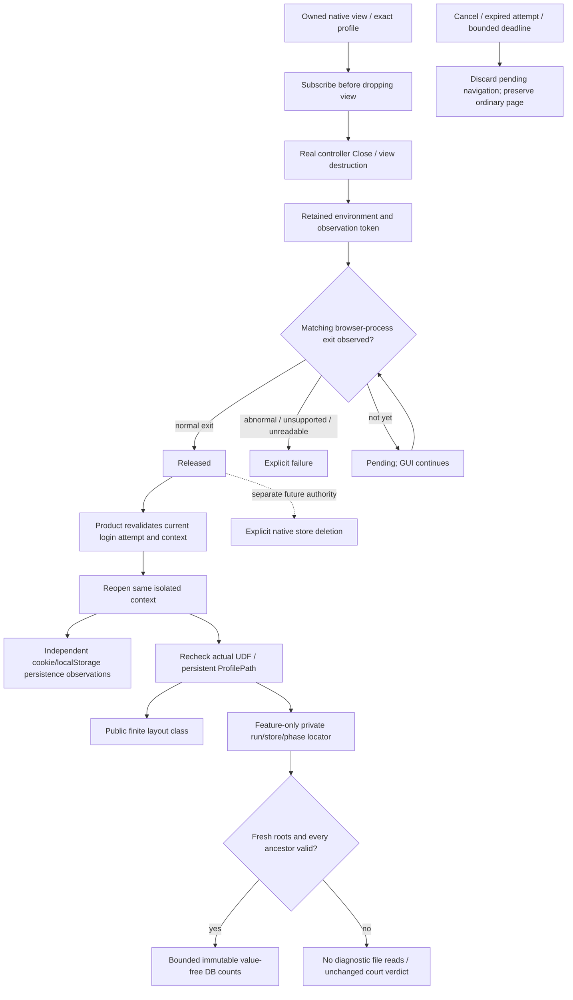

# Native browser-context release and reuse

Parent: [shared mechanisms](PRD_02_28_shared_core.md). Product consumer:
[provider pool](PRD_02_31_01_02_provider_pool.md). Native evidence:
[developer courts](PRD_02_32_dev_loop_crosscheck.md).
Status: `[-]` Windows release observer and product wait implemented in the
development tree; actual SDK delivery and persistence qualification remain open.

This module owns the native release boundary before reusing or deleting a
browser context. Account identity, pending-login ownership and UI recovery stay
product-owned. It does not own account removal or authorize data deletion.

## Outcome tree DAG

```text
Outcome: reuse an account's browser context only after its previous native host has released it
├── [-] OBSERVE — retain an exact native release observation across view destruction
│   invariant: register before Close; match the owned browser process identity
│   evidence: NR-01 actual Windows release callback and preserved raw native receipt
│   safe failure: unsupported/failed observation is explicit, never treated as released
│   dependency: minicon-web native host and supported WebView2 environment events
│   non-goal: reading or copying cookies, process-wide scans or forced global termination
├── [-] REUSE — product waits asynchronously before recreating that same context
│   invariant: pending host closure cannot silently open a replacement store
│   evidence: NR-02 A -> B -> A native storage journey and bounded pending-state regression
│   safe failure: deadline/cancel leaves the ordinary live page and other accounts intact
│   dependency: OBSERVE and serial auth presentation; non-goal: sleeping or blocking the GUI thread
├── [_] QUALIFY — distinguish release ordering from persistence and visibility claims
│   invariant: close callback alone does not establish cookie persistence or successful OAuth
│   evidence: NR-03 unchanged cookie/localStorage oracle, source identity and actual failure control
│   safe failure: preserve the failed observation and investigate its actual cause
│   dependency: existing dedicated native court; non-goal: accepting storage loss to obtain a pass
├── [-] LOCATE — diagnose only the fresh court's verified native profile directory
│   invariant: bind run/store/phase and reject linked ancestry before any diagnostic read
│   evidence: finite layout regression and bounded synthetic metadata controls; new SDK court pending
│   safe failure: unavailable locator leaves the storage verdict unchanged
│   dependency: mandatory profile verification and non-default diagnostics feature
│   non-goal: recursive discovery, cookie values, decryption or production profile export
└── [_] LATER DELETE — compose release with an explicitly authorized store deletion
    invariant: observation, deletion and durable completion are separate results
    evidence: future OS-specific deletion/retry courts; currently unavailable
    safe failure: retain retryable cleanup intent; do not report Done on timeout
    dependency: product-owned cleanup intent and each OS store API
    non-goal: deleting on reconnect completion/cancel or treating directory removal as macOS store removal
```

## Memory palace



## Windows release boundary

`NativePageHost` obtains the actual environment and owned browser process ID
while the view is live, subscribes to `BrowserProcessExited`, then drops the view
through its existing real Close path. Retain the environment and registration
token until completion or caller teardown. Events for another process cannot
release this observation. A malformed event or abnormal exit reports failure;
it is not a durable-flush acknowledgment.

Expose a grant-free, opaque `NativePageRelease` and a finite status observation
to the product; keep COM types and SDK calls inside `minicon-web`. The callback
uses bounded state, wakes the owning event loop and cannot unwind across FFI.
Release observation performs no filesystem deletion, provider traffic or cookie
inspection. Dropping the observation unregisters its event handler.

WebView2 documents the event as occurring after the environment's browser
process collection and resources have exited; see the
[official environment event contract](https://learn.microsoft.com/en-us/microsoft-edge/webview2/reference/win32/icorewebview2environment5).
This is a native lifetime observation. It does not independently prove all
descendant absence, persistence after a crash or provider authentication.

## Product reuse policy

Track at most 18 outstanding auth-context releases in one GUI process. Retire
completed observations; never recreate a context while its release is Pending.
Opening a different context can proceed independently. A failed/unsupported
observation refuses that context's pending recreation with a scoped error.

Keep at most one pending auth navigation, owned by attempt ID and exact context.
Wait at most ten seconds without restarting the provider's authorization timer.
Before navigation, revalidate the current active attempt, context and dismissal
state. Cancel/expiry/close discards that navigation and restores the parked live
ordinary page. A late release event cannot reopen a cancelled login. A release
deadline is not evidence that the store was released; retain its observation
until a later real completion or process teardown.

Reuse the existing Browser root and ordinary-page parking/restoration. Waiting
shows a scoped loading state; it does not acquire credentials, create another
Browser root, retry authentication automatically or block terminal input.

## Initial evidence and remaining scope

The initial Windows x86_64 development checks execute five product auth tests
and twelve native-page mechanism tests, including three new pending-navigation
and three new release-reducer regressions. Eight actual runtime assertion RED
controls independently remove attempt/context/dismissal ownership, deadline
enforcement, deadline preservation, close cancellation, owned-PID matching,
normal-exit checking, unreadable-event refusal and terminal-state retention.
Their source is restored byte-exactly:
`target-six/v0.2.23-provider/auth-release-guards/receipt.json`. These checks do
not instantiate a native view or establish delivery of a COM callback. Final
restored gates are recorded in `auth-release-final-gate-receipt.json` beside it.

The exact Windows failures from source `bc25e30` show missing reopened-A cookie
with matching localStorage; their owner and receipts remain in PRD 28. The
shutdown/flush hypothesis is unproven. The release-boundary change must run the
same native oracle before its persistence effect can be claimed.

Run `40169994716` at `51a3894c0d7263ab179ddc07f3f3385f96b77683` actually
retested both Windows ISAs. Both still fail the initial native journey at
reopened A: cookie `missing`, localStorage `matches`, after the three ordinary/A/B
checks pass. The failure is not a reported release timeout or unsupported
subscription; the reopened page actually loads and reports. There is no separate
raw matching-exit event trace yet, so page arrival alone does not qualify the
native observation. The two deliberate native faults and restored variant do
not execute after the initial failure. Independent artifact, source, protocol
and restoration verification is retained in
`target-six/v0.2.23-provider/ci-51a3894-native-release/verification-index.json`.
The release ordering change has not repaired cookie persistence. Keep the same
oracle while investigating actual profile mode, persistence and bounded fixture
diagnostics; do not add arbitrary delay or claim the event guarantees a flush.

NR-01..03 remain open until their actual native checks and event evidence pass. Pure event reducers and
injected pending/cancel tests cannot certify SDK callback delivery or cookie
persistence. Linux helper release and macOS identified-store deletion require
their own native mechanisms; Windows success cannot qualify them.

### Value-free failure diagnosis

The next dedicated test join records fixed profile-verification/release-state
observations at each action, including the actual same-profile observation
before A reopens. The trace is bounded and test-feature-only; it exposes no PID,
directory, cookie, grant or raw SDK error. A missing release observation stays
distinct from a matching normal exit. Creation verification remains product
behavior; test tracing does not add production navigation or credential APIs.

The runner may inspect only the fresh A/B directories in its own manifest, at
the fixed relative database/configuration paths and the verified-profile slots
defined below. It reports file/read/error classes,
bounded persistent/expiry counts and configured-key booleans, without cookie
values, encrypted blobs, decryption or recursive profile discovery. Read-only
immutable SQLite inspection ignores WAL; missing rows/schema with WAL are
inconclusive. The reopened fixture rewrites its cookie before reporting, and
owned Job cleanup can interrupt descendants. These post-exit observations do
not reconstruct the first close or certify a flush. Diagnostic failure cannot
change the independently measured court verdict or weaken its storage oracle.

Local Windows x86_64 development passes the thirteen native-page mechanism
tests (including the new exact/persistent profile-facts regression), five
dedicated-feature auth tests, and four synthetic diagnosis checks. Removing
the profile validation produces an actual Rust assertion RED and byte-exact
restoration (`native-profile-facts-control/receipt.json` under the existing
`target-six/v0.2.23-provider/` output). Four actual Python assertion REDs cover
configuration-value redaction, binding both manifest roots before reads,
hardlink refusal and immutable/no-WAL-write diagnosis; exact restored checks
and hashes are in `cookie-diagnostics-integrated-controls-optional/receipt.json`.
These do not execute a local native view or qualify a cookie fix. Actual SDK
profile/release observations and diagnosis require the next native run.

Run `40172206150` at `d3ba0dccf6724d9233173fa54ae339c924f93dae` supplies
that next Windows x86_64 observation and still fails the initial storage oracle.
Its actual A, B and reopened-A hosts all pass persistent-profile verification.
Before A reopens, the bounded trace records `matching-normal-exit` for that
owned profile. The first three fixture checks pass, but reopened A still reports
cookie `missing` and localStorage `matches`. Thus normal-exit delivery and
persistent profile mode have now been observed on that court without repairing
cookie retention. The native fault variants and restored run do not execute
after this initial failure.

Both before and after owned-Job cleanup, all four fixed Cookies candidates and
their WAL/SHM candidates report `not-found` for A and B. Their `EBWebView/Local
State` files are readable: the encryption object and encrypted-key configuration
are present, the app-bound-key configuration is absent, and the measured wall
clock is stable relative to monotonic time within two seconds. No database row
or expiry count is available. The checked native ProfilePath is a proper
descendant of the exact UDF, but its relative layout was not recorded. Missing
fixed candidates therefore do not establish absence of a cookie database or an
encryption/flush failure. Inspect that actual layout or bounded fixture-origin
cookie metadata before choosing a repair; keep the storage oracle unchanged.

Independent source, native trace, fixture, binary, protocol and artifact-digest
verification is retained in
`target-six/v0.2.23-provider/ci-d3ba0dc-auth-diagnosis/verification-index.json`.
The DB diagnostic is in the failure-log artifact for this source; the
[development workflow owner](PRD_02_32_dev_loop_crosscheck.md#opt-in-native-authorization-context-court)
owns its subsequent always-upload retention change.

### Verified directory diagnostic join

The next development join reuses mandatory exact-UDF/persistent-profile
verification to expose only `EBWebView/Default`, `Default`, `other-descendant`
or `unavailable` in the public native trace. The non-default
`native-auth-court` feature also enables minicon-web's
`native-profile-diagnostics` seam. Only that test artifact can retain a private
relative directory, bounded to 16 components and 2048 UTF-8 bytes.

The private `native-profile-locator.private.json` carrier is bounded to 16 KiB
and bound to the fresh manifest's run, phase and store identity. Both A and
reopened A retain their observations independently. Before reading any carrier,
fixed DB, verified-directory DB or Local State file, validate the common roots
and every ancestor without symlinks/reparse points. A rejected common root
permits no diagnostic read. Under valid roots a missing or wrong-run carrier
still permits the independent fixed-slot comparison. Only `Network/Cookies`
and `Cookies` under the verified directory join the existing immutable,
bounded, value-free metadata oracle; the public result names a finite
same/different/unavailable A-reopen directory relation. Never export the
carrier or private directory names. Artifact exclusions belong to PRD 32.

The root's actual Python protocol control run retains eleven assertion REDs
and fourteen restored passing checks in
`target-six/v0.2.23-provider/profile-locator-protocol-root/`.
Four additional actual run.py guard controls cover the common authority gate,
run binding, verified directory choice and reopened-directory relation, then
restore exact source bytes and all fourteen passing checks:
`target-six/v0.2.23-provider/profile-locator-controls-root-v2/receipt.json`.
The earlier root-v1 used a nonexistent test name and is setup failure, never
counterevidence. These checks are synthetic, with no native browser or cookie
persistence claim. Actual SDK locator production and DB observations require a
new matching-source Windows court; run `40172206150` cannot supply them.

The integrated Windows native-page family passes fourteen mechanism tests,
including its three existing release-observer tests, and the dedicated-feature
auth suite passes five. Raw executions are `h0-final-native-page.log` and
`h0-final-auth-feature.log` under the same output root. The new finite-layout
test produces a real assertion RED when the unknown-descendant classification
is replaced; its guard log is `h0-runtime-controls/finite-profile-layout.log`,
with exact-restored positive execution in
`h0-runtime-controls-remaining/restored-profile-layout.log`. These are scoped
mechanism checks, not new SDK/browser persistence observations.
