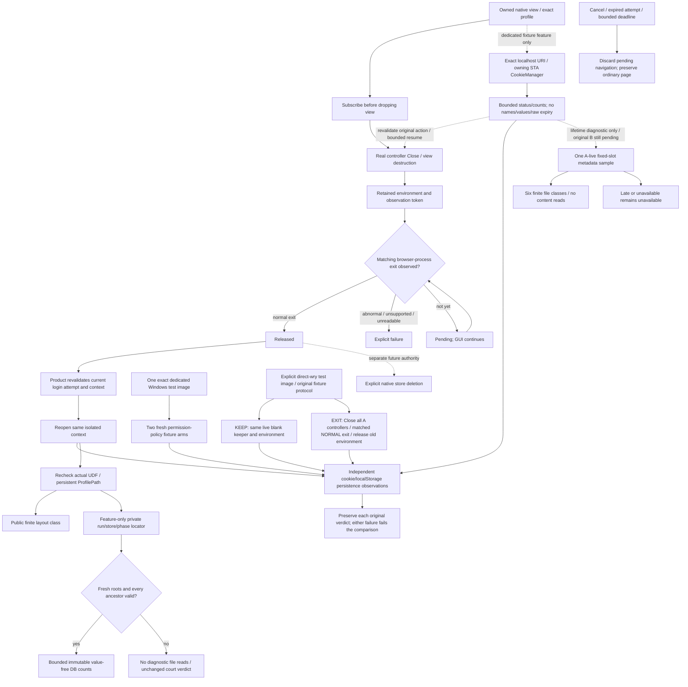

# Native browser-context release and reuse

Parent: [shared mechanisms](PRD_02_28_shared_core.md). Product consumer:
[provider pool](PRD_02_31_01_02_provider_pool.md). Native evidence:
[developer courts](PRD_02_32_dev_loop_crosscheck.md).
Status: `[-]` Windows release observer and product wait implemented in the
development tree; actual SDK delivery and persistence qualification remain open.

This module owns the native release boundary before reusing or deleting a
browser context. Account identity, pending-login ownership and UI recovery stay
product-owned. It does not own account removal or authorize data deletion.

## Outcome tree DAG

```text
Outcome: reuse an account's browser context only after its previous native host has released it
├── [-] OBSERVE — retain an exact native release observation across view destruction
│   invariant: register before Close; match the owned browser process identity
│   evidence: NR-01 actual Windows release callback and preserved raw native receipt
│   safe failure: unsupported/failed observation is explicit, never treated as released
│   dependency: minicon-web native host and supported WebView2 environment events
│   non-goal: reading or copying cookies, process-wide scans or forced global termination
├── [-] REUSE — product waits asynchronously before recreating that same context
│   invariant: pending host closure cannot silently open a replacement store
│   evidence: NR-02 A -> B -> A native storage journey and bounded pending-state regression
│   safe failure: deadline/cancel leaves the ordinary live page and other accounts intact
│   dependency: OBSERVE and serial auth presentation; non-goal: sleeping or blocking the GUI thread
├── [-] QUALIFY — distinguish release ordering from persistence and visibility claims
│   invariant: close callback alone does not establish cookie persistence or successful OAuth
│   evidence: NR-03 unchanged cookie/localStorage oracle, source identity and actual failure control
│   safe failure: preserve the failed observation and investigate its actual cause
│   dependency: existing dedicated native court; non-goal: accepting storage loss to obtain a pass
├── [-] LOCATE — diagnose only the fresh court's verified native profile directory
│   invariant: bind run/store/phase and reject linked ancestry before any diagnostic read
│   evidence: finite layout regression and bounded synthetic metadata controls; new SDK court pending
│   safe failure: unavailable locator leaves the storage verdict unchanged
│   dependency: mandatory profile verification and non-default diagnostics feature
│   non-goal: recursive discovery, cookie values, decryption or production profile export
├── [-] COOKIE METADATA — observe finite fixture-origin native metadata before navigation/release
│   invariant: exact live attempt/context/action/recipe and one owned queued action
│   evidence: new feature-only mechanism/driver assertions and matching-source Windows SDK court
│   safe failure: finite unavailable within the original deadline; stale/cancelled actions never resume
│   dependency: verified native host, dedicated court and unchanged storage oracle
│   non-goal: cookie values, provider profiles, persistence waits/flush/repair or changing the oracle
├── [-] ACL CONTRAST — compare fresh fixture permission policies on one exact test image
│   invariant: retain both original storage verdicts; a failed baseline still permits the control observation
│   evidence: AC-01 coordinator/source controls and AC-02 matching-source Windows SDK comparison
│   safe failure: either failed arm fails the aggregate; absent structural difference is inconclusive
│   dependency: COOKIE METADATA and explicit Windows-only developer entry in PRD 32
│   non-goal: production UDF/credential-policy changes, effective child-token access or a persistence repair
├── [-] LIFETIME CONTRAST — preserve all eight original checks across two explicit browser lifetimes
│   invariant: KEEP proves a live same-environment keeper; EXIT proves matching normal exit before new environment
│   evidence: LC-01 helper controls and LC-02 actual same-image comparison; retained results below
│   safe failure: retain each original failure; unavailable boundary is BLOCKED, never a persistence repair
│   dependency: shared test-only fixture protocol and existing native observations
│   non-goal: production behavior changes, forced-exit evidence or a new release gate
├── [-] PRE-CLOSE FILE METADATA — sample six fixed fixture slots while A is still live
│   invariant: exact pending B/run/store authority; finite metadata classes only, original oracle unchanged
│   evidence: seven Rust host consumers, six Python checks and eight actual assertion controls; native replay open
│   safe failure: unavailable/late metadata stays unavailable; never becomes Cookie content or durability truth
│   dependency: existing fixture SDK summary and release ordering; non-goal: discovery, flush or a production repair
└── [_] LATER DELETE — compose release with an explicitly authorized store deletion
    invariant: observation, deletion and durable completion are separate results
    evidence: future OS-specific deletion/retry courts; currently unavailable
    safe failure: retain retryable cleanup intent; do not report Done on timeout
    dependency: product-owned cleanup intent and each OS store API
    non-goal: deleting on reconnect completion/cancel or treating directory removal as macOS store removal
```

## Memory palace



## Windows release boundary

`NativePageHost` obtains the actual environment and owned browser process ID
while the view is live, subscribes to `BrowserProcessExited`, then drops the view
through its existing real Close path. Retain the environment and registration
token until completion or caller teardown. Events for another process cannot
release this observation. A malformed event or abnormal exit reports failure;
it is not a durable-flush acknowledgment.

Expose a grant-free, opaque `NativePageRelease` and a finite status observation
to the product; keep COM types and SDK calls inside `minicon-web`. The callback
uses bounded state, wakes the owning event loop and cannot unwind across FFI.
Release observation performs no filesystem deletion, provider traffic or cookie
inspection. Dropping the observation unregisters its event handler.

WebView2 documents the event as occurring after the environment's browser
process collection and resources have exited; see the
[official environment event contract](https://learn.microsoft.com/en-us/microsoft-edge/webview2/reference/win32/icorewebview2environment5).
This is a native lifetime observation. It does not independently prove all
descendant absence, persistence after a crash or provider authentication.

## Product reuse policy

Track at most 18 outstanding auth-context releases in one GUI process. Retire
completed observations; never recreate a context while its release is Pending.
Opening a different context can proceed independently. A failed/unsupported
observation refuses that context's pending recreation with a scoped error.

Keep at most one pending auth navigation, owned by attempt ID and exact context.
Wait at most ten seconds without restarting the provider's authorization timer.
Before navigation, revalidate the current active attempt, context and dismissal
state. Cancel/expiry/close discards that navigation and restores the parked live
ordinary page. A late release event cannot reopen a cancelled login. A release
deadline is not evidence that the store was released; retain its observation
until a later real completion or process teardown.

Reuse the existing Browser root and ordinary-page parking/restoration. Waiting
shows a scoped loading state; it does not acquire credentials, create another
Browser root, retry authentication automatically or block terminal input.

## Initial evidence and remaining scope

The initial Windows x86_64 development checks execute five product auth tests
and twelve native-page mechanism tests, including three new pending-navigation
and three new release-reducer regressions. Eight actual runtime assertion RED
controls independently remove attempt/context/dismissal ownership, deadline
enforcement, deadline preservation, close cancellation, owned-PID matching,
normal-exit checking, unreadable-event refusal and terminal-state retention.
Their source is restored byte-exactly:
`target-six/v0.2.23-provider/auth-release-guards/receipt.json`. These checks do
not instantiate a native view or establish delivery of a COM callback. Final
restored gates are recorded in `auth-release-final-gate-receipt.json` beside it.

The exact Windows failures from source `bc25e30` show missing reopened-A cookie
with matching localStorage; their owner and receipts remain in PRD 28. The
shutdown/flush hypothesis is unproven. The release-boundary change must run the
same native oracle before its persistence effect can be claimed.

Run `40169994716` at `51a3894c0d7263ab179ddc07f3f3385f96b77683` actually
retested both Windows ISAs. Both still fail the initial native journey at
reopened A: cookie `missing`, localStorage `matches`, after the three ordinary/A/B
checks pass. The failure is not a reported release timeout or unsupported
subscription; the reopened page actually loads and reports. There is no separate
raw matching-exit event trace yet, so page arrival alone does not qualify the
native observation. The two deliberate native faults and restored variant do
not execute after the initial failure. Independent artifact, source, protocol
and restoration verification is retained in
`target-six/v0.2.23-provider/ci-51a3894-native-release/verification-index.json`.
The release ordering change has not repaired cookie persistence. Keep the same
oracle while investigating actual profile mode, persistence and bounded fixture
diagnostics; do not add arbitrary delay or claim the event guarantees a flush.

NR-01..03 remain open until their actual native checks and event evidence pass. Pure event reducers and
injected pending/cancel tests cannot certify SDK callback delivery or cookie
persistence. Linux helper release and macOS identified-store deletion require
their own native mechanisms; Windows success cannot qualify them.

### Value-free failure diagnosis

The next dedicated test join records fixed profile-verification/release-state
observations at each action, including the actual same-profile observation
before A reopens. The trace is bounded and test-feature-only; it exposes no PID,
directory, cookie, grant or raw SDK error. A missing release observation stays
distinct from a matching normal exit. Creation verification remains product
behavior; test tracing does not add production navigation or credential APIs.

The runner may inspect only the fresh A/B directories in its own manifest, at
the fixed relative database/configuration paths and the verified-profile slots
defined below. It reports file/read/error classes,
bounded persistent/expiry counts and configured-key booleans, without cookie
values, encrypted blobs, decryption or recursive profile discovery. Read-only
immutable SQLite inspection ignores WAL; missing rows/schema with WAL are
inconclusive. The reopened fixture rewrites its cookie before reporting, and
owned Job cleanup can interrupt descendants. These post-exit observations do
not reconstruct the first close or certify a flush. Diagnostic failure cannot
change the independently measured court verdict or weaken its storage oracle.

Local Windows x86_64 development passes the thirteen native-page mechanism
tests (including the new exact/persistent profile-facts regression), five
dedicated-feature auth tests, and four synthetic diagnosis checks. Removing
the profile validation produces an actual Rust assertion RED and byte-exact
restoration (`native-profile-facts-control/receipt.json` under the existing
`target-six/v0.2.23-provider/` output). Four actual Python assertion REDs cover
configuration-value redaction, binding both manifest roots before reads,
hardlink refusal and immutable/no-WAL-write diagnosis; exact restored checks
and hashes are in `cookie-diagnostics-integrated-controls-optional/receipt.json`.
These do not execute a local native view or qualify a cookie fix. Actual SDK
profile/release observations and diagnosis require the next native run.

Run `40172206150` at `d3ba0dccf6724d9233173fa54ae339c924f93dae` supplies
that next Windows x86_64 observation and still fails the initial storage oracle.
Its actual A, B and reopened-A hosts all pass persistent-profile verification.
Before A reopens, the bounded trace records `matching-normal-exit` for that
owned profile. The first three fixture checks pass, but reopened A still reports
cookie `missing` and localStorage `matches`. Thus normal-exit delivery and
persistent profile mode have now been observed on that court without repairing
cookie retention. The native fault variants and restored run do not execute
after this initial failure.

Both before and after owned-Job cleanup, all four fixed Cookies candidates and
their WAL/SHM candidates report `not-found` for A and B. Their `EBWebView/Local
State` files are readable: the encryption object and encrypted-key configuration
are present, the app-bound-key configuration is absent, and the measured wall
clock is stable relative to monotonic time within two seconds. No database row
or expiry count is available. The checked native ProfilePath is a proper
descendant of the exact UDF, but its relative layout was not recorded. Missing
fixed candidates therefore do not establish absence of a cookie database or an
encryption/flush failure. Inspect that actual layout or bounded fixture-origin
cookie metadata before choosing a repair; keep the storage oracle unchanged.

Independent source, native trace, fixture, binary, protocol and artifact-digest
verification is retained in
`target-six/v0.2.23-provider/ci-d3ba0dc-auth-diagnosis/verification-index.json`.
The DB diagnostic is in the failure-log artifact for this source; the
[development workflow owner](PRD_02_32_dev_loop_crosscheck.md#opt-in-native-authorization-context-court)
owns its subsequent always-upload retention change.

### Verified directory diagnostic join

The next development join reuses mandatory exact-UDF/persistent-profile
verification to expose only `EBWebView/Default`, `Default`, `other-descendant`
or `unavailable` in the public native trace. The non-default
`native-auth-court` feature also enables minicon-web's
`native-profile-diagnostics` seam. Only that test artifact can retain a private
relative directory, bounded to 16 components and 2048 UTF-8 bytes.

The private `native-profile-locator.private.json` carrier is bounded to 16 KiB
and bound to the fresh manifest's run, phase and store identity. Both A and
reopened A retain their observations independently. Before reading any carrier,
fixed DB, verified-directory DB or Local State file, validate the common roots
and every ancestor without symlinks/reparse points. A rejected common root
permits no diagnostic read. Under valid roots a missing or wrong-run carrier
still permits the independent fixed-slot comparison. Only `Network/Cookies`
and `Cookies` under the verified directory join the existing immutable,
bounded, value-free metadata oracle; the public result names a finite
same/different/unavailable A-reopen directory relation. Never export the
carrier or private directory names. Artifact exclusions belong to PRD 32.

The root's actual Python protocol control run retains eleven assertion REDs
and fourteen restored passing checks in
`target-six/v0.2.23-provider/profile-locator-protocol-root/`.
Four additional actual run.py guard controls cover the common authority gate,
run binding, verified directory choice and reopened-directory relation, then
restore exact source bytes and all fourteen passing checks:
`target-six/v0.2.23-provider/profile-locator-controls-root-v2/receipt.json`.
The earlier root-v1 used a nonexistent test name and is setup failure, never
counterevidence. These checks are synthetic, with no native browser or cookie
persistence claim. Actual SDK locator production and DB observations require a
new matching-source Windows court; run `40172206150` cannot supply them.

The integrated Windows native-page family passes fourteen mechanism tests,
including its three existing release-observer tests, and the dedicated-feature
auth suite passes five. Raw executions are `h0-final-native-page.log` and
`h0-final-auth-feature.log` under the same output root. The new finite-layout
test produces a real assertion RED when the unknown-descendant classification
is replaced; its guard log is `h0-runtime-controls/finite-profile-layout.log`,
with exact-restored positive execution in
`h0-runtime-controls-remaining/restored-profile-layout.log`. These are scoped
mechanism checks, not new SDK/browser persistence observations.

### Actual verified-directory Windows observation

The exact `5344921a770a373f29dc517aad5a550ca1f6b8ef` Windows x86_64
development court `40177005858` reaches a new SDK observation but still fails
the initial storage oracle: reopened A reports cookie `missing`, localStorage
`matches`. All three A/B/A-reopen presentations verify persistent mode and the
exact requested UDF, with finite layout `EBWebView/Default`. A-reopen observes
matching normal exit. The private locator is written and excluded from both
uploaded archives; its contents are not part of the public evidence.

Before and after owned Job cleanup, the bounded verified-directory comparison
reports A/reopened-A directory relation `same`. All six phase/directory Cookies
slots and the older four fixed candidates are `not-found`; counts and expiry
remain unavailable. This establishes the verified directory and normal-exit
facts without establishing database absence, a flush failure or a DPAPI cause.
The original cookie oracle remains unchanged. Native fault variants and
restored execution do not run after this initial failure.

Both archive digests/sizes, exact-source inputs, native trace and actual driver
binary hash are independently checked in
`target-six/v0.2.23-provider/ci-5344921-auth-diagnosis/verification-index.json`.
No executable was downloaded for an independent PE-header reread. The ordinary
browser smoke's 22 checks pass; they do not substitute for failed authorization
cookie persistence. The next finite metadata diagnostic is specified below;
its runtime and matching-source SDK qualification remain open.

### Feature-only CookieManager metadata diagnostic (in progress)

The dedicated Windows court adds a shared `native-profile-diagnostics` query,
using the existing actual verified host on its owning STA. It accepts only the
exact fixture localhost URI, never an empty query or a provider profile scan.
At most 64 cookies contribute finite total/session/persistent/expiry buckets.
Names, values, domain/path strings, raw expiry values, URI, COM interfaces and
HRESULT text are absent from its public result. Unsupported/failed/timed-out
reads have unavailable counts, never invented zeros. Callback state is weak,
generation-owned and non-Send; callback bodies/wake cannot unwind across COM,
and cancel/drop never waits for a callback.

There are at most four public observations: A, B and reopened A before their
original target navigation, plus live A immediately before its context release.
Each contains only phase, stage, finite status and counts. A query has at most
two seconds from actual begin and cannot extend the court deadline. Before
navigation release and Ready/ack, the product rechecks the current pending
Action's kind/sequence/phase/full URI against the immutable recipe and actual
attempt/context; captured URI equality alone cannot authorize another action.

The extra live-A sample begins only when a valid B notice follows A's actual
fixture report and acknowledgment. B stays in one separate owned slot; normal
pending is empty so old A/HOME Ready cannot acknowledge B. On completion or
finite unavailable, recheck old A, queued B, last acknowledgment and empty normal
pending; drop query references on the STA, then dispatch that original B once.
Close, exit, replacement, overlap and late callbacks cannot dispatch stale work.

Original page/fixture bytes and all eight storage-oracle checks are unchanged.
This extra asynchronous observation perturbs close timing even without sleeps,
retries or forced flushes. A later unchanged-oracle PASS alone cannot establish
a production persistence repair. SDK metadata, fixture cookie identity, normal
profile release, disk observations and durable persistence stay distinct facts.

The integrated Windows checks pass three shared reducers and four driver
consumers in `target-six/v0.2.23-provider/cookie-v2-preflight-receipt.json`,
including actual pinned SDK API compilation and strict default/dedicated-feature
Clippy. The default main inventory remains 679; the dedicated feature adds four
driver tests. These reducers do not instantiate a native view or deliver a COM
callback. Its bounded pending-action/queued-B static review is retained in
`target-six/v0.2.23-provider/windows-cookie-manager-v2-readonly-review.json`.

Ten actual Rust runtime assertion controls cover bounds, generation, URI
restriction, independent pending action, cancellation/deadline, Ready gating
and the single causally authorized B slot. The chain is
`target-six/v0.2.23-provider/cookie-v2-runtime-controls-remaining/receipt.json`:
four accepted controls reuse matching source hashes from the first failed
receipt, six complete afterward, and all seven tests pass after exact restore.
The first cancellation classifier expected the preceding return-value assertion
but the mutant actually failed the Cancelled-result assertion. That failed
classification remains retained; the corrected consumer assertion is rerun,
never counted as a setup failure or silently relabelled PASS.

The Python receipt consumer additionally checks that the declared diagnostic
feature matches the actual driver even on driver failure. Its new test passes
with the fourteen existing fixture checks. Removing each build/driver identity
condition produces an actual assertion RED, then restores byte-exactly and
passes: `target-six/v0.2.23-provider/cookie-v2-feature-identity-controls/receipt.json`.
Original fixture/page sources and the eight native oracle conditions remain
unchanged; synthetic protocol outcomes cannot establish those native results.

The frozen local join passes 46 Rust executions, fifteen Python checks and all
22 default ordinary-browser checks, with formatting and both strict Clippy
profiles: `target-six/v0.2.23-provider/cookie-v2-final-gate-receipt.json`.
Only this owning PRD's evidence is updated afterward. Independent postcommit
verification of `f49d7ff7e8f03bb0b9aefe6fb9637cceebb2c3df` passes 25 Rust and
fifteen Python checks and audits the producer's raw gates and restoration chain:
`target-six/v0.2.23-provider/cookie-v2-independent-f49d7ff/receipt.json`.
It uses the shared build cache, not an isolated checkout. Native persistence
is a separate observation below.

### Actual finite-cookie Windows pilot

Windows x86_64 development run `40185187494`, exact source
`f49d7ff7e8f03bb0b9aefe6fb9637cceebb2c3df`, executes the diagnostic feature
and retains the original native failure. Of eight fixture oracles, three pass,
reopened-A inheritance fails and four are not observed. Reopened A reports
cookie `missing`, localStorage `matches`; the two native fault variants and
restored execution do not run after the initial failure.

All four actual SDK samples return `observed`: A before navigation has zero
cookies; live A before context release has one persistent cookie with future
expiry and zero session cookies; B and reopened A before navigation each have
zero. Thus a future-expiring persistent cookie is visible to the SDK before
release and absent from that URI's SDK snapshot after reopening. These counts
do not expose or establish cookie identity or explain where persistence failed.

All three hosts verify persistent mode, the requested UDF and finite layout
`EBWebView/Default`. Reopened A observes matching normal exit and the same
verified profile directory. Fixed and verified-directory DB candidates remain
`not-found` before and after owned cleanup; row counts remain unavailable.
Local State reports configured encryption-key booleans and stable clock
observations. None establishes database absence, access failure, decryption
failure or a missing flush. Sampling still perturbs release timing.

The ordinary-browser court passes all 22 checks. Dedicated protocol checks pass
fifteen positives and eleven actual assertion counterexamples; shutdown and
ordinary filtered Rust suites are not run after the native failure. The author
audit checks source/feature identity, both archive API digests/sizes, private
carrier exclusions and 102 raw-file digests:
`target-six/v0.2.23-provider/ci-f49d7ff-cookie-native/verification-index.json`.
That audit is explicitly not independent whole-change verification. The native
cookie-persistence result remains FAIL; no production repair is claimed.

The next planned diagnostic compares two fresh fixture-only permission policies
using one exact diagnostic binary and the unchanged eight oracles: existing
owner-only directory protection versus ordinary inherited directory permissions.
Its actual initial/final finite ACL observations must establish a meaningful
difference; otherwise the comparison is inconclusive. Python directory creation
also affects the initial Windows ACL, so this is an entire fixture permission
policy comparison rather than an assumed single Rust-call difference. No
existing directory, real account profile or credential ACL is relaxed.

[Microsoft's WebView2 guidance](https://learn.microsoft.com/en-us/deployedge/webview2-security-tools#preserve-default-access-control-lists-acls-on-the-apps-user-data-folder-udf)
requires preserving default UDF access for sandboxed processes. The current
private-directory helper replaces its DACL with current-user access; this is
a concrete investigation hypothesis, not proof that the observed cookie loss
was an access denial. Any later production browser-directory mechanism must
remain separate from private credential protection and preserve SDK-owned
permissions across account-store writes and browser reuse. The permission
contrast is planned, not an executed comparison or a persistence fix.

### Fresh permission-policy diagnostic join (in progress)

The development coordinator builds one dedicated image and runs the original
eight-oracle fixture in two create-new arms, even when the baseline observation
fails. The control changes creation of the complete synthetic arm to inherited
permissions and omits only its initial Rust A/B directory rewrite. It accepts
only exact empty, unlinked fixture paths; existing account profiles and private
credential protection retain their current policy.

Check source, dedicated image and canonical default-product bytes around both
arms. Preserve each actual exit, absent/failed oracle, SDK sample and finite
ACL observation independently. Either original arm failing makes the aggregate
FAIL; even two passing arms establish only a diagnostic comparison. This mode
does not run or claim the ordinary native negative/restored qualification chain.
The public aggregate is `acl-contrast-receipt.json`; private carrier/store
exclusions remain the ordinary court's responsibility.

An initial local read-only observation invokes the actual preview ACL reader
on newly created empty directories, without any browser or Rust rewrite:
`target-six/v0.2.23-provider/acl-preview-host-observation/receipt.json`.
On Python 3.11.15, all four 0700 directories report protected DACL/three ACEs/
zero inherited ACEs; their 0777 counterparts report unprotected DACL/nine ACEs/
nine inherited ACEs. This proves a finite structural difference on this host,
not effective sandbox access, a cookie cause or native persistence.

Local strict-wrapper tests pass eleven native-auth UI/court consumers, including
two new fixture-policy tests. Changing invalid-mode admission and occupied-path
refusal produces their original assertion REDs; exact restoration passes all
eleven again. The initial final alignment gate rejects raw Windows attribute
access in the product driver; the corrected driver reuses the existing shared
link/reparse classifier without weakening that gate. Current-source controls:
`target-six/v0.2.23-provider/acl-rust-controls-v2/receipt.json`.
Five Python consumers execute the actual coordinator and workflow planner using
bounded controlled child fixtures. Six serial controls fail their original
assertions for baseline short-circuit, erased baseline failure, duplicate build,
changed-source dispatch, mismatched driver mode and invalid WinARM selection.
Exact restoration passes all five:
`target-six/v0.2.23-provider/acl-python-controls/receipt.json`.
These are non-GUI consumer results, not an executed browser comparison.
Independent postcommit verification and matching-source native comparison
remain open; the original native cookie-persistence verdict remains FAIL.

### Actual fresh-policy comparison

Independent non-GUI verification of exact commit
`310d14034410ce6495783edd633db4abf9142b91` passes 29 Rust and five Python
consumers with stable source/blob/clean observations:
`target-six/v0.2.23-provider/acl-independent-310d140/receipt.json`.
The verifier did not author this diagnostic slice; shared cache remains
`isolated=false`. Its exact guarded push precedes the native experiment.

Windows x86_64 run `40190665519` executes both arms using the same dedicated
image SHA-256
`5b63e6eb0df0de80401776f09072ff96fbae7593fe6eed6d30b9170c6e8507a6`.
Both fail the unchanged reopened-A storage oracle: Cookie is missing while
localStorage matches. Each retains three passing, one failed and four
unobserved original checks. SDK observations in both arms are zero before A,
one future-expiring persistent cookie before A releases, zero before B and
zero before reopened A. Thus this particular inherited-permission control
does not remove the observed failure; it is not a production repair.

The initial baseline A/B DACL is protected with three ACEs; the control is
unprotected with seven. After the driver and after owned cleanup, baseline
profiles remain protected with two ACEs and control profiles remain
unprotected with seven. This is an actual structural contrast, not proof of
effective sandbox access. Both arms verify persistent `EBWebView/Default`,
same A/reopen directory and matching normal exit. The finite verified/fixed
DB candidates remain not-found, which does not establish that no database
exists elsewhere. Source, dedicated image and canonical product hashes remain
unchanged across both observations. Cause remains UNKNOWN.

The canonical browser's 22 checks, five controlled ACL consumers and protocol's
fifteen restored checks/eleven actual assertion counterexamples pass. The
diagnostic aggregate and workflow remain FAIL; later ordinary Rust/shutdown
suites do not execute after that step. Both uploaded archives' API identities,
sizes, digests, public bytes and private carrier/store exclusions are audited in
`target-six/v0.2.23-provider/ci-310d140-acl-native/verification-index.json`.
This native audit is by the diagnostic author, not independent whole-change
qualification. No fault/restored native qualification or flush/access claim
is supplied by this comparison.


## Direct-wry lifetime comparison (planned diagnostic)

The ACL comparison did not repair the original reopened-A Cookie failure.
The next finite experiment compares keeping an actual same-environment blank
controller alive with closing all A controllers, observing the exact owned
normal browser exit, releasing the old environment and reopening the same fresh
UDF with a new environment. An environment COM reference alone is not a keeper.
Use one pinned, explicitly enabled Windows-only developer example and identical
options/runtime for both arms. Preserve the original fixture/page and all eight
assertions; run both arms even when the first original oracle fails.

Physically reuse the dedicated court's bounded Recipe/HTTP/Worker protocol and
the existing Cookie metadata and release observer. Keep all COM lifetime work
on its pumping STA. Check exact pending recipe/action before navigation or
callback resume. Record four finite metadata phases and verified private profile
locators; public artifacts exclude profiles, manifests and private carriers.
Normal exit is a lifetime fact, not a flush acknowledgement. KEEP success only
establishes memory reuse; neither arm substitutes for the production court.

The integrated example compiles after a measured missing crate-root import is
repaired by reusing the existing public URL function. Strict example and both
product Clippy configurations pass; eighteen alignment, eleven example tests
(five new consumers plus six physically reused native mechanisms) and all six
existing dedicated product-court consumers pass. The original path-alignment
failure was missing tracked new-file registration, not a product regression;
root registers only reviewed paths with intent-to-add. Initial failed compiler/
style/alignment receipts remain retained. Evidence:
`target-six/v0.2.23-provider/lifetime-initial-gates-v3/receipt.json` and
`lifetime-initial-gates-v4/receipt.json` in that directory.

LC-01's five new consumers each fail their exact original assertion when the
real load-history, keeper, normal-exit, finite-mode or action-URL guard is
removed. All eleven original/restored example tests pass and source restores
byte-exactly: `target-six/v0.2.23-provider/lifetime-helper-controls/receipt.json`.
These are helper-consumer checks, not COM or browser-lifetime observations.

The exact source `0ac018e5fcb2a559ba9ca9a68f6402a1adc6f1a4` executes the
same-image LC-02 comparison in Windows x86_64 run `40199947999`, attempt 1.
KEEP passes all eight original checks with the same live browser/environment.
EXIT retains three true checks, one failed and four unobserved: reopened A's
Cookie is missing while localStorage matches. The normal owned browser exit,
new environment, persistent profile and runtime identity are observed; both
arms use runtime `155.0.4283.62`. The aggregate and CI remain FAIL. KEEP supplies
memory-reuse evidence; normal exit supplies lifetime evidence. Cause remains
UNKNOWN, with no flush, DPAPI, permission or production-repair conclusion.

The retained source, raw two-arm outcomes and archive audit are indexed in
`target-six/v0.2.23-provider/ci-0ac018e-lifetime/verification-index.json`
(SHA-256 `5f0c9eda07c6e138c874850af1a92de4441368d032fef529deacab51fa260777`).
Later pre-close metadata code is absent from that image and cannot borrow its
qualification. Original failed observations and older failed setup attempts stay
retained; no new run or reclassification is implied.

### Next diagnostic: one A-live file-metadata sample

The frozen preview keeps the original fixture/page and all eight predicates.
After the existing A-before-release SDK summary reports exactly one persistent,
future Cookie, retain A and the exact pending B action, then sample only six
fixed Cookie/legacy WAL/SHM slots under the already verified fresh A profile.
The token-bound existing fixture worker validates run/store/locator ancestry and
the original action before and after sampling. It returns only absent, regular
empty/nonempty, unavailable or refused-link classes. It neither opens file
contents nor enumerates other paths, and it acknowledges no new fixture action.

The STA continues pumping. One owned bounded HTTP request runs off that thread;
late/malformed/failed observations remain unavailable within the original court
deadline. Revalidate pending B before the unchanged A-close path. Keep and join
the worker after the loop. A metadata syscall itself is not hard-interruptible;
this is not a new arbitrary-filesystem hard-time guarantee. No sleep, flush,
retry, permission change or production path is added.

Local integrated-source qualification executes all thirteen example tests
(including seven host consumers: the original five unchanged plus two new),
six new Python metadata/HTTP checks, fifteen original fixture protocol checks
and eighteen alignment tests. Format and strict default/native-auth/example
Clippy pass. The initial gate attempt retains FAIL because its fixture invocation
omitted the required `--output`; supplying that argument completes the remaining
gates without changing assertions or source. Receipts:
`target-six/v0.2.23-provider/preclose-initial-gates/receipt.json` and
`target-six/v0.2.23-provider/preclose-initial-gates-resume/receipt.json`.

Eight serial source controls each reach the intended unchanged consumer
assertion: SDK eligibility, deadline, nonempty classification, store identity,
exact pending action, action change after sampling, reparse rejection and
route-token authority. Initial/restored Python6 and Rust7 both pass; all mutated
source bytes restore exactly. The deadline failure specifically returns observed
six-slot data against the original unavailable expectation, not merely another
equality failure. Receipt:
`target-six/v0.2.23-provider/preclose-controls-attempt-1/receipt.json`
(SHA-256 `0b5c13e2ac95e78a6d3e90c8b9ff6d0bc11b3762d0de30f1f6902ff72f9b02c6`).
This is synthetic helper/HTTP qualification, with shared build cache; it proves
no COM/browser persistence result. The first matching-source native replay below retains the original EXIT failure.

Pre-close presence versus post-exit absence only characterizes sampled file
lifetime. It identifies neither Cookie contents nor a deleting actor; absence
in both samples does not establish never-created or no alternate backend. The
extra causal request can perturb timing and cannot repair or reinterpret the
retained Cookie failure.

Independent static review reproduces a receipt-classification defect with two
actual original-assertion failures: driver exit 69 and invalid driver identity
are labelled original-oracle failures even when all original checks pass. Root
repairs that classification; all four controlled regressions pass. Two further
source controls make the retained normal-PASS and actual-oracle-FAIL assertions
fail, then restore all four passes. The actual arm, receipt I/O and original
validator execute with an injected fixture/owned child; no process, HTTP or COM
runs. Evidence: `target-six/v0.2.23-provider/lifetime-arm-classification-repair/receipt.json`
and `lifetime-arm-positive-controls/receipt.json` in that directory. Original
failures remain failures; unavailable diagnostics retain their separate BLOCKED
result. Independent source review is recorded at
`target-six/v0.2.23-provider/lifetime-independent-static-review/receipt.json`.

The actual workflow inline plan passes seven controlled selections and rejects
all-cell/mutually incompatible lifetime dispatch. Removing its real admission
guard violates the original refusal assertion. Existing default selection keeps
four ordinary cells; explicit all keeps six. Evidence:
`target-six/v0.2.23-provider/lifetime-workflow-plan-controls/receipt.json`.
The unchanged original protocol executes eleven real assertion counterexamples
and fifteen restored positives with byte-exact source restoration:
`target-six/v0.2.23-provider/lifetime-protocol-review/receipt.json`.

The final current-source gate passes format, strict example/default/native-auth
Clippy, eighteen alignment checks, eleven example consumers and six dedicated
court consumers: `target-six/v0.2.23-provider/lifetime-final-gates/receipt.json`.
The stale preview comment is replaced with an owner pointer only; executable
code, tests and line count remain exact relative to the five helper controls,
with that delta recorded in `lifetime-comment-closeout.json` beside the gate.
The earlier documentation-closeout helper stopped on a mismatched wrapped
paragraph before changing this owner; its successful source-comment edit and
actual final gates are retained, not classified as runtime counterevidence.
Only this evidence/status closeout follows those source gates. Source
qualification/integration stays serialized with provider work; the diagnostic
does not alter normal qualification or release scope.


### Actual pre-close metadata replay: original EXIT failure retained

Exact source `ac20aeed3873654340ddf32942b2c1f504ca84ef`, Windows x86_64 run
`40218598520`, executes both arms once using one dedicated image
`16cb967302037f4f862bd522d9179eff100b9dc087887ca22996f966061f432f`
and runtime155.0.4283.62. KEEP again passes all eight original predicates. EXIT
again fails the original reopened-A Cookie predicate while localStorage matches;
its actual normal-exit/new-environment boundary is valid. Aggregate remains FAIL.

In both arms, the SDK observes one persistent future Cookie before A closes,
while the new accepted pre-close metadata observation classifies all six fixed
slots absent. EXIT's reopened SDK observation has zero Cookies; KEEP's has one.
This samples those paths and times only: it establishes neither an alternate
backend nor a flush, deletion actor, permission/DPAPI cause or production fix.
The additional causal HTTP handoff remains a timing difference from the old run.

`target-six/v0.2.23-provider/ci-ac20aee-lifetime/verification-index.json`
(SHA-256 `dcc3fff35713426ee423f5ee2c521d3bafc642fd87b1dd2ab09dd573b993003e`)
binds480 exact-source Git blobs, the seven strict helper passes, eleven original
protocol assertion REDs and fifteen restored protocol passes. The public ZIP's
API size/digest/CRC and private exclusions are audited. No Cookie contents or
private profile carrier were downloaded. This is diagnostic evidence; the
production persistence requirement remains unresolved.
