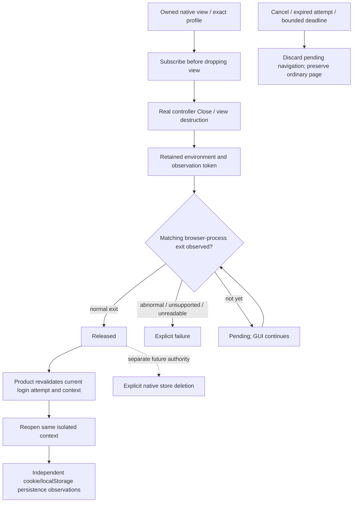

# Native browser-context release and reuse

Parent: [shared mechanisms](PRD_02_28_shared_core.md). Product consumer:
[provider pool](PRD_02_31_01_02_provider_pool.md). Native evidence:
[developer courts](PRD_02_32_dev_loop_crosscheck.md).
Status: `[-]` Windows release observer and product wait implemented in the
development tree; actual SDK delivery and persistence qualification remain open.

This module owns the native release boundary before reusing or deleting a
browser context. Account identity, pending-login ownership and UI recovery stay
product-owned. It does not own account removal or authorize data deletion.

## Outcome tree DAG

```text
Outcome: reuse an account's browser context only after its previous native host has released it
├── [-] OBSERVE — retain an exact native release observation across view destruction
│   invariant: register before Close; match the owned browser process identity
│   evidence: NR-01 actual Windows release callback and preserved raw native receipt
│   safe failure: unsupported/failed observation is explicit, never treated as released
│   dependency: minicon-web native host and supported WebView2 environment events
│   non-goal: reading or copying cookies, process-wide scans or forced global termination
├── [-] REUSE — product waits asynchronously before recreating that same context
│   invariant: pending host closure cannot silently open a replacement store
│   evidence: NR-02 A -> B -> A native storage journey and bounded pending-state regression
│   safe failure: deadline/cancel leaves the ordinary live page and other accounts intact
│   dependency: OBSERVE and serial auth presentation; non-goal: sleeping or blocking the GUI thread
├── [_] QUALIFY — distinguish release ordering from persistence and visibility claims
│   invariant: close callback alone does not establish cookie persistence or successful OAuth
│   evidence: NR-03 unchanged cookie/localStorage oracle, source identity and actual failure control
│   safe failure: preserve the failed observation and investigate its actual cause
│   dependency: existing dedicated native court; non-goal: accepting storage loss to obtain a pass
└── [_] LATER DELETE — compose release with an explicitly authorized store deletion
    invariant: observation, deletion and durable completion are separate results
    evidence: future OS-specific deletion/retry courts; currently unavailable
    safe failure: retain retryable cleanup intent; do not report Done on timeout
    dependency: product-owned cleanup intent and each OS store API
    non-goal: deleting on reconnect completion/cancel or treating directory removal as macOS store removal
```

## Memory palace



## Windows release boundary

`NativePageHost` obtains the actual environment and owned browser process ID
while the view is live, subscribes to `BrowserProcessExited`, then drops the view
through its existing real Close path. Retain the environment and registration
token until completion or caller teardown. Events for another process cannot
release this observation. A malformed event or abnormal exit reports failure;
it is not a durable-flush acknowledgment.

Expose a grant-free, opaque `NativePageRelease` and a finite status observation
to the product; keep COM types and SDK calls inside `minicon-web`. The callback
uses bounded state, wakes the owning event loop and cannot unwind across FFI.
Release observation performs no filesystem deletion, provider traffic or cookie
inspection. Dropping the observation unregisters its event handler.

WebView2 documents the event as occurring after the environment's browser
process collection and resources have exited; see the
[official environment event contract](https://learn.microsoft.com/en-us/microsoft-edge/webview2/reference/win32/icorewebview2environment5).
This is a native lifetime observation. It does not independently prove all
descendant absence, persistence after a crash or provider authentication.

## Product reuse policy

Track at most 18 outstanding auth-context releases in one GUI process. Retire
completed observations; never recreate a context while its release is Pending.
Opening a different context can proceed independently. A failed/unsupported
observation refuses that context's pending recreation with a scoped error.

Keep at most one pending auth navigation, owned by attempt ID and exact context.
Wait at most ten seconds without restarting the provider's authorization timer.
Before navigation, revalidate the current active attempt, context and dismissal
state. Cancel/expiry/close discards that navigation and restores the parked live
ordinary page. A late release event cannot reopen a cancelled login. A release
deadline is not evidence that the store was released; retain its observation
until a later real completion or process teardown.

Reuse the existing Browser root and ordinary-page parking/restoration. Waiting
shows a scoped loading state; it does not acquire credentials, create another
Browser root, retry authentication automatically or block terminal input.

## Initial evidence and remaining scope

The initial Windows x86_64 development checks execute five product auth tests
and twelve native-page mechanism tests, including three new pending-navigation
and three new release-reducer regressions. Eight actual runtime assertion RED
controls independently remove attempt/context/dismissal ownership, deadline
enforcement, deadline preservation, close cancellation, owned-PID matching,
normal-exit checking, unreadable-event refusal and terminal-state retention.
Their source is restored byte-exactly:
`target-six/v0.2.23-provider/auth-release-guards/receipt.json`. These checks do
not instantiate a native view or establish delivery of a COM callback. Final
restored gates are recorded in `auth-release-final-gate-receipt.json` beside it.

The exact Windows failures from source `bc25e30` show missing reopened-A cookie
with matching localStorage; their owner and receipts remain in PRD 28. The
shutdown/flush hypothesis is unproven. The release-boundary change must run the
same native oracle before its persistence effect can be claimed.

Run `40169994716` at `51a3894c0d7263ab179ddc07f3f3385f96b77683` actually
retested both Windows ISAs. Both still fail the initial native journey at
reopened A: cookie `missing`, localStorage `matches`, after the three ordinary/A/B
checks pass. The failure is not a reported release timeout or unsupported
subscription; the reopened page actually loads and reports. There is no separate
raw matching-exit event trace yet, so page arrival alone does not qualify the
native observation. The two deliberate native faults and restored variant do
not execute after the initial failure. Independent artifact, source, protocol
and restoration verification is retained in
`target-six/v0.2.23-provider/ci-51a3894-native-release/verification-index.json`.
The release ordering change has not repaired cookie persistence. Keep the same
oracle while investigating actual profile mode, persistence and bounded fixture
diagnostics; do not add arbitrary delay or claim the event guarantees a flush.

NR-01..03 remain open until their actual native checks and event evidence pass. Pure event reducers and
injected pending/cancel tests cannot certify SDK callback delivery or cookie
persistence. Linux helper release and macOS identified-store deletion require
their own native mechanisms; Windows success cannot qualify them.
