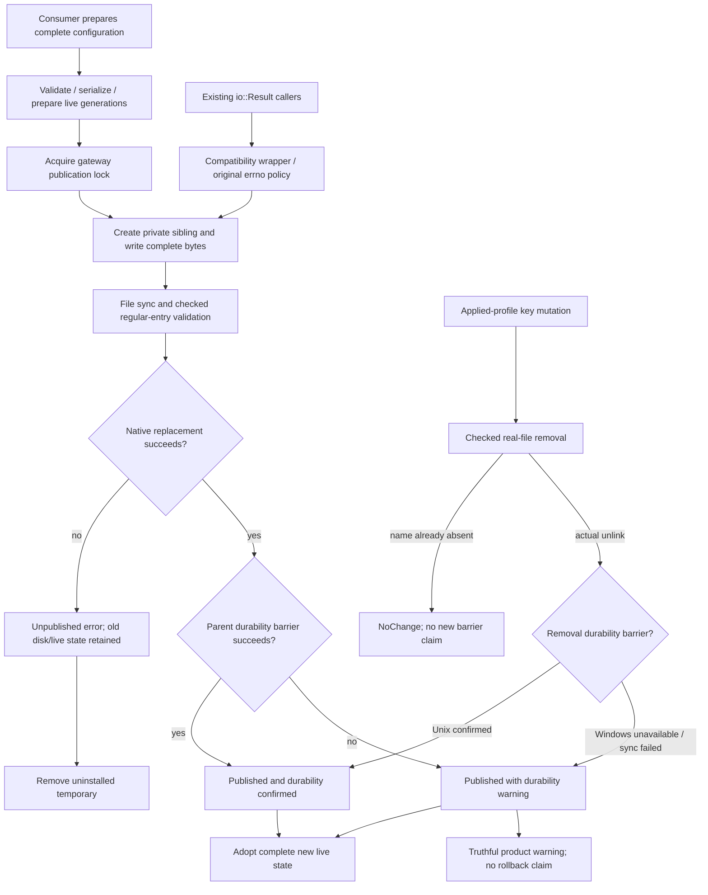

# Commit-aware private publication

Parent: [shared mechanisms](PRD_02_28_shared_core.md). Product consumer:
[connection application](PRD_02_31_01_02_01_connection_selection.md).
Status: `[-]` shared mechanism and gateway-save integration in development;
native cross-platform and final-source qualification remain open.

## Outcome tree DAG

```text
Outcome: keep complete private disk state and its live consumer aligned at the real publication boundary
├── [-] PRIVATE — create, synchronize and replace one private sibling file
│   invariant: Unix 0600 / protected Windows parent ACL; reject link-like targets
│   evidence: PPUB-01 actual staging/final permissions, bounded reads and cleanup
│   safe failure: pre-replacement failure retains old bytes and removes the temporary
│   dependency: existing private creation and shared native replacement adapters
│   non-goal: implicit directory creation, new OS permission code or multi-file transactions
├── [-] RESULT — distinguish publication from the later durability barrier
│   invariant: published=true only after complete bytes or intended absence are published; retain operation/error category
│   evidence: PPUB-02 real old/new bytes around injected replace and parent-sync failures
│   safe failure: uncertainty is explicit; never claim rollback after publication
│   dependency: PRIVATE and existing FilePublishError; non-goal: proving crash persistence
├── [-] CONSUME — gateway and owner adopt already-published configuration
│   invariant: finish validation/entropy before publication and change disk/live configuration together
│   evidence: PPUB-03 save failure and published-warning journeys with reopened private configuration
│   safe failure: pre-publication error changes neither state; post-publication warning retains new state
│   dependency: RESULT and product-owned gateway state lock; non-goal: catalogue/draft/verification completion
├── [-] REMOVE — publish actual intended absence of a private regular file
│   invariant: no tombstone; absent NoChange is not a confirmed deletion barrier
│   evidence: PPUB-05 controlled Windows remove/absence and original guard failures; other native targets open
│   safe failure: effective Windows absence has an explicit durability warning
│   dependency: real-entry checks and existing Unix parent sync; non-goal: new Windows FFI or secure erase
└── [_] QUALIFY — keep native and compatibility obligations explicit
    invariant: the legacy I/O API retains its category and original inspect/create errno
    evidence: PPUB-04 runtime guard failures and actual OS/ISA permission/publication courts
    safe failure: unavailable Unix mode or native court evidence stays BLOCKED for that claim
    dependency: PRIVATE/RESULT/CONSUME and release owners; non-goal: inferring Unix access from Windows
```

## Memory palace



## Mechanism contract

`filesystem_publish::write_private_atomic` returns the existing typed
`FilePublishError`. Its successful result covers replacement and the native
durability barrier. `published()` on an error identifies completed replacement
followed by a failed parent barrier. An unpublished error means this operation
did not replace the destination; it makes no claim about independent writers.

The caller owns and protects the parent. Reuse the existing exclusive private
creation options (Unix 0600; inherited protected Windows ACL), file flush,
regular-entry checks, replacement and parent sync. General-purpose staging
options do not establish privacy. The private writer and the generic publisher
share their checked replacement/barrier mechanism; provider code does not copy
native rename or permission implementations.

The typed error preserves its operation, original I/O category/source and
publication flag. Existing `filesystem::write_private_atomic` callers retain
their `io::Result<()>` API: inspect/create failures return the original I/O error
including direct OS errno, while later-step conversions retain the category.
That compatibility API alone does not promise that every error precedes
publication; consumers that must align live state use the typed result.

## Intended-absence publication

The [profile-key consumer](PRD_02_31_01_02_02_profile_keys.md) requires actual
private-file removal, not an empty-file tombstone. The shared typed remove
checks a real regular entry and publishes intended absence. An unpublished
error preserves the previous entry; a published error means intended absence
was made effective but crash durability is unconfirmed. NotFound is a distinct
NoChange result and does not clear a consumer's prior warning.

Unix removal checks real parent sync. Windows deletion has no established
barrier in this adapter: successful removal returns a published durability
warning. Its replacement-specific `sync_parent` no-op is not reused as proof
of durable deletion. Existing write API and compatibility errno behavior stay
unchanged. Three new shared Windows x86_64 consumers now pass actual unlink,
NotFound/no-change, directory refusal and published-warning observations, with
three original single-assertion RED controls and exact restored GREEN. Their
source/count receipts and the product consumer checkpoint are indexed by the
[profile-key evidence owner](PRD_02_31_01_02_02_profile_keys.md#k1-development-evidence).
Unix parent-sync/native-target and final-artifact claims remain open.

## Gateway consumer

The gateway finishes validation, generation preparation and locking before
calling the writer. The publication result distinguishes a durable save from
an applied save with unconfirmed durability. Both published outcomes adopt the
same complete configuration in gateway state, runtime owner and rendered view.
A warning is retained in the runtime view and shown by the shared Settings
status projection even after an unrelated metadata status update. A confirmed
explicit save clears it. A scoped form error may temporarily take precedence;
do not return a generic failed-save result that implies the previous
configuration remains applied.

Tests must exercise actual private bytes/reopen and gateway observations. A
test-only barrier fault may be injected after a real write, but cannot stand in
for the shared writer's independent replace/barrier test. A subsequent successful
explicit save can clear the warning. No automatic retry or paid request follows
from the warning. Account-catalogue verification, authority locking and atomic
profile application retain their own remaining obligations in the consumer PRD.

## Evidence frontier

PPUB-01..04 remain partial until their selected native/final-source join. The
first Windows x86_64 strict-wrapper run passes three new shared tests, including
actual staging/final DACL inspection, real replacement plus injected parent
barrier failure, original errno and temporary cleanup. Two new consumer tests
pass actual private-file reopen, old/new HTTP conversation binding, safe failed
save, warning retention and a subsequent confirmed save. One consumer fault
temporarily makes account metadata unreadable after a real gateway publication;
that metadata cannot turn the applied save into a false error. Initial logs:
`target-six/v0.2.23-provider/private-publication-initial.log` and
`target-six/v0.2.23-provider/private-publication-consumer-initial.log`.

Six actual assertion-RED controls remove the publication flag, legacy errno
preservation, Windows private ACL inheritance, gateway adoption of a published
warning, the no-fallible-read-after-publication boundary, and visible warning
retention. Their exact restored hashes are recorded in
`target-six/v0.2.23-provider/private-publication-guards/receipt.json`.
The Windows ACL control fails against the real staged file when the parent's
native inheritance is disabled. It does not substitute for the prepared Unix
0600 mode control, which at that checkpoint still required a native Unix court
with explicit umask.
Restored regression gates are recorded in `private-publication-final-gate-receipt.json`
beside those logs. Native Unix mode and Windows ACL evidence
retain their actual source/feature/OS/ISA scope. This mechanism does not simulate
power loss or certify a final release artifact.

The opt-in native source court subsequently executed on Windows x86_64 with
three initial passes, three actual assertion RED controls and three restored
passes. All five Cargo-reported test images are measured as the requested PE
ISA, their digests and original streams are retained, and the mutated sources
are restored byte-exactly. Receipt:
`target-six/v0.2.23-provider/private-publication-native-local-fixed/receipt.json`.
This is HEAD plus the declared development overlay with shared cache. The first
bare-Bash launcher failure is retained separately and is not a runtime control;
the selection/operating correction is owned by
[PRD 32](PRD_02_32_dev_loop_crosscheck.md#opt-in-private-publication-source-court).

Run `40172199308` at `d3ba0dccf6724d9233173fa54ae339c924f93dae` subsequently
completed this opt-in source court on all six native OS/ISA cells. Each cell
executed three initial passes, three actual assertion RED controls and three
restored passes: 36 positive execution instances and 18 independent negative
instances in total. Unix mode controls ran with explicit child-shell umask 022;
both Windows cells exercised the native private inheritance guard. Each cell's
five Cargo-reported test images have matching native format/ISA, source and
mutant hashes are independently recalculated, and exact source restoration,
owned-process cleanup, raw streams and artifact ZIP digests are verified.

The ordinary selected native suites separately report 744 Rust passes and six
unselected Pi opt-in tests ignored. Their canonical browser and bounded
shutdown checks retain their own source and scope. Dedicated authorization
context execution was disabled in this run. Independent evidence is
`target-six/v0.2.23-provider/ci-d3ba0dc-private-publication/verification-index.json`.
These are native source/privacy/publication observations; they do not simulate
power loss, qualify subsequent changed product source or certify release bytes.
