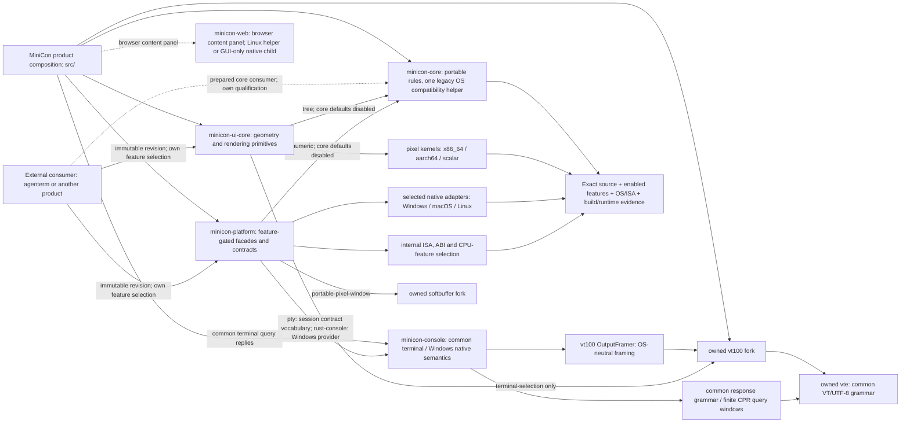

# Module ownership, abstraction and reuse

Owner of the question "what can another product take from MiniCon, through
which boundary, and where do OS and ISA differences live?" Parent:
[MiniCon product requirements](../PRD.md). Source inventory reviewed
2026-10-18; v0.2.15 publication and qualification are recorded in
[release history](archive/v0.2.15-release-history.md).

Legend: `[v]` implemented with named evidence, `[-]` partial, `[_]` planned.

An owned Windows console backend is now an authorized research direction in
[PRD 02.34](PRD_02_34_windows_console_backend.md). Keep its implementation
behind the existing PTY contract. The new `minicon-console` workspace crate has
experimental Windows-only APIs and native x86_64 cmd/I/O/record/job evidence.
The platform's optional `rust-console` feature consumes it behind the existing
PTY facade; MiniCon forwards that feature as `experimental-rust-console` and
the explicit GUI opt-in is owned by [terminal selection](PRD_02_24_con_terminal.md#pty-backend-selection).
Its Windows adapter owns bounded input/output
staging and control priority; `minicon-console` owns console API/input semantics
and the lifetime/classification/completion of deferred native output requests.
Its Windows host exposes `has_pending_output` for work that includes native
buffer fallback, alongside the retained-request count and `resume_output`.
The detailed bounds, ordering and runtime evidence stay in PRD 02.34.
The opened Rust PTY also exposes optional read-only aggregate read-state
observation; unavailable providers return Unsupported. Its contract and native
phase evidence remain owned by PRD 02.34/35.
Native ABI stabilization, AgenTerm reuse and cross-ISA claims
require their own implementation and consumer evidence.
Opened `PtyMaster::backend_kind()` is now available through the Windows and
shared POSIX adapters. Product `ui-snapshot` consumes that identity rather than
inferring an opened backend from invocation flags or the automatic-selection
report. Windows x64 window-consumer evidence belongs to PRD 24.01; POSIX and
Windows ARM64 compilation do not establish runtime coverage on those hosts.

## Map

```text
Outcome: maintain one terminal implementation with explicit reusable boundaries
├── Product composition — src/; behavior owners PRD_02_24 / 25 / 26 / 31
│   ├── terminal lifecycle and painting; no exported terminal-engine crate yet
│   ├── tabs, composer routing, notes, settings and update policy
│   └── control CLI, mux and harness composition
├── Reusable rules — crates/minicon-core
│   └── click / composer / json / keymap / numeric / tree / version
│       no ISA branches or native backend dependency; one legacy OS helper
│       default-enabled editing/codec features; minimal consumers opt out
├── Reusable UI mechanisms — crates/minicon-ui-core
│   ├── damage / retained_frame / glyph_cache / scrollbar geometry
│   ├── tree compatibility exports use core types and implementation
│   ├── terminal_selection: optional vt100-dependent feature
│   └── pixel: portable API, internal x86_64 / aarch64 / scalar kernels
├── Reusable native mechanisms — crates/minicon-platform
│   ├── capability facade + contract types + selected native adapters
│   │   (the PTY/session contract vocabulary is owned by minicon-console::session
│   │   since 2026-10-21; contract::pty re-exports it under the pty feature)
│   ├── OS branches: Windows / macOS / Linux / Unix / unsupported
│   ├── ISA branches: byte search, checksum, CPU facts and native ABI details
│   ├── numeric compatibility exports use core implementation
│   └── opt-in features; a common facade does not imply equal availability
├── Independent terminal library — crates/minicon-console; PRD_02_35
│   ├── terminal::TerminalStream / Utf16Decoder: OS/ISA-neutral state, framing, viewport follow/activation, typed projection limits, bounded text/recovery and per-producer decoding
│   ├── terminal::TerminalPresentation: active/presented frames and bounded synchronization; GUI consumes through a private clock adapter (PRD 24.01)
│   └── Windows ConDrv/object/API/input/job/control service; experimental PTY adapter
├── [-] Browser surface — crates/minicon-web (workspace member; native adapters stay here; PRD_02_25 + PRD_02_31)
│   ├── library: open/load URL, proxy application, staged OAuth/dashboard/preview/wasm
│   ├── Linux optional helper owns wry/tao; macOS/Windows GUI feature owns native child WebView
│   └── product face remains Tab / content panel; no tray; core/headless crates do not link wry
├── Owned dependencies — third_party/
│   ├── vte: authoritative VT/UTF-8 grammar and side-effect-free boundary preview
│   ├── vt100: VT parsing, literal cell/style writes, damage, shared row snapshots and bounded OutputFramer
│   └── softbuffer: native presentation backends
├── Bootstrap exception — src/startup.rs
│   └── Windows x86_64 / aarch64 entry assembly; not a reusable runtime API
└── Evidence and remaining consolidation
    ├── source boundary / scalar oracle / consumer feature matrix
    ├── per-OS × ISA build and runtime receipts: PRD_02_27 / 32
    └── duplicate helpers and product-bound extraction remain explicit debt
```



The non-exhaustive PTY native-key vocabulary includes `NativeTerminalKey::Break`.
The experimental Rust Windows adapter implements it; other native-key adapters
currently return Unsupported for that key. Cursor-key identities share one
Windows conversion helper. Behavior and scoped evidence are owned by
[PRD 02.34](PRD_02_34_windows_console_backend.md).

## Reading portability claims

Record these dimensions independently for each module:

| Dimension | Required distinction |
|---|---|
| Responsibility | Product behavior, reusable rule, UI mechanism, native mechanism or bootstrap |
| Reuse | Public crate/module and required features; actual consumer versus candidate extraction |
| OS | Same implementation, adapter selection, unsupported capability or product policy selector |
| ISA | Same source, compile-time kernel/ABI selection, runtime CPU-feature dispatch or target-specific payload |
| Evidence | Source inspection, named test, build receipt and runtime receipt, each with its own scope |

An OS-neutral API may contain ISA-specific kernels. An ISA-neutral algorithm
may still call an OS-specific service. One source tree is not one executable
for every ISA. A compiled cell does not prove runtime behavior, and a scalar
fallback does not qualify an additional product target. Product delivery scope
remains the six cells in [delivery](PRD_02_27_con_delivery.md).

## Current ownership and reuse entry points

Paths below are relative to the repository root. Public exports and Cargo
features are the source of truth; this table groups responsibilities rather
than duplicating the full platform feature catalog.

| Owner / source | Function and reuse entry | OS / ISA boundary | Dependency and safe failure |
|---|---|---|---|
| `crates/minicon-core/src/lib.rs` | Public `click`, `composer`, `json`, `keymap`, `numeric`, `tree`, `version`; reused directly by MiniCon | No ISA branches; legacy host-newline helper documented below | Optional `itoa`/`unicode-width` behind default-enabled json/composer features; keymap enables composer; no normal dependency when defaults are disabled |
| `crates/minicon-ui-core/src/lib.rs` | Shared geometry, scrollbar hit testing, damage, retained frames, glyph caching, tree helpers | Geometry is shared source; `pixel` specializes internally | No mandatory platform dependency; `terminal-selection` opts into `vt100`; buffer and geometry errors stay at the API boundary |
| `crates/minicon-ui-core/src/pixel.rs` | `blend_mask_xrgb`, `pack_xrgb_to_rgb8`, pixel fill helpers | Internal ISA kernels; see inventory below | Scalar reference; public blend uses common input prefix, pack writes complete pixels |
| `crates/minicon-platform/src/lib.rs`, `contract/`, `selected.rs` | Capability facades for PTY, window, input, IME, font, IPC, clipboard, process, filesystem and other native mechanisms; private state uses protected-directory, atomic private-write and bounded no-follow-read seams | OS adapter selection; Unix private files are 0600, Windows private directories install a protected current-user ACL; some mechanisms also branch by ISA/ABI | Default features empty; enable required features explicitly; unsupported/failure results are capability-specific, never inferred success |
| `third_party/vt100` | VT screen/parser API including damage, DECAWM, `auto_wrap()`, `CellStyle`, programmatic literal cell/style fills and full/diff replay | Shared OS/ISA-neutral parser state; dependencies may specialize internally | Own fork required by terminal rendering and the optional Windows console service, which consumes the cell-edit API; upstream vt100 is not interchangeable; behavior owner [terminal](PRD_02_24_con_terminal.md) |
| `third_party/vte` | VT/UTF-8 grammar, `at_boundary()` and side-effect-free `preview_byte()` exposed through the owned vt100 parser | OS/ISA-neutral grammar; memchr may specialize internally | Exact lexer state, not a second boundary scanner; shared by terminal parsing and the optional Windows service; owner [terminal](PRD_02_24_con_terminal.md) |
| `crates/minicon-console` | Common `terminal::TerminalPresentation` / `TerminalResponses` / `csi_query_reply` / `TerminalStream` / `Utf16Decoder` / `CellRect` and screen region/literal-span, absolute cursor placement/replay and viewport projection operations; Windows ConDrv server/clients, aggregate read-retention/admission observation, typed APIs, per-buffer stream composition and native output ordering | Common state/stream is OS/ISA-neutral; native buffer identities/handles and service are Windows-only, native ABI/ISA qualification stays separate | GUI directly consumes common query replies and presentation through `src/terminal/presentation.rs`; product owns clock/budget, all-tab timer folding and raster (PRD 24.01); optional `rust-console` provider in platform; direct paths to owned vt100/VTE preserve required APIs for external repository consumers; owners [terminal library](PRD_02_35_terminal_library.md) and [Windows backend](PRD_02_34_windows_console_backend.md) |
| `crates/minicon-web` | Browser content-panel API (`PageHost`, URL/title/load/history events, proxy, OAuth); bin `minicon-web-host`; Linux anonymous executable carrier | Default features link no wry. `wry-host` links wry/tao/JSON into the Linux helper; GTK is Linux-only. `native-page-host` links wry into the macOS/Windows GUI only, plus Windows WebView2 native success/accelerator callbacks. Linux `memfd_create` syscall numbers are internal x86_64/aarch64 adapters. Core/headless consumers remain WebView-free | GUI consumes a bounded helper command/state pipe on Linux; canonical embedding and exact-source receipts belong to PRD 27. Missing runtime is typed Unavailable, never the OS browser. Product chrome/focus belongs to PRD 25; CLI observation to PRD 26. Native journeys still require each OS/ISA |
| `third_party/softbuffer` | Native pixel presentation consumed by platform's portable window host | Backend selected by OS/window system; not a native-free UI rule | Own fork carries macOS presentation changes; backend failures remain native results |
| `src/terminal.rs`, `terminal_paint.rs`, `raster_surface.rs`, `font.rs` | Terminal lifecycle and renderer composition | Shared composition over native facades; behavior may select by OS | Binary-private modules, not an independently exported terminal engine; owner [terminal](PRD_02_24_con_terminal.md) |
| `src/workspace.rs`, `ui.rs`, `rename.rs`, `notes.rs`, `session_store.rs`, `update*.rs`, `browser.rs`, `browser_ui.rs`, `browser_process.rs` | Tab identity, layout, editable surfaces, persistence, manual update policy; `browser.rs` re-exports `minicon_web`, `browser_ui.rs` owns product address/focus/state and pointer editing through core composer/click rules; Linux-only `browser_process.rs` owns bounded parent pipe transport | Product composition; native WebView calls and anonymous executable carrier stay in `minicon-web`; parent process transport is GUI-only | Do not export product state merely because a helper is pure; browser shell owner [workspace](PRD_02_25_con_workspace.md); wry isolation [horizon](PRD_02_31_v0_2_horizon.md) |
| `src/control*.rs`, `snapshot.rs`, `agent_interface.rs`, `cli.rs` | Public CLI/protocol and local observation/control composition | Shared product protocol over native IPC/input/screenshot mechanisms | A CLI contract is not a reusable Rust crate; owner [control](PRD_02_26_con_control_cli.md) |
| `src/mux.rs`, `harness*.rs` | Bounded mux/harness subcommands | Product policy over native mechanisms and transport | Keep provider/session policy out of reusable native crates; owner [0.2.x horizon](PRD_02_31_v0_2_horizon.md) |

MiniCon consumes its crates through workspace paths. External products consume
`minicon-platform` and `minicon-ui-core` through immutable full Git revisions;
the dependency recipe lives in `crates/minicon-platform/README.md`. The local
agenterm checkout pins all three MiniCon crates to
`0326e2abaf71cb2f8dc22f766de9b410efa4be1e`. Direct core consumption is prepared
in its text-selection boundary conversion, with scoped Windows development
evidence in that checkout; it is not an automatic pin to 0.2.15 or a claim of
qualified AgenTerm behavior on every native cell. Consumers of fork-dependent
functionality must also check
their own dependency resolution: this workspace's `[patch.crates-io]` does not
automatically become a consuming workspace's patch policy.
Direct dependencies on multiple sibling MiniCon crates must use the same Git
URL and immutable revision; otherwise Cargo can resolve multiple core instances
and lose the shared tree type identity this consolidation establishes.

## Internal ISA and ABI inventory

This inventory covers direct architecture branches in `src/` and `crates/`
at the review date. Dependency internals, build scripts and the loader packaging
chain require their own inspection; no absence claim is made about those.

| Source | Selection and implementation | Fallback / limit |
|---|---|---|
| `crates/minicon-ui-core/src/pixel.rs` | x86_64 blend selects AVX2 or SSE2 using CPU and OS register-state checks; RGB pack independently selects SSSE3 or scalar; aarch64 uses NEON | Other architectures select scalar; baseline kernels are not evidence of product support on other targets |
| `crates/minicon-platform/src/byte_search.rs` | x86_64 inline assembly behind public `contains` | Other architectures use scalar byte search with the same matching contract |
| `crates/minicon-platform/src/checksum.rs` | Adler-32: runtime SSSE3 check on x86_64, NEON on aarch64 | Scalar on x86_64 without SSSE3 and other architectures; CRC32 is table-based shared code |
| `crates/minicon-platform/src/hardware.rs` | Architecture identity, pointer width and CPU-feature reporting | Reports facts; detection is not an accelerated implementation or a product-target promise |
| `crates/minicon-platform/src/adapters/windows/environment.rs` | x86_64 environment-search assembly | Other architectures use bounded portable search |
| `crates/minicon-platform/src/adapters/windows/native_virtualization.rs` | WHPX probe includes x86_64/aarch64-specific handling | Other architectures report unavailable; no VM lifecycle authority |
| `crates/minicon-platform/src/adapters/windows/{cache_hierarchy,control_window}.rs` | Pointer-width-dependent cache-sharing validity and native window ABI types | ABI/observation adaptation, not SIMD dispatch; 32-bit cache sharing is unknown and does not add a supported delivery cell |
| `crates/minicon-platform/src/adapters/linux/linux_xkb_startup.rs` | Compile-time x86_64/aarch64 selection of bundled XKB library bytes | Target-specific payloads, not portable arithmetic; no generic payload branch |
| `src/startup.rs` | Windows bootstrap assembly jumps to Rust-generated main using x86_64 `jmp` or aarch64 `b` | Explicit pre-platform exception; no general runtime API or other-ISA entry promised |

Native calls belong behind platform facades; product selectors may express
behavior differences. Bootstrap exceptions are named by
`tests/minicon_alignment.rs`'s platform-boundary guard. Keep algorithmic ISA
specialization inside shared mechanism owners, not product dispatch sites.

## Evidence and limits

- Core boundary: `crates/minicon-core/src/lib.rs` tests
  `no_platform_dependency_creeps_in` and
  `core_source_target_conditionals_stay_within_the_legacy_boundary` in
  `crates/minicon-core/tests/support/source_boundary.rs` check the production
  dependency section and recursively parse every src Rust file. The source
  check inspects direct cfg/cfg_attr/cfg! syntax even in disabled/unregistered
  modules, with the specific legacy host-newline exception below. It does not
  expand generated macros or prove runtime equivalence.
- Kernel equivalence: `crates/minicon-ui-core/src/pixel.rs` contains scalar,
  public API and native-kernel oracle checks;
  `crates/minicon-platform/src/checksum.rs` contains
  `adler_all_lengths_and_every_split_are_bit_exact`;
  `byte_search.rs` contains `matches_the_standard_library_on_every_window`.
  A run on one ISA exercises only the compiled/available kernels there.
- Consumer features and native boundary: `tests/minicon_alignment.rs` contains
  `minicon_platform_features_match_the_consumer_matrix` and the raw-OS-reach
  guard. A platform build with its empty default features does not qualify
  MiniCon's enabled feature set.
- Six-cell qualification and exact-artifact runtime evidence belong to
  [delivery](PRD_02_27_con_delivery.md) and
  [dev-loop crosscheck](PRD_02_32_dev_loop_crosscheck.md). Release receipts,
  including [v0.2.15](archive/v0.2.15-release-history.md), retain their recorded
  source and gate scope; they do not certify every optional platform feature.
- v0.2.15 source `0ac2d7ed1b3898835956f80569718c4d2eb994b9` passes all six
  native dev courts, including default UI and an isolated minimal consumer,
  plus the six-cell signed/packaged artifact courts. The complete workspace/fork
  gate is qualified on Windows x86_64; native dev compilation does not imply
  every root/platform unit or optional feature executed on every cell. Exact
  scope and receipts are in [release history](archive/v0.2.15-release-history.md)
  and [the archived plan](../plan/archive/plan-v0.2.15.md).

## Design assessment and compatibility boundary (2026-10-18)

The three boundaries are useful and largely reflected in the code: pure rules,
host-neutral UI mechanisms, and native mechanisms. Retain the public crate
names for now; migration churn is not justified by naming alone. The baseline
gaps were ownership overlap, incomplete boundary enforcement and stale descriptions; v0.2.15 preparation addresses them as described below.

| Crate | Naming and intended contract | Assessment and required clarification |
|---|---|---|
| `minicon-core` | Shared host-neutral rules | Reasonable umbrella name, but not the whole terminal engine. The package description now covers all rule families and the source header points here. Core keymap is an opinionated composer rule set, not a universal keyboard policy for consumers. |
| `minicon-ui-core` | Host-neutral UI mechanisms, including internal ISA kernels | Appropriate name; host-neutral does not mean ISA-free. The description now includes rendering primitives; tree exports forward core; terminal selection remains optional. |
| `minicon-platform` | Native capability contracts and adapters with explicit feature selection | Appropriate umbrella for OS and machine mechanisms, but not a promise that every capability exists on every host. Its broad optional feature surface needs consumer-feature evidence. `native-pixel-window` versus `portable-pixel-window` describes implementation backends, not the overall portability of the crate. |
| `minicon-web` | Browser content-panel API (lib + `minicon-web-host`) | Name matches the adopted boundary (2026-10-23). Not a tray host and not chrome UI. Passive WebView probe stays on `minicon-platform`. The default helper does not link wry and exits Unavailable; `wry-host` is Linux's optional loader, while `native-page-host` links the GUI-only macOS/Windows child. |

Core owns tree and numeric implementation. UI-core/platform depend on core
with defaults disabled, preserving old public import paths and UI/core tree
type identity without pulling editor/codec dependencies into minimal consumers.
The isolated `bash scripts/check-reuse.sh` consumer checks the dependency graph
and compiles/runs the compatibility APIs outside workspace feature unification.
It is part of l1/l3. Windows console-row encoding now compiles only for PTY
(or tests), so an empty-feature native consumer does not carry that dead module.

**Legacy compatibility exception:** `composer::paste_review_display_text(text)`
has always selected Windows CRLF versus Unix LF via cfg!, which the old textual
guard missed. Removing that behavior would break consumers. Keep this API and
its host-dependent test as a named, narrowly checked exception; new callers use
`paste_review_display_text_with_newline(text, NewlineForm)` and select native
editor format outside core. MiniCon selects it in `src/clipboard_paste.rs`.
The explicit-format test exercises both choices on its running host. Consumers
that previously set core defaults off must now explicitly enable
composer/json/keymap when they need those APIs; ordinary default consumers
retain all existing exports. Core is ISA-neutral, but its
legacy default composer API must not be described as entirely OS-independent.
Removing the compatibility helper requires a consumer migration and explicit
API compatibility decision; no new target selectors inherit this exception.

Keep external reuse reproducible at an immutable revision with the consumer's
actual features and fork resolution. The initial assessment was static; added
local tests and native receipts support only their recorded feature/cell scope.

## Terminal library consolidation

- [-] Keep parsing, cells/styles, damage and output framing in owned shared
  libraries. Windows native error mapping and producer-lifetime policy stay in
  adapters. `OutputFramer` now has a neutral error contract and no OS/ISA imports;
  its concrete behavior belongs to [terminal](PRD_02_24_con_terminal.md).
- [-] The initial `terminal::TerminalStream` facade is now in `minicon-console`;
  its independent library scope and future merger decision belong to
  [PRD 02.35](PRD_02_35_terminal_library.md). Extend session composition only after identifying its
  required composition: feed output, inspect cells/damage, resize, encode input,
  report capabilities and own shutdown/backpressure. Product tabs, settings,
  event loops and GUI painting policy must remain outside that facade.
- [-] The facade owns its parser/framer pair, exposes screen edits without
  decoder reset, and consumes itself on final-tail delivery. The Windows host now
  consumes this facade; GUI migration, explicit session-discard receipts and
  portable process lifecycle remain open.
- [-] Native W title publication also consumes the common bounded formatter;
  its portable contract belongs to [PRD 02.35](PRD_02_35_terminal_library.md#independent-title-publication)
  and native compatibility scope to [PRD 02.34](PRD_02_34_windows_console_backend.md#native-wide-title-publication-leaf).
- [-] Native title conversion, ordinary output and string readback share a
  Windows-private whole-string codec; input/output code-page selection and
  legacy reply rules remain native policy. Its scoped API evidence belongs to
  [PRD 02.34](PRD_02_34_windows_console_backend.md#title-code-pages-and-native-reply-boundaries).
- [-] Committed title events and hidden-stream effect publication now share
  the common terminal facade. Low-level framing/opaque OSC belongs to
  [PRD 02.24](PRD_02_24_con_terminal.md#osc-payloads-parser-events-and-framed-commit),
  reusable API scope to [PRD 02.35](PRD_02_35_terminal_library.md#committed-title-events-and-undisplayed-streams),
  and actual Windows consumer evidence to PRD 02.34.
- [-] Initial Windows console titles reuse the same native display conversion
  and common independent publisher as explicit setters. CONNECT admission,
  reply and console-wide lifetime policy remain Windows-owned; scoped runtime
  evidence belongs to PRD 02.34's initial-title/lifetime leaf.
- [-] The common POSIX PTY mechanism now lives in `adapters/unix/pty.rs`;
  `adapters/linux/pty.rs` and `adapters/macos/pty.rs` are thin, distinct
  adapter identities forwarding the same four public entry points, and
  `selected.rs` still selects by OS identity. Cross-target `cargo check`
  (x86_64-unknown-linux-gnu, aarch64-apple-darwin, `--features pty`) passes;
  native runtime qualification on both actual platforms (Linux cells + macOS
  dev-loop-crosscheck court) remains open before this reads `[v]`.
- [_] Qualify a minimal external consumer with actual selected features and
  owned fork resolution on Windows/macOS/Linux and supported ISAs. Linux/ARM
  cross-compilation cannot substitute for macOS or ARM native runtime evidence.
  Installation/package ergonomics and stable public API policy remain open.

## Platform feature–consumer audit (2026-10-21)

Method: the feature graph was read from `crates/minicon-platform/Cargo.toml`
(91 declared features) and the transitive closure computed for each verified
consumer's direct enablement. MiniCon's direct set comes from its own
`Cargo.toml` dependency blocks, guarded live by
`minicon_platform_features_match_the_consumer_matrix` in
`tests/minicon_alignment.rs`. AgenTerm's direct set was read in its checkout
at `2196131f292c31c3355212f4bcb2fa5e1d47a620`, which pins all MiniCon crates to
revision `0326e2abaf71cb2f8dc22f766de9b410efa4be1e`. The isolated
`scripts/check-reuse.sh` consumer deliberately enables no features (it proves
minimality, not consumption); the crate's own probe binary requires
`rust-console`, already inside MiniCon's closure. "Zero verified consumer"
means no consumer visible from this repository and the AgenTerm checkout — it
is not a death certificate; an unverifiable external consumer stays UNKNOWN
and removal is a separate owner decision, per the audit's non-goal.

Counts: MiniCon closure 37 features, AgenTerm closure 40, union 49 of 91;
42 features have zero verified consumers, of which `default` (empty by
policy) and `full` (catalog umbrella) are non-facades by design, leaving
**40 zero-consumer facades**.

| Consumer tier | Features |
|---|---|
| MiniCon direct (20: 16 main + win `native-pixel-window` + unix `portable-pixel-window` + dev `input-inject` + optional `rust-console`) | clipboard, contained-process-spawn, entropy, filesystem, filesystem-read, font, host-open, ime, input, input-inject, ipc, native-pixel-window, network-http, parent-console, portable-pixel-window, pty, runtime, rust-console, screenshot, window |
| AgenTerm direct (17, at the pin above) | activation, clipboard, console-interrupt, console-line-editor, filesystem, font, ime, input, ipc, locking, portable-pixel-window, process, pty, screenshot, serde, webview, window |
| Transitive only (21, pulled in by the sets above) | directory-access, file-identity, filesystem-append, filesystem-cleanup, filesystem-conventions, filesystem-create, filesystem-entry, filesystem-open, process-containment, process-control, process-conventions, process-image, process-metrics, process-observation, process-reference, process-security, process-spawn, process-window, user-identity, window-enum, window-op |
| Zero verified consumers (40 facades + `default`/`full`) | a11y-publish, a11y-tree, app-container-process, app-container-profile, app-facts, audio, cache-hierarchy, chassis-present, current-target-binding, desktop-host, device-capture, device-inventory, device-io, file-attributes, filesystem-usage, filesystem-watch, hardware, host-boot-identity, host-memory, host-notification, host-pressure, host-resource-snapshot, keyboard-layout, login-session, native-messaging-registry, network-dns, network-interfaces, network-routes, permission-settings, privilege-authorization, privilege-service-lifecycle, processor-affinity, processor-topology, service, shared-memory, simulator, storage, storage-device-inventory, system-broker, virtualization-probe |

Maintenance: when a consumer's enablement changes (MiniCon's matrix test, or
an AgenTerm pin movement), recompute the closure and update this table in the
same change. A facade leaving the zero tier needs its consumer named; a
facade entering it is a fact, not an automatic deprecation.

## Consolidation frontier and maintenance rule

- [v] v0.2.15 delivered scope: recursively guard core source portability;
  preserve default APIs while making dependency-bearing core modules optional;
  make core the tree/numeric implementation owner with UI/platform compatibility
  exports; correct names/descriptions without renaming public crates. The
  default-disabled core edges must not import unrelated composer/JSON
  dependencies into minimal UI/native consumers. Delivery contracts, order and
  evidence: [release history](archive/v0.2.15-release-history.md) and
  [archived plan](../plan/archive/plan-v0.2.15.md).
- [v] Shared platform/UI ownership moved into MiniCon in v0.2.5, with the
  `{PLATFORM-MOVE}` evidence in
  [the archived plan](../plan/archive/plan-v0.2.5.md). The former staged
  external-platform extraction is superseded by that ownership decision.
- [v] Tree/numeric implementations are consolidated through compatibility
  exports; named guard, oracle, type-identity and isolated-consumer evidence is
  recorded in the archived plan and six native minimal-consumer receipts,
  within the feature scopes stated above.
- [_] v0.2.16 consumer/feature selection and test orchestration follow
  [the owning test contract](PRD_02_33_test_orchestration.md). AgenTerm pin
  movement remains conditional on that product's actual consumer evidence.
- [_] `workspace`, `session_store`, `ui` and `palette` remain product-local.
  Extract a rule only for an identified consumer and explicit contract; no
  completed reusable terminal-engine crate is claimed.
- [v] The recursive core guard covers newly added source modules and direct
  target syntax, proven by the plan's three source mutations; the historical composer newline exception is explicitly
  preserved rather than hidden or mislabeled as pure.
- For every module move or material behavior change, update this map's
  responsibility, reuse entry, features, OS/ISA split and evidence scope in the
  same change. Detailed behavior stays in its capability PRD. Before opening a
  new feature branch in the product tree, check existing owners and reuse paths
  and record any unresolved boundary as debt.

Non-goals: a generic utility warehouse, blanket cross-ISA certification,
unmeasured abstraction layers, or changes to product scope in this inventory.

The Windows console service's read-only font queries expose one private virtual
compatibility descriptor. They do not depend on platform GUI font discovery or
claim that the renderer uses that face/size. The native RawUI dependency and
actual client evidence are owned by [PRD 02.34](PRD_02_34_windows_console_backend.md).
The neutral cell mutation remains in the owned shared terminal library.
