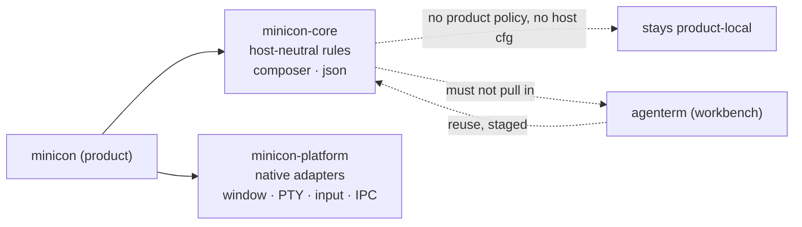

# Shared core and reuse boundary (`minicon-core`)

Owner of the question "what can another product take from MiniCon, and what
has to stay". Parent: [MiniCon product requirements](../PRD.md).

Legend: `[v]` shipped, `[-]` partial, `[_]` planned.

## Map

```text
minicon-core — shared, host-neutral rules
├── Why: MiniCon and agenterm share a terminal; the terminal half sinks here
├── The constraint that decides the shape
│   ├── agenterm must not depend on a crate that depends on agenterm (double resolve)
│   └── so reusable == "needs nothing from agenterm" (measured table)
├── Stage 1 — shipped: composer + json
├── Stage 2 — in progress
├── Stage 3 — shipped (2026-10-11): shape changed by an owner decision
└── Non-goals
```



## Why this module exists

MiniCon and `agenterm` are separate products that share a terminal. The
README's staged plan says a `terminal-core` (pty / vt100 / raster / font / ime)
should sink into this repository and `agenterm` should depend on it. That end
state is right — MiniCon *is* the terminal, and the larger product adds
workspace, fleet and server on top — but the order matters, and taking it in
one step would be a mistake.

## The constraint that decides the shape

`agenterm` cannot depend on a crate that itself depends on `agenterm`'s own
crates. Cargo would then resolve those crates twice — once as a workspace path
member and once through a git dependency — producing two distinct instances of
the same types. That is not a style preference; it does not link.

So the reusable half is exactly **what needs nothing from `agenterm`**, and
that is measurable rather than arguable. Measured on 2026-08-23:

| module | non-`std` dependencies | reusable |
|---|---|---|
| `composer` | `unicode-width` | yes |
| `json` | `itoa` | yes |
| `session_store` | `workspace::TabId` | via `workspace` |
| `control_pending` | `control`, `json`, `workspace` | no — `control` is host-bound |
| `workspace` | `agenterm_ui_core::compute_tree_depths_by` | one helper away |
| `ui` | `agenterm_ui_core`, `agenterm_platform::numeric` | two helpers away |
| `palette` | `agenterm_platform::numeric`, `vt100::Color` | two helpers away |
| `perf`, `raster_surface`, `a11y`, `font`, `terminal_paint`, `agent_interface` | platform / vt100 | no |

`agenterm-ui-core` is already "Host-neutral AgenTerm interaction geometry" and
is OS-neutral, with architecture-specific SIMD behind scalar fallbacks. It is
not a thing to duplicate; it is a thing to draw the line against.

## Stage 1 — shipped

- [v] `crates/minicon-core` contains `composer` and `json`: multiline composer
  editing with a caret and wide-character measurement, and a bounded JSON codec.
  Both are ordinary data and arithmetic.
- [v] the crate has **no platform, OS, window or terminal-backend dependency,
  and no `cfg` on architecture or operating system anywhere**. That is what
  makes it consumable without dragging a platform layer along.
- [v] both halves of that rule are enforced by tests rather than by intent. One
  reads the manifest, because the property is about the dependency graph and no
  compiler error announces a new dependency; the other scans the modules,
  because a manifest can stay clean while the code stops behaving identically
  everywhere. The manifest test was negative-controlled: adding `vt100` turns it
  red.
- [v] the dependency test is bounded to the production section. A
  dev-dependency cannot reach a consumer, and failing on one would forbid the
  `serde_json` oracle that keeps the codec honest — the codec exists *because*
  `serde_json` is too large for this product's budget, so comparing against it
  is the test that matters.

Found by the split, and worth recording because it generalizes: `to_vec` was
`#[cfg(test)]`. Inside a binary that works, because a test build compiles it.
Across a crate boundary it does not — a consumer's test build does not enable
the dependency's `test` cfg — so a test-only helper simply disappears. Every
`cfg(test)` item crossing a new boundary has to be re-examined.

## Stage 2 — in progress

- [v] move tree-depth computation out of `agenterm-ui-core` into this crate.
  `minicon-core::tree` now owns `TreeDepthNode`, `TreeDepthError`,
  `compute_tree_depths` and `compute_tree_depths_by`, and `src/workspace.rs`
  calls it there instead of reaching into the UI crate. The move is
  behaviour-preserving by construction: the transferred logic is line-for-line
  identical to the helper it replaces, and it is checked here rather than only
  in the crate it left. Two tests were added for properties the original did not
  assert — the accessor form reading parentage from a caller's own node type,
  and depths resolving correctly across sparse, unordered ids — because those
  are the parts that make it reusable.
- [v] move scrollbar geometry out of `agenterm-ui-core` into this crate.
  `minicon-core::scrollbar` now owns `ScrollbarRect`, `ScrollbarGeometry`,
  `ScrollbarHit`, `ScrollbarThumbDrag`, `terminal_scrollbar_geometry`,
  `scrollback_for_thumb_top` and `scrollbar_hit_test`; `src/ui.rs` and
  `src/main.rs` use them from here. The moved arithmetic is unchanged, so the
  change is behaviour-preserving rather than merely plausible. Writing tests for
  it surfaced two behaviours that were true but undocumented and easy to assume
  otherwise: an inverted track is passed through with a `height()` that is
  negative, so callers cannot treat a non-negative height as free, and a thumb
  at the live end rests on the track's bottom edge, so there is deliberately no
  `TrackBelow` region to hit there. Both are now asserted.
- [v] move the numeric rounding shims out of `agenterm-platform` into this
  crate. `minicon-core::numeric` now owns `round_f32`, `round_f64`, `ceil_f32`
  and `trunc_f32`, and all twenty call sites in `font`, `main`, `palette`,
  `raster_surface` and `ui` use them from here. This one mattered more than the
  others: the shims exist to avoid a platform C runtime math import, so the
  crate that forbids platform dependencies is their natural home, and while they
  lived in `agenterm-platform` the product could not have dropped that dependency
  for geometry alone. The moved code is identical, verified by comparing the
  bodies rather than by reading them.
- [_] `workspace`, `session_store`, `ui` and `palette` then follow, because the
  single helper each was waiting on is here: `workspace` needed tree depths,
  and `ui` and `palette` needed the rounding shims.
- [_] `agenterm` depends on `minicon-core` for those helpers. This is the
  dependency inversion the README describes, proved on leaves rather than on
  the terminal engine.

Stage 2's leaf moves are therefore done, and the successors above are scheduled
rather than assumed.

The value is not line count. It is that the inversion gets tested on code where
being wrong is cheap, before it is attempted on `pty` / `font` / `ime`, where
every `cfg` and every `unsafe` in the product lives.

## Stage 3 — shipped (2026-10-11), shape changed by an owner decision

- [v] The shared platform layer now lives **here**, not in `agenterm`:
  `crates/minicon-platform` (was `agenterm-platform`), `crates/minicon-ui-core`
  (was `agenterm-ui-core`), and the two forks `third_party/vt100` and
  `third_party/softbuffer`. They are ordinary in-repo path members of this
  workspace, and `src/` plus the test suites use them as `minicon_platform` /
  `minicon_ui_core`. Plan and evidence: [`plan/archive/plan-v0.2.5.md`](../plan/archive/plan-v0.2.5.md)
  leaf `{PLATFORM-MOVE}`.

The original plan here was to *extract a `terminal-core`* out of
`agenterm-platform` by splitting that crate along a terminal seam, in one
repository that both products still depended on. The owner changed the shape on
2026-10-10 after `agenterm` retargeted itself to a MiniCon extension
(llm/agent/harness plugins, an app market) rather than a second terminal
product: the two products no longer share a terminal by reuse, so the crate
that serves the terminal now belongs to **MiniCon**, and `agenterm` depends on
MiniCon. Moving the whole crate — rather than carving a terminal seam out of it
and leaving the rest behind — is *less* work and has one owner for the bytes,
which is the property Stage 1 and Stage 2 were building toward. It does mean
MiniCon carries platform adapters it does not itself call (accessibility trees,
input injection, device capture, contained-process spawning); they are vendored
as-is under `crates/minicon-platform`, and the CU-only tests among them were
brought green in the same round (`{CU-TESTFIX}` in the plan).

Naming across this PRD corpus: prose written before 2026-10-10 that says
`agenterm-platform` / `agenterm-ui-core` names the same code that now lives at
`crates/minicon-platform` / `crates/minicon-ui-core` here, and prose that says
"the pinned `agenterm-platform`" describes the git-pin dependency that this
round removed. Internal `AGENTERM_*` C macros and env vars inside the copied
sources were deliberately **not** renamed (recorded in the plan, not silently
skipped). New writing uses the `minicon-*` names.

## Non-goals

- Not a general-purpose utility crate. Something belongs here because two
  products need the same *rule*, not because it happens to be generic.
- Not a reason to make MiniCon's own code more abstract than its use demands.
  The boundary exists to keep a dependency out, not to invite indirection.
- **No mandatory dependency inversion for its own sake.** Keep extracting
  host-neutral rules into `minicon-core`. This non-goal was what Stage 3's
  *shape* was originally restrained by ("do not split `agenterm-platform`
  solely to invert the arrow"), and it still holds: the inversion landed
  because the owner re-scoped `agenterm` on 2026-10-10, not to satisfy the
  arrow. Absent that product change, consuming a shared crate at a git pin
  would remain a legitimate alternative. See "Stage 3" above for how it
  actually landed.
