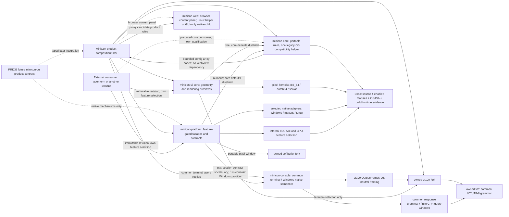
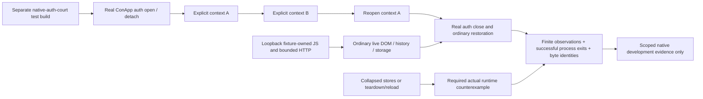

# Module ownership, abstraction and reuse

Planned ujs/WASM host-module boundaries and independent logic delivery are owned
by [PRD31.01.04](PRD_02_31_01_04_dynamic_logic.md). No runtime dependency or
shared crate is added by that design; map concrete engine capabilities here
before implementation after unisacc/ujs readiness is established.

Owner of the question "what can another product take from MiniCon, through
which boundary, and where do OS and ISA differences live?" Parent:
[MiniCon product requirements](../PRD.md). Source inventory reviewed
2026-10-18; v0.2.15 publication and qualification are recorded in
[release history](archive/v0.2.15-release-history.md).

Legend: `[v]` implemented with named evidence, `[-]` partial, `[_]` planned.

An owned Windows console backend is now an authorized research direction in
[PRD 02.34](PRD_02_34_windows_console_backend.md). Keep its implementation
behind the existing PTY contract. The new `minicon-console` workspace crate has
experimental Windows-only APIs and native x86_64 cmd/I/O/record/job evidence.
The platform's optional `rust-console` feature consumes it behind the existing
PTY facade; MiniCon forwards that feature as `experimental-rust-console` and
the explicit GUI opt-in is owned by [terminal selection](PRD_02_24_con_terminal.md#pty-backend-selection).
Its Windows adapter owns bounded input/output
staging and control priority; `minicon-console` owns console API/input semantics
and the lifetime/classification/completion of deferred native output requests.
Its Windows host exposes `has_pending_output` for work that includes native
buffer fallback, alongside the retained-request count and `resume_output`.
The detailed bounds, ordering and runtime evidence stay in PRD 02.34.
The opened Rust PTY also exposes optional read-only aggregate read-state
observation; unavailable providers return Unsupported. Its contract and native
phase evidence remain owned by PRD 02.34/35.
Native ABI stabilization, AgenTerm reuse and cross-ISA claims
require their own implementation and consumer evidence.
Opened `PtyMaster::backend_kind()` is now available through the Windows and
shared POSIX adapters. Product `ui-snapshot` consumes that identity rather than
inferring an opened backend from invocation flags or the automatic-selection
report. Windows x64 window-consumer evidence belongs to PRD 24.01; POSIX and
Windows ARM64 compilation do not establish runtime coverage on those hosts.

## Map

```text
Outcome: maintain one terminal implementation with explicit reusable boundaries
├── Product composition — src/; behavior owners PRD_02_24 / 25 / 26 / 31
│   ├── terminal lifecycle and painting; no exported terminal-engine crate yet
│   ├── tabs, composer routing, notes, settings and update policy
│   │   └── [_] robot / Harness host destination / operational projection → PRD 36
│   │       [_] future origin-scoped node observation / task handoff → PRD 37
│   └── control CLI, mux and harness composition
│       └── [-] product-private model gateway / manual account selection → PRD 31.01
│           ├── [_] connection journey / state projection / recovery → PRD 31.01.01
│           ├── [-] account-specific networks / keyed client allocation → PRD 31.01.02
│           └── [-] usage receipts / balance and allowance monitoring → PRD 31.01.03
├── [_] Future CU product library / optional CLI — reserved crates/minicon-cu; PRD 38
│   └── target/admission/observation/action meaning; native mechanisms stay in platform
├── Reusable rules — crates/minicon-core
│   └── click / composer / json / keymap / numeric / tree / version
│       no ISA branches or native backend dependency; one legacy OS helper
│       default-enabled editing/codec features; minimal consumers opt out
├── Reusable UI mechanisms — crates/minicon-ui-core
│   ├── damage / retained_frame / glyph_cache / scrollbar geometry
│   ├── tree compatibility exports use core types and implementation
│   ├── terminal_selection: optional vt100-dependent feature
│   └── pixel: portable API, internal x86_64 / aarch64 / scalar kernels
├── Reusable native mechanisms — crates/minicon-platform
│   ├── capability facade + contract types + selected native adapters
│   │   (the PTY/session contract vocabulary is owned by minicon-console::session
│   │   since 2026-10-21; contract::pty re-exports it under the pty feature)
│   ├── OS branches: Windows / macOS / Linux / Unix / unsupported
│   ├── ISA branches: byte search, checksum, CPU facts and native ABI details
│   ├── numeric compatibility exports use core implementation
│   └── opt-in features; a common facade does not imply equal availability
├── Independent terminal library — crates/minicon-console; PRD_02_35
│   ├── terminal::TerminalStream / Utf16Decoder: OS/ISA-neutral state, framing, viewport follow/activation, typed projection limits, bounded text/recovery and per-producer decoding
│   ├── terminal::TerminalPresentation: active/presented frames and bounded synchronization; GUI consumes through a private clock adapter (PRD 24.01)
│   └── Windows ConDrv/object/API/input/job/control service; experimental PTY adapter
├── [-] Browser surface — crates/minicon-web (workspace member; native adapters stay here; PRD_02_25 + PRD_02_31)
│   ├── library: open/load URL, validated proxy override and creation-time application, staged OAuth/dashboard/preview/wasm
│   ├── Linux optional helper owns wry/tao; macOS/Windows GUI feature owns native child WebView
│   ├── [-] native context release/reuse → PRD_02_28_01_browser_context_lifecycle.md
│   └── product face remains Tab / content panel; no tray; core/headless crates do not link wry
├── Owned dependencies — third_party/
│   ├── vte: authoritative VT/UTF-8 grammar and side-effect-free boundary preview
│   ├── vt100: VT parsing, literal cell/style writes, damage, shared row snapshots and bounded OutputFramer
│   └── softbuffer: native presentation backends
├── Bootstrap exception — src/startup.rs
│   └── Windows x86_64 / aarch64 entry assembly; not a reusable runtime API
└── Evidence and remaining consolidation
    ├── source boundary / scalar oracle / consumer feature matrix
    ├── per-OS × ISA build and runtime receipts: PRD_02_27 / 32
    └── duplicate helpers and product-bound extraction remain explicit debt
```



The non-exhaustive PTY native-key vocabulary includes `NativeTerminalKey::Break`.
The experimental Rust Windows adapter implements it; other native-key adapters
currently return Unsupported for that key. Cursor-key identities share one
Windows conversion helper. Behavior and scoped evidence are owned by
[PRD 02.34](PRD_02_34_windows_console_backend.md).

## Reading portability claims

Record these dimensions independently for each module:

| Dimension | Required distinction |
|---|---|
| Responsibility | Product behavior, reusable rule, UI mechanism, native mechanism or bootstrap |
| Reuse | Public crate/module and required features; actual consumer versus candidate extraction |
| OS | Same implementation, adapter selection, unsupported capability or product policy selector |
| ISA | Same source, compile-time kernel/ABI selection, runtime CPU-feature dispatch or target-specific payload |
| Evidence | Source inspection, named test, build receipt and runtime receipt, each with its own scope |

An OS-neutral API may contain ISA-specific kernels. An ISA-neutral algorithm
may still call an OS-specific service. One source tree is not one executable
for every ISA. A compiled cell does not prove runtime behavior, and a scalar
fallback does not qualify an additional product target. Product delivery scope
remains the six cells in [delivery](PRD_02_27_con_delivery.md).

## Current ownership and reuse entry points

Paths below are relative to the repository root. Public exports and Cargo
features are the source of truth; this table groups responsibilities rather
than duplicating the full platform feature catalog.

| Owner / source | Function and reuse entry | OS / ISA boundary | Dependency and safe failure |
|---|---|---|---|
| `crates/minicon-core/src/lib.rs` | Public `click`, `composer`, `field_editor`, `json`, `keymap`, `numeric`, `tree`, `version`; reused directly by MiniCon. `field_editor` shares bounded single-line edits, atomic selected replacement, composition and pointer selection for address/active-proxy/candidate fields; product actions remain in callers | No ISA branches; legacy host-newline helper documented below | Optional `itoa`/`unicode-width` behind default-enabled json/composer features; keymap enables composer and field_editor; no normal dependency when defaults are disabled. Five mechanism oracles and the Windows public editor journey are scoped development evidence, not every native input path |
| `crates/minicon-ui-core/src/lib.rs` | Shared geometry, scrollbar hit testing, damage, retained frames, glyph caching, tree helpers | Geometry is shared source; `pixel` specializes internally | No mandatory platform dependency; `terminal-selection` opts into `vt100`; buffer and geometry errors stay at the API boundary |
| `crates/minicon-ui-core/src/pixel.rs` | `blend_mask_xrgb`, `pack_xrgb_to_rgb8`, pixel fill helpers | Internal ISA kernels; see inventory below | Scalar reference; public blend uses common input prefix, pack writes complete pixels |
| `crates/minicon-platform/src/lib.rs`, `contract/`, `selected.rs` | Capability facades for PTY, window, input, IME, font, IPC, clipboard, process, filesystem and other native mechanisms; private state uses protected-directory, atomic private-write and bounded no-follow-read seams | OS adapter selection; Unix private files are 0600, Windows private directories install a protected current-user ACL; some mechanisms also branch by ISA/ABI | Default features empty; enable required features explicitly; unsupported/failure results are capability-specific, never inferred success |
| `crates/minicon-platform/src/contained_process.rs` / `adapters/{unix,windows}/contained_process.rs` | Owned headless/frozen processes, cancellable bounded pipe reads and identity-preserving cleanup; limits are native mechanisms and product policy stays in consumers | Windows contained spawning enables file-identity and the existing Windows-only optional `dunce` dependency: compatible canonical cwd spellings are simplified only with matching directory identity; CMD rejects remaining UNC/device/long cwd instead of falling back. Other executables retain extended-only paths. PTY adapters are unchanged. The Windows x86_64 working-tree overlay passed four native cwd checks, including ordinary/frozen CMD nonce access; removing conversion and removing refusal each produced runtime RED, followed by byte-exact restoration and four GREEN checks (`target-six/v0.2.23-provider/cwd-guard-receipt.json`). Other targets and final-source qualification remain open. Windows Job active-process quota is containment-local; Unix `active_processes` maps to real-UID-wide RLIMIT_NPROC, including unrelated tasks, so it is not an owned-group quota. MiniCon worker leaves that field unset on Unix; other consumers retain their explicit native quota choice | Unreaped direct-child identity reserves the PGID through group cleanup. Darwin EPERM is accepted only after a complete bounded native inventory proves no live members; unknown/truncated evidence fails. Both macOS ISAs passed the two native process-group cases, both runtime guard-removal controls and exact restoration in dev run 40113098833 at d40c4fd (source-file SHA-256 062b1c006fd534677faa53649ade990c5880d2d0e4ee42f7dd60dd3a4923cdbe). Final-source qualification remains open; worker budgets belong to PRD 31 |
| `crates/minicon-platform/src/parent_console.rs` / `console_interrupt.rs` | ParentConsoleSession retains existing console attachment without suppressing interrupts; the existing observer reports Ctrl-C/SIGINT | Windows uses the shared serialized ConsoleGuard and preserves inherited redirection; Unix attachment is a no-op and the observer owns native signal handling | Explicit provider serve and worker invocations; the product owns its finite observation thread, invocation cancellation and service cleanup. No console allocation, GUI activation or broad process capability required; native lifecycle evidence remains separately scoped |
| `crates/minicon-platform/src/network_http.rs` / shared TLS configuration consumed by `network_http_stream.rs` | Buffered and streaming HTTPS share explicit target trust policy: Windows NativeTls with platform certificate roots; Unix Rustls with WebPKI roots. Certificate and hostname verification remain enabled | Choosing NativeTls alone does not choose the system trust store: ureq defaults to WebPKI roots unless explicitly configured. Native TLS, DER/PEM and Rustls failures retain the typed TLS category; account/UI consumers may expose that category without error payloads | 2026-10-25 Windows x86_64 anonymous OpenCode differential: both UA variants failed with NativeTls/default WebPKI roots; both returned HTTP 200 when only roots changed to PlatformVerifier. `target-six/v0.2.23-provider/native-http-probe-before.log` records only status/typed classes, no body or challenge. After shared-policy repair, the actual platform stream returned HTTP 200 for both UAs; three TLS-policy/error tests changed from three runtime failures to three passes and the HTTP/stream regression passed 39 tests (`target-six/v0.2.23-provider/native-http-policy-receipt.json`). This is a Windows x86_64 working-tree overlay; final-source and other-target gates remain open, and anonymous initialization is not account authorization evidence |
| `crates/minicon-platform/src/network_http_stream.rs`, `network_loopback.rs` | Opt-in bounded native HTTP streaming/cancellation and a loopback HTTP listener; product authentication, protocol conversion, account selection and tools stay outside | Existing target TLS provider and contained resolver process; portable listener owns finite connection jobs and disconnect cancellation | `network-http-stream` / `network-loopback`; concrete consumers are provider login, the local API service and the explicit worker gateway transport. Windows development: 13 stream and 4 listener mechanism checks, plus the real CLI file/exec/resume fixture; other native targets and final-source release gates remain open. Buffered `network-http` retains its independent limits |
| `third_party/vt100` | VT screen/parser API including damage, DECAWM, `auto_wrap()`, `CellStyle`, programmatic literal cell/style fills and full/diff replay | Shared OS/ISA-neutral parser state; dependencies may specialize internally | Own fork required by terminal rendering and the optional Windows console service, which consumes the cell-edit API; upstream vt100 is not interchangeable; behavior owner [terminal](PRD_02_24_con_terminal.md) |
| `third_party/vte` | VT/UTF-8 grammar, `at_boundary()` and side-effect-free `preview_byte()` exposed through the owned vt100 parser | OS/ISA-neutral grammar; memchr may specialize internally | Exact lexer state, not a second boundary scanner; shared by terminal parsing and the optional Windows service; owner [terminal](PRD_02_24_con_terminal.md) |
| `crates/minicon-console/src/host.rs` / `host/input.rs`; Windows PTY adapter | Optional caller-owned protocol lifecycle trace via `ConsoleHost::set_request_trace(File)` | Windows native console only; the adapter accepts a command-local `MINICON_CONSOLE_TRACE` path through exclusive creation, keeping existing ambient compatibility tracing separate | Bounded metadata-only records; no console text, SDK buffers or credential environment. Diagnostic failure does not change completion semantics; selected cases and receipts are owned by [PRD 32](PRD_02_32_dev_loop_crosscheck.md#repair-checkpoint-and-remaining-native-failures) |
| `crates/minicon-console` | Common `terminal::TerminalPresentation` / `TerminalResponses` / `csi_query_reply` / `TerminalStream` / `Utf16Decoder` / `CellRect` and screen region/literal-span, absolute cursor placement/replay and viewport projection operations; Windows ConDrv server/clients, aggregate read-retention/admission observation, typed APIs, per-buffer stream composition and native output ordering | Common state/stream is OS/ISA-neutral; native buffer identities/handles and service are Windows-only, native ABI/ISA qualification stays separate | GUI directly consumes common query replies and presentation through `src/terminal/presentation.rs`; product owns clock/budget, all-tab timer folding and raster (PRD 24.01); optional `rust-console` provider in platform; direct paths to owned vt100/VTE preserve required APIs for external repository consumers; owners [terminal library](PRD_02_35_terminal_library.md) and [Windows backend](PRD_02_34_windows_console_backend.md) |
| `crates/minicon-web` | Browser content-panel API (`PageHost`, URL/title/load/history events, proxy, OAuth); bin `minicon-web-host`; Linux anonymous executable carrier; Windows native profile entry `PageProfile::webview2_user_data_folder` is owned by [PRD 28.01](PRD_02_28_01_browser_context_lifecycle.md) | Default features link no wry. `wry-host` links wry/tao/JSON into the Linux helper; GTK is Linux-only. `native-page-host` links wry into the macOS/Windows GUI only, plus Windows WebView2 native success/accelerator callbacks. Linux `memfd_create` syscall numbers are internal x86_64/aarch64 adapters. Core/headless consumers remain WebView-free | GUI consumes a bounded helper command/state pipe on Linux; canonical embedding and exact-source receipts belong to PRD 27. Missing runtime is typed Unavailable, never the OS browser. Product chrome/focus belongs to PRD 25; CLI observation to PRD 26. Native journeys still require each OS/ISA |
| `third_party/softbuffer` | Native pixel presentation consumed by platform's portable window host | Backend selected by OS/window system; not a native-free UI rule | Own fork carries macOS presentation changes; backend failures remain native results |
| `src/terminal.rs`, `terminal_paint.rs`, `raster_surface.rs`, `font.rs` | Terminal lifecycle and renderer composition | Shared composition over native facades; behavior may select by OS | Binary-private modules, not an independently exported terminal engine; owner [terminal](PRD_02_24_con_terminal.md) |
| `src/workspace.rs`, `ui.rs`, `rename.rs`, `notes.rs`, `session_store.rs`, `update*.rs`, `browser.rs`, `browser_ui.rs`, `browser_process.rs` | Tab identity, layout, editable surfaces, persistence, manual update policy; `browser.rs` re-exports `minicon_web`, `browser_ui.rs` owns product address/focus/state and pointer editing through core composer/click rules; Linux-only `browser_process.rs` owns bounded parent pipe transport | Product composition; native WebView calls and anonymous executable carrier stay in `minicon-web`; parent process transport is GUI-only | Do not export product state merely because a helper is pure; browser shell owner [workspace](PRD_02_25_con_workspace.md); wry isolation [horizon](PRD_02_31_v0_2_horizon.md) |
| `src/control*.rs`, `snapshot.rs`, `agent_interface.rs`, `cli.rs` | Public CLI/protocol and local observation/control composition | Shared product protocol over native IPC/input/screenshot mechanisms | A CLI contract is not a reusable Rust crate; owner [control](PRD_02_26_con_control_cli.md) |
| `src/mux.rs`, `harness*.rs` | Bounded mux/harness subcommands | Product policy over native mechanisms and transport | Keep provider/session policy out of reusable native crates; owner [0.2.x horizon](PRD_02_31_v0_2_horizon.md) |
| `src/provider_*.rs` and settings integration (implementation in progress) | Product-private single-turn request/events, model protocol adapters, account registry, manual selector and loopback API; existing worker and named external client are consumers. Planned journey/state projection and draft/apply composition stay in product settings/runtime code | Protocol/selection and experience projection are OS/ISA-neutral; bounded streaming HTTP, private storage, listener/cancel and child-process mechanisms use platform capability seams; login presentation uses minicon-web only when needed | Owners [provider gateway](PRD_02_31_01_provider_gateway.md) and [connection experience](PRD_02_31_01_01_harness_experience.md); headless serve initializes no GUI/WebView, while native GUI binaries may still link wry. Standalone mechanism consumers remain WebView-free. Extract native mechanisms only when a concrete contract needs them; no new public provider crate or ujs/tinyvm dependency in the first delivery. Auth, client and native target evidence remain separately scoped |

The [applied-profile key owner](PRD_02_31_01_02_02_profile_keys.md) composes
Gateway-locked key publication with the shared typed private removal mechanism;
it does not copy native deletion/barrier code into the product. Windows removed
entry durability remains explicitly unconfirmed; its replacement barrier is
not silently generalized. The consumer owner records K1 controlled Windows
development evidence; other native targets and K2/K3 remain open.

Provider account labels/network policies, profile keys/allocations, usage
attribution, persistence budgets and monitoring policy remain MiniCon-owned
composition under [PRD 31.01.02](PRD_02_31_01_02_provider_pool.md) and
[PRD 31.01.03](PRD_02_31_01_03_usage_monitoring.md). Existing native HTTP proxy
and minicon-web storage/proxy primitives are mechanisms to qualify, not evidence
of per-account isolation. Any missing native context capability belongs in
minicon-web/platform; do not implement product account state in those crates or
add an independent browser/agent runtime for this design.

The developing [Harness workspace](PRD_02_36_harness_workspace.md) adds product-owned
host destination/return state, settings deep links and operational projections
over those same runtimes. Its `src/harness_workspace_ui.rs` consumer reads the
cached provider view; runtime actions remain with the existing provider owner.
Initial native chrome/layout/hits reuse the current
host UI mechanisms; a design HTML preview is not a new shipped renderer. Later
built-in task operation consumes a bounded worker event/lifecycle seam instead
of adding another agent loop or depending on AgenTerm product state. Native
focus/page visibility and ISA/scale evidence remain explicit shared mechanisms.

The next-version [tab-tree interaction owner](PRD_02_25_03_tab_tree_interactions.md)
keeps subtree move intents, kind/drop rules and event ownership in product
`workspace.rs`/`rename.rs`/host composition. Reuse shared typed topology, bounded
field editing, pointer capture and geometry mechanisms. Do not extract a new
tree framework or place MiniCon tab policy in native adapters; qualify paint,
hits, input and session preservation through MiniCon's actual consumer.

[Verified connection selection](PRD_02_31_01_02_01_connection_selection.md)
keeps catalogue ownership, per-profile drafts, verification identities and
applied-route migration in product-owned `provider_*` modules. Reuse shared
private atomic publication, bounded HTTP and cancellation mechanisms; do not
move provider organization or allocation policy into shared native adapters.
The product-private `provider_selection.rs` cache and DraftBook now join the
production Owner/Gateway/Settings consumers under development. The private
`harness_settings_ui/connection_forms.rs` owns per-form editor buffers and
acknowledgement rebasing, reusing the shared field editor; it exports no shared
account, route or permission policy. The exact-candidate transport and proof
consumer are being joined in these same product modules; the earlier applied-only
server probe remains test-only. The product Store's bounded multi-account
publication seam and Gateway-to-Store lock join now consume the existing shared
atomic-write result for plain Apply under development; account authority and
profile policy remain private to MiniCon. Acceptance and scoped evidence remain
with that owner.
Settings orientation and form selection stay product-private in `harness_settings_ui/overview.rs`;
it consumes the existing typed View, form identity, row geometry and field-focus
route, with no shared OS/ISA API. Behavior and scoped Windows evidence belong
to [the experience owner](PRD_02_31_01_01_harness_experience.md#focused-form-sections-2026-10-26).
Its responsive panel/header rectangles remain in the product's existing
`ui.rs`, consumed by Harness paint/input and the shared settings-route
dispatcher/snapshot. [Panel scope and evidence](PRD_02_31_01_01_harness_experience.md#responsive-panel-and-close-control-2026-10-26)
add no native window or platform geometry API.
Persistent section navigation uses those same product rectangles, typed
section actions and existing editor/monitoring focus owners; the public and
native fixtures consume published navigation targets. Its behavior and evidence
belong to [persistent navigation](PRD_02_31_01_01_harness_experience.md#persistent-section-navigation-2026-10-26).
The binary-private `harness_settings_ui/account_feedback.rs` projects account
draft validation and matching save receipts into inline read-only feedback.
No shared platform API is added; behavior and evidence belong to
[account save feedback](PRD_02_31_01_01_harness_experience.md#account-save-feedback-2026-10-26).
The binary-private `harness_settings_ui/account_menu.rs` owns the account action
menu and keyboard focus; it delegates draft changes, reconnect and removal to
the existing product owners. No shared native API is added. Behavior and scoped
evidence belong to [account action menu](PRD_02_31_01_01_harness_experience.md#account-action-menu-2026-10-26).
The binary-private `harness_settings_ui/account_removal.rs` owns transient
account-removal review and applied-client identity binding. It adds no shared
platform API or native adapter; runtime logout/storage authority is unchanged.
Behavior and scoped evidence belong to [account removal review](PRD_02_31_01_01_harness_experience.md#account-removal-review-2026-10-26).

The binary-private `harness_settings_ui/text.rs` owns the existing Settings
read-only labels and their width-aware continuation projection, using the host's
existing font measurement. Paint, paging, hit testing and focus reveal consume
the expanded product row list; no shared layout API or provider policy changes.
Behavior and scoped evidence belong to [explanation reflow](PRD_02_31_01_01_harness_experience.md#read-only-explanation-reflow-2026-10-26).
The binary-private `harness_account_ui.rs` projects account state, cached
readings and the gateway's nonblocking sampled account-operation counts for
Settings/Monitoring and Dashboard consumers.
The latter stays product-private through Gateway -> Runtime View -> account
presentation; its scope and evidence belong to
[sampled account activity](PRD_02_31_01_02_provider_pool.md#sampled-account-activity-2026-10-26).
It moved from
the Settings child module when the Dashboard joined; it reuses the report's
existing UTC timestamp and monitoring state labels, with no shared OS/ISA API.
Settings presentation belongs to [the pool experience](PRD_02_31_01_01_harness_experience.md#cached-pool-status-and-account-readings-2026-10-26);
operational cards and client targets belong to [PRD36](PRD_02_36_harness_workspace.md#cached-account-and-client-projection-2026-10-26).
Report presentation reuses the existing pure
`minicon_platform::contract::local_clock::civil_from_unix_seconds` conversion;
UTC labels and unavailable-time meaning remain product-owned in
`harness_workspace_ui/usage_report.rs` and [the report owner](PRD_02_31_01_03_03_usage_reports.md).
This adds no native adapter, dependency or independent clock engine, and local
Windows developer evidence does not qualify other advertised targets.
The [whole-profile workflow](PRD_02_31_01_02_01_01_profile_verification.md)
reuses these consumers and adds one bounded product-private pending/active
intent gate, one sequential worker and existing field-activity merge. Its quote,
parent cancellation and commit-admission policy stay in MiniCon; they do not
require a second queue, transport, shared publisher hook or permission engine. The private
`provider_runtime/profile_batch.rs` hosts that Runtime policy; it is not a
shared capability or a new orchestration service.
Its [version-3 resolver/migration prerequisite](PRD_02_31_01_02_01_connection_selection.md#version-3-resolver-and-migration-prerequisite-in-progress)
also keeps private provenance and compatibility resolution in these product
modules; its production consumer does not promote the future paid-probe/draft
engine into a shared adapter.
Production binding updates compare effective model transport, independently of
private registry keys, through the existing gateway's request-header mechanism.
The [commit-aware private-publication owner](PRD_02_28_02_private_publication.md)
owns the shared result, privacy, compatibility and consumer-alignment contracts.
Its development join is a prerequisite; it does not complete catalogue/draft/
verification or profile application.

The [cluster horizon](PRD_02_37_cluster_horizon.md) reserves product-owned node
identity, pairing/authority, origin-scoped projection and operation reconciliation.
Audit reusable transport/identity/storage mechanisms at C0 before implementation;
the current local control/model APIs are not a remote authorization contract.
Node/account policy and the dashboard must not migrate into shared native crates
or depend on AgenTerm Fleet state. No cluster mechanism is exported by this plan.

MiniCon consumes its crates through workspace paths. External products consume
`minicon-platform` and `minicon-ui-core` through immutable full Git revisions;
the dependency recipe lives in `crates/minicon-platform/README.md`. The local
agenterm checkout pins all three MiniCon crates to
`0326e2abaf71cb2f8dc22f766de9b410efa4be1e`. Direct core consumption is prepared
in its text-selection boundary conversion, with scoped Windows development
evidence in that checkout; it is not an automatic pin to 0.2.15 or a claim of
qualified AgenTerm behavior on every native cell. Consumers of fork-dependent
functionality must also check
their own dependency resolution: this workspace's `[patch.crates-io]` does not
automatically become a consuming workspace's patch policy.
Direct dependencies on multiple sibling MiniCon crates must use the same Git
URL and immutable revision; otherwise Cargo can resolve multiple core instances
and lose the shared tree type identity this consolidation establishes.

## Internal ISA and ABI inventory

This inventory covers direct architecture branches in `src/` and `crates/`
at the review date. Dependency internals, build scripts and the loader packaging
chain require their own inspection; no absence claim is made about those.

| Source | Selection and implementation | Fallback / limit |
|---|---|---|
| `crates/minicon-ui-core/src/pixel.rs` | x86_64 blend selects AVX2 or SSE2 using CPU and OS register-state checks; RGB pack independently selects SSSE3 or scalar; aarch64 uses NEON | Other architectures select scalar; baseline kernels are not evidence of product support on other targets |
| `crates/minicon-platform/src/byte_search.rs` | x86_64 inline assembly behind public `contains` | Other architectures use scalar byte search with the same matching contract |
| `crates/minicon-platform/src/checksum.rs` | Adler-32: runtime SSSE3 check on x86_64, NEON on aarch64 | Scalar on x86_64 without SSSE3 and other architectures; CRC32 is table-based shared code |
| `crates/minicon-platform/src/hardware.rs` | Architecture identity, pointer width and CPU-feature reporting | Reports facts; detection is not an accelerated implementation or a product-target promise |
| `crates/minicon-platform/src/adapters/windows/environment.rs` | x86_64 environment-search assembly | Other architectures use bounded portable search |
| `crates/minicon-platform/src/adapters/windows/native_virtualization.rs` | WHPX probe includes x86_64/aarch64-specific handling | Other architectures report unavailable; no VM lifecycle authority |
| `crates/minicon-platform/src/adapters/windows/{cache_hierarchy,control_window}.rs` | Pointer-width-dependent cache-sharing validity and native window ABI types | ABI/observation adaptation, not SIMD dispatch; 32-bit cache sharing is unknown and does not add a supported delivery cell |
| `crates/minicon-platform/src/adapters/linux/linux_xkb_startup.rs` | Compile-time x86_64/aarch64 selection of bundled XKB library bytes | Target-specific payloads, not portable arithmetic; no generic payload branch |
| `src/startup.rs` | Windows bootstrap assembly jumps to Rust-generated main using x86_64 `jmp` or aarch64 `b` | Explicit pre-platform exception; no general runtime API or other-ISA entry promised |

Native calls belong behind platform facades; product selectors may express
behavior differences. Bootstrap exceptions are named by
`tests/minicon_alignment.rs`'s platform-boundary guard. Keep algorithmic ISA
specialization inside shared mechanism owners, not product dispatch sites.

## Evidence and limits

- Core boundary: `crates/minicon-core/src/lib.rs` tests
  `no_platform_dependency_creeps_in` and
  `core_source_target_conditionals_stay_within_the_legacy_boundary` in
  `crates/minicon-core/tests/support/source_boundary.rs` check the production
  dependency section and recursively parse every src Rust file. The source
  check inspects direct cfg/cfg_attr/cfg! syntax even in disabled/unregistered
  modules, with the specific legacy host-newline exception below. It does not
  expand generated macros or prove runtime equivalence.
- Kernel equivalence: `crates/minicon-ui-core/src/pixel.rs` contains scalar,
  public API and native-kernel oracle checks;
  `crates/minicon-platform/src/checksum.rs` contains
  `adler_all_lengths_and_every_split_are_bit_exact`;
  `byte_search.rs` contains `matches_the_standard_library_on_every_window`.
  A run on one ISA exercises only the compiled/available kernels there.
- Consumer features and native boundary: `tests/minicon_alignment.rs` contains
  `minicon_platform_features_match_the_consumer_matrix` and the raw-OS-reach
  guard. A platform build with its empty default features does not qualify
  MiniCon's enabled feature set.
- Six-cell qualification and exact-artifact runtime evidence belong to
  [delivery](PRD_02_27_con_delivery.md) and
  [dev-loop crosscheck](PRD_02_32_dev_loop_crosscheck.md). Release receipts,
  including [v0.2.15](archive/v0.2.15-release-history.md), retain their recorded
  source and gate scope; they do not certify every optional platform feature.
- v0.2.15 source `0ac2d7ed1b3898835956f80569718c4d2eb994b9` passes all six
  native dev courts, including default UI and an isolated minimal consumer,
  plus the six-cell signed/packaged artifact courts. The complete workspace/fork
  gate is qualified on Windows x86_64; native dev compilation does not imply
  every root/platform unit or optional feature executed on every cell. Exact
  scope and receipts are in [release history](archive/v0.2.15-release-history.md)
  and [the archived plan](../plan/archive/plan-v0.2.15.md).

## Design assessment and compatibility boundary (2026-10-18)

The three boundaries are useful and largely reflected in the code: pure rules,
host-neutral UI mechanisms, and native mechanisms. Retain the public crate
names for now; migration churn is not justified by naming alone. The baseline
gaps were ownership overlap, incomplete boundary enforcement and stale descriptions; v0.2.15 preparation addresses them as described below.

| Crate | Naming and intended contract | Assessment and required clarification |
|---|---|---|
| `minicon-core` | Shared host-neutral rules | Reasonable umbrella name, but not the whole terminal engine. The package description now covers all rule families and the source header points here. Core keymap is an opinionated composer rule set, not a universal keyboard policy for consumers. |
| `minicon-ui-core` | Host-neutral UI mechanisms, including internal ISA kernels | Appropriate name; host-neutral does not mean ISA-free. The description now includes rendering primitives; tree exports forward core; terminal selection remains optional. |
| `minicon-platform` | Native capability contracts and adapters with explicit feature selection | Appropriate umbrella for OS and machine mechanisms, but not a promise that every capability exists on every host. Its broad optional feature surface needs consumer-feature evidence. `native-pixel-window` versus `portable-pixel-window` describes implementation backends, not the overall portability of the crate. |
| `minicon-web` | Browser content-panel API (lib + `minicon-web-host`) | Name matches the adopted boundary (2026-10-23). Not a tray host and not chrome UI. Passive WebView probe stays on `minicon-platform`. The default helper does not link wry and exits Unavailable; `wry-host` is Linux's optional loader, while `native-page-host` links the GUI-only macOS/Windows child. |

The sibling Surf `labs/web-shell` experiment additionally consumes the additive
`PageSession` command/state contract (`Navigate`, back/forward/reload, inspect,
revision-scoped click). Its Surf adapter retains target authority in the engine
process; the native Wry child implements navigation/state and explicitly refuses
semantic click. `PageHost` and existing MiniCon GUI call sites remain compatible.
This is a development path consumer, not a released cross-repository pin or a
new claim about memory, headless WebView support, or platform qualification.

Core owns tree and numeric implementation. UI-core/platform depend on core
with defaults disabled, preserving old public import paths and UI/core tree
type identity without pulling editor/codec dependencies into minimal consumers.
The isolated `bash scripts/check-reuse.sh` consumer checks the dependency graph
and compiles/runs the compatibility APIs outside workspace feature unification.
It is part of l1/l3. Windows console-row encoding now compiles only for PTY
(or tests), so an empty-feature native consumer does not carry that dead module.

**Legacy compatibility exception:** `composer::paste_review_display_text(text)`
has always selected Windows CRLF versus Unix LF via cfg!, which the old textual
guard missed. Removing that behavior would break consumers. Keep this API and
its host-dependent test as a named, narrowly checked exception; new callers use
`paste_review_display_text_with_newline(text, NewlineForm)` and select native
editor format outside core. MiniCon selects it in `src/clipboard_paste.rs`.
The explicit-format test exercises both choices on its running host. Consumers
that previously set core defaults off must now explicitly enable
composer/json/keymap when they need those APIs; ordinary default consumers
retain all existing exports. Core is ISA-neutral, but its
legacy default composer API must not be described as entirely OS-independent.
Removing the compatibility helper requires a consumer migration and explicit
API compatibility decision; no new target selectors inherit this exception.

Keep external reuse reproducible at an immutable revision with the consumer's
actual features and fork resolution. The initial assessment was static; added
local tests and native receipts support only their recorded feature/cell scope.

## Terminal library consolidation

- [-] Keep parsing, cells/styles, damage and output framing in owned shared
  libraries. Windows native error mapping and producer-lifetime policy stay in
  adapters. `OutputFramer` now has a neutral error contract and no OS/ISA imports;
  its concrete behavior belongs to [terminal](PRD_02_24_con_terminal.md).
- [-] The initial `terminal::TerminalStream` facade is now in `minicon-console`;
  its independent library scope and future merger decision belong to
  [PRD 02.35](PRD_02_35_terminal_library.md). Extend session composition only after identifying its
  required composition: feed output, inspect cells/damage, resize, encode input,
  report capabilities and own shutdown/backpressure. Product tabs, settings,
  event loops and GUI painting policy must remain outside that facade.
- [-] The facade owns its parser/framer pair, exposes screen edits without
  decoder reset, and consumes itself on final-tail delivery. The Windows host now
  consumes this facade; GUI migration, explicit session-discard receipts and
  portable process lifecycle remain open.
- [-] Native W title publication also consumes the common bounded formatter;
  its portable contract belongs to [PRD 02.35](PRD_02_35_terminal_library.md#independent-title-publication)
  and native compatibility scope to [PRD 02.34](PRD_02_34_windows_console_backend.md#native-wide-title-publication-leaf).
- [-] Native title conversion, ordinary output and string readback share a
  Windows-private whole-string codec; input/output code-page selection and
  legacy reply rules remain native policy. Its scoped API evidence belongs to
  [PRD 02.34](PRD_02_34_windows_console_backend.md#title-code-pages-and-native-reply-boundaries).
- [-] Committed title events and hidden-stream effect publication now share
  the common terminal facade. Low-level framing/opaque OSC belongs to
  [PRD 02.24](PRD_02_24_con_terminal.md#osc-payloads-parser-events-and-framed-commit),
  reusable API scope to [PRD 02.35](PRD_02_35_terminal_library.md#committed-title-events-and-undisplayed-streams),
  and actual Windows consumer evidence to PRD 02.34.
- [-] Initial Windows console titles reuse the same native display conversion
  and common independent publisher as explicit setters. CONNECT admission,
  reply and console-wide lifetime policy remain Windows-owned; scoped runtime
  evidence belongs to PRD 02.34's initial-title/lifetime leaf.
- [-] The common POSIX PTY mechanism now lives in `adapters/unix/pty.rs`;
  `adapters/linux/pty.rs` and `adapters/macos/pty.rs` are thin, distinct
  adapter identities forwarding the same four public entry points, and
  `selected.rs` still selects by OS identity. Cross-target `cargo check`
  (x86_64-unknown-linux-gnu, aarch64-apple-darwin, `--features pty`) passes;
  native runtime qualification on both actual platforms (Linux cells + macOS
  dev-loop-crosscheck court) remains open before this reads `[v]`.
- [_] Qualify a minimal external consumer with actual selected features and
  owned fork resolution on Windows/macOS/Linux and supported ISAs. Linux/ARM
  cross-compilation cannot substitute for macOS or ARM native runtime evidence.
  Installation/package ergonomics and stable public API policy remain open.

## Platform feature–consumer audit (recomputed 2026-10-24)

Method: the feature graph was read from `crates/minicon-platform/Cargo.toml`
(93 declared features) and the transitive closure computed for each verified
consumer's direct enablement. MiniCon's direct set comes from its own
`Cargo.toml` dependency blocks, guarded live by
`minicon_platform_features_match_the_consumer_matrix` in
`tests/minicon_alignment.rs`. AgenTerm's direct set was read in its checkout
at `2196131f292c31c3355212f4bcb2fa5e1d47a620`, which pins all MiniCon crates to
revision `0326e2abaf71cb2f8dc22f766de9b410efa4be1e`. The isolated
`scripts/check-reuse.sh` consumer deliberately enables no features (it proves
minimality, not consumption); the crate's own probe binary requires
`rust-console`, already inside MiniCon's closure. "Zero verified consumer"
means no consumer visible from this repository and the AgenTerm checkout — it
is not a death certificate; an unverifiable external consumer stays UNKNOWN
and removal is a separate owner decision, per the audit's non-goal.

Counts: MiniCon closure 46 features, AgenTerm closure 40, union 51 of 93;
42 features have zero verified consumers, of which `default` (empty by
policy) and `full` (catalog umbrella) are non-facades by design, leaving
**40 zero-consumer facades**.

| Consumer tier | Features |
|---|---|
| MiniCon direct (23: 19 main + win `native-pixel-window` + unix `portable-pixel-window` + dev `input-inject` + optional `rust-console`) | clipboard, console-interrupt, contained-process-spawn, entropy, filesystem, filesystem-read, font, host-open, ime, input, input-inject, ipc, native-pixel-window, network-http, network-http-stream, network-loopback, parent-console, portable-pixel-window, pty, runtime, rust-console, screenshot, window |
| AgenTerm direct (17, at the pin above) | activation, clipboard, console-interrupt, console-line-editor, filesystem, font, ime, input, ipc, locking, portable-pixel-window, process, pty, screenshot, serde, webview, window |
| Transitive only (22, pulled in by the sets above) | directory-access, file-identity, filesystem-append, filesystem-cleanup, filesystem-conventions, filesystem-create, filesystem-entry, filesystem-open, filesystem-publish, process-containment, process-control, process-conventions, process-image, process-metrics, process-observation, process-reference, process-security, process-spawn, process-window, user-identity, window-enum, window-op |
| Zero verified consumers (40 facades + `default`/`full`) | a11y-publish, a11y-tree, app-container-process, app-container-profile, app-facts, audio, cache-hierarchy, chassis-present, current-target-binding, desktop-host, device-capture, device-inventory, device-io, file-attributes, filesystem-usage, filesystem-watch, hardware, host-boot-identity, host-memory, host-notification, host-pressure, host-resource-snapshot, keyboard-layout, login-session, native-messaging-registry, network-dns, network-interfaces, network-routes, permission-settings, privilege-authorization, privilege-service-lifecycle, processor-affinity, processor-topology, service, shared-memory, simulator, storage, storage-device-inventory, system-broker, virtualization-probe |

Maintenance: when a consumer's enablement changes (MiniCon's matrix test, or
an AgenTerm pin movement), recompute the closure and update this table in the
same change. A facade leaving the zero tier needs its consumer named; a
facade entering it is a fact, not an automatic deprecation.

## Consolidation frontier and maintenance rule

- [v] v0.2.15 delivered scope: recursively guard core source portability;
  preserve default APIs while making dependency-bearing core modules optional;
  make core the tree/numeric implementation owner with UI/platform compatibility
  exports; correct names/descriptions without renaming public crates. The
  default-disabled core edges must not import unrelated composer/JSON
  dependencies into minimal UI/native consumers. Delivery contracts, order and
  evidence: [release history](archive/v0.2.15-release-history.md) and
  [archived plan](../plan/archive/plan-v0.2.15.md).
- [v] Shared platform/UI ownership moved into MiniCon in v0.2.5, with the
  `{PLATFORM-MOVE}` evidence in
  [the archived plan](../plan/archive/plan-v0.2.5.md). The former staged
  external-platform extraction is superseded by that ownership decision.
- [v] Tree/numeric implementations are consolidated through compatibility
  exports; named guard, oracle, type-identity and isolated-consumer evidence is
  recorded in the archived plan and six native minimal-consumer receipts,
  within the feature scopes stated above.
- [_] v0.2.16 consumer/feature selection and test orchestration follow
  [the owning test contract](PRD_02_33_test_orchestration.md). AgenTerm pin
  movement remains conditional on that product's actual consumer evidence.
- [_] `workspace`, `session_store`, `ui` and `palette` remain product-local.
  Extract a rule only for an identified consumer and explicit contract; no
  completed reusable terminal-engine crate is claimed.
- [v] The recursive core guard covers newly added source modules and direct
  target syntax, proven by the plan's three source mutations; the historical composer newline exception is explicitly
  preserved rather than hidden or mislabeled as pure.
- For every module move or material behavior change, update this map's
  responsibility, reuse entry, features, OS/ISA split and evidence scope in the
  same change. Detailed behavior stays in its capability PRD. Before opening a
  new feature branch in the product tree, check existing owners and reuse paths
  and record any unresolved boundary as debt.

Non-goals: a generic utility warehouse, blanket cross-ISA certification,
unmeasured abstraction layers, or changes to product scope in this inventory.

The Windows console service's read-only font queries expose one private virtual
compatibility descriptor. They do not depend on platform GUI font discovery or
claim that the renderer uses that face/size. The native RawUI dependency and
actual client evidence are owned by [PRD 02.34](PRD_02_34_windows_console_backend.md).
The neutral cell mutation remains in the owned shared terminal library.

### Browser proxy creation-time adapter (0.2.22)

`proxy_override` validates the process-local product override before adapter
creation; an invalid endpoint must never become a direct connection. Product
editor and page-recreation semantics belong to PRD 25. macOS uses a separate
nonpersistent WebKit data store for each explicitly proxied page to prevent a previous proxy from
leaking into a new page after clearing the field; HTTP CONNECT proxy support
requires macOS 14 or later. Windows uses WebView2 creation arguments and Linux
uses the helper environment. Compilation does not qualify routing: per-platform
proxy request receipts and missing native courts belong to the 0.2.22 plan.

The native macOS executable's embedded plist and both app wrappers permit
user-selected HTTP page content through `NSAllowsArbitraryLoadsInWebContent`.
Without this WebView-specific setting, ATS rejects non-loopback HTTP before
any proxy connection; loopback-only tests cannot expose the defect. This
uses the [documented WebView policy](https://developer.apple.com/documentation/bundleresources/information-property-list/nsapptransportsecurity/nsallowsarbitraryloadsinwebcontent).
The HTTP proxy court requires a synthetic non-loopback target served entirely
by a loopback proxy. HTTPS keeps the default server certificate trust checks;
there is no certificate-exception callback.

On macOS, revealing a native page explicitly places its NSView above the
parent software surface and invalidates its display. The public AppKit
operation prevents a recreated, successfully loaded page from staying blank
until a terminal/browser switch. This is adapter presentation ownership;
product visibility and error-overlay authority stay in MiniCon.

The shared config codec accepts a bounded string array for candidate data
(`browser.proxy_options`, absent/null means empty). Shape validation, JSON
escaping and the 256-item structural bound remain in `minicon-core`; endpoint
validation, normalization, deduplication and the eight-choice product limit
remain in MiniCon's `web_preferences` module. The core codec does not depend
on the native page library or product editor state. Runtime candidate and
restart evidence belongs to PRD 25 and the 0.2.22 plan.

### Native browser proxy environment isolation

Windows WebView2 creation options are environment-wide: distinct proxy/bypass
arguments cannot share a user-data directory while an older browser process is
still alive. `minicon-web` keys proxied contexts by the SHA-256 of all native
arguments under the OS temporary `minicon-webview2-proxy/` cache directory.
Equal options reuse a directory; different options get different directories,
without exposing endpoints in directory names. Proxied controllers use InPrivate
mode; ordinary direct contexts retain their existing profile. This cache is
native WebView data, not saved proxy-choice persistence or a bundled runtime.
Creation/storage failure remains typed and never falls back to direct routing.
The optional native-court hook `MINICON_BROWSER_PROFILE_ROOT` places proxied
keys and the ordinary `direct/` context beneath one owned fixture root. It
selects storage only, never an active proxy or a saved candidate. Native courts
clear `WEBVIEW2_USER_DATA_FOLDER`: that WebView2 override would replace the API's
per-environment directory and recreate the incompatibility. MiniCon does not
mutate the process environment while creating views. External WebView2 policy
or environment overrides retain their native precedence and may reject a
conflicting configuration. See Microsoft's [environment creation contract](https://learn.microsoft.com/en-us/microsoft-edge/webview2/reference/win32/webview2-idl#createcorewebview2environmentwithoptions).
Product editing, candidate persistence and page-reset meaning remain in
[PRD 25.01](PRD_02_25_01_browser_preferences.md).

Released Windows proxy-environment qualification and the earlier failed-source
observation are owned by [0.2.22 release history](archive/v0.2.22-release-history.md).

### Explicit browser context development join

`minicon-web::PageProfile/PageContext` and the typed `PageContextError` describe
caller-owned persistent storage and explicit network settings without account or
Harness semantics. The caller pre-creates a private canonical directory and pairs
it with a stable nonzero 16-byte store identifier. Product account/attempt binding,
ordinary-page restoration and authorization redaction belong to
[PRD 31.01.02](PRD_02_31_01_02_provider_pool.md#browser-context-integration-frontier).
The existing ordinary browser entry points remain distinct from these explicit
context entry points.

`NativePageHost::new_with_context` is behind `native-page-host` on Windows/macOS.
Windows uses a persistent WebView2 environment, verifies its actual data folder
and refuses a conflicting user-data environment override. Creation verification
also requires the actual native profile's InPrivate flag
to be false and its canonical profile directory to be a proper descendant of
that exact UDF. The native getter contract is documented by
[ICoreWebView2Profile](https://learn.microsoft.com/en-us/microsoft-edge/webview2/reference/win32/icorewebview2profile?view=webview2-1.0.3537.50).
Failure refuses the explicit context; it never substitutes a default store.
The existing optional
`windows-core` dependency uses the existing 0.61 ABI family. macOS requires
14+ for the persistent identified store and explicit proxy handling; Direct
clears old proxy settings on that store. General bypass lists and distinct
HTTP/HTTPS proxies are explicitly unsupported on that adapter. Deleting a
directory does not establish deletion of the OS-managed macOS store.

Linux's `spawn_page_host_in_context` and optional `wry-host` helper use a bounded
startup stdin frame before the existing command stream. Profile/proxy metadata
is not placed in argv. The private WebsiteDataManager applies its Direct or
Custom proxy policy before the first remote URL; helper creation does not mutate
process-global proxy variables. Shared validation refuses linked profile ancestry
and unsupported proxy shapes. The headless crate does not gain a native or JSON
dependency from this framing mechanism.

These are development adapter mechanisms. Compilation and frame/parser tests do
not prove same-origin cookies/localStorage isolation between ordinary/A/B/A views,
persistence after reopen, native proxy routing or loopback callback delivery.
Those native journeys and the product integration remain open.

#### Native context and live-page court

[Native context lifecycle](PRD_02_28_01_browser_context_lifecycle.md) owns the
release observation and same-context reuse boundary. The court below retains
the independent storage/live-page oracle; a release callback does not replace it.
Its [feature-only CookieManager diagnostic](PRD_02_28_01_browser_context_lifecycle.md#feature-only-cookiemanager-metadata-diagnostic-in-progress)
keeps the owning-STA native query/status/cancellation mechanism inside
`minicon-web`, with fixture/action authority in the product's dedicated driver.
The default product does not expose this diagnostic API; its finite observations
and scoped evidence remain with that owner.

The dedicated fixture's fresh-directory permission contrast reuses
`minicon-platform::filesystem::metadata_is_link_like` for symlink/reparse
classification. OS attribute handling stays in the shared platform adapter;
fixture path ownership and opt-in policy remain in the product test driver.
Its behavior and qualification belong to the
[lifecycle diagnostic owner](PRD_02_28_01_browser_context_lifecycle.md#fresh-permission-policy-diagnostic-join-in-progress).

The next development join exercises the existing product auth presentation and
shared native hosts through a non-default `native-auth-court` test build. The
default product neither compiles its driver nor accepts its test-only argument.
The driver carries no provider grant, account or auth transport. A loopback
fixture owns its page JavaScript and finite observations; there is no production
eval API or provider endpoint override. Build outputs and receipts remain
separate from canonical/default product artifacts.

```text
Outcome: prove native account-store separation and live ordinary-page preservation
├── [-] CONTEXT — ordinary -> A -> B -> reopened A at one fixture origin
│   invariant: separate cookies/localStorage; A persists only in A's context
│   evidence: actual native page reports and HTTP Cookie headers; collapsed-context RED
│   safe failure: typed capability refusal or failed bounded court, never shared-store fallback
│   dependency: explicit native contexts and real helper; non-goal: provider authorization
├── [-] LIVE — ordinary returns with the same DOM/input/history after auth closes
│   invariant: one original document load; unchanged unsaved-input/document nonce
│   evidence: real detach/restore consumer and engine history; teardown/reload RED
│   safe failure: retain failure observations; do not call URL reload preservation
│   dependency: CONTEXT and serial presentation; non-goal: native focus/map-state certification
└── [-] SCOPE — exact dedicated test bytes and bounded process lifetime
    invariant: source/features/OS/ISA/helper identity and terminal exits name each result
    evidence: existing native dev courts collect raw fixture/driver/process receipts
    safe failure: missing court is BLOCKED; incomplete observations are not a pass
    dependency: isolated native host; non-goal: default/release-artifact qualification
```



The page can report while hidden, so successful DOM/storage observations cannot
certify native visibility, checked hide/readiness, map state, focus, toolbar
gestures or physical input. Proxy/no-direct and delayed-helper publication keep
their separate native obligations. A disposable court user/profile is required;
macOS identified-store cleanup remains an explicit OS-managed operation.
Invocation and result retention belong to
[the native dev court](PRD_02_32_dev_loop_crosscheck.md#opt-in-native-authorization-context-court).
Compilation/protocol checks prepare this join; native execution is scoped by
the exact-source observations below, not by the existence of the court itself.

**First native run, source `b47799d92f14f22dcc3d5243c33d9a9cf1f2a033`.**
Run `40166792139` completed with two Linux jobs successful and four failed jobs.
Both Windows ISAs actually executed the initial journey: ordinary/A/B initial
storage checks passed, but reopened A failed `context-a-reopen-inherited-storage`.
That assertion compares both prior cookie and localStorage; its original receipt
cannot distinguish missing persistence from unexpected inherited data. Browser
folder verification passed, but shutdown/flush timing is an unproven hypothesis.
Neither Windows negative variant nor restored journey ran. Both macOS jobs
stopped before Python/native execution on a Bash 3.2 empty-array/nounset error;
the workflow correction belongs to PRD 32. Independent raw job logs, artifact
identity/digest checks and the terminal index are retained in
`target-six/v0.2.23-provider/ci-b47799d-native/verification-index.json`.
This run does not close the all-platform context/persistence obligation.

Follow-up fixture receipts record only fixed `matches` / `missing` / `unexpected`
categories for each initial cookie and localStorage comparison. They expose no
values or profile contents. Both must still equal A's prior value on reopen;
missing persistence is a failure. The protocol now has ten checks and ten actual
assertion-RED controls with exact restoration, including independent cookie and
localStorage loss cases. Local receipt:
`target-six/v0.2.23-provider/native-auth-storage-diagnostics-protocol/protocol-guard-receipt.json`.
These are protocol checks; corrected native execution remains required.

**Diagnostic follow-up, source `bc25e30879466f4a5e41dfa17a63c1cf80e5ef77`.**
Run `40167727817` retained actual Windows x64/ARM observations: reopened A's
initial cookie is `missing`, while its initial localStorage `matches`. The first
ordinary/A/B comparisons match. This distinguishes cookie loss from account
cross-contamination; it does not yet establish shutdown/flush as the cause.
The independent artifact/receipt audit is retained in
`target-six/v0.2.23-provider/ci-bc25e30-native/verification-index.json`.
macOS protocol preflight failure is owned by PRD 32 below, not classified as a
native storage result. The required Windows persistence/native join stays open.

**macOS ARM follow-up, source `e55613a94e5c49eb780b76ce51a89bacfe90cb73`.**
Run `40168915277` actually executed the dedicated native journey: initial and
restored variants each pass all eight checks, including reopened A's matching
cookie/localStorage and the ordinary page's same document, unsaved input and
native history. Both deliberate native faults produce their exact expected
failures (`context-b-inherited-storage` and `ordinary-document-reloaded`). The
independent audit verifies artifact digest, all four binary/receipt identities,
declared source mutations, byte-exact source restoration and unchanged canonical
product hash in
`target-six/v0.2.23-provider/ci-e55613a-macos-auth/verification-index.json`.
This qualifies only the named macOS ARM dedicated test bytes. Windows persistence,
physical input, provider OAuth and final product artifacts retain
their independent obligations; protocol startup evidence is owned by PRD 32.

The subsequent `51a3894c0d7263ab179ddc07f3f3385f96b77683` run `40169994716`
also qualifies the macOS Intel dedicated test scope: initial/restored eight
checks, both precise native fault failures, protocol controls and exact source/
canonical restoration pass in that job. The independent mixed-outcome audit is
`target-six/v0.2.23-provider/ci-51a3894-native-release/verification-index.json`.
The overall run still fails because both Windows jobs retain the reopened-A
cookie loss. [The lifecycle owner](PRD_02_28_01_browser_context_lifecycle.md)
owns that unresolved result and next diagnosis; macOS success cannot close it.

The local scaffold checkpoint is recorded in
`target-six/v0.2.23-provider/native-auth-court-final-gate-receipt.json`:
2 auth-presentation and 4 account-settings Rust tests in the dedicated feature,
18 default-product alignment tests, 9 Python protocol checks, formatting and
strict all-target Clippy with and without the feature pass. The new public
black-box `default_product_refuses_the_native_authorization_court_entry_point`
passes and fails at runtime when default CLI acceptance is deliberately added;
`native-auth-default-refusal-guard-receipt.json` records exact restoration.
`native-auth-context-protocol-race-fixed/protocol-guard-receipt.json` records
nine actual protocol assertion failures, exact restoration and nine passing
checks. Replacement detection covers reports before and after restore ACK.
An initial alignment run found newly documented files absent from Git's index;
its retained `native-auth-court-prestage-*` receipt/log is not counterevidence.
The later successful gate ran with those exact new paths indexed.

`native-court-owned-process-final/receipt.json` exercises one real Windows x64
headless child under the runner's private Job and observes normal exit/cleanup.
This is process-runner feedback, not browser isolation or independent descendant
qualification. No local GUI, actual provider, alternate OS/ISA or release bytes
were exercised by this checkpoint. Native browser observations and their two
specific runtime counterexamples must still execute in the selected CI courts.

### Process-owned Linux embedding development join

`resize_embedded_page_for_process` and
`set_embedded_page_visible_for_process` select only a direct child of the
requested parent whose bounded `WM_CLASS` pair matches the helper and whose
`_NET_WM_PID` is exactly one CARDINAL/32 value matching the caller-owned child.
Missing, malformed, stale or mismatched identity returns false. PID properties
are not authentication; the caller must own the actual process handle.

The shared Linux selector uses dynamically loaded libxcb with connection-local
checked replies and mutations, bounded child/property reads and RAII cleanup.
Both existing class-only entry points and process-owned entry points share that
backend. A disappearing window cannot invoke a process-global Xlib error handler
in the parent. Checked requests still depend on the native display responding;
this mechanism does not add a wall-clock timeout to an X server round trip.

The optional helper explicitly publishes its own PID, completes initial GTK
mapping, synchronizes GDK and verifies parent/class/PID through the checked
selectors before emitting the separate `embedded_ready` frame containing only
PID and parent. It never presents that acknowledgement as a URL/title snapshot.
The product owns parking admission and retry meaning in PRD 31.01.02.
The helper's older startup reparent operations still use Xlib inside the isolated
child; the new parent selector does not certify those startup failure paths.

Pure property tests and the explicit-display native test
`embedded_page_process_selector_maps_and_resizes_only_its_direct_owned_child`
name the selector obligations. The latter must be selected explicitly; missing
DISPLAY is Unavailable. Its synthetic child properties do not establish the
actual GTK helper's publication, same-origin storage, delayed startup or live
DOM preservation. Those actual-helper courts remain open for this new source.

### Owned-window half placement seam

[PRD 25.04](PRD_02_25_04_window_shortcuts.md) owns the MiniCon chords. The shared
`window_host::WindowHalf` geometry and `PixelWindow::snap_to_half` operation own
no shortcut policy. The macOS adapter uses its own NSView/NSWindow and screen;
foreign-window AX placement is a separate capability. Other backends refuse
unless explicitly implemented. Native evidence must name OS/ISA; pure geometry
or another product's passes do not qualify macOS placement.

## Linux authorization helper release join

The Linux authorization release join reuses the existing helper command channel,
checked process-owned visibility and auth attempt/context admission. Shared
`NativePageReleaseStatus` describes a lifetime observation only. Windows retains
its WebView2 exit event; Linux helper close/exit mechanics and product profile
reuse are qualified separately in [PRD28.01](PRD_02_28_01_browser_context_lifecycle.md).
An enum available to macOS does not establish a macOS release observer.

## Future computer-use consumer boundary

[PRD 38](PRD_02_38_computer_use.md) reserves a same-repository product crate;
no crate is implemented by this design. Its future native dependencies remain
`minicon-platform` capture/accessibility/input/window facades and selected OS
adapters. Keep native fixes there, with feature/OS/ISA and actual runtime
coverage recorded at selection. CU target/admission/observation/action meaning
belongs to PRD 38, host-control meaning to PRD 26 and owned-window shortcuts to
PRD 25.04. Do not import AgenTerm product owners, grants or receipts, duplicate
native adapters, or infer native availability from a shared API. CU's proposed
external CLI and later service decisions are owned by PRD 38, not this map.

### Local request-accounting join (implementation in progress)

[The accounting owner](PRD_02_31_01_03_01_request_accounting.md) owns product
attribution, exact usage/billing, retention and cached summaries. It reuses the
existing minicon-platform HTTP/SSE transport and typed private publication;
it adds no shared OS/ISA API or accounting policy to the platform. RawValue is
an existing serde_json feature, not a new SSE/transport engine. Execution status is owned by that module; this reuse map does not confer
provider or native qualification.

### Usage report projection join

[Report presentation](PRD_02_31_01_03_03_usage_reports.md) reuses existing host
paragraph/font/button geometry, editor, focus/return and event-loop deadlines.
The accounting owner retains cached UTC rollover; metadata retains policy and
provider HTTP. Crate-private typed re-exports serve actual UI consumers
only; no new shared OS/ISA, statistics, writer or timer framework is introduced.
Explicit report Clear reuses the product-owned Actor/history queue and private
publisher; its semantics and evidence belong to the accounting/report owners.
