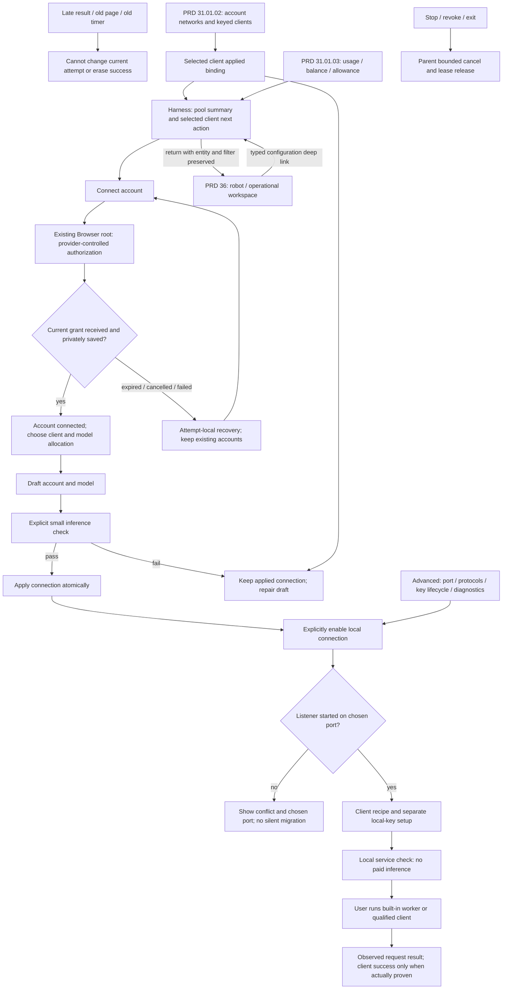

# Harness connection experience

Parent: [provider gateway](PRD_02_31_01_provider_gateway.md). Sequence:
[0.2.23 plan](../plan/plan-v0.2.23.md#harness-product-redesign-before-publication).
Status: `[_]` product redesign specified after owner feedback, 2026-10-25;
implementation and acceptance remain open. Existing gateway receipts do not
qualify this experience.

This module owns Harness information architecture, visible state, first use,
recovery and connection handoff. [Provider pool](PRD_02_31_01_02_provider_pool.md)
owns account/network/profile allocation; [monitoring](PRD_02_31_01_03_usage_monitoring.md)
owns statistics, balances and quota. The parent owns provider contracts, storage,
API semantics, limits and binding authority. The worker's tools and execution
remain with [PRD 31](PRD_02_31_v0_2_horizon.md#harness--detail).
The new [Harness workspace](PRD_02_36_harness_workspace.md) owns the robot entry
and operational large-screen view. This module owns its configuration forms;
both surfaces use the same account/profile/measurement state.

## Outcome tree DAG

```text
Outcome: manage an account pool and give each local tool a usable, observable connection
├── [_] ORIENT — one visible next action and a persistent current connection
│   invariant: authorization, model validation, local service and client use are distinct
│   evidence: HU-01 empty/partial/returning journeys without operator explanations
│   safe failure: name the incomplete step; preserve the last working connection
│   dependency: existing Harness route and typed runtime observations
│   non-goal: another settings window or duplicating the PRD 36 operation view
├── [_] AUTHORIZE — leave for the provider and return with an unambiguous result
│   invariant: only the current grant and successful private save establish connection
│   evidence: HU-02 success/expiry/cancel/retry/stale-result public journeys
│   safe failure: fresh retry; existing accounts and browser/terminal drafts survive
│   dependency: parent auth coordinator and existing Browser root
│   non-goal: reading cookies, DOM login detection or modifying provider pages
├── [_] CHOOSE — select an account/model and verify before applying a connection
│   invariant: draft, verified candidate and applied binding remain distinct
│   evidence: HU-03/04 paid-probe consent, failed save and active-binding change
│   safe failure: failed verification/save leaves the previous binding usable
│   dependency: pool client-profile allocation, catalogue and parent binding generation
│   non-goal: automatic model selection, fallback or account rotation
├── [_] CONNECT — enable the local endpoint and hand off a complete client recipe
│   invariant: explicit start, actual endpoint and separate key setup; no implied client success
│   evidence: HU-05/06 stopped/conflict/restart/key and real-client journeys
│   safe failure: retain the chosen port and give the failing step's recovery action
│   dependency: parent listener/key contracts and a versioned qualified client
│   non-goal: installing clients, editing their files or running tasks from Settings
└── [_] RECOVER — find and repair the affected connection without losing context
    invariant: errors belong to their operation; a stale error cannot overwrite later success
    evidence: HU-07/08/09 account lifecycle, narrow/native input and safe diagnostics
    safe failure: retain drafts, mask secrets and keep terminal/page input independent
    dependency: shared workspace controls and additive PRD 26 observations
    non-goal: invoice administration, transcript storage or changing provider billing settings
```

## Memory palace



## Problem and product decisions

The current `src/harness_settings_ui.rs` presents listener/port controls before
accounts, mixes a manually typed model ID with a long catalogue, and separates
the key from a command template that alone cannot connect a client. A shared
`busy`/status presentation does not tell the user which operation completed.
`provider_runtime.rs` can open a provider completion URL after credentials have
already been stored, making the host's separate successful result easy to miss.
The owner also observed a DeepSeek login-page timeout while a subsequent
account inference succeeded. That observation proves conflicting feedback,
not the cause of the provider page's error.

Use a guided connection experience in the existing Harness settings route.
Keep Console / Web / Harness as the top-level routes. Inside Harness use a
pool summary and expandable sections, rather than another row of navigation tabs
or a modal wizard. Settings remains useful after first use.

| Area, in display order | Product behavior |
| --- | --- |
| Pool overview | Account availability, local service status, attention states and selected client connection; distinguish pending setup from applied allocations |
| Account pool | Multiple accounts from the same provider, local labels, account-specific login/service network, authorization/model status and authoritative balance/allowance summaries |
| Clients and allocations | Each harness profile has its own key and model/account mappings; guided built-in/qualified-external/manual recipes use the selected profile |
| Usage and allowance | Local account/client/model totals, provider snapshot freshness and bounded monitoring controls; read-only metrics do not imply account rotation |
| Advanced | Port, exact protocol URLs, local-key lifecycle and bounded diagnostic details; opening this section performs no network or clipboard action |

On first use the summary shows three steps: **Connect an account -> Allocate and
verify a model for a client -> Connect that tool**. Resume at the first incomplete step after
returning from the browser or reopening Settings. After application, show the
connection summary and operational actions instead of restarting onboarding.
Closing Settings is never cancellation, sign-out or Stop.

```text
Console | Web | Harness

Model connections                                  Local API: Stopped
Accounts: 3 configured   Clients: 2 configured        [Enable local connection]
Next: verify the selected client allocation          [Review allocation]

Account pool
  DeepSeek A      Connected   Login: Direct   Balance: not refreshed
  DeepSeek B      Connected   Login: Proxy    Balance: not refreshed
  OpenCode Go C   Connected   Allowance: not refreshed
  [Connect account]                         [Account details / network]

Clients and allocations
  Built-in Harness -> DeepSeek A / chosen model        [Configure]
  Pi               -> DeepSeek B / chosen model        [Configure]
  [Add client profile]

Usage and allowance
  Today · local requests/tokens by account or client; missing usage labeled
  [Details]  [Refresh provider readings]  Monitoring: Off

> Advanced: port / protocol addresses / diagnostics
[Open Harness workspace]
```

This is an information-layout wireframe, not pixel acceptance. Interface text
follows the existing selected UI language, including errors and action labels;
provider names and model identifiers stay unchanged. Narrow layouts stack
actions with their labels and use the existing readable scrolling mechanism.
The pool summary, selected client connection and recovery action must be reachable
without scrolling through every model. Keyboard focus follows visible order;
Tab, Shift+Tab, Enter, Escape and native IME keep their workspace semantics.

## Settings layout and form design

The global gear opens the existing anchored chrome panel. Keep the top-level
Console / Web / Harness routes. Harness begins with a compact setup/service
summary and four section links: **Account pool, Client allocations, Usage
monitoring, Local API**. These select a form section inside the same panel;
they do not add windows or a row of full application tabs. Diagnostics and
low-level identifiers are expandable details in their relevant section.

Use a readable expanded panel up to 760 DIP, bounded by available host width
and height and anchored to the Settings entry. At least 640 available DIP
supports a section rail and form/detail area; below that use a section selector
and single stacked form. If the panel fills a short/narrow host, retain explicit
Back/Close and scrollable content; avoid horizontally clipped fixed-height rows.
These are proposed layout targets requiring actual native evidence.

```text
Settings                                       [Open Harness] [Close]
Console | Web | Harness
Account setup 3 configured · Client setup 2 configured · Local API Stopped
┌───────────────────┬───────────────────────────────────────────────┐
│ Account pool      │ Accounts                         [Connect +] │
│ Client allocations│ DeepSeek A  Connected  Direct     [Details]  │
│ Usage monitoring  │ DeepSeek B  Connected  Proxy      [Details]  │
│ Local API         │ OpenCode C  Connected  Go         [Details]  │
│                   ├───────────────────────────────────────────────┤
│                   │ DeepSeek B                                    │
│                   │ Label: [Personal / Google account          ] │
│                   │ Login network:   [Saved proxy v]             │
│                   │ Service network: [Direct v]                  │
│                   │ Authorization: Connected   Last check: time  │
│                   │ Balance: last known value · freshness         │
│                   │ [Refresh reading] [Reconnect] [More actions]  │
├───────────────────┴───────────────────────────────────────────────┤
│ Unapplied network draft · affects future work [Revert] [Save]     │
└───────────────────────────────────────────────────────────────────┘
```

### Account pool form

The list distinguishes same-provider accounts using local labels, provider,
short identity and connected/needs-login/disabled states. Selecting a row opens
its detail; clicking Details never starts a login. Show the applied login and
service network separately, with plain-language status and the account's affected
client count. Balance/allowance is a read-only snapshot with a labeled explicit
Refresh action; it is not edited as account configuration.

Connect account asks for provider and local label, then shows login-network
choice before Continue. The supported provider page owns the identity method,
including Google; MiniCon does not invent a separate Google OAuth adapter.
The owner's second DeepSeek account can choose a login proxy without changing
the first account's browser storage or ordinary Web proxy preferences. Auth
pending/success/expiry presentation follows the existing handoff section below.

Keep destructive/rare actions in an account-specific menu: Disable, Reconnect,
Sign out and remove. Selecting one names affected client allocations and active
work. A network edit shows Draft vs Applied values and can be reverted without
reconnecting. Saving a changed policy does not reroute active work or silently
start a new authorization attempt. Link failed login/network state directly to
the relevant setting; do not ask the user to diagnose a generic busy status.

### Client allocation form

The left list is client profiles, not provider accounts. New profile asks for a
local name and a qualified recipe or Manual configuration. It gets its own key;
a visual **Copy configuration** action never copies a different profile's key.

Profile detail contains **Connection**, **Model allocations**, and **Local key**:

- Connection: actual service status and the client-specific protocol/base URL;
  selected shell and a complete handoff recipe. A stopped URL is not presented
  as currently available.
- Allocations: editable rows for local alias, account, upstream catalogue model,
  relevant capabilities and exact-route verification state. One alias is marked
  default for the built-in recipe. **Add model**, **Verify**, **Apply allocation**
  are explicit; remove affects this profile and explains continuation rules.
- Local key lifecycle authority: [applied-profile keys](PRD_02_31_01_02_02_profile_keys.md).
  Created / Not created / Revoked plus explicit Create, Copy and
  Replace/Revoke actions. The key value stays masked. Show that sharing a key
  also shares route allocation and local usage attribution.

The action footer names the profile being edited and shows pending changes.
Selecting another account row must not mutate it. Failed check/save leaves the
previous applied connection visible. No automatic paid verification while typing,
scrolling, switching rows or reopening Settings.

### Monitoring form

Separate **Local usage recording** from **Provider balance/allowance refresh**.
Explain that local history covers MiniCon traffic only, and show retained coverage
and Clear local history as an explicit action. Account provider cards show which
measurements are supported, the last success, current freshness and any unavailable
authorization capability. Do not present unknown as a disabled-looking zero.

Expose the monitoring owner's planned opt-in switch, refresh interval and per-account
attention thresholds with their actual units; show any minimum interval validation
beside the field. Balance thresholds are currency-specific, quota thresholds
require a known allowance limit. **Refresh now** is a metadata action, not Test
model. **View usage** opens PRD 36 with the same account/profile/time filter.
All polling, retention and measurement facts remain owned by PRD 31.01.03.

### Local API form

Display actual stopped/starting/running/stopping/error state, configured port,
actual bound address and **Start / Stop**. While running, explain that port edits
require Stop. Below, show the protocol-specific addresses, links to each profile's
key/recipe, and expandable diagnostics. Do not place every profile's key controls
in this global service form. Stop names that it affects all local API profiles;
it is not confused with disabling one account or stopping one future task.

### Drafts, focus and feedback

Keep drafts per selected account/profile/section while switching Console/Web/
Harness or moving between Settings and the operational workspace. Returning
restores the entity, caret/selection and scroll where meaningful; IME preedit
follows the shared blur rules and is not silently submitted. The footer offers
Revert / Save for non-inference edits and Verify and apply for unverified model
allocations. It names the affected entity instead of offering an ambiguous global
Save all. Closing Settings retains unapplied in-memory drafts with a small
indicator; process exit does not auto-save them.

An asynchronous draft acknowledgement must preserve edits made after dispatch,
including clearing and retyping the same value. Track edit intent per field;
string equality alone cannot distinguish an untouched field from later input.
Changing an allocation's account also owns clearing its model selection, even
when the model text was already empty. Revert and model-choice results may
reset only fields that have not been edited since that request.

Returning to an existing connection form restores its last legal editable
field and stable allocation slot, with the retained caret/selection. Leaving
clears preedit and pointer selection gestures under the shared blur rules.
A removed slot cannot redirect focus to a different allocation. Keyboard
highlight in the profile chooser remains distinct from entering that form.

Keep applied alias/account/upstream-model rows visible beside the selected
draft's changes. A label or allocation count alone cannot explain which
connection is currently used. Account metadata failure must retain existing
forms and their applied references. A matching successful Discard result still
removes that unapplied form and restores a legal selection while metadata is
unavailable; an unrelated failure cannot clear other forms. These are required
draft-form behaviors, with implementation and public/native acceptance open.

Status feedback is inline and operation-scoped. Use a non-focus-stealing success
notice for Save/Copy and preserve a persistent result where it changes the setup
step. Copy failures say that copying failed, never Copied. Disable a control
only for its real dependency and show why. Group errors with the relevant field
and keep unrelated Stop/Back/Cancel controls usable. Account balance reads and
model verification must not share an unlabeled spinner.

## Visible state and primary action

Do not compress the following into one green `ready` badge. User labels are
projections of authoritative operations, not a replacement for their contracts.

| Dimension | Visible states | What completion establishes |
| --- | --- | --- |
| Authorization attempt | Waiting for authorization / Saving account / Connected / Cancelled / Expired / Could not connect | Connected means the intended grant was received and privately stored; page navigation alone establishes nothing |
| Selected client model | Not selected / Not checked / Checking / Check passed at a displayed time / Check failed | A successful bounded inference for that exact account, credential generation, route and relevant protocol; not every model on the account |
| Local service | Stopped / Starting / Running / Stopping / Could not start | The listener is actually bound at the displayed address; not that an external tool works |
| Client handoff | Setup incomplete / Configuration available / Local service check passed / Request observed | Configuration or an authenticated local check does not certify that the external client's task succeeded |

A check is historical evidence, not a promise of current quota or uptime.
Changed credentials, model or route invalidate that candidate's check. A
transient network failure does not itself invalidate the authorization grant.
Keep the parent's stricter usable-account requirement: authorization alone
does not admit inference before the selected model has passed its check.

| Current situation | Primary next action |
| --- | --- |
| No connected account | Connect account |
| Authorization pending | Continue authorization; Cancel remains available |
| Connected account, no model | Choose model |
| Unverified candidate | Verify and apply, with the inference/quota notice adjacent |
| Previously verified exact candidate, unapplied | Apply connection; no automatic repeat paid request |
| Applied usable connection, stopped service | Enable local connection |
| Service running, handoff incomplete | Configure the selected tool |
| Configured connection | Show connection details; Test again is a secondary explicit action |
| Failure | Repair the affected step; do not reset unrelated completed steps |

Busy state is scoped to its operation. Authorizing another account must not
hide Stop, block unrelated terminal input or replace a running connection's
status. A second simultaneous login is refused with Continue/Cancel guidance;
clicking another provider never silently replaces the current attempt.

## Authorization handoff and recovery

1. Connect account opens a small provider choice in the same route. Explain
   which hosted account is being connected. Only supported methods are offered.
2. Start a fresh bounded attempt and open its official authorization page in
   the existing Browser root. Show a host-owned progress strip and **Back to
   Harness** entry while that attempt is pending. Device-code flows also expose
   their effective countdown and explicit Copy code / Open authorization.
3. A grant received and successfully saved produces a persistent account result
   in Harness and a dismissible host notification. Do not steal focus, inject
   content into the provider page or force a return to Settings. If the provider
   contract requires final navigation, complete it in the original authorization
   surface; its page result cannot erase an already stored grant.
4. Return to Harness reveals the connected account and the model step. A paid
   model check is a separate deliberate action; receiving a grant does not
   silently spend inference quota.

The catalogue may load once after account storage as non-inference metadata
work, with a scoped loading/error state. It must not imply a paid model check,
hide the successful authorization result or repeatedly retry in the background.

The latest authoritative result for the current attempt wins. A timeout timer
or browser error after successful grant storage cannot change Connected into
Expired. A failed private save shows **Authorization received; could not save
account**, with a fresh-retry action and no usable-account claim. Do not retain
an unbounded secret-bearing attempt merely to offer a retry button.

An actual expiry says that **this authorization attempt expired** and offers
Retry; an existing connected account remains separately visible and unchanged.
Retry creates fresh state and callback/device ownership under the parent's
contract. Old timers, callbacks and results cannot complete the retry. Cancel
ends only the pending attempt. No automatic login retry, page-cookie import,
clipboard mutation or inference probe is needed to resolve a timeout message.

When a provider page and host result disagree, show the verifiable host result
and its next action: **Account connected; choose a model** or **Model check
passed** where proved. Do not explain the provider page's cause without evidence,
and do not tell the user to log in again just to clear a stale page message.

## Account and model selection

The [connection-selection owner](PRD_02_31_01_02_01_connection_selection.md)
defines catalogue/authority identity, draft revisions, exact verification,
atomic application and legacy migration. This section owns their presentation.

Account cards show provider, provider-supplied label, stable short ID, connection
state and the client allocations using that account. Only the expanded account shows
its catalogue, network, balance and secondary actions. Keep Connect another
account available. Custom local labels and multiple keyed client profiles are
selected scope under the pool owner; they are not deferred.

Use a bounded picker over that account's actual catalogue. Show a friendly name
where supplied and capabilities relevant to the selected client. Never invent
tool/streaming support or a recommended default from a model's name. Remember
a previously applied matching route as a draft; a new account does not inherit
another provider's model. Manual provider-qualified IDs remain an advanced
option and receive the same validation. An unsupported model is a route problem,
not an instruction to sign out every account.

Select the client profile being edited before choosing its account/model aliases.
Selecting an account or model changes that profile's draft only.
**Verify and apply** is one explicit operation: disclose the small inference request, validate the exact
candidate, then atomically save and apply the complete binding. A matching
successful check can be reused while its identity remains unchanged. Apply
failure retains both the user's draft and the previous working connection;
it must not partially switch account, model or local client profile, and must
not modify another profile's working allocation.

Before applying a different binding, explain the parent's conversation rule:
new conversations use the new connection, and old conversations cannot silently
continue on it. Do not cancel an already admitted stream merely because a
model row was highlighted. Account reconnection stages fresh credentials before
replacing stored credentials; failure preserves the existing record. Reuse an
account ID only when provider identity proves it is the same account, never
by display label alone.

## Local connection and client handoff

**Enable local connection** validates at least one usable applied profile and
starts the shared listener on the configured port. An explicit profile setup
action creates that profile's independent local key if missing; reuse its key
on later setup. Explain key creation before the first enable if combined in
one guided action. Other incomplete profiles stay unavailable individually.
Merely opening Settings, applying a model or copying a recipe never starts it.
If binding or save fails, do not start. If port binding fails after key creation,
show **Key created; service not running**, preserve the key and chosen port,
and offer Retry / Change port. Never choose another port or create another key
silently. Restart still starts stopped under the parent contract.

Client handoff cards select or create an independent keyed profile under the
pool owner. Show its aliases and actual account allocations; warn that copying
one profile key to another application shares both allocation and statistics.
Offer only clients with actual scoped compatibility evidence
as qualified choices; the manual card states that other clients are unverified.
Protocol compatibility alone does not qualify Codex, Cursor or an unnamed CLI.

Each card must supply a complete, versioned handoff:

- Required account/model capabilities and supported client version/protocol.
- The exact actual endpoint in the format that client accepts, including the
  correct base-path convention; a stopped endpoint is labeled as such.
- Separate local-key setup in the user's selected shell. Copy key is explicit,
  reports clipboard failure, and never inserts an upstream credential. Do not
  put key values in copied command templates, history or diagnostic exports.
- A copyable invocation/configuration with clearly marked user inputs. The
  built-in worker needs a project root, task and explicit allowed commands;
  no task execution or allow-list expansion occurs while configuring it.
- A **Check local service** action using authenticated local metadata/model
  routing only, with no provider inference or paid quota. This checks the service
  using the stored local key, not the key/environment/configuration of another
  client process. A separate real task verifies the client; do not present a copied template as successful use.
- Recovery for stopped listener, wrong key, unsupported model/protocol and
  changed conversation binding. Shared-key and restart limits stay visible
  where they affect the client recipe.

Settings does not install clients, write their configuration files, launch tasks
or introduce a background daemon. Future visual task operation is separately
owned and staged in PRD 36.
Advanced reveals editable port, both protocol URLs, explicit key revoke/replace
and diagnostic details. Stop remains readily available while running. Explain
actual active-request/conversation effects before destructive account removal
or key revocation, using the parent's bounded cancellation semantics.

```text
Connect a tool: Built-in Harness
Profile: Built-in Harness (independent local key)
Uses: alias work -> DeepSeek A / selected model
Local connection: Running · http://127.0.0.1:<actual-port>/v1

1  Shell: [PowerShell / bash]  Local key: Created       [Copy key]
   Set the named variable in this shell using the shown private-input steps.
2  Project: [path]  Task: [text]  Allowed commands: [explicit list]
   [Copy command]  (uses the key variable; never contains its value)
3  [Check local service]  Checks the service; no provider inference.
   Run the displayed task in that terminal to check model and tool use.

Other tool: [qualified client/version]   [Manual protocol configuration]
```

The wireframe's endpoint placeholder is replaced with the actual bound address
only when running. The shell recipe explains its process-local environment and
cleanup; it must not suggest that setting a variable in one shell configures
every terminal or GUI client. Missing project/task inputs remain explicit
placeholders and cannot be labeled as a runnable, complete task.

## Errors, diagnostics and acceptance

Put errors beside the affected action, with a plain-language result and one
useful recovery action. Keep optional typed details expandable. Do not leave
an old global footer error above a successfully recovered connection. Sign-out
reports local credential removal separately from provider revocation; unsupported
remote revocation is not described as successful remote logout. Rate limits
stay on the same account, expose retry guidance and never silently replay work.
Diagnostics exclude keys, authorization/device codes, callback query strings,
provider bodies, prompts and tool transcripts. Copying diagnostics is explicit.

Every row below is `[_]` until named evidence exists. Fixtures can prove state
and recovery; real grants, physical input and final artifact claims retain their
separate parent owners and may remain BLOCKED.

| Journey | Observable acceptance |
| --- | --- |
| HU-01 First use and return | Empty/partial/applied states expose the correct next action; no unexpected paid request, listener start, key creation or clipboard write on open/reopen |
| HU-02 Authorization result | Real grant/save success visible after browser return; expiry/cancel/save failure have distinct recovery; old timer/page/result cannot overwrite success or another attempt |
| HU-03 Model choice | Actual catalogue, manual-ID refusal, per-client capability display and explicit probe consent; an account-level success does not certify untested routes |
| HU-04 Apply and recover | Draft differs visibly from applied binding; failed probe/save preserves old connection; changed binding gives the specified conversation guidance |
| HU-05 Endpoint lifecycle | Explicit enable, missing/existing key, occupied port, key-copy failure, Stop and restart produce truthful states and bounded cleanup |
| HU-06 Complete client handoff | Fresh profile with real account -> built-in file/exec task and named external client's tool/SSE/cancel journey, using only the displayed recipe and no hidden operator configuration |
| HU-07 Account lifecycle | Same-provider labels/network contexts and per-client allocations remain distinguishable; reconnect/remove races and local/remote logout outcomes shown accurately; PP-01..06 own the pool proofs |
| HU-08 Native usability | Selected languages, normal/narrow/short viewports, keyboard traversal, native IME and focus return; unchanged Console/Web/terminal drafts; actual claimed scales and platforms named |
| HU-09 Feedback and redaction | Errors clear only when their operation recovers; unrelated failures do not hide running status; snapshots/diagnostics/copies preserve the documented secret boundaries |
| HU-10 Settings forms | Account/profile/monitor/service sections retain entity-scoped drafts, keyboard order, readable narrow forms and correct save/verify/copy feedback; no hidden network or inference on navigation |
| HU-11 Operational handoff | Robot workspace <-> Settings deep links preserve entity/filter/return focus and show the same applied configuration, active counts and measurement freshness |

Pool and metric acceptance stay with PP-01..06 and UM-01..06 in their owners.
The product gate includes a continuous journey:
connect -> verify/apply -> explicitly enable -> configure a tool -> complete a
real tool task -> stop -> reopen and recover. Observe state, actual effects and
pixels. Prove new critical guards with runtime counterexamples; a passing layout
fixture alone does not certify usability or authorization.

### Scoped profile-verification visual observation

The [whole-profile checkpoint](PRD_02_31_01_02_01_01_profile_verification.md#public-zero-call-and-unknown-plan-checkpoint)
records complete N=0/unavailable action captions. Separate actual image
inspection at English/scale1000 also observes the surrounding long verification
explanation truncated in the narrow Settings pane. Receipt:
`target-six/v0.2.23-provider/cs05-final-gates/visual-review.json`.
HU-08 remains open: the complete explanatory text must be readable through a
bounded layout/wrapping treatment before claiming overall narrow-view usability.
The button observation is not human-owner acceptance or physical-input evidence.

### Selected-profile key consumer candidate

The [key lifecycle owner](PRD_02_31_01_02_02_profile_keys.md#k2-selected-applied-profile-consumer-candidate)
owns K2 applied targeting, immediate Copy-intent invalidation, actual clipboard
feedback and worker/Pi handoff semantics. Its integrated controlled-consumer
checkpoint is recorded there; source controls and public/native handoff remain
open. It does not complete HU-05/06/08/09 or native/client qualification.

### Independent service editing during asynchronous publication

Service port editing has its own input owner. Initial or changed client-profile
metadata must not steal that focus, move its caret/selection, cancel its preedit
or jump its viewport. An unrelated View publication with the same applied port
must not reset a selected port value merely because its bytes still equal the
applied value. A changed applied port may update an untouched, unfocused field;
an active or dirty draft remains the user's draft. Failed Save preserves both
the previous applied port and the editable correction; retry remains explicit.
The existing typed View, field editor and connection forms are prerequisites;
the sole product hot file is `src/harness_settings_ui.rs`. Deterministic actual
consumer regressions precede the fix, followed by the original public failed-
save/retry journey. This does not change storage publication, provider authority,
model verification or accepted profile state.

The two actual consumer subjects are
`independent_port_focus_survives_profile_hydration` and
`independent_port_selection_survives_unrelated_view_publication`.
`target-six/v0.2.23-provider/port-publication-controls/receipt.json` records
their two baseline passes, each intended original assertion failure after its
production guard is removed, byte-exact source restoration and two restored
passes. These add two subjects to the Windows binary suite (869 total).
The original public failed-save/draft/retry journey also passes both Windows
architectures in [run40243448527](https://github.com/partnernetsoftware/minicon/actions/runs/40243448527)
at `45a5165be999e3aed40cf806fe48f2a55f1e731c`, with Loaded-state setup and
the actual corrected port checked before Submit. That earlier-source result
does not qualify the subsequent focus/selection fix or physical input.

The integrated fix is qualified for development on both Windows architectures
by [run40244714076](https://github.com/partnernetsoftware/minicon/actions/runs/40244714076)
at `fc26f165396b10b3b733c2b84dc863d213c75e57`. Each target's23 selected
Harness suites reports success. A log/receipt audit verifies both new consumer
subjects, the existing profile-return/navigation subject, the original public
failed-save/draft/retry journey and the public H0 destination journey actually
execute and pass on each target; repeated subjects in separate selected suites
retain their actual execution counts. Audit:
`target-six/v0.2.23-provider/harness-ci-fc26f16/verification-index.json`.
This closes these two editing regressions at that source; it does not claim
physical clipboard/IME input, another scale or final signed-artifact acceptance.

### Hosted physical Harness fields and redaction checkpoint

The exact `d2a67eb` Windows x86_64 physical court passes actual pointer/keyboard
port and model draft editing, Console/Web/Harness route return with those
drafts retained, temporary local-key creation/revocation and public snapshot
redaction. It applies no model binding, performs no provider login/inference
and does not claim a physical Copy-key action. The model-field and key-status
PNGs have been visually inspected; no key bytes are shown. Source/image,
actual1000-permille geometry, exact clipboard/GUI/thread/profile cleanup and the
still-blocked ARM64 scope belong to
[PRD32](PRD_02_32_dev_loop_crosscheck.md#hosted-native-input-completion-and-remaining-desktop-allocation).
Clipped explanation rows and technical draft-status wording observed in that
fixture remain open presentation work; native field success does not close
the complete first-use/readability acceptance gate.
