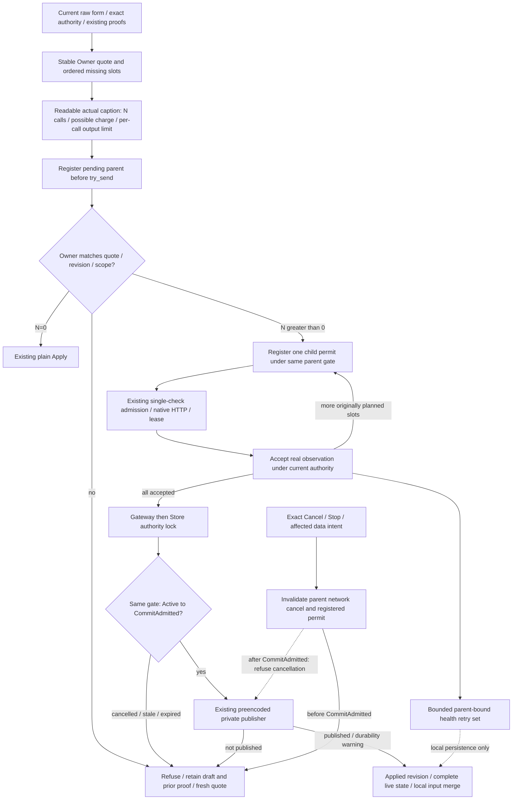

# Whole-profile verification and application

Parent: [connection selection](PRD_02_31_01_02_01_connection_selection.md).
Sequence: [0.2.23 plan](../plan/plan-v0.2.23.md#harness-product-redesign-before-publication).
Status: `[_]` accepted CS-05 design, 2026-10-25. An ignored implementation
preview is in preparation; production integration and runtime qualification
have not started. Plain Apply is an independently verified
prerequisite, not completion of this workflow.

This module owns the complete-profile paid-check quote, sequential execution,
progress/cancellation and the transition into existing atomic Apply. The parent
retains raw candidate/wire/proof identity and plain publication; the pool owner
retains account/profile/key lifecycle. Public schema belongs to PRD 26.

## Outcome tree DAG

```text
Outcome: verify exactly the displayed missing models, then apply the complete profile once
├── [_] QUOTE — one bounded Owner quote for current raw input and reusable evidence
│   invariant: visible N/order/scope equals the paid work authorized by the explicit click
│   evidence: BV-01 stale quote and same-N changed-authority refusal; zero-call plan
│   safe failure: show unavailable/stale and perform no inference
│   dependency: parent raw resolver and exact proofs; non-goal: deriving proof from account Ready
├── [_] RUN — one parent operation, one sequential existing check worker
│   invariant: accepted proofs survive a later failure and cannot add work to the original plan
│   evidence: BV-02 sparse two-account sequence, actual POST counts and deliberate retry
│   safe failure: stop on failure/expiry and retain drafts/proofs/old applied routes
│   dependency: QUOTE and existing transport/permit; non-goal: parallel paid checks or automatic retry
├── [_] INTENT — invalidate pending or active work before queue delivery
│   invariant: exact Cancel/Stop/affected data change prevents further unadmitted child requests
│   evidence: BV-03 pending-start, queue-full, between-child and value-ABA controls
│   safe failure: no revived permit or stale/future request cancellation
│   dependency: one bounded shared parent gate; non-goal: cancelling for caret-only activity
├── [_] COMMIT — enter one explicit cancellation cutoff, then reuse atomic Apply
│   invariant: CommitAdmitted differs from Published; complete state follows the typed write result
│   evidence: BV-04 pre-admission cancellation, write failure and published-warning matrix
│   safe failure: unpublished failure keeps old routing; published state is never called rolled back
│   dependency: RUN and parent Gateway-to-Store publication; non-goal: a second publisher or rename-time cancellation hook
├── [_] MERGE / HEALTH — retain later input and bounded local health-write warnings
│   invariant: final result has an applied revision; health retry cannot undo a published result or pay again
│   evidence: BV-05 later typing/selection, two warning accounts and stale local retry
│   safe failure: preserve local edits and distinguish stale authority from persistence failure
│   dependency: existing field-activity merge and readiness separation; non-goal: a tenth edit receipt/history
└── [_] PRESENT / QUALIFY — actual cost caption, progress, controls and public observations
    invariant: readable painted N/output limit and pointer admission describe the same quote
    evidence: BV-06 localized short/narrow viewports, public N=0 path and controlled/native journeys
    safe failure: unreadable/stale/pending input cannot start the batch; missing selected evidence is BLOCKED
    dependency: all preceding leaves and PRD 26; non-goal: claiming real entitlement from controlled HTTP
```

## Memory palace



## Quote and cost contract

Each profile has at most one bounded private quote and a finite public plan
projection: an opaque plan ID, draft revision and ordered distinct paid slots.
It covers the complete current raw references, full candidate authorities/wires,
unchanged legacy references and reusable proof identities. IDs remain stable
until those meaningful inputs change; labels, focus and polling do not churn
quotes. The public plan exposes no grants, URLs, headers or raw organization.

The actual full-width localized action displays the exact number of calls,
possible charge and the parent's per-call output limit. Painter and pointer
routing share the same complete-caption fit test. Flush and acknowledge staged
input before accepting that click; pending/invalid input never defers an
automatic batch submission. The action carries the displayed plan ID, revision
and exact ordered paid-slot list. Owner rereads authority and rejects a changed
scope even when its call count stays equal. It never silently expands the quote.

A zero-call quote invokes existing plain Apply without inventing a check or
timestamp. Unchanged legacy provenance is governed solely by the parent; a
missing legacy account does not by itself manufacture new paid work or proof.
A new alias over a retained wire uses the parent's planned shared resolver
extension and requires its own actual inference evidence before Apply.

## Sequential execution and budgets

One explicit parent request/profile/revision/Stop epoch pins the initial plan,
its ordered sparse slots, accepted cursor and one 300-second total deadline.
There are at most 32 paid model checks, subject to the parent's allocation
bound. Each child reuses the parent's single-check deadline, decoded-response
budget including refresh, output cap, native transport, lease and one-shot
permit; the total deadline may shorten that child's allowance.

Only one worker exists at a time. Successful acceptance retains that exact proof
and advances a private cursor; it neither invalidates its own authorization nor
adds a slot when the current reusable-proof set changes. Any failure, expiry or
pre-admission cancellation stops subsequent work without partial profile Apply.
A later explicit retry obtains a new quote and pays only for still-missing
proofs. The logical batch remains active between children, excluding another
check/catalogue/login/Start. No new HTTP engine or request queue is introduced.

## Immediate intent and cancellation cutoff

Use one bounded shared gate for the current pending/active parent, its exact
identity, parent network-cancellation handle and currently registered child
permit. Runtime registers pending identity before enqueueing the batch; a failed
send withdraws only that same parent. Owner can activate only the matching,
unrevoked registration. This covers edits or Cancel between enqueue and Owner
start, before an active View has reached the GUI.

Exact Cancel must match this pending/active parent; stale and future IDs cannot
poison it. Stop and structurally valid affected-profile Edit/Choose/Remove/
Revert/Discard invalidate it before trying the existing queue, including on a
full queue. UI also invalidates the same gate as soon as actual raw input data
changes, before successful flush is possible. An A-to-B-to-A edit is revoked on
its first data change. Caret, selection, focus and another profile's edits do not
revoke it. Do not use the editor's broader activity counter as a content-change
signal.

Next-child registration and producer invalidation share the same gate lock.
Invalidation cancels the parent native network handle and the registered
one-shot child permit. A request already admitted by the existing transport CAS
may have incurred cost; cancellation cannot retract those admitted bytes.

After all checks succeed, existing Apply holds Gateway then Store authority.
Inside its prewrite callback, acquire the same parent gate, revalidate epoch,
cancel, revision, authority and deadline, and atomically change Active to
CommitAdmitted. This is the explicit cancellation cutoff, before invoking the
existing publisher; it is not a promise of a hook immediately before rename.
The visible Applying phase is not Published and no longer offers cancellation.
A late queued/stale-view Cancel is refused without setting the parent flag or
changing the eventual write result. An unpublished write failure remains Failed
with draft/proofs retained; a published durability warning advances complete
state. Never report rollback or Cancelled for the committed operation.

## Result merge and health persistence

A positive-call batch is a check operation, not a form command held in the nine
unresolved edit-receipt slots for its lifetime. Maintain one parent-bound,
nonblocking publication baseline containing the original input and field
activity sequence. A successful profile terminal carries an explicit
`applied_revision`; consume that exact parent/revision through existing later-
field merge before ordinary form synchronization. A rejected unrelated start
cannot clear someone else's baseline. Preserve later text, caret/selection and
all other profiles, including while the final save is being admitted.

Retain the existing active/last-terminal observation slots with finite scope,
progress and Applying/Applied state. Do not add child request histories or a
tenth edit receipt. Zero-call Apply uses the existing short Apply receipt.

Keep one parent-bound deduplicated pending health-write set, bounded by the
pool's account ceiling. Successful inference proof is independent of these
writes; retry performs local persistence only, with no new timestamp or paid
request. Authority failure is stale/failed health work, not a storage-success
warning. After profile publication, such a retry cannot rewrite the historical
Applied result into Failed or remove its applied revision. The published
connection and its current availability are distinct observations.

## Evidence frontier and joins

BV-01..06 are planned and unproven. Required controlled consumers include exact
same-N changed-scope rejection, zero POST for N=0, sparse two-account ordering,
partial failure/proof reuse, pending-start and queued Cancel/Stop/data-edit
races, first value-ABA change, caret-only continuation, stored deadline expiry,
multiple readiness failures, final authority race, and publication failure versus
published-warning outcomes. Use the actual Owner/transport/private publisher;
newly introduced guards need their original assertion RED and exact restoration.

Public UI must observe the real button, caption/geometry, progress, cancellation,
final applied revision and unchanged unrelated drafts/keys. Controlled HTTP does
not establish real provider entitlement, physical input or release artifacts.
The current plain-Apply source is `eca1f1f4d282a31354e8bdfbe2148205c54aff30`;
its independent evidence remains in the parent. CS-05 has no executed tests yet.
