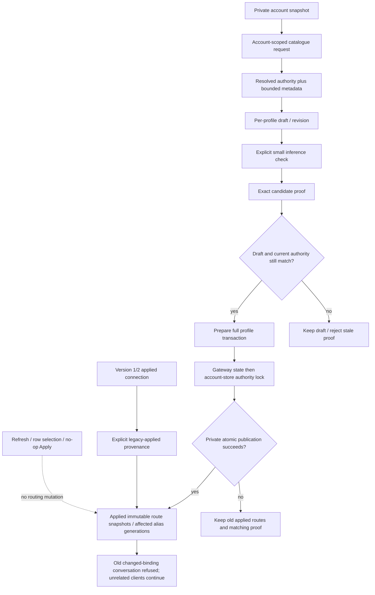

# Account catalogues and verified connection application

Parent: [provider pool](PRD_02_31_01_02_provider_pool.md). User-facing forms and
actions remain with [Harness experience](PRD_02_31_01_01_harness_experience.md).
Sequence: [0.2.23 plan](../plan/plan-v0.2.23.md#harness-product-redesign-before-publication).
Status: `[-]` selected implementation contract with an organization-authority
prerequisite in development; catalogue/draft/verify/apply delivery remains open.

This module owns catalogue identity, connection drafts, verification evidence
and publication of applied routes. The parent owns account/profile/key lifecycle;
the gateway owns admission, conversation pinning and protocol conversion.

## Outcome tree DAG

```text
Outcome: safely prepare one client's model connection while other clients keep working
├── [_] CATALOGUE — query one account without changing applied allocations
│   invariant: account and resolved authority own metadata, never a provider-global model ID
│   evidence: CS-01 same-provider A/B with equal model IDs and different wire routes
│   safe failure: retain prior readings as stale; discard results from superseded authority
│   dependency: private account snapshots and existing bounded catalogue transport
│   non-goal: automatic metadata polling or inference while selecting a model
├── [_] DRAFT — retain separate bounded edits for default and additional profiles
│   invariant: highlighted account/model/alias is never an applied routing mutation
│   evidence: CS-02 edit/switch/revert/reopen with unchanged disk and live sessions
│   safe failure: invalid edits retain the last valid applied connection and the user's draft
│   dependency: profile identity, catalogue and existing field mechanisms
│   non-goal: persisting unapplied edits on exit or adding model-HTTP management endpoints
├── [_] VERIFY — bind a deliberate inference check to the exact candidate
│   invariant: profile/alias/account/grant/network/organization/wire identity must all match
│   evidence: CS-03/04 real bounded HTTP with authority changes before send and before return
│   safe failure: late checks cannot authorize a changed candidate; preserve existing allocations
│   dependency: existing probe, cancellation and account lease mechanisms
│   non-goal: assuming account-wide readiness proves every model or repeating paid checks on typing
├── [_] APPLY — publish a complete profile transaction after validation
│   invariant: private disk and live routing change together under current authority
│   evidence: CS-05/06 failed-save retry, changed-alias refusal and unrelated live stream continuity
│   safe failure: no partial binding; retain draft and matching proof for a deliberate retry
│   dependency: VERIFY and serialized gateway/store publication
│   non-goal: rotating unrelated bindings, account fallback or cancelling streams on highlight
└── [_] MIGRATE — preserve existing usable connections without inventing inference evidence
    invariant: default key/aliases and custom allocations retain their meaning
    evidence: CS-07 version-1/2 load, default/custom worker resume and migration no-op
    safe failure: corrupt or ambiguous migration refuses publication without rewriting private state
    dependency: applied route schema and admission rules
    non-goal: treating legacy account readiness as a newly observed exact-model check
```

## Memory palace



## Authority and metadata ownership

An operation authority includes the stable account ID/provider, credential
generation, service-network generation and effective organization scope.
Organization scope combines a persistent epoch and a tagged digest of the
credential's actual organization; raw identifiers and grants are not public state.
A normal token refresh may change organization without changing credential
generation, so credential generation alone cannot identify a valid check.
Persist the organization epoch in the same private credential record and advance
it atomically on an actual organization change. A -> B -> A must not revive an
old proof or named conversation. Same-value writes and refreshes omitting the
organization preserve its epoch; legacy records use credential generation as
their initial epoch. Reconnect establishes fresh credential authority.

Catalogue transport returns the authority actually used after supported token
refresh or initial organization resolution. Compare current authority before
accepting its result. A first OpenCode organization selection can establish the
resolved catalogue scope; a late response cannot cross reconnect, service edit,
disable or removal. Catalogue refresh never saves gateway routing configuration.

Keep catalogue IDs local to an account and authority. Equal IDs in two accounts
can legitimately describe different protocols, URLs or headers. Applied routes
are immutable snapshots referenced by allocations, with a separate private
registry identity when needed; metadata cannot overwrite a referenced snapshot.
Transport identity includes provider, upstream model, protocol, URL, headers
and effective organization, independently of the registry's internal ID.

The initial catalogue cache is bounded in memory, with explicit Not loaded,
Loading, Fresh, Stale and Error observations. Capacity/eviction never deletes an
applied route or proof. After restart, retain applied route snapshots and require
explicit metadata loading when a catalogue is absent; do not pretend that an
applied route is the provider's complete current catalogue. Exact cache byte and
entry bounds must be enforced before accepting a response and recorded with
implementation evidence.

## Draft and verification identity

Default and additional profiles follow the same draft/verify/apply rules. Each
draft has a revision, default alias and bounded alias/account/model allocations.
UI focus and selected account detail are independent of the draft's allocation.
Switching forms retains drafts in memory; Revert reconstructs the applied
connection. Account labels and catalogue timestamps do not invalidate an
otherwise identical candidate's inference proof.

A check covers exactly one profile/alias, account authority and complete wire
route. Validate this identity after obtaining refreshed credentials and before
sending a paid request, then revalidate after the response. A draft edited while
checking cannot inherit the late proof. A successful check does not apply the
candidate by itself unless the initiating action was Verify and apply.

Verify and apply checks each changed allocation that lacks a matching proof,
then applies the complete profile atomically. A previous exact check can be
reused by explicit Apply without another paid request. Failure preserves the
draft, matching successful proofs and previous applied profile. Readiness of
the account alone never authorizes a newly selected model.

## Publication and migration

Prepare all fallible route validation, identifiers and serialization before
publishing. Acquire gateway state before the account-store authority lock;
revalidate the affected candidate authorities and hold them through atomic
private publication. No reverse lock acquisition is permitted. A failure before
publication must not advance live state or binding generations. A completed
replacement followed by a failed durability barrier is already published: keep
disk/live state aligned and report the durability warning truthfully. Reuse the
shared publication result's committed/published distinction; a generic I/O error
cannot prove that old bytes remain. Never claim rollback after replacement.
The [private-publication owner](PRD_02_28_02_private_publication.md) records the
shared typed result and current gateway-save consumer checkpoint. That
prerequisite does not qualify verified atomic profile Apply on its own.

Change only affected profile/alias generations when effective routing changes.
Unrelated live streams and sessions survive catalogue reads and another
profile's Apply. Existing conversations cannot silently use a new binding;
already admitted streams retain their original lease. Mechanical snapshot-ID
migration and no-op Apply must not rotate an unchanged effective binding.

Version 1/2 migration preserves the default key, `minicon-selected`, legacy
accepted route/model identifiers and existing custom-profile aliases. Mark
previously applied connections with explicit LegacyApplied provenance, without
inventing a check timestamp. That provenance preserves only the unchanged
existing allocation; it does not verify an unallocated catalogue row or a new
candidate. New inference proofs and legacy provenance remain distinguishable
in private state and user-visible status.

## Evidence frontier

CS-01..07 above are implementation obligations, all `[_]`. Each trusted
regression must fail at runtime when its guarded identity/transaction condition
is removed, then pass after exact restoration. Public Settings journeys must
show applied versus draft state and the actual failing operation. Controlled
HTTP cannot qualify real provider entitlement, native input or release bytes.

### Organization authority prerequisite

Development `AccountSnapshot.organization` carries an opaque persistent epoch
and tagged organization-value digest. Credential-v2 files can omit the epoch
for migration; explicit invalid/null epochs are refused. A real organization
change rotates the epoch in the same private credential publication, while
same-value writes and refreshes omitting organization preserve it.

Conversation binding generations include this authority. After token refresh,
the model consumer reacquires the bound authority under the account-store lock
before preparing the inference request. A changed organization returns the
existing changed-binding refusal. This does not change the original catalogue
organization-resolution or probe entry points; exact candidate verification and
transactional application still require their later scoped APIs above.

The first local strict test-wrapper run executed four tests successfully:

- `provider_accounts::tests::organization_authority_persists_and_aba_never_revives_an_old_grant_binding`
- `provider_accounts::tests::organization_authority_legacy_missing_epoch_is_stable_until_the_value_changes`
- `provider_server::tests::organization_authority_aba_refuses_old_sessions_without_cancelling_admitted_sse_or_other_accounts`
- `provider_server::tests::organization_authority_changed_by_refresh_is_refused_before_a_bound_model_request`

They use private files/reopen and actual loopback HTTP. The HTTP peer answers
even an incorrectly admitted inference, so a removed guard must fail the
409/no-inference assertions rather than merely time out. One admitted SSE
finishes and a different account/profile retains its binding through A -> B -> A.
Receipt log: `target-six/v0.2.23-provider/organization-authority-initial.log`.
The complete local provider regression then passed 98 tests with one unselected
Pi opt-in test ignored; both public gateway-worker journeys and all 18 alignment
tests passed. Unit inventory increased from 622 to 626. Formatting and strict
all-target Clippy passed with default and dedicated native-court features.
`target-six/v0.2.23-provider/organization-authority-final-gate-receipt.json`
records the latter gates and source hashes.

Six actual runtime assertion failures cover epoch rotation, exact authority
comparison, binding epoch inclusion, the pre-inference guard, organization-value
digest and legacy fallback. Sources were restored exactly; the joined index is
`target-six/v0.2.23-provider/organization-authority-controls-index.json`.
Two rejected control-fixture attempts (a changed formatting anchor and a
non-compiling mutant) remain retained and do not count as product counterexamples.
Independent postcommit, native/final-source and release qualification remain
open. This is a prerequisite checkpoint; CS-01..07 are not completed by it.
