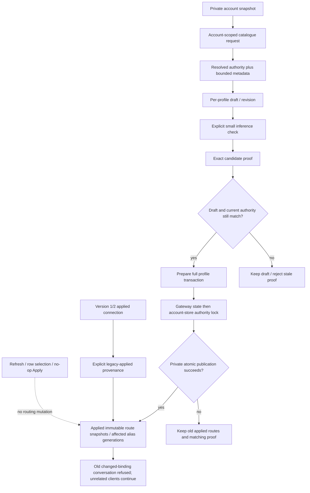

# Account catalogues and verified connection application

Parent: [provider pool](PRD_02_31_01_02_provider_pool.md). User-facing forms and
actions remain with [Harness experience](PRD_02_31_01_01_harness_experience.md).
Sequence: [0.2.23 plan](../plan/plan-v0.2.23.md#harness-product-redesign-before-publication).
Status: `[-]` organization authority, production catalogue, migration and draft
form joins in development; draft acceptance and verify/apply delivery remain open.

This module owns catalogue identity, connection drafts, verification evidence
and publication of applied routes. The parent owns account/profile/key lifecycle;
the gateway owns admission, conversation pinning and protocol conversion.

## Outcome tree DAG

```text
Outcome: safely prepare one client's model connection while other clients keep working
├── [-] CATALOGUE — query one account without changing applied allocations
│   invariant: account and resolved authority own metadata, never a provider-global model ID
│   evidence: CS-01 same-provider A/B with equal model IDs and different wire routes
│   safe failure: retain prior readings as stale; discard results from superseded authority
│   dependency: private account snapshots and existing bounded catalogue transport
│   non-goal: automatic metadata polling or inference while selecting a model
├── [-] DRAFT — retain separate bounded edits for default and additional profiles
│   invariant: highlighted account/model/alias is never an applied routing mutation
│   evidence: CS-02 edit/switch/revert/reopen with unchanged disk and live sessions
│   safe failure: invalid edits retain the last valid applied connection and the user's draft
│   dependency: profile identity, catalogue and existing field mechanisms
│   non-goal: persisting unapplied edits on exit or adding model-HTTP management endpoints
├── [_] VERIFY — bind a deliberate inference check to the exact candidate
│   invariant: profile/alias/account/grant/network/organization/wire identity must all match
│   evidence: CS-03/04 real bounded HTTP with authority changes before send and before return
│   safe failure: late checks cannot authorize a changed candidate; preserve existing allocations
│   dependency: existing probe, cancellation and account lease mechanisms
│   non-goal: assuming account-wide readiness proves every model or repeating paid checks on typing
├── [_] APPLY — publish a complete profile transaction after validation
│   invariant: private disk and live routing change together under current authority
│   evidence: CS-05/06 failed-save retry, changed-alias refusal and unrelated live stream continuity
│   safe failure: no partial binding; retain draft and matching proof for a deliberate retry
│   dependency: VERIFY and serialized gateway/store publication
│   non-goal: rotating unrelated bindings, account fallback or cancelling streams on highlight
└── [-] MIGRATE — preserve existing usable connections without inventing inference evidence
    invariant: default key/aliases and custom allocations retain their meaning
    evidence: CS-07 version-1/2 load, default/custom worker resume and migration no-op
    safe failure: corrupt or ambiguous migration refuses publication without rewriting private state
    dependency: applied route schema and admission rules
    non-goal: treating legacy account readiness as a newly observed exact-model check
```

## Memory palace



## Authority and metadata ownership

An operation authority includes the stable account ID/provider, credential
generation, service-network generation and effective organization scope.
Organization scope combines a persistent epoch and a tagged digest of the
credential's actual organization; raw identifiers and grants are not public state.
A normal token refresh may change organization without changing credential
generation, so credential generation alone cannot identify a valid check.
Persist the organization epoch in the same private credential record and advance
it atomically on an actual organization change. A -> B -> A must not revive an
old proof or named conversation. Same-value writes and refreshes omitting the
organization preserve its epoch; legacy records use credential generation as
their initial epoch. Reconnect establishes fresh credential authority.

Catalogue transport returns the authority actually used after supported token
refresh or initial organization resolution. Compare current authority before
accepting its result. A first OpenCode organization selection can establish the
resolved catalogue scope; a late response cannot cross reconnect, service edit,
disable or removal. Catalogue refresh never saves gateway routing configuration.

Keep catalogue IDs local to an account and authority. Equal IDs in two accounts
can legitimately describe different protocols, URLs or headers. Applied routes
are immutable snapshots referenced by allocations, with a separate private
registry identity when needed; metadata cannot overwrite a referenced snapshot.
Transport identity includes provider, upstream model, protocol, URL, headers
and effective organization, independently of the registry's internal ID.

The initial catalogue cache is bounded in memory, with explicit Not loaded,
Loading, Fresh, Stale and Error observations. Capacity/eviction never deletes an
applied route or proof. After restart, retain applied route snapshots and require
explicit metadata loading when a catalogue is absent; do not pretend that an
applied route is the provider's complete current catalogue. Exact cache byte and
entry bounds must be enforced before accepting a response and recorded with
implementation evidence.

## Draft and verification identity

Default and additional profiles follow the same draft/verify/apply rules. Each
draft has a revision, default alias and bounded alias/account/model allocations.
UI focus and selected account detail are independent of the draft's allocation.
Switching forms retains drafts in memory; Revert reconstructs the applied
connection. Account labels and catalogue timestamps do not invalidate an
otherwise identical candidate's inference proof.

A check covers exactly one profile/alias, account authority and complete wire
route. Validate this identity after obtaining refreshed credentials and before
sending a paid request, then revalidate after the response. A draft edited while
checking cannot inherit the late proof. A successful check does not apply the
candidate by itself unless the initiating action was Verify and apply.

Verify and apply checks each changed allocation that lacks a matching proof,
then applies the complete profile atomically. A previous exact check can be
reused by explicit Apply without another paid request. Failure preserves the
draft, matching successful proofs and previous applied profile. Readiness of
the account alone never authorizes a newly selected model.

## Publication and migration

Prepare all fallible route validation, identifiers and serialization before
publishing. Acquire gateway state before the account-store authority lock;
revalidate the affected candidate authorities and hold them through atomic
private publication. No reverse lock acquisition is permitted. A failure before
publication must not advance live state or binding generations. A completed
replacement followed by a failed durability barrier is already published: keep
disk/live state aligned and report the durability warning truthfully. Reuse the
shared publication result's committed/published distinction; a generic I/O error
cannot prove that old bytes remain. Never claim rollback after replacement.
The [private-publication owner](PRD_02_28_02_private_publication.md) records the
shared typed result and current gateway-save consumer checkpoint. That
prerequisite does not qualify verified atomic profile Apply on its own.

Change only affected profile/alias generations when effective routing changes.
Unrelated live streams and sessions survive catalogue reads and another
profile's Apply. Existing conversations cannot silently use a new binding;
already admitted streams retain their original lease. Mechanical snapshot-ID
migration and no-op Apply must not rotate an unchanged effective binding.

Version 1/2 migration preserves the default key, `minicon-selected`, legacy
accepted route/model identifiers and existing custom-profile aliases. Mark
previously applied connections with explicit LegacyApplied provenance, without
inventing a check timestamp. That provenance preserves only the unchanged
existing allocation; it does not verify an unallocated catalogue row or a new
candidate. New inference proofs and legacy provenance remain distinguishable
in private state and user-visible status.

## Evidence frontier

CS-01 is `[-]` in development. The version-3 resolver/migration prerequisite and
production draft-form join are also `[-]`; the full CS-02..07
draft/verify/atomic-apply obligations remain open.
Each trusted
regression must fail at runtime when its guarded identity/transaction condition
is removed, then pass after exact restoration. Public Settings journeys must
show applied versus draft state and the actual failing operation. Controlled
HTTP cannot qualify real provider entitlement, native input or release bytes.

### Organization authority prerequisite

Development `AccountSnapshot.organization` carries an opaque persistent epoch
and tagged organization-value digest. Credential-v2 files can omit the epoch
for migration; explicit invalid/null epochs are refused. A real organization
change rotates the epoch in the same private credential publication, while
same-value writes and refreshes omitting organization preserve it.

Conversation binding generations include this authority. After token refresh,
the model consumer reacquires the bound authority under the account-store lock
before preparing the inference request. A changed organization returns the
existing changed-binding refusal. This does not change the original catalogue
organization-resolution or probe entry points; exact candidate verification and
transactional application still require their later scoped APIs above.

The first local strict test-wrapper run executed four tests successfully:

- `provider_accounts::tests::organization_authority_persists_and_aba_never_revives_an_old_grant_binding`
- `provider_accounts::tests::organization_authority_legacy_missing_epoch_is_stable_until_the_value_changes`
- `provider_server::tests::organization_authority_aba_refuses_old_sessions_without_cancelling_admitted_sse_or_other_accounts`
- `provider_server::tests::organization_authority_changed_by_refresh_is_refused_before_a_bound_model_request`

They use private files/reopen and actual loopback HTTP. The HTTP peer answers
even an incorrectly admitted inference, so a removed guard must fail the
409/no-inference assertions rather than merely time out. One admitted SSE
finishes and a different account/profile retains its binding through A -> B -> A.
Receipt log: `target-six/v0.2.23-provider/organization-authority-initial.log`.
The complete local provider regression then passed 98 tests with one unselected
Pi opt-in test ignored; both public gateway-worker journeys and all 18 alignment
tests passed. Unit inventory increased from 622 to 626. Formatting and strict
all-target Clippy passed with default and dedicated native-court features.
`target-six/v0.2.23-provider/organization-authority-final-gate-receipt.json`
records the latter gates and source hashes.

Six actual runtime assertion failures cover epoch rotation, exact authority
comparison, binding epoch inclusion, the pre-inference guard, organization-value
digest and legacy fallback. Sources were restored exactly; the joined index is
`target-six/v0.2.23-provider/organization-authority-controls-index.json`.
Two rejected control-fixture attempts (a changed formatting anchor and a
non-compiling mutant) remain retained and do not count as product counterexamples.
Independent postcommit, native/final-source and release qualification remain
open. This is a prerequisite checkpoint; CS-01..07 are not completed by it.

### Catalogue and draft mechanism checkpoint

At the earlier mechanism checkpoint, `src/provider_selection.rs` joined the
product binary through `#[cfg(test)]`. Its cache now has a production consumer
under integration; the draft/frozen-candidate/proof mechanisms retain their test
gate until their own delivery leaves. The module is product-private and adds no
management endpoint or public crate.
The strict test wrapper executed 17 named tests, increasing the main binary's
inventory from 631 to 648 before the separate migration regression below.
The module owns bounded account-local cache tickets, fresh/stale/error states,
frozen wire candidates, independent default-plus-seven-client drafts and exact
candidate proofs. No test-only module is presented as a working Settings flow.

The local cache enforces 16 accounts, 512 routes and a 2 MiB raw/encoded response
limit per account, plus 8 MiB retained route/authority storage in aggregate.
Draft edit storage is bounded to 4 MiB with 32 allocations per profile. Proof
records have separate bounded alias/profile counts; the storage calculation is
not a total allocator or process-RSS measurement. Catalogue and proof identities
exclude registry IDs and labels and retain the actual credential, service and
organization authority. Effective wire identity follows the existing transport:
an OpenCode organization hint must agree with the account grant; a DeepSeek
hint discarded by the request builder cannot change transport identity.

`target-six/v0.2.23-provider/connection-selection-controls-clippy-fixed/receipt.json`
retains 17 initial passes, seven actual runtime assertion failures and 17
restored passes. The controls cover actual returned authority, superseded
tickets, stale catalogue selection, draft edit/revert ABA, effective model
identity, profile capacity and response bounds. The original source bytes were
restored exactly; Cargo-reported PE/x86_64 test images and original stdout/stderr
are identified. A further ten runtime controls qualify each remaining named
test, followed by another 17 restored passes:
`target-six/v0.2.23-provider/connection-selection-remaining-controls/receipt.json`.
They cover metadata eviction, requested generation, aggregate memory,
allocation capacity, registry-independent proof reuse, credential scope,
private Debug output, unloaded state, real store-digest compatibility and
discarded DeepSeek header hints. Each of the 17 new tests has an observed
runtime failure when its guarded mechanism is changed. The first strict Clippy
gate's collapsible condition was corrected before these current-source controls;
the earlier failed gate and older-hash controls remain retained as history.

This is Windows x86_64 shared-cache mechanism evidence. Production catalogue
transport authority, independent UI drafts, actual pre/post-paid-request
verification, config-v3 migration/provenance and transactional Apply remain
open under CS-01..07. No actual provider, native GUI or release artifact is
qualified by this checkpoint.

### Preserve conversations through registry metadata changes

The production gateway compares the selected route's effective transport when
preparing default and custom-alias binding generations. Registry keys, client
labels and header hints that `route_request` discards do not rotate generations.
Header emission and the generation comparison share `emitted_route_headers`;
actual account organization remains governed by the account epoch/digest.
Model, provider, protocol, URL and emitted headers remain transport identity.

The new loopback regression
`provider_server::tests::registry_metadata_migration_preserves_default_and_custom_conversations`
first failed against the former full-record comparison: a registry-only change
turned the default client's existing binding into HTTP 409. With the corrected
comparison, both clients retain their original binding responses; changing only
the custom client's effective URL then refuses its old conversation with 409
while the default client continues. Initial failing/passing logs are
`target-six/v0.2.23-provider/registry-migration-before.log` and
`registry-migration-after.log`. The regression adds one main-binary test.
The default comparison additionally includes the selected account, while the
custom comparison includes each allocation's account. Equal model transport
cannot make an account A -> B -> A switch revive an earlier conversation.
The loopback regression
`provider_server::tests::default_account_aba_cannot_revive_an_old_conversation`
first failed against the route-only default comparison
(`target-six/v0.2.23-provider/default-account-aba-before.log`). It adds a second
main-binary test; the mechanism-plus-regression inventory is now 650.

Four actual runtime controls independently restore the default full-record
comparison, restore the custom full-record comparison, or omit effective URL
identity, or omit the selected account. Each makes its corresponding regression
fail, followed by exact restoration and a passing migration rerun:
`target-six/v0.2.23-provider/registry-binding-controls/receipt.json`.
The earlier control attempt rejected the third test's custom `assert!` panic
text in its log classifier; its failed receipt is retained separately and does
not replace the corrected court. The actual source guard and assertion were
unchanged when the classifier was corrected.
This repairs a migration prerequisite; it does not implement config-v3 loading,
legacy accepted wire-ID preservation or verified atomic Apply.
In particular, preserving a GET binding after an internal key change alone does
not preserve POST requests using the former route ID as their model name.
Migration must explicitly retain those accepted legacy names before registry
retagging is exposed as a complete product operation.

### Production catalogue join (in progress)

The cache now has an actual production consumer: account-detail refresh starts
an owned background catalogue request, receives the transport's resolved
authority, then accepts its bounded result under `AccountStore::with_snapshot`.
That callback holds the store mutation lock only for bounded in-memory
acceptance; it performs no I/O or gateway-lock acquisition. The existing
Gateway-to-store lock order remains in force. Cache observations feed read-only
account-detail rows; neither refresh action nor clicking a catalogue row saves
`gateway.json`, changes applied selections or starts an inference request.

OpenCode's initial organization resolution uses a store-locked authority CAS.
It changes only the organization on the latest credential, preserving a newer
token and unrelated label/login preferences. Credential/service/enablement/
organization changes reject stale resolution. Establishing a real organization
does change account authority; metadata-only routing does not exempt an older
conversation from the existing changed-authority refusal.

Metadata exchanges, including token-refresh waiting and HTTP, share one
60-second deadline and a cumulative 2 MiB response budget. Existing native HTTP,
account leases, proxy policy and cancellation remain the transport mechanisms.
The cache retains the bounds above and is absent after restart; applied route
snapshots remain available independently. Safe public rows contain model IDs,
upstream model and protocol, never URLs, request headers or credentials.

The first integrated strict-wrapper run passed 10 `cs01_` regressions, increasing
the main-binary inventory from 657 to 667. It exercises actual bounded loopback
HTTP, same-provider A/B catalogue isolation, unchanged applied files and named
bindings, late credential/service/disable/remove/organization results, final
store-lock acceptance, cancellation, cumulative response/deadline limits,
failed-refresh row retention, organization CAS and read-only UI actions.
Log: `target-six/v0.2.23-provider/cs01-initial-green.log`. Two earlier fixture
failures remain retained: the binding peer used a port different from the
configured admission authority, and the metadata peer incorrectly required
inference-session headers. Neither is counted as a guarded product RED.
Default and `native-auth-court` all-target strict Clippy passed after the
reported unnecessary option dereference was corrected. Runtime guard controls,
broader product/native and independent qualification remain open. CS-02..07
are unchanged downstream obligations; this join is not a completed connection
selection or verified Apply flow.

Review then reproduced two production projection failures with actual runtime
assertions: a missing credential left a failed-start catalogue Fresh, and a
registry read failure left a completed operation busy. The first attempted
repro used the wrong isolated account-store subdirectory; its setup failures
in `cs01-projection-before.log` are not guard evidence. The corrected actual
REDs are `cs01-projection-runtime-before.log`. A failed snapshot/disabled
account now invalidates cached authority before begin and publishes a bounded
account error; Busy alone does not invalidate another operation's readings.
A failed registry/preferences read retains bounded readings as unavailable,
revokes Fresh/Loading claims and independently publishes operation completion.
A later successful read restores Loaded. An unreadable individual credential
also has an account-specific failure instead of unexplained stale rows.
Unknown account IDs cannot grow the error map.

The corrected 12 CS-01 tests plus the existing 17 selection mechanisms pass in
`cs01-projection-after.log`; main-binary inventory is 669. The initial ten guard
controls and exact restoration are chained through
`cs01-runtime-controls-final/receipt.json`. Two rejected variants passed because
another cumulative transport bound remained, or the changed cache error branch
was not reached by an HTTP parser failure; neither is counted as RED. Six
runtime-consumer controls pass after the projection repair, with 29 exact-restored
positive checks in `cs01-postprojection-controls/receipt.json`;
unchanged store/cache/server/UI source hashes keep their earlier scoped proof.

The restored source passes the joined local development gate:
`target-six/v0.2.23-provider/cs01-final-gate-receipt.json`. Its selected bin
union executes 239 tests with one unselected Pi opt-in ignored; default/custom
workers execute 2, public menu/H0 2, alignment 18, native-page 14 and dedicated
auth 5, totaling 280 actual passing Rust executions. Formatting and both default
and dedicated-feature all-target strict Clippy pass. An explicit fresh dev build
also passes all 22 canonical native-browser checks. The scope remains controlled
HTTP and isolated Windows development; it does not close actual provider grants,
physical input/scales, matching-source six-cell or release qualification.

### Version-3 resolver and migration prerequisite (in progress)

The production codec now validates and upgrades version-1/2 configurations in
memory to version 3. Loading an existing file does not rewrite its bytes,
create/rotate client keys, load a catalogue or start network work. Structurally
valid unresolved account references remain intact; admission reports the actual
account failure. Incomplete old setup with no selected account and a retained
model string remains loadable without manufacturing an allocation.

The original file has a 1 MiB read bound. Explicit publication validates and
serializes within the same write bound before invoking the private writer.
Provenance can make a near-limit legacy file's in-memory representation larger
than that bound: its unchanged existing routes remain readable/usable, while
an oversized future save is refused before changing disk or live bindings.

One canonical allocation resolver now serves admission, default Start,
binding/model observations, migration and generation comparison. The optional
private `default_route` registry key is separate from `model`, which retains
the previously accepted default public name. `minicon-selected`, that old name
and the upstream model ID remain accepted; retagging a private registry key
does not introduce a new public alias. Custom aliases/defaults are unchanged.
Mechanical registry changes preserve effective account/wire generations.

Version 3 records exactly one explicit provenance item per complete allocation.
LegacyApplied has an effective-route digest and no fabricated time/account
authority. A live transition checks its actual previous allocation and refuses
copying that history to another account/profile/alias/wire or downgrading back
to version 1/2. Persisted inference evidence has a versioned exact candidate,
positive check time, canonical wire fingerprint and credential/service/
organization authority. Decode checks its allocation identity; admission also
checks current authority. The proof creation bridge remains test-only until
the real paid-probe consumer is integrated.

Both loaded and fresh Owner configurations become version 3. The old immediate
SelectAccount/SelectModel actions now return VerificationRequired. At this
prerequisite checkpoint, GUI replacement was still pending; the draft join below
replaces those callers, while verification/application remain open.
This intentionally incomplete development checkpoint cannot qualify that
connection experience or a releasable Candidate. Existing applied routes remain
usable independently of those new-selection actions.

The first corrected strict-wrapper run passes ten new `cs02_` tests, increasing
the main inventory from 669 to 679:
`target-six/v0.2.23-provider/cs02-leaf1-initial-green.log`.
Migration/name compatibility reaches real loopback POSTs and named bindings;
seven custom profiles, all 32 allocations each, unresolved accounts, malformed
provenance, write bounds, read-only migration and downgrade refusal are covered.
Older fixture setup is adapted by writing actual legacy private files before
the real decoder, preserving the production transition guard. The publication
fault regression uses a clearly synthetic DraftBook proof prerequisite to reach
its actual disk/live warning/failure consumer; it establishes no paid inference.
The broader existing bin consumer gate passes 249 with one unselected Pi opt-in
ignored in `cs02-leaf1-existing-consumers-repaired.log`.

Fifteen actual runtime assertion controls cover all ten new tests, followed by
their byte-exact restored passing executions:
`target-six/v0.2.23-provider/cs02-leaf1-controls/receipt.json`.
They exercise old-name HTTP admission, registry-only generation stability,
legacy digest/history, custom default-alias resolution, independent read/write
size boundaries, exact proof wire/organization authority, downgrade refusal,
incomplete setup, read-time byte preservation and both old-selector refusals.
The seven-profile test's quota rejection also has provenance validation; it is
not counted as an independently proved quota guard. Setup/compile errors,
timeouts or passing mutants count as no assertion RED. Independent frozen-source
read-only review found no substantiated must-fix, retaining the incomplete-GUI
boundary; its frozen source and findings remain under
`target-six/v0.2.23-provider/cs02-leaf1-readonly-review/`.
The joined local development gate passes 290 actual Rust executions with one
unselected Pi opt-in ignored, default/dedicated-feature strict all-target Clippy,
formatting and all 22 canonical native-browser checks:
`target-six/v0.2.23-provider/cs02-final-gate-receipt.json`.
Its first alignment attempt rejects an ignored Markdown evidence-file reference;
the retained failed attempt is `cs02-final-attempt1/receipt.json`. Only that PRD
pointer is corrected to its output directory. The final receipt explicitly
reuses the six passing compiled gates with unchanged source bytes and reruns
the full documentation alignment and remaining gates. No failed attempt is
relabelled as PASS. Independent postcommit verification subsequently passes
269 Rust executions with one unselected Pi opt-in ignored in
`target-six/v0.2.23-provider/cs02-independent-5411903/receipt.json`.
It uses a shared Cargo cache (`isolated=false`); the verifier is distinct from
the source producers. The later matching-source native development followup
is owned by [PRD 32](PRD_02_32_dev_loop_crosscheck.md#version-3-compatibility-and-h0-native-feedback).
Complete CS-02..07 and release qualification remain open.

### Production draft-form join (in progress)

The existing DraftBook now serves all eight actual Owner forms. Raw bounded
input and stable allocation slots remain separate from the last valid semantic
candidate. Applied references share immutable validated routes while retaining
allocation-specific provenance and unavailable accounts. Import/revert checks
persisted exact evidence without inventing a new authority or check time.

Runtime exposes bounded draft commands, revisions and exact terminal receipts.
The next command acknowledges only receipts actually delivered by poll; nine
unconsumed commands produce backpressure without arbitrary eviction, and a
failed channel send does not mark an unsent request in flight. Atomic Stop
remains independent. Legal Config/keys with unreadable account metadata retain
the book; explicit metadata recovery preserves dirty forms.

Settings consumes these forms through the existing editor and row geometry.
Per-field activity protects later input and selection from Revert/Choose
acknowledgements, including text ABA and account-dependent model clearing.
Successful Discard consumes its exact receipt even when metadata is unavailable.
Form return restores its last legal field/slot; profile-chooser navigation needs
confirmation. Applied alias/account/upstream-model rows remain visible beside
the draft. The experience owner specifies the product behavior. The old
immediate-selector GUI callers are gone. Verify and Apply remain unavailable;
the retired unused runtime applied-only probe path is removed, while existing
server probe regressions remain test-only. CS-03 must add a real candidate probe.

Initial strict-wrapper integration passes 49 selected consumers: ten existing
CS-02 regressions, fifteen new backend tests and all 24 Settings tests (including
twelve nested form tests). Main inventory grows from 679 to 712. Receipt:
`target-six/v0.2.23-provider/cs02-leaf2-initial-green-receipt.json`.
Earlier compilation/lint failures and incomplete synthetic Discard/Host-port
fixtures remain failed attempts, not guarded counterevidence.

Eight backend guards produce actual assertion failures in one temporary compound
test image, one exact tag/test per fresh process, with reviewed panic locations
and messages. All 84 selection/runtime/Settings consumers pass without a tag
and again through the strict wrapper after byte-exact source restoration:
`target-six/v0.2.23-provider/leaf2-batch8-v3-controls/receipt.json`.
The two earlier launcher/inventory failures are retained and supply no RED.
The remaining six backend controls also produce their original consumer
assertion REDs and restore all 84 consumers:
`target-six/v0.2.23-provider/leaf2-batch6-controls/receipt.json`.
The real send-ownership reorder is tested separately, with its original
assertion RED and all 36 runtime consumers passing after exact restoration:
`target-six/v0.2.23-provider/leaf2-send-ownership-control/receipt.json`.
Together these cover all fifteen new backend tests. All eighteen new UI tests
also produce their intended original consumer assertion REDs in two temporary
compound-source images, with one tagged exact test per fresh process:
`target-six/v0.2.23-provider/leaf2-ui12-v2-controls/receipt.json` and
`target-six/v0.2.23-provider/leaf2-ui6-controls/receipt.json`.
Both restore all three modified files byte-exactly, keep runtime source
unchanged, and pass all 84 consumers without a tag and after restoration.
These are process-isolated controls, not eighteen separately rebuilt mutants.
The earlier temporary-slice compilation failure is retained under
`leaf2-ui12-controls/receipt.json`; it supplies no runtime RED.

An explicit fresh default dev build and public CLI replay pass nine observations
covering eight independent model/caret/selection buffers, A-to-B-to-A typing,
201-byte local retention without resubmission, Discard/recreate, applied/Revert,
and observed 760/narrow/short row reachability. Applied Config/key bytes remain
unchanged and the owned GUI exits cleanly:
`target-six/v0.2.23-provider/leaf2-dev-build-receipt.json` and
`target-six/v0.2.23-provider/leaf2-public-eight-forms-initial/receipt.json`.
This is injected public input with a synthetic unavailable account, not physical
input, pixels, actual provider/paid work, full native or release qualification.
The broader original-source development gate passes 330 Rust consumers with
one named Pi opt-in ignored, both strict all-target Clippy configurations,
format checking, nine fresh public form checks and 22 ordinary-browser checks:
`target-six/v0.2.23-provider/leaf2-broader-gate-receipt.json`.
Its explicit default build has SHA-256
`c5f4cb33fd0f71e891aed5f1d26b708e494450a5816036dd63adc64fce00aee4`.
The UI controls restore exactly the source qualified by this broader gate;
the later documentation-only evidence closeout does not change that product
source. Independent postcommit verification of
`d082e75e319306af88e526966d3a105c90ca999c` passes 300 Rust consumers with
one named Pi opt-in ignored and nine public form checks. The verifier rejects
the canonical path's unexpected post-test bytes, then explicitly rebuilds the
default product and pins its new SHA-256
`d46adf1e44f2a1513284e4986c1b670806d007863fd310e964ea44abf3bc0849`.
Both the nine form checks and 22 ordinary-browser checks pass on those new
bytes. Historical c5 receipts are retained without relabeling. Evidence:
`target-six/v0.2.23-provider/leaf2-independent-d082e75/receipt.json`.
The verifier is distinct from this slice's product producers; shared Cargo
cache is explicitly `isolated=false`. Its AB-control audit acknowledges its
own earlier manifest contribution and is not independent proof of that manifest.
The exact commit is pushed after genuine independent ledger PASS. Matching-source
six-cell development feedback runs separately; none of this is release evidence.
This draft-form join does not complete candidate verification, atomic Apply,
native auth-cookie persistence, actual provider/client journeys or the release.
