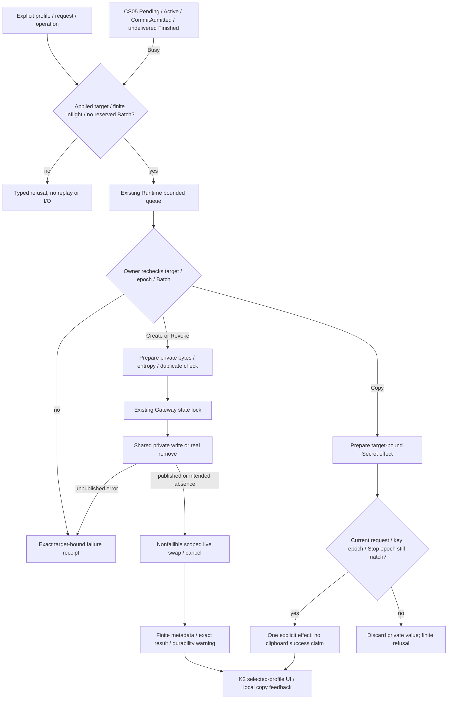

# Applied-profile private key lifecycle

Parent: [provider pool](PRD_02_31_01_02_provider_pool.md#profiles-routing-and-key-lifecycle).
Presentation: [Harness experience](PRD_02_31_01_01_harness_experience.md#client-allocation-form).
Shared publication: [private publication](PRD_02_28_02_private_publication.md).
Status: `[-]` K1 backend implemented with Windows x86_64 strict regression and
original-assertion controls below; K2 UI and K3 public/native handoff remain
separate, unqualified leaves.

## Outcome tree DAG

```text
Outcome: manage one selected applied profile's key without changing another client or misreporting publication
├── [-] TARGET — capture applied profile ID and monotonic key request
│   invariant: default remains canonical; process-only drafts never create orphan private files
│   evidence: PK-01 targeted custom/default restart and draft-only rejection
│   safe failure: typed refusal with no replay; dependency: validated applied Config
│   non-goal: changing allocation/proof, account auth or client recipes
├── [-] PUBLISH — prepare validation, duplicates and entropy before disk/live transition
│   invariant: failure before publication changes neither; published warning advances both
│   evidence: PK-02 real publication failure/warning, duplicate and no-op controls
│   safe failure: explicit unconfirmed durability; dependency: existing Gateway state lock and shared publisher
│   non-goal: a transaction engine, empty-file revocation tombstones or new Windows barrier
├── [-] REVOKE — publish actual intended absence, then cancel only this profile
│   invariant: old key is refused for new admission/continuation and normal restart; unrelated work survives
│   evidence: PK-03 unlink/restart/recreate and independent binding consumers
│   safe failure: absent NoChange preserves prior warning; dependency: shared typed remove
│   non-goal: secure erase, account removal or claims of crash durability without a barrier
├── [-] DELIVER — bounded metadata and one explicit target-bound secret effect
│   invariant: current request/key identity must match; no value enters observations or Debug
│   evidence: PK-04 stale copy, queue failure, exact receipt and finite backlog controls
│   safe failure: explicit Busy/Cancelled, never replay; dependency: existing Runtime queue/Pending
│   non-goal: implicit clipboard, clipboard-success claims or a secret history
└── [-] QUALIFY — compile and original-assertion guard controls before UI/native claims
    invariant: source, counts and exact restored bytes bind actual evidence
    evidence: PK-05 strict tests plus K2/K3 public/native journeys when implemented
    safe failure: unavailable evidence BLOCKED; dependency: all preceding leaves
    non-goal: treating this preview as actual execution or provider/release qualification
```

## Memory palace



## Admission and compatibility

Use one explicit applied profile ID plus a positive monotonic key-operation
request. The canonical default profile remains available during incomplete
initial setup, preserving the existing default Create/Copy/Revoke flow and
`client-key` filename. Custom IDs must exist in the validated persisted Config;
a newly created process-only form cannot create `client-key-<id>`. Applied custom
profiles keep that existing filename. Draft edits/Apply never rotate keys.

The legacy three Actions remain valid and are translated to the real targeted
default request path. Key request sequencing is separate from draft/verification
requests. There are at most eight unresolved key operations, one per profile.
An exact result observed by `Runtime.poll` releases its slot; full/disconnected
queue sends do not claim a sent request. Metadata/results never silently evict
an unresolved request. Results mean background preparation/publication, not
successful clipboard delivery. K2 owns the latter observation.

Runtime checks CS05 reservation before enqueue and Owner checks again before
key I/O. Pending, Active, CommitAdmitted and undelivered Finished all produce
Busy, without replay. Batch admission likewise refuses outstanding key requests,
so a previously accepted Copy cannot first deliver while a new batch reserves
the surface. Stop's existing epoch rejects queued old key intent.

## Publication and removal

Gateway validates target and cross-profile uniqueness and prepares any changed
generation before invoking the private publication callback under its existing
state lock. Every mutation, including unchanged Revoke, invokes the relevant
publication/absence callback. After an unpublished failure, disk and live key
remain old. After actual publication, the remaining swap/session invalidation
has no fallible entropy, I/O or metadata read. Only the affected profile's
sessions and active work change. Equal keys do not rotate bindings.

Revoke uses actual removal through the shared typed mechanism; it never writes
an empty secret tombstone. Unix checks the real parent-directory synchronization.
Windows has no established deletion durability barrier: successful unlink is
immediately effective but explicitly durability-unconfirmed. The existing
Windows replacement `sync_parent` no-op is not evidence of a remove barrier.
NotFound is a separate NoChange observation, not a newly confirmed publication.
Repeated absent Revoke preserves any outstanding unconfirmed warning. A later
confirmed Create can clear it. Immediate admission/restart lookup and crash
durability are distinct; no secure erase is promised.

## Metadata and secret delivery

One finite metadata row per applied target describes existence, process-local
key epoch, state and outstanding durability warning. An explicit Revoke may be
observed as Revoked in this process; without a new persistent tombstone, restart
describes an absent key as NotCreated. A finite exact result names target,
request and operation with typed outcome/error. No raw secret/hash-derived key
identity, credential, URL or header enters View, status, snapshots or Debug.

Copy keeps bytes in one bounded explicit Secret effect carrying target/request
and process-local key epoch. It is delivered once only when latest accepted
intent, current key epoch and Stop epoch still match. Later accepted mutation or
Stop cannot relabel stale bytes as a newer result. Create never auto-copies.
The compatibility Copy payload retains `.expose()` for the existing default UI
consumer; its Debug remains redacted. K1 does not change UI painting or recipes.

## Evidence frontier

K1 now has actual controlled backend evidence; K2/K3 remain unqualified. Required
observations cover default migration; custom create/restart/copy/revoke;
draft-only refusal; duplicate/equal key behavior; unpublished versus published
warning; actual absence and warning-preserving repeated Revoke; fresh generation
after recreate; stale/once-only copy; Batch/Stop/queue gates; and independent
profile/session preservation. K2/K3 must add actual selected-profile controls,
copy failure, manual recipe and claimed native/public evidence. No provider
auth, monitoring or release qualification is implied.

### K1 development evidence

The Windows x86_64 integrated source has fourteen new Runtime/Gateway consumers
and three new shared-removal consumers. The initial strict Clippy run rejected
an unused production convenience wrapper; restricting that fixture-only wrapper
to tests fixed the lint without suppressing it. Repaired gates passed 347 main
consumer execution instances (one existing named opt-in Pi case ignored),
nineteen shared publication tests and eighteen alignment tests, with default and
native-auth-court strict all-target Clippy. Receipt:
`target-six/v0.2.23-provider/k1-repaired-gates/receipt.json`.

`k1-source-controls-attempt-1/receipt.json` in that directory preserves eighteen
accepted original single-assertion RED controls across sixteen test subjects,
plus one rejected target-file unwrap. Its original/compound-no-tag/restored
baselines passed fourteen Runtime tests and three shared-removal tests; source,
index and HEAD were stable and restored exactly. Do not relabel the unwrap as RED.

The target-file test then moved its existing default-byte assertion before the
dependent custom-file read, preserving both statement blocks. A separate fresh
case (shared cache, no claim of build isolation) now reaches that exact original
assertion when custom publication incorrectly targets the default path. Initial,
compound-no-tag and restored consumers each passed one test. Receipt:
`target-six/v0.2.23-provider/k1-target-file-control-attempt-1/receipt.json`.
The eighteen previous controls retain their old source hashes; this repair does
not retroactively rebind them. Restored-source regression is recorded separately
in `target-six/v0.2.23-provider/k1-closeout-gates/receipt.json` when executed.

These observations cover fresh synthetic private roots and controlled peers,
not the OS clipboard, actual providers, Unix remove durability, native GUI input,
other targets or release artifacts. K2 selected-profile UI and K3 actual public
handoff/native evidence remain required before their product claims close.
