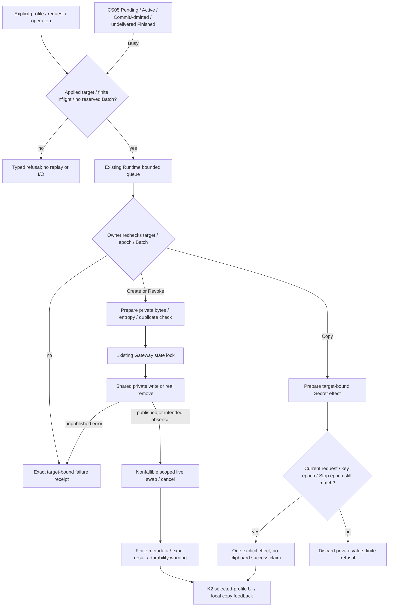
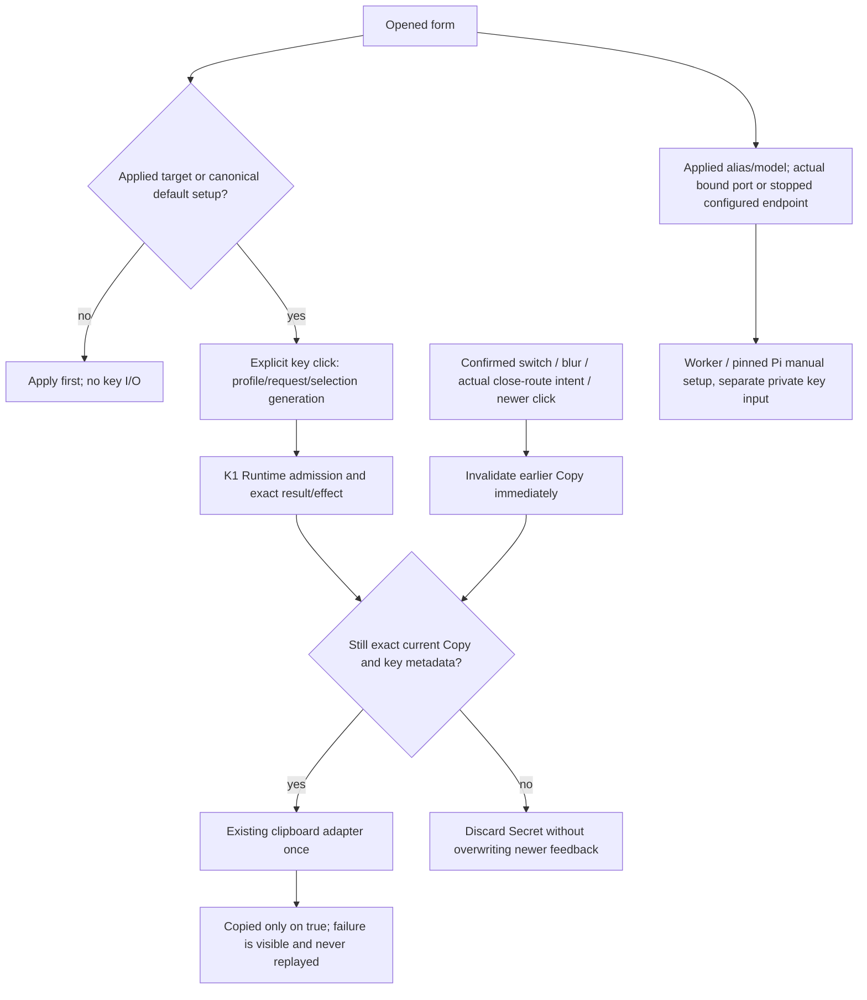

# Applied-profile private key lifecycle

Parent: [provider pool](PRD_02_31_01_02_provider_pool.md#profiles-routing-and-key-lifecycle).
Presentation: [Harness experience](PRD_02_31_01_01_harness_experience.md#client-allocation-form).
Shared publication: [private publication](PRD_02_28_02_private_publication.md).
Status: `[-]` K1 backend implemented with Windows x86_64 strict regression and
original-assertion controls below. K2 UI now compiles and passes synthetic
consumers; its source controls and K3 public/native handoff remain open.

## Outcome tree DAG

```text
Outcome: manage one selected applied profile's key without changing another client or misreporting publication
├── [-] TARGET — capture applied profile ID and monotonic key request
│   invariant: default remains canonical; process-only drafts never create orphan private files
│   evidence: PK-01 targeted custom/default restart and draft-only rejection
│   safe failure: typed refusal with no replay; dependency: validated applied Config
│   non-goal: changing allocation/proof, account auth or client recipes
├── [-] PUBLISH — prepare validation, duplicates and entropy before disk/live transition
│   invariant: failure before publication changes neither; published warning advances both
│   evidence: PK-02 real publication failure/warning, duplicate and no-op controls
│   safe failure: explicit unconfirmed durability; dependency: existing Gateway state lock and shared publisher
│   non-goal: a transaction engine, empty-file revocation tombstones or new Windows barrier
├── [-] REVOKE — publish actual intended absence, then cancel only this profile
│   invariant: old key is refused for new admission/continuation and normal restart; unrelated work survives
│   evidence: PK-03 unlink/restart/recreate and independent binding consumers
│   safe failure: absent NoChange preserves prior warning; dependency: shared typed remove
│   non-goal: secure erase, account removal or claims of crash durability without a barrier
├── [-] DELIVER — bounded metadata and one explicit target-bound secret effect
│   invariant: current request/key identity must match; no value enters observations or Debug
│   evidence: PK-04 stale copy, queue failure, exact receipt and finite backlog controls
│   safe failure: explicit Busy/Cancelled, never replay; dependency: existing Runtime queue/Pending
│   non-goal: implicit clipboard, clipboard-success claims or a secret history
└── [-] QUALIFY — compile and original-assertion guard controls before UI/native claims
    invariant: source, counts and exact restored bytes bind actual evidence
    evidence: PK-05 strict tests plus K2/K3 public/native journeys when implemented
    safe failure: unavailable evidence BLOCKED; dependency: all preceding leaves
    non-goal: treating this preview as actual execution or provider/release qualification
```

## Memory palace



## Admission and compatibility

Use one explicit applied profile ID plus a positive monotonic key-operation
request. The canonical default profile remains available during incomplete
initial setup, preserving the existing default Create/Copy/Revoke flow and
`client-key` filename. Custom IDs must exist in the validated persisted Config;
a newly created process-only form cannot create `client-key-<id>`. Applied custom
profiles keep that existing filename. Draft edits/Apply never rotate keys.

The legacy three Actions remain valid and are translated to the real targeted
default request path. Key request sequencing is separate from draft/verification
requests. There are at most eight unresolved key operations, one per profile.
An exact result observed by `Runtime.poll` releases its slot; full/disconnected
queue sends do not claim a sent request. Metadata/results never silently evict
an unresolved request. Results mean background preparation/publication, not
successful clipboard delivery. K2 owns the latter observation.

Runtime checks CS05 reservation before enqueue and Owner checks again before
key I/O. Pending, Active, CommitAdmitted and undelivered Finished all produce
Busy, without replay. Batch admission likewise refuses outstanding key requests,
so a previously accepted Copy cannot first deliver while a new batch reserves
the surface. Stop's existing epoch rejects queued old key intent.

## Publication and removal

Gateway validates target and cross-profile uniqueness and prepares any changed
generation before invoking the private publication callback under its existing
state lock. Every mutation, including unchanged Revoke, invokes the relevant
publication/absence callback. After an unpublished failure, disk and live key
remain old. After actual publication, the remaining swap/session invalidation
has no fallible entropy, I/O or metadata read. Only the affected profile's
sessions and active work change. Equal keys do not rotate bindings.

Revoke uses actual removal through the shared typed mechanism; it never writes
an empty secret tombstone. Unix checks the real parent-directory synchronization.
Windows has no established deletion durability barrier: successful unlink is
immediately effective but explicitly durability-unconfirmed. The existing
Windows replacement `sync_parent` no-op is not evidence of a remove barrier.
NotFound is a separate NoChange observation, not a newly confirmed publication.
Repeated absent Revoke preserves any outstanding unconfirmed warning. A later
confirmed Create can clear it. Immediate admission/restart lookup and crash
durability are distinct; no secure erase is promised.

## Metadata and secret delivery

One finite metadata row per applied target describes existence, process-local
key epoch, state and outstanding durability warning. An explicit Revoke may be
observed as Revoked in this process; without a new persistent tombstone, restart
describes an absent key as NotCreated. A finite exact result names target,
request and operation with typed outcome/error. No raw secret/hash-derived key
identity, credential, URL or header enters View, status, snapshots or Debug.

Copy keeps bytes in one bounded explicit Secret effect carrying target/request
and process-local key epoch. It is delivered once only when latest accepted
intent, current key epoch and Stop epoch still match. Later accepted mutation or
Stop cannot relabel stale bytes as a newer result. Create never auto-copies.
The compatibility Copy payload retains `.expose()` for the existing default UI
consumer; its Debug remains redacted. K1 does not change UI painting or recipes.

## Evidence frontier

K1 now has actual controlled backend evidence; K2/K3 remain unqualified. Required
observations cover default migration; custom create/restart/copy/revoke;
draft-only refusal; duplicate/equal key behavior; unpublished versus published
warning; actual absence and warning-preserving repeated Revoke; fresh generation
after recreate; stale/once-only copy; Batch/Stop/queue gates; and independent
profile/session preservation. K2/K3 must add actual selected-profile controls,
copy failure, manual recipe and claimed native/public evidence. No provider
auth, monitoring or release qualification is implied.

### K1 development evidence

The Windows x86_64 integrated source has fourteen new Runtime/Gateway consumers
and three new shared-removal consumers. The initial strict Clippy run rejected
an unused production convenience wrapper; restricting that fixture-only wrapper
to tests fixed the lint without suppressing it. Repaired gates passed 347 main
consumer execution instances (one existing named opt-in Pi case ignored),
nineteen shared publication tests and eighteen alignment tests, with default and
native-auth-court strict all-target Clippy. Receipt:
`target-six/v0.2.23-provider/k1-repaired-gates/receipt.json`.

`k1-source-controls-attempt-1/receipt.json` in that directory preserves eighteen
accepted original single-assertion RED controls across sixteen test subjects,
plus one rejected target-file unwrap. Its original/compound-no-tag/restored
baselines passed fourteen Runtime tests and three shared-removal tests; source,
index and HEAD were stable and restored exactly. Do not relabel the unwrap as RED.

The target-file test then moved its existing default-byte assertion before the
dependent custom-file read, preserving both statement blocks. A separate fresh
case (shared cache, no claim of build isolation) now reaches that exact original
assertion when custom publication incorrectly targets the default path. Initial,
compound-no-tag and restored consumers each passed one test. Receipt:
`target-six/v0.2.23-provider/k1-target-file-control-attempt-1/receipt.json`.
The eighteen previous controls retain their old source hashes; this repair does
not retroactively rebind them. Restored-source regression is recorded separately
in `target-six/v0.2.23-provider/k1-closeout-gates/receipt.json` when executed.

These observations cover fresh synthetic private roots and controlled peers,
not the OS clipboard, actual providers, Unix remove durability, native GUI input,
other targets or release artifacts. K2 selected-profile UI and K3 actual public
handoff/native evidence remain required before their product claims close.

## K2 selected applied-profile consumer (candidate)

```text
Outcome: the explicit key/recipe click belongs to the intended applied profile
├── [_] SELECT — actual opened form, not chooser highlight or dirty model
│   invariant: custom drafts get Apply guidance and zero key I/O; canonical default setup remains
│   evidence: K2 selected action/receipt and draft-only consumers, UNRUN
│   safe failure: typed local refusal; dependency: K1 metadata; non-goal: altering forms/CAS
├── [_] COPY — one exact profile/request/selection-intent, consumed once
│   invariant: stale results cannot write clipboard or overwrite newer feedback
│   evidence: K2 switch ABA/intent/receipt/actual sink consumers, UNRUN
│   safe failure: Not copied or clipboard failure; dependency: K1 effect; non-goal: native sink qualification
└── [_] RECIPE — selected applied mapping and actual running or explicitly configured stopped endpoint
    invariant: templates never contain key bytes or dirty mappings; no implicit task/start/network
    evidence: K2 actual recipe sink/alias/port consumers, UNRUN
    safe failure: Apply/create/enable guidance; dependency: qualified worker/Pi contract; non-goal: all clients
```



Create, Copy and Revoke capture the currently opened applied profile at the
actual click. The canonical default retains pre-model-setup key creation and
its existing Create/Copy/Revoke Action entry points; K1 translates those into
the same monotonic targeted default operation. Custom profiles use explicit
ProfileKey requests. Custom process-only forms show Apply guidance without
creating an orphan key.
The existing key row uses three short localized captions with the same actual
cell/text-fit predicate for paint and pointer dispatch. A false highlight flag
is not a disabled operation. Existing form edits, pending acknowledgements,
caret/selection, scroll and CS05 revision merges retain their current authority.

Only the current profile/request/local intent/selection generation may consume
a Secret effect. Confirmed A->B->A changes, newer key/recipe clicks, actual
Settings close/route transitions and blur revoke that intent synchronously,
including close/reopen between polls. Chooser arrow-only highlighting is not a
profile switch. Stale effects do not consume a newer profile's intent or replace
newer Busy/clipboard-failure feedback. Copy preparation success is never called
clipboard success. The actual clipboard adapter boolean owns that result; a
failure is visible beside the operation and requires a new explicit click.

Recipe handoff reuses the same reserved Batch gate, including a local Pending
reservation and undelivered Finished, instead of trusting lagging View.active.
It uses the selected applied default alias/model and actual listening port;
otherwise it labels the configured endpoint as stopped. It requires that
profile's existing key and an enabled applied mapping, but copies no key bytes.
PowerShell/bash templates explain private prompt, process-local environment,
cleanup and shared-key attribution. Worker root/task/allowed commands remain
explicit user placeholders. The Pi 1.4.0 manual template reuses the pinned
fixture's API/environment lookup/compatibility fields; actual numeric model
capability limits remain explicitly replaceable placeholders, not invented
entitlements. Nothing installs a client, writes its config, starts a service,
runs a task, probes a provider or qualifies arbitrary clients by copying text.

The finite public metadata schema is registered only with PRD26. No raw Secret,
key digest/epoch, wire URL/header or rendered recipe enters snapshots/logs.
K2 now passes fmt, default/native-auth-court all-target strict Clippy and
79 controlled consumer executions: all 47 Harness settings tests (including
eleven added K2 consumers), fourteen K1 Runtime cases and eighteen alignment
tests, with zero failed/ignored. Receipt:
`target-six/v0.2.23-provider/k2-repaired-gates/receipt.json`.
The initial strict Clippy rejection of three no-longer-constructed legacy
Actions is retained in `k2-initial-gates/clippy.log`; canonical default setup
now genuinely reuses those original entries and their targeted translation.
No test or assertion was weakened. This lint failure is not assertion RED.

Selection, actual memory-sink results, receipt/intent fencing, applied recipes
and narrow caption-fit now have synthetic consumer observations. Thirteen
actual original-assertion RED controls cover the eleven new subjects, followed
by exact source restoration and passing consumers. Twelve controls are in
`target-six/v0.2.23-provider/k2-source-controls-attempt-2/receipt.json`; the
joint blur/selection ABA control is in
`target-six/v0.2.23-provider/k2-selection-aba-control-attempt-1/receipt.json`.
Both bind the same original source hashes. The earlier compound-mutant syntax
failure and selection-only passing mutant remain retained, not accepted RED:
real blur invalidation protected the latter, so the final ABA control removes
that joint boundary rather than claiming each redundant guard is necessary.

K3 actual selected-profile GUI/clipboard/client journeys retain their separate
scope. The no-window route leaf does not prove removal of the actual main
repaint hook. Public dispatch and visible-form events also poll the Runtime;
any integration counterproof must account for those real routes instead of
assuming requests in one batch execute without intervening polls.

The final restored-source regression passes fmt, both strict Clippy profiles,
380 Rust executions with zero failed and the one existing opt-in Pi case
ignored, plus 15 public Apply, six whole-profile and 22 browser checks on an
explicitly rebuilt and pinned default Windows x64 image. The fresh synthetic
GUI roots exit normally and are removed. Evidence:
`target-six/v0.2.23-provider/k2-final-gates/completion.json` and its linked
original/child receipts. This is regression evidence, not the new K3 selected
key/OS clipboard journey, real provider authorization or release qualification.

K3's public selected-key journey now has an integrated runner,
`scripts/profile-key-handoff-smoke.py`. Its seven nonclipboard observations use
fresh synthetic ready-state injection and local metadata GET only; the twelve
Windows CI observations add actual clipboard/key/recipe/failure consumers on a
disposable desktop. Existing developer CI selects that clipboard scope only on
Windows x64 normal runs and uploads only its safe receipt, never the private
fixture carrier. The Windows CI scope remains UNRUN; the local scope has named evidence below;
synthetic ready state does not establish OAuth, paid inference or Pi execution.
The actual public sequence does not establish a pending Copy or independent
main-hook counterexample; the existing K2 boundary receipts retain that scope.

The current integrated default Windows image also passes K3's seven public
nonclipboard observations, with 26 real local metadata GETs, zero rejecting-proxy
connections and clean owned-process shutdown. Evidence:
`target-six/v0.2.23-provider/k3-original-nonclipboard/build-replay.json` and its
linked safe replay receipt. The build records exact dirty source and pinned bytes;
it does not claim a clean release, real provider grant or clipboard qualification.

Exact `2133ce1` native run `40214712657` exposes a separate macOS ARM test-fixture
failure: nine K2 child cases fail private-root setup before their consumer
assertions because the temporary path retains a symbolic-link ancestor. The
fixture now canonicalizes its own newly created directory before the unchanged
private protection call; production policy and all consumer assertions are
unchanged. Native replay of this test-only repair remains pending. Evidence:
`target-six/v0.2.23-provider/k2-macos-test-root-repair.json` and the original
`../v0.2.23-window-half/ci-2133ce1-native/osx-aarch64/receipt/minicon-auth-settings.log`.


### K3 retained native failure and public selector repair

Exact-source `2d7c3e159f65f2bb5c926cefd04ef19bcf5f3f91`, native run
`40217399944`, retains Windows x86_64 FAIL. Actual OS Copy succeeds for all
three selected profiles; the subsequent dirty-model/alias precondition fails
before recipes, contention/retry and close/reopen checks. Those later checks,
shutdown and ordinary suites in that job are unobserved, not passes. The safe
receipt is `ci-2d7c3e1-native`'s `profile-key-handoff.json` (SHA-256
`d03f84d96fed1a731efe609932ff67091f9593aab520596bb85f00e2fe78fad1`).

The runner clicked published `model` (profile chooser), instead of
`model_input` (the model editor). A fresh owned-window comparison through the
public CLI reproduces the unchanged dirty-draft assertion failure with the
original selector, then passes with only that selector corrected; the original
model text remains unchanged in the failing arm. Neither arm accesses the OS
clipboard or a provider. Receipt:
`target-six/v0.2.23-provider/k3-dirty-editor-reproduction/dirty-editor-comparison.json`.
The integrated runner now selects `model_input` and preserves boolean-only
precondition diagnostics. Actual Windows CI replay of the remaining clipboard
and recipe checks remains open; this local repair is not their qualification.


### K3 corrected-selector native replay

Exact `ac20aeed3873654340ddf32942b2c1f504ca84ef`, run `40218590490`, reaches
nine public checks: all three actual OS Copy targets, dirty model/alias
precondition, applied running recipes and the stopped configured-only recipe
pass. It then fails `clipboard-lock-cleanup`. The safe receipt does not retain
the lock child's exit/ready/release acknowledgement or the original key-action
exception that the finally cleanup may have replaced. No product cause or actual
contention/retry result is inferred. ABA/reopen, final network assertion,
shutdown and ordinary suites remain unobserved after that failure. Recorded
provider POST/proxy counts are zero and owned final cleanup reports no errors.

The safe artifact/raw audit is
`target-six/v0.2.23-provider/ci-ac20aee-k3/verification-index.json`
(SHA-256 `26c2b8503b2f59ca7a2624674f6008ee85cc0fbe5776bfc453ea0c31bac9c2de`).
The next diagnostic must preserve primary failure and publish only finite helper
lifecycle/status fields; it must not relax original assertions or export the
private carrier, keys or clipboard contents. The earlier failed runs remain
separate source observations, not reclassified successes.


### K3 observed contention prerequisite and owned-window correction

Exact `f659387d64c6f7ca3d4bf2c96a25ae9d5c14f6f1`, run `40229716348`,
again passes nine public checks and then fails the original
`key-terminal-result-mismatch:clipboard_failed` assertion. The primary error is
now preserved separately from cleanup: the lock child reports release observed,
but CloseClipboard fails with Win32 1418 (clipboard not open). This does not
prove continuous native contention or identify a product Copy defect. The safe
receipt is `target-six/v0.2.23-provider/ci-f659387-native/receipts/profile-key-handoff.json`.
The private carrier and clipboard values remain excluded from uploads.

The fixture now creates one hidden message-only STATIC window on its lock
thread, associates OpenClipboard with that exact window, verifies
GetOpenClipboardWindow before publishing Ready and while holding/releasing,
then explicitly closes and destroys its owned window. It never activates a
window or reads/writes clipboard contents in the lock child. Only four extra
fixed booleans and finite lifecycle errors enter the existing safe receipt;
no window handle or arbitrary diagnostic payload is exported. Primary and
cleanup errors remain separate. All twelve product assertions, the contention
failure expectation and original 20-second lock deadline remain unchanged.
This corrects an unproven fixture prerequisite; actual native replay is still
pending, not a product fix or K3 pass.

Microsoft's [OpenClipboard contract](https://learn.microsoft.com/en-us/windows/win32/api/winuser/nf-winuser-openclipboard)
allows a NULL window association, while
[GetOpenClipboardWindow](https://learn.microsoft.com/en-us/windows/win32/api/winuser/nf-winuser-getopenclipboardwindow)
cannot identify that NULL-associated open. The explicit owned association
provides an observable lock identity; documentation alone does not establish
why the previous run lost its lock.


The replay's key-action wait also accepted an old terminal presented frame
before requiring its new request ID. This could evaluate the wrong result and
release contention before the new adapter operation finished. The wait now
requires the selected profile and a strictly newer request before consuming a
terminal; all original target/result/request assertions remain unchanged.
`target-six/v0.2.23-provider/k3-fresh-terminal-reproduction.json` records two
controlled old-terminal frame sequences: the original function fails its
original result/fresh-request requirement; the corrected function ignores the
old and pending frames, then accepts the exact new receipt. This exercises no
GUI or clipboard and does not yet prove which race occurred in the CI failure.
Native replay of the owned-window and receipt-wait corrections remains open.
