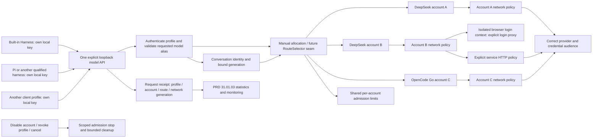

# Provider pool and client allocation

Parent: [provider gateway](PRD_02_31_01_provider_gateway.md). Presentation:
[Harness experience](PRD_02_31_01_01_harness_experience.md). Measurements:
[usage and balances](PRD_02_31_01_03_usage_monitoring.md). Sequence:
[0.2.23 plan](../plan/plan-v0.2.23.md#harness-product-redesign-before-publication).
Status: `[-]` selected design with a partial backend checkpoint, clarified by
the owner on 2026-10-25. Account networks, isolated authorization contexts,
profile management UI and actual three-account acceptance remain open.

This module owns multi-account identity, account-specific network policy,
client profiles and allocation. The parent retains protocol, admission,
conversation-continuity and future selector contracts. No tool execution
authority moves into the gateway.

## Outcome tree DAG

```text
Outcome: share several separately authenticated accounts across local harnesses
├── [_] ACCOUNTS — two DeepSeek accounts and one OpenCode Go account coexist
│   invariant: identity, credentials, network policy and availability remain account-scoped
│   evidence: PP-01 distinct same-provider grants and independent removal/reconnect
│   safe failure: refuse ambiguous identity; preserve other accounts
│   dependency: parent verified authentication and private storage
│   non-goal: importing another agent's cookies or credentials
├── [_] NETWORK — one account can use a proxy for its Google login
│   invariant: browser authorization and service HTTP use their explicit account policy
│   evidence: PP-02/03 isolated login contexts and actual proxy/direct transport traces
│   safe failure: proxy failure is visible; no silent direct fallback or cross-account reuse
│   dependency: shared native HTTP and minicon-web creation/profile capabilities
│   non-goal: changing system proxy, ordinary Web preferences or region spoofing guarantees
├── [-] CLIENTS — several local harness profiles share one API listener
│   invariant: each local key identifies its own profile, model exposure and allocation
│   evidence: PP-04 separate keys/allowlists, attribution and isolated revoke
│   safe failure: unknown key/model refused before upstream use
│   dependency: parent authentication, API and route selector
│   non-goal: certifying an untested client merely because a profile exists
└── [-] ALLOCATE — explicitly route each profile's model aliases to accounts
    invariant: a conversation retains its validated account/model/network binding
    evidence: PP-05/06 concurrent profiles, shared account limits and changed-route refusal
    safe failure: bounded busy/auth/quota error; no unannounced account substitution
    dependency: CLIENTS, account availability and parent lease/session ownership
    non-goal: automatic rotation, cheapest-route selection or the future dynamic engine
```

## Memory palace



## Reference scenario and product vocabulary

The owner has two DeepSeek accounts and one OpenCode Go account. One DeepSeek
login requires a proxy for the Google sign-in option to appear. This establishes
a login-network requirement only; it does not prove that the account's inference
also needs that proxy, or that Google sign-in must appear on every network.

- **Provider:** the service adapter and its supported authorization/protocols.
- **Account:** one credential identity at that provider/service/workspace,
  with a user label, network policy, enabled state and measurement capabilities.
- **Client profile:** a locally named consumer connection, its independent key
  and exposed model routes. One installation using a shared key is one profile;
  MiniCon cannot distinguish applications that deliberately share credentials.
- **Allocation:** an explicit profile/model-alias -> account/upstream-model
  mapping. The pool may serve different profiles concurrently.

Illustrative allocations, not automatic defaults or compatibility claims:

| Client profile | Local model alias | Account | Upstream model |
| --- | --- | --- | --- |
| Built-in worker | `work` | DeepSeek A | Explicitly selected catalogue route |
| Pi connection | `work` | DeepSeek B | Explicitly selected catalogue route |
| Another tested harness | `coding` | OpenCode Go C | Entitled, protocol-compatible route |

The same alias can map differently under different profile keys. Clients see
only their configured aliases and compatible capabilities in `/v1/models`.
The same account can serve more than one profile under a shared lease budget;
creating another profile never multiplies account concurrency or quota.

## Account identity and lifecycle

Initial ceilings remain 16 accounts and 8 client profiles. These are engineering
bounds, not subscription entitlements. Custom local account labels are now in
scope so two DeepSeek accounts can be recognized without exposing email/phone.
Retain provider-supplied masked identity and a stable short local ID as secondary
information. A label is never proof that two grants are the same account.

Keep separate browser storage for each account's login context, including its
Google/provider session. Allocate an isolated pending context before an account
exists and attach it only after a successful grant. Reconnect uses that account's
context. Serially present these contexts in the existing Browser root; this
does not add concurrent Browser roots. An adapter unable to isolate storage
and apply the requested proxy reports that exact capability as BLOCKED rather
than using another account's signed-in context.

Account disable is a reversible allocation/admission change; it does not erase
credentials or receipts. Remove/sign-out reports local removal and remote
revocation separately. Show affected profiles before removing an allocated
account. Late login, refresh, balance or model-query results cannot recreate it
or overwrite a reconnected credential generation. Historical local receipts
retain an opaque account ID after removal and never retain credentials.

## Per-account network policy

Expose two explicit settings in account details:

| Policy | Requests it controls |
| --- | --- |
| Login network | Authorization browser and provider-side initialization/exchange/device polling; loopback callback always bypasses the proxy |
| Service network | Model catalogue, inference, token refresh, balance/usage reads and remote sign-out for that account |

Each chooses **Direct** or a saved supported proxy. An explicit Use login network
choice may link the service policy; do not infer that choice from a successful
browser login. Display the effective policies before authorization and testing.
The owner's Google-login example must work with a login proxy while service
HTTP can remain independently configured. Whether that real account needs a
service proxy remains unverified until chosen/tested; do not treat silence as
that configuration choice.

Direct means no inherited process proxy on that request. Account overrides do
not mutate system environment, Console sessions or the ordinary Web route's
saved proxy choice. Reuse existing proxy validation and native transport
capabilities; unsupported schemes/authentication are explicit errors. Secret
proxy credentials stay in the private store; labels and redacted policy IDs
are sufficient for public observations.

Snapshot the policy generation for each operation. Editing network settings
affects new work after atomic save; it cannot reroute an admitted stream midway.
A conversation cannot silently continue with a changed route/network identity.
A proxy outage produces account-scoped recovery and never direct fallback.
Closing the auth surface must not destroy unrelated page or terminal drafts.

## Profiles, routing and key lifecycle

Create/edit/disable/revoke profiles in Harness. Each profile has its own local
key, display label and bounded model allocations; upstream secrets never reach
the client. The initial `default` connection becomes the default profile during
migration, preserving its key and binding. Do not copy its key into new profiles
or silently assign every profile the global selected account.

Each profile has a chosen default alias for the built-in recipe, and may expose
additional explicit aliases for clients that select models. Model IDs alone
cannot escape the profile allowlist. Applying a draft changes only that profile;
the parent owns conversation pinning, generation changes and refusal semantics.
Include profile and network identity in those checks without forwarding arbitrary
client headers or exposing new management endpoints over model HTTP.

Revoke/replace one profile key affects that profile's new and active work under
the existing cancellation bound, not every other harness. Disabling/removing an
account affects every allocation that references it. User-visible affected
profiles and repair actions must distinguish these two operations.

The first selector uses explicit mappings. Do not treat a pool as permission
for automatic account rotation, quota bypass or cross-provider substitution.
The future llm-gate can propose allocations through the parent's validated
selection seam; session pinning, credentials and cancellation stay host-owned.

## Acceptance and implementation frontier

| Status / journey | Required observable result |
| --- | --- |
| `[_]` PP-01 | Two actual DeepSeek accounts plus OpenCode Go coexist; labels, grants and reconnect/removal remain isolated |
| `[_]` PP-02 | Separate login storage and account-selected proxy exercised on every claimed native adapter; another account's Google session is not reused |
| `[_]` PP-03 | Controlled traces prove Direct vs proxy for login/service HTTP, loopback bypass and no fallback; the real Google-login case is recorded separately |
| `[-]` PP-04 | Backend distinct keys/allowlists/scoped revocation checkpoint below; profile-management UI and final product qualification remain open |
| `[-]` PP-05 | Backend shared leases and independent stream checkpoint below; attributed usage and actual multiple-account/client journeys remain open |
| `[-]` PP-06 | Backend selected-route refusal and catalogue retention checkpoint below; draft/apply, account networks and continuous recovery remain open |

### Backend checkpoint: independent clients, 2026-10-25

Development `provider_server::Config` accepts version 2 profiles and explicit
alias/account/catalogue-route allocations. Version 1 remains readable; its
selected account/model and private `client-key` stay the default profile.
Additional private keys load only after opaque IDs and bounded config validate.

Key admission, model listing, session names, changed-route generations and
active revocation are profile-scoped. Listing models does not consume session
slots; unknown aliases fail before upstream transport. Shared total/account
lease limits remain shared. A usable additional profile can start the listener
when the default connection is unfinished. Switching that default account and
refreshing its catalogue preserve other clients' allocated routes.

Named regression evidence:

- `provider_runtime::tests::client_profiles_load_private_keys_and_keep_sessions_and_revocation_isolated`
- `provider_runtime::tests::switching_default_account_and_refreshing_catalog_preserves_allocated_routes`
- `provider_runtime::tests::conflicting_other_account_catalog_keeps_applied_routes_and_sessions_unchanged`
- `provider_runtime::tests::gateway_prepare_failure_cannot_publish_a_new_disk_configuration`
- `provider_server::tests::profile_leases_share_account_capacity_and_revoke_only_their_own_work`
- `provider_server::tests::lease_revalidates_the_resolved_binding_after_key_or_route_changes`
- `provider_server::tests::profile_route_changes_are_scoped_and_catalog_reads_do_not_bind_sessions`
- `provider_server::tests::profile_only_listener_routes_private_grant_and_survives_default_revoke_during_sse`
- `minicon_harness::gateway_worker_uses_custom_profile_alias_for_tools_and_resume`

The first uses two synthetic DeepSeek accounts and one synthetic OpenCode
account through the actual private store/runtime/listener. The native SSE test uses an
actual loopback HTTP peer to verify the selected account credential, immediate
SSE and successful completion after the default client's key is revoked.
These are backend proofs, not actual provider grants, entitlement, proxies,
profile-management/native UI or final artifact acceptance.

The public worker journey separately exercises a custom default alias through
the shipped CLI, real file/exec tools, persisted resume and changed-binding
refusal. The legacy default journey also removes the additive persisted alias
field before resume, proving migration of old worker sessions. Evidence:
`pool-worker-alias-red.log` and `pool-worker-alias-green.log` (two passes);
the original runtime failure observes `minicon-selected` where `work` is required.

Retained evidence under `target-six/v0.2.23-provider/` includes
`pool-runtime-valid-fixture-red.log`, `pool-catalog-runtime-red.log`,
`pool-provider-integrated-green.log` (67 passes, one explicitly unavailable
pinned-Pi test, zero failures) and the separate guard-court receipts. Independent
review then added catalogue-conflict, admission-race and prepare/publication
counterexamples; `pool-provider-final-green.log` has 70 passes, one explicitly
unselected pinned-Pi case and zero failures after their fixes. Do not infer
success from a log filename: the earlier review-fixes run retains two failures.
`pool-final-gate-receipt.json` records restored-source hashes and serial final
gates: worker unit 38, public worker 2, alignment 17 and the explicitly selected
pinned Pi 1.4.0 client 1 pass against a controlled upstream. Pi's opt-in test
therefore has separate executed evidence; the ordinary provider run's ignored
entry is not counted as its execution. Formatting and strict all-target clippy
also pass (`pool-fmt-final.log`, `pool-clippy-final.log`). The development unit
inventory grew from 584 to 592, and the public worker target from 14 to 15.
The restored-source receipt owns the post-mutation integration result.
Cached routes do not establish another account's current entitlement;
per-account catalogue freshness and verification/apply remain open.

Until account-owned catalogues join, a refresh whose same-ID full route
conflicts with another account's allocation returns `CatalogConflict` without
writing config or changing the live route/session generation. Identical routes
can be shared. Lease admission revalidates the resolved profile/full binding
under the same lock as capacity allocation, refusing key reuse or route changes
that race body preparation. Config validation, locking and generation creation
finish before the private publish callback. That covers preparation failures;
the shared filesystem's possible post-publication parent-sync error and full
draft/apply durability recovery remain separate open product work.

Product profile/network composition stays in MiniCon-owned code. Native
HTTP, private storage and browser isolation stay in their existing shared owners;
do not add another agent loop, account service daemon or plugin system.
