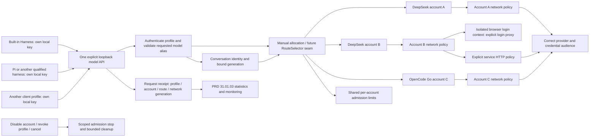
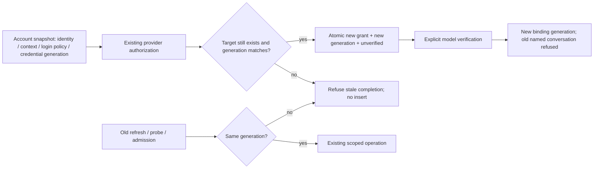

# Provider pool and client allocation

Parent: [provider gateway](PRD_02_31_01_provider_gateway.md). Presentation:
[Harness experience](PRD_02_31_01_01_harness_experience.md). Measurements:
[usage and balances](PRD_02_31_01_03_usage_monitoring.md). Sequence:
[0.2.23 plan](../plan/plan-v0.2.23.md#harness-product-redesign-before-publication).
Status: `[-]` selected design with a partial backend checkpoint, clarified by
the owner on 2026-10-25. Native account-network/context acceptance, profile
management UI and actual three-account acceptance remain open.

This module owns multi-account identity, account-specific network policy,
client profiles and allocation. The parent retains protocol, admission,
conversation-continuity and future selector contracts. No tool execution
authority moves into the gateway.

[Connection selection](PRD_02_31_01_02_01_connection_selection.md) owns the
account catalogue, profile draft, exact verification and atomic route-publication
contract used by ALLOCATE below. It also owns preservation of legacy applied
connections during migration; this module retains profile/key lifecycle.

## Outcome tree DAG

```text
Outcome: share several separately authenticated accounts across local harnesses
├── [_] ACCOUNTS — two DeepSeek accounts and one OpenCode Go account coexist
│   invariant: identity, credentials, network policy and availability remain account-scoped
│   evidence: PP-01 distinct same-provider grants and independent removal/reconnect
│   safe failure: refuse ambiguous identity; preserve other accounts
│   dependency: parent verified authentication and private storage
│   non-goal: importing another agent's cookies or credentials
├── [-] NETWORK — one account can use a proxy for its Google login
│   invariant: browser authorization and service HTTP use their explicit account policy
│   evidence: PP-02/03 isolated login contexts and actual proxy/direct transport traces
│   safe failure: proxy failure is visible; no silent direct fallback or cross-account reuse
│   dependency: shared native HTTP and minicon-web creation/profile capabilities
│   non-goal: changing system proxy, ordinary Web preferences or region spoofing guarantees
├── [-] CLIENTS — several local harness profiles share one API listener
│   invariant: each local key identifies its own profile, model exposure and allocation
│   evidence: PP-04 separate keys/allowlists, attribution and isolated revoke
│   safe failure: unknown key/model refused before upstream use
│   dependency: parent authentication, API and route selector
│   non-goal: certifying an untested client merely because a profile exists
└── [-] ALLOCATE — explicitly route each profile's model aliases to accounts
    invariant: a conversation retains its validated account/model/network binding
    evidence: PP-05/06 concurrent profiles, shared account limits and changed-route refusal
    safe failure: bounded busy/auth/quota error; no unannounced account substitution
    dependency: CLIENTS, account availability and parent lease/session ownership
    non-goal: automatic rotation, cheapest-route selection or the future dynamic engine
```

## Memory palace



## Reference scenario and product vocabulary

The owner has two DeepSeek accounts and one OpenCode Go account. One DeepSeek
login requires a proxy for the Google sign-in option to appear. This establishes
a login-network requirement only; it does not prove that the account's inference
also needs that proxy, or that Google sign-in must appear on every network.

- **Provider:** the service adapter and its supported authorization/protocols.
- **Account:** one credential identity at that provider/service/workspace,
  with a user label, network policy, enabled state and measurement capabilities.
- **Client profile:** a locally named consumer connection, its independent key
  and exposed model routes. One installation using a shared key is one profile;
  MiniCon cannot distinguish applications that deliberately share credentials.
- **Allocation:** an explicit profile/model-alias -> account/upstream-model
  mapping. The pool may serve different profiles concurrently.

Illustrative allocations, not automatic defaults or compatibility claims:

| Client profile | Local model alias | Account | Upstream model |
| --- | --- | --- | --- |
| Built-in worker | `work` | DeepSeek A | Explicitly selected catalogue route |
| Pi connection | `work` | DeepSeek B | Explicitly selected catalogue route |
| Another tested harness | `coding` | OpenCode Go C | Entitled, protocol-compatible route |

The same alias can map differently under different profile keys. Clients see
only their configured aliases and compatible capabilities in `/v1/models`.
The same account can serve more than one profile under a shared lease budget;
creating another profile never multiplies account concurrency or quota.

## Account identity and lifecycle

Initial ceilings remain 16 accounts and 8 client profiles. These are engineering
bounds, not subscription entitlements. Custom local account labels are now in
scope so two DeepSeek accounts can be recognized without exposing email/phone.
Retain provider-supplied masked identity and a stable short local ID as secondary
information. A label is never proof that two grants are the same account.

Keep separate browser storage for each account's login context, including its
Google/provider session. Allocate an isolated pending context before an account
exists and attach it only after a successful grant. Reconnect uses that account's
context. Serially present these contexts in the existing Browser root; this
does not add concurrent Browser roots. An adapter unable to isolate storage
and apply the requested proxy reports that exact capability as BLOCKED rather
than using another account's signed-in context.

Before reusing a closing native context, consume the
[shared release boundary](PRD_02_28_01_browser_context_lifecycle.md). Its product
wait is attempt-scoped and cancellable; ordinary live-page restoration and the
provider authorization deadline keep their existing owners and meaning.

Account disable is a reversible allocation/admission change; it does not erase
credentials or receipts. Remove/sign-out reports local removal and remote
revocation separately. Show affected profiles before removing an allocated
account. Late login, refresh, balance or model-query results cannot recreate it
or overwrite a reconnected credential generation. Historical local receipts
retain an opaque account ID after removal and never retain credentials.

## Per-account network policy

Expose two explicit settings in account details:

| Policy | Requests it controls |
| --- | --- |
| Login network | Authorization browser and provider-side initialization/exchange/device polling; loopback callback always bypasses the proxy |
| Service network | Model catalogue, inference, token refresh, balance/usage reads and remote sign-out for that account |

Each chooses **Direct** or a saved supported proxy. An explicit Use login network
choice may link the service policy; do not infer that choice from a successful
browser login. Display the effective policies before authorization and testing.
The owner's Google-login example must work with a login proxy while service
HTTP can remain independently configured. Whether that real account needs a
service proxy remains unverified until chosen/tested; do not treat silence as
that configuration choice.

Direct means no inherited process proxy on that request. Account overrides do
not mutate system environment, Console sessions or the ordinary Web route's
saved proxy choice. Reuse existing proxy validation and native transport
capabilities; unsupported schemes/authentication are explicit errors. Secret
proxy credentials stay in the private store; labels and redacted policy IDs
are sufficient for public observations.

Snapshot the policy generation for each operation. Editing network settings
affects new work after atomic save; it cannot reroute an admitted stream midway.
A conversation cannot silently continue with a changed route/network identity.
A proxy outage produces account-scoped recovery and never direct fallback.
Closing the auth surface must not destroy unrelated page or terminal drafts.

## Profiles, routing and key lifecycle

The [applied-profile key owner](PRD_02_31_01_02_02_profile_keys.md) owns exact
operation targeting, private publication/removal, finite metadata and secret
delivery. Its K1 development checkpoint and remaining K2/K3 presentation/public
handoff evidence are recorded there. This pool section retains profile/routing policy.

Create/edit/disable/revoke profiles in Harness. Each profile has its own local
key, display label and bounded model allocations; upstream secrets never reach
the client. The initial `default` connection becomes the default profile during
migration, preserving its key and binding. Do not copy its key into new profiles
or silently assign every profile the global selected account.

Each profile has a chosen default alias for the built-in recipe, and may expose
additional explicit aliases for clients that select models. Model IDs alone
cannot escape the profile allowlist. Applying a draft changes only that profile;
the parent owns conversation pinning, generation changes and refusal semantics.
Include profile and network identity in those checks without forwarding arbitrary
client headers or exposing new management endpoints over model HTTP.

Revoke/replace one profile key affects that profile's new and active work under
the existing cancellation bound, not every other harness. Disabling/removing an
account affects every allocation that references it. User-visible affected
profiles and repair actions must distinguish these two operations.

The first selector uses explicit mappings. Do not treat a pool as permission
for automatic account rotation, quota bypass or cross-provider substitution.
The future llm-gate can propose allocations through the parent's validated
selection seam; session pinning, credentials and cancellation stay host-owned.

## Acceptance and implementation frontier

| Status / journey | Required observable result |
| --- | --- |
| `[_]` PP-01 | Two actual DeepSeek accounts plus OpenCode Go coexist; labels, grants and reconnect/removal remain isolated |
| `[_]` PP-02 | Separate login storage and account-selected proxy exercised on every claimed native adapter; another account's Google session is not reused |
| `[_]` PP-03 | Controlled traces prove Direct vs proxy for login/service HTTP, loopback bypass and no fallback; the real Google-login case is recorded separately |
| `[-]` PP-04 | Backend distinct keys/allowlists/scoped revocation checkpoint below; profile-management UI and final product qualification remain open |
| `[-]` PP-05 | Backend shared leases and independent stream checkpoint below; attributed usage and actual multiple-account/client journeys remain open |
| `[-]` PP-06 | Backend selected-route refusal and catalogue retention checkpoint below; draft/apply, account networks and continuous recovery remain open |

### Backend checkpoint: independent clients, 2026-10-25

Development `provider_server::Config` accepts version 2 profiles and explicit
alias/account/catalogue-route allocations. Version 1 remains readable; its
selected account/model and private `client-key` stay the default profile.
Additional private keys load only after opaque IDs and bounded config validate.

Key admission, model listing, session names, changed-route generations and
active revocation are profile-scoped. Listing models does not consume session
slots; unknown aliases fail before upstream transport. Shared total/account
lease limits remain shared. A usable additional profile can start the listener
when the default connection is unfinished. Switching that default account and
refreshing its catalogue preserve other clients' allocated routes.

Named regression evidence:

- `provider_runtime::tests::client_profiles_load_private_keys_and_keep_sessions_and_revocation_isolated`
- `provider_runtime::tests::switching_default_account_and_refreshing_catalog_preserves_allocated_routes`
- `provider_runtime::tests::conflicting_other_account_catalog_keeps_applied_routes_and_sessions_unchanged`
- `provider_runtime::tests::gateway_prepare_failure_cannot_publish_a_new_disk_configuration`
- `provider_server::tests::profile_leases_share_account_capacity_and_revoke_only_their_own_work`
- `provider_server::tests::lease_revalidates_the_resolved_binding_after_key_or_route_changes`
- `provider_server::tests::profile_route_changes_are_scoped_and_catalog_reads_do_not_bind_sessions`
- `provider_server::tests::profile_only_listener_routes_private_grant_and_survives_default_revoke_during_sse`
- `minicon_harness::gateway_worker_uses_custom_profile_alias_for_tools_and_resume`

The first uses two synthetic DeepSeek accounts and one synthetic OpenCode
account through the actual private store/runtime/listener. The native SSE test uses an
actual loopback HTTP peer to verify the selected account credential, immediate
SSE and successful completion after the default client's key is revoked.
These are backend proofs, not actual provider grants, entitlement, proxies,
profile-management/native UI or final artifact acceptance.

The public worker journey separately exercises a custom default alias through
the shipped CLI, real file/exec tools, persisted resume and changed-binding
refusal. The legacy default journey also removes the additive persisted alias
field before resume, proving migration of old worker sessions. Evidence:
`pool-worker-alias-red.log` and `pool-worker-alias-green.log` (two passes);
the original runtime failure observes `minicon-selected` where `work` is required.

Retained evidence under `target-six/v0.2.23-provider/` includes
`pool-runtime-valid-fixture-red.log`, `pool-catalog-runtime-red.log`,
`pool-provider-integrated-green.log` (67 passes, one explicitly unavailable
pinned-Pi test, zero failures) and the separate guard-court receipts. Independent
review then added catalogue-conflict, admission-race and prepare/publication
counterexamples; `pool-provider-final-green.log` has 70 passes, one explicitly
unselected pinned-Pi case and zero failures after their fixes. Do not infer
success from a log filename: the earlier review-fixes run retains two failures.
`pool-final-gate-receipt.json` records restored-source hashes and serial final
gates: worker unit 38, public worker 2, alignment 17 and the explicitly selected
pinned Pi 1.4.0 client 1 pass against a controlled upstream. Pi's opt-in test
therefore has separate executed evidence; the ordinary provider run's ignored
entry is not counted as its execution. Formatting and strict all-target clippy
also pass (`pool-fmt-final.log`, `pool-clippy-final.log`). The development unit
inventory grew from 584 to 592, and the public worker target from 14 to 15.
The restored-source receipt owns the post-mutation integration result.
Cached routes do not establish another account's current entitlement;
per-account catalogue freshness and verification/apply remain open.

Until account-owned catalogues join, a refresh whose same-ID full route
conflicts with another account's allocation returns `CatalogConflict` without
writing config or changing the live route/session generation. Identical routes
can be shared. Lease admission revalidates the resolved profile/full binding
under the same lock as capacity allocation, refusing key reuse or route changes
that race body preparation. Config validation, locking and generation creation
finish before the private publish callback. That covers preparation failures;
the shared filesystem's possible post-publication parent-sync error and full
draft/apply durability recovery remain separate open product work.

Product profile/network composition stays in MiniCon-owned code. Native
HTTP, private storage and browser isolation stay in their existing shared owners;
do not add another agent loop, account service daemon or plugin system.

### Development join: private account policy and service transport

The next development slice keeps account labels, enabled state, stable browser
context identity and independent login/service policies in the private account
registry. Legacy records retain Direct for both policies. Readiness changes and
credential refresh preserve this metadata; public account summaries exclude it.
An edit compares its original label/policy before publication, so a stale form
cannot silently overwrite another change. Account service changes rotate the
binding generation; a login-only or label change does not. Each admitted request
retains its service-policy snapshot. Disable cancels that account's registered
work and blocks new admission without erasing the credential.

Named Windows x86_64 development regressions:

- `provider_accounts::tests::private_account_preferences_survive_readiness_and_stay_out_of_public_metadata`
- `provider_accounts::tests::account_edits_persist_without_sharing_context_or_changing_grants`
- `provider_server::tests::account_network_edits_invalidate_only_service_bindings_and_preserve_admitted_policy`
- `provider_server::tests::service_proxy_is_account_scoped_and_failed_proxy_never_falls_back_direct`
- `provider_runtime::tests::login_completion_immediately_publishes_account_preferences_and_preserves_completion_effect`
- `provider_runtime::tests::queued_account_saves_publish_each_receipt_and_keep_failed_and_stale_edits_out_of_storage`
- `harness_settings_ui::tests::save_acknowledgement_rebases_only_its_form_and_keeps_later_draft_and_caret`

The transport journey uses real loopback HTTP and CONNECT peers, two synthetic
grants and the actual local model listener. It observes an old proxied SSE
finishing after a policy edit, new Direct work, the other account's independent
Direct route and a refused proxy with no direct fallback. It does not establish
real-provider authorization or native browser isolation. Retained logs under
`target-six/v0.2.23-provider/` include `account-preferences-red.log`,
`account-login-view-red.log` and `account-network-provider-green-2.log`
(75 passes, one unselected opt-in test). The first attempted integration logs
retain compilation/fixture failures and must not be described as passing proof.

The restored-source local join is recorded in
`account-network-final-gate-receipt.json`: provider 76 passes and one unselected
opt-in test, form acknowledgement 1 pass, explicit browser-context mechanisms
5 passes, public worker 2 passes, formatting and strict all-target Clippy pass.
The development main test inventory is 599. Five executed guard removals fail
at runtime and restore byte-exact source (`account-network-guard-receipt.json`).
Earlier incorrect-assertion trials and an interrupted cache-lock wait are
retained separately and excluded from that counterexample claim. These are
Windows x86_64 local development results, not independent clean-build, native
browser isolation, real-provider or release qualification.

Account settings separate detail selection from applying the default client
binding. Per-account drafts survive switching, and matching save receipts rebase
the submitted form while retaining later text/caret/selection. New authorization
completion must publish both summaries and policy projections immediately.
Receipts are retained per account across coalesced runtime views; a failed save
remains visible on that account even when another account subsequently succeeds.
Native form acceptance and native browser-context qualification remain open.
The following development join consumes login policy and remote sign-out policy;
a persisted proxy alone remains insufficient evidence of authorization routing.
Later balance readers still need to consume service policy explicitly.

### Browser-context integration frontier

The shared adapter entry points and platform limits are owned by
[PRD 28](PRD_02_28_shared_core.md#explicit-browser-context-development-join).
Product integration must attach a stable pending/account context and attempt ID
to authorization, device verification and completion effects. Reuse is decided
from the actual host context, never just an existing Browser root or matching URL.
Preserve unrelated terminal and ordinary Web drafts across the serial auth view.

Keep the ordinary live page parked while the serial authorization presentation
is visible, preserving page form input and history as well as chrome drafts.
Only the current presentation can receive input or expose page observations.
The shared process-owned Linux selectors and explicit helper readiness are
owned by PRD 28. Only a ready ordinary helper with a successful checked hide can
be parked; a starting/unidentifiable helper keeps its ordinary page and requires
retry. Do not start a second presentation on an unconfirmed hide. Replacing the
ordinary host and reloading its URL cannot certify preservation of page drafts.
Authorization observation also needs an explicit presentation role: URL-domain
redaction alone misses Google SSO and other provider redirects. All authorization
context URLs, titles and editor observations use the role's redaction boundary.

### Development join: authorization transport and serial presentation

`[-]` The connection draft accepts a label and independent login/service
networks before either provider starts. A fresh private context identity travels
with the attempt; successful grant publication stores that policy atomically
with the account. DeepSeek initialization, exchange and cancellation and OpenCode
device initialization/polls use the frozen login policy. The local callback
listener stays literal loopback. DeepSeek remote sign-out uses the removed
account's service-policy snapshot; no OpenCode remote-revocation endpoint is
invented. These are development mechanisms, not new real-provider evidence.

The serial auth view parks the live ordinary host and its model/address/proxy
drafts. Completion is acknowledged by MiniCon rather than a provider landing
page. Closing auth cancels/dismisses that attempt and restores the ordinary
browser without closing its tree node; a subsequent ordinary close has the
usual behavior. A shortcut that changes the presenting role discards the old
batch's remaining URL/title/error/navigation fields and shortcuts. The two
native adapters consume that shared product boundary.

Device challenges retain the worker's absolute deadline. The GUI refuses queued
challenges for a finished, locally cancelled, dismissed or different attempt;
matching completion clears the challenge. A committed account result wins over
that attempt's earlier browser/cancellation error while preserving unrelated
form errors. This prevents a successfully saved grant from being relabeled as
a browser landing-page timeout. Account readiness still requires model testing.

Named development regressions:

- `provider_login::tests::configured_deepseek_login_pins_its_network_and_logout_uses_service_policy`
- `provider_login::tests::configured_opencode_device_polls_keep_login_policy_and_save_distinct_service_policy`
- `provider_accounts::tests::pending_browser_contexts_reopen_privately_without_sharing_another_accounts_store_or_proxy`
- `harness_auth_ui::tests::closing_authorization_restores_ordinary_page_and_consumes_only_the_first_close`
- `harness_auth_ui::tests::authorization_close_shortcut_discards_the_old_hosts_remaining_observations_and_keys`
- `harness_settings_ui::tests::queued_device_challenge_cannot_return_after_cancel_or_replace_another_attempt`
- `harness_settings_ui::tests::committed_login_clears_only_its_own_browser_failure_after_cancel_loses_the_race`

Transport spies verify configured request policy and synthetic grant persistence;
the DeepSeek journey also uses an actual loopback callback socket. Park/restore
unit journeys exercise the production detach and observation consumers without
native handles. Neither establishes native DOM/history/cookie preservation,
actual provider entitlement or a completed product connection journey. Context
cleanup after host release, native reconnect acceptance, per-account catalogues,
client-allocation UI and monitoring retain their open obligations.

The Windows x86_64 local restored-source receipt is
`target-six/v0.2.23-provider/auth-integration-final-gate-receipt.json`: provider
79 passes and one unselected opt-in Pi test; auth presentation 2, auth settings
3, browser chrome 6, private-context rules 4, process-property rules 2, public
gateway workers 2 and alignment 17 passes. Formatting and strict all-target
Clippy pass. Main's test inventory is 606, up from 599. Six executed guard
removals fail at runtime with byte-exact restoration
(`auth-integration-guard-receipt.json`). Initial fixture compilation mistakes
and the first Clippy rejection are retained separately and are not runtime
counterexample evidence. No GUI, clipboard or human input is claimed by this
local join. The subsequent scoped native feedback for source `1d14868`, run
`40163306959`, completed successfully in all six cells. Its independently
audited receipt is
`target-six/v0.2.23-provider/ci-1d14868-native/verification-index.json`:
600 Rust passing execution instances, zero failed and six unselected opt-in
tests. Linux explicitly executed its owned-child X11 court. This is filtered
native developer feedback, not full suites, actual authorization/storage
preservation, real-provider acceptance or release-artifact qualification.

The preceding checkpoint `e6f9f38` has completed successful native development
feedback in all six cells, run `40161247565`, retained in
`target-six/v0.2.23-provider/ci-e6f9f38-native/verification-index.json`.
Its 506 Rust passes are execution instances, not unique tests. That historical
filtered run does not qualify the new auth presentation or checked-XCB source.

### Reconnect implementation frontier

`[-]` Reconnect retains the account ID, latest label, enabled state and its
existing browser context. It uses a frozen login-policy snapshot and an expected
credential generation. A successful private grant replacement advances that
generation and resets readiness in one atomic credential-file publication;
cancel, stale completion, wrong provider or removed target cannot insert a new
account or overwrite the current grant. Network/label edits made while the
provider page is open remain applied rather than being replaced by an old form.

The version-2 private credential record owns its generation and readiness
together with its grant. Legacy version-1 credentials remain readable and use
their registry readiness and stable account ID as the initial generation.
The registry's persisted summary state is a legacy compatibility input only;
current public summaries project version-2 readiness from the credential.
This avoids publishing a new grant and its readiness across two separate files,
and requires no growing collection of historical credential files.

Refresh, organization selection and readiness writes compare their starting
credential generation under the same account-store mutation lock as removal
and reconnect. Request leases snapshot policy and credential generation together.
An admitted old request may finish with its already acquired old grant; it
cannot acquire a reconnected grant under the old binding. New conversation
bindings include credential generation, so re-verifying a reconnected account
does not silently revive old conversations. Affected account work stays local;
other accounts and client allocations are preserved.

Organization selection changes only that field on the latest locked credential,
so a delayed catalogue cannot restore old tokens. Conversely, normal token
refresh with no provider-supplied organization inherits the latest locked value;
the caller must not prefill it from its pre-HTTP snapshot. An explicit provider
organization replaces it. Reconnect is a new authorization and does not inherit
the old value. Both actual HTTP completion orders require regression evidence.

Implementation leaves and evidence join:

```text
Outcome: reconnect an account without identity loss or stale credential publication
├── [-] STORE — atomic grant/generation/readiness and legacy projection
│   invariant: one credential publication; stale refresh/probe and removal cannot win
│   evidence: store reconnect/refresh/readiness/removal/legacy counterexamples
│   safe failure: preserve existing grant on rejected publication; never insert target
│   dependency: existing private atomic filesystem; non-goal: historical secret files
├── [-] ADMISSION — leases and bindings retain credential generation
│   invariant: old work cannot borrow a new grant; other accounts remain independent
│   evidence: actual loopback refresh/probe/admission and conversation refusal
│   safe failure: typed changed-binding/login error before unintended dispatch
│   dependency: STORE; non-goal: automatic retry under another account
└── [-] HANDOFF — explicit reconnect through the existing auth presentation
    invariant: same account/context; cancelled/stale result cannot duplicate or resurrect
    evidence: configured coordinator/runtime and native recovery journey
    safe failure: retain account and draft; show operation-specific recovery
    dependency: STORE/ADMISSION; non-goal: treating authorization as model verification
```



The development Settings account detail now offers **Reconnect this account**.
Save or revert dirty/submitted account edits before starting; reconnect does not
implicitly apply a form or change the selected client/model. Cancelling keeps
the existing grant and applied connection. Successful authorization resets model
readiness, and the existing explicit verification path must succeed again.

Windows x86_64 restored-source evidence:
`target-six/v0.2.23-provider/reconnect-final-gate-receipt.json` records provider
94 passes plus one unselected opt-in Pi test, auth presentation 2, auth settings
4, public gateway workers 2 and alignment 17 passes: 119 passing executions.
Formatting and strict all-target Clippy pass. Main's test inventory increases
from 606 to 622. The source stayed stable throughout these gates; this paragraph
is a subsequent evidence-only documentation closeout.

`reconnect-guard-receipt.json` records fourteen actual runtime failures with
byte-exact restoration. The original reconnect baseline and both organization
HTTP failures remain in `reconnect-baseline-red.log`,
`reconnect-organization-http-red.log` and
`reconnect-organization-reverse-http-red.log`. A runner preflight rejected an
ambiguous size-guard anchor before mutation; `reconnect-guard-setup-note.json`
retains it separately and does not count it as a runtime counterexample.

Named production-consumer regressions include:

- `provider_accounts::tests::reconnect_atomically_resets_readiness_preserves_latest_metadata_and_survives_reopen`
- `provider_login::tests::reconnect_reuses_account_context_and_cannot_duplicate_or_resurrect_a_removed_target`
- `provider_runtime::tests::reconnect_action_and_cancel_keep_the_applied_connection_and_existing_grant`
- `harness_settings_ui::tests::reconnect_requires_saved_account_edits_and_never_applies_the_form_implicitly`
- `provider_server::tests::reconnect_changes_only_its_bindings_and_old_leases_cannot_borrow_the_new_grant`
- `provider_server::tests::reconnect_rejects_late_refresh_and_probe_results_after_real_http_completes`
- `provider_server::tests::organization_selection_preserves_a_concurrent_refresh_through_actual_catalog_and_probe`
- `provider_server::tests::refresh_preserves_a_new_organization_selected_while_its_http_response_is_pending`

Store and coordinator fixtures use synthetic grants; the callback, refresh,
catalogue and probe regressions use actual bounded loopback sockets. These
results do not certify native context storage/history preservation, real
provider reconnect, other OS/ISA execution, full workspace or release bytes.
Those obligations remain open with the preceding account acceptance journeys.

The reconnect checkpoint `f442ed5988528f6c69af4c49614a23f40cfae3ea` completed
all six scoped native development cells in run `40165164496`. Its independently
audited index is
`target-six/v0.2.23-provider/ci-f442ed5-native/verification-index.json`:
696 passing Rust execution instances, zero failed and six unselected Pi opt-in
tests. Every selected auth/settings/context/selector suite executed, including
the explicit Linux owned-child X11 court. Artifact API digests match all six
downloaded archives. These are filtered development results, with no actual
provider/native auth DOM-history-storage/full-suite/release substitution.
The subsequent dedicated native-context scaffold and its remaining execution
obligations are owned by [PRD 28](PRD_02_28_shared_core.md#native-context-and-live-page-court).

### Native feedback retained from the profile checkpoint

Development run `40159013816`, source
`8937d9bb5319906d76e1e48a02a44fafa3f6ce44`, finished with five successful cells
and a failed macOS ARM cell. Provider checks passed in all cells, but the macOS
ARM legacy worker alias-removal/resume journey reported a changed binding.
The failure's root cause remains unproven; random fixture directory allocation
and redacted changed-field diagnostics prepare a new-source investigation,
not a certified fix. The retained index is
`target-six/v0.2.23-provider/ci-8937d9b-native/verification-index.json`.
This filtered development run is not a release gate or native evidence for the
subsequent account/network/browser changes.

### Public real-account readiness inventory

A bounded no-activate default build at
`8eba92523facc543df29b1fe6e6319c7ea08ad52` reads loaded account state through
nine public CLI commands, using the existing real-use roots. It observes one
stored DeepSeek account reporting Ready, zero OpenCode accounts, no active login
and a stopped listener. The owned GUI exits normally with code0 and its Job
closes; original roots are retained. Only aggregate counts, enums and booleans
are recorded. Receipt:
`target-six/v0.2.23-provider/real-account-readiness-8eba925/receipt.json`.

The verifier reads no private account/token/profile file and requests no
authorization, inference or metadata refresh; normal product startup may resume
previously opted-in monitoring. Ready is the observed public state, not a fresh
provider proof. A second actual DeepSeek account and OpenCode Go remain absent
from this observation; their requested real login/network/allocation journeys
still need those authorizations. This inventory neither completes PP-01..03 nor
substitutes a synthetic grant for the missing accounts.

The same bounded public observer revalidates this inventory at
`f60e216f13dbe4570cc42abf0a8fce93a10300ea`: one Ready DeepSeek, zero OpenCode,
no active login and a stopped listener. Nine public commands execute; the owned
no-activate GUI exits normally with code0, its Job closes and real-use roots
remain intact. Receipt:
`target-six/v0.2.23-provider/real-account-readiness-f60e216/receipt.json`.
The build is selected by Cargo's compiler-artifact record with a matching
measured hash, not file time. Its prepared review copy and build receipt live
under `target-six/v0.2.23-provider/owner-review-f60e216/`. No authorization,
inference or metadata-refresh action was requested; only aggregate public
state is retained. The missing real-account journeys remain open.
