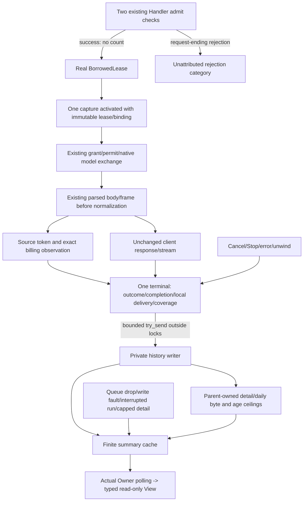

# Local request accounting and retained usage

Parent: [usage and monitoring](PRD_02_31_01_03_usage_monitoring.md).
Status: `[-]` implementation integrated; strict compilation and initial controlled consumers pass; source controls and final integration remain open.
UM-01/02 mechanism work does not close real-provider attribution, financial
settlement, balances/allowances, monitoring, UI or release qualification.

## Outcome tree DAG

```text
Outcome: retain actual local model work once and reveal measurement coverage
├── [-] CAPTURE — bind once immediately after real BorrowedLease
│   invariant: returned lease lifetime and immutable binding determine attribution
│   evidence: actual client/probe HTTP/SSE consumers and original-assertion controls
│   safe failure: typed measurement gap; dependency: existing lease/permit; non-goal: counting both admit checks
├── [-] SOURCE — observe existing decoded upstream values before shaping
│   invariant: cumulative replacement, source conventions and exact money stay explicit
│   evidence: native/cross-protocol/partial/final consumers
│   safe failure: invalid/absent observation, not model replay/failure; dependency: existing codec; non-goal: second SSE parser
├── [-] HISTORY — nonblocking queue to bounded private retention
│   invariant: no I/O or wait on model/render producer and no discarded detail masquerades as erased use
│   evidence: overflow/write failure/retention/restart/unclean shutdown
│   safe failure: coverage gaps; dependency: shared typed private publisher; non-goal: a database/daemon
└── [-] SUMMARY — cached UTC windows and separate account/profile/model dimensions
    invariant: final/partial/missing/probe and charge/list-price/allowance are not conflated
    evidence: known dimensional totals/Other buckets and read-only projection
    safe failure: stale/incomplete retained snapshot; dependency: HISTORY; non-goal: UI or wallet inference
```

## Memory palace



## Capture and source semantics

Successful Handler admit checks do not count accepted work: the same request
is checked before body collection and again at handle. Count an account-bound
request once only after its actual lease. Freeze returned credential/service/
organization generations and immutable binding/candidate identity at that point;
do not reattribute through a later Store/UI lookup. Anonymous admission and
pre-lease rejections remain separate. A request guard owns one terminal attempt,
including error, cancellation, Stop and interrupted unwinding; queue failure is
an accounting gap, never another inference or a changed HTTP response.

Explicit probes use the same capture core and their own purpose. Lease admission
and native model dispatch are different facts: authority/permit refusal before
dispatch is not a paid call. A successful remote response followed by stale
proof acceptance still retains observed probe use without manufacturing proof.
`transport_dispatched` means handed to the existing native exchange, not evidence
that a remote service received or charged it. Local successful writes are not
client acknowledgement. Queue wait remains unavailable without a real shared
timing datum; lease duration cannot be mislabeled queue/handler duration.

The existing JSON/SSE decoder is the framing authority. Observe already framed
raw JSON and its parsed value before protocol conversion/native forwarding.
Messages base input, cache-read and cache-create retain their source convention;
Chat prompt includes cached input and reasoning is an output subset. Optional
cache/reasoning absence is not zero. Present cumulative fields replace previous
values, never sum chunks; decreases are retained but marked inconsistent.
Final token coverage requires completed transport, successful semantic finish,
valid required input AND output counts. Terminal-looking frames/error+DONE or
truncated EOF cannot manufacture Final. Downstream failure does not erase known
completed upstream usage; partial disconnect does not prove billing stopped.

## Pinned response billing

The official [OpenCode response contract](https://github.com/anomalyco/opencode/blob/5ed03ad1377b549df83aa52dc11bdb07593a5327/services/www/src/docs/content/console/api/inference.mdx#L91-L119)
defines `usage.cost` and `usage.opencode` fields. Retain cost and list cost as
separate USD observations; retain allowance consumption in its plan-limit USD
unit, separate from cash. Preserve billing_source, optional estimated flag and
the separately billed token dimensions. Missing, invalid and reported zero stay
distinct. Costs are reported before final provider settlement and may be reduced;
these observations are neither an invoice nor an authoritative balance.

For Chat, billing is on the final usage chunk when the upstream supplies it;
Messages uses message_delta usage. Do not alter stream/include_usage forwarding
or ask for extra paid work merely to obtain measurements. Keep absent metadata
unknown. Other providers remain governed by their own proven field contracts;
an unrecognized response does not prove the provider unsupported.

Existing serde_json's narrow raw_value feature preserves bounded exact decimal
lexemes for supported billing fields through the same JSON engine. Do not enable
global arbitrary_precision, change existing number serialization, or introduce
another SSE parser. Checked decimal aggregation preserves units/estimated status,
reports overflow and never uses binary floating point or sums subset dimensions.
Private receipts contain only finite whitelisted observations; no prompt, tool
data, response/header bag, grant, raw organization ID, proxy URL or local key.

## Retention and read-only summary

The [parent](PRD_02_31_01_03_usage_monitoring.md#request-receipts-and-bounded-history)
owns the detail/daily age/count/byte ceilings; this implementation must retain
them rather than silently substitute RAM. The producer queue has 256 slots and
each serialized receipt is at most 4 KiB. Overflow, writer failure, interruption,
truncation and arithmetic overflow are explicit coverage, never model errors.
Use the shared typed private publication result; distinguish unpublished failure
from already published bytes with unconfirmed durability. Mark an active run
open before claiming durable coverage. The writer never owns a queue Sender:
Gateway history and each live capture do. Only the last Sender disconnect plus
an empty receiver permits the closed marker, after final gap counters are sampled.
Stop does not close accounting or wait for its filesystem I/O. Last-Gateway Drop
never waits: it can execute on a network handler or other non-Owner thread.

At final run_loaded_owner shutdown, stop/join its model jobs and listener, finish
login shutdown, take a non-producing UsageClose handle, drop login and Owner,
then wait at most 500ms on that background thread. The handle retains no Sender.
A remaining external Gateway/capture prevents closure. Timeout means completion
was unconfirmed at that instant, not that an in-flight atomic publication was
retracted. The writer may later truly drain and publish closed; the next startup
uses those actual private bytes. Unconfirmed/unfinished shutdown cannot be
called clean or crash durable. Fresh fixture roots are removed only after actual
writer completion, never underneath a detached writer.

Daily aggregates keep global totals AND independent account/profile/model
dimensions (16/8/512 current retained groups plus Other), within the parent's
daily byte budget. Historical churn or capped detail moves coverage to explicit
Other/incomplete groups; it does not erase known global/dimensional usage.
Never derive filtered totals only from the capped recent receipt list or sum
the independent dimensions together. Probes remain separate by default.

The first typed summary carries timezone_basis=UTC and windows of UTC today,
the current plus previous six UTC calendar days, and current plus previous 29.
Terminal time determines its day. Final/partial observations and known/missing
sample counts remain distinct. Read-only sampling shares an immutable Arc snapshot, is bounded/nonblocking and
preserves a prior cached summary on contention/failure. Later UI must label this
basis explicitly rather than relabeling it as an unspecified local day.

## Evidence frontier

Initial controlled implementation consumers now have named observations below.
Source controls and full integration remain pending. Required consumers include
actual concurrent client/probe exchanges; cumulative native/cross-protocol usage
with suppressed downstream usage; error/EOF/cancel/Stop/delivery cases; financial
zero/estimate/allowance/precision; queue/storage/retention/restart gaps; and known
independent dimension/window totals. Every new test requires an actual original
consumer assertion RED and exact restored GREEN. Metadata network/authorization,
real grants, wallet/allowance refresh, monitoring and Harness pixels are separate
parent leaves; this mechanism cannot silently close them.

### Initial controlled execution

`target-six/v0.2.23-provider/um-consumer-corrected-gates/receipt.json` records
fmt, default/native-auth all-target strict Clippy, all sixteen new named consumers
and eighteen alignment tests passing with zero failed/ignored. The first compiler
failure and earlier 14-pass/two-failure baseline remain retained: the new tests
had incorrectly expected native model rewriting and a different stream error.
The corrected tests require the existing full native response bytes and exact
error frame without a synthetic DONE; production response semantics were not
changed to satisfy them. These failures are not mutation RED.

The client fixture now uses the real Store update to distinguish its admitted
service generation from credential generation before changing service again
during the actual HTTP request. Its original attribution assertion is unchanged;
`um-client-distinct-epoch-gates/receipt.json` records the strengthened consumer
and both strict Clippy profiles passing. `um-final-original-source.json` binds
the final eight source paths for the forthcoming original/guard/restored runs.
The sixteen initial consumers do not establish metadata balances, real grants,
UI/native acceptance, storage fault completeness or release qualification.

### Actual source controls

`target-six/v0.2.23-provider/um-source-controls-attempt-1/receipt.json` records
sixteen actual original-assertion RED controls across the sixteen new subjects,
then exact eight-file restoration and passing original/no-tag/restored inventories
of sixteen each. Every accepted case has its intended single assertion, actual
exit101, finite cleanup and retained raw logs. Setup/compiler/timeout/passing
mutants are not accepted. Original consumer assertions remain intact in mutants.

The ownership control removes the joint record/sink consumption boundary; the
day-cap control removes its two related limits together. Semantic-final,
service-epoch, late-stale probe usage and decreasing-counter controls establish
only their named boundaries. Earlier unexecuted suggestions that would reach an
unwrap/await failure and the original colliding-epoch fixture remain recorded in
the frozen preparation; they are not counted as executed or accepted RED.
Final regression and provider/metadata/UI/native qualification remain open.

### Final local integration regression

`target-six/v0.2.23-provider/um-k3-final-regression/receipt.json` records fmt,
default/native-auth all-target strict Clippy, 376 main consumers (including all
sixteen UM cases and the existing profile/settings/browser-control consumers),
two actual local gateway worker journeys and eighteen alignment tests passing:
396 execution passes, zero failures and the one existing opt-in Pi case ignored.
Source/HEAD/index remain unchanged during the gate. This is controlled Windows
integration evidence; real accounts, metadata reads, report pixels, other native
targets and final selected artifacts remain open under their owning modules.
