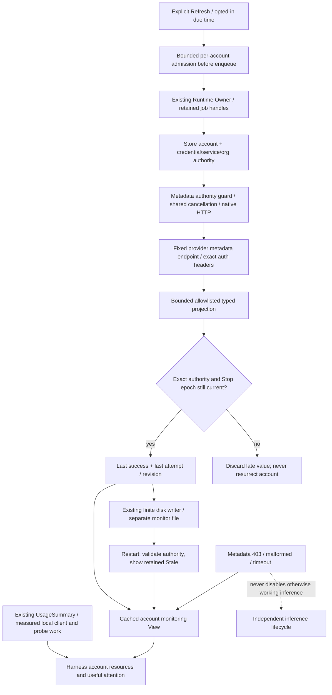

# Account balances, allowance and monitoring

Parent: [usage and monitoring](PRD_02_31_01_03_usage_monitoring.md).
Local statistics: [request accounting](PRD_02_31_01_03_01_request_accounting.md).
Account authority: [provider pool](PRD_02_31_01_02_provider_pool.md).
Status: `[-]` integrated development implementation with named local evidence
below; original controls, native/public UI and real-account qualification remain open. This delivery
retains the full selected 0.2.23 outcome, including two DeepSeek accounts and
OpenCode Go; a safe Unknown display does not complete a supported metadata read.

## Outcome tree DAG

```text
Outcome: see useful provider-authoritative account resources and refresh safely
├── [-] CONTRACT — fixed credential-compatible metadata adapters
│   invariant: exact provider/audience/workspace source; money is not allowance
│   evidence: pinned official consumers and real per-account metadata-only reads
│   safe failure: typed unsupported/permission/schema error, not zero
│   dependency: existing grants and service policy; non-goal: API-key import/cookies/scraping
├── [-] READ — one captured account authority through transport and acceptance
│   invariant: reconnect/org/network/remove/Stop cannot relabel a late response
│   evidence: controlled real HTTP races, proxy/cancel/403 and original-assertion controls
│   safe failure: discard stale result, retain labeled old value
│   dependency: Store snapshot/cancellation/native HTTP; non-goal: model inference or readiness
├── [-] RETAIN — bounded private last readings and explicit settings
│   invariant: restart/storage failure cannot turn old or partial data into Fresh
│   evidence: actual private publication/restart/limits/faults and late writer races
│   safe failure: persistence unavailable/unconfirmed, last good value remains labeled
│   dependency: shared private publisher; non-goal: another ledger/database or invoices
├── [-] MONITOR — explicit Refresh and opted-in process-lifetime scheduling
│   invariant: coalesced work obeys limits/deadlines/backoff and owns cancellable workers
│   evidence: two accounts independent, same account coalesced, Stop/exit/no catch-up
│   safe failure: Busy/cooldown/paused; never silently retry a user action
│   dependency: READ/RETAIN and existing Runtime queue; non-goal: daemon/auto-purchase/routing
└── [-] PRESENT — cached readings, freshness and useful attention
    invariant: old success, latest attempt and measurement capability remain distinct
    evidence: public manual/opt-in/narrow UI and real two-DeepSeek/Go receipts
    safe failure: source/time/stale/permission unavailable remain visible
    dependency: immutable View join and local usage summaries; non-goal: real-provider claim from fixtures
```

## Memory palace



## Provider contracts and remaining measurements

### DeepSeek account wallets

The official account reader at commit
`22ddee3792402c3e70ec5f86a63c3e3e895a2f60` performs a fixed GET
`https://platform.deepseek.com/api/v0/users/get_user_summary`, with the stored
Platform grant in `x-dsh-auth-token` and existing client metadata headers.
Its successful business payload contains `normal_wallets` and `bonus_wallets`;
rows carry CNY/USD currency and decimal strings. Preserve the two components,
source and raw bounded decimal representation. The official grammar includes
fraction-only, trailing-dot and exponent forms; normalize lexically for any
comparison, never through binary floats. HTTP401 and business code40003 are
explicit rejected-grant observations. They are not generic network failures.
Sources: [projection](https://github.com/deepseek-ai/deepseek-harness/blob/22ddee3792402c3e70ec5f86a63c3e3e895a2f60/packages/credentials/deepseek-account-platform/src/details.ts),
[wire contract](https://github.com/deepseek-ai/deepseek-harness/blob/22ddee3792402c3e70ec5f86a63c3e3e895a2f60/packages/credentials/deepseek-account-platform/src/protocol.ts).
This is account-grant support, not the separate API-key balance API. MiniCon must
still demonstrate two independent real account reads; none was performed here.

### OpenCode Go allowance

Official commit `450e7b92412c780a7b5a75226bb8d49aaca24e22`,
[`packages/core/src/usage-limits.ts`](https://github.com/anomalyco/opencode/blob/450e7b92412c780a7b5a75226bb8d49aaca24e22/packages/core/src/usage-limits.ts#L157-L191),
provides the missing current OAuth consumer. It reads
`GET https://opencode.ai/zen/go/v1/usage` using OAuth access Bearer and
`x-opencode-org-id` from the chosen workspace. Its response is
`usage.{rolling,weekly,monthly}`, each with status `ok`/`rate-limited`, finite
percent and a reset date string. Percentage is allowance consumption, not cash.
Do not guess that it is capped at100, derive dollar balance, or conflate an
exhaustion flag with missing data. A403 makes this measurement unavailable;
without a reliable typed reason it does not prove zero allowance, no subscription,
or invalid inference credentials. Freeze this actual client path/header contract;
the canonical `/inference/go/v1/usage` migration needs its own verified request,
not an automatic URL rewrite. The official device-grant-compatible code removes
the old contract UNKNOWN; MiniCon's actual granted-account read remains pending.

### Cash and budgets are separate

The same official file reads Console member budgets with OAuth through
`/console/api/policies/current-budgets` and the Console header contract
([ConsoleAccess](https://github.com/anomalyco/opencode/blob/450e7b92412c780a7b5a75226bb8d49aaca24e22/packages/core/src/console-access.ts)).
A spending cap is not cash credit. This investigation has not established an
OAuth-compatible cash-wallet endpoint. Do not turn a budget or Go percentage into
wallet balance or silently replace OAuth with a personal key/cookie. If monetary
OpenCode credit is required by the accepted outcome, that exact capability stays
BLOCKED until a provider-supported contract and actual read exist or the owner
explicitly resolves the release scope. This is not permission to drop it.

## Read and lifecycle contract

Use the existing account Store, fixed provider builders, per-account service
network and native cancellable transport with normal certificate/hostname
validation, no redirects and no proxy fallback. Explicit Refresh is unavailable for a user-disabled account; its cached reading
remains visible and enabling uses the existing account-policy action. Missing
grant or removed account yields NeedsAuth/Missing without HTTP. Enabled
CredentialStored with a valid stored grant may read metadata before inference
verification; a successful wallet/allowance read is not inference and
must not call mark_ready. Missing OpenCode workspace requires an explicit chosen
organization, never a guessed first organization or model-supplied header.

Each job captures opaque account, provider, credential generation, service
policy/generation, organization epoch/digest, request and Stop epoch. Use a metadata authority guard that reuses the Store/network/cancel mechanisms
without consuming model inference lease counters. Compare authority before any metadata request, after
any authorized token refresh, and at acceptance. Token refresh uses the existing
account-local lock/CAS; it must preserve newer organization resolution. No HTTP
or snapshot-publication work happens on the UI thread or while holding
Pending/Gateway/Store locks. Store's own bounded credential read stays within
its existing mutation lock for atomic acceptance. Lock order stays Gateway then
Store; the in-memory acceptance callback never reacquires Gateway or performs I/O.

A metadata job has a15s total deadline including credential refresh; each body is
at most64KiB, response count is finite, and redirects are refused. Bound parsing
before allocating projected rows. HTTP429, permission403, no subscription,
needs-authorization, malformed schema, network error, stale authority and actual
cancellation are separate outcomes. Do not use the existing generic
`check_status` mapping that collapses401/403 to NeedsLogin. Metadata403 never
calls disable_account or removes a grant. First delivery changes only monitoring
state on metadata rejection; existing inference readiness/reconnect remains a
separate authority. The same typed metadata outcomes and Retry-After handling
apply to prerequisite token refresh, through the existing shared refresh
mutex/budget/HTTP/parser/CAS mechanism. Its metadata error mapping distinguishes
temporary HTTP429/503 and malformed responses from actual grant rejection;
temporary failure does not persist an authentication pause. Existing inference
mapping remains separately owned. A late rejection from a replaced access token must not
become a current-grant revocation merely because ordinary refresh preserved its
generation: compare captured grant under Store authority or label the observation
as a dated previous-attempt failure. Acceptance compares the actually used grant
atomically under the existing Store mutation lock; its transient stamp is never
stored, serialized or logged. Raw tokens/digests are not public evidence.

Retain last success separately from latest attempt. Errors never overwrite a
known amount with zero. Reconnect/network/org changes label the old reading as
previous-authority Stale; an old workspace reading is never displayed as current
workspace money. Removal cancels and evicts; late completion/write cannot restore
it. Restart validates each retained authority against current Store state and
initially labels retained values Stale, not a newly fetched reading. While the
process runs, a successful accepted read is Fresh until the next failed attempt,
authority change or a 600s age ceiling. Display exact last-read age; wall
clock uncertainty is never negative age or false Fresh. Provider as-of time, if
supplied, stays distinct from local receipt time. The600s ceiling is accepted for this slice. Corrupt,
missing and truly zero values remain distinct.

## Persistence and finite scheduling

Use one private versioned monitor snapshot/settings store, separate from request
receipts and credentials. Extend the existing finite statistics writer with a
single bounded, coalescing monitoring-cache slot; do not copy that writer or
start a second disk-persistence loop. Proposed ceilings:16 accounts,16 wallet rows/account,
64 allowance-window rows/account,128 bytes/decimal,64 bytes/reset string,
512KiB total cached readings and16KiB policy. Oversize becomes a visible storage/
coverage failure, retaining last accepted bounded data. Do not grow an append-only
balance history or duplicate the parent-owned request/daily retention ceilings.

Persist monitor opt-in and thresholds; keep latest sanitized success/attempt
metadata and an explicit durability state. Reuse typed private atomic publication:
DurabilityUnconfirmed means published bytes, not rollback. Cache publication
revision and authority tags survive delayed writer completion. Pending compares
the current snapshot revision with the actual writer completion, including after
manual Refresh; reopen acknowledges the revision actually loaded. A superseded write
may remain a tagged historical value but cannot become Fresh or resurrect an
account on reload. Final disk acceptance is not provider settlement. Writer
failure cannot retry inference or erase another account's last reading.

Manual Refresh is explicit. Opening Settings renders cached values only. Auto
monitoring defaults off; existing parent timing remains300s interval/60s minimum,
one query per account and at most two accounts globally. The first implementation
uses one retained metadata job globally, so it remains within that ceiling without
a second scheduler or stealing inference lease slots. Repeated due/completion triggers
coalesce; an already active manual refresh reports Busy/already refreshing with
its current request rather than queueing a replay. Within cooldown, show next
eligible time and require a later click. Deliberate retry can bypass automatic
network backoff after the minimum, but not an explicit provider Retry-After.
Legal Retry-After seconds/HTTP dates within the finite 4800s horizon set a private,
authority-bound not-before that survives restart and also gates manual Refresh.
Oversized or ambiguous legal hints, or unavailable time, pause automatic traffic
rather than shorten the provider's delay; malformed hints retain bounded backoff.
Automatic delay is bounded exponential backoff, honors Retry-After and has no
sleep catch-up burst. An account's disabled/removed/reconnected policy cancels its
job independently. Stop advances the shared epoch, cancels jobs, clears due work
and pauses monitoring for this process; a later explicit Refresh is one read,
not implicit resumption. Admission and due work observe the actual Stop epoch
before starting; a duplicate same-epoch acknowledgement cannot erase a new
explicit selected-account Resume. Re-enable Monitor explicitly to resume timed reads.
Exit retains and joins real workers after cancelling actual transport.

There are at most16 ordinary unacknowledged account operations plus16 priority
Off slots. Only explicit Off may coexist with that account's pending Refresh;
all other conflicts remain Busy. Off fences/cancels matching metadata before
enqueue, then uses the same actor and writer to save policy. Retain both exact
(account, request) results until delivered acknowledgement; drain delivered
acknowledgements before accepting an immediate next terminal. Queue refusal
reclaims only the rejected Off slot, reports not saved and never retries it.
No extra transport queue, thread or scheduling engine is introduced.

The explicit Off control remains usable with invalid unsaved threshold drafts:
it saves enabled=false with the currently applied thresholds, preserving the
draft text/caret/selection. Save(false) while disabling an applied enabled policy
or interrupting Refresh carries that same Off intent; ordinary already-off
threshold Save still validates. Consume both exact results regardless of order.
A late old read cannot overwrite newer Off feedback. Failed enqueue restores
the old read pending state; successful Off with draft changes says that
monitoring is off and threshold edits are not saved.

## Presentation and selected acceptance

Every account shows source/type, last successful value/time, current freshness,
last attempt status and explicit Refresh/Monitor controls. Display normal/bonus
wallets separately by currency; Go shows three labeled windows with supplied
percent/status/reset. Known low thresholds/exhaustion/staleness yield local
attention only. Repeated attention coalesces; no notification daemon, auto-top-up,
paid overage toggle, model inference or account/route switch is caused by metadata.

Existing View.usage supplies local account/profile/model measured usage and
coverage; monitoring never reconstructs those totals from a wallet. Metadata
queries do not become model receipts. New financial values are explicitly
user-visible local data, not secrets/grants, and need a reviewed PRD26 whitelist;
operator/release logs retain only fixed categories/counts/currencies and real-read
success identity, not raw balances, grants, bodies or proxy/org headers.

Named evidence must include actual two-DeepSeek wallet reads and OpenCode Go
allowance read under their selected grants, per-account service routing and
stale/error behavior. Controlled fixtures establish mechanism/negative controls,
not provider entitlement. Follow with opt-in/coalescing/backoff/Stop and owned
public UI/narrow-layout journeys. Full0.2.23 reporting/history/UM01–06 remain
selected in the parent; manual-only delivery is the first dependency, not the
final selected milestone. Unknown/unsupported presentation alone closes none of
the supported real-read or monitoring obligations.


## Implementation preview v2

The ignored account-monitoring-preview-v2 manifest binds seven source paths and17 UNRUN candidates. Its HANDOFF identifies typed immutable snapshots and the existing writer, independent file availability, exact per-account delivery, metadata authority and persisted opt-in. This is not compilation, executed evidence or real-account qualification. The parent owns startup opt-in semantics; the charter has only its pointer. Preserve all selected UM03/04 gates and the unresolved OpenCode cash measurement. Root must hunk-join the concurrent qualified idleUTC writer, never copy the old full postimage over it. No provider measurement was executed.

### Integrated developer evidence, 2026-10-26

`target-six/v0.2.23-provider/account-monitoring-correction-repaired-gates/receipt.json`
records actual fmt, default/native-auth strict all-target Clippy,61 selected
accounting/monitoring/report consumer passes and18 alignment passes. Its source
map binds the dirty integrated source at HEAD `a2c9bde`; it is not a clean-HEAD,
native, real-provider or release-artifact receipt. The preceding integrated
attempt failed strict Clippy on equivalent adjacent Backoff branches; root
combined the conditions without changing assertions. Earlier setup/compile
failures remain in their original receipts. Original-assertion controls, public
GUI, real account reads and full release gates remain open. A subsequent static
review identified temporary OpenCode token-refresh errors being collapsed
to NeedsAuth before the metadata GET. The subsequently integrated narrow shared-
refresh correction is bound by
`target-six/v0.2.23-provider/account-monitoring-refresh-integrated-gates/receipt.json`:
fmt, both strict Clippy configurations,64 consumers and18 alignment checks pass.
Its three additional actual localhost consumers cover typed refresh failures,
fresh-token-to-Go-GET and Controller rate-limit/backoff. These are controlled
requests, not real OAuth/account evidence. The earlier six-correction controls
have10 original-assertion RED results across8 subjects, with exact restoration
and canonical GREEN, in `monitoring-correction-controls-attempt-2/receipt.json`
under that same ignored evidence root. Attempt1 remains a rejected control
classification because one cutpoint logged its tag twice; its actual failure
and restored GREEN are retained. The refreshed mapper's five controls also
produce the intended original assertion failures across its three actual HTTP
consumers, followed by exact restore and canonical GREEN, in
`monitoring-refresh-controls-attempt-1/receipt.json`. These control receipts
bind their own source maps and controlled images; they do not qualify the
public/native UI or real providers. The original17 subjects subsequently
completed17 intended original-assertion RED controls, exact restoration and
canonical GREEN in `monitoring-original17-controls-attempt-1/receipt.json`.
Together these receipts cover32 selected cutpoints across28 monitoring
subjects; each claim remains limited to its actual recorded assertion.

### First actual DeepSeek metadata read through the owned product UI

`target-six/v0.2.23-provider/real-account-metadata-once-attempt-1/receipt.json`
records one explicitly requested manual metadata read against the existing real
DeepSeek account. It uses the already pinned developer image SHA-256
`f8fd174813311c08757b2ad5e3ce99e83bf9a96042b206cb3c5aa730dd67bceb`,
not a release image or a newly qualified current-HEAD build. The separate
`real-account-metadata-once.py` verifier reuses the frozen handover's exact
owned-pipe PID, private Job and no-activation guards; the original handover
helper remains unchanged. The product legitimately loads the original account
configuration; the verifier never reads credentials/profile contents.

Across 51 public CLI calls, the verifier observes one account, selects its
Monitoring row, captures the previous public report, clicks Read metadata once
exactly once, observes a numeric pending request and its completion, then reads
the public report again. The attempt text changes, its UTC finish time matches
this invocation, and its result is `Ok(())`. The official source is
`DeepSeekSummaryV0`; two wallet rows and saved-cache presentation are observed.
No actual balance, account ID/label, snapshot, screenshot, credential or private
file is retained. The monitoring opt-in presentation remains unchanged; the
verifier requests no inference, policy change, login or model check. Previously
opted-in product monitoring could resume on launch, so this receipt does not
claim exactly one total provider HTTP request.

The directly owned product closes normally with exit zero; its Job closes,
the real roots remain intact, and image/helper support hashes are unchanged.
This establishes one real DeepSeek manual-read/report/cache acknowledgement
journey. It does not close UM-03/04: the second DeepSeek account and its explicit
proxy, real OpenCode Go allowance, cross-account isolation, automatic monitoring
lifecycle and final exact-source release evidence remain required.
