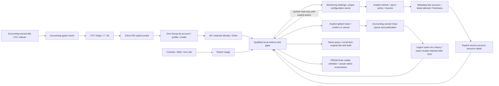

# Local usage reports and monitoring presentation

Parent: [usage and monitoring](PRD_02_31_01_03_usage_monitoring.md).
Workspace/navigation: [PRD36](PRD_02_36_harness_workspace.md).
Source semantics: [request accounting](PRD_02_31_01_03_01_request_accounting.md).
Provider metadata/policy: [account monitoring](PRD_02_31_01_03_02_account_monitoring.md).
Status: `[-]` integrated development implementation with named evidence below;
local original-assertion controls and presentation replay have evidence below;
advertised native/provider and release qualification remain open. This does
not close UM05/06.

## Outcome tree DAG

```text
Outcome: understand retained local use and actual provider resources without changing work
├── [-] SELECT — UTC Today/7/30, Clients/Probes, one Group-by dimension
│   invariant: account/client-profile/model tables are independent, not joint filters
│   evidence: distinct fixture totals, All/Other and historical-key consumers
│   safe failure: retained unavailable selection, never silent All/index fallback
│   dependency: accounting cached summary; non-goal: a second statistics engine
├── [-] EXPLAIN — coverage, exact tokens/money and source states remain readable
│   invariant: missing is not zero; channels/conventions and local/provider times differ
│   evidence: actual painter and source-state consumers in EN/Hans/Hant narrow/wide
│   safe failure: visible partial/error/gap/unknown qualification
│   dependency: accounting and metadata typed contracts; non-goal: invoices/wallet inference
├── [-] NAVIGATE — large Robot Usage, compact Monitoring Settings, reversible return
│   invariant: Settings owns configuration; report entry performs no model/metadata action
│   evidence: public routes with drafts/scroll/focus/live-page preserved
│   safe failure: cached NotLoaded/Unavailable and reachable Settings/Back
│   dependency: PRD36 return authority and existing host editor; non-goal: duplicated forms
├── [-] PRESENT — bounded shared geometry and truthful cached updates
    invariant: paint/hit/snapshot share one visible projection; idle UTC windows stay current
    evidence: cache-rollover prerequisite + deadline/coalescing + actual viewport consumers
    safe failure: recorded-as-of/unknown period, bounded visible rows and diagnostics
    dependency: accounting-owned clock/cache prerequisite and PRD26 whitelist
    non-goal: new timer/layout/writer engine or synthetic native qualification
└── [-] CLEAR — explicit all-history confirmation and exact operation feedback
    invariant: current filters never narrow Clear; only explicit confirmation dispatches it
    evidence: three guarded consumers and 17 public Clear checks; named receipts below
    safe failure: typed Busy/Unavailable/Storage, never false saved or implicit retry
    dependency: accounting-owned Clear writer/Runtime contract; non-goal: provider reset or model cancellation
```

## Memory palace



## Report projection authority

Read immutable View.usage and the independently owned View.account_monitoring.
Never read history/account/key files on UI input, recompute statistical totals,
join independent dimension tables, create another writer or issue a model read.
The accounting owner defines coverage, token conventions, exact financial units,
retention and the local computation-time/UTC-cache-rollover prerequisite. The
metadata owner defines provider resources, freshness and all policy execution.
Their retained limits and source facts are linked, not copied into this module.

Periods use one explicit UTC calendar basis. Default purpose is Clients; Probes
is an explicit distinct view. Group by selects exactly one of Account, Client
profile or Model. Each dimension remembers its own selection; the header names
all active choices. All uses global totals; Other uses the selected dimension's
actual capped bucket. A disappeared retained identity remains unavailable until
the user selects another, never silently replaced by an index/global total.
Historical account/profile IDs remain readable; client profile is not a known
executable. Model identity includes provider and protocol, not just model text.

## Qualified information hierarchy

Large Usage presents source/coverage, outcomes, separate Final/Partial token
conventions and optional subsets, independent financial channels, then detailed
retention/gap diagnostics. Global this-process counters have a separate label;
they are not filtered-period counts. Source detail span is labeled detail, not
the independent daily aggregate span. No subset/dimension is summed twice.
Known zero requires known samples. Missing/invalid/overflow stays qualified.
Cash charge, estimated/unclassified charge, list price and plan allowance keep
their actual exact units and coverage. No binary float financial formatting.

Official resource detail always names one actual source account. Account-group
detail may show that account; profile/model/global reports do not imply a unique
wallet. Keep last_success, latest_attempt, backend freshness, persistence, policy
pause and attention independent. Unknown capability is not unsupported; a known
contract is not proof this MiniCon account was exercised. Local computed_at,
provider observation/as-of and reset text have separate labels. No wallet is
derived by subtracting local use, and unlike currencies/kinds are not summed.
Display local computation/observation timestamps as readable UTC date/time,
using the existing platform civil-time conversion. Raw Unix milliseconds and
UTC day indexes remain structured observation fields, not user-facing prose.
Unavailable/out-of-range time is explained rather than formatted as a date.

Settings and Usage share localized reading, pause, latest-attempt and storage
labels. User-facing state must distinguish monitoring off, explicit Stop,
disabled account, expired authorization, changed authority and retry backoff;
failed reads keep actionable failure text and never look successful. Do not
present Rust `Some(...)`, `Ok(())`, quoted labels or qualification-process
jargon as product status. Unknown capability still differs from a supported
metadata contract, and neither substitutes for a successful account reading.
This presentation join changes no account, policy, request or persistence state.
Hot files are the existing report label projection and Settings consumer;
their shared native layout, metadata backend and public structured identities
retain their existing owners. Validate both actual consumer projections in
English/Simplified/Traditional Chinese and prove intended guard failures.

## Navigation, layout and configuration

Keep five existing workspace destinations and Overview's four cards. Its compact
monitoring summary links to Monitoring Settings; Usage is the full report, not a
three-line card. Settings contains compact observations and Open usage report.
It remains the only configuration editor for monitoring opt-in/thresholds/
explicit refresh/resume, using the metadata owner's exact actions and receipts.
The views use cached values; Robot entry creates no Runtime. First explicit
Settings initialization retains a previously persisted opt-in due schedule, not
a new enable intention. No automatic login/listener/probe or field-edit policy
enable is introduced. Manual refresh does not silently resume polling.

Use one report content scroll and shared geometry for painting, hits and public
observations. Narrow windows stack controls and inline detail, preserving full
translated labels/long IDs/exact decimals; Back, Settings and group controls stay
reachable. Tab/roving group navigation and pointer choose the same visible row.
Harness continues owning pressed/released/IME events. No inherited hidden editor
receives input. Settings/report round trips preserve independent forms/carets,
blur preedit and invalidate old key Copy intent at the actual closing intent,
including close/reopen between polls. Return restores original Console/Web
context and page DOM without reload; report query/selection/scroll are retained.
An explicit Settings destination requested during the first asynchronous load
is resolved after profile rows arrive. It is a one-shot destination; later
keyboard, IME, pointer or wheel navigation supersedes it. The heading must be
visible; last-page clamping may put preceding rows above it.

## Bounded presentation and observations

PRD36 owns metric redraw coalescing and immediate lifecycle/input behavior.
Keep Runtime effects/receipts current; throttle only visible metric presentation.
Use one pinned Arc per rendered frame and the existing event-loop deadline path
for a newest pending update. Hidden views avoid expensive row formatting.
Do not introduce another timer thread, busy Wake loop or global effect throttle.

Public schema belongs to PRD26 and is registered only with actual consumers.
Whitelist active query, safe selected identity, typed source/gap states, local
time basis, finite visible row text and shared rectangles; exact decimals remain
strings. Never serialize full View/history/authority, grants, org/proxy data,
keys/hashes, URLs/headers or model content. Computed geometry is not native pixel
acceptance. Public/native evidence names actual source/binary/features/OS/ISA/
viewport/scale and preserves failures; old accounting/H0 evidence is not H1 proof.

## Explicit local-history Clear presentation

Clear is an exception to read-only projection, not another statistics or writer
engine. The [accounting owner](PRD_02_31_01_03_01_request_accounting.md) owns the
cutoff, retention and typed publication result. The report offers one explicit
all-history action, inline confirmation and keyboard/pointer cancellation.
Confirmation states that all accounts, client profiles and periods are included,
provider resources/policies/keys are unchanged, and running work continues.
The actual complete confirmation button itself states that subsequent request
completions are recorded, including already-running work.

Pending remains an unresolved operation across hide/navigation. Match the exact
submitted request from View.usage.clear; the result and its corresponding history
Arc bypass metric coalescing together. Retain that terminal after Runtime ACK.
Render Durable, durability-unconfirmed and Storage as distinct outcomes; only
Durable may say saved. A rejected enqueue requires a fresh explicit confirmation,
never retry on paint/poll. Preserve period/group/query and return scroll.

The integrated three UI consumers pass the strict test entry on the overlay
above `294332a`. Removing confirmation admission, Clear urgency and rejection
feedback each fails its intended original assertion; exact restoration passes.
Named evidence is `target-six/v0.2.23-provider/usage-clear-origin-fixture-gates/receipt.json`
and `usage-clear-serial-controls-attempt-1/receipt.json` under that root.
No removed guard remains in product source.

`target-six/v0.2.23-provider/usage-clear-public-attempt-2/receipt.json` records
17 passing public checks through two fresh owned Windows x86_64 GUI processes
on the matching dirty-source developer image (SHA-256
`f8fd174813311c08757b2ad5e3ce99e83bf9a96042b206cb3c5aa730dd67bceb`).
Known and bounded-corrupt synthetic histories both retain file bytes on Cancel
and Escape, then explicit confirmation produces the actual Durable UI result,
Ready history and empty persisted details/days. The known selected account
stays selected and unavailable until an explicit All choice; Console draft/focus
survive return. All 266 public commands complete, both processes exit 0 and
owned cleanup has no errors; private gateway/key fixture bytes remain unchanged.
Root visually reviewed the English 1000x700, scale-1 confirmation and resulting
report PNGs: the all-accounts/all-periods scope, later-completion warning and
saved result are visible. The first attempt's fixture-bound setup failure is
retained in `usage-clear-public-attempt-1/`; it started no GUI. The corrected
runner uses the existing product aggregate byte ceiling, without changing a
product guard. This is synthetic public CLI/pixel evidence, not physical input,
real accounts, other locales/targets, storage-fault completeness or release
qualification. Those remaining parent obligations stay open.
No new View fact or top-level public schema is introduced: seven finite Clear
row IDs reuse the existing report rows/text/action/complete/rect observation.

## Delivery frontier

The integrated report, metadata/Settings join, existing deadline glue and
PRD26 observation registration have local developer evidence below. Advertised
native targets and remaining parent product obligations stay open. Explicit
Clear has local guarded developer and synthetic public confirmation/file evidence
against the accounting-owned writer/Runtime contract, as scoped above.
Provider readings stay with the metadata owner;
full exact-artifact release qualification stays separately open.

### Initial implementation preview boundary

The frozen initial preview added the real Usage report/Monitoring forms, existing geometry and
deadline consumers, and thirteen candidate Rust consumers. Source semantics and
idleUTC/computed-at are owned by .01; metadata backend by .02. All candidates are
UNRUN at capture, not report qualification. Exact original/preview source identities and
guard proposals accompany the ignored integration handoff; no test/PASS ledger
or native evidence is claimed. Root integrates hot hunks serially.

### Integrated developer checkpoint, 2026-10-26

`target-six/v0.2.23-provider/account-monitoring-readable-report-gates/receipt.json`
binds fmt, default/native-auth strict all-target Clippy,65 selected consumers
and18 alignment passes, including the actual loading-to-destination consumer.
`usage-public-scroll-attempt-4/receipt.json` under that evidence root records
33 public checks in five fresh Windows x64 cases: three locales with known
retained totals, valid empty and corrupt history. Actual published hit rectangles,
literal independent period/group/money oracles, nonzero scroll return,
Console/Web drafts and ordinary-page DOM/history were exercised. All five
owned GUIs exited0 with unchanged private gateway/key bytes and no cleanup
errors. This is a synthetic-history product replay, not real-provider or other
OS/ISA/scale evidence. Raw failure attempts1–3 remain retained: an actual initial
load routing bug, an impossible first-row oracle under last-page clamping,
then a setup that had not actually produced nonzero scroll. The repaired
runner keeps the literal values and query/scroll assertions.

Visual review of the retained English and CJK screenshots found internal Unix
time prose. The subsequent readable-UTC presentation passed the named Rust gate
and `usage-public-human-utc-attempt-5/receipt.json`:36 public checks across the
same five fresh cases, including independent Python UTC rendering oracles in
each known locale. All GUIs exited0,1135 CLI calls completed and private
gateway/key bytes remained unchanged, with no cleanup errors. The pinned
Windows x64 dev image is SHA256
`b1a9170642d75233d0aa8fec89e9f99668c076787ceffebb00b95857de4d0c8f`;
its same-source build receipt is `usage-public-human-utc-build/receipt.json`.
Root inspected actual English1000x700, Simplified Chinese760x540 and Traditional
Chinese420x300 screenshots; action/size oracles also cover the other captured
viewports. This is not physical-input/native browser-child pixel evidence.

`um-ui19-human-utc-controls-attempt-1/receipt.json` records19 intended original
assertion failures across19 UI subjects, with exact source restoration and
canonical GREEN. Frozen earlier packages remain history; no setup, compile or
passing-mutant result is counted as RED. No aggregate UM05/06 completion or
public-release claim follows these local, synthetic-history results.

### Readable monitoring status join

Settings and report now share localized pause/attempt labels for the actual
typed states, preserve the previous resource reading on a failed refresh,
and explain unknown capability separately from a supported metadata API.
The reading/storage strings use ordinary display formatting; explicit-action
feedback also avoids Rust option/result wrappers. The report explanation now
describes provider resources versus local usage in user terms.

`target-six/v0.2.23-provider/presentation-header-controls/receipt.json` records
the two added original consumer subjects (English/Hans/Hant), their intended
assertion failures when debug formatting is restored, and passing exact-source
restorations. Bin discovery increases from865 to867 subjects. The same receipt
also contains the independent header-join control owned by PRD36. No metadata
request, policy change, physical input or clipboard action is used in these
local controls. Native presentation and real-provider acceptance retain their
separate scopes.

The frozen local integration receipt is
`target-six/v0.2.23-provider/presentation-header-gates/receipt.json`: fmt,
default/native-auth strict all-target Clippy,15 report-filter and12
monitoring-filter execution instances, the H0 and browser-menu public journeys,
and18 alignment subjects pass. Filters intentionally overlap and are not a
unique-subject or full-workspace count. No tracked source changes during those
gates. Hosted matching-source presentation/input feedback remains open.
