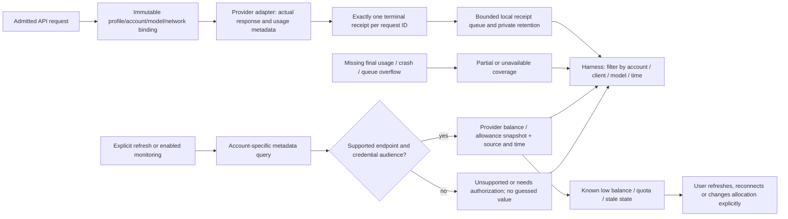

# Local usage statistics and provider balance monitoring

Parent: [provider gateway](PRD_02_31_01_provider_gateway.md). Account/allocation
identity: [provider pool](PRD_02_31_01_02_provider_pool.md). Presentation:
[Harness experience](PRD_02_31_01_01_harness_experience.md). Sequence:
[0.2.23 plan](../plan/plan-v0.2.23.md#harness-product-redesign-before-publication).
Status: `[_]` selected design after the owner's 2026-10-25 clarification.
Protocol usage forwarding already exists; a durable statistics/monitoring
product has not been delivered.

## Outcome tree DAG

```text
Outcome: see which harness used which account, and whether its funds/quota need attention
├── [_] ATTRIBUTION — local requests measured once under their actual binding
│   invariant: profile/account/model/protocol identify the admitted request
│   evidence: UM-01/02 concurrent, failed, streamed and cancelled request receipts
│   safe failure: mark partial/missing usage and accounting gaps; never invent zero
│   dependency: provider-pool identities and provider adapter terminal events
│   non-goal: prompts, tool transcripts or observations of unrelated direct traffic
├── [_] BALANCE — read provider-authoritative money and allowance snapshots
│   invariant: source, account/workspace, unit, freshness and support are explicit
│   evidence: UM-03 real credential-compatible reads and stale/error lifecycle
│   safe failure: unknown/unsupported/stale, preserving the last successful reading
│   dependency: verified provider endpoint/audience and per-account network policy
│   non-goal: deriving wallet balance from local tokens or fabricating billing APIs
├── [_] MONITOR — bounded refresh and actionable local attention states
│   invariant: monitoring performs no model inference, auto-top-up or routing change
│   evidence: UM-04 opt-in refresh/coalescing/backoff/cancel and account isolation
│   safe failure: pause failed polling; keep inference and other accounts independent
│   dependency: BALANCE and process-lifetime scheduling
│   non-goal: OS daemon, continuous web scraping or external notifications
└── [_] REPORT — account/client/model views without misleading financial totals
    invariant: local measured usage, provider charge and estimated cost stay distinct
    evidence: UM-05/06 retention, restart, currency/coverage and narrow-view journeys
    safe failure: display the retained coverage and any missing measurements
    dependency: ATTRIBUTION, bounded private persistence and Harness presentation
    non-goal: invoices, cross-currency conversion or a financial administration product
```

## Memory palace



## What the product measures

| Information | Meaning and source |
| --- | --- |
| Local requests | Accepted, completed, failed and cancelled requests seen by this gateway; rejected admission recorded separately |
| Local tokens | Provider-reported input/output and cache/reasoning detail where supplied; missing/partial usage remains labeled |
| Performance | Queue wait, first response/first text where observable, total duration, active requests and typed failure category |
| Provider-reported charge | Returned charge and currency for the actual credential/service; retain whether the provider labels it estimated |
| Estimated cost | Optional separately labeled price-version calculation only when applicable prices and usage dimensions are known; not required for the first slice |
| Balance | Latest authoritative wallet/credit reading for the account/workspace, including separate currency and bonus/recharge components where supplied |
| Plan allowance | Provider-defined usage windows, consumed/remaining allowance and reset time; a subscription allowance is not cash balance |

Local statistics cover only traffic through MiniCon. Direct provider use by
another application can change the remote balance without appearing in these
counts. Never calculate an authoritative balance by subtracting local estimated
cost, add unlike currencies, or treat allowance consumption as a cash charge.
A profile identifies a shared key, not a provable executable identity.

## Request receipts and bounded history

Generate a local request ID and capture profile/account/route/model/protocol,
binding/network generation, request purpose (`client` or explicit `probe`),
timestamps, outcome, timing and available usage/cost fields. Failed authentication
has no account attribution. Do not persist keys, proxy secrets, prompts, tool
arguments/results, authorization URLs, response bodies or raw upstream headers.

Capture supported billing extensions before protocol normalization can discard
them. Cumulative stream usage updates replace earlier snapshots rather than
being summed. Complete one receipt at terminal success/error/cancel; repeated
terminal events cannot double count it. Known partial usage may contribute only
to clearly marked partial totals. Disconnect/cancel without final usage leaves
the final charge unknown; socket closure does not prove remote billing stopped.

The first view provides Today / Last 7 days / Last 30 days and filters by account,
client profile and model. Keep explicit probes separate by default so setup does
not look like an external harness's usage. Use decimal amounts and original
currencies; cache/reasoning subsets are not blindly added to token totals.

Initial retention ceilings: at most 10,000 recent receipts and 16 MiB on disk,
plus bounded daily aggregates for 30 days under an 8 MiB ceiling. Record the
actual retained time span and aggregation detail; capped detail is not erased
usage. Flush through a bounded queue outside the network/render threads. Queue
overflow, persistence failure or unclean shutdown produces a visible coverage
gap, never a claim of exact accounting. Statistics failure does not replay or
silently block model work. Clear history is explicit and cannot imply provider
balance reset. No new database runtime is required for the first slice.

### Implementation join and read-only source inventory

The existing `provider_server.rs` owns Binding, real BorrowedLease admission,
`handle_model` and explicit `probe_candidate`; `provider_protocol.rs` owns the
raw-body conversion and incremental SSE bridge. There are no separate
`provider_schema.rs`/`provider_transport.rs` owners or existing durable usage/
balance/health-summary APIs to reuse. Existing leases/active state are capacity
and cancellation, not accounting history.

Freeze attribution only after real lease success. Handler admission is checked
both before body collection and at handling; recording each check would double
count. Capture non-stream usage from the bounded upstream body before conversion
and streamed usage from the existing decoded frame dispatch before shaping.
Normalized downstream output may omit usage or discard billing extensions.
Reuse that parser; do not add another SSE engine. A request-local once-only
terminal guard distinguishes upstream completion from downstream delivery and
keeps client/probe purposes separate. A stream completes only after the bridge's
actual finish contract; terminal-looking frames followed by error/truncated EOF
cannot claim complete billing. Missing RequestContext queue timing stays
unavailable rather than renaming handler time.

The terminal handoff must remain bounded/nonblocking and outside Gateway/Store
locks. The later private writer/history and Runtime cached summaries consume it;
they do not replay inference on accounting failure. Implement this seam before
metadata scheduling. Read-only source research is frozen at
`target-six/v0.2.23-provider/usage-feasibility/source-identity.json` with its
primary-source note beside it; it ran no credentials, providers, tests or native
courts and closes no UM acceptance item.

## Provider feasibility and snapshot contract

Each adapter declares independent support for balance, quota windows, usage
history and response billing fields. A snapshot includes account/workspace ID,
credential generation, provider source/version, unit/currency, observed time,
optional reset/provider time, and `fresh`, `stale`, `unavailable`, `unsupported`
or `needs_authorization`. Malformed, absent and zero are different values.
Late results from old grants or removed accounts are discarded.

Research checked 2026-10-25; these are implementation inputs, not MiniCon account
read receipts:

| Provider | Primary input and implementation consequence |
| --- | --- |
| DeepSeek account grant | The [pinned official account implementation](https://github.com/deepseek-ai/deepseek-harness/blob/22ddee3792402c3e70ec5f86a63c3e3e895a2f60/packages/credentials/deepseek-account-platform/README.md) defines a GET to the fixed Platform issuer's `/api/v0/users/get_user_summary`, using `x-dsh-auth-token` and the five existing client metadata headers. Its [typed projection](https://github.com/deepseek-ai/deepseek-harness/blob/22ddee3792402c3e70ec5f86a63c3e3e895a2f60/packages/credentials/deepseek-account-platform/src/details.ts) retains separate normal/bonus wallets with CNY/USD decimal strings, including scientific notation. This is a verified credential contract, not an actual MiniCon account read |
| DeepSeek API-key balance | The [public balance API](https://api-docs.deepseek.com/api/get-user-balance/) reports currency and total/granted/topped-up amounts. Its existence alone does not prove an OAuth grant can call it; keep credential contracts distinct |
| OpenCode Go allowance | The [official Go guide](https://opencode.ai/v2/docs/console/go/) describes rolling, weekly and monthly plan limits. An [official repository clarification](https://github.com/anomalyco/opencode/issues/52227) identifies Go usage/model metadata paths, but endpoint version, response schema, workspace and OAuth-token access still require actual adapter verification; do not import Console cookies or add an OpenCode agent dependency |
| OpenCode response metadata | The [official inference reference](https://dev.opencode.ai/v2/docs/console/api/inference) distinguishes charge, billing source and Go allowance in usage metadata. Read them only where the selected endpoint really returns them; a zero charge does not mean no plan allowance was consumed |

DeepSeek needs a narrow typed GET builder under its existing issuer/client
metadata contract; the current auth POST builder is not interchangeable. Query
under the account's captured service-network policy and CAS the exact credential,
service and organization lifetime on acceptance. Metadata success is not model
readiness. Only the contract's actual rejected-grant signals may change that
credential's lifecycle; failures cannot invalidate a newer reconnect.

The [OpenCode API reference](https://dev.opencode.ai/v2/docs/console/api/)
distinguishes Models, Usage and Billing permissions. Current device-token/config/
inference consumers expose no proven Usage/Billing audience. The Go endpoint's
existence does not prove access, and absence of that proof is UNKNOWN rather than
proof of unsupported. Verify metadata authorization independently; do not add an
API-key auth method, borrow cookies, scrape billing or disable inference on a
metadata-only 403/404 to obtain a green result.

Balance and allowance are independent capabilities. If the exact OpenCode grant
can read quota but not monetary credit, display quota with Balance unavailable;
do not substitute one for the other. A source endpoint migration cannot silently
change inference routing or grant audience. Unsupported monitoring does not by
itself disable an otherwise working inference account; a confirmed credential
rejection follows the provider's real lifecycle contract.

## Refresh, attention and first-delivery gate

Local request counters update while the explicit listener runs. Provider metadata
refresh is a separate explicit Refresh action or opt-in **Monitor account
allowance** setting while MiniCon is running. Opening Settings renders cached
readings only. A refresh never sends a model inference or changes a provider's
paid overage/recharge settings.

Initial automatic interval is five minutes, coalesced per account with at least
one minute between refreshes. Completion-triggered refresh respects the same
minimum. Limit metadata work to one query per account and two accounts globally,
with finite adapter deadlines. Rate-limit/network failures back off, show last
success and allow a deliberate retry; no unbounded catch-up after sleep. Disable,
sign-out and process exit cancel the affected poll. No hidden browser navigation.

Show local attention for provider-confirmed exhaustion/auth failure, stale reads,
and user-configured low monetary balance or allowance thresholds when units and
limits are known. Repeated polling coalesces the same attention state. Opening
provider billing is an explicit browser action; MiniCon never auto-purchases,
enables paid overflow, switches accounts or changes quotas in response.

| Status / journey | Required observable result |
| --- | --- |
| `[_]` UM-01 | Two DeepSeek accounts and OpenCode Go receive independently attributed requests from multiple keyed profiles, including concurrent shared-account use |
| `[_]` UM-02 | Non-stream/SSE success, cumulative usage, error, cancel and missing final usage yield one correctly qualified receipt; no double counting or invented zeros |
| `[_]` UM-03 | Real per-account balance/allowance reads for supported exact grants; unsupported/stale/error remain truthful and cannot erase another account's snapshot |
| `[_]` UM-04 | Manual/opt-in polling, coalescing, timeout/backoff, account proxy, reconnect/remove races and exit remain bounded with no model-call side effect |
| `[_]` UM-05 | Restart/retention/overflow/failure reveal actual coverage; client/account/model totals and separate currencies match controlled receipts |
| `[_]` UM-06 | Harness overview shows useful account balance/allowance and client usage in narrow/localized layouts; no secrets or transcript content in observations |

0.2.23 targets local attribution/history, account/client summaries, explicit
provider refresh, truthful balance/allowance capability states and basic
attention. Rich charts, price estimation, exports and remote notifications can
be sequenced later. If a requested provider measurement lacks access, record
the exact BLOCKED capability and obtain an explicit release-scope decision;
displaying unavailable is safe behavior, not evidence that monitoring shipped.
