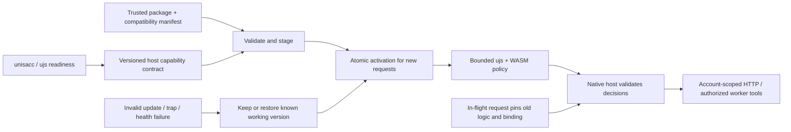

# Independently versioned Harness logic

Parent: [provider gateway](PRD_02_31_01_provider_gateway.md). Status: `[_]`
design direction accepted on 2026-10-26, not implemented in 0.2.23. The owner
expects unisacc/ujs to mature before introducing ujs + WASM dynamic logic.
Their actual APIs and readiness must be inspected; no existing ABI is assumed.

## Outcome tree DAG

```text
Outcome: evolve Harness policies without a native client release for every change
├── [_] CONTRACT — versioned host capabilities and typed policy inputs/outputs
│   invariant: host owns credentials, permissions, network policy, accounting and cancellation
│   evidence: two logic versions work on one client; denied capabilities stay denied
│   safe failure: reject incompatible ABI/capabilities before activation
│   dependency: unisacc/ujs readiness and existing gateway/worker boundaries
│   non-goal: generic plugins or a new permission engine
├── [_] MODULE — bounded ujs logic in WASM
│   invariant: time/memory/output budgets; no ambient file/network/credential access
│   evidence: timeout/trap/oversize/cancel cases release owned resources
│   safe failure: explicit failure without silent inference/tool replay
│   dependency: CONTRACT and measured engine behavior
│   non-goal: treating WASM alone as sufficient security
├── [_] DELIVERY — separate logic version and atomic activation
│   invariant: trusted provenance, integrity and host compatibility checked before activation
│   evidence: install, incompatible/interrupted update, disable and rollback journeys
│   safe failure: retain last working module and bundled manual mode
│   dependency: MODULE and explicit distribution/trust decision
│   non-goal: evaluating arbitrary scripts supplied by models/providers
└── [_] OPERATE — visible active version and request-pinned execution
    invariant: in-flight requests retain their original module version and binding
    evidence: update during stream, rollback and unchanged usage attribution
    safe failure: no mid-conversation account switch; explicit unavailable result
    dependency: DELIVERY and immutable account/profile/conversation identities
    non-goal: cross-machine scheduling or tools in the inference API
```

## Memory palace



## Native host and dynamic logic

MiniCon owns native UI/lifecycle, private storage, protocol mechanisms and
capability enforcement. Candidate-selection rules, provider normalization within
supported transports, workflow steps and presentation hints can become dynamic
after their typed contracts are qualified. New native transport, permissions or
ABI changes still require a client release.

Modules receive opaque account/profile handles and minimal redacted state.
The host injects credentials and checks enabled accounts, network policy,
conversation identity and client allocation. A module cannot expand file/exec
permissions, start a listener or grant computer-use authority.

The first experiment replaces one bounded policy decision while retaining the
manual selector. Demonstrate two module versions on the same binary, cancellation,
incompatible-module refusal and rollback before adding automatic scheduling.
Do not port the whole Harness into scripts in the first integration.

## Sequence and update experience

0.2.24 prepares the readiness inventory and host contract, then selects the first
experiment. Embedding the engine is conditional on actual unisacc/ujs maturity;
there is no promised runtime shipment in that version. Implementation ownership
must follow PRD28 before adding crates or dependencies.

The future UI shows active logic version, compatible host range, origin, update
result and previous working version. Install/update/rollback are explicit
initially; automatic updates require a later decision. New requests use the new
version while existing work finishes or is explicitly cancelled. Diagnostics
exclude raw credentials, prompts and tool transcripts.

Package provenance/signing, manifest schema, WASM budget API, state migration and
update channel remain open decisions to resolve from real engine contracts.
Measure package size and native-host overhead under the existing product budget.
