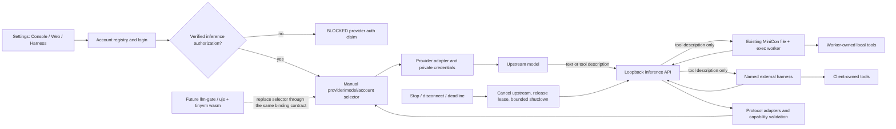

# Harness settings and local model gateway

Parent: [0.2.x horizon](PRD_02_31_v0_2_horizon.md). Product boundary:
[charter](PRD_02_23_minicon.md). Sequence:
[0.2.23 plan](../plan/plan-v0.2.23.md). Status: `[-]` implementation active;
existing harness/browser mechanisms are inputs, not qualification of this feature.
Account-auth implementation is now in progress; the owner goal authorizes
development through public 0.2.23 without changing the evidence requirements.

This module owns Harness settings, provider account identity and authentication,
the local inference API, and the selection seam for a future `llm-gate`.
The existing worker's file/exec authority remains in the parent module.

## Outcome tree DAG

```text
Outcome: connect a model account once and use it from MiniCon's worker or a compatible local harness
├── [-] SETTINGS — Console / Web / Harness in the existing settings panel
│   invariant: one Harness route presents listener, accounts, selected model and connection instructions
│   evidence: public route/focus/state/pixel journey, including a narrow window and failed save
│   safe failure: keep the prior configuration and terminal draft; show a local actionable error
│   dependency: workspace controls and additive PRD 26 observations
│   non-goal: another settings window or an agent workbench
├── [-] AUTH — DeepSeek and OpenCode provider identities and usable credentials
│   invariant: flow availability follows the verified initialization contract; AccountReady requires successful real inference
│   evidence: dated official contract plus real login/inference/logout and expiry/refresh where the provider supplies them
│   safe failure: unavailable authentication is BLOCKED; no fabricated OAuth endpoint or successful-login badge
│   dependency: provider feasibility probe, private platform storage and browser presentation when required
│   non-goal: calling API-key entry, website cookies or Console MCP authorization model-inference OAuth
├── [-] POOL — small account registry and manual selection
│   invariant: an explicit provider/model/account binding stays fixed for a conversation
│   evidence: two isolated accounts, manual switch, disabled/missing account and continuation refusals
│   safe failure: explain which binding needs repair; never silently use another account or provider
│   dependency: AUTH and a typed selection contract
│   non-goal: automatic rotation, load balancing, fallback chains or quota scheduling
├── [-] API — explicit process-lifetime loopback model endpoint
│   invariant: OpenAI Chat Completions and Anthropic Messages expose model inference only
│   evidence: authenticated text/tool/SSE/cancel round trips and unauthorized/port-conflict/stop black boxes
│   safe failure: bounded protocol-shaped error, cancellation and release of the account lease
│   dependency: POOL, protocol adapters and bounded native HTTP streaming mechanisms
│   non-goal: file/exec endpoints, remote tasks, LAN access, daemon or protocol-completeness claims
├── [-] WORKER — reuse the existing file + exec harness through the model API
│   invariant: local root/command policy and task lifetime stay with the worker
│   evidence: real model -> tool description -> worker execution -> tool result -> final answer; negative tool courts
│   safe failure: missing account or API does not start a tool; cancel/limits reap owned descendants
│   dependency: API and worker budget/output/lifecycle repairs in the parent module
│   non-goal: a second agent loop or treating exec's cwd as a filesystem sandbox
└── [-] CLIENT / FUTURE SEAM — one named external client and replaceable selection
    invariant: compatibility names client/version/protocol/model; selection returns a binding, not execution authority
    evidence: one real external tool/SSE/cancel journey and a fake selector substitutable without codec changes
    safe failure: unsupported client/capability is explicit and unqualified
    dependency: API and frozen selection seam
    non-goal: all CLI/TUI compatibility, implementing llm-gate, or embedding ujs/tinyvm in 0.2.23
```

## Memory palace



## Decisions and first delivery

Owner direction, 2026-10-24: add Harness beside Console and Web, configure a
local API port, support OpenAI and Anthropic model protocols, and start a
provider-pool with DeepSeek and OpenCode account login. Subsequent narrowing:
**first make the path work**; a future `llm-gate` may schedule through the
owner's ujs + tinyvm (wasm) dynamic engine.

The first delivery is a small connection product: connect an account, choose
one model/account, start the endpoint, copy a connection recipe, and complete
a tool-using task. The pool is an account collection with explicit selection.
No scheduler or script engine is needed to demonstrate that outcome.

**Transport decision:** HTTP is the model interchange for external clients.
CLI commands manage or run that same product capability; they do not spawn
another agent CLI for each inference request. Reusable Rust request/event and
selection interfaces sit below HTTP. Initially the built-in worker consumes
HTTP too, making the shared path observable; later an in-process consumer can
reuse the interfaces without a different credential or selection policy.

The provider gateway is a new, narrowly admitted model-listener capability.
It does not inherit the GUI control endpoint's tab authority and cannot call
the worker's tools. MiniCon still has no agent manager or remote execution
service. An inference response describing a tool never authorizes its execution.

### Planned CLI connection and legacy behavior

The first implementation adds `minicon provider serve [--port <port>]` for
foreground headless serving. GUI Start and this command use the same service
composition; startup does not discover/kill another instance or auto-select a
different port. Provider management initially stays in Harness settings rather
than adding a second account editor to the CLI.

The existing worker gains an explicit gateway mode:

```sh
minicon harness --root <path> --task "<task>" \
  --gateway http://127.0.0.1:28789/v1 \
  --client-key-env MINICON_LOCAL_API_KEY --allow-cmd <name>
```

Gateway worker flags, foreground serving and settings/server composition are implemented; account-backed and final native qualification remain in progress. The real CLI fixture `gateway_worker_runs_its_own_tools_and_refuses_changed_resume_binding` verifies native HTTP, both worker-owned tools, key exclusion from exec, persisted binding and changed-binding refusal against a controlled model peer. This does not establish a real OAuth account or hosted inference. Gateway mode validates a
literal IPv4 loopback URL, requires the named client-key environment variable,
and resolves model/account through that key's client profile. No credential
value belongs in argv. Explicit `--backend` and `--gateway` are mutually
exclusive; absent `--gateway`, legacy backend/env behavior stays unchanged.
`--root`, `--allow-cmd`, `--session` and `--continue` retain their worker meaning.
There is no implicit listener start or fallback to a legacy upstream when the
gateway is unavailable. Bind the worker's session to the client profile and
provider/account/model identity; continuing it with a different binding is a
typed refusal, never an unnoticed provider change. The child exec environment
does not inherit the local client key.

## Settings and first-use journey

All three routes stay in the existing settings panel. Console retains terminal
and current shared preferences; Web retains browser/proxy preferences. Harness
owns these sections, in order:

| Section | First-delivery behavior |
| --- | --- |
| Local API | Stopped/listening/error status, numeric port, explicit Start/Stop, actual base URL and last bounded error |
| Provider accounts | Add DeepSeek/OpenCode, account label and auth method, login/cancel/reconnect/remove, readiness and selected account |
| Model | Provider-qualified model ID, explicit account, capability badges derived from the adapter, Apply |
| Connect a client | OpenAI/Anthropic base URLs and a versioned recipe for the client actually qualified; create/copy/revoke a local client key |

First use: Harness -> Add provider -> supported login -> select model/account
-> Start -> copy recipe -> run the existing worker or the qualified client.
Enable Login once the supported initialization contract is established; keep
account readiness pending until its real grant and inference probe succeed.
Never use guessed endpoints or a successful-login badge for an anonymous
challenge. The first connection uses provider-generated labels plus a stable
short account ID to distinguish accounts from the same provider. Custom label
editing is deferred; diagnostics use opaque account IDs.

Settings opens without a listener, account probe or paid model request. Saving
configuration does not start the service. A deliberate Connect/Test action may
perform a small, disclosed inference probe. Provider failures remain in this
route and do not interrupt terminal input or page navigation.

Use the existing bounded editor, menu, focus and short-window scrolling seams.
Secrets remain masked, absent from snapshots and diagnostic exports. Copying a
new local key is an explicit action; connection recipes contain a placeholder
or environment-variable reference, never an upstream credential.

## Listener lifecycle and local client credentials

- Bind **`127.0.0.1` only**, using port **28789** as the proposed initial
  editable default. Valid ports are 1024..65535; the displayed URL uses the
  actual bound port. This is a design default, not a claim that the port is
  free. No wildcard bind, LAN mode, tunnel, browser CORS grant or port search.
- States: `stopped -> starting -> listening -> draining -> stopped`; startup
  and runtime failure enter `error` with a retry action. Start validates the
  configuration and at least one usable binding before accepting inference.
- Changing the port requires Stop first; while listening the field explains
  that step and is not editable. Save the validated port atomically, then
  explicitly Start. A failed save retains the previous configuration; a bind
  conflict stays stopped/error on the chosen port. No live port migration or
  silent endpoint change is needed for the first delivery.
- The GUI owns the listener until its process exits. Closing Settings does
  not stop it; detach/reattach follows process lifetime. A new GUI launch
  always starts stopped, even when the port/accounts are persisted.
- Headless `minicon provider serve` is the same server in an explicitly run
  foreground process. It uses stored accounts without creating or initializing
  a WebView or GUI; it
  neither attaches to nor starts a second GUI-owned server. A duplicate bind
  fails clearly. Ctrl+C, Stop and process shutdown cancel active work.
- Every inference and model-list request requires a locally generated client
  key, independent of upstream credentials. Accept Bearer authorization on
  OpenAI routes and `x-api-key` on Anthropic routes. Keys identify a local
  client profile and its selected binding; compare without logging the secret.
  Revocation rejects new requests; active requests drain or cancel within the
  same stop bound. An invalid key never reaches an upstream or any tool.
- Check Host against the bound loopback authority, reject browser-origin
  requests, and do not serve credentials/configuration over model HTTP. Local
  management remains a separate private CLI/GUI control path.

Initial engineering ceilings, to be measured before release: 8 concurrent
requests globally, at most 2 per account, a 16-entry admission queue with a
15-second wait, 16 MiB JSON request bodies, 1 MiB individual stream events,
32 MiB aggregate response bytes, 120-second upstream inactivity and a
10-minute total request deadline. Stop/drain is at most 5 seconds, then cancel.
Admission rejects before allocating beyond its bound. These are model-service
limits, not the worker's shorter exec timeout. Terminal rendering must not
wait on network, refresh, JSON parsing or admission work.

## Provider-pool v0: identity, login and selection

### Provider contract

Each registered provider declares its stable ID, service identity, upstream
base/path rules, available auth methods, model IDs and per-model capabilities.
Credentials are bound to that provider/service, not generic interchangeable
bearer strings. First delivery uses built-in typed adapters, not downloadable
plugins or executable configuration. Zhipu/GLM and Kimi are future adapters;
their OAuth methods are not presumed from another vendor's login UI.

An account has an opaque ID, provider/service ID, display label, credential
reference and state: `disconnected`, `authorizing`, `ready`, `refreshing`,
`needs_login`, `error`, or `disabled`. `ready` requires the intended inference
grant, not merely successful page navigation. Model/protocol incompatibility
is a route error, not a reason to mark every credential invalid.

For OAuth, verify authorize/token endpoints, actual client identity rules, scopes,
redirect or device-code rules, token audience, expiry and refresh/revocation
behavior according to the provider's real contract. Use state, PKCE S256 where the provider supports
the code flow, one-shot callbacks and a 180-second cancellable login deadline.
The device prompt shows the remaining effective deadline, capped by both the
local attempt and the provider expiry.
The callback listener is separate from the model port and closes on timeout,
cancel or exit. Browser presentation stays in MiniCon's browser tab; an
unsupported embedded-browser flow is explicitly unavailable. Existing WebView
tests do not substitute for a provider-supported authorization contract.

For expiring grants, refresh only for an active authorized operation, coalesced per account, and
retry an expired credential once if the provider permits. Failed refresh
requires reconnect; no background refresh timer or automatic account switch.
DeepSeek's documented account grant is opaque until rejected and has no
expiry/refresh operation; do not invent one. OpenCode device grants have an
expiry and refresh token. A public client ID is an identifier, not a secret or
evidence that independent registration is required.
Late login/refresh completion cannot recreate a removed account. Disconnect
removes local credentials and attempts provider revocation where supported;
report local removal and remote revocation separately. A cancelled or failed
local removal releases its temporary admission block only if the account still
exists; it cannot recreate credentials or change the selected conversation.

Persist non-secret configuration separately from a private credential store,
using the platform's protected directory, bounded no-follow read and atomic
private-write mechanisms. This first delivery does not claim hardware-backed
storage. Logout, save failure, restart and migration must preserve isolation;
never import other agents' credential files automatically. Existing API-key
environment overrides remain explicit legacy inputs and are not silently
added as pooled OAuth accounts.

### Manual pool policy and conversation binding

Store at most 16 provider accounts. The first connection exposes one local client profile, `default`, with explicit create/copy/revoke of its independent key. The schema ceiling is 8 profiles; multi-profile creation and editing are deferred until needed by real client recipes.
Each client profile selects exactly one `{provider, account, model}` binding.
Its generation also pins the selected catalogue route identity, native protocol,
endpoint and configured non-secret headers. Changing that route invalidates old
conversations even when its wire model ID is unchanged; unrelated catalogue
edits do not invalidate the current route.
The model listing shows only compatible configured routes for that profile;
unknown models fail instead of choosing a default that sends data elsewhere.
Changing a profile affects new conversations. Existing conversations never silently migrate: the first connection rejects continuation after a changed binding; disabling/removing that account makes continuation fail with
reconnect/new-conversation guidance.

Recipes for qualified clients supply a stable session identifier, mapped to
a generated upstream session ID without forwarding arbitrary client headers.
For hosted OpenCode Go, send the provider-required session header through
the adapter. Never reuse the existing one-global-session constant for every
client. A client without a stable session signal is limited to a dedicated
fixed account profile; do not claim arbitrary continuation or live switching.
Routing metadata is process-local and capped at 256 entries, including the
dedicated no-session slot. A full table refuses new conversations; it does not
evict old bindings and silently recreate their upstream sessions. Mappings
expire on process exit or client-key replacement, whose generation also changes.
No prompts or tool transcripts are persisted by the gateway. A restart loses
gateway session mappings and requires a new conversation for session-dependent
providers. The qualification recipe must expose this limit.

No automatic failover in v0: rate limits preserve the same account and return
retry guidance; ambiguous delivery, partial SSE output and tool results are
never transparently replayed. This keeps the first path deterministic while
leaving scheduling to the later llm-gate.

### Future llm-gate seam

Separate `ModelRequest`, `ModelEvent`, `ProviderAdapter` and a `RouteSelector`
contract. `RouteSelector` receives client/session identity, requested model,
required capabilities and redacted account availability; it returns a validated
account/model binding or a typed refusal. The current implementation is manual.
The host validates every returned binding against the client's allowed routes,
account state and capability matrix, including after future engine decisions.

Future ujs + tinyvm (wasm) can implement selection through a bounded host-call
adapter. The engine receives opaque account handles and metadata, not raw
tokens, arbitrary sockets, filesystem access or tool execution. Cancellation,
credential use, HTTP and leases remain host-owned. No runtime dependency,
wasm ABI, scheduler, engine packaging or external engine API is added now.

## Protocol scope and client qualification

| Surface | First delivery | Follow-on / explicit limit |
| --- | --- | --- |
| `GET /v1/models` | Authenticated configured model IDs with capability filtering | No claim that all upstream catalog entries work with both protocols |
| `POST /v1/chat/completions` | OpenAI text, role history, function tools/results, non-stream and SSE | Reject unsupported modalities/fields that change meaning |
| `POST /v1/messages` | Anthropic text blocks, system input, tool_use/tool_result, non-stream and SSE | Preserve the supported version/error/event shape; no fabricated token counts |
| `POST /v1/responses` | Not required for the initial connection slice | Required before claiming Codex compatibility; separate typed items, function and streaming evidence |

Translate only the advertised common capability subset. Preserve tool call IDs,
argument JSON, result linkage, ordering, stop/finish reasons, supported usage
and incremental SSE event framing. Unsupported semantic fields fail before
upstream dispatch; documented harmless metadata may be ignored. Usage absent
from the provider is absent/unsupported, not an invented exact count. Native
same-protocol forwarding is preferred where semantics match; translation must
not manufacture hidden reasoning or omit required continuation blocks.

When the provider/model cannot preserve required tool or reasoning state for
the requested client protocol, that route is unavailable. The initial scope is
text plus function tools, with bounded parallel tool-call descriptions; the
caller executes them. No multimodal, server-side conversation storage,
embeddings, audio, web search, batch or generic API proxy is promised.

The server propagates disconnect/cancel and bounds backpressure. Before SSE
headers it returns a protocol-shaped error; afterward it uses that protocol's
error/termination rules and never appends an unrelated JSON success. It must
not buffer the entire response to fake streaming. No automatic request replay.

Qualify **the built-in worker plus one named external client**, choosing a
local client with an actual configurable compatible endpoint (Pi is the first
candidate). Record the client version, configuration, provider/model, auth
method, protocol, text/tool cycle, streaming and cancellation observations.
Both protocol adapters need black-box evidence even if the first client uses
only one. Codex requires Responses evidence, and is a follow-on connection
target rather than a Chat Completions compatibility claim. Cursor IDE's
documented backend routing prevents assuming that its requests can reach this
machine's loopback listener; keep it unqualified. Identify a concrete Grok CLI
implementation before planning its adapter. Do not expose the server publicly
to make an unqualified client appear compatible.

## Authentication research and current implementation gaps

Research date: 2026-10-24. Working product interpretation is **DeepSeek model
API** and **hosted OpenCode Console/Go inference**, matching the existing
backends' intended role. The OpenCode agent's headless server is a different
agent/session API and is not a raw provider substitute. This interpretation
does not establish either vendor's OAuth support.

| Subject | Confirmed input | Consequence |
| --- | --- | --- |
| DeepSeek | [Official account implementation](https://github.com/deepseek-ai/deepseek-harness/blob/22ddee3792402c3e70ec5f86a63c3e3e895a2f60/packages/credentials/deepseek-account-platform/src/index.ts) supplies auth_init/auth_exchange/cancel with PKCE; the separate API-key path uses Bearer | Anonymous auth_init with MiniCon metadata returned a successful business envelope and official authorize URL; user grant and inference are still unqualified |
| OpenCode | [Official device flow](https://github.com/anomalyco/opencode/blob/20a6cc72917586eb5314be075f96dbb21d16c480/packages/core/src/plugin/provider/opencode.ts) supplies device authorization and refresh; external API-key and MCP paths are distinct | Anonymous device initialization accepted client_id=minicon and returned a challenge; user grant and inference are still unqualified |
| OpenCode service identity | The same guide distinguishes hosted inference plans, native model protocols and stable Go session headers; free chat models are limited to OpenCode | Verify the chosen hosted endpoint, account entitlement and model, not a guessed local agent server |
| Codex | [Official custom provider configuration](https://developers.openai.com/codex/config-advanced/) includes Responses wire configuration | Chat Completions alone does not qualify this client |
| Cursor IDE | [Official API-key routing](https://cursor.com/help/models-and-usage/api-keys) sends requests through its backend | Loopback reachability is unproven; no first-delivery compatibility claim |
| Pi | [Official custom model configuration](https://github.com/earendil-works/pi/blob/main/packages/coding-agent/docs/models.md) provides configurable provider APIs | A candidate for first external qualification, not completed evidence |

Anonymous probes created no logged-in account and did not exchange a token or
call inference. The DeepSeek anonymous attempt was cancelled. These observations
remove the earlier assumption that MiniCon must first obtain a separate
registration before even starting login; no official restriction supporting
that requirement was found. A client-name denylist would be an invented gate.

The DeepSeek account adapter must use its documented account inference header
and Anthropic endpoint, rather than relabeling the legacy Bearer codec as OAuth.
[Official account inference implementation](https://github.com/deepseek-ai/deepseek-harness/blob/22ddee3792402c3e70ec5f86a63c3e3e895a2f60/packages/llm/llm-deepseek-account/src/index.ts)
owns the upstream protocol input; adapters still need real qualification here.

OAuth remains the requested account experience. Feasibility work must either
produce supported inference authorization or return a documented unavailable
result. Existing explicit API-key mode can validate transport while this is
open, but it does **not** complete the OAuth leaf or silently replace that
requirement. If both requested OAuth paths remain unavailable, report that
scope before choosing a release; do not label the desired connection delivered.

Source audit, not a new runtime receipt:

- `src/harness.rs` already runs file/exec and bounded persisted sessions;
  `harness_wire.rs` and `harness_opencode.rs` already contain provider codecs.
  The gateway composes `provider_protocol.rs` single-turn conversion and the
  shared streaming HTTP transport, while file/exec stays in the worker. Calling
  `run_task` inside the gateway would incorrectly transfer tool authority.
- The previous GUI DeepSeek prototype used unverified generic authorize/token endpoints and an independent callback/exchange lifetime. The product shortcut `Ctrl+Shift+D` now invokes the same Harness account-login coordinator as Settings; the old product bridge and detached exchange are retired. Shared minicon-web APIs remain available to their existing consumers. The direct legacy worker may still read an already-existing private bearer file (parent owner); new account grants are isolated in the provider store and never silently fed into that legacy codec.
- The legacy OpenCode worker codec retains its own direct-backend contract.
  The gateway instead resolves model identity and endpoint from the authorized
  official catalogue; historical direct API-key receipts cannot certify that
  separate hosted endpoint or OAuth.
- Worker source findings, limits and required repairs are owned by the
  [parent's worker requirements](PRD_02_31_v0_2_horizon.md#worker-requirements-for-the-first-gateway-connection).
  The shared API path depends on those cancellation, output, credential
  isolation and descendant-cleanup proofs, without moving tool authority here.

### Public observation of authorization pages

Actual authorization navigation and the interactive address bar retain their
necessary query values. Public CLI snapshots, tab listings, host notices and
OS window titles expose a fixed authorization title and only the known page
origin/path, with an explicit redaction marker. This covers current DeepSeek
and OpenCode authorization/completion pages, the new loopback callback and
known historical MiniCon callback paths. Ordinary page query strings retain
their existing browser semantics. Device codes stay in the expiring interactive
prompt and explicit user clipboard action; neither codes nor grant/client keys
are included in public observation metadata.

### Scoped first-connection development evidence

- [v] The gateway worker preserves its own file/exec authority and refuses a changed resume binding against a controlled model peer.
  `minicon_harness::gateway_worker_runs_its_own_tools_and_refuses_changed_resume_binding`
  runs the actual native CLI through loopback HTTP, real file and exec tools,
  tool-result delivery, key exclusion from exec and persisted resume identity.
  Removing the binding guard made the changed-account invocation exit 0 rather
  than 2; the real CLI journey passed again after exact source restoration.
  This is a model-peer fixture, not OAuth or hosted-model inference evidence.
- The pinned real **Pi 1.4.0** CLI passed
  `provider_server::tests::external_pi_1_4_0_uses_real_gateway_sse_and_usage`:
  actual client -> actual Gateway -> controlled loopback upstream, final text
  `MINICON_PI_OK`, stop, input/output usage 7/3, total 10, exit 0. Package tag
  and npm provenance bind source `4a080252f06caf63a525d7873c5d94d3c23887e0`.
  This names client/protocol compatibility on Windows x86_64; its upstream was
  synthetic and it does not establish account authorization or the separate
  live tool/cancel courts. The explicitly ignored court fails BLOCKED when its
  pinned local dependency is unavailable.
- A Windows x86_64 private-console foreground probe drove the actual
  `provider serve` executable with synthetic stored-ready data, authenticated
  `/v1/models`, verified attachment to its isolated parent console, and sent
  native `CTRL_C_EVENT`. The process exited 0 in 0.063 seconds and its port
  could be rebound. Receipt `native-windows-private-console-CTRL_C_EVENT`
  identifies development bytes `a88240ae42accae661e9222cee62ac59cfe8b1274842aaafd24cd441ddb1def4`.
  This proves foreground stop/cleanup on that host, not a provider grant or
  upstream inference cancellation; the latter retains its separate courts.
- Actual DeepSeek GUI initialization reached the official authorization page
  after fixing host BCP47 locale conversion at the provider boundary. The prior
  build failed before transport with InvalidInput; the corrected native build
  initialized the flow and rendered the official origin/path. User grant and
  inference remain pending. Public observations redact its query and fragment.

## Evidence and documentation closeout

Provider delivery rows remain `[-]` until account-backed and selected native
courts qualify them. Windows x86_64 development checks: the `provider_` filter
ran 60 passing tests and reported the separately invoked Pi court ignored;
the worker filter ran 36 passing tests; the HTTP filter ran 40 passing tests.
Four public Harness settings journeys and the public authorization-URL
redaction journey also passed.

Eleven guard removals each produced a real runtime assertion failure, followed
by exact byte restoration: model/tool budgets, exec environment, SSE error,
usage/content preservation, typed cancellation, CLI port-save confirmation,
failed/cancelled account-removal recovery, full selected-route identity and
effective device expiry. The latter four use
`provider_cli::tests::failed_port_save_never_starts_old_listener_and_same_port_needs_no_write`,
`provider_runtime::tests::removal_cancel_and_failure_restore_only_the_still_stored_account`,
`provider_server::tests::selected_full_route_identity_invalidates_binding_but_unselected_changes_do_not`
and `provider_login::tests::device_challenge_uses_the_actual_attempt_deadline_and_can_cancel_immediately`.
These are controlled mechanism/input fixtures, not real account authorization.
Unavailable provider authorization or native courts are `BLOCKED` for their exact claim. Register evidence and public
command identities only when implemented; design prose does not change machine
truth or advertise nonexistent commands.

Required acceptance: failed saves preserve state; listener conflict/stop/restart;
unauthorized requests have no upstream/tool effect; OAuth invalid state, timeout,
cancel, refresh and removal races; account isolation/manual binding; actual text,
tools, SSE and cancel for both protocols; worker global limits and descendant
cleanup; one real external client; native settings focus/secret redaction on
each claimed OS/ISA; bounded idle/active cost and artifact size. For new guards,
prove the corresponding public assertion fails when the guard is removed.
Use isolated synthetic credentials for mechanism courts and real supported
accounts only for separately identified provider receipts; never commit secrets
or prompt/tool transcripts. Qualification and publication remain with PRD 27/32.

### Native Harness input checkpoint

The unsigned Windows x86_64 pack/input checkpoint indexed by
[the controls owner](PRD_02_25_02_browser_controls.md#exact-unsigned-windows-native-input-checkpoint)
also observed physical Console/Web/Harness route changes, independent native
port/model drafts, unchanged saved binding before Submit, and explicit local
key creation/revocation with no key in public snapshots or receipts. Its
`harness-routes-fields-and-redaction` row passed; the overall court remains
BLOCKED on fixture clipboard restoration. It attempted no account login,
provider inference or listener activation, so the real-grant frontier above
is unchanged. Pixel review and final-source qualification remain separate.
