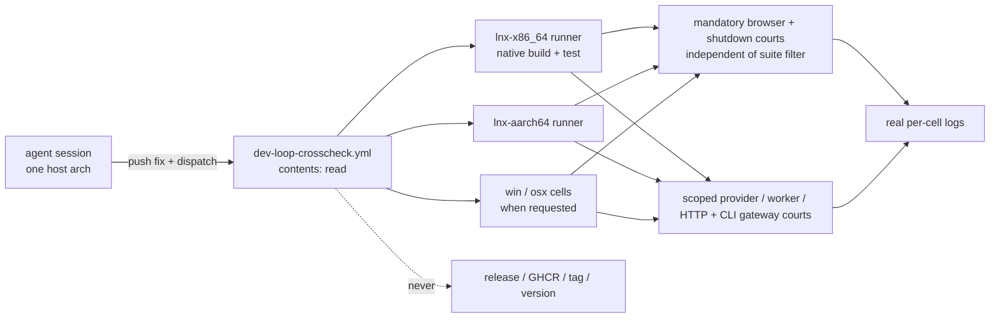

# Cross-arch dev-test loop for an agent session (`dev-loop-crosscheck`)

Owner of `.github/workflows/dev-loop-crosscheck.yml`. This is a narrower,
separate mechanism from the release pipeline in
`prd/PRD_02_27_con_delivery.md` — read that module for how release evidence,
the six-cell build and GHCR publish work. This module owns only the
recurring dev-loop need: an agent session (typically Linux-only, with no
osx/win host of its own) that must develop a cross-arch fix and prove it
against a real runtime, using nothing beyond default GitHub Actions access.

## Map

```text
dev-loop-crosscheck — agent cross-arch dev/test loop
├── Problem: a cloud session can reach only its own host's architecture
├── Non-goal: never a release-evidence path, never publishes, never needs write
├── Mechanism: GitHub-hosted native per-cell build + test on request
│   ├── inputs: ref, cells, test_filter
│   ├── core and UI library tests, including each native ISA kernel
│   ├── isolated minimal consumer; no workspace feature leakage
│   ├── [-] provider / worker / HTTP mechanism and real CLI gateway courts (0.2.23)
│   │   invariant: each named native scope actually executes its selected tests
│   │   evidence: per-cell suite logs; first hosted dispatch of added scopes pending
│   │   safe failure: fail that cell and retain logs; absent authorization stays unqualified
│   │   dependency: first-gateway source and native build; non-goal: OAuth entitlement or release receipts
│   ├── [v] mandatory browser artifact and shutdown-response courts, independent of test_filter
│   └── permissions: contents: read only
├── Permission walls, disambiguated from the release / GHCR / local-artifact paths
└── Validation record (real hosted runners, run 36313213803)
```



## Problem and non-goal

A cloud coding session can reach only its own host's architecture directly.
Reproducing or fixing a bug that only shows up on another cell (Windows,
macOS, or even a different Linux ISA) needs a real run on that cell, not a
cross-compiled guess. The existing courts do not fit this recurring need:

- `six-grid-cloud-build.yml` already compiles natively per cell in CI, but is
  wired to the release-evidence receipt/identity path and a GHCR publish that
  requires all six cells and `packages: write` — the wrong shape for "build
  and test one or two cells while iterating on a fix."
- `local-artifact-probe.yml` needs a pre-built bundle behind a release asset,
  which needs release-create/upload rights this kind of session does not
  have (see "Permission walls" below).

Non-goal: this mechanism never becomes a release-evidence path, never
publishes anywhere, and never needs `packages: write` or `contents: write`.
Compiling here is for development feedback only, never a substitute for the
exact-source qualification `prd/PRD_02_27_con_delivery.md` owns.

## Mechanism: `.github/workflows/dev-loop-crosscheck.yml`

Push a fix to `main`, dispatch this workflow, and each requested cell builds
and runs the real test suites natively on its own GitHub-hosted runner —
the same "compile on the cell that will run it" pattern
`six-grid-cloud-build.yml` uses for release, minus its GHCR publish and
receipt/identity bookkeeping. Only `permissions: contents: read`. No GHCR
token, no release, no new tag, no local cross-compile or transfer step.

Inputs: `ref` (defaults to the dispatched branch), `cells` (space-separated;
empty runs the four non-macOS cells — macOS runners bill roughly 10x Linux
and queue longest, so opt in explicitly with `all` or the `osx-*` names when
a macOS-specific question needs it), `test_filter` (a Rust test-name
substring, applied to ordinary suites; the mandatory courts below stay active).

Per cell: `cargo build --locked --workspace --all-targets --target <triple>`,
then each suite is run with `cargo test --locked --target <triple> --test
<name>` (`-p minicon-core` for the crate's own unit tests) — **not** a
guessed path under `target/<triple>/debug/<name>`. Cargo integration/unit
test binaries live hashed under `target/<triple>/debug/deps/`; a workflow
that stats a guessed path and treats "not found" as "nothing to run" reports
a false green with zero suites executed. This is not hypothetical: it is
exactly what happened and was caught below.

### First-gateway development scopes (0.2.23)

Unfiltered runs additionally execute main-binary `provider_` and `harness::`
unit filters, platform `network_` with `network-http-stream,network-loopback`,
and the actual `minicon_harness` CLI gateway journey through the strict test lints in
`build.sh test-suite`. A filter containing `provider`, `harness`,
`network` or `gateway` selects its corresponding scope; the existing mandatory
browser/shutdown courts remain independent. The control integration target runs serially because browser-editor clipboard
and composer-image journeys share the native desktop and clipboard. Independent
mechanism suites retain their existing parallel test setting. The provider filter still reports
the separately invoked pinned-Pi court ignored; a green ordinary run does not
claim that external dependency executed.

Both macOS cells additionally run `scripts/retained-group-native-court.py`
for an unfiltered, provider, harness or retained_group scope. It exercises real
normal/zombie-only and leader-exits-first process groups, removes each actual
production guard in turn, requires a runtime assertion failure, restores the
exact source bytes and reruns both positive cases. Compiler failure or zero
selected tests is not counterevidence. Its finite logs and source-restoration
receipt join the cell output; this is a native mechanism court, not a VM lease.
The producer remains [the platform owner](PRD_02_28_shared_core.md).

These scopes exercise controlled model peers, worker-owned tools, routing,
streaming and cancellation mechanisms. They cannot establish a real account
grant or hosted inference entitlement. Those delivery claims remain with
[the gateway owner](PRD_02_31_01_provider_gateway.md). The first hosted run of
these added scopes is pending; earlier six-cell receipts predate them.

**Local Windows x86_64 development gate (2026-10-25).**
`build.sh test -- --test-threads=1` completed the workspace and both owned lexer
forks with exit 0; the runner summaries reported 1691 passed and 82 ignored.
The original full attempt exposed two control-release regressions; the restored
complete gate passed both unchanged journeys after the host-routing fix.
This is local development qualification. Ignored native/network courts and
credential-gated legacy tests do not establish account authorization, live
inference, another OS/ISA or final release bytes. Named first-gateway and
external-client scopes stay with their product owner above.

The 0.2.21 browser stage qualifies a canonical native artifact and records its
byte identity, native browser test and public-CLI journey, independently of the
optional suite filter. Product behavior belongs to
[PRD 25](PRD_02_25_con_workspace.md); release-artifact qualification remains
with [PRD 27](PRD_02_27_con_delivery.md).

The shutdown-response court also ignores that filter. It runs
`control::shutdown_response_tests` through `build.sh test-suite --bin minicon`,
requiring exactly four passed tests on Windows and three on Unix, with no
failed or ignored tests. The passing receipt includes
`probe-logs/control-shutdown-response.log`; failure logs retain it too.
[PRD 26](PRD_02_26_con_control_cli.md) owns response lifetime and bounds.
**2026-10-24 qualification.** [Run `40003029035`](https://github.com/partnernetsoftware/minicon/actions/runs/40003029035),
at exact source `329a30d7c64b9f1cd0c41f14cefcc53779b5f98e`, attempt 1,
completed all six cell jobs successfully. Each cell actually ran one explicit
native browser test, its public-CLI workspace journey and the required
shutdown-response count above, all with zero failed or ignored tests in those
mandatory courts. The six downloaded `crosscheck-receipt-<cell>-attempt-1`
artifacts were independently checked for source/cell/status and exact log
summaries; both macOS ISAs supplied all four real window PNGs. Local inspection
confirmed the geometric Reload icon in both Mac captures.

This dispatch used `test_filter=browser_windows` for ordinary suites. Its green
suite labels do not certify unfiltered console/library coverage; that earlier
scope retains its separately named receipts below. These native development
bytes also do not replace PRD 27's final-source pack, signed or public bytes.
The host-injection and native page-focus acceptance boundaries remain owned
by [PRD 25](PRD_02_25_con_workspace.md#tab-kinds-and-content-panels).

From v0.2.21, each cell also runs the portable `minicon-console` library
(`--lib`) and its host-neutral integration tests `synchronized_presentation`
and `presentation_allocations`. An unfiltered run that logs `running 0 tests`
for one of those suites fails the cell. The Windows console service
(`minicon_console_agent`, `rust_console_pty`) stays inside `win-*`. Linux
cells additionally run the POSIX PTY session tests, the two native X11
clipboard unit tests, and `minicon_load_portability_linux`. After Xvfb is
up, the Linux job sets `MINICON_REQUIRE_DISPLAY=1`; an X11 test that would
have returned success with no `DISPLAY` fails instead. Those Linux suites
are not implied by a green macOS or Windows cell. Run `39917026302` at exact
source `3db5710` records all three portable-console suites `ok` on all six
cells and records `linux-pty`, `linux-x11-clipboard`, and `linux-elf-needed`
`ok` on both Linux cells. The PTY invocation names
feature `pty` and the X11 invocation names feature `clipboard`; omitting those
features compiles the target tests out, so the unfiltered nonzero-test guard
would correctly reject the court rather than certify a no-op.

That run is intentionally not presented as an all-green Windows-service
receipt: Windows arm64 passed every suite, while Windows x64 retained the two
known G6 unread-output `FreeConsole` failures in `rust_console_pty` (94 passed,
2 failed). All portable suites on that same x64 receipt passed. A red carried
debt court remains red; it does not erase the independently named portable or
Linux receipts and is not silently converted to a skip.

The Windows branch also owns a focused `windows-private-filesystem` suite from
v0.2.21. It runs `minicon-platform`'s `private_` library tests with feature
`filesystem` on both Windows ISAs and fails if Cargo reports zero tests. It is
independent of `test_filter`, like the minimal-reuse court: a focused product
rerun must not silently erase the native DACL evidence. This is the runtime
owner for the OAuth bearer's protected current-user-only directory ACL; it is
not permission to run every platform unit test in the dev loop.

Run `39919403513`, exact source `c09e999`, records that suite `ok` on Windows
x86_64 (6 seconds) and arm64 (8 seconds), with a nonzero test count on each.
Both overall jobs remained red solely on the two already-carried G6
`rust_console_pty` disconnect cases (94 passed, 2 failed per ISA). The
independent receipt therefore closes the ACL runtime claim without relabeling
or suppressing the service debt.

From v0.2.15 preparation, each cell also runs the UI-core library suite and
`scripts/check-reuse.sh`. The latter sets `CARGO_BUILD_TARGET` to the matrix
triple, checks minimal core/UI dependency edges in an isolated workspace and
executes the compatibility APIs with dead-code/unused-result warnings denied.
It is not filtered by `test_filter`: feature leakage must remain visible even
when a developer selects one Rust test. Its result is included in the same
per-cell structured receipt; it does not substitute for release artifacts.

Failure or a hang (`cancelled`, not just `failure` — the same gap fixed in
`local-artifact-probe.yml`, see `prd/PRD_02_27_con_delivery.md`) uploads
`probe-logs/*.log` via the same pinned `actions/upload-artifact` SHA used
elsewhere in this repo's workflows.

## Local per-host gates, and the ones that are not gates

Focus-dependent control journeys establish their intended UI focus before
asserting event routing. Failed CLI assertions include the attempted command,
so a transport timeout can be attributed to its actual operation rather than
treated as a generic slow start. A negative control is valid only if it reaches
the guarded behavior; an earlier setup failure does not prove that guard.

Windows clipboard journeys in the control executable share one clipboard lease
through seed, asynchronous completion and restoration; an image-paste journey
cannot replace another journey's text payload. This lease covers this executable,
not other processes or a user's desktop. The multi-tab host sends stderr to an
owned diagnostic file, reported on panic after host cleanup; its unread output
must not backpressure the host. Panic cleanup also reports the host's exit status
before termination, so an exited host and a live stalled host are distinguishable.

A local check that compiles nothing is worse than no check, because it reads as
green. Two were found by a release chain failing on code a local gate had
"passed" (0.2.7, 2026-10-13), so each is written down with the exact command
that actually compiles the code:

- **macOS platform code.** `adapters/macos/window.rs` includes the unix window
  host as `#[path = "../unix/window_host.rs"] mod window_host;` under
  `#[cfg(all(feature = "input", feature = "ime"))]`. A check that omits those
  features compiles no macOS window code and reports success. The working
  command, which the host can run without an Apple SDK because `cargo check`
  does not link:

  ```sh
  cargo check --target x86_64-apple-darwin -p minicon-platform \
    --features 'portable-pixel-window,input,ime'
  ```

  A `compile_error!` probe dropped into a macOS-only function is the way to
  prove the gate still reaches it.
- **Linux product code.** `cargo check --target x86_64-unknown-linux-gnu` stops
  in `ring`'s build script (no C compiler for the target). `cargo zigbuild
  --target x86_64-unknown-linux-gnu` with zig on `PATH` does compile and link
  the product, so it is the gate that covers `#[cfg(unix)]` product code.
- **The whole macOS product** cannot be compiled here: `ring` needs an Apple C
  toolchain. The platform-side gate above plus the CI macOS cells are the
  evidence; that is a limit to state, not a gap to paper over.
- **On Windows, building while a build of this tree is running** (recorded
  2026-10-14). Cargo builds the `minicon` bin as a dependency of any integration
  test that reads `CARGO_BIN_EXE_minicon` — `tests/minicon_alignment.rs` does —
  and Windows refuses to *delete* a running executable, so a MiniCon left
  running from `target\debug` makes the next `cargo test` die at `failed to
  remove file target\debug\minicon.exe — 拒绝访问 (os error 5)` before a single
  test starts. Renaming a running image is permitted, deleting it is not. The
  gate is a target directory outside the clone:

  ```sh
  CARGO_TARGET_DIR=<dir outside the clone> cargo test --locked --test <name>
  ```

  This is **not** a toolchain or registry wall: `reg query …\Windows Kits\
  Installed Roots` answers normally and the SDK `rc.exe` that `build.rs`'s
  `winresource` step needs is present, so `cargo check/test/clippy
  --all-targets` all compile and run on this host from a cold tree. An earlier
  revision of `plan/archive/plan-v0.2.8.md` mis-attributed this failure to a sandbox
  `reg.exe` blacklist; that cause was wrong and is withdrawn.

### Observed-state preconditions for black-box gates

`minicon_blackbox::controlled_wheel_moves_the_real_scrollback_offset_up_then_down`
historically failed on this Windows host for at least three releases:
`plan/archive/plan-repo-hygiene-2026-10-24.md` records it against the pristine tree, and
`prd/archive/v0.2.6-release-history.md` lists it as that release's one
pre-existing local-gate failure. Re-checked 2026-10-14 by A/B — it fails both at
the pre-0.2.8 commit `486cdd9` (viewport moves 2 lines) and on `main` (0–2), so
it is **not** a property of the 0.2.8 scrollback change.

What it actually is, measured rather than guessed: the journey prints 120 lines
and then sends `send-wheel … --notches 5`; `scroll_by` clamps with
`min(5, grid.scrollback.len())`, and on this host the live grid holds only 1–2
rows of scrollback at that moment even though the configured capacity
(`scrollback_len`) is 4000. 0.2.8 made this visible for the first time, because
`max_scrollback` in the snapshot now reports the real depth; before that change
it always read 4000 and so hid a wheel that had nothing to move.

Why the live grid retains so little is **not established**. The leading
hypothesis was that ConPTY repaints with absolute cursor addressing instead of
emitting the linear newline stream a POSIX PTY produces, so far fewer rows pass
through `Grid::scroll_up` and reach the scrollback — a hypothesis, not a
finding. In v0.2.15 preparation the fixture now observes individual
shell-expanded output markers until the snapshot proves at least five real
history rows exist. Only then does it send wheel input and assert the unchanged
5→3 offsets. This removes the unsupported burst-output precondition rather
than weakening the wheel assertion. Qualification and negative-control results
belong to the [archived 0.2.15 plan](../plan/archive/plan-v0.2.15.md) and
[release history](archive/v0.2.15-release-history.md).
Observe the fully edited command before sending Enter, then observe its
shell-expanded marker. Otherwise a fast shell can both edit the previous last
row and scroll between mirror samples, leaving no unchanged suffix from which
the screen-buffer mirror can infer the real scroll. The fixture's readiness
assertion retains its last snapshot on failure.
The multi-tab control journey uses the same observed-command preparation for
the inactive target before asserting its one-notch wheel receipt. A final marker
from a 1,200-line burst alone does not prove that the sampled mirror retained
history; its actual viewport row count bounds the required preparation.

The keyboard forwarding journey has the same observation-order requirement:
capture the cursor after typing `ABCDE` before sending either ArrowLeft. A
timed background journey could finish both moves before the first snapshot,
mistaking the final column for the starting column and asking for two further
moves. The fixture now sends both keys through the public control command only
after observing that baseline, and still requires exactly two columns of motion.
A one-key negative control must fail that assertion. This is a fixture repair,
independent of the post-release test-orchestration review.

The child-geometry resize journey also needs a native probe: Windows reads
`[Console]::WindowWidth/WindowHeight` through PowerShell; Unix reads this child's
tty through `stty size`. Invoking `powershell.exe` unconditionally produced an
empty pane and a timeout on both Linux ISAs and macOS ARM in run `39137777772`.
Keep the shared narrow/wide assertions and never substitute the host's own grid
size for what the child reports.

The Windows resize fixture compares the child's reported columns with the
actual host grid after each change, not a fixed 100-column threshold: the hosted
desktop can clamp a 1400-pixel request to an 88-column grid. First require a
smaller baseline containing only that width, then a larger host width accompanied
by fresh equal child output. PowerShell probes start after an interactive shell
executes an observed readiness marker, as in the throughput court; this does not
qualify the separate `-File` startup path.

Resize-event timestamps use a probe-local monotonic stopwatch. Determine the
settled size from the chronologically latest event and compare the earliest and
latest timestamps for that size; console repaint rows need not be chronological.
The same-size nudge still requires at least two events spanning 100 ms. The
product-nudge delay mutation must fail that assertion.

The shared PowerShell shell/probe-readiness budget is 60 seconds. In targeted
run `39139623345`, Windows ARM completes four of five regressions; the first
C# probe has not announced readiness at the old 30-second deadline, while a
later equivalent probe completes in about 25 seconds. Keep cold shell/compiler
startup separate from the nudge interval and from throughput performance floors.

### Gates that compile a path but cannot exercise it
A compiled path is not a working path. The same 0.2.7 release produced the
opposite failure from the ones above: a path that *did* compile on the one host
we can run, and still failed the moment it ran.

`minicon_platform::network_http`'s TLS layer is exercised by **nothing** in the
default suite — every test in it speaks `http://` to a loopback server — so the
suite can be green while `https://` panics. That is exactly what happened:
`ureq` picks its TLS provider at runtime and defaults to Rustls, the Windows
manifest enables only `native-tls`, and the product's first `https` call (the
new update check) died inside `ureq`. The fix pins the provider per host; the
finding is recorded in `plan/archive/plan-v0.2.7.md` and
`prd/PRD_02_25_con_workspace.md`.

The lesson is a category, not one bug: **an opt-in real-endpoint test is the
only gate for a network path whose default tests are loopback-only.** It must
be run by hand before a release, from `plan/archive/plan-v0.2.7.md`:

```sh
cargo test --bin minicon -- --ignored update::tests::the_real_release_api_still_parses
```

It stays `#[ignore]`d on purpose — CI must not depend on GitHub being reachable
— so nothing will ever run it for us. The Unix arm of the same fix is still
unexercised: no host here can execute a Linux/macOS binary, so it rests on
reading `ureq`'s own feature tree rather than a live call.

## First-gateway native findings (2026-10-25)

The initial unfiltered six-cell run
[`40110164630`](https://github.com/partnernetsoftware/minicon/actions/runs/40110164630)
at `891ad5f4c8ff00b40bc4585a289150964dfdcb90` failed; it is not qualification.
Both Linux cells passed provider, gateway CLI and HTTP courts but exposed a
nested exec failure. The diagnostic run
[`40111350019`](https://github.com/partnernetsoftware/minicon/actions/runs/40111350019)
at `cb0dc680d3de14edb48314792f27e2faa3ee5215` captured actual EAGAIN from the
second spawn under the UID-wide NPROC32 limit. Worker native policy belongs to
[PRD 31](PRD_02_31_v0_2_horizon.md#worker-requirements-for-the-first-gateway-connection).
Both macOS cells exposed zombie-group EPERM and two missing-root fixtures with symlinked
temporary ancestors; owned cleanup belongs to PRD 28 and private-file policy
is preserved. Both Windows cells' existing native queued-read/retirement
disconnect courts stalled despite their already serial execution; the next
source captures native FreeConsole/read-return stages and exact process exit,
without a larger timeout or removed assertion. Windows ARM additionally exposed
PROCESSOR_ARCHITECTURE after startup despite the explicitly cleared native
block. Its next fixture poisons the parent value and accepts only the exact
non-secret ARM64 pair; the actual value and native mechanism remain pending
that cell's rerun, and no provider/client secret may be inherited.
The next source must rerun its selected scopes before any release claim.

The local repair checkpoint passed strict Clippy, all eight offline script
self-tests and the canonical dangerous-lint main-binary gate (573 passed,
2 ignored, including one new version-producer case). The two Windows native
disconnect cases passed individually with rust-console/parent-console/runtime
features under the same dangerous-lint wrapper. Those local development scopes
do not replace either Windows CI cell or the required macOS/Linux reruns.

### Repair checkpoint and remaining native failures

Run [`40113098833`](https://github.com/partnernetsoftware/minicon/actions/runs/40113098833)
at `d40c4fd45543ea7e4e055d963d62bc2684a943ce` passed all 21 configured
suite rows on each Linux ISA, including the previously failing nested worker
spawn. Both macOS ISAs passed the owned-group positive cases, two actual
runtime guard-removal failures and byte-exact restoration; their raw logs and
receipts survived in the failed-job artifacts. The workflow now also retains
that directory in its success artifact, pending a new-source run.
The full Windows workspace and owned-fork gate at that checkpoint exited 0:
1692 passed / 82 ignored across 38 summaries. The separate native Microsoft
Pinyin preedit/commit test also passed on the interactive Windows x86_64 host;
this certifies that host fixture, not the three new browser fields.

Both macOS cells still failed the minimal-environment fixture because startup
added `__CF_USER_TEXT_ENCODING` after the explicitly cleared exec block. The
[Apple CF getter/writer](https://github.com/apple-oss-distributions/CF/blob/CF-1153.18/CFStringEncodings.c#L832-L955)
and [early initialization](https://github.com/apple-oss-distributions/CF/blob/CF-1153.18/CFRuntime.c#L851-L867)
explain this mechanism; that historical source is not a claim about the runner's
exact installed framework. The follow-up fixture supplies a valid UID-prefixed
parent sentinel, confirms it survived parent startup, then accepts only a strict
native three-component UID/encoding/region record in the child. A fourth field,
unknown key or provider/client sentinel still fails. No Unix process-global
environment mutation or production forwarding exception is introduced. Its
current-native proof remains pending.

Windows ARM passed its revised minimal-environment probe and all 36 selected
worker tests at this checkpoint; the production forwarding list is unchanged.

Windows queued-read failure now proves the owned probe is still inside
`FreeConsole` with one deferred text read. Retirement failure proves
`FreeConsole` returned but its reader is still admitted and has not returned.
These observations narrow the failure; they do not establish which server
notification was received or authorize a changed NTSTATUS/error allowlist.
The next diagnostic checkpoint must observe receive/retire/completion ordering
without changing the original deadlines or assertions.

The opt-in service trace is limited to 2048 records / 256 KiB per owned
session. Only the two failing fixture cases supply a command-local trace file;
creation is exclusive and failures preserve service behavior. Metadata names
receive/admit/defer/resume, process/object identities, admitted/deferred counts
and actual completion errors before existing cancellation normalization. No
console text or SDK buffer is recorded. The workflow copies at most four bounded
trace files into its ordinary evidence directory on every Windows outcome.
Both original cases pass locally with tracing. The focused Windows run
[`40115122092`](https://github.com/partnernetsoftware/minicon/actions/runs/40115122092)
at `c0fac4291c22b535154984dbe9ecbcdad46e8b39` retained both complete traces.
At the failure instant neither case had received DISCONNECT; records after the
panic belong to fixture cleanup and cannot establish that FreeConsole delivered
it. No speculative cancellation fix or error-code exception is justified.
The diagnostic filter `disconnect_stock` explicitly runs only the two existing
ignored queued-disconnect/read-retirement comparisons against installed system
ConPTY. A common SDK lifetime failure must be distinguished from a MiniCon host
failure before changing the implementation; ordinary product pass criteria and
original assertions remain unchanged.

Both macOS cells passed their focused provider and retained-group scopes in
[`40115118541`](https://github.com/partnernetsoftware/minicon/actions/runs/40115118541)
at the same source, with the raw guard/removal/restoration files now present in
the success artifacts. The subsequent interactive-login ceiling repair belongs
to PRD 31.01 and still requires final-source native qualification.

## Permission walls, disambiguated

The observations below describe the 2026-09-27 session, not a universal current
publication restriction. Current release authority and gate selection belong
to [delivery](PRD_02_27_con_delivery.md); 0.2.15's authorized public Promotion is
recorded in its release history.

Found and confirmed distinct while building this (2026-09-27); recorded here
because the framing had been conflated before being corrected:

1. `workflow_dispatch` on an existing workflow, and reading/downloading
   existing release assets — never blocked. This is why the mechanism above
   works at all.
2. Creating a release, uploading to one, or pushing a new tag — blocked by a
   Claude-Code client-side `[Auto-Mode Bypass]` classifier. A session-type
   policy, not a GitHub permission; not worth retrying through another tool.
3. Direct `ghcr.io` push using a sandbox's own token via `oras` — a genuine
   GitHub-side 401 (the token lacks `packages:write`), distinct from (2) and
   confirmed separately (network reachability to `ghcr.io` itself is fine;
   the challenge is a normal unauthenticated 401, not a proxy/network block).

None of the three gate cross-arch *testing* — only cross-arch *publishing*,
which this mechanism never needed. A future session finding itself blocked
on (2) or (3) while trying to test something should reach for this workflow
instead of trying to work around either wall.

## Validation record

- v0.2.15 source `0ac2d7ed1b3898835956f80569718c4d2eb994b9`, run
  `39142875932`: all six native cells pass their full configured dev-suite
  sets, including default UI and the isolated minimal consumer. Root/platform
  compilation is not a claim that every such unit executed on every cell;
  the separate canonical Windows workspace/fork gate and final artifact courts
  are scoped in [release history](archive/v0.2.15-release-history.md).
- Proposed selection/profile changes are owned by
  [test orchestration](PRD_02_33_test_orchestration.md), with implementation
  still planned. This module continues to describe the current native workflow.

- Run `36312887935` (`lnx-x86_64 lnx-aarch64`, commit `38ddba2`, first real
  dispatch): reported `success` in ~107s, but logs show the test-run step
  never executed a single test — the path-guessing bug above. Caught by
  reading job logs rather than trusting the green checkmark.
- Fixed in commit `da29abf`: `cargo test --target <triple> --test <name>`
  instead of a guessed path.
- Run `36313213803` (same two cells, commit `da29abf`): real execution
  confirmed from the logs — `minicon-core` 95/95, `minicon_blackbox` 28/28
  (including `nonexistent_program_via_dash_e_exits_cleanly_instead_of_hanging`),
  `minicon_control` 14/14 (including the process-group regression test
  `killing_a_process_group_also_kills_what_it_forked` from commit `2e789c4`),
  `minicon_throughput` 1/1, on both `ubuntu-24.04` and `ubuntu-24.04-arm`,
  ~3 minutes per cell, no hang, no `cancelled`. This is also the real-CI
  validation that closed the `minicon_core` process-group-teardown hang fix
  (`2e789c4`) on hosted runners, not only locally.

Full narrative and the owner-correction history that led here:
`plan/plan-carried-debt.md`'s G1 leaf (not archived — this module records
the accepted, standing mechanism; the plan leaf keeps the exploration
history that produced it).
