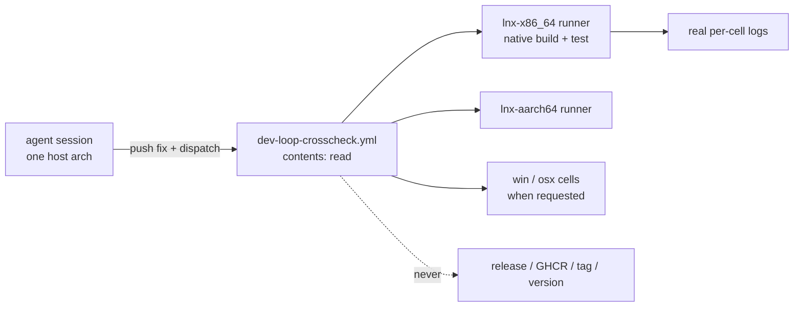

# Cross-arch dev-test loop for an agent session (`dev-loop-crosscheck`)

Owner of `.github/workflows/dev-loop-crosscheck.yml`. This is a narrower,
separate mechanism from the release pipeline in
`prd/PRD_02_27_con_delivery.md` — read that module for how release evidence,
the six-cell build and GHCR publish work. This module owns only the
recurring dev-loop need: an agent session (typically Linux-only, with no
osx/win host of its own) that must develop a cross-arch fix and prove it
against a real runtime, using nothing beyond default GitHub Actions access.

## Map

```text
dev-loop-crosscheck — agent cross-arch dev/test loop
├── Problem: a cloud session can reach only its own host's architecture
├── Non-goal: never a release-evidence path, never publishes, never needs write
├── Mechanism: GitHub-hosted native per-cell build + test on request
│   ├── inputs: ref, cells, test_filter
│   └── permissions: contents: read only
├── Permission walls, disambiguated from the release / GHCR / local-artifact paths
└── Validation record (real hosted runners, run 36313213803)
```



## Problem and non-goal

A cloud coding session can reach only its own host's architecture directly.
Reproducing or fixing a bug that only shows up on another cell (Windows,
macOS, or even a different Linux ISA) needs a real run on that cell, not a
cross-compiled guess. The existing courts do not fit this recurring need:

- `six-grid-cloud-build.yml` already compiles natively per cell in CI, but is
  wired to the release-evidence receipt/identity path and a GHCR publish that
  requires all six cells and `packages: write` — the wrong shape for "build
  and test one or two cells while iterating on a fix."
- `local-artifact-probe.yml` needs a pre-built bundle behind a release asset,
  which needs release-create/upload rights this kind of session does not
  have (see "Permission walls" below).

Non-goal: this mechanism never becomes a release-evidence path, never
publishes anywhere, and never needs `packages: write` or `contents: write`.
Compiling here is for development feedback only, never a substitute for the
exact-source qualification `prd/PRD_02_27_con_delivery.md` owns.

## Mechanism: `.github/workflows/dev-loop-crosscheck.yml`

Push a fix to `main`, dispatch this workflow, and each requested cell builds
and runs the real test suites natively on its own GitHub-hosted runner —
the same "compile on the cell that will run it" pattern
`six-grid-cloud-build.yml` uses for release, minus its GHCR publish and
receipt/identity bookkeeping. Only `permissions: contents: read`. No GHCR
token, no release, no new tag, no local cross-compile or transfer step.

Inputs: `ref` (defaults to the dispatched branch), `cells` (space-separated;
empty runs the four non-macOS cells — macOS runners bill roughly 10x Linux
and queue longest, so opt in explicitly with `all` or the `osx-*` names when
a macOS-specific question needs it), `test_filter` (a Rust test-name
substring, applied to every suite).

Per cell: `cargo build --locked --workspace --all-targets --target <triple>`,
then each suite is run with `cargo test --locked --target <triple> --test
<name>` (`-p minicon-core` for the crate's own unit tests) — **not** a
guessed path under `target/<triple>/debug/<name>`. Cargo integration/unit
test binaries live hashed under `target/<triple>/debug/deps/`; a workflow
that stats a guessed path and treats "not found" as "nothing to run" reports
a false green with zero suites executed. This is not hypothetical: it is
exactly what happened and was caught below.

Failure or a hang (`cancelled`, not just `failure` — the same gap fixed in
`local-artifact-probe.yml`, see `prd/PRD_02_27_con_delivery.md`) uploads
`probe-logs/*.log` via the same pinned `actions/upload-artifact` SHA used
elsewhere in this repo's workflows.

## Local per-host gates, and the ones that are not gates

A local check that compiles nothing is worse than no check, because it reads as
green. Two were found by a release chain failing on code a local gate had
"passed" (0.2.7, 2026-10-13), so each is written down with the exact command
that actually compiles the code:

- **macOS platform code.** `adapters/macos/window.rs` includes the unix window
  host as `#[path = "../unix/window_host.rs"] mod window_host;` under
  `#[cfg(all(feature = "input", feature = "ime"))]`. A check that omits those
  features compiles no macOS window code and reports success. The working
  command, which the host can run without an Apple SDK because `cargo check`
  does not link:

  ```sh
  cargo check --target x86_64-apple-darwin -p minicon-platform \
    --features 'portable-pixel-window,input,ime'
  ```

  A `compile_error!` probe dropped into a macOS-only function is the way to
  prove the gate still reaches it.
- **Linux product code.** `cargo check --target x86_64-unknown-linux-gnu` stops
  in `ring`'s build script (no C compiler for the target). `cargo zigbuild
  --target x86_64-unknown-linux-gnu` with zig on `PATH` does compile and link
  the product, so it is the gate that covers `#[cfg(unix)]` product code.
- **The whole macOS product** cannot be compiled here: `ring` needs an Apple C
  toolchain. The platform-side gate above plus the CI macOS cells are the
  evidence; that is a limit to state, not a gap to paper over.
- **On Windows, building while a build of this tree is running** (recorded
  2026-10-14). Cargo builds the `minicon` bin as a dependency of any integration
  test that reads `CARGO_BIN_EXE_minicon` — `tests/minicon_alignment.rs` does —
  and Windows refuses to *delete* a running executable, so a MiniCon left
  running from `target\debug` makes the next `cargo test` die at `failed to
  remove file target\debug\minicon.exe — 拒绝访问 (os error 5)` before a single
  test starts. Renaming a running image is permitted, deleting it is not. The
  gate is a target directory outside the clone:

  ```sh
  CARGO_TARGET_DIR=<dir outside the clone> cargo test --locked --test <name>
  ```

  This is **not** a toolchain or registry wall: `reg query …\Windows Kits\
  Installed Roots` answers normally and the SDK `rc.exe` that `build.rs`'s
  `winresource` step needs is present, so `cargo check/test/clippy
  --all-targets` all compile and run on this host from a cold tree. An earlier
  revision of `plan/plan-v0.2.8.md` mis-attributed this failure to a sandbox
  `reg.exe` blacklist; that cause was wrong and is withdrawn.

### One black-box gate that holds on a POSIX PTY, not on this host

`minicon_blackbox::controlled_wheel_moves_the_real_scrollback_offset_up_then_down`
fails on this Windows host and has failed on it for at least three releases:
`plan/plan-repo-hygiene.md` records it against the pristine tree, and
`prd/archive/v0.2.6-release-history.md` lists it as that release's one
pre-existing local-gate failure. Re-checked 2026-10-14 by A/B — it fails both at
the pre-0.2.8 commit `486cdd9` (viewport moves 2 lines) and on `main` (0–2), so
it is **not** a property of the 0.2.8 scrollback change.

What it actually is, measured rather than guessed: the journey prints 120 lines
and then sends `send-wheel … --notches 5`; `scroll_by` clamps with
`min(5, grid.scrollback.len())`, and on this host the live grid holds only 1–2
rows of scrollback at that moment even though the configured capacity
(`scrollback_len`) is 4000. 0.2.8 made this visible for the first time, because
`max_scrollback` in the snapshot now reports the real depth; before that change
it always read 4000 and so hid a wheel that had nothing to move.

Why the live grid retains so little is **not established**. The leading
hypothesis is that ConPTY repaints with absolute cursor addressing instead of
emitting the linear newline stream a POSIX PTY produces, so far fewer rows pass
through `Grid::scroll_up` and reach the scrollback — a hypothesis, not a
finding. The test is left as-is: it is green on the Linux cells, where a real
POSIX PTY drives it.

### Gates that compile a path but cannot exercise it
A compiled path is not a working path. The same 0.2.7 release produced the
opposite failure from the ones above: a path that *did* compile on the one host
we can run, and still failed the moment it ran.

`minicon_platform::network_http`'s TLS layer is exercised by **nothing** in the
default suite — every test in it speaks `http://` to a loopback server — so the
suite can be green while `https://` panics. That is exactly what happened:
`ureq` picks its TLS provider at runtime and defaults to Rustls, the Windows
manifest enables only `native-tls`, and the product's first `https` call (the
new update check) died inside `ureq`. The fix pins the provider per host; the
finding is recorded in `plan/archive/plan-v0.2.7.md` and
`prd/PRD_02_25_con_workspace.md`.

The lesson is a category, not one bug: **an opt-in real-endpoint test is the
only gate for a network path whose default tests are loopback-only.** It must
be run by hand before a release, from `plan/archive/plan-v0.2.7.md`:

```sh
cargo test --bin minicon -- --ignored update::tests::the_real_release_api_still_parses
```

It stays `#[ignore]`d on purpose — CI must not depend on GitHub being reachable
— so nothing will ever run it for us. The Unix arm of the same fix is still
unexercised: no host here can execute a Linux/macOS binary, so it rests on
reading `ureq`'s own feature tree rather than a live call.

## Permission walls, disambiguated

Found and confirmed distinct while building this (2026-09-27); recorded here
because the framing had been conflated before being corrected:

1. `workflow_dispatch` on an existing workflow, and reading/downloading
   existing release assets — never blocked. This is why the mechanism above
   works at all.
2. Creating a release, uploading to one, or pushing a new tag — blocked by a
   Claude-Code client-side `[Auto-Mode Bypass]` classifier. A session-type
   policy, not a GitHub permission; not worth retrying through another tool.
3. Direct `ghcr.io` push using a sandbox's own token via `oras` — a genuine
   GitHub-side 401 (the token lacks `packages:write`), distinct from (2) and
   confirmed separately (network reachability to `ghcr.io` itself is fine;
   the challenge is a normal unauthenticated 401, not a proxy/network block).

None of the three gate cross-arch *testing* — only cross-arch *publishing*,
which this mechanism never needed. A future session finding itself blocked
on (2) or (3) while trying to test something should reach for this workflow
instead of trying to work around either wall.

## Validation record

- Run `36312887935` (`lnx-x86_64 lnx-aarch64`, commit `38ddba2`, first real
  dispatch): reported `success` in ~107s, but logs show the test-run step
  never executed a single test — the path-guessing bug above. Caught by
  reading job logs rather than trusting the green checkmark.
- Fixed in commit `da29abf`: `cargo test --target <triple> --test <name>`
  instead of a guessed path.
- Run `36313213803` (same two cells, commit `da29abf`): real execution
  confirmed from the logs — `minicon-core` 95/95, `minicon_blackbox` 28/28
  (including `nonexistent_program_via_dash_e_exits_cleanly_instead_of_hanging`),
  `minicon_control` 14/14 (including the process-group regression test
  `killing_a_process_group_also_kills_what_it_forked` from commit `2e789c4`),
  `minicon_throughput` 1/1, on both `ubuntu-24.04` and `ubuntu-24.04-arm`,
  ~3 minutes per cell, no hang, no `cancelled`. This is also the real-CI
  validation that closed the `minicon_core` process-group-teardown hang fix
  (`2e789c4`) on hosted runners, not only locally.

Full narrative and the owner-correction history that led here:
`plan/plan-carried-debt.md`'s G1 leaf (not archived — this module records
the accepted, standing mechanism; the plan leaf keeps the exploration
history that produced it).
