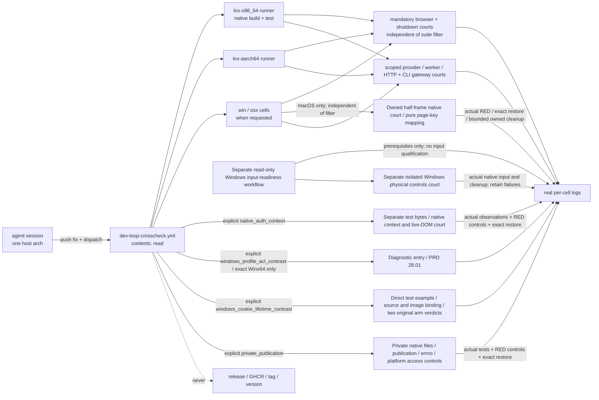

# Cross-arch dev-test loop for an agent session (`dev-loop-crosscheck`)

Owner of `.github/workflows/dev-loop-crosscheck.yml`. This is a narrower,
separate mechanism from the release pipeline in
`prd/PRD_02_27_con_delivery.md` — read that module for how release evidence,
the six-cell build and GHCR publish work. This module owns only the
recurring dev-loop need: an agent session (typically Linux-only, with no
osx/win host of its own) that must develop a cross-arch fix and prove it
against a real runtime, using nothing beyond default GitHub Actions access.

## Map

```text
dev-loop-crosscheck — agent cross-arch dev/test loop
├── Problem: a cloud session can reach only its own host's architecture
├── Non-goal: never a release-evidence path, never publishes, never needs write
├── Mechanism: GitHub-hosted native per-cell build + test on request
│   ├── inputs: ref, cells, test_filter, native_auth_context, private_publication, windows_profile_acl_contrast, windows_cookie_lifetime_contrast
│   ├── core and UI library tests, including each native ISA kernel
│   ├── isolated minimal consumer; no workspace feature leakage
│   ├── [-] provider / worker / HTTP mechanism and real CLI gateway courts (0.2.23)
│   │   scope: provider/gateway/harness selection includes both default and custom-alias CLI gateway journeys
│   │   invariant: each named native scope actually executes its selected tests
│   │   evidence: per-cell suite logs; account-source receipts linked from PRD 31.01.02
│   │   safe failure: fail that cell and retain logs; absent authorization stays unqualified
│   │   dependency: first-gateway source and native build; non-goal: OAuth entitlement or release receipts
│   ├── [v] mandatory browser artifact and shutdown-response courts, independent of test_filter
│   ├── [-] mandatory macOS owned-window half placement → PRD 25.04
│   │   invariant: actual owned frames and pure page-key mapping keep separate evidence scopes
│   │   evidence: native example readback/refusal and actual source-guard RED/restored passes
│   │   safe failure: unsupported/setup/compiler/timeout is not RED; restore exact bytes and retain failure
│   │   dependency: current platform API, isolated Mac desktop and owned child; non-goal: hardware/WK-focus or release proof
│   ├── [-] explicit native_auth_context test-build court → PRD 28
│   │   invariant: exact test bytes/source and real observation failures, separately from default product
│   │   evidence: qualification receipt, eight engine observations and two actual counterexamples
│   │   safe failure: preserve BLOCKED/failed result; do not count compilation or timeout as RED
│   │   dependency: canonical browser/helper and isolated desktop; non-goal: release/provider/visibility proof
│   ├── [v] separate Windows native-input readiness observation
│   │   invariant: read-only window-station/desktop and installed/loaded Pinyin facts stay distinct from actual input
│   │   evidence: exact-source input-readiness.json on both hosted Windows targets
│   │   safe failure: unavailable/absent prerequisites are BLOCKED or SETUP_REQUIRED, never native-input PASS
│   │   dependency: disposable hosted Windows desktop; non-goal: foreground, keyboard, clipboard, language installation or product qualification
│   ├── [-] isolated Windows physical browser/Harness controls court
│   │   invariant: actual foreground-owned SendInput, native Pinyin and exact clipboard restoration retain distinct provenance
│   │   evidence: current default product image, public editor/page observations and bounded owned-client PNGs on each selected target
│   │   safe failure: missing IME, lost foreground, failed restoration or forced cleanup is BLOCKED/failure
│   │   dependency: observed hosted desktop, isolated synthetic profile and existing native fixture; non-goal: owner-desktop input, provider login, other scales or release qualification
│   ├── [-] explicit Windows fixture ACL comparison → PRD 28.01
│   │   invariant: diagnostic entry requires exactly win-x86_64 and native_auth_context=false
│   │   evidence: real workflow-plan consumer and separate diagnostic aggregate
│   │   safe failure: reject incompatible selection; retain the comparison's nonzero failure
│   │   dependency: canonical browser and dedicated qualifier; non-goal: native/release qualification
│   ├── [-] explicit windows_cookie_lifetime_contrast diagnostic → PRD 28.01
│   │   invariant: one Winx64 diagnostic; independent from auth/ACL/private-publication selection
│   │   evidence: explicit build/source/image receipts and both original arm verdicts
│   │   safe failure: preserve nonzero/blocked outcome and export only the public allowlist
│   │   dependency: canonical browser and direct test example; non-goal: production repair or release qualification
│   ├── [-] explicit private_publication source court → PRD 28.02
│   │   invariant: private native files and actual guard failures retain exact restored source
│   │   evidence: three named baseline tests, three runtime REDs and three restored passes
│   │   safe failure: compilation/timeout/zero tests are failed evidence, never RED
│   │   dependency: private writer and owned build process; non-goal: GUI/provider/crash or release-artifact proof
│   └── permissions: contents: read only
├── Permission walls, disambiguated from the release / GHCR / local-artifact paths
└── Validation record (real hosted runners, run 36313213803)
```



## Problem and non-goal

A cloud coding session can reach only its own host's architecture directly.
Reproducing or fixing a bug that only shows up on another cell (Windows,
macOS, or even a different Linux ISA) needs a real run on that cell, not a
cross-compiled guess. The existing courts do not fit this recurring need:

- `six-grid-cloud-build.yml` already compiles natively per cell in CI, but is
  wired to the release-evidence receipt/identity path and a GHCR publish that
  requires all six cells and `packages: write` — the wrong shape for "build
  and test one or two cells while iterating on a fix."
- `local-artifact-probe.yml` needs a pre-built bundle behind a release asset,
  which needs release-create/upload rights this kind of session does not
  have (see "Permission walls" below).

Non-goal: this mechanism never becomes a release-evidence path, never
publishes anywhere, and never needs `packages: write` or `contents: write`.
Compiling here is for development feedback only, never a substitute for the
exact-source qualification `prd/PRD_02_27_con_delivery.md` owns.

## Mechanism: `.github/workflows/dev-loop-crosscheck.yml`

Push a fix to `main`, dispatch this workflow, and each requested cell builds
and runs the real test suites natively on its own GitHub-hosted runner —
the same "compile on the cell that will run it" pattern
`six-grid-cloud-build.yml` uses for release, minus its GHCR publish and
receipt/identity bookkeeping. Only `permissions: contents: read`. No GHCR
token, no release, no new tag, no local cross-compile or transfer step.

Inputs: `ref` (defaults to the dispatched branch), `cells` (space-separated;
empty runs the four non-macOS cells — macOS runners bill roughly 10x Linux
and queue longest, so opt in explicitly with `all` or the `osx-*` names when
a macOS-specific question needs it), `test_filter` (a Rust test-name
substring, applied to ordinary suites; the mandatory courts below stay active).
`native_auth_context` explicitly selects the dedicated native test-build court
below and defaults to false, so its extra build/mutation cost is deliberate.
`private_publication` independently opts into the source court below; it also
defaults to false and does not follow the ordinary Rust test-name filter.

Per cell: `cargo build --locked --workspace --all-targets --target <triple>`,
then each suite is run with `cargo test --locked --target <triple> --test
<name>` (`-p minicon-core` for the crate's own unit tests) — **not** a
guessed path under `target/<triple>/debug/<name>`. Cargo integration/unit
test binaries live hashed under `target/<triple>/debug/deps/`; a workflow
that stats a guessed path and treats "not found" as "nothing to run" reports
a false green with zero suites executed. This is not hypothetical: it is
exactly what happened and was caught below.

### First-gateway development scopes (0.2.23)

Unfiltered runs additionally execute main-binary `provider_` and `harness::`
unit filters, platform `network_` with `network-http-stream,network-loopback`,
and the actual `minicon_harness` CLI gateway journey through the strict test lints in
`build.sh test-suite`. A filter containing `provider`, `harness`,
`network` or `gateway` selects its corresponding scope; the existing mandatory
browser/shutdown courts remain independent. The control integration target runs serially because browser-editor clipboard
and composer-image journeys share the native desktop and clipboard. Independent
mechanism suites retain their existing parallel test setting. The provider filter still reports
the separately invoked pinned-Pi court ignored; a green ordinary run does not
claim that external dependency executed.

Both macOS cells additionally run `scripts/retained-group-native-court.py`
for an unfiltered, provider, harness or retained_group scope. It exercises real
normal/zombie-only and leader-exits-first process groups, removes each actual
production guard in turn, requires a runtime assertion failure, restores the
exact source bytes and reruns both positive cases. Compiler failure or zero
selected tests is not counterevidence. Its finite logs and source-restoration
receipt join the cell output; this is a native mechanism court, not a VM lease.
The producer remains [the platform owner](PRD_02_28_shared_core.md).

These scopes exercise controlled model peers, worker-owned tools, routing,
streaming and cancellation mechanisms. They cannot establish a real account
grant or hosted inference entitlement. Those delivery claims remain with
[the gateway owner](PRD_02_31_01_provider_gateway.md). Current account-source
native receipts and their filtered scope are linked from
[the pool owner](PRD_02_31_01_02_provider_pool.md); earlier six-cell receipts
cannot qualify subsequent source.

### Mandatory macOS owned-window half placement

Both macOS cells run `scripts/macos-snap-half-native-court.py` independently
of the ordinary test-name filter. Its explicit standalone platform example
observes its own AppKit screen/frame for left, right and repeated-right
placement, plus refusal without movement for an incompatible content minimum.
The bounded driver binds the actual checkout/source, explicit Cargo example
and features, thin native ISA and pinned executable hash. It removes the real
frame application and the related frame/content size-preflight boundary
separately, requires the unchanged original geometry/refusal assertions to fail,
restores exact source bytes and replays the original consumer. The latter
control does not establish each size guard individually. Pure native-page
physical-key mapping has a separate exact libtest PASS/guard-RED/restored-PASS
sequence. The owned example also retains finite size-getter/refusal labels;
old content-only passing mutants remain rejected in their original receipts.

The source driver reuses the existing owned-process boundary, with a 20-second
native-child bound and finite build/log limits. Public logs and receipts are
always retained; private temporary executable pins stay outside the upload
paths. Unsupported capability, compilation failure, an unrelated panic or a
timeout never counts as a counterexample. Missing native evidence remains open.
The same driver additionally runs the two pure UI Meta consumers and a fresh
single-display public CLI host-route initial/removed-ConApp-call/restored
journey. That journey observes actual owned-window bounds and retained GUI
input/live-page state through public black boxes. Its build and replay bounds
are 180 seconds each. Physical Command delivery, actual focused WK responder
ownership, multi-display public observation and signed/public artifacts retain
separate named evidence; a CLI pass does not qualify them. Product behavior and the
remaining acceptance frontier belong to
[PRD 25.04](PRD_02_25_04_window_shortcuts.md).

### Opt-in private-publication source court

Set `private_publication=true` to run `scripts/private-publication-native-court.py`
serially through the strict test wrapper for the requested native target. It
requires the three named new private-publication tests to pass, then one actual
assertion failure per removed publication flag, legacy errno and native access
guard, and finally the three restored passes. Unix launches use explicit child
shell umask 022; Windows removes native private-directory inheritance for its
access control. [PRD 28.02](PRD_02_28_02_private_publication.md) owns the mechanism
and consumer behavior.

The runner retains original stdout/stderr, source hashes, actual result counts,
Cargo-reported test-image digest/ISA and cleanup/restoration outcomes. It reuses
the existing owned-process boundary, so a timed-out Cargo tree is closed before
source restoration; it never launches a GUI or provider. Its receipt binds HEAD
plus the listed working-tree bytes and declares shared cache and any initial
dirty state. Native source mechanisms do not certify release artifact behavior
or survival of a power loss. A hard host/process loss cannot fabricate terminal
PASS; an interrupted or incomplete receipt remains unavailable evidence.

The first local launch retained a failed preflight: passing bare `bash` through
the native Windows process launcher selected WSL before Git Bash and ran zero
tests. The corrected court reuses `scripts/test-plan.py::choose_bash` and passes
the resolved executable to the launcher. A PATH prefix alone did not select
the intended native executable in that failed attempt. Its raw failure remains
in `target-six/v0.2.23-provider/private-publication-native-local/receipt.json`.

### Opt-in Windows browser-lifetime diagnostic

`windows_cookie_lifetime_contrast=true` selects only `cells=win-x86_64` with
native-auth, ACL and private-publication options false. The workflow invokes
`scripts/native-auth-context/lifetime.py --build` after the canonical browser
court; it keeps dedicated target output and a create-new pinned example separate.
The lifecycle experiment, original oracle and interpretation belong to
[PRD 28.01](PRD_02_28_01_browser_context_lifecycle.md#direct-wry-lifetime-comparison-planned-diagnostic).
The job retains the actual comparison exit code and uploads an explicit public
allowlist even on failure. The broad failure upload excludes this entire private
output namespace. Actual lifecycle observations and interpretation remain owned
by the linked module; this diagnostic entry grants no native/product/release
qualification.

For the pre-close metadata integration, explicitly run
`python -B scripts/native-auth-context/lifetime_metadata_selfcheck.py` under the
root's serialized gate, or invoke it once in the existing build coordinator.
Retain a matching-source receipt before native replay. Source-map membership
alone is not execution evidence. Candidate counts, safety boundaries and old/new
diagnostic status remain in [PRD 28.01](PRD_02_28_01_browser_context_lifecycle.md#next-diagnostic-one-a-live-file-metadata-sample).

### Opt-in native authorization-context court

Set `native_auth_context=true` with the exact requested `ref` and cells. After
the canonical browser court, `scripts/native-auth-context/qualify.py` serially
builds its non-default feature under ignored `target/native-auth-court-build/`,
runs the initial native journey, exercises a production prior-account-context
reuse mutation and a declared test-driver ordinary-reload fault, restores exact
source bytes, and reruns the native journey. The original default product hash
must remain unchanged. The [mechanism owner](PRD_02_28_shared_core.md#native-context-and-live-page-court)
defines the observations, authority and limits; these test bytes cannot certify
the default product or release artifact.

The runner receives a serialized build declaration bound to the measured test
binary/helper hashes, actual compiled features and OS/ISA. It never guesses a
binary's source from current HEAD. Linux uses an explicit canonical helper path
in both its private manifest and `MINICON_BROWSER_BIN`; the driver refuses a
different selection. A negative run requires an actual fixture observation
failure and a native-driver failure result. Compilation, missing capability,
incomplete observation, process timeout or arbitrary nonzero exit is not RED.

The qualification receipt, raw build/driver logs and redacted engine/fixture
receipts are retained on every outcome. Private manifests and browser/config
stores are excluded from artifact upload. Required unavailable evidence remains
BLOCKED. Direct native-host Unsupported is typed by the driver; some browser
creation refusals remain undiagnosed failures until their actual cause is
established, and cannot be labeled an isolation defect by inference.

The always-upload receipt artifact explicitly includes each native run's bounded
`windows-cookie-diagnostics.json`, when produced, alongside its native driver
receipt. Diagnostics are useful on success as well as failure; retaining them
must not depend on the failure-only broad-log artifact. An older workflow
without that include may retain the file only in failure logs. The file's
value-free observation contract and limits remain with
[the lifecycle owner](PRD_02_28_01_browser_context_lifecycle.md); a missing file
never supplies a persistence result by inference.

Both success and failure artifact selections explicitly exclude the
feature-only `native-profile-locator.private.json` carrier. Its directory
authority, bounds and finite public diagnostics belong to the
[verified-directory join](PRD_02_28_01_browser_context_lifecycle.md#verified-directory-diagnostic-join).
Protocol selfcheck counts come from the actual restored receipt; the protocol
control count is separate and must not grow merely because checks were added.

### Opt-in Windows fixture permission-policy comparison

`windows_profile_acl_contrast=true` selects the dedicated qualifier's
`--windows-profile-acl-contrast` entry. The workflow planner requires exactly
`cells=win-x86_64` and `native_auth_context=false`; incompatible selections
fail before dispatching cells. Defaults retain the ordinary qualification path.
Run this only on the allocated CI desktop, after the canonical browser court.
Its separate public `acl-contrast-receipt.json` joins the existing per-arm
allowlist and private-store exclusions. Diagnostic behavior, original verdicts
and the limits of ACL observations belong to the
[lifecycle owner](PRD_02_28_01_browser_context_lifecycle.md#fresh-permission-policy-diagnostic-join-in-progress).

### Provider and authorization court feedback

Provider/Harness/auth focused runs also select the H0 host tests, pending-control
ownership tests and exact public H0 journey with nonzero passing execution
required. Windows/macOS additionally select minicon-web's native-page tests
with `native-page-host` enabled; Linux qualifies its existing separate process
host instead. Their raw logs join the always-upload artifact. The canonical
browser smoke retains existing host checks and adds H0 checks through the same
script; actual check IDs/results are authoritative, not a historical count.

The first opt-in run (`40166792139`, source `b47799d`) exposed macOS Bash 3.2's
empty-array expansion under `set -u`: neither macOS auth court started. The
invocation now appends the optional Linux helper through positional parameters;
empty `"$@"` is valid on that shell. Both macOS cells still require actual
execution on the corrected source. The mechanism owner records the Windows
reopen observation failure and the follow-up value-free diagnostics; do not
relabel this terminal failure as a verified wait or a successful native join.

The corrected invocation in run `40167727817` reached Python on macOS ARM,
then the first protocol-control subprocess exceeded its 12-second deadline
under the court's Python 3.14.7. No dedicated Rust driver build or native
execution had started there. Its original log contains no child stack, so the
cause is unproven. `verify_protocol.py` now requests a diagnostic thread dump
before the unchanged deadline, preserves timed-out stdout/stderr and records
an incomplete failed-control receipt after exact source restoration. Timeout
is still a failure, never assertion RED. Local diagnostic handling and actual
macOS execution must be verified separately.

The loopback fixture also overrides Python HTTPServer's default bind path,
which otherwise calls `socket.getfqdn` even for `127.0.0.1`, outside the fixture
deadline. Literal loopback binding now uses a fixed server name without DNS.
This removes a demonstrated unbounded prerequisite; it is not yet evidence
that DNS caused either macOS timeout. Local protocol qualification executes
eleven checks and eleven actual assertion-RED controls with exact restoration:
`target-six/v0.2.23-provider/native-auth-bounded-startup-protocol/protocol-guard-receipt.json`.
An actual deliberately stalled child in an isolated script copy hit the unchanged
12-second deadline, retained its earlier thread dump, produced a failed-control
receipt and restored that fixture exactly. Receipt:
`target-six/v0.2.23-provider/native-auth-timeout-control/receipt.json`.
Neither local check executes a native browser or qualifies macOS.

Run `40168915277` at `e55613a94e5c49eb780b76ce51a89bacfe90cb73` subsequently
passed this complete preflight on the macOS ARM court: eleven protocol checks,
eleven actual assertion RED controls (including no-loopback-DNS), and exact
restoration. Dedicated native execution then completed; its storage/live-page
observations are owned by [PRD 28](PRD_02_28_shared_core.md#native-context-and-live-page-court).
The independent audit is retained in
`target-six/v0.2.23-provider/ci-e55613a-macos-auth/verification-index.json`.
This verifies corrected startup for that source and host, without establishing
the cause of the earlier uninstrumented timeout or qualifying macOS Intel.

**Local Windows x86_64 development gate (2026-10-25).**
`build.sh test -- --test-threads=1` completed the workspace and both owned lexer
forks with exit 0; the runner summaries reported 1691 passed and 82 ignored.
The original full attempt exposed two control-release regressions; the restored
complete gate passed both unchanged journeys after the host-routing fix.
This is local development qualification. Ignored native/network courts and
credential-gated legacy tests do not establish account authorization, live
inference, another OS/ISA or final release bytes. Named first-gateway and
external-client scopes stay with their product owner above.

The 0.2.21 browser stage qualifies a canonical native artifact and records its
byte identity, native browser test and public-CLI journey, independently of the
optional suite filter. Product behavior belongs to
[PRD 25](PRD_02_25_con_workspace.md); release-artifact qualification remains
with [PRD 27](PRD_02_27_con_delivery.md).

The shutdown-response court also ignores that filter. It runs
`control::shutdown_response_tests` through `build.sh test-suite --bin minicon`,
requiring exactly four passed tests on Windows and three on Unix, with no
failed or ignored tests. The passing receipt includes
`probe-logs/control-shutdown-response.log`; failure logs retain it too.
[PRD 26](PRD_02_26_con_control_cli.md) owns response lifetime and bounds.
**2026-10-24 qualification.** [Run `40003029035`](https://github.com/partnernetsoftware/minicon/actions/runs/40003029035),
at exact source `329a30d7c64b9f1cd0c41f14cefcc53779b5f98e`, attempt 1,
completed all six cell jobs successfully. Each cell actually ran one explicit
native browser test, its public-CLI workspace journey and the required
shutdown-response count above, all with zero failed or ignored tests in those
mandatory courts. The six downloaded `crosscheck-receipt-<cell>-attempt-1`
artifacts were independently checked for source/cell/status and exact log
summaries; both macOS ISAs supplied all four real window PNGs. Local inspection
confirmed the geometric Reload icon in both Mac captures.

This dispatch used `test_filter=browser_windows` for ordinary suites. Its green
suite labels do not certify unfiltered console/library coverage; that earlier
scope retains its separately named receipts below. These native development
bytes also do not replace PRD 27's final-source pack, signed or public bytes.
The host-injection and native page-focus acceptance boundaries remain owned
by [PRD 25](PRD_02_25_con_workspace.md#tab-kinds-and-content-panels).

From v0.2.21, each cell also runs the portable `minicon-console` library
(`--lib`) and its host-neutral integration tests `synchronized_presentation`
and `presentation_allocations`. An unfiltered run that logs `running 0 tests`
for one of those suites fails the cell. The Windows console service
(`minicon_console_agent`, `rust_console_pty`) stays inside `win-*`. Linux
cells additionally run the POSIX PTY session tests, the two native X11
clipboard unit tests, and `minicon_load_portability_linux`. After Xvfb is
up, the Linux job sets `MINICON_REQUIRE_DISPLAY=1`; an X11 test that would
have returned success with no `DISPLAY` fails instead. Those Linux suites
are not implied by a green macOS or Windows cell. Run `39917026302` at exact
source `3db5710` records all three portable-console suites `ok` on all six
cells and records `linux-pty`, `linux-x11-clipboard`, and `linux-elf-needed`
`ok` on both Linux cells. The PTY invocation names
feature `pty` and the X11 invocation names feature `clipboard`; omitting those
features compiles the target tests out, so the unfiltered nonzero-test guard
would correctly reject the court rather than certify a no-op.

That run is intentionally not presented as an all-green Windows-service
receipt: Windows arm64 passed every suite, while Windows x64 retained the two
known G6 unread-output `FreeConsole` failures in `rust_console_pty` (94 passed,
2 failed). All portable suites on that same x64 receipt passed. A red carried
debt court remains red; it does not erase the independently named portable or
Linux receipts and is not silently converted to a skip.

The Windows branch also owns a focused `windows-private-filesystem` suite from
v0.2.21. It runs `minicon-platform`'s `private_` library tests with feature
`filesystem` on both Windows ISAs and fails if Cargo reports zero tests. It is
independent of `test_filter`, like the minimal-reuse court: a focused product
rerun must not silently erase the native DACL evidence. This is the runtime
owner for the OAuth bearer's protected current-user-only directory ACL; it is
not permission to run every platform unit test in the dev loop.

Run `39919403513`, exact source `c09e999`, records that suite `ok` on Windows
x86_64 (6 seconds) and arm64 (8 seconds), with a nonzero test count on each.
Both overall jobs remained red solely on the two already-carried G6
`rust_console_pty` disconnect cases (94 passed, 2 failed per ISA). The
independent receipt therefore closes the ACL runtime claim without relabeling
or suppressing the service debt.

From v0.2.15 preparation, each cell also runs the UI-core library suite and
`scripts/check-reuse.sh`. The latter sets `CARGO_BUILD_TARGET` to the matrix
triple, checks minimal core/UI dependency edges in an isolated workspace and
executes the compatibility APIs with dead-code/unused-result warnings denied.
It is not filtered by `test_filter`: feature leakage must remain visible even
when a developer selects one Rust test. Its result is included in the same
per-cell structured receipt; it does not substitute for release artifacts.

Failure or a hang (`cancelled`, not just `failure` — the same gap fixed in
`local-artifact-probe.yml`, see `prd/PRD_02_27_con_delivery.md`) uploads
`probe-logs/*.log` via the same pinned `actions/upload-artifact` SHA used
elsewhere in this repo's workflows.

## Local per-host gates, and the ones that are not gates

Focus-dependent control journeys establish their intended UI focus before
asserting event routing. Failed CLI assertions include the attempted command,
so a transport timeout can be attributed to its actual operation rather than
treated as a generic slow start. A negative control is valid only if it reaches
the guarded behavior; an earlier setup failure does not prove that guard.

Windows clipboard journeys in the control executable share one clipboard lease
through seed, asynchronous completion and restoration; an image-paste journey
cannot replace another journey's text payload. This lease covers this executable,
not other processes or a user's desktop. The multi-tab host sends stderr to an
owned diagnostic file, reported on panic after host cleanup; its unread output
must not backpressure the host. Panic cleanup also reports the host's exit status
before termination, so an exited host and a live stalled host are distinguishable.

A local check that compiles nothing is worse than no check, because it reads as
green. Two were found by a release chain failing on code a local gate had
"passed" (0.2.7, 2026-10-13), so each is written down with the exact command
that actually compiles the code:

- **macOS platform code.** `adapters/macos/window.rs` includes the unix window
  host as `#[path = "../unix/window_host.rs"] mod window_host;` under
  `#[cfg(all(feature = "input", feature = "ime"))]`. A check that omits those
  features compiles no macOS window code and reports success. The working
  command, which the host can run without an Apple SDK because `cargo check`
  does not link:

  ```sh
  cargo check --target x86_64-apple-darwin -p minicon-platform \
    --features 'portable-pixel-window,input,ime'
  ```

  A `compile_error!` probe dropped into a macOS-only function is the way to
  prove the gate still reaches it.
- **Linux product code.** `cargo check --target x86_64-unknown-linux-gnu` stops
  in `ring`'s build script (no C compiler for the target). `cargo zigbuild
  --target x86_64-unknown-linux-gnu` with zig on `PATH` does compile and link
  the product, so it is the gate that covers `#[cfg(unix)]` product code.
- **The whole macOS product** cannot be compiled here: `ring` needs an Apple C
  toolchain. The platform-side gate above plus the CI macOS cells are the
  evidence; that is a limit to state, not a gap to paper over.
- **On Windows, building while a build of this tree is running** (recorded
  2026-10-14). Cargo builds the `minicon` bin as a dependency of any integration
  test that reads `CARGO_BIN_EXE_minicon` — `tests/minicon_alignment.rs` does —
  and Windows refuses to *delete* a running executable, so a MiniCon left
  running from `target\debug` makes the next `cargo test` die at `failed to
  remove file target\debug\minicon.exe — 拒绝访问 (os error 5)` before a single
  test starts. Renaming a running image is permitted, deleting it is not. The
  gate is a target directory outside the clone:

  ```sh
  CARGO_TARGET_DIR=<dir outside the clone> cargo test --locked --test <name>
  ```

  This is **not** a toolchain or registry wall: `reg query …\Windows Kits\
  Installed Roots` answers normally and the SDK `rc.exe` that `build.rs`'s
  `winresource` step needs is present, so `cargo check/test/clippy
  --all-targets` all compile and run on this host from a cold tree. An earlier
  revision of `plan/archive/plan-v0.2.8.md` mis-attributed this failure to a sandbox
  `reg.exe` blacklist; that cause was wrong and is withdrawn.

### Observed-state preconditions for black-box gates

`minicon_blackbox::controlled_wheel_moves_the_real_scrollback_offset_up_then_down`
historically failed on this Windows host for at least three releases:
`plan/archive/plan-repo-hygiene-2026-10-24.md` records it against the pristine tree, and
`prd/archive/v0.2.6-release-history.md` lists it as that release's one
pre-existing local-gate failure. Re-checked 2026-10-14 by A/B — it fails both at
the pre-0.2.8 commit `486cdd9` (viewport moves 2 lines) and on `main` (0–2), so
it is **not** a property of the 0.2.8 scrollback change.

What it actually is, measured rather than guessed: the journey prints 120 lines
and then sends `send-wheel … --notches 5`; `scroll_by` clamps with
`min(5, grid.scrollback.len())`, and on this host the live grid holds only 1–2
rows of scrollback at that moment even though the configured capacity
(`scrollback_len`) is 4000. 0.2.8 made this visible for the first time, because
`max_scrollback` in the snapshot now reports the real depth; before that change
it always read 4000 and so hid a wheel that had nothing to move.

Why the live grid retains so little is **not established**. The leading
hypothesis was that ConPTY repaints with absolute cursor addressing instead of
emitting the linear newline stream a POSIX PTY produces, so far fewer rows pass
through `Grid::scroll_up` and reach the scrollback — a hypothesis, not a
finding. In v0.2.15 preparation the fixture now observes individual
shell-expanded output markers until the snapshot proves at least five real
history rows exist. Only then does it send wheel input and assert the unchanged
5→3 offsets. This removes the unsupported burst-output precondition rather
than weakening the wheel assertion. Qualification and negative-control results
belong to the [archived 0.2.15 plan](../plan/archive/plan-v0.2.15.md) and
[release history](archive/v0.2.15-release-history.md).
Observe the fully edited command before sending Enter, then observe its
shell-expanded marker. Otherwise a fast shell can both edit the previous last
row and scroll between mirror samples, leaving no unchanged suffix from which
the screen-buffer mirror can infer the real scroll. The fixture's readiness
assertion retains its last snapshot on failure.
The multi-tab control journey uses the same observed-command preparation for
the inactive target before asserting its one-notch wheel receipt. A final marker
from a 1,200-line burst alone does not prove that the sampled mirror retained
history; its actual viewport row count bounds the required preparation.

The keyboard forwarding journey has the same observation-order requirement:
capture the cursor after typing `ABCDE` before sending either ArrowLeft. A
timed background journey could finish both moves before the first snapshot,
mistaking the final column for the starting column and asking for two further
moves. The fixture now sends both keys through the public control command only
after observing that baseline, and still requires exactly two columns of motion.
A one-key negative control must fail that assertion. This is a fixture repair,
independent of the post-release test-orchestration review.

The child-geometry resize journey also needs a native probe: Windows reads
`[Console]::WindowWidth/WindowHeight` through PowerShell; Unix reads this child's
tty through `stty size`. Invoking `powershell.exe` unconditionally produced an
empty pane and a timeout on both Linux ISAs and macOS ARM in run `39137777772`.
Keep the shared narrow/wide assertions and never substitute the host's own grid
size for what the child reports.

The Windows resize fixture compares the child's reported columns with the
actual host grid after each change, not a fixed 100-column threshold: the hosted
desktop can clamp a 1400-pixel request to an 88-column grid. First require a
smaller baseline containing only that width, then a larger host width accompanied
by fresh equal child output. PowerShell probes start after an interactive shell
executes an observed readiness marker, as in the throughput court; this does not
qualify the separate `-File` startup path.

Resize-event timestamps use a probe-local monotonic stopwatch. Determine the
settled size from the chronologically latest event and compare the earliest and
latest timestamps for that size; console repaint rows need not be chronological.
The same-size nudge still requires at least two events spanning 100 ms. The
product-nudge delay mutation must fail that assertion.

The shared PowerShell shell/probe-readiness budget is 60 seconds. In targeted
run `39139623345`, Windows ARM completes four of five regressions; the first
C# probe has not announced readiness at the old 30-second deadline, while a
later equivalent probe completes in about 25 seconds. Keep cold shell/compiler
startup separate from the nudge interval and from throughput performance floors.

### Gates that compile a path but cannot exercise it
A compiled path is not a working path. The same 0.2.7 release produced the
opposite failure from the ones above: a path that *did* compile on the one host
we can run, and still failed the moment it ran.

`minicon_platform::network_http`'s TLS layer is exercised by **nothing** in the
default suite — every test in it speaks `http://` to a loopback server — so the
suite can be green while `https://` panics. That is exactly what happened:
`ureq` picks its TLS provider at runtime and defaults to Rustls, the Windows
manifest enables only `native-tls`, and the product's first `https` call (the
new update check) died inside `ureq`. The fix pins the provider per host; the
finding is recorded in `plan/archive/plan-v0.2.7.md` and
`prd/PRD_02_25_con_workspace.md`.

The lesson is a category, not one bug: **an opt-in real-endpoint test is the
only gate for a network path whose default tests are loopback-only.** It must
be run by hand before a release, from `plan/archive/plan-v0.2.7.md`:

```sh
cargo test --bin minicon -- --ignored update::tests::the_real_release_api_still_parses
```

It stays `#[ignore]`d on purpose — CI must not depend on GitHub being reachable
— so nothing will ever run it for us. The Unix arm of the same fix is still
unexercised: no host here can execute a Linux/macOS binary, so it rests on
reading `ureq`'s own feature tree rather than a live call.

## First-gateway native findings (2026-10-25)

The initial unfiltered six-cell run
[`40110164630`](https://github.com/partnernetsoftware/minicon/actions/runs/40110164630)
at `891ad5f4c8ff00b40bc4585a289150964dfdcb90` failed; it is not qualification.
Both Linux cells passed provider, gateway CLI and HTTP courts but exposed a
nested exec failure. The diagnostic run
[`40111350019`](https://github.com/partnernetsoftware/minicon/actions/runs/40111350019)
at `cb0dc680d3de14edb48314792f27e2faa3ee5215` captured actual EAGAIN from the
second spawn under the UID-wide NPROC32 limit. Worker native policy belongs to
[PRD 31](PRD_02_31_v0_2_horizon.md#worker-requirements-for-the-first-gateway-connection).
Both macOS cells exposed zombie-group EPERM and two missing-root fixtures with symlinked
temporary ancestors; owned cleanup belongs to PRD 28 and private-file policy
is preserved. Both Windows cells' existing native queued-read/retirement
disconnect courts stalled despite their already serial execution; the next
source captures native FreeConsole/read-return stages and exact process exit,
without a larger timeout or removed assertion. Windows ARM additionally exposed
PROCESSOR_ARCHITECTURE after startup despite the explicitly cleared native
block. Its next fixture poisons the parent value and accepts only the exact
non-secret ARM64 pair; the actual value and native mechanism remain pending
that cell's rerun, and no provider/client secret may be inherited.
The next source must rerun its selected scopes before any release claim.

The local repair checkpoint passed strict Clippy, all eight offline script
self-tests and the canonical dangerous-lint main-binary gate (573 passed,
2 ignored, including one new version-producer case). The two Windows native
disconnect cases passed individually with rust-console/parent-console/runtime
features under the same dangerous-lint wrapper. Those local development scopes
do not replace either Windows CI cell or the required macOS/Linux reruns.

### Repair checkpoint and remaining native failures

Run [`40113098833`](https://github.com/partnernetsoftware/minicon/actions/runs/40113098833)
at `d40c4fd45543ea7e4e055d963d62bc2684a943ce` passed all 21 configured
suite rows on each Linux ISA, including the previously failing nested worker
spawn. Both macOS ISAs passed the owned-group positive cases, two actual
runtime guard-removal failures and byte-exact restoration; their raw logs and
receipts survived in the failed-job artifacts. The workflow now also retains
that directory in its success artifact, pending a new-source run.
The full Windows workspace and owned-fork gate at that checkpoint exited 0:
1692 passed / 82 ignored across 38 summaries. The separate native Microsoft
Pinyin preedit/commit test also passed on the interactive Windows x86_64 host;
this certifies that host fixture, not the three new browser fields.

Both macOS cells still failed the minimal-environment fixture because startup
added `__CF_USER_TEXT_ENCODING` after the explicitly cleared exec block. The
[Apple CF getter/writer](https://github.com/apple-oss-distributions/CF/blob/CF-1153.18/CFStringEncodings.c#L832-L955)
and [early initialization](https://github.com/apple-oss-distributions/CF/blob/CF-1153.18/CFRuntime.c#L851-L867)
explain this mechanism; that historical source is not a claim about the runner's
exact installed framework. The follow-up fixture supplies a valid UID-prefixed
parent sentinel, confirms it survived parent startup, then accepts only a strict
native three-component UID/encoding/region record in the child. A fourth field,
unknown key or provider/client sentinel still fails. No Unix process-global
environment mutation or production forwarding exception is introduced. Its
current-native proof remains pending.

Windows ARM passed its revised minimal-environment probe and all 36 selected
worker tests at this checkpoint; the production forwarding list is unchanged.

Windows queued-read failure now proves the owned probe is still inside
`FreeConsole` with one deferred text read. Retirement failure proves
`FreeConsole` returned but its reader is still admitted and has not returned.
These observations narrow the failure; they do not establish which server
notification was received or authorize a changed NTSTATUS/error allowlist.
The next diagnostic checkpoint must observe receive/retire/completion ordering
without changing the original deadlines or assertions.

The opt-in service trace is limited to 2048 records / 256 KiB per owned
session. Only the two failing fixture cases supply a command-local trace file;
creation is exclusive and failures preserve service behavior. Metadata names
receive/admit/defer/resume, process/object identities, admitted/deferred counts
and actual completion errors before existing cancellation normalization. No
console text or SDK buffer is recorded. The workflow copies at most four bounded
trace files into its ordinary evidence directory on every Windows outcome.
Both original cases pass locally with tracing. The focused Windows run
[`40115122092`](https://github.com/partnernetsoftware/minicon/actions/runs/40115122092)
at `c0fac4291c22b535154984dbe9ecbcdad46e8b39` retained both complete traces.
At the failure instant neither case had received DISCONNECT; records after the
panic belong to fixture cleanup and cannot establish that FreeConsole delivered
it. No speculative cancellation fix or error-code exception is justified.
The diagnostic filter `disconnect_stock` explicitly runs only the two existing
ignored queued-disconnect/read-retirement comparisons against installed system
ConPTY. A common SDK lifetime failure must be distinguished from a MiniCon host
failure before changing the implementation; ordinary product pass criteria and
original assertions remain unchanged.

The installed-system comparison at
[`40116114474`](https://github.com/partnernetsoftware/minicon/actions/runs/40116114474)
(`08269df8d1345eb550f8fb79931e29b49e2587c8`) failed on both Windows ISAs.
Its retirement case returned successfully from `FreeConsole` but left the
explicit `CONIN$` reader blocked, matching the owned backend's observation.
The queued-read comparison stopped earlier, at its keyboard-control barrier;
it never reached a disconnect case and supplies no disconnect result.
The [documented FreeConsole contract](https://learn.microsoft.com/en-us/windows/console/freeconsole)
describes detachment; it does not establish completion of every already-open
synchronous read. The separate
[CancelSynchronousIo contract](https://learn.microsoft.com/en-us/windows/win32/api/ioapiset/nf-ioapiset-cancelsynchronousio)
also distinguishes requesting cancellation from observing completion. Together
with the same-host stock result, this invalidates the old detachment-implies-read-return
test assumption; it is not a claim that the SDK prohibits concurrent detachment.

The replacement required courts use actual root-process exit (code 35), not
`FreeConsole`: `rust_console_pty_exited_reader_retires_its_read_and_reveals_the_surviving_buffer`
first observes simultaneous admitted root/peer reads, then requires only the
peer read to survive, buffer `B>`/cursor `(0,2)`, real peer input and final EOF.
`rust_console_pty_exited_readers_retire_deferred_reads_without_output_consumption`
covers root `ReadFile`, `ReadConsoleW` and `ReadConsoleInputW` separately:
both callers are deferred before exit, only the peer remains without consuming
output, and that same peer is then admitted and reads a real native key.
The peer must not change the shared input mode while output is blocked; an
initial fixture did so and stalled before submitting its read. The record-reader
fixture removes that unrelated prerequisite. Both replacement tests passed on
the interactive Windows x86_64 host. Both Windows CI ISAs subsequently passed
their selected native PTY scope in
[`40118153544`](https://github.com/partnernetsoftware/minicon/actions/runs/40118153544)
at `8c0c7c3a75f32d70baa7aa65c68597548cd7c7cb`: each executed 98 tests with
0 failures, 1 ignored and 71 filtered out. Both new process-exit tests appear
as executed passes in each job's raw log. The ignored case is the explicit
external Windows PowerShell cooked-read court; it is not qualified by this run.
The `rust_console_pty_` filter left other ordinary suite rows with zero selected
tests; their `ok` labels do not establish a full workspace or six-cell pass.
The separately mandatory native browser baseline passed one test per ISA,
bounded control shutdown passed four, and private-filesystem scope passed seven.
Browser receipts report no physical keyboard check or screenshots, so they do
not replace the new controls/Harness/IME acceptance matrix or real OAuth.
Disabling the shared retirement predicate made both tests fail at runtime;
adding global cancellation after the actual caller's disconnect also made both
fail because the live peer was lost. Byte-exact restoration passed both again
(`target-six/v0.2.23-provider/process-disconnect-guard-receipt.json`). Removing
only process-specific retirement had still passed via independent object-close
retirement; that trial is retained as a non-counterexample, not claimed as RED.
Old `FreeConsole` assertions remain intact in explicitly ignored owned-host
observations. Stock keyboard-control pressure also retains its own ignored
comparison, so its failure cannot conceal the separate disconnect observation.

Both macOS cells passed their focused provider and retained-group scopes in
[`40115118541`](https://github.com/partnernetsoftware/minicon/actions/runs/40115118541)
at the same source, with the raw guard/removal/restoration files now present in
the success artifacts. The subsequent interactive-login ceiling repair belongs
to PRD 31.01 and still requires final-source native qualification.

## Permission walls, disambiguated

The observations below describe the 2026-09-27 session, not a universal current
publication restriction. Current release authority and gate selection belong
to [delivery](PRD_02_27_con_delivery.md); 0.2.15's authorized public Promotion is
recorded in its release history.

Found and confirmed distinct while building this (2026-09-27); recorded here
because the framing had been conflated before being corrected:

1. `workflow_dispatch` on an existing workflow, and reading/downloading
   existing release assets — never blocked. This is why the mechanism above
   works at all.
2. Creating a release, uploading to one, or pushing a new tag — blocked by a
   Claude-Code client-side `[Auto-Mode Bypass]` classifier. A session-type
   policy, not a GitHub permission; not worth retrying through another tool.
3. Direct `ghcr.io` push using a sandbox's own token via `oras` — a genuine
   GitHub-side 401 (the token lacks `packages:write`), distinct from (2) and
   confirmed separately (network reachability to `ghcr.io` itself is fine;
   the challenge is a normal unauthenticated 401, not a proxy/network block).

None of the three gate cross-arch *testing* — only cross-arch *publishing*,
which this mechanism never needed. A future session finding itself blocked
on (2) or (3) while trying to test something should reach for this workflow
instead of trying to work around either wall.

## Validation record

- v0.2.15 source `0ac2d7ed1b3898835956f80569718c4d2eb994b9`, run
  `39142875932`: all six native cells pass their full configured dev-suite
  sets, including default UI and the isolated minimal consumer. Root/platform
  compilation is not a claim that every such unit executed on every cell;
  the separate canonical Windows workspace/fork gate and final artifact courts
  are scoped in [release history](archive/v0.2.15-release-history.md).
- Proposed selection/profile changes are owned by
  [test orchestration](PRD_02_33_test_orchestration.md), with implementation
  still planned. This module continues to describe the current native workflow.

- Run `36312887935` (`lnx-x86_64 lnx-aarch64`, commit `38ddba2`, first real
  dispatch): reported `success` in ~107s, but logs show the test-run step
  never executed a single test — the path-guessing bug above. Caught by
  reading job logs rather than trusting the green checkmark.
- Fixed in commit `da29abf`: `cargo test --target <triple> --test <name>`
  instead of a guessed path.
- Run `36313213803` (same two cells, commit `da29abf`): real execution
  confirmed from the logs — `minicon-core` 95/95, `minicon_blackbox` 28/28
  (including `nonexistent_program_via_dash_e_exits_cleanly_instead_of_hanging`),
  `minicon_control` 14/14 (including the process-group regression test
  `killing_a_process_group_also_kills_what_it_forked` from commit `2e789c4`),
  `minicon_throughput` 1/1, on both `ubuntu-24.04` and `ubuntu-24.04-arm`,
  ~3 minutes per cell, no hang, no `cancelled`. This is also the real-CI
  validation that closed the `minicon_core` process-group-teardown hang fix
  (`2e789c4`) on hosted runners, not only locally.

Full narrative and the owner-correction history that led here:
`plan/plan-carried-debt.md`'s G1 leaf (not archived — this module records
the accepted, standing mechanism; the plan leaf keeps the exploration
history that produced it).

### Version-3 compatibility and H0 native feedback

The exact source `54119037581cfc023eb0c30eeb4ea4011713e2da` completes all six
provider-filtered native development cells in
[`40182929017`](https://github.com/partnernetsoftware/minicon/actions/runs/40182929017),
attempt 1. The single-job API, source identity, raw test logs, six artifact ZIP
digests/sizes and screenshots are independently audited in
`target-six/v0.2.23-provider/ci-5411903-native/verification-index.json`
(SHA-256 `f1443a66245d95c3d65e7d6f8a3c9c7daf29c3eeebec8e1274b68ddaed282333`).

There are 1730 passing Rust execution instances, six unselected Pi opt-in ignores
and no unexpected failures. Four deliberate retained-group assertion failures
are counted separately; both macOS cells also retain their initial/restored
passing checks and exact restored source. Each cell actually executes all ten
new configuration/resolver consumers and one H0 public journey. Canonical
ordinary-browser smoke passes 22 checks per cell; auth/settings/profile/process,
geometry and pending-control suites have nonzero execution. In particular,
the repaired sampler passes on Mac ARM after the two retained failed sources
recorded by [the H0 owner](PRD_02_36_harness_workspace.md).

This run selects neither dedicated native authorization nor private-publication
fault qualification. Native Cookie persistence, real provider entitlement,
physical keyboard/IME/scales and release six-cell/signing/Promotion remain
separate obligations. Uploaded receipts contain no product executable for an
independent PE/ELF/Mach-O header reread; that particular check stays BLOCKED.
The audit uses only exact-commit Git blobs, not later local diagnostic changes.


### Exact2d7 six-cell feedback: partial success with retained failures

Run `40217399944` at `2d7c3e159f65f2bb5c926cefd04ef19bcf5f3f91` is terminal:
four cells succeed and two fail. Both macOS settings suites pass all47 consumers,
including eleven K2 subjects; both half-window courts pass23 canonical browser
checks and twelve joint phases with four actual assertion REDs. All sixteen UM
subjects pass by name in each of the five cells that actually run ordinary suites.
Windows x86_64 stops at the retained K3 failure owned by
[profile keys](PRD_02_31_01_02_02_profile_keys.md#k3-retained-native-failure-and-public-selector-repair),
so its later ordinary/shutdown suites are unobserved.

Intel macOS fails the original
`network_http_stream::tests::delayed_resolver_is_cancelled_or_timed_out_and_reaped`
assertion: expected Resolve Timeout does not match, with actual variant absent
from that log. The fixture reached ready/live-process checks. The identical
platform source blob passed this subject in the earlier2133 run; cause is
UNKNOWN, not attributed to new accounting or a never-started child. Preserve
the original assertion and deadlines while adding finite failure observations.

The audit indexes4021 passing execution instances, one failure and110 explicit
ignored instances across those five ordinary cells (overlap is intentional,
not unique-test count). All six public ZIPs pass API digest/size/CRC and private
exclusion checks. Index:
`target-six/v0.2.23-provider/ci-2d7c3e1-native/verification-index.json`
(SHA-256 `0135ddd11734d2d817088bd77c657ad4bef1d5dd7e7dfde086c2c093ba9ebe18`).
Newer source does not borrow this as complete six-cell or release qualification.

### Windows rasteriser routing and host-dependent winners

Exact `999c797ec90a848287d005dfcf0a6094deb82dbf` in
[run 40231767306](https://github.com/partnernetsoftware/minicon/actions/runs/40231767306)
is terminal FAIL. The standard workspace reaches the platform font suite:
559 pass, one fails, one is explicitly ignored. The failing
`the_rasteriser_that_measured_closer_is_the_one_that_draws` passes every
per-size selection/drawing assertion, then fails its additional assumption
that both rasterisers must win at least one sampled size (`[true, false]`).
That winner distribution depends on the installed face and native runtime;
it is not a product requirement. The same original test passes on the local
Windows 20348 court. Neither result establishes a rendering defect.

The corrected test retains every per-size selection/drawing assertion and
replaces the winner-distribution assumption with two required native routing
subjects. Each selects one branch in the test thread's resolved renderer
cache, then compares the public adapter's glyph pixels, dimensions and offsets
with the independently invoked native GDI or DirectWrite result over five
sizes. Actual native references must differ somewhere, otherwise this court
cannot establish routing. A drop guard restores the original thread-local
cache. There is no process-environment mutation, desktop input, mock native
rasteriser or production change.

Local evidence under `target-six/v0.2.23-provider/`:
`font-routing-original-local.log` records the original passing subject;
`font-routing-corrected.log` records 24 pass / zero fail / one explicit
measurement ignore, with two added required subjects. In
`font-routing-controls-attempt-2/receipt.json`, forcing constant DirectWrite
breaks the GDI subject's actual pixel assertion and forcing constant GDI
breaks the DirectWrite subject's assertion; each exact restoration passes
both subjects. Source bytes, index and HEAD are restored. The first control
driver's FAIL is retained in `font-routing-controls/`: it misclassified the
actual expected assertion failure because `--nocapture` interleaves panic
output with the test result line; it is not a separate product failure.
Hosted replay of the correction remains open until its actual result exists.

The same terminal 999 run separately passes the original native-input suite
(26 pass, zero fail, two explicit FreeConsole observations), all 27 selected
suite entries and the twelve profile-key/handoff checks. The uploaded selected
suite receipt's `job_status: success` describes only those suites; it does not
override the standard workspace failure or certify an overall green job.
Cookie persistence, physical native input and exact-source release gates
retain their separate owners and remain open.

### Terminal 46cb175 replay: product gates pass, trace collection fails

[Run 40233835091](https://github.com/partnernetsoftware/minicon/actions/runs/40233835091)
at exact `46cb17594a2e89ef30822813c3061fd04b720348` passes the complete
standard workspace/owned-fork test command, including both new native rasteriser
subjects and the retained measurement/drawing subject. It also passes all27
selected suites, canonical browser and bounded shutdown courts, and the actual
twelve profile-key/handoff checks with zero proxy requests/provider POSTs and
no cleanup errors. These results are scoped developer evidence, not release
qualification. Raw standard output and public receipts are retained under
`target-six/v0.2.23-provider/ci-46cb175-native/`; the full job log is
`ci-46cb175-windows-job.log` beside that directory.

The job remains terminal FAIL: the final console-lifecycle collector rejects
its fifth trace. Four traces were uploaded before this rejection. The ordinary
native PTY producer retains one admitted-reader and three deferred-API traces
per invocation; this workflow now executes that producer through both the
standard workspace and its selected suite. The old four-file collector bound
therefore does not cover the two expected invocations. The correction admits
eight files, still at most256KiB each (2MiB total); a ninth file or any oversized
file remains a hard failure. No product assertion, test selection or failure
retention changes.

`target-six/v0.2.23-provider/console-trace-collector-controls/receipt.json`
executes the actual old/current workflow Python bodies against fresh synthetic
files. The original body fails after four of eight; the corrected body copies
all eight; the corrected ninth-file and256KiB+1 cases both fail with the exact
bound error. Hosted replay of this collector correction remains open. Do not
relabel the existing red job green from its passing product suites.

### Read-only Windows native-input prerequisites

The separate `windows-input-readiness.yml` workflow observes both hosted
Windows targets without building Rust or touching a human desktop. It uses
bounded Win32 queries for a visible process window station, a read-only opened
input desktop and its equality with the current thread's desktop; the desktop
names remain in memory and its owned handle closes. It also checks the exact
installed Microsoft Pinyin TIP/profile registry key and at most128 loaded
keyboard layouts, recording only the presence of Simplified Chinese. It sends
no input, activates no layout/window, accesses no clipboard and installs no
language component. The owning native-input court remains PRD 25.02.

Each `input-readiness.json` binds actual checkout SHA, selected cell and probe
process architecture. `READY_TO_ATTEMPT` means only observed prerequisites;
`native_input_qualified` remains false. An otherwise usable desktop with Pinyin
installed but not loaded is `SETUP_REQUIRED`; absent or unavailable prerequisites
are `BLOCKED`. Both non-ready statuses exit2, and all receipts upload even on
failure. None of these statuses is an actual SendInput/preedit/commit, native
scale or signed-artifact result. Local validation parses the YAML/Python
without executing native calls; hosted observations are recorded below.

[Run 40237967143](https://github.com/partnernetsoftware/minicon/actions/runs/40237967143)
at exact `3960e721d5f893e2257bcf3bbeb7c5613fb9bc8b` is terminal
`SETUP_REQUIRED` on both Windows architectures. Both report a visible station,
the current input desktop, a closed owned desktop handle and the installed
Microsoft Pinyin profile; neither has a Simplified Chinese layout loaded.
No input, foreground change or clipboard access occurs. The nonzero jobs
correctly preserve that prerequisite outcome. Native input remains unqualified.

### Successful integrated Windows replay

[Run 40236848290](https://github.com/partnernetsoftware/minicon/actions/runs/40236848290)
at `7a18b93bdc62e191a24c8e6923ac370bd1350005` is terminal SUCCESS on both
Windows architectures. Both execute all27 selected suites and retain their
native authorization-context positive/negative/restored results under
[PRD 28.01](PRD_02_28_01_browser_context_lifecycle.md). The x86_64 standard
workspace/owned-fork gate records2020 passes and87 explicit ignored instances;
its twelve actual profile-key/handoff checks also pass. The collector uploads
eight bounded console traces on x86_64 and four on aarch64, closing the hosted
replay of the corrected eight-file bound. The prior red job stays red.
The audited local index is
`target-six/v0.2.23-provider/ci-7a18b93-native/verification-index.json`.
This is development evidence, not six-cell/signing/release qualification.

### Physical controls court preparation

Reuse the retained native-controls fixture's actual page echo, Ctrl+L/menu
traversal, three browser editors' native clipboard and Pinyin journeys, and
Harness port/model drafts and private-key redaction. Migrate its obsolete
blanket `client_key` field-name ban to the current metadata-only public contract;
the generated synthetic key must still be absent from every public snapshot.
Run only on disposable hosted Windows desktops. Register the already installed
Pinyin profile for the court if needed, preserve its setup/cleanup outcome,
and do not install a language pack or execute native calls on the owner desktop.
Source/image, actual scale, native observations and exact clipboard cleanup
must be recorded separately from PNG human review and final signed qualification.
Shared prerequisites are the public snapshot contract and existing contained
launch/clipboard fixture. Hot files are the new isolated workflow/fixture and
their PRD owners; no production Rust or Cargo change is selected here.

`.github/workflows/windows-native-controls.yml` builds each target's default
product and runs `scripts/native-controls/run.py` sequentially on its own hosted
desktop. `scripts/native-controls/clipboard_snapshot.py` retains bounded text
formats in memory, refuses unknown formats before mutation and checks exact
restoration before the owned GUI closes. Public observations, owned-client PNGs
and setup/restoration booleans upload; synthetic private profiles and saved
clipboard bytes do not. The native fixture refuses ordinary local execution
before loading any native DLL or accessing desktop state.

Local guard evidence:
`target-six/v0.2.23-provider/native-input-local-refusal/verification.json`.
The complete fixture returns BLOCKED without native access, removing its
hosted-only guard breaks the original refusal assertion (the attempted DLL
call is trapped before execution), and exact restoration passes again. No
window, process or clipboard operation occurs in this local control. Hosted
physical execution and human PNG review remain open until actual receipts.

First physical execution at exact `c420449951d4b597748d63cbc3440ac22228600f`,
[run40238894373](https://github.com/partnernetsoftware/minicon/actions/runs/40238894373),
is terminal FAIL. x86_64 reaches actual native page-key echo and Ctrl+L, then
fails the original `Tab cycles to New trigger` assertion after proxy-menu
dismissal. aarch64 is BLOCKED before input because Windows denies foreground
activation. Both gracefully close their own GUI (exit0), join their page thread,
remove synthetic profiles and restore original language profiles. x86_64 also
verifies exact original empty clipboard restoration; aarch64 never changes it.
The retained receipts are under
`target-six/v0.2.23-provider/native-controls-ci-c420449/`. Preserve both original
outcomes. Capture a bounded synthetic public snapshot at failure before cleanup
to locate the actual focus/trigger state; do not weaken the original assertion
or interpret missing diagnostic state as a product pass.

The exact `13cbfed` replay
[run40239216117](https://github.com/partnernetsoftware/minicon/actions/runs/40239216117)
retains the same two failures plus their actual public snapshots. The x86_64
GUI remains foreground, but the robot header has intercepted forward Tab at
the old proxy/New boundary. PRD36 owns the complete forward/reverse traversal
join, including the actual forward-exit loop repair; PRD25.02 keeps its editor
and menu requirements. The native fixture must visit both new header buttons
and still reach New, not drop that final assertion.

For a refused initial foreground request, the hosted fixture may attempt one
real activation click only after resolving its own visible client's center,
verifying WindowFromPoint's PID and root HWND match the direct owned GUI, and
confirming no overlay covers that point. It then requires actual foreground
readback before any keyboard input. An obscured target, partial input or lost
foreground blocks; there is no repeated focus fight, AttachThreadInput or
foreground-lock bypass. This is disposable-court setup, never owner-desktop
execution or a CU product capability.

`target-six/v0.2.23-provider/native-input-local-refusal-current.json` verifies
the current fixture still refuses a local constructor before any native DLL
call; its initial guard AST is identical to the already counterexample-proven
guard at `c420449`. No owner clipboard, foreground or input is accessed.

The next exact-source physical replay,
[run40239947558](https://github.com/partnernetsoftware/minicon/actions/runs/40239947558)
at `360222fc1d0065b2e69855d031467ac0731654b9`, retains an actual x86_64
PASS for page-key echo, Ctrl+L and the complete forward/reverse Robot/Settings
join at1000 permille. Its overall result is still FAIL: the Pinyin check accepts
the first nonempty preedit too early, while the immediately retained failure
snapshot already has the expected `ni'hao`. Keep that receipt under
`target-six/v0.2.23-provider/native-controls-ci-360222f/`. Wait for the complete
original predicate within the existing four-second bound, then retain the
original assertion; do not accept a partial syllable or relax the commit oracle.
Exact empty-clipboard restoration and normal exit0 pass on this failed run.

The same run's aarch64 court is BLOCKED with its activation point obscured;
it sends no input and needs no clipboard restoration. For the next disposable
court, revalidate the direct GUI PID and present only its own window using
SetWindowPos with NOACTIVATE before resolving the actual click target again.
This neither unlocks the foreground restriction nor clicks an unrelated window;
keyboard still requires actual foreground readback. A failed/obscured presentation
remains BLOCKED. Both language-profile restoration receipts remain retained.

The exact `a3925e3` physical replay
[run40240295246](https://github.com/partnernetsoftware/minicon/actions/runs/40240295246)
reaches four actual x86_64 passed browser/input rows, now including complete
Pinyin preedit/commit and clipboard operations in all three editors. Their
scope and reviewed images belong to [PRD25.02](PRD_02_25_02_browser_controls.md).
The overall court is BLOCKED later in the Harness phase when foreground is
lost; it stops input, closes the GUI normally and verifies clipboard restoration.
ARM64 is separately BLOCKED before input by the obscured activation point.
Do not report this run as a complete physical-input PASS.

Linux native-context qualification first runs the helper-transport/lifetime
subjects and actual source mutations through the strict product wrapper.
[PRD28.01](PRD_02_28_01_browser_context_lifecycle.md#linux-supported-close-replay-remains-failed)
owns the current subjects, controls, terminal hosted results and next finite
release-stage diagnosis. Each control must reach the intended original
assertion(s), restore exact source, then pass the complete mechanism group.
Build failure, zero tests or controller timeout are never RED. Only then does
the unchanged eight-observation native context court run. The transport joins
the qualifier's tracked source identities; final source and canonical product
preservation remain mandatory. Mechanism success does not qualify storage.

The older exact `360222f` six-cell run40239951153 is now terminal FAIL:
Linux ARM64, Windows x86_64 and both macOS cells succeed; Linux x86_64 fails
the storage qualifier described in PRD28.01, and Windows ARM64 fails one
public control subject. Its original failed-port-save assertion expects the
editable `30127` draft but observes the previous `28789`. That cell's native
context positive/negative/restored qualifier itself passes. Keep its control
failure as a separate product obligation; a healthy auth qualifier does not
override the failed Settings recovery journey. Local retained artifacts are
under `target-six/v0.2.23-provider/ci-360222f-native/`.

The initial Linux release join at `f6b0478`, run40242520109, fails compilation
on both native Linux targets: the existing restore entry has no window argument.
It executes no new helper subjects or native persistence court, so this is not
a RED control or a runtime result. The correction retains the exact parent
handle captured at helper spawn inside the existing transport and uses that
same parent/PID/ready contract for hide-before-release. It does not infer a
parent from an untrusted incoming frame. Local compiler logs are retained in
`target-six/v0.2.23-provider/linux-release-f6b0478-ci-failed.log`.

The failed-port-save investigation first strengthens its preparation: the
public fixture must observe actual Loaded metadata plus operation-idle before
changing `gateway.json` into a directory, and must observe the entered30127
correction before Submit. Busy=false alone is not successful initialization
(the existing PRD36 contract). All original failed-save/old-port/draft/retry
assertions remain. This establishes the actual failed step before changing
product editing logic; it does not claim the old ARM64 failure was fixture-only.
The shared prerequisite is the existing public metadata projection; the only
implementation hot file for this preparation is the public browser court.

The follow-up Windows physical court records at most16 refusal observations:
foreground and hit-window class, process basename, geometry and equality to the
owned GUI. It reads no titles, command lines or full image paths, and captures
no foreign-window screenshots. Every physical click now also verifies the
actual point still belongs to the owned GUI immediately before admission;
foreground or overlay mismatch stops input. This diagnoses the existing
ARM64 activation and x86_64 later-focus failures without reclaiming foreground,
clicking setup windows or weakening the original native editor predicates.
These observations remain hosted-court-only and do not qualify physical input
until the actual replay succeeds.

Actual page child HWNDs can belong to a WebView2 renderer rather than the host
PID. Their admission requires both ancestry under the exact owned root and
membership in the fixture's private kill-on-close Job; process ancestry alone
or a renderer executable name grants nothing. The court queries that explicit
Job with [IsProcessInJob](https://learn.microsoft.com/en-us/windows/win32/api/jobapi/nf-jobapi-isprocessinjob)
using a limited-query process handle, closes it immediately and refuses failed
queries. Foreground readback remains the original owned-root equality check.

The exact `fc26f16` follow-up
[run40244709831](https://github.com/partnernetsoftware/minicon/actions/runs/40244709831)
is terminal BLOCKED on both architectures. The x86_64 hit is an actual
`Chrome_RenderWidgetHostHWND` under the owned root, hosted by
`msedgewebview2.exe`; a same-PID-only admission check incorrectly refuses it.
The Job-and-root check above addresses that fixture boundary, pending replay.
ARM64's actual obscuring hit and foreground are `Windows.UI.Core.CoreWindow`
from `WWAHost.exe`; its purpose is not inferred from those names. Both GUI
roots close normally and clipboard state is restored/unchanged. Local receipts:
`target-six/v0.2.23-provider/native-controls-ci-fc26f16/`.

For initial activation only, if ordinary NOACTIVATE presentation remains
obscured, the disposable court may present its exact owned window as topmost
once, re-resolve the actual hit and send the one click only if ownership is
proved. Record this presentation condition and restore its window level during
cleanup. Do not terminate or interact with the obscuring process. Subsequent
foreground/point competition still stops input; there is no repeated raising
or activation loop. This is fixture setup, not a claim of ordinary desktop
z-order or another process's behavior.
