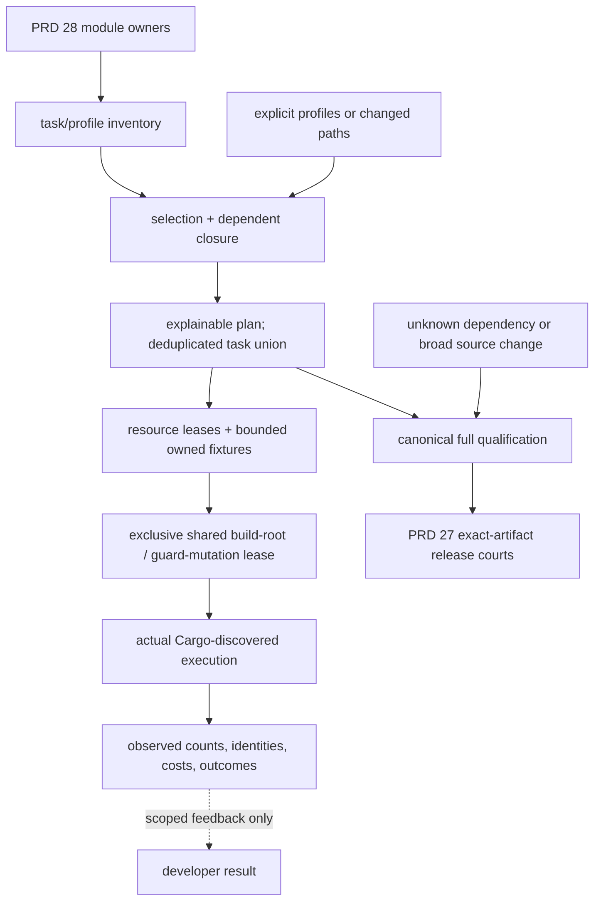
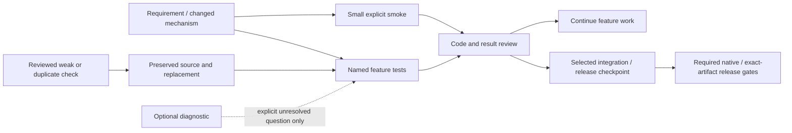

# Test orchestration and evidence scope

Owner of test selection, profile composition, fixture lifetime and feedback-cost
measurement. Parent: [product requirements](../PRD.md). The initial 0.2.16
proposal is historical; fixture lifetime and an initial explicit-profile planner
are partial, while automatic changed-path execution remains unqualified. The
[archived proposal](../plan/archive/plan-v0.2.16.md) preserves its original sequence.
INVENTORY, SELECT, COMPOSE, MEASURE and LIFETIME remain open at the statuses
below; archiving an obsolete version proposal neither completes nor abandons them.

[Module ownership](PRD_02_28_shared_core.md) owns abstraction boundaries.
[Native development court](PRD_02_32_dev_loop_crosscheck.md) owns the hosted
workflow and fixture-specific observations. [Delivery](PRD_02_27_con_delivery.md)
owns release obligations and exact-artifact authority. This module does not
change the product's capabilities or any release policy.

## Outcome tree DAG

```text
Outcome: relevant development feedback without lost release obligations
├── [-] Inventory authority
│   ├── [v] initial manifest: scripts/test-profiles.json
│   ├── actual suite names, feature/target/backend tuples and resources
│   └── required, opt-in, diagnostic, manual and unavailable evidence
├── [-] Selection and composition
│   ├── [v] explicit control/terminal/docs/reuse/script profile union
│   ├── [-] changed-path owner/dependent closure (plan-only)
│   ├── unknown/broad changes expand conservatively
│   └── exact task/build identities; isolated consumer graphs stay separate
├── [-] Fixture and resource lifecycle
│   ├── [v] cancellable journey sleeps and owned process teardown
│   ├── [-] opt-in native window diagnostics; profile wiring pending
│   ├── [-] named serial desktop gate for deadline-bound public observations
│   ├── [v] shared build-root and guard-mutation serialization in the 0.2.22 trial
│   └── [_] general resource leases before enabling automatic concurrency
└── Observable evidence
    ├── planned/observed names and counts, phase costs and final verdicts
    ├── real guard mutation must fail its selected profile
    └── complete canonical full gate; independent exact-artifact release courts
```



## Contracts

### Owner-selected development loop (2026-10-26)

The owner requests a small daily smoke set plus tests chosen for the current
requirement, and archival of redundant or ineffective checks. This changes the
default development schedule now, not the selected product's required behavior.

```text
Outcome: get useful feedback before spending another full build/court round
├── [v] SMOKE — a few real product entry/session/worker journeys
│   invariant: exact discovered tests execute once; no provider login or physical desktop input
│   evidence: named cases, actual counts and elapsed times from the existing planner
│   safe failure: zero tests or unsupported required environment fails its claim
│   dependency: current native product and isolated fixtures; non-goal: broad GUI/browser/IME qualification
├── [-] FEATURE — explicit requirement-owned profile or exact test selection
│   invariant: the changed behavior and its failure/recovery assertion own the selection
│   evidence: real selected journey and a meaningful counterexample for its guard
│   safe failure: retain uncovered/unknown dependencies in the report
│   dependency: capability PRD and known test names; non-goal: automatically rerunning every suite
└── [v] RETIRE — first reviewed redundant/weak checks archived
    invariant: source/reason and replacement remain reviewable; required behavior is retained
    evidence: archive inventory, surviving runtime checks and updated active test count
    safe failure: keep an unreviewed check; never delete a failing assertion to report green
    dependency: inspect what each test actually proves; non-goal: deleting useful regressions by age/size alone
```



Daily invocation is `scripts/test-tier.sh smoke`, followed by an explicit
profile or `scripts/build.sh test-suite ... CASE -- --exact` for the requirement.
The smoke inventory lives only in `scripts/test-profiles.json`. It reuses
existing public journeys; it is not a new framework or an all-target suite.
Run ordinary fixtures with fresh configuration/browser-profile roots. Batch
related assertions into the same owned journey and reuse matching build output.
Do not rerun full gates, all OS/ISA cells or guard-mutation batches after every
small edit. Select a native diagnostic only for a concrete unresolved question,
record its result and stop repeating an unchanged failed experiment. Integration
and release run their selected obligations at a deliberate source checkpoint.

First archival review: the source-text lint/doc spelling check duplicates the
actual build-wrapper argument court and does not prove compiler behavior.
The "documented modes" test only checks an invalid mode and can return a pass
without Bash; it also invokes real build cleanup from an alignment test.
Preserve both original tests under `tests/archive/`; the existing isolated
build-wrapper selftest owns selected-suite lint forwarding and invalid-mode
refusal. Product wire/queue, lifecycle, actual regressions and real native
failures retain their required scopes. Archival reduces the active alignment
set by two; runtime replacement belongs to the scripts profile, not every edit.

Evidence for this first checkpoint: the Windows smoke executes exactly three
discovered cases,0 ignored, in3.7/4.0/6.1 seconds (13.8 seconds summed task time
with the existing build cache). Receipt:
`target-six/v0.2.23-provider/test-loop-smoke/receipt.json`. It is development
feedback, not a cold-build budget, all-platform GUI claim or release receipt.
The active alignment suite now executes16 cases instead of18, all passing.
The wrapper selftest executes five isolated cases; removing selected-suite lint
forwarding or accepting an invalid mode makes its original assertions fail,
and exact source restoration passes. Receipt:
`target-six/v0.2.23-provider/test-loop-wrapper-controls/receipt.json`.
The planner's actual execution selftest also rejects inherited owner profile
roots and an extra libtest argument boundary; both deliberate faults fail and
restore. Receipt:
`target-six/v0.2.23-provider/test-loop-selection-controls/receipt.json`.
Other unreviewed tests remain active. This checkpoint does not claim a completed
repository-wide test-quality audit or automatic changed-path selection.

### Implementation ownership (partial)

| Component | Responsibility | Boundary |
|---|---|---|
| `scripts/test-profiles.json` | Initial task/profile inventory, ownership and phase metadata; feature/target/resource inventory remains open | No second suite list in shell or workflow code |
| `scripts/test-plan.py` | Explicit profile union, plan-only path fallback, Cargo test listing and observed count guard; complete dependency closure and receipts remain open | Use the Python runtime already required by build tooling; no new Rust runner crate |
| `scripts/test-tier.sh` | Compatible tier/profile CLI and forwarding | No independent dependency resolver, lint flags or release decision |
| `scripts/build.sh` | Canonical test lints shared by full and `test-suite` gates; a planned `test-build` mode emits Cargo artifact metadata without running tests | Reuse the same command/flag definitions for full and selected execution; `--no-run` is build evidence only |
| `tests/support/` | Owned fixture lifetime, temporary resources and diagnostics shared by actual test callers | First callers are black-box/control fixtures where contracts match; assertions remain with their capability suites; no generic fixture framework |
| Native dev workflow | Select native cells and invoke the same inventory/executor, upload final receipts on success/failure/cancellation | Do not compile a target and report its tests as executed |
| Release workflows | Existing exact-artifact authority in PRD 27 | No hidden signer/Promotion dispatch from a test profile |

The initial `scripts/test-profiles.json` and `scripts/test-plan.py` now provide
explicit `--profile`, `--phase`, `--list` and `--plan` entry points through
`scripts/test-tier.sh`. `--changed-since` is plan-only: unknown/shared paths
select the canonical full gate, and inferred selection cannot yet execute.
The manifest presently covers control, terminal paint, docs links, reuse and
script self-tests; it is not the complete inventory envisioned here. Selected
Cargo suites use `build.sh test-suite`, which shares the canonical dangerous
test lints with the full workspace/fork gate and rejects zero discovered or
executed tests. The black-box fixture now cancels journey sleeps on
drop, and its zoom window watcher is opt-in through `MINICON_ZOOM_WINDOW_WATCH=1`.
Windows x64 evidence: `dropping_a_session_cancels_an_active_journey_wait`
passed in about 0.5 seconds; replacing the cancellable wait with `sleep` made
it fail in about 5 seconds; the notes-persistence and ordinary zoom journeys
passed in about 2.2 and 9.2 seconds respectively. Other native cells and
in-flight control-command cancellation are still open. New executables, lint
flags and full-suite lists must not be reconstructed separately in each
consumer.

Run inexpensive static checks over changed test code before a mutation batch.
If a protected test changes, refresh its dependent guard cases and final affected
profiles; retain other evidence only when its source and guarded test scope still
match. This avoids repeating unrelated native courts after a test-only lint fix.

### Time-sensitive desktop qualification

The 0.2.21 owned-console held-frame journey must complete its text and PNG
observations inside the presentation window owned by PRD 24.01. Its fixture
uses the native query reply as the ready marker and starts independent public
CLI observations together; each records its own completion time. Before that
window, the public resize sets a 640x400 logical frame and waits for both frame
and PTY grid to settle; at least three rows and ten columns preserve every SDK
coordinate while bounding PNG work. A late
observation is `BLOCKED`, never a passed state assertion. The SDK's expensive
row readback is verified afterward. Product behavior and pixel assertions are
unchanged. Concurrent GUI journeys can exhaust that window on the shared test
host. `RUST_TEST_THREADS=1 ./scripts/build.sh test` names a serial schedule,
not a passing verdict; that schedule alone also exceeded the observation
window before the frame-size setup was bounded. Preserve the actual schedule
and outcome with each receipt; a serial pass does not certify a parallel run.
The actual failed/passing receipts belong to
[the archived plan](../plan/archive/plan-v0.2.21.md#browser-workspace-qualification-follow-up-2026-10-24).

### Inventory and selection

`scripts/test-profiles.json` is the initial single inventory. Each current task
records its owning capability, execution entry and phase. Complete inventory
must add features, target/backend constraints, resource claims and mandatory,
opt-in, diagnostic or manual evidence status. The current path rules only
explain a plan and fail broad/unknown changes to full coverage; they are not a
qualified PRD 28 reverse-dependent closure. A filename is not proof of a pure
or GUI-free test.

An obligation can name a complete suite or explicit discovered test names.
Map dependencies at module/API granularity where proved; a composer-only edit
does not acquire every numeric/backend obligation merely because both live in
one crate. Unmapped/new tests, modules or dependency edges expand coverage until
their ownership is reconciled. Validate discovery separately for each required
feature/target tuple; a declared non-applicable court differs from a required
court whose executable or tests unexpectedly disappeared.

`scripts/test-tier.sh` retains tier aliases and gains `--list`, `--plan`,
`--profile` (repeatable) and `--changed-since`. A plan prints selected tasks,
reasons, prerequisite closures, feature/target tuples and unavailable courts.
Unknown paths, ambiguous ownership, build/feature changes or unresolved fanout
expand to full coverage. A filter that observes zero tests cannot satisfy a
mandatory obligation. Renames/deletions and unstaged changes participate in the
change inventory, as do staged and untracked source files; a base revision alone
does not describe the current tree. Ignored generated output stays outside the
source inventory. Start selection in plan-only comparison mode; enable reduced
developer execution only after dependency/omission mutations demonstrate the
selection contract. Explicitly owned prose-only edits use the docs profile;
changes to a documented behavior also select that capability's contract tests.

Composition deduplicates identical obligations in a union. Build reuse requires
matching source/configuration, compiler, target, features, profile and rustflags.
Use Cargo discovery for executable identities; never guess hashed paths or pick
by modification time. Minimal external consumers remain in an isolated workspace
so feature unification cannot hide dependency leakage.

Resolve executables from Cargo's artifact output, then use the toolchain's
supported exact-name filters and listing interface to batch a union. On the
baseline Rust 1.97 harness, `--list --exact` with the clipboard and multi-tab
control names lists both tests, without executing either. Listing is discovery
evidence only; execution must still return those observed names and counts.
Do not depend on nightly JSON reporting or infer execution from a listing.

### Full coverage and reuse boundaries

`scripts/build.sh test` remains the canonical workspace-plus-vendored-fork
execution gate with dead_code, unused_variables and unused_must_use denied.
Workspace `--features` / `-F` selections apply to the workspace invocation;
the separate vendored-fork invocation retains test selectors and arguments
after `--` but omits those workspace feature names. This permits the explicit
Rust console integration selector without claiming fork feature equivalence.
`scripts/build-feature-forwarding-selftest.py` executes the wrapper with
recording commands and is registered in the offline self-test entry.
The full profile/tier adds existing required lint, minimal-consumer and script
checks without maintaining a second, incomplete workspace-suite list. Root
binary units, platform library units and vt100 damage oracles must be executed,
not merely compiled. A hosted development workflow remains scoped feedback;
its coverage cannot be inferred from `--all-targets` compilation.

Phases remain explicit. Edit feedback runs selected local obligations;
integration composes the affected contracts and resources; release requires the
canonical local full gate and the independent native/artifact gates owned by
PRD 27. `l3`/`all` is the complete local regression entry, not an instruction to
sign or publish. Its receipt states the local scope and names external courts
that it did not execute. A release planner cannot accept that receipt in place
of required six-cell, signing, Defender, reputation and Promotion receipts.
An ordinary developer plan prints which native courts are relevant; starting
cloud courts is an explicit selection, not a hidden side effect of a pure rule
test. OS/ISA-specific changes include their affected native implementation and
its scalar/neutral oracle; broad target/feature changes expand conservatively.

Consumer profiles cover core defaults/minimal/independent optional features,
UI default/terminal-selection and platform minimal/product feature closures.
Retain API identity, numerical oracles, recursive portability checks and the
legacy newline exception defined by PRD 28. An AgenTerm dependency update needs
an immutable MiniCon revision and evidence from AgenTerm's actual enabled
features and call sites. MiniCon's native result does not certify another
product or every optional capability.

### Lifetime, readiness and concurrency

Fixture waits react to cancellation. Drop closes only owned processes and
endpoints and joins workers within a documented deadline; the initial
cancellation-to-teardown target is two seconds, to be qualified per native
court. A pending wait cannot outlive its test solely to keep a host alive.
Cancellation covers both journey sleeps and in-flight owned CLI subprocesses;
an interruptible sleep alone does not bound a driver blocked on a 120-second
control exchange. Diagnostic output collection is bounded too.
Retain the assertion that caused a fixture to exist, including persistence
across a real process restart.

Separate causal readiness from operation assertions: observe an executed marker,
actual geometry or real history before asserting input effects. A shell's
echoed command alone is insufficient output evidence. Bounded failures name the
operation, last observation and owned process identity. Setup failures do not
count as negative proof of a later guard.

Diagnostic sampling runs in an explicit diagnostics profile. Removing optional
observation must not remove required functional assertions or turn an unrun
capability green. Actual timing budgets and exceptions are named, not global
sleep multipliers or blanket retries.

Isolate user configuration, native windows, clipboard formats and filesystem
fixtures before parallelism. Otherwise hold an explicit resource lease shared
across executables. A mutex inside one test executable cannot protect another
executable. Never kill processes by image name or mutate a user's global
configuration merely to accelerate tests.

### Parallel source owners and the shared build root

Independent source-file ownership does not isolate a Cargo build or a running
black-box fixture. A guard mutation in one module affects the whole binary;
linking can temporarily replace the canonical executable while an existing
fixture is spawning another public CLI process from that same path.

In the authorized 0.2.22 parallel trial, workers used exclusive write sets and
shared interfaces, then handed off source before the root's integration and
qualification. Mutations, builds and public journeys using the same output
root run serially under one controller. A worker waits for missing root
interfaces rather than repeatedly compiling an incomplete composition.
Separate artifact copies do not supply desktop/clipboard isolation by
themselves. The trial's actual overlap, rework and receipts belong to
[its plan](../plan/archive/plan-v0.2.22.md); no serial comparison or speedup is inferred.

### Receipts and measurements

Each receipt binds source/configuration, target, compiler, features, backend and
binary identity to planned obligations and selection reasons, observed names
and counts, final suite verdicts and unavailable/omitted courts. Distinguish
queue, setup/cache transfer, build, readiness, assertion and teardown times.
Do not derive a final pass from a status captured before tests finish.

Record controller and artifact-source revisions independently when they differ;
`GITHUB_SHA` identifies a workflow controller, not necessarily the binary under
test. With `MINICON_TEST_BINARY`, hash the supplied bytes and bind available
manifest provenance; never silently replace them with a local rebuild or infer
their source from the checkout. Required unknown provenance remains unresolved.
Receipt measurements must be real: a post-operation digest copied from the
expected value does not prove unchanged bytes. The 0.2.15 native Defender court
provides a measured-digest example owned by PRD 27.

Compare at least three like-for-like cold and warm runs with medians/ranges,
retained coverage and guard-mutation failures. Throughput reports identify
whether bytes are actually PTY-drained or console-agent rendered generation;
existing workload floors remain mandatory. Debug/source and exact retail-binary
tests are separate receipts. Optional network, manual IME and VM evidence must
be named explicitly; unavailable courts remain BLOCKED.

## Delivery leaves and safe failure

| Leaf | Invariant / observable evidence | Dependency / safe failure / non-goal |
|---|---|---|
| Inventory | Canonical expansion matches actual suite discovery and current gates | PRD 28/27/32; unknown obligations expand or fail; no invented universal certification |
| Selection | Required dependency mutation cannot escape its selected plan | Inventory; unknown paths select full; no release authority from a targeted pass |
| Composition | Identical tasks run once with matching identities and observed names/counts | Selection; incompatible graphs stay separate; no workspace-unified minimal consumer |
| Lifetime | Cancellation bounds teardown while persistence/input assertions remain | Owned fixtures; expose timeout and clean only owned PIDs; no skipped regression |
| Resources | Parallel tasks cannot clobber another session's settings/clipboard | Isolation or lease; serialize if uncertain; no blanket parallel run |
| Receipts | Planned obligations match observed outcomes; real guard mutations fail | Prior leaves; missing evidence stays unavailable; no successful zero-test gate |

## Status and non-goals

- [v] Initial design documented; implementation acceptance is in the v0.2.16 plan.
- [v] `l3`/`all` now executes fmt, workspace Clippy, canonical workspace and
  fork tests, reuse and offline self-tests. An unfiltered Windows x64 local
  run passed; filtered `l3` fails closed. This is local qualification only.
- [-] Fixture cancellation and diagnostic extraction have scoped implemented
  slices in the v0.2.16 plan.
- [-] Initial inventory, explicit-profile dispatcher and task deduplication;
  automatic path selection, complete suite/consumer inventory and comparable
  measurements remain open. `test-plan-selftest.py` guards phase deferral,
  deduplication, unknown-path full fallback and zero-test refusal; a Windows
  x64 `control` edit run executed 15 tests. This is scoped feedback, not a
  release verdict.
- [-] Windows x64 local platform/GUI courts passed for the explicit Rust
  provider; other OS/ISA and exact-artifact courts still need their own receipts.

Non-goals: new product features, a generic terminal engine, public crate renames,
new OS/ISA support, lower throughput floors, compiler/LTO changes, signing-policy
changes or weakening the six-cell/Defender/reputation/Promotion chain.


## Observed library-selection limitation

During the console VT-title work, `scripts/build.sh test --features
experimental-rust-console --lib -- --test-threads=1` completed the workspace
library unit binaries, then failed before the owned parsers with Cargo's
"--lib cannot be used multiple times": the wrapper adds --lib while forwarding
the caller's copy. This is an orchestration failure, not a full-gate pass.
Library-only argument normalization remains planned in this owner.

The current scoped workaround uses explicit test-name selectors through the
same wrapper. Names collected from the owned parser sources ran all 26 vt100
and 34 standard VTE library tests with zero filtered tests in those binaries;
no bare Cargo test entry point or release-policy change is implied. Evidence is
in the console leaf's ignored `title-vt-owned-parsers.log`. Future profile work
must use actual Cargo discovery and receipts rather than assuming a source-name
inventory proves coverage; the zero-filter result establishes the scope here.

### Local context and observation interference

On the owner's Windows desktop, use explicitly selected non-clipboard consumers.
Do not run the unfiltered workspace gate there: existing unignored control tests
write the real shared clipboard, even when their GUI uses `--no-activate`.
A per-process clipboard mutex does not isolate the desktop. The complete
`scripts/build.sh test` workspace/owned-fork gate runs on the existing isolated
Windows x64 dev-loop runner, before the independent browser/K3 steps, whenever
the dispatch has no Rust filter and is not a dedicated lifetime/ACL diagnostic.
Its standard-workspace log and receipt record the checked-out source and actual
counts; ignored opt-ins remain unqualified. No local desktop emulation or
assertion skipping substitutes for that execution.
Independent browser/K3 courts may continue after that standard step fails;
the final job explicitly retains its failure. Their passing evidence cannot
override the failed standard gate or qualify an unexecuted later suite.

A moved checkout may leave cached source-bound test programs with their old
`CARGO_MANIFEST_DIR`. Refresh the local source compilation before trusting its
path-dependent checks; preserve dependency caches and inherited edits. Native
fixture profile isolation is owned by PRD 28; a global runtime override must
not accidentally force distinct proxy environments into one folder.

Browser observation predicates use one public snapshot per poll and a bounded
rate, preserving the control owner's replay-cache budget while retaining actual
proxy-request and persistence assertions. Resource-sensitive local qualification
names its build schedule; [PRD 27](PRD_02_27_con_delivery.md#local-qualification-resource-budget)
owns the resource history and the release archive preserves failed runs.

The canonical build wrapper applies a caller's `--lib` selector to workspace
packages and avoids forwarding a duplicate to the separately owned fork, which
already selects its library. The complete standard product gate remains the
final development obligation; a filtered/failed wrapper call is not a full pass.

### Windows SDK fixture build prerequisite

The Windows main-unit suite includes the existing synchronized native SDK
journey owned by [TUI compatibility](PRD_02_24_01_tui_compatibility.md).
It requires the canonical workspace output
`target/debug/minicon-platform-console-probe.exe`. A filtered
`build.sh test-suite --bin minicon` invocation does not build another package's
probe binary. Prepare through `scripts/build.sh dev --workspace --all-targets`,
matching the native CI workspace build and MiniCon's enabled platform features;
do not substitute a platform-default-only check.

Observed 2026-10-26: the local main invocation ran852 passes, then reported this
one missing-fixture failure and two existing opt-in ignores. Its raw receipt is
`target-six/v0.2.23-provider/monitoring-report-full-regression/receipt.json`.
The workspace build and unchanged original SDK test then passed, followed by
the two synthetic worker journeys and alignment, in
`monitoring-report-regression-resume/receipt.json` under the same evidence root.
No assertion was weakened; the earlier failed whole invocation remains failed.
The subsequent standard workspace/fork invocation is retained as FAIL in
`monitoring-report-standard-gate/receipt.json` under the same evidence root.
The main unit binary passed 853 tests with two existing opt-in ignores; the
workspace later stopped at the minicon-web source-contract test requiring
`webkit_proxy_env` in `wry_host.rs`. Its 35 other package tests passed. The
owned-fork phase was not reached. Diagnose the actual host/proxy consumer before
changing its assertion; this failed invocation is not a complete gate pass.

The narrow source-contract repair retains the eight other original assertions
and checks the actual child environment and explicit context proxy calls.
Two actual production-call removals each failed the intended assertion; exact
restoration passed. The isolated default minicon-web package passed 22 tests.
Root initially expected the workspace-unified count of 36, so the original
control driver receipt retains an inventory failure; the separate adjudication
does not rewrite it. Evidence is `wry-host-source-repair-controls/receipt.json`
and `wry-host-source-repair-controls-adjudication.json` under the same root.
These structural checks do not qualify native proxy routing.

The subsequent full local run was stopped after the existing Windows composer
image test had written a synthetic DIB to the shared clipboard. It may have
replaced the owner's prior contents; they were not read or recoverable here.
`monitoring-report-standard-gate-resume/stop-receipt.json` records 1,187 completed
passes, unchanged source and successful fmt/default/native-auth Clippy checks,
not a complete gate. Its original RUNNING receipt remains alongside the explicit
stop receipt because the owned process was forcibly stopped. Complete standard
qualification now requires the isolated CI execution described above.
