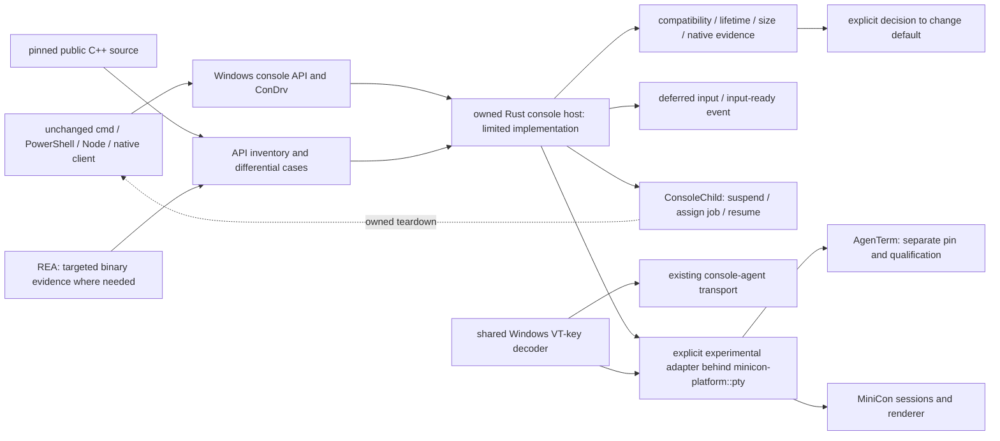

# minicon-console: owned Rust Windows console backend

Parent: [product index](../PRD.md). Existing PTY behavior remains owned by
[terminal](PRD_02_24_con_terminal.md); reusable boundaries by
[shared core](PRD_02_28_shared_core.md). Research reviewed 2026-10-19.

The owner authorizes development of `minicon-console`, an owned Rust replacement
for the Windows console host and ConPTY-facing backend. Independence means control of the user-mode API
server implementation, lifecycle and servicing, rather than changing a process
name. The hypothesis that the system host causes reported instability still
needs a reproducible failure and attribution; process counts do not prove it.

Legend: `[v]` implemented/verified with named evidence, `[-]` partial,
`[_]` planned.

## Tree

```text
Outcome: own the Windows console backend with measured compatibility
├── [v] Establish the implementation boundary
│   ├── existing minicon-platform::pty facade and two Windows adapters
│   ├── public Microsoft C++ host, API dispatch and ConDrv transport sources
│   └── REA 6.7.0 release/source research; no decompilation execution claimed
├── [-] Rust crate: crates/minicon-console
│   ├── [v] actual ConDrv server, input event and non-inheritable reference
│   ├── [v] bounded receive/cancellation and explicit unsupported completion
│   ├── [v] accepted CONNECT, opaque handles and DISCONNECT reclamation
│   ├── [v] real cmd ASCII / CJK / emoji output and exact nonzero exit
│   ├── [v] deferred line/raw/record input, explicit interruption and input-ready event
│   ├── [v] job-owned client launch, actual parent/child teardown and input budgets
│   ├── [v] explicit experimental PTY adapter, native resize and key delivery
│   ├── [v] current input/output reopen, native access/duplicate/close probes
│   ├── [v] scoped PowerShell 5/7 and Node TTY/readline native cases
│   └── [-] general API service, signals, screen semantics and product selection
├── [_] Optional isolated, source-pinned C++ comparison build
│   ├── explicit selected-host launch; record actual image, hash and fallback
│   └── retain upstream notices and separate upstream baseline from our changes
├── [-] Replace behavior behind a reusable Windows adapter
│   ├── console API dispatch, handles and client attachment
│   ├── input records, processed/raw modes, Unicode and screen state
│   └── cancellation, process ownership, resize and bounded shutdown
└── [-] Qualify and integrate
    ├── differential clients, fault injection and current-user lifecycle evidence
    ├── Windows x86_64 and aarch64 separately; exact OS/build and feature scope
    └── explicit selection, package budget and rollback before default promotion
```

## Memory palace



## Verified findings and source identities

Microsoft describes OpenConsole as the open-source console host. Its public
server source contains API dispatch and driver transport; this is a better
starting point than reconstructing those modules from decompiler output.
Public source and the locally installed Windows binary are separate identities:
no exact version or behavioral equivalence has been established.

Reference revision: `microsoft/terminal`
`9fd41b2baec77d25b8cfb584070d5998eab7df81`. Relevant source entry points:

- [README](https://github.com/microsoft/terminal/blob/9fd41b2baec77d25b8cfb584070d5998eab7df81/README.md),
  [license](https://github.com/microsoft/terminal/blob/9fd41b2baec77d25b8cfb584070d5998eab7df81/LICENSE)
  and [organization](https://github.com/microsoft/terminal/blob/9fd41b2baec77d25b8cfb584070d5998eab7df81/doc/ORGANIZATION.md).
- [API dispatch](https://github.com/microsoft/terminal/blob/9fd41b2baec77d25b8cfb584070d5998eab7df81/src/server/ApiDispatchers.cpp)
  and [ConDrv transport](https://github.com/microsoft/terminal/blob/9fd41b2baec77d25b8cfb584070d5998eab7df81/src/server/ConDrvDeviceComm.cpp).
- [ConPTY launch](https://github.com/microsoft/terminal/blob/9fd41b2baec77d25b8cfb584070d5998eab7df81/src/winconpty/winconpty.cpp)
  selects a host executable and carries native handles. Side-by-side launch is
  a feasibility reference, not proof our own host works on every supported OS.

REA official repository: [morluto/rea](https://github.com/morluto/rea).
Latest GitHub release observed on the research date:
[rea-agents-6.7.0](https://github.com/morluto/rea/releases/tag/rea-agents-6.7.0),
published 2026-10-18; tag target
`27dc42d10249f0410904a75c0997842eb03b931c`, package version `6.7.0`.
Its [Windows guide](https://github.com/morluto/rea/blob/27dc42d10249f0410904a75c0997842eb03b931c/docs/windows-ghidra-p0.md)
describes experimental native analysis; its
[CLI evidence contract](https://github.com/morluto/rea/blob/27dc42d10249f0410904a75c0997842eb03b931c/docs/cli.md)
is the operating reference. Native pseudocode and assembly are observations,
not an automatically recovered, buildable C++ project. Use REA for specific
unresolved binary/source differences, with symbols and differential execution.

Ten pinned reference files were downloaded and SHA-256 inventoried locally in
`target/conhost-research/source-inventory.json` (ignored). The observed system
host is file version `10.0.20348.1`, size `987136`, SHA-256
`b925ac56deef971ad6f83aed9eb8328568002c2b033917b70debc7f12e2e3553`.
No REA/Ghidra analysis or reference-host build was executed. REA, Java and
Ghidra were not discovered on the current command search path; that observation
does not establish absence from the machine.

## Ownership and architecture

Keep the public PTY facade stable. Windows-specific driver/bootstrap/ABI code
belongs in `minicon-console`, now a workspace member, behind the Windows
adapter with explicit experimental selection. Its initial Rust APIs are experimental;
the optional platform `rust-console` feature now depends on it; default
consumers do not enable or select it. AgenTerm can reuse the
mechanism, with its own explicit dependency and qualification.

The implementation language is Rust, as explicitly directed by the owner.
Microsoft C++ source and optional reference builds are specification and
differential evidence, not the new implementation. The component is named
`minicon-console`: it owns console service semantics; `minicon-platform::pty`
owns product-facing platform adaptation. If a C ABI is introduced, it must
bound ownership, buffer lengths, cancellation, errors and panic/exception
containment. Share host-neutral rules only after their behavior is understood.

The intended owned host still uses Windows kernel facilities, including ConDrv
where needed. Replacing that kernel driver is outside this user-mode project.
Raw redirected pipes alone cannot establish compatibility with console clients.
An initial build of upstream OpenConsole is a reference baseline, not a new
backend or a fix. Renaming that build proves neither independence nor stability.

## Delivery leaves

| Leaf | Invariant and observable evidence | Safe failure / dependency / non-goal |
|---|---|---|
| SOURCE | Pin source, toolchain and notices; map the required native structures and bootstrap contract into Rust. Optional reference builds record dependencies, binary hashes and actual imports. | Report missing tools explicitly; do not modify the installed system host. No binary/source equivalence claim from matching names. |
| BOOTSTRAP | A child built against the ordinary console API attaches to the selected host; record actual host image/hash and driver/bootstrap calls. Disabling custom-host selection must fail the identity assertion. | Refuse unsupported combinations or explicitly report fallback. Needs SOURCE; no silent system-host fallback satisfying an independence test. |
| SEMANTICS | Inventory implemented/unimplemented APIs and observed return codes, handles, text, cursor, events and exit behavior against reference and system hosts. | Unsupported behavior is explicit and session-local. Needs BOOTSTRAP; an echo-only demo is not shell/TUI compatibility. |
| LIFETIME | Current-user/SID-scoped launch identities survive PID-reuse checks; close-tab, close-window, crash, EOF, blocked I/O and resize races have bounded cleanup and sibling isolation. Mutating cleanup must fail. | Kill only owned fixture processes. Needs SEMANTICS; no cross-user process-count inference or global conhost termination. |
| PROMOTION | Per-OS-build and per-ISA runtime evidence, representative client journeys, host-inclusive resource accounting and artifact checks precede changing defaults. | Retain explicit compatibility backend; identify which backend actually ran. Needs prior leaves; no untested all-Windows claim. |

Required client cases include cmd, Windows PowerShell, PowerShell 7, Node-based
agent CLIs and native Console API probes. Cover raw/processed input, mouse,
Ctrl+C/Break, UTF-8/UTF-16, CJK, alternate screen, resize/reflow, redirected
handles, nested children, attach/free console and termination. Keep the matrix
small enough to diagnose individual differences before expanding it.

The experimental adapter now runs its Rust service in the consumer process,
without a service sidecar or embedded extraction. Shipping single-file delivery
still needs an explicit product-selection/packaging decision and exact-artifact
size/signature/scan and cleanup evidence. A C++ sidecar reference build may be
used only for research; no new shipping form is approved by this research
document. Retain current supported systems until the owner
chooses a separately evidenced compatibility boundary.

## Status and next executable milestone

[v] Source and REA research with pinned references. [-] Rust native transport
and API service; [v] initial connection/I/O/record/job subset; [_] remaining
API semantics, control signals, optional binary analysis and product selection.
Sequence: [backend research plan](../plan/plan-windows-console-backend.md).
This work has no assigned release version and does not replace the approved
0.2.16 test-orchestration plan. No production backend or default changed.

### Initial Windows x86_64 native evidence

`scripts/build.sh test rust_console_ -- --nocapture` executes thirty tests:
sixteen library cases (thirteen native and three state cases) and fourteen
independent native Win32-client cases. The
canonical wrapper visits unrelated workspace/fork suites but filters those
cases out; this is a targeted pass. The original five bootstrap cases remain:

- `rust_console_driver_registers_noninheritable_server_and_reference`: real
  driver registration/reference creation; kernel handle flags checked.
- `rust_console_driver_rejects_a_non_console_handle` and
  `rust_console_driver_rejects_truncated_registration`: kernel rejects the
  invalid handle and incomplete registration, respectively.
- `rust_console_driver_receive_timeout_cancels_and_settles_io`: two real
  asynchronous waits time out and settle; no stale first read blocks the next.
- `rust_console_driver_receives_and_rejects_a_real_cmd_connection`: an
  unchanged cmd fixture receives our private pseudoconsole reference through
  native process attributes. Rust receives CONNECT with the actual child PID,
  completes it as unsupported, and observes non-successful client exit.
  This is not proof cmd commands work. The fixture never invokes the system
  `CreatePseudoConsole`; it is terminated by its owned process handle on failure.

Runtime negatives: making native handles inheritable fails the handle-ownership
assertion; removing the selected reference from process startup fails CONNECT
reception. Both mutations are restored before the positive run. Local logs
remain under ignored `target/conhost-research/`.

An earlier attempt to query `IOCTL_CONDRV_GET_SERVER_PID` returned Win32 error 1
on the observed driver. That attempted identity mechanism is not shipped or
silently treated as supported; the bootstrap proof instead observes a real
kernel-delivered client request on our private server. No kernel-driver rewrite,
Windows aarch64 native pass, complete host implementation or improved stability
is claimed by these initial tests.

Compile-only checks also pass for Windows aarch64 (including test sources) and
the non-Windows Linux x86_64 configuration. The Linux configuration exports no
Windows console service; compilation does not qualify a native runtime.

### Accepted-client service and current API inventory

`ConsoleHost` binds permanently to one driver-session identity. Kernel-provided
process/object tokens are stored as opaque integers rather than dereferenced
pointers. The current caps are 64 clients, 1024 handle records and 1 MiB per
input transfer; oversized transfers fail explicitly. A request borrows its
originating session and is consumed by completion, preventing double completion
through the Rust API. These are implementation boundaries, not compatibility
certification for all clients or OS releases.

| Driver/API operation | Current behavior | Remaining scope |
|---|---|---|
| CONNECT / DISCONNECT | Accept validated initial metadata, issue process/input/output tokens, reclaim that client's records on disconnect. | General inherited/duplicated handles, attach/free-console and descendant lifecycle qualification. |
| CREATE_OBJECT / CLOSE_OBJECT | Open current input/output and unambiguous generic objects; retain native access/share metadata, enforce API access and retire known kernel-finalizer tokens even without a live process token. | Separate new screen buffers, other access masks, broad sharing and cross-process handle inheritance remain unqualified. Native Win32 CON opens on the measured kernel normalize share metadata to 3, including a requested share mode of zero. |
| RAW_WRITE / WriteConsole | Capture actual client bytes, convert current code page or UTF-16 to UTF-8, send to the supplied writer, update screen state. | DBCS output fragments, processed-output/mode fidelity, pending surrogate at final stream end and complete output backpressure/cancellation. |
| GetCP / SetCP / GetLangId | Distinct input/output code pages, validated ID updates, real initial OEM page/current-user language. UTF-8 one-byte reads are tested. | Full legacy/stateful code-page and mixed-encoding qualification. |
| GetMode / SetMode | Store buffer modes and enforce echo's line-input dependency; basic cooked/raw input consumes those modes. | Full mode validation, signals, insert/history editing and processed-output fidelity. |
| RAW_READ / ReadConsole | Retain actual requests until input arrives; cooked line/echo/backspace, Unicode/byte delivery, caller initial text, wake mask/control state, bounded partial-read tails. | Full editing/history, mixed ANSI-to-Unicode transitions with a partially consumed byte, all control-character and cancellation variants. |
| GetNumberOfInputEvents / ReadConsoleInputW / PeekConsoleInputW / WriteConsoleInputW | Bounded typed key/mouse/resize/focus queue; counts, remove/peek, NOWAIT bypass, native input-handle readiness and Unicode append/prepend decoding. Native client-written key/focus records and returned counts are tested. | ANSI input-record variants, remaining record types and broad application qualification. |
| GetScreenBufferInfo | Return bounded initial geometry and cursor from the owned VT parser, plus initial attributes/colors. | Full legacy screen mutation, attributes, scrolling, resize, multiple buffers and readback. |
| GetCursorInfo / SetCursorPosition | Query initial cursor size and owned VT visibility; validated native position emits a VT cursor move into the same screen state. | Cursor-size mutation, complete window/scrolling interactions and general API fidelity remain open. |
| GetTitleW / SetTitleW | Preserve initial/current UTF-16 title; bounded metadata and client buffers. | ANSI title variants and independent native API differential coverage. |
| Other operations | Explicit NOT_SUPPORTED; no silent call to system conhost. | Control signals, remaining layer APIs and GUI/product qualification. |

The backend reuses this repository's owned `vt100` fork for screen state behind
the Windows adapter. That reuse does not make Windows console mode semantics
equivalent to VT semantics; remaining differences stay explicit above.
`minicon-platform` and the MiniCon binary still do not depend on this experimental
crate, so the shipped default and artifact dependency graph are unchanged.

Native evidence:

- `rust_console_driver_owned_host_executes_real_cmd_output_and_exit`: unchanged
  system cmd executes a built-in echo. Exact output reaches the Rust sink, exit
  is zero, actual dispatch includes successful output and DISCONNECT clears all
  client records. Every dispatch in this fixture must be supported.
- `rust_console_driver_owned_host_preserves_real_cmd_unicode_and_nonzero_exit`:
  unchanged cmd writes Chinese plus an emoji through WriteConsole, then exits
  with status 7; exact text/space/CRLF and the actual exit status are checked.
- `rust_console_driver_owned_host_rejects_a_foreign_session_without_harming_its_client`:
  two private driver sessions and two real clients; a host rejects the foreign
  CONNECT while its original client remains live and finishes successfully.
- Three state cases cover a surrogate pair split across writes, malformed
  surrogate recovery and writer failure without false screen advancement.

Runtime negatives drop actual sink output, disable session binding, discard the
pending high surrogate and swallow sink failure. Each corresponding selected
test fails; restored code passed the original eleven-case output suite. These
cases remain in the backend selector and expanded PTY suite. Local evidence:
`target/conhost-research/host-final-suite.log` and named `*-negative.log` files.

Debugging found two fixture/bootstrap details: standard handles must explicitly
avoid the parent's streams; cmd's quoted image spelling must use native path
separators. A mixed `System32/cmd.exe` spelling caused cmd command parsing to
fail even though native WriteConsole worked. No production workaround or
relaxed output assertion was used to qualify echo. A separate local native API
probe helped confirm output mode, screen-info layout and WriteConsole's result;
it is diagnostic evidence, not a registered cross-platform acceptance case.

### Deferred input, independent API probes and owned process lifetime

`host/input.rs` owns bounded event/read state: 4096 queued events, 64 pending
reads, 32768 UTF-16 line units and the existing 1 MiB transfer ceiling.
`ConsoleHost` borrows the originating driver while reads are deferred. Each
request is completed once; dropping an unhandled request also releases its
actual kernel wait. On disconnect/handle close, associated deferred requests
and byte tails are removed. Input availability is the real event registered
with ConDrv, including input queued before CONNECT.

`ConsoleChild` is the reusable native launch/lifetime owner. It takes an
absolute image plus an explicit Windows command line, creates a suspended
client with the private reference, assigns a kill-on-close job, then resumes.
Resume checks the actual prior suspend count. The public process handle is
borrowed; membership/counts are queried from the private job. Dropping the owner
closes that job and waits for its root process with a bounded budget.
Native UTF-16 environment/cwd overrides and an explicit platform adapter are
implemented in the following milestone; broader product selection remains open.

The Cargo-built `minicon-console-probe` directly calls Windows APIs and reports
results to private files rather than using the console path it is testing.
Cargo supplies its exact executable path to `tests/native_input.rs`; the court
does not guess a hashed test path. It proves:

- ReadConsoleW exact UTF-16/counts, caller-supplied initial characters and a
  requested Tab wakeup with control-key state.
- Actual blocked cmd input, Enter-delimited completion and emoji backspace
  editing; killing the waiting client clears its deferred request.
- ReadConsoleInputW typed key/mouse/resize/focus fields, empty/nonempty peek,
  native stdin-handle waiting and NOWAIT from a second thread while a cooked
  read is already blocked.
- ReadFile one-byte UTF-8 reads preserve Chinese and a supplementary character;
  code-page conversion uses the native codec and retains per-handle byte tails.
- An overflow enqueue leaves the native-visible 4096-record inventory intact,
  and pre-CONNECT input signals the actual input handle.
- A blocked reader is reclaimed by job-owner drop. A real child spawned by the
  probe joins the same job and Rust console; root and descendant process
  objects are both observed terminated after owner drop. The descendant handle
  gains cleanup authority only after positive private-job membership checking.

The interruption protocol is console-specific. The pinned Microsoft
`readDataCooked`, `readDataDirect` and `readDataRaw` implementations use
`STATUS_ALERTED` for handle-closing/interruption cases. A generic
`STATUS_CANCELLED` reply caused the controlled cmd fixture to exit with an
access violation; that is a rejected implementation, not a successful cancel.
Native ReadConsoleW now returns BOOL success, zero characters and LastError
995 (`ERROR_OPERATION_ABORTED`) on the tested interruption path. This special
console behavior is documented by [ReadFile](https://learn.microsoft.com/en-us/windows/win32/api/fileapi/nf-fileapi-readfile)
and inherited by [ReadConsole](https://learn.microsoft.com/en-us/windows/console/readconsole).
It does not implement delivery of a Ctrl+C process signal.

Seventeen runtime negative controls cover payload delivery, interruption
status, input-event signaling, ANSI byte tails, raw surrogate pairing, Enter
waiting, NOWAIT ordering, native mouse fields, dead-client cleanup, initial
input offsets, kill-on-close, suspended launch, request-drop cancellation,
Unicode backspace, atomic queue overflow, wakeup control state and prebound
input signaling. Each selected test must fail with the changed behavior;
all edited source bytes are restored before the positive suite. An early mouse
mutation merely caused an unused-variable compile failure and was replaced by
a runtime mutation; compile failures do not count as negative proof.

Local receipts: `target/conhost-research/input-negative-audit.json`,
`input-full-suite.log`, and per-control `*-negative.log` files. The current
native scope is Windows x86_64 on the measured host; Windows aarch64 compilation
does not replace native execution. General signal/resize/readback compatibility,
legacy driver bootstrap and MiniCon/AgenTerm product selection remain open.

### Explicit experimental PTY integration

Enable MiniCon's `experimental-rust-console` feature (forwarding the platform's
`rust-console` feature), then call the Windows `ChildCommand::rust_console()`
builder before `spawn`. The ordinary `into_parts`, master reader/writer/resize,
wait clone, native keys, input ownership and verified Job cleanup contracts are
used. `PtyMaster::backend_kind()` identifies the actually opened Windows session;
the process-wide default backend report still describes default selection.
No GUI setting, environment flag or automatic fallback selects the Rust host.

The Windows adapter's `pty/rust_console.rs` composes the existing command-line
quoting, application search, environment merge, cancellable input writer and
64 KiB bounded output queue. One in-process worker owns its driver and borrowing
host locally. There is no console-agent child, CreatePseudoConsole call or
system-host launch in this path. It polls its private input pipe, retains split
UTF-8 and CRLF state, and services a bounded control queue. Invalid UTF-8 is an
explicit session failure. Native up/down keys bypass host console attachment.
The owned screen has a 1 Mi-cell budget; resize updates the reused VT screen
and emits a native window record when window input is enabled. This does not
yet establish full reflow, alternate-buffer or legacy screen API compatibility.

Shutdown switches output to drain mode before terminating the private job and
waiting, bounded, for the host worker. The worker reports transport errors and
EOF through the existing output queue. API-level unsupported replies go back
to their requesting clients without becoming authority to kill sibling clients.
A final native cancellation (995) becomes EOF only after the actual private
Job is observed empty. A live client's error remains visible. Independent
output-reader failures are sent to the main test thread, which also requires
EOF; a detached reader panic cannot supply positive evidence.

`scripts/build.sh test --features experimental-rust-console rust_console_ -- --nocapture`
adds seven platform integration cases and one actual-output-capacity shutdown
case to the original thirty tests. The facade cases cover environment/cwd and
nonzero exit, fragmented UTF-8 and CRLF, blocked/nonreading-client cleanup, prelaunch screen
budget rejection, native initial/resized dimensions and key fields. UTF-8
fragments are separated by two acknowledged worker laps, preventing pipe
coalescing from bypassing the decoder boundary. The output-pressure case
observes the queue at actual capacity before shutdown and requires worker exit,
not merely client exit. Native dimension/key reports come from a Cargo-built
Win32 fixture using a private result file; Cargo provides the exact binary path.

Twelve additional runtime negative controls cover actual backend selection,
environment/cwd forwarding, split UTF-8/CRLF, initial dimensions, resize event
fields, key repeat, job termination, output-drain release, the prelaunch screen
budget and the workspace/fork feature boundary. Each selected test/self-test
fails after its guarded behavior is changed; compile failures are excluded and
source restoration is SHA-256 checked. Local receipts are
`target/conhost-research/pty-negative-audit.json`, `pty-positive-suite.log` and
the named `pty-*-negative.log` files. These extend the earlier milestone's
negative evidence rather than claiming its old source hashes describe this one.

The measured native facade host reports Windows `10.0.20348`, build `20348`,
x86_64. The following real-client milestone extends this scope; older Windows
and Windows ARM64 runtime behavior remain unqualified. GUI integration,
complete control signals and screen semantics remain required before promotion.

### Real-client and native object milestone

The native qualification command adds explicitly selected external courts:
`scripts/build.sh test --features experimental-rust-console rust_console_ -- --include-ignored --nocapture`.
Set `MINICON_TEST_WINDOWS_POWERSHELL`, `MINICON_TEST_PWSH` and
`MINICON_TEST_NODE` to the absolute images being qualified. Their tests fail
with `BLOCKED` when a requested image is missing; default execution leaves the
five external/reference courts unrequested rather than counting them as passes.
Clear `AGENTERM_FORCE_CONSOLE_AGENT` and `FORCE_CONSOLE_AGENT` in that test
process for the reference court. It requires actual backend identity `conpty`;
an inherited fallback override initially selected `console-agent` and was
rejected, not accepted as reference evidence.

The measured images are Windows PowerShell `5.1.20348.859`, PowerShell `7.4.2`
and Node `v24.15.0`. `target/conhost-research/client-identities.json` records
their observed runtime versions, file versions and SHA-256 values. Both
PowerShell cases set UTF-8 input/output explicitly, read CJK plus an emoji and
return an exact nonzero exit code. Node requires actual stdin/stdout TTYs and
exercises raw Unicode delivery and readline cursor-left insertion (`ac`, left,
`b` becomes `abc`). The scripts use `TERM=xterm-256color`, matching MiniCon's
terminal launch; inherited `TERM=dumb` selected Node's simplified editor and
was a rejected fixture configuration. This does not qualify PowerShell's full
interactive editor, all default encodings, Node agent packages or general TUIs.

`host/objects.rs` owns handle identity/access/share checks. Current-buffer
CREATE_OBJECT completion transfers its token in native `Information`, rather
than an output byte buffer, following the pinned
[IoDispatchers](https://github.com/microsoft/terminal/blob/9fd41b2baec77d25b8cfb584070d5998eab7df81/src/server/IoDispatchers.cpp).
An unchanged Win32 fixture verifies read-only/write-only access failures,
DuplicateHandle survival after original close, generic CON input, and 1050
sequential open/close operations beyond the simultaneous handle cap. Its native
result vector matches the explicitly opened system ConPTY reference. Requested
Win32 share mode zero succeeds on this host and arrives at our server as share
metadata 3; this is not evidence that exclusive native sharing has been proved.

The cursor query exposes a concrete contract discrepancy: public
[GetConsoleCursorInfo](https://learn.microsoft.com/en-us/windows/console/getconsolecursorinfo)
documents READ access, but the measured 20348 server and pinned
`ApiDispatchers.cpp` require WRITE. The differential fixture covers both handle
directions; the implementation follows that observed/source-pinned behavior
without claiming identical behavior across all Windows builds.

Windows `console_input.rs` now owns the VT-key decoder used by both the legacy
console agent and the owned adapter; its existing agent tests retain their
identities. The owned worker uses it for escape keys while preserving its own
complete UTF-8/UTF-16 text path. Native records retain key identity even with
VT input mode enabled; only ReadConsole/ReadFile text delivery converts those
keys into supported VT sequences. A native probe checks both API directions
after a CSI prefix is split across acknowledged worker laps. Key modifiers,
all function-key forms, mouse transport decoding and the legacy decoder's full
Unicode behavior remain separate qualification obligations.

`WriteConsoleInputW` now decodes bounded native records, preserves append versus
prepend ordering, services actual waiting reads and returns the native count.
This also supplies the input wakeup used by libuv when canceling a previous
console read. The [Node v24.15.0 libuv source](https://github.com/nodejs/node/blob/v24.15.0/deps/uv/src/win/tty.c)
was a source guide; no binary/source equivalence is claimed. Close finalizers
remove the known handle's pending reads and byte tails before retiring it,
and refresh the actual input-ready event.

The expanded selector executes 46 targeted cases: the earlier 38, three more
native platform cases, four external-client cases and one ConPTY differential
case. Local positive evidence is `target/conhost-research/clients-positive-suite.log`.
The final selector also includes `selected::console_agent::tests::` after `--`
and executes the 29 existing agent unit cases, for 75 targeted cases in
`clients-final-suite.log`. This is scoped regression evidence, not the full GUI
or release court. Normal experimental execution without requested external
courts executes 41 of these backend cases and leaves five unrequested.

Twelve additional runtime negative controls cover current-buffer reopen for
both PowerShell versions, Node cursor-query initialization, access checking,
compatible share metadata, close-budget reclamation, native cursor permissions,
shared arrows in both Node and the legacy agent, record payload/count, and VT
text/record delivery. Source restoration is SHA-256 checked. An initial arrow
mutation only caused a dead-code compile failure; it was replaced with a
runtime mutation and the compile-only failure was excluded. Receipts are
`target/conhost-research/client-negative-audit.json` and named
`client-*-negative.log` files. Each earlier milestone's receipts retain their
own source scope; they are not relabeled as evidence for this revision.
