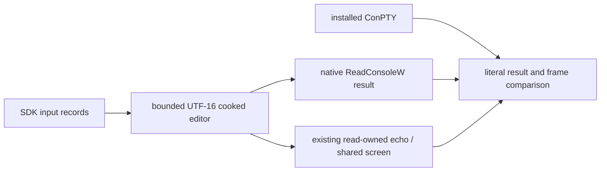

# minicon-console: owned Rust Windows console backend

Parent: [product index](../PRD.md). Existing PTY behavior remains owned by
[terminal](PRD_02_24_con_terminal.md); reusable boundaries by
[shared core](PRD_02_28_shared_core.md). Research reviewed 2026-10-20.

The owner authorizes development of `minicon-console`, an owned Rust replacement
for the Windows console host and ConPTY-facing backend. Independence means control of the user-mode API
server implementation, lifecycle and servicing, rather than changing a process
name. The hypothesis that the system host causes reported instability still
needs a reproducible failure and attribution; process counts do not prove it.

Legend: `[v]` implemented/verified with named evidence, `[-]` partial,
`[_]` planned.

## Tree

```text
Outcome: own the Windows console backend with measured compatibility
├── [v] Establish the implementation boundary
│   ├── existing minicon-platform::pty facade and two Windows adapters
│   ├── public Microsoft C++ host, API dispatch and ConDrv transport sources
│   └── REA 6.7.0 release/source research; no decompilation execution claimed
├── [-] Rust crate: crates/minicon-console
│   ├── [v] actual ConDrv server, input event and non-inheritable reference
│   ├── [v] bounded receive/cancellation and explicit unsupported completion
│   ├── [v] accepted CONNECT, opaque handles and DISCONNECT reclamation
│   ├── [v] real cmd ASCII / CJK / emoji output and exact nonzero exit
│   ├── [v] scoped dense TUI replay: original API payloads / emitted wire / native readback / alternate resize
│   ├── [v] scoped native synchronized output into a common presented-frame consumer
│   │   invariant: owned PTY delivers markers/data while native query reads and controls stay live
│   │   evidence: two synchronized_native courts; 12 SDK sessions, source/wire/native/frame captures, exit/EOF/private-Job cleanup
│   │   safe failure: explicit end or bounded consumer recovery; no transport pause or positive GUI capability claim
│   │   dependency: common TerminalPresentation and native read admission; non-goal: GUI timers/pixels or system-host parity
│   ├── [v] private-mode report return transport: native VT reads receive actual frontend replies
│   │   invariant: complete DECRPM is input text, not a dropped unknown physical key
│   │   evidence: independent SDK literal reads, fragmented round trip, Up/q, exit31 and EOF
│   │   safe failure: bounded classification/queues and finite owned-process teardown
│   │   dependency: common frontend helper + native input; non-goal: general response ownership
│   ├── [v] native DA/DSR/CPR response transport with finite CPR/F3 disambiguation
│   │   invariant: input follows committed query output; expired/consumed CPR requests release key dispatch
│   │   evidence: independent native literal responses, raw/VT modes, F3 records and exit/EOF
│   │   safe failure: bounded query inventory and session-local teardown on tracking failure
│   │   dependency: PRD 35 common response tracker; non-goal: cross-process reply attribution
│   ├── [v] scoped native read retention/admission through the opened PTY
│   │   invariant: distinguish retained deferred calls from validated waiting reads; metadata I/O is neither
│   │   evidence: actual SDK phase transitions, pressure/mode gates and bounded read-only control
│   │   safe failure: unavailable backend returns Unsupported; snapshot grants no future read/PID authority
│   │   dependency: native host inventory + platform PTY control; non-goal: guessing ConPTY internals from thread I/O flags
│   ├── [v] deferred line/raw/record input, explicit interruption and input-ready event
│   ├── [v] scoped native input flush: queue, cached-text/read lifetime and readiness
│   ├── [v] scoped ANSI input-record writes: code pages, partial DBCS and bounded admission
│   ├── [v] scoped ANSI record reads/peeks: bounded expansion, tail lifetime and live queries
│   ├── [v] scoped single-write input coalescing: shared admission and checked repeats
│   ├── [-] cooked editing: processed backspace/newline and wakeup-control precedence
│   │   ├── [v] scoped silent UTF-16 cursor/edit state and actual Console.ReadLine consumer
│   │   ├── [v] scoped native Ctrl+Left/Right word navigation (48-session court below)
│   │   ├── [-] shared-parser echoed cursor/repaint; broader editing-key transport open
│   │   └── [v] scoped read-owned drawing-buffer retention / hidden echo / completion collection
│   ├── [v] scoped cancelled-read buffer reclamation / admitted fallback / query-safe output scheduling
│   ├── [v] scoped retirement preflight / caller-scoped completion / in-flight file-reference ownership
│   │   └── [v] retirement court observes projected surviving frame before presentation transport close
│   │       invariant: client exit is not proof that the last frame was delivered
│   │       evidence: owned/reference B> frame, cursor/boundary, unchanged native return and EOF assertions
│   │       safe failure: bounded frame wait; no early HPCON close or relaxed snapshot
│   │       dependency: native retirement + live PTY reader; non-goal: a GUI teardown or system-host fix
│   ├── [v] scoped queued-read reply shapes / caller retirement / unrelated FIFO retention
│   ├── [v] scoped keyboard waiters: raw Ctrl+C and record C/Break retain their reads
│   ├── [v] scoped pending text reads retain their admitted cooked/raw kind across LINE_INPUT changes
│   ├── [v] scoped raw text batches drain available input to caller capacity and preserve record/codec remainders
│   ├── [v] scoped completed text/cache ownership: duplicates share, independent files isolate, final close retires
│   ├── [v] scoped inherited input: explicit files retain continuation; defaults rebind per connection; verified child exit
│   ├── [v] native aliases: bounded per-executable A/W tables, DOSKEY expansion and cooked continuation
│   ├── [v] job-owned client launch, actual parent/child teardown and input budgets
│   ├── [v] explicit experimental PTY adapter, native resize and key delivery
│   ├── [v] current input/output reopen, native access/duplicate/close probes
│   ├── [v] scoped PowerShell 5/7 and Node TTY/readline native cases
│   ├── [v] connection/file lifetimes, restricted inherited stdio and UTF-8 tails
│   ├── [v] scoped processed Ctrl+C: private Job admission, retained process handles,
│   │   native handler receipt and interrupted-read evidence; missing native
│   │   entry point fails explicitly; no host-console group broadcast
│   ├── [v] standalone queue-full interruption and handler API reentry: native
│   │   inventory/handler receipts, bounded failure, same private Job authority
│   ├── [v] native GenerateConsoleCtrlEvent: C/Break, attached process groups,
│   │   retained group metadata and real same-Job child isolation; no PID recovery
│   ├── [v] scoped keyboard Break: shared native-key facade, raw/cooked interruption,
│   │   events/ANSI flush, completed text retention and native-ready reset
│   ├── [v] scoped output mode fidelity: native processed controls, VT gating, newline
│   │   translation and margin behavior; compare real SDK cursor receipts and
│   │   terminal projection, retain finite wide-margin progress and shared parser ownership
│   ├── [v] scoped drawing attributes: native setter/query and subsequent text share VT state
│   ├── [v] scoped native character/attribute readback: bounded views of the shared screen
│   ├── [v] scoped native fills: shared literal-cell/style edits with ordered safe projection
│   ├── [-] rectangular W/A read/write: clipped row stride, per-cell styles and scoped wide pairs
│   │   └── [v] scoped read-only virtual current-font/size queries for real RawUI
│   ├── [-] native geometry: buffer versus viewport versus parent PTY dimensions
│   ├── [-] multiple native buffers: stable handle binding, inactive state and active publication
│   ├── [-] bounded Unicode publication batches over the shared lexer and scalar-width policy
│   ├── [-] canonical invalid UTF-8 prefix recovery before native edits and exit
│   ├── [v] native-buffer process-exit fallback and inherited file-object retirement
│   ├── [v] ordinary output follows vertical viewport without horizontal panning
│   ├── [v] native buffer handoff preserves each stream's VT main/alternate pair
│   ├── [-] console-wide title metadata and frontend publication
│   │   └── native W setter uses the common independent title formatter
│   │   └── scoped A/W setters/getters, input code pages and bounded native replies
│   │   └── complete VT title commits and nonvisual effects from inactive producers
│   │   └── initial CONNECT publication and scoped parent/child title lifetime
│   ├── [v] scoped native cursor info: SDK/PowerShell sizes, visibility and shared replay
│   ├── [-] indexed native output: variable text/attribute spans over common cells
│   ├── [-] native scroll: shared snapshot moves; scoped W/A, overlap, clip and RawUI evidence
│   ├── [-] mixed output: authoritative parser boundaries, bounded fragments and native injection
│   └── [-] general API service, signals, screen semantics and product selection
├── [_] Optional isolated, source-pinned C++ comparison build
│   ├── explicit selected-host launch; record actual image, hash and fallback
│   └── retain upstream notices and separate upstream baseline from our changes
├── [-] Replace behavior behind a reusable Windows adapter
│   ├── [v] minicon-platform bounded input queue and control priority: serialized
│   │   ordinary writes, processed C bypass, raw order and Break transport flush;
│   │   native receipts and finite close, no unbounded staging
│   ├── [v] scoped nonblocking bounded output staging and deferred output-producing
│   │   requests: keep private controls/native queries live under output pressure;
│   │   ordered recovery and EOF tail evidence, explicit budget failure
│   ├── console API dispatch, handles and client attachment
│   ├── input records, processed/raw modes, Unicode and screen state
│   └── cancellation, process ownership, resize and bounded shutdown
└── [-] Qualify and integrate
    ├── [v] scoped explicit product GUI opt-in and actual native-window SDK consumer → PRD 24.01
    │   invariant: actual opened identity; inherited selection; bounded waiting-client close
    │   evidence: gui_owned_console native-window/selection courts, scoped Windows x64 artifacts
    │   failure: reject missing build support; no automatic fallback/default promotion
    │   dependency: existing PTY facade and shared presentation; non-goal: compositor or real harness acceptance
    ├── differential clients, fault injection and current-user lifecycle evidence
    ├── Windows x86_64 and aarch64 separately; exact OS/build and feature scope
    └── explicit selection, package budget and rollback before default promotion
```

## Memory palace

```mermaid
flowchart LR
    CLIENT["unchanged cmd / PowerShell / Node / native client"] --> API["Windows console API and ConDrv"]
    FRONTEND["frontend-owned capability replies"] --> RINPUT["common report grammar / finite CPR window before key decoder"]
    HOST --> ACCEPTED["accepted output / caller clock"] --> CPR["common outstanding CPR inventory"] --> RINPUT
    RINPUT --> HOST
    READOBS["read-only PTY control / aggregate native read state"] --> HOST
    API --> HOST["owned Rust console host: limited implementation"]
    HOST --> ADAPTER["explicit experimental adapter behind minicon-platform::pty"]
    ADAPTER --> SYNCCONSUMER["SDK synchronized-output court: common TerminalPresentation consumer"]
    SYNCCONSUMER --> SYNCFRAME["active / presented frames; source / wire / native readback"]
    SYNCCONSUMER --> FRONTEND
    HOST --> INPUT["deferred input / input-ready event"]
    INPUT --> COOK["one native UTF-16 editor / silent and echoed reads"]
    COOK --> BIND["native read owns starting drawing buffer until completion"]
    BIND --> HIDECHO["hidden buffer edits / no active-buffer publication"]
    BIND --> COLLECT["closed buffer retained during read / collected after completion"]
    BIND --> CANCELBUF["cancel: discard hidden orphan / retain active identity until admitted"]
    CANCELBUF --> READYWORK["has_pending_output / one fallback before queued kernel call"]
    READYWORK --> ECOMMIT
    CANCELBUF --> RETIRE["one process/object read-retirement match"]
    RETIRE --> QUEUED["queued and accepted reads: same selector / cause / native reply builder"]
    QUEUED --> REPLIES["ReadFile 0 / ReadConsole 20 / records 8 bytes; zero returned counts"]
    QUEUED --> FOREIGN["preserve other callers / queued writers / kernel finalizers"]
    INPUT --> WAITERS["keyboard: cooked C/Break ends; raw C and record C/Break wait"]
    WAITERS --> READMODE["admission fixes waiter kind; current mode still controls signal recognition"]
    READMODE --> RAWBATCH["raw: available units to remaining capacity / preserve queue and codec tail"]
    RAWBATCH --> FILECACHE["file-owned completed UTF-16 / encoded tail / flush readiness"]
    FILECACHE --> INHERITCACHE["inherited file vs new default connection / creator retirement / retained child observation"]
    COOK --> ALIASES["native executable-scoped aliases / expand after echo / per-file multiline continuation"]
    RETIRE --> POSTLIVE["predict surviving output handles and read owners before dispatch"]
    POSTLIVE -->|"may publish"| READYWORK
    POSTLIVE -->|"another read survives"| INPUT
    COOK --> ELAYOUT["temporary common-parser layout / bounded origin search"]
    ELAYOUT --> DCURSOR["absolute drawing cursor / delayed wrap"]
    DCURSOR --> VT
    ELAYOUT --> ECOMMIT["sink before screen / viewport / echo-origin commit"]
    ECOMMIT --> VIEW
    HOST --> MODES["Win32 output modes / native SDK differential receipts"]
    MODES --> VT["reuse owned VT parser and terminal projection"]
    HOST --> ATTR["native drawing attributes / SDK query / projected cells"]
    ATTR --> VT
    HOST --> READBACK["native cell readback / bounded result / same shared screen"]
    READBACK --> VT
    HOST --> FILL["native fills / transactional shared-cell edits / safe VT projection"]
    FILL --> VT
    HOST --> RECT["CHAR_INFO rectangles / capture bounds / clipping / access"]
    RECT --> EDIT["shared Screen::write_cell / row bounds / damage"]
    EDIT --> VT
    RAWUI["real Windows PowerShell RawUI"] --> RECT
    HOST --> GEO["native buffer / window geometry / access / bounds"]
    GEO --> VIEW["common drawing grid versus projected viewport"]
    VIEW --> VT
    HOST --> BUFFERS["native buffer identities / per-buffer common terminal state"]
    BUFFERS --> VIEW
    BUFFERS --> BIND["CONOUT open / duplicate lifetime / active-close fallback"]
    HOST --> BATCH["bounded UTF-16/UTF-8 text batches / native newline and margin translation"]
    BATCH --> RECOVERY["shared invalid-prefix boundary / canonical replacement / retained new grammar"]
    HOST --> FAMILY["native buffer file lifetime / creator exit / inherited survivor / final-close fallback"]
    HOST --> FOLLOW["vertical stream follow / two-axis native cursor commands / fixed metadata effects"]
    HOST --> LAYER["common displayed-stream activation / logical VT layer / pending grammar"]
    HOST --> TITLE["A/W title metadata / input code page / exact native reply counts"]
    TITLE --> CODEC["Windows-private whole-string codec: titles / output / readback / input records"]
    INPUT --> ANSI["A record writes / typed conversion / current input CP"]
    ANSI --> CODEC
    ANSI --> CAP
    ANSI --> LEAD["one retained DBCS lead / commit after converted admission"]
    INPUT --> MERGE["single append / checked key repeat / mouse position / latest resize"]
    MERGE --> SLOTS["shared raw-queue admission / zero-slot tail replacement"]
    GEO --> SLOTS
    INPUT --> AR["A/W record read / Peek / bounded staged reply"]
    AR --> CODEC
    AR --> RT["at most seven encoded key tails / pure Peek / raw queue counts"]
    AR --> LIVE
    TITLE --> TITLEOUT["common independent bounded title publication"]
    TITLE --> EVENTS["committed OSC title events / inactive stream effect publication"]
    TITLE --> INIT["staged initial title / admission / output readiness / accepted CONNECT"]
    BATCH --> VT
    HOST --> CUR["native cursor size / visibility / WRITE access"]
    CUR --> CV["common visibility / shape / blink and replay"]
    CV --> VT
    HOST --> STR["indexed W/A text / attribute spans / counts / WRITE access"]
    STR --> SPAN["shared literal text spans / independent styles / clipped end"]
    SPAN --> VT
    HOST --> SCROLL["native scroll / WRITE access / code pages"]
    SCROLL --> MOVE["common CellRect / snapshot move / wide-pair invariants"]
    MOVE --> VT
    RAWUI --> SCROLL
    RAWUI --> FONT["Windows legacy font queries / virtual metadata only"]
    HOST --> FONT
    HOST --> FRAME["client VT/UTF-8 fragments / immediate controls / native output boundary"]
    FRAME --> VT
    HOST --> LIFE["connection defaults vs opened file objects"]
    LIFE --> DEFAULTS["DISCONNECT: caller reads and connection defaults"]
    LIFE --> FILES["CLOSE_OBJECT: shared file state and remaining reads"]
    HOST --> JOB["ConsoleChild: suspend / assign job / resume"]
    JOB --> SIGNAL["control targets admitted before CONNECT reply"]
    SIGNAL --> RETAIN["retained process handle / live check / native EndTask"]
    HOST --> GROUP["admitted CONNECT process-group metadata"]
    GROUP --> GENERATE["native C/Break API / known group check"]
    GENERATE --> RETAIN
    INPUT --> CAP["queued-record budget / bounded interrupt batches"]
    CAP --> SIGNAL
    CAP --> BRK["native Break / modifier validation"]
    BRK --> CACHE["flush events and ANSI bytes / preserve completed line text"]
    INPUT --> FLUSH["native input flush / WRITE rights / no read interruption"]
    FLUSH --> CACHE
    FLUSH --> LIVE
    CACHE --> READY["cached text readable / post-Break native event reset"]
    JOB -. "owned teardown" .-> CLIENT
    ADAPTER --> MC["MiniCon sessions and renderer"]
    ADAPTER --> IQ["Rust input: 16 frames / serialized ordinary writers"]
    IQ --> PRESS["actor observes stalled input pump"]
    PRESS --> PRIORITY["processed Ctrl+C priority / raw bytes retain order"]
    PRIORITY --> SIGNAL
    BRK --> EPOCH["clear transport and decoder fragments / interrupt old writers"]
    EPOCH --> IQ
    ADAPTER --> OQ["bounded output staging / FIFO deferred emitting requests"]
    OQ --> LIVE["continue controls and non-emitting native queries"]
    OQ --> TAIL["consumer recovery drains staged bytes before EOF"]
    ADAPTER --> AG["AgenTerm: separate pin and qualification"]
    KEYS["shared Windows VT-key decoder"] --> ADAPTER
    KEYS --> OLD["existing console-agent transport"]
    SRC["pinned public C++ source"] --> SPEC["API inventory and differential cases"]
    REA["REA: targeted binary evidence where needed"] --> SPEC
    SPEC --> HOST
    GATE["compatibility / lifetime / size / native evidence"] --> DEFAULT["explicit decision to change default"]
    HOST --> GATE
```



## Verified findings and source identities

### Accepted drawing-attribute leaf

Invariant: native text attributes, subsequent writes and native attribute queries
use the existing VT drawing state, without a second screen model. Evidence must
exercise all 256 foreground/background combinations, reverse/underline, native
access checks and interleaved VT changes through an independent SDK client and
system ConPTY. Unsupported legacy grid/DBCS attribute flags fail explicitly;
rectangular writes, buffer cell readback, palette changes and RGB-to-legacy
quantization remain separate leaves. Dependencies are output request ordering,
the shared parser and native handle access checks. Hot files are the host API
dispatcher/output module and the independent native PTY fixture. Failed output
must propagate before the owned drawing state advances.

### Accepted screen-readback leaf

Invariant: ReadConsoleOutputCharacter A/W and ReadConsoleOutputAttribute are
bounded, non-mutating views of the same VT cells used for output. Evidence uses
independent native SDK buffers, exact counts/bytes/attributes, read-only and
write-only handles, wide-cell clipping, invalid coordinates, row/end boundaries,
UTF-8/OEM conversion and an excessive-transfer rejection. Complex-cell legacy
projection follows the pinned modern source and is distinguished from old
native layouts. Failures zero returned records; no extra screen model is added.
The leaf depends on native file lifetimes, shared cell attributes and ordered
output requests. Hot files are the host dispatcher, output/readback modules,
owned parser's wide-cell creation and native probe. Fill/rectangular writes,
literal C0 cell preservation and multiple screen buffers remain separate work.

### Accepted native-fill leaf

Invariant: FillConsoleOutputCharacter A/W and FillConsoleOutputAttribute edit
the existing shared cells, preserve cursor/drawing state and the untouched
character/style component, and never execute literal cell contents as VT.
Evidence combines SDK fill counts/readback with owned projected cells, access
checks, wide overwrite/padding, controls, OEM conversion and a real cmd clear
regression. Safe failure leaves owned cells unchanged if projection fails;
unsupported legacy attributes/unpaired UTF-16 and excessive projection fail
explicitly with zero native written count. Dependencies are readback, FIFO
output scheduling, native handle rights and shared full/diff projection. Hot
files are the host dispatcher/screen/output modules and the owned parser's
cell/style/edit/serialization modules. Remaining rectangular/multi-buffer and
partial-client-VT interaction work is not replaced by this leaf.

### Accepted mixed-output leaf

Invariant: one authoritative client parser owns UTF-8 and VT grammar. Native
screen operations preserve that input state and reach the consumer at complete
wire boundaries. Immediate controls inside an unfinished sequence execute once;
incomplete bytes cannot capture a later native projection. Evidence must compare
actual SDK readback and consumed PTY cells for fragmented CSI/UTF-8/string
commands, native fill/cursor/attribute calls, cancellation and bounded recovery.
Dependencies are the existing parser, safe native projection and API error
completion. Hot files are the shared lexer/parser, host output/screen/dispatch
and native fixtures. The upstream lexer must expose its own state boundary;
do not reconstruct a parallel VT grammar. Pending bytes have a fixed budget;
overflow rejects the write explicitly, discards only unfinished input and leaves
the host usable. Broader rectangular APIs, signals and default selection remain
separate work rather than substitutes for this stream contract.

Microsoft describes OpenConsole as the open-source console host. Its public
server source contains API dispatch and driver transport; this is a better
starting point than reconstructing those modules from decompiler output.
Public source and the locally installed Windows binary are separate identities:
no exact version or behavioral equivalence has been established.

Reference revision: `microsoft/terminal`
`9fd41b2baec77d25b8cfb584070d5998eab7df81`. Relevant source entry points:

- [README](https://github.com/microsoft/terminal/blob/9fd41b2baec77d25b8cfb584070d5998eab7df81/README.md),
  [license](https://github.com/microsoft/terminal/blob/9fd41b2baec77d25b8cfb584070d5998eab7df81/LICENSE)
  and [organization](https://github.com/microsoft/terminal/blob/9fd41b2baec77d25b8cfb584070d5998eab7df81/doc/ORGANIZATION.md).
- [API dispatch](https://github.com/microsoft/terminal/blob/9fd41b2baec77d25b8cfb584070d5998eab7df81/src/server/ApiDispatchers.cpp)
  and [ConDrv transport](https://github.com/microsoft/terminal/blob/9fd41b2baec77d25b8cfb584070d5998eab7df81/src/server/ConDrvDeviceComm.cpp).
- [ConPTY launch](https://github.com/microsoft/terminal/blob/9fd41b2baec77d25b8cfb584070d5998eab7df81/src/winconpty/winconpty.cpp)
  selects a host executable and carries native handles. Side-by-side launch is
  a feasibility reference, not proof our own host works on every supported OS.

REA official repository: [morluto/rea](https://github.com/morluto/rea).
Latest GitHub release observed on the research date:
[rea-agents-6.7.0](https://github.com/morluto/rea/releases/tag/rea-agents-6.7.0),
published 2026-10-18; tag target
`27dc42d10249f0410904a75c0997842eb03b931c`, package version `6.7.0`.
Its [Windows guide](https://github.com/morluto/rea/blob/27dc42d10249f0410904a75c0997842eb03b931c/docs/windows-ghidra-p0.md)
describes experimental native analysis; its
[CLI evidence contract](https://github.com/morluto/rea/blob/27dc42d10249f0410904a75c0997842eb03b931c/docs/cli.md)
is the operating reference. Native pseudocode and assembly are observations,
not an automatically recovered, buildable C++ project. Use REA for specific
unresolved binary/source differences, with symbols and differential execution.

Ten pinned reference files were downloaded and SHA-256 inventoried locally in
`target/conhost-research/source-inventory.json` (ignored). The observed system
host is file version `10.0.20348.1`, size `987136`, SHA-256
`b925ac56deef971ad6f83aed9eb8328568002c2b033917b70debc7f12e2e3553`.
No REA/Ghidra analysis or reference-host build was executed. REA, Java and
Ghidra were not discovered on the current command search path; that observation
does not establish absence from the machine.

## Ownership and architecture

Keep the public PTY facade stable. Windows-specific driver/bootstrap/ABI code
belongs in `minicon-console`, now a workspace member, behind the Windows
adapter with explicit experimental selection. Its initial Rust APIs are experimental;
the optional platform `rust-console` feature now depends on it; default
consumers do not enable or select it. AgenTerm can reuse the
mechanism, with its own explicit dependency and qualification.

The implementation language is Rust, as explicitly directed by the owner.
Microsoft C++ source and optional reference builds are specification and
differential evidence, not the new implementation. The component is named
`minicon-console`: it owns console service semantics; `minicon-platform::pty`
owns product-facing platform adaptation. If a C ABI is introduced, it must
bound ownership, buffer lengths, cancellation, errors and panic/exception
containment. Share host-neutral rules only after their behavior is understood.

The intended owned host still uses Windows kernel facilities, including ConDrv
where needed. Replacing that kernel driver is outside this user-mode project.
Raw redirected pipes alone cannot establish compatibility with console clients.
An initial build of upstream OpenConsole is a reference baseline, not a new
backend or a fix. Renaming that build proves neither independence nor stability.

## Delivery leaves

| Leaf | Invariant and observable evidence | Safe failure / dependency / non-goal |
|---|---|---|
| SOURCE | Pin source, toolchain and notices; map the required native structures and bootstrap contract into Rust. Optional reference builds record dependencies, binary hashes and actual imports. | Report missing tools explicitly; do not modify the installed system host. No binary/source equivalence claim from matching names. |
| BOOTSTRAP | A child built against the ordinary console API attaches to the selected host; record actual host image/hash and driver/bootstrap calls. Disabling custom-host selection must fail the identity assertion. | Refuse unsupported combinations or explicitly report fallback. Needs SOURCE; no silent system-host fallback satisfying an independence test. |
| SEMANTICS | Inventory implemented/unimplemented APIs and observed return codes, handles, text, cursor, events and exit behavior against reference and system hosts. | Unsupported behavior is explicit and session-local. Needs BOOTSTRAP; an echo-only demo is not shell/TUI compatibility. |
| LIFETIME | Current-user/SID-scoped launch identities survive PID-reuse checks; close-tab, close-window, crash, EOF, blocked I/O and resize races have bounded cleanup and sibling isolation. Mutating cleanup must fail. | Kill only owned fixture processes. Needs SEMANTICS; no cross-user process-count inference or global conhost termination. |
| PROMOTION | Per-OS-build and per-ISA runtime evidence, representative client journeys, host-inclusive resource accounting and artifact checks precede changing defaults. | Retain explicit compatibility backend; identify which backend actually ran. Needs prior leaves; no untested all-Windows claim. |

Required client cases include cmd, Windows PowerShell, PowerShell 7, Node-based
agent CLIs and native Console API probes. Cover raw/processed input, mouse,
Ctrl+C/Break, UTF-8/UTF-16, CJK, alternate screen, resize/reflow, redirected
handles, nested children, attach/free console and termination. Keep the matrix
small enough to diagnose individual differences before expanding it.

The experimental adapter now runs its Rust service in the consumer process,
without a service sidecar or embedded extraction. Shipping single-file delivery
still needs an explicit product-selection/packaging decision and exact-artifact
size/signature/scan and cleanup evidence. A C++ sidecar reference build may be
used only for research; no new shipping form is approved by this research
document. Retain current supported systems until the owner
chooses a separately evidenced compatibility boundary.

## Status and next executable milestone

[v] Source and REA research with pinned references. [-] Rust native transport
and API service; [v] initial connection/I/O/record/job subset and scoped Ctrl+C;
[-] remaining API/signal semantics; [_] optional binary analysis and product selection.
Sequence: [backend research plan](../plan/plan-windows-console-backend.md).
This work has no assigned release version and does not replace the approved
0.2.16 test-orchestration plan. No production backend or default changed.

### Initial Windows x86_64 native evidence

`scripts/build.sh test rust_console_ -- --nocapture` executes thirty tests:
sixteen library cases (thirteen native and three state cases) and fourteen
independent native Win32-client cases. The
canonical wrapper visits unrelated workspace/fork suites but filters those
cases out; this is a targeted pass. The original five bootstrap cases remain:

- `rust_console_driver_registers_noninheritable_server_and_reference`: real
  driver registration/reference creation; kernel handle flags checked.
- `rust_console_driver_rejects_a_non_console_handle` and
  `rust_console_driver_rejects_truncated_registration`: kernel rejects the
  invalid handle and incomplete registration, respectively.
- `rust_console_driver_receive_timeout_cancels_and_settles_io`: two real
  asynchronous waits time out and settle; no stale first read blocks the next.
- `rust_console_driver_receives_and_rejects_a_real_cmd_connection`: an
  unchanged cmd fixture receives our private pseudoconsole reference through
  native process attributes. Rust receives CONNECT with the actual child PID,
  completes it as unsupported, and observes non-successful client exit.
  This is not proof cmd commands work. The fixture never invokes the system
  `CreatePseudoConsole`; it is terminated by its owned process handle on failure.

Runtime negatives: making native handles inheritable fails the handle-ownership
assertion; removing the selected reference from process startup fails CONNECT
reception. Both mutations are restored before the positive run. Local logs
remain under ignored `target/conhost-research/`.

An earlier attempt to query `IOCTL_CONDRV_GET_SERVER_PID` returned Win32 error 1
on the observed driver. That attempted identity mechanism is not shipped or
silently treated as supported; the bootstrap proof instead observes a real
kernel-delivered client request on our private server. No kernel-driver rewrite,
Windows aarch64 native pass, complete host implementation or improved stability
is claimed by these initial tests.

Compile-only checks also pass for Windows aarch64 (including test sources) and
the non-Windows Linux x86_64 configuration. The Linux configuration exports no
Windows console service; compilation does not qualify a native runtime.

### Accepted-client service and current API inventory

`ConsoleHost` binds permanently to one driver-session identity. Kernel-provided
process/object tokens are stored as opaque integers rather than dereferenced
pointers. The current caps are 64 clients, 1024 handle records and 1 MiB per
input transfer; oversized transfers fail explicitly. A request borrows its
originating session and is consumed by completion, preventing double completion
through the Rust API. These are implementation boundaries, not compatibility
certification for all clients or OS releases.

| Driver/API operation | Current behavior | Remaining scope |
|---|---|---|
| CONNECT / DISCONNECT | Accept validated initial metadata, issue process/input/output tokens, cancel the caller's reads and reclaim its connection-default records on disconnect. | Arbitrary cross-process duplication, explicit attach/reconnect and broader descendant qualification remain open; native parent exit/FreeConsole cases are scoped below. |
| CREATE_OBJECT / CLOSE_OBJECT | Open current input/output, unambiguous generic objects and independent drawing buffers; retain native access/share metadata and retire kernel-finalizer tokens even without a live creator. Native buffer and process-family scope is specified below. | Other access masks, arbitrary duplication/attach and broad sharing remain unqualified. Native Win32 CON opens on the measured kernel normalize share metadata to 3, including a requested share mode of zero. |
| GetConsoleProcessList | Return complete distinct connected PIDs from this console's registry; required count with no partial array for short capacity, non-emitting query under pressure. Native SDK capacity/error and process-family evidence is specified below. | Explicit attach/reconnect, additional system versions and all process/connection race orders. |
| RAW_WRITE / WriteConsole | Capture actual bytes, convert current code page/UTF-16, apply scoped processed/VT/newline/wrap modes and project onto the shared VT screen. | DBCS fragments, other code-page/grapheme combinations, final dangling surrogate and broader mode/API interactions. |
| GetCP / SetCP / GetLangId | Distinct input/output code pages, validated ID updates, real initial OEM page/current-user language. UTF-8 one-byte reads are tested. | Full legacy/stateful code-page and mixed-encoding qualification. |
| GetMode / SetMode | Store input modes/enforce echo dependency; configure output modes and mirror VT DECAWM in native output flags; explicit PTY defaults match system ConPTY. | Full flag validation, insert/history editing and broader mode/screen interactions. |
| RAW_READ / ReadConsole | Retain actual requests until input arrives; cooked line/echo/backspace, Unicode/byte delivery, caller initial text, wake mask/control state, bounded partial-read tails. | Full editing/history, mixed ANSI-to-Unicode transitions with a partially consumed byte, all control-character and cancellation variants. |
| GetNumberOfInputEvents / ReadConsoleInput A/W / PeekConsoleInput A/W / WriteConsoleInput A/W | Bounded typed key/mouse/resize/focus queue; counts, remove/peek, NOWAIT bypass, native input-handle readiness and Unicode append/prepend decoding. ANSI write/read conversion and native evidence are owned by the input-record leaves below. | Broader cache-mode/coalescing semantics, remaining record types, system versions and application qualification. |
| GetScreenBufferInfo | Return selected-buffer geometry, cursor and scoped current drawing attributes from the shared screen; retain initial palette. Geometry, scrolling, multiple buffers and rectangle scope is specified below. | Palette mutation/RGB quantization, exact legacy layout, reflow and complete viewport-follow policy. |
| SetTextAttribute | Validate native output WRITE access; map BGR palette bits, intensity, reverse and underline to shared VT drawing state. Grid/DBCS flags fail explicitly. | Full LVB mode/code-page gating and additional attribute/mode/API combinations. |
| ReadConsoleOutputCharacter A/W / ReadConsoleOutputAttribute | Validate READ access; bounded native character/attribute views of the same screen, wide-edge clipping, row/end traversal, current output CP conversion, exact returned record counts and zero records on error. Rectangle/literal/pressure scope is specified below. | Complete raw UTF-16 layout, all code-page/grapheme policies and every concurrent query/output ordering variant. |
| FillConsoleOutputCharacter A/W / FillConsoleOutputAttribute | Validate WRITE access; literal shared-cell/style edits, repetition counts, native readback, safe projection and cursor/drawing-state preservation. | Remaining legacy attribute flags/unpaired UTF-16, broader per-buffer/VT interactions and largest-grid performance. |
| GetCursorInfo / SetCursorInfo / SetCursorPosition | Per-buffer native percentage/visibility and validated cursor position; shared cursor state and replay scope is specified below. | Pixel-exact frontend cursor geometry, complete window/scrolling interactions and additional system versions. |
| Native A/W title APIs and VT title events | See the accepted title/publication/lifetime and OSC termination leaves below for implemented behavior and native evidence. | Additional system versions, abnormal lifetime/title-stack behavior and broader control/encoding combinations. |
| Processed Ctrl+C input | Private-Job admission before CONNECT reply, retained process identity, native handler/default exit and interrupted-read receipts; raw input remains data. | Other native-key transports, unattached-group compatibility, other signals and broader OS/client qualification. |
| Other operations | Additional implemented APIs follow the accepted capability leaves below; unsupported calls return explicit NOT_SUPPORTED with no system-host fallback. | Remaining layer APIs and GUI/product qualification. |

The backend reuses this repository's owned `vt100` fork for screen state behind
the Windows adapter. That reuse does not make Windows console mode semantics
equivalent to VT semantics; remaining differences stay explicit above.
`minicon-platform::pty` selects the optional service through rust-console; the
MiniCon binary forwards that opt-in as experimental-rust-console. The default
product backend remains unchanged. API implementation and experimental selection
do not certify default-backend or release qualification.

Native evidence:

- `rust_console_driver_owned_host_executes_real_cmd_output_and_exit`: unchanged
  system cmd executes a built-in echo. Exact output reaches the Rust sink, exit
  is zero, actual dispatch includes successful output and DISCONNECT clears all
  client records. Every dispatch in this fixture must be supported.
- `rust_console_driver_owned_host_preserves_real_cmd_unicode_and_nonzero_exit`:
  unchanged cmd writes Chinese plus an emoji through WriteConsole, then exits
  with status 7; exact text/space/CRLF and the actual exit status are checked.
- `rust_console_driver_owned_host_rejects_a_foreign_session_without_harming_its_client`:
  two private driver sessions and two real clients; a host rejects the foreign
  CONNECT while its original client remains live and finishes successfully.
- Three state cases cover a surrogate pair split across writes, malformed
  surrogate recovery and writer failure without false screen advancement.

Runtime negatives drop actual sink output, disable session binding, discard the
pending high surrogate and swallow sink failure. Each corresponding selected
test fails; restored code passed the original eleven-case output suite. These
cases remain in the backend selector and expanded PTY suite. Local evidence:
`target/conhost-research/host-final-suite.log` and named `*-negative.log` files.

Debugging found two fixture/bootstrap details: standard handles must explicitly
avoid the parent's streams; cmd's quoted image spelling must use native path
separators. A mixed `System32/cmd.exe` spelling caused cmd command parsing to
fail even though native WriteConsole worked. No production workaround or
relaxed output assertion was used to qualify echo. A separate local native API
probe helped confirm output mode, screen-info layout and WriteConsole's result;
it is diagnostic evidence, not a registered cross-platform acceptance case.

### Deferred input, independent API probes and owned process lifetime

`host/input.rs` owns bounded event/read state: 4096 queued events, 64 pending
reads, 32768 UTF-16 line units and the existing 1 MiB transfer ceiling.
`ConsoleHost` borrows the originating driver while reads are deferred. Each
request is completed once; dropping an unhandled request also releases its
actual kernel wait. Disconnect cancels that caller's reads and retires its
connection defaults. Opened-file byte tails survive the creator's disconnect
until the final object close; that close retires the object's pending reads
regardless of caller. Input availability is the real event registered
with ConDrv, including input queued before CONNECT.

`ConsoleChild` is the reusable native launch/lifetime owner. It takes an
absolute image plus an explicit Windows command line, creates a suspended
client with the private reference, assigns a kill-on-close job, then resumes.
Resume checks the actual prior suspend count. The public process handle is
borrowed; membership/counts are queried from the private job. Dropping the owner
closes that job and waits for its root process with a bounded budget.
Native UTF-16 environment/cwd overrides and an explicit platform adapter are
implemented in the following milestone; broader product selection remains open.

The Cargo-built `minicon-console-probe` directly calls Windows APIs and reports
results to private files rather than using the console path it is testing.
Cargo supplies its exact executable path to `tests/native_input.rs`; the court
does not guess a hashed test path. It proves:

- ReadConsoleW exact UTF-16/counts, caller-supplied initial characters and a
  requested Tab wakeup with control-key state.
- Actual blocked cmd input, Enter-delimited completion and emoji backspace
  editing; killing the waiting client clears its deferred request.
- ReadConsoleInputW typed key/mouse/resize/focus fields, empty/nonempty peek,
  native stdin-handle waiting and NOWAIT from a second thread while a cooked
  read is already blocked.
- ReadFile one-byte UTF-8 reads preserve Chinese and a supplementary character;
  code-page conversion uses the native codec and retains per-handle byte tails.
- An overflow enqueue leaves the native-visible 4096-record inventory intact,
  and pre-CONNECT input signals the actual input handle.
- A blocked reader is reclaimed by job-owner drop. A real child spawned by the
  probe joins the same job and Rust console; root and descendant process
  objects are both observed terminated after owner drop. The descendant handle
  gains cleanup authority only after positive private-job membership checking.

The interruption protocol is console-specific. The pinned Microsoft
`readDataCooked`, `readDataDirect` and `readDataRaw` implementations use
`STATUS_ALERTED` for handle-closing/interruption cases. A generic
`STATUS_CANCELLED` reply caused the controlled cmd fixture to exit with an
access violation; that is a rejected implementation, not a successful cancel.
Native ReadConsoleW now returns BOOL success, zero characters and LastError
995 (`ERROR_OPERATION_ABORTED`) on the tested interruption path. This special
console behavior is documented by [ReadFile](https://learn.microsoft.com/en-us/windows/win32/api/fileapi/nf-fileapi-readfile)
and inherited by [ReadConsole](https://learn.microsoft.com/en-us/windows/console/readconsole).
The cancellation primitive alone does not deliver a process signal. Owned
Ctrl+C delivery is implemented in the separate milestone below.

Seventeen runtime negative controls cover payload delivery, interruption
status, input-event signaling, ANSI byte tails, raw surrogate pairing, Enter
waiting, NOWAIT ordering, native mouse fields, dead-client cleanup, initial
input offsets, kill-on-close, suspended launch, request-drop cancellation,
Unicode backspace, atomic queue overflow, wakeup control state and prebound
input signaling. Each selected test must fail with the changed behavior;
all edited source bytes are restored before the positive suite. An early mouse
mutation merely caused an unused-variable compile failure and was replaced by
a runtime mutation; compile failures do not count as negative proof.

Local receipts: `target/conhost-research/input-negative-audit.json`,
`input-full-suite.log`, and per-control `*-negative.log` files. The current
native scope is Windows x86_64 on the measured host; Windows aarch64 compilation
does not replace native execution. General signal/resize/readback compatibility,
legacy driver bootstrap and MiniCon/AgenTerm product selection remain open.

### Explicit experimental PTY integration

Enable MiniCon's `experimental-rust-console` feature (forwarding the platform's
`rust-console` feature), then call the Windows `ChildCommand::rust_console()`
builder before `spawn`. The ordinary `into_parts`, master reader/writer/resize,
wait clone, native keys, input ownership and verified Job cleanup contracts are
used. `PtyMaster::backend_kind()` identifies the actually opened Windows session;
the process-wide default backend report still describes default selection.
No GUI setting, environment flag or automatic fallback selects the Rust host.

The Windows adapter's `pty/rust_console.rs` composes the existing command-line
quoting, application search, environment merge, cancellable input writer and
64 KiB bounded output queue. One in-process worker owns its driver and borrowing
host locally. There is no console-agent child, CreatePseudoConsole call or
system-host launch in this path. It polls its private input pipe, retains split
UTF-8 and CRLF state, and services a bounded control queue. Invalid UTF-8 is an
explicit session failure. Native up/down keys bypass host console attachment.
The owned screen has a 1 Mi-cell budget; resize updates the reused VT screen
and emits a native window record when window input is enabled. This does not
yet establish full reflow, alternate-buffer or legacy screen API compatibility.

Shutdown switches output to drain mode before terminating the private job and
waiting, bounded, for the host worker. The worker reports transport errors and
EOF through the existing output queue. API-level unsupported replies go back
to their requesting clients without becoming authority to kill sibling clients.
A final native cancellation (995) becomes EOF only after the actual private
Job is observed empty. A live client's error remains visible. Independent
output-reader failures are sent to the main test thread, which also requires
EOF; a detached reader panic cannot supply positive evidence.

`scripts/build.sh test --features experimental-rust-console rust_console_ -- --nocapture`
adds seven platform integration cases and one actual-output-capacity shutdown
case to the original thirty tests. The facade cases cover environment/cwd and
nonzero exit, fragmented UTF-8 and CRLF, blocked/nonreading-client cleanup, prelaunch screen
budget rejection, native initial/resized dimensions and key fields. UTF-8
fragments are separated by two acknowledged worker laps, preventing pipe
coalescing from bypassing the decoder boundary. The output-pressure case
observes the queue at actual capacity before shutdown and requires worker exit,
not merely client exit. Native dimension/key reports come from a Cargo-built
Win32 fixture using a private result file; Cargo provides the exact binary path.

Twelve additional runtime negative controls cover actual backend selection,
environment/cwd forwarding, split UTF-8/CRLF, initial dimensions, resize event
fields, key repeat, job termination, output-drain release, the prelaunch screen
budget and the workspace/fork feature boundary. Each selected test/self-test
fails after its guarded behavior is changed; compile failures are excluded and
source restoration is SHA-256 checked. Local receipts are
`target/conhost-research/pty-negative-audit.json`, `pty-positive-suite.log` and
the named `pty-*-negative.log` files. These extend the earlier milestone's
negative evidence rather than claiming its old source hashes describe this one.

The measured native facade host reports Windows `10.0.20348`, build `20348`,
x86_64. The following real-client milestone extends this scope; older Windows
and Windows ARM64 runtime behavior remain unqualified. GUI integration,
complete control signals and screen semantics remain required before promotion.

### Real-client and native object milestone

The native qualification command adds explicitly selected external courts:
`scripts/build.sh test --features experimental-rust-console rust_console_ -- --include-ignored --nocapture`.
Set `MINICON_TEST_WINDOWS_POWERSHELL`, `MINICON_TEST_PWSH` and
`MINICON_TEST_NODE` to the absolute images being qualified. Their tests fail
with `BLOCKED` when a requested image is missing; default execution leaves the
five external/reference courts unrequested rather than counting them as passes.
Clear `AGENTERM_FORCE_CONSOLE_AGENT` and `FORCE_CONSOLE_AGENT` in that test
process for the reference court. It requires actual backend identity `conpty`;
an inherited fallback override initially selected `console-agent` and was
rejected, not accepted as reference evidence.

The measured images are Windows PowerShell `5.1.20348.859`, PowerShell `7.4.2`
and Node `v24.15.0`. `target/conhost-research/client-identities.json` records
their observed runtime versions, file versions and SHA-256 values. Both
PowerShell cases set UTF-8 input/output explicitly, read CJK plus an emoji and
return an exact nonzero exit code. Node requires actual stdin/stdout TTYs and
exercises raw Unicode delivery and readline cursor-left insertion (`ac`, left,
`b` becomes `abc`). The scripts use `TERM=xterm-256color`, matching MiniCon's
terminal launch; inherited `TERM=dumb` selected Node's simplified editor and
was a rejected fixture configuration. This does not qualify PowerShell's full
interactive editor, all default encodings, Node agent packages or general TUIs.

`host/objects.rs` owns handle identity/access/share checks. Current-buffer
CREATE_OBJECT completion transfers its token in native `Information`, rather
than an output byte buffer, following the pinned
[IoDispatchers](https://github.com/microsoft/terminal/blob/9fd41b2baec77d25b8cfb584070d5998eab7df81/src/server/IoDispatchers.cpp).
An unchanged Win32 fixture verifies read-only/write-only access failures,
DuplicateHandle survival after original close, generic CON input, and 1050
sequential open/close operations beyond the simultaneous handle cap. Its native
result vector matches the explicitly opened system ConPTY reference. Requested
Win32 share mode zero succeeds on this host and arrives at our server as share
metadata 3; this is not evidence that exclusive native sharing has been proved.

The cursor query exposes a concrete contract discrepancy: public
[GetConsoleCursorInfo](https://learn.microsoft.com/en-us/windows/console/getconsolecursorinfo)
documents READ access, but the measured 20348 server and pinned
`ApiDispatchers.cpp` require WRITE. The differential fixture covers both handle
directions; the implementation follows that observed/source-pinned behavior
without claiming identical behavior across all Windows builds.

Windows `console_input.rs` now owns the VT-key decoder used by both the legacy
console agent and the owned adapter; its existing agent tests retain their
identities. The owned worker uses it for escape keys while preserving its own
complete UTF-8/UTF-16 text path. Native records retain key identity even with
VT input mode enabled; only ReadConsole/ReadFile text delivery converts those
keys into supported VT sequences. A native probe checks both API directions
after a CSI prefix is split across acknowledged worker laps. Key modifiers,
all function-key forms, mouse transport decoding and the legacy decoder's full
Unicode behavior remain separate qualification obligations.

`WriteConsoleInputW` now decodes bounded native records, preserves append versus
prepend ordering, services actual waiting reads and returns the native count.
This also supplies the input wakeup used by libuv when canceling a previous
console read. The [Node v24.15.0 libuv source](https://github.com/nodejs/node/blob/v24.15.0/deps/uv/src/win/tty.c)
was a source guide; no binary/source equivalence is claimed. Close finalizers
remove the known handle's pending reads and byte tails before retiring it,
and refresh the actual input-ready event.

The expanded selector executes 46 targeted cases: the earlier 38, three more
native platform cases, four external-client cases and one ConPTY differential
case. Local positive evidence is `target/conhost-research/clients-positive-suite.log`.
The final selector also includes `selected::console_agent::tests::` after `--`
and executes the 29 existing agent unit cases, for 75 targeted cases in
`clients-final-suite.log`. This is scoped regression evidence, not the full GUI
or release court. Normal experimental execution without requested external
courts executes 41 of these backend cases and leaves five unrequested.

Twelve additional runtime negative controls cover current-buffer reopen for
both PowerShell versions, Node cursor-query initialization, access checking,
compatible share metadata, close-budget reclamation, native cursor permissions,
shared arrows in both Node and the legacy agent, record payload/count, and VT
text/record delivery. Source restoration is SHA-256 checked. An initial arrow
mutation only caused a dead-code compile failure; it was replaced with a
runtime mutation and the compile-only failure was excluded. Receipts are
`target/conhost-research/client-negative-audit.json` and named
`client-*-negative.log` files. Each earlier milestone's receipts retain their
own source scope; they are not relabeled as evidence for this revision.

### Connection lifetime versus opened-file lifetime

Actual standard stdin/stdout inheritance already survived the parent's exit
and explicit FreeConsole in the first native probe; this disproved the initial
assumption that all inheritance was broken. The narrower failing case passed
a separately opened, read-only CONOUT$ as child stdout. After creator exit,
the owned backend returned invalid handle (6) for a read query. The same fixture
on system ConPTY kept the read query valid and rejected writing with access
denied (5). The independent native result is `true,0,true,0|false,5,0`.

The old record tied every handle to its creator's console-process token and
erased them all on disconnect. `HandleLifetime` now distinguishes connection
defaults from CREATE_OBJECT files. The connection case carries its owning
process token; an opened file is instead retained until the driver's final
CLOSE_OBJECT. This follows the pinned
[ProcessHandle](https://github.com/microsoft/terminal/blob/9fd41b2baec77d25b8cfb584070d5998eab7df81/src/server/ProcessHandle.h)
ownership of connection defaults and
[IoDispatchers](https://github.com/microsoft/terminal/blob/9fd41b2baec77d25b8cfb584070d5998eab7df81/src/server/IoDispatchers.cpp)
transfer of created-file ownership to the driver. `open_handles()` exposes a
count of live server records alongside `connected_clients()`, not process IDs
or OS handle authority.

Every operation still requires a known calling connection, a valid object from
the already-bound driver session, the proper object kind and native access.
The creator is not an access boundary for a file that the kernel has inherited
into another connected caller. The read-only inheritance case proves that
allowing that caller does not grant WRITE access. Kernel object identity is
not inferred from an application-supplied numeric handle or a PID scan. The
public [console-handle contract](https://learn.microsoft.com/en-us/windows/console/console-handles)
distinguishes creation-time sharing from arbitrary interprocess duplication;
this milestone does not certify the latter.

`cancel_process_reads` cancels operations belonging to the departing caller.
`retire_input_object` removes an object's conversion tail and all requests for
that object when its lifetime ends. A parent reading the first byte of UTF-8
CJK input from an opened CONIN$ can exit; the child consumes the remaining two
bytes from the inherited file without replacement or loss. Conversely, closing
the last file handle discards a partial tail and clears the real native input
signal. The native fixture observes first byte 228, remaining bytes 184/173,
and WAIT_TIMEOUT/zero queued events after final close. Separate actual-cmd
evidence requires all connection-default records to be gone after disconnect.
A three-cmd private family additionally keeps the opened input file alive while
its reading child is terminated through an owned, Job-verified process handle.
After the actual child DISCONNECT, exactly one live parent read must remain and
consume the supplied line. This isolates caller cancellation from final file
close and connection-default retirement.

The Cargo-built `tests/support/inheritance.rs` fixture coordinates only its own
process family through private files. The controller observes creator exit
before releasing the child; SDK mode/count/error results are independent of
the output path under test. Native stdio inheritance, parent FreeConsole,
restricted output, a shared byte tail and final-close input readiness are
covered. A real Node child_process spawn also inherits TTY output and propagates
the child's nonzero exit code. Cleanup remains the existing private Job owner.

The expanded command from the preceding milestone, also selecting the 29
legacy-agent units, executes 83 targeted cases: 54 backend cases plus those 29
units. Seven explicit external/reference cases are requested in this receipt;
normal experimental execution leaves them unrequested. Local baseline evidence
is `target/conhost-research/inherit-final-suite.log`, with the first failing
reference comparison in `inherit-reference-repro.log`. This adds scoped
inheritance evidence on the measured Windows x86_64 host, not general attach,
new-buffer, signal, TUI or Windows ARM64 runtime qualification.

Eight runtime mutation controls cover connection-default cleanup, opened-file
lifetime, early file retirement, early and final byte-tail cleanup, native
access checks, nested connections and dead-reader cancellation. Removing each
guard makes its named native test fail; sources are restored and the final
83-case suite passes again. Local mutation identities and restored source hashes
are in `target/conhost-research/inherit-negative-audit.json`.

### Owned Ctrl+C delivery

`ConsoleHost::for_child` binds control authority to the launch owner's private
Job. The control scope borrows that launch owner through the host lifetime;
it does not duplicate the Job handle or extend its kill-on-close ownership.
Each kernel CONNECT is checked against that Job before its success reply.
The host retains the admitted process handle until DISCONNECT; `control_targets`
reports those scalar inventory counts. There is no later PID lookup, global
console attachment or GenerateConsoleCtrlEvent broadcast from the host. A
foreign private-Job fixture is rejected with native access denied before any
client handle is admitted. The normal cmd teardown fixture observes one retained
target after CONNECT and zero after DISCONNECT.

The pinned public `src/host/conwinuserrefs.h`, `src/interactivity/win32/ConsoleControl.cpp`
and `src/server/IoDispatchers.cpp` supply the native EndTask ABI and console-app
notification. Rust loads user32 only from the system directory and resolves the
control entry point; absence fails explicitly. Delivery iterates only retained,
live targets. The PID-shaped ABI argument comes from the retained process handle;
its identity cannot be reused while that handle pins the object, as explained
in Microsoft's [process-ID lifetime discussion](https://devblogs.microsoft.com/oldnewthing/20110107-00/?p=11803/).
A native return code is not delivery evidence: `send_ctrl_c` counts attempts.

Processed key-down character 0x03 is intercepted on the external input route,
including when no read is pending. Pending console reads receive STATUS_ALERTED
with zero native counts. With processed input disabled, that character remains
ordinary input. WriteConsoleInputW record injection is a separate native API
route and is not qualified as a signal generator by this milestone. General
GenerateConsoleCtrlEvent and connected-group C/Break delivery are implemented
in the following milestone; the Rust native-key Break slice is implemented below; other key transports remain open. This is private
console authority, not a foreground-process contract.

The Cargo-built Win32 client explicitly clears its inherited ignore-Ctrl+C
attribute before installing a real handler. Microsoft documents that this
[ignore attribute is inherited independently of the handler list](https://learn.microsoft.com/en-us/windows/console/ctrl-c-and-ctrl-break-signals).
The initial native call returned success without executing the handler while
that inherited attribute was still enabled (`control-native-status.log`). This
is preserved as a rejected success criterion, not a backend-delivery receipt.

The handler writes only to an atomic; its ordinary main thread reports native
results through the private file fixture. Real observations cover handler-only
delivery without a pending read, interrupted ReadConsoleW (BOOL true,
LastError 995 and zero units), unprocessed input (one unit 3, no handler),
default STATUS_CONTROL_C_EXIT and isolation between two simultaneously live
private consoles. Explicit system-ConPTY comparison repeats handler, interrupted
read and unprocessed-input cases and matches their independently observed values.
The expanded targeted command now executes 90 cases: 61 backend and 29 legacy
agent units, including eight requested external/reference cases. Baseline local
evidence is `target/conhost-research/control-positive-suite.log`; the final
post-mutation receipt is `control-final-suite.log`.

The next milestone addresses synchronous console I/O from a native handler
and a standalone interruption at full input capacity. Mixed text/control
backpressure, inherited ignore-state journeys in real shells and delivery under
sustained connection churn remain required before experimental promotion.

Eight runtime mutation controls cover native dispatch, processed-mode gating,
blocked-read interruption, private-Job admission, target retirement on disconnect,
control-key recognition, missing native export and the system-reference event
comparison. Each new test fails with the relevant behavior changed. The local
`control-negative-audit.json` records test/log identities and restored hashes;
`control-final-suite.log` records the fresh 90-case pass after restoration.

### Control generation, queue pressure and handler API reentry

The original 4096-record budget charged every incoming key against free queue
slots, so a standalone processed Ctrl+C could not reach its handler once the
queue filled. The queue check now charges only records that will be enqueued;
control events still count against the separate 4096-event batch bound. A real
SDK query observes 4096 queued keys before and after successful handler execution.
The ordinary typeahead is preserved. This does not make a mixed over-budget
text/control batch partially accepted: it still fails atomically, and the PTY
byte-stream backlog case remains open.

The real native callback now has a dedicated fixture that calls GetConsoleMode
and WriteConsoleW synchronously using fixed local buffers. It publishes success
only after both SDK calls return the expected mode/count, and the PTY observer
also requires the callback's actual output. This passes without a separate
control worker. The explicit system-ConPTY handler comparison includes the same
callback; the result does not qualify every reentrant console API or shell.

Native GenerateConsoleCtrlEvent now reaches API 0x02000001 through the existing
PTY adapter and ConDrv dispatcher. Typed internal C/Break events reuse the
retained-target authority. CONNECT's ProcessGroupId is captured with each
admitted process; generation validates a requested attached group and filters
the retained handles by that group before native dispatch. Invalid events and
unknown groups return native invalid-parameter results rather than treating an
unknown PID as authority. The pinned
[ApiDispatchersInternal](https://github.com/microsoft/terminal/blob/9fd41b2baec77d25b8cfb584070d5998eab7df81/src/server/ApiDispatchersInternal.cpp)
posts control events without the keyboard path's input flushing/read termination.
The new API route follows that separation; concurrent blocked-read behavior
still needs its own explicit generation court.

The Win32 fixture generates C and Break while its input mode is raw and checks
the actual handler event code. A same-console child is created with
CREATE_NEW_PROCESS_GROUP and publishes readiness only after connecting and
registering its handler. The parent then calls GenerateConsoleCtrlEvent with
that actual child group ID; the child reports Break and the parent reports no
signal. This fixture uses only its private Job family. The explicit system
ConPTY court repeats C, Break, invalid event/group and child-group isolation,
and matches every native result. Unattached groups that an upstream host may
recover through parent-PID lookup and other event types remain unqualified.
The scoped native-key VK_CANCEL path is implemented in the following milestone.

The expanded targeted command selects 99 cases: 70 backend cases plus 29 legacy
agent units, with nine requested external/reference cases. Local baseline and
final receipts are `control-groups-positive-suite.log` and
`control-groups-final-suite.log` under `target/conhost-research/`. The first
full-queue runtime failure is `control-pressure-repro.log`.

The wider 97-case run exposed a separate close race: a final ConDrv cancellation
could reach the worker before that worker confirmed an empty private Job,
even though the termination controller subsequently verified emptiness. The adapter now
allows up to 500 ms for that exact Job's member count to settle to zero before
classifying ERROR_OPERATION_ABORTED as normal EOF. It still reports cancellation
as an error when clients remain alive, or when the membership query fails.
Native suspended-client fixtures exercise an actual delayed termination and an
actually live Job; no PID scan or synthetic member count substitutes for them.
The two additional cases bring the targeted total to 99. General I/O errors are
not eligible for this cancellation-specific rule.

Ten runtime mutation controls cover interrupt batch bounds, queue charging,
handler mode queries, native API dispatch, group filtering/validation/metadata,
Break event identity and both delayed-empty/live-Job settlement outcomes. All
nine newly added tests and the expanded handler differential fail under their
respective behavior changes. Sources are restored before the final 99-case
suite. Local `control-groups-negative-audit.json` records exact test/log and
restored-source identities. ARM64/other Windows runtime, complete interactive
shells and packaged/default selection remain outside this receipt.

### Native Break keys and completed-read ownership

`NativeTerminalKey::Break` extends the non-exhaustive PTY vocabulary. The
experimental Rust backend consumes it through `PtyChild::send_native_key` and
its existing bounded control channel. One shared Windows key-identity helper
serves both the previous cursor-key transport and the Rust adapter. Ctrl+Break
maps to VK_CANCEL with the control modifier; key-up, zero-repeat and Alt-modified
records do not trigger console shortcuts. Typed Ctrl+C with a native virtual
key/modifier is also recognized while processed input is enabled.

Break is independent of processed-input mode. It clears queued events and ANSI
byte tails, interrupts pending raw/cooked reads with STATUS_ALERTED and resets
native input readiness. Completed cooked text is a separate ownership class:
remaining UTF-16 data stays readable after Break while the native wait handle
is reset. A new suppression bit describes that distinction until new text is
cooked. Generation through the programmatic control API remains separate from
keyboard flushing.

The initial implementation erased all completed text. The pinned
[InputBuffer](https://github.com/microsoft/terminal/blob/9fd41b2baec77d25b8cfb584070d5998eab7df81/src/host/inputBuffer.cpp)
separates event storage from cached text, and the native system court disproved
that first implementation: after reading `A` from `AB` plus CR/LF, Break leaves
`B` plus CR/LF available. The final implementation preserves those exact units.
The private file remains open throughout the signal and subsequent readback;
file finalization cannot masquerade as flushing. Both byte and wide fixtures
record the wait result before/after Break, then accept fresh `Z` plus CR to
make the following SDK read bounded and distinguish old cache from fresh data.

The system court sends the pinned
[Win32-input sequence](https://github.com/microsoft/terminal/blob/9fd41b2baec77d25b8cfb584070d5998eab7df81/src/terminal/parser/InputStateMachineEngine.cpp)
for VK_CANCEL directly through its owned ConPTY input stream. This validates
the reference route without attaching the test runner to a console. The public
native-key method still explicitly returns Unsupported for other Windows
transports; their full provider/OS/ISA qualification is not supplied by this
single reference-wire observation. POSIX native-key delivery remains unsupported.
The reference uses the input parser's control-key dispatch rather than calling
WriteConsoleInputW from the test process.

On the measured 20348 system provider, the first one-byte CP65001 ReadFile
returned varying incorrect values (including 248 and 56), while the owned
UTF-8 path consistently returns 228 for the same CJK character. The fixture
requests and independently queries CP65001 before this read. This discrepancy
is reported, not adopted as an owned-backend requirement: the comparison
excludes only that first native byte, requires correct owned UTF-8, and compares
the exact following flush/readback behavior. It does not attribute all reported
system-host instability to this scoped observation.

A concurrent run also exposed an ACK/readiness race: the SDK read could resume
before the server updated its input event. Read service now publishes readiness
before completing a request. Cancellation first removes the pending inventory
and publishes its state, completes each interrupted request, and only then
posts the keyboard control event. Failures completing one read do not suppress
posting the signal to the remaining owned targets.

Real clients cover full 4096-event queues in processed/raw modes, partial cooked
line interruption, raw read interruption, live ANSI/wide conversion state and
native input-handle waiting. The input-open fixture is shared with inherited
stdio tests through `tests/support/console_file.rs`. The native cursor-key
identity test is explicitly retained to protect its shared mapping.

The expanded targeted command adds `native_cursor_keys_preserve_win32_identity_and_repeat`
to the previous selectors and executes 107 cases: 78 backend/reference cases and
29 legacy-agent units, including twelve requested external/reference cases.
Local baseline/final evidence is `key-break-positive-suite.log` and
`key-break-final-suite.log`. `key-break-tail-reference-repro.log` preserves the
failing first comparison; `key-break-tail-corrected.log` records the corrected
cache semantics. Mixed byte-stream/control backpressure, other Windows/ISA
runtime, complete interactive shells/TUI and packaged/default selection remain
open.

Fourteen runtime mutation controls cover Alt/Ctrl/native-key classification,
processed-independent Break, the shared key mapping, physical/ANSI flushing,
completed text retention, readiness suppression, pending-read cancellation,
unsupported transport rejection, reference-wire byte transport, cursor-key
regression and response/readiness ordering. The last control deliberately
replies before refreshing readiness and holds that stale window for 100 ms;
the native read/wait fixture must detect it. All seven new tests and the
retained cursor-map test have observed runtime negatives. Source restoration
and log identities are in `key-break-negative-audit.json`.

## Bounded input transport and controls under input pressure

The experimental Windows adapter now owns its input staging in Rust instead
of sending its own input through an anonymous kernel pipe. The existing PTY
facade delegates to either `PipeInputWriter` for the previous Windows providers
or `RustInput` for the explicit Rust provider. Both remain internal Windows
adapters; no public cross-OS or cross-ISA contract changes. Console API and
keyboard semantics still belong to `minicon-console`; transport ordering and
backpressure belong to `minicon-platform`.

Ordinary calls serialize through one writer lock. At most sixteen 4 KiB frames
are queued, with one 4 KiB worker prefix and one 4 KiB active producer frame.
The caller's borrowed input is not copied into an unbounded staging buffer.
The existing separate control channel holds at most 32 requests. Queue waits,
writer-lock acquisition and control replies have finite timeouts; normal
progress refreshes the write inactivity deadline. Closing the worker wakes
blocked writers with `BrokenPipe`, and diagnostic formatting excludes input
contents.

A singleton Ctrl+C asks the actor before acquiring the ordinary writer lock,
so a different thread's large input cannot prevent its delivery. For mixed
input, priority requires actual actor-observed pressure and the actor's current
processed-input mode. The actor can remove one C from its prefix or queued
frames; the writer can submit one still-unaccepted C through the control
channel and records its offset so that byte is not delivered twice. Priority
may overtake ordinary input under pressure; ordinary bytes retain their
relative order. In raw mode the same C remains ordinary input, including when
written separately by a second thread. A write error can follow partial input
acceptance, as with the existing PTY writer.

Keyboard Break clears queued transport bytes, the worker prefix and partial
UTF-8/CRLF/escape decoder state, then uses the shared native-key mapping and
the core's existing Break semantics. Incrementing the transport generation
stops an already active old write with `Interrupted`; it cannot reinsert old
bytes after the flush. New calls can write in the new generation. This does
not erase the core's completed UTF-16 line cache described above.

Five additional native-process tests cover C in caller/queue/worker buffers,
exactly one callback while retaining 80,000 ordinary input records, raw record
order for mixed and separate C, interruption of a different thread's blocked
write, and Break cancellation with no stale transport resurrection. The
initial old-pipe failure is preserved as `input-pressure-repro.log`.
`input-pressure-positive-suite.log` runs 112 cases: 83 backend/reference cases
and 29 legacy-agent units, including the twelve requested external/reference
cases. Eleven runtime mutations independently remove the queue bound, raw-mode
gate, singleton/caller/queued/prefix priority, exactly-once offset, close wake,
Break generation, queued flush and prefix flush. Each produces a runtime test
failure; all five new cases have an observed negative. Restored source hashes
and log identities are in `input-pressure-negative-audit.json`; the restored
112-case rerun is `input-pressure-final-suite.log`. Receipts stay under the
ignored `target/conhost-research/` evidence directory.

This qualifies input-pressure controls on the recorded native Windows x86_64
host. An actor blocked writing to a full output sink still requires separate
control-delivery qualification; this change proves neither that scenario nor
complete interactive shell/TUI compatibility. Other Windows/ISA runtime,
performance, packaged artifacts and default selection remain open.

## Output pressure, deferred requests and retained EOF tails

The previous experimental adapter called blocking `OutputPipe::push` from the
same actor servicing ConDrv. A full 64 KiB consumer queue therefore blocked
control delivery and native query dispatch. `output-pressure-repro.log`
preserves the native-process failure before the replacement: a writer could
not finish its ninth 8 KiB output block without any consumer.

The adapter now stages at most 4 MiB of terminal bytes and moves only available
space into the existing 64 KiB output queue. It never waits on that queue from
inside API dispatch. One output-producing request is resumed only after the
preceding staged bytes have drained. Normal input/echo and non-Break native
keys also wait for output capacity; resize/non-Break facade requests report
`WouldBlock` rather than adding an unbounded control backlog. Processed C and
Break remain serviceable and retain their private-Job authority.

`minicon-console` owns `dispatch_with_output_ready`, the conservative native
API bypass classification, FIFO request retention and completion. Only known
non-emitting queries, attachment/object lifecycle and native control generation
bypass stalled output; future API additions default to ordered deferral.
`minicon-platform` owns bounded byte staging and calls `resume_output` when
ready. At most 64 ordinary borrowed `DriverRequest` objects retain their kernel request
identities; client payloads are not copied while queued. Excess requests get
`STATUS_INSUFFICIENT_RESOURCES`; native WriteConsoleW fixtures observe Windows
error 1450. Disconnect/final object close reclaim matching retained requests.
Keyboard interruption also removes deferred console reads using their native
interrupted-read completion after publishing input readiness.
Internal buffer transitions are also output work; their readiness and one-work-item
contract are owned by [cancelled-read buffer reclamation](#cancelled-read-buffer-reclamation).

The byte budget rejects an oversized append before changing staging. Normal
backpressure retains unconsumed bytes; explicit shutdown may discard staging.
Unrecoverable transport errors remain failed sessions rather than normal EOF.
Root exit or final ConDrv cancellation does not publish EOF until staged
terminal bytes have drained. Cancellation still requires an actually empty
private Job before becoming normal EOF. This classification also covers native
errors while completing or resuming a request, not only receiving its next
descriptor, so a final completion race does not discard accepted terminal
bytes. Other errors and cancellation with a live Job member remain failures.
Once native input ends, blocked/new writers get `BrokenPipe` and queued control
reply channels disconnect while output can still await a consumer. Closing the
PTY releases its actor and private Job even when no consumer remains.

Native fixtures exercise processed C, raw Break, query reentry from the native
control handler and main thread, and a ReadConsoleW call deferred behind full
output. The latter returns successful interruption with LastError 995 and zero
read units. The consumer starts only after these receipts. Recovery compares
262,144 bytes of independently encoded UTF-16/UTF-8 data, varying within and
between blocks to expose byte duplication, loss or reordering, together with
the initial title frame. A separate retained-tail case waits for actual root
exit and observed input closure before creating its first reader, then compares
the exact retained tail and EOF. The initial-title/lifetime leaf below owns the
updated data/header boundary; the earlier receipt used 73,728 data-only bytes.
Recovery first consumes exactly 4 KiB, pauses consumption across two native
query round trips, then resumes. This forces a partial staging flush and makes
loss/repetition of an unconsumed prefix observable without a timing-only wait.

The capacity fixture opens 65 independent CONOUT$ file objects while one write
is already waiting. Exactly 64 requests remain pending and two extra writes
fail with 1450; controls and queries remain live and all successful writes
survive recovery. Threads sharing the same synchronous output file did not
expose the needed independent requests in the first fixture; separate file
objects make the server-side capacity observable. This is scoped behavior,
not a claim about every Windows console I/O serialization rule. Readiness and
handler receipts publish via temporary-file rename so file existence cannot
race incomplete receipt contents.

A separate native child uses `DETACHED_PROCESS` with null stdio but remains in
the same private Job. After root exit and delivery of all terminal bytes, EOF
must stay pending until that live, unattached member is explicitly released by
its own report handshake and exits. Zero attached clients alone do not prove
an empty Job. No system console attachment, process-name sweep or unrelated
user/session lookup is used. Native Job-backed units also distinguish final
cancellation from live-member failure and unrelated native errors, and check
the staging bound, atomic rejection and explicit shutdown discard boundary.

The targeted command above now executes 117 cases: 88 backend/reference cases
and 29 legacy-agent units, including all twelve requested external/reference
cases. Five new tests comprise three native-process cases and two native
adapter units. `output-pressure-positive-suite.log` and
`output-pressure-final-suite.log` record the baseline and restored-source run.
Seventeen runtime mutations cover the blocking sink, query bypass, deferral,
request capacity/status, deferred-read cancellation, EOF tail, input closure,
zero-member Job authority, cancellation status/authority, byte capacity/atomic
rejection, consumer capacity, shutdown versus pressure and partial-byte order.
All five new tests have observed runtime negatives. Restored source hashes and
individual log identities are in `output-pressure-negative-audit.json` under
the ignored local evidence directory.

Complete interactive shells/TUI, native Windows ARM64 and other Windows versions,
performance and packaged/default selection still require their own evidence.
The above fixtures qualify these output-pressure paths on the recorded native
Windows x86_64 host; they do not prove every simultaneous API/mode/screen
interaction or concurrent writer ordering scenario.

## Native output modes and terminal projection

The mode contract follows the primary
[Windows SetConsoleMode specification](https://learn.microsoft.com/en-us/windows/console/setconsolemode)
and the pinned public
[output implementation](https://github.com/microsoft/terminal/blob/9fd41b2baec77d25b8cfb584070d5998eab7df81/src/host/_stream.cpp).
The scoped implementation now lives in `minicon-console/src/host/output.rs`;
native API dispatch remains in `host.rs`. `ConsoleHost::new` retains classic
output flags 3. The explicit platform PTY adapter chooses flags 7 through the
same `set_output_mode` mechanism used by native SetConsoleMode calls, matching
the measured initial system-ConPTY mode. It does not change GUI selection.

The Windows layer distinguishes unprocessed text, processed legacy text and
processed VT text. It normalizes unprocessed C0/DEL into safe projected spaces,
handles legacy CR/LF/tab/backspace and OEM control glyph conversion, translates
LF to CRLF unless newline auto-return is disabled, and keeps split CR/LF from
acquiring duplicate returns. Legacy writes resolve a filled margin immediately;
VT writes retain delayed wrapping. Native SDK cursor reports clamp that pending
column to the last valid screen column. Native output flags mirror VT DECAWM
changes. The OS/ISA-neutral parser mechanism and full/diff state replay belong
to [terminal rendering](PRD_02_24_con_terminal.md), not this Windows layer.

UTF-8 byte fragments keep the shared parser's existing decoder state rather
than introducing another decoder or unbounded staging. UTF-16 surrogate
handling remains shared with the previous native write path. Existing transfer
and output staging limits still apply. Opaque output-pressure fixtures now
explicitly select mode 15, so their byte-integrity proof measures transport
rather than depending on legacy text being forwarded without interpretation.

Independent SDK fixtures cover all sixteen combinations `0..=15` of the four basic output bits, with
native initial/current mode, eight cursor observations, and VT wrap-toggle
reflection where applicable. Owned projected rows are checked separately from
native cursor receipts, with a second VT parser consuming actual PTY bytes.
The fixture publishes its native `RtlGetVersion` build. It holds its process
alive until the consumer observes an invisible end marker; closing system HPCON
earlier would intentionally discard producer output and invalidate comparison.
Rows are compared independently so soft-wrap metadata is not confused with
visible cell content. This output-mode court did not qualify legacy screen
readback; the later scoped readback leaf below owns that evidence.

On the measured build 20348, every native cursor/mode receipt agrees. Projected
rows agree for modes `3,5,7,11,13,15`. The old reference stream in unprocessed
modes `0,2,4,6,8,10,12,14` can execute C0/ESC although its native SDK cursor counts them as
literal input; legacy no-wrap modes 1 and 9 also exposes chunk-dependent `ZY` versus
documented last-column overwrite. These reference stream observations remain
visible and build-scoped, not adopted as the owned display contract. The owned
no-wrap path produces `XZ` for a write of `XYZ` starting two cells before the
margin. Other Windows builds require reference-row agreement or a separately
reviewed observation; they do not inherit these exceptions silently. The
current pinned source's control stripping and immediate-wrap handling also
differ from the older measured host. None of this attributes every reported
system-host failure to one cause.

The owned wide-margin policy consumes an unplaceable two-cell glyph without
splitting cells or looping without progress. A real SDK client writes CJK plus
emoji at the last column with wrapping disabled, receives all three UTF-16
units as consumed, keeps its cursor there, and subsequently writes `Z` normally.
This is a bounded owned policy, not a claim of matching every system-host
wide/grapheme edge case. The independent parser unit also covers this guard,
fragmented DECAWM, re-enabling wrapping and RIS. Full/diff replay must preserve
later writes across mode changes, including a mode-only diff back to wrapping.

The expanded local command includes the previous backend selectors plus
`autowrap_` and `damage::tests::`. It executes 141 cases: 92 backend/reference,
29 legacy-agent, 14 owned-parser and six UI-core damage cases, including thirteen
requested external/reference cases. Six new cases comprise one console unit,
three native platform cases and two parser units. The three original bootstrap
checks now require cmd's exact wrap-negotiation prefix followed by unchanged
ASCII/Unicode payload; foreign-session rejection is also checked before any
owned-client output is drained. The native baseline mismatch remains in
`output-modes-repro.log`; positive/final receipts stay in the ignored local
research directory. Full flag validation, other code pages/graphemes, screen
buffer APIs, broader application/Windows/ISA runtime, performance and packaged
selection remain open.

Output-mode guard evidence is `output-modes-positive-suite.log`, the restored
`output-modes-final-suite.log`, and `output-modes-negative-audit.json`.
Twenty-three runtime mutations cover PTY defaults, processed/VT gates,
newline/literal/OEM/tab/backspace handling, legacy margins, SDK and terminal
cursor conventions, mode reflection, UTF-8 decoder continuity, actual sink
bytes, foreign-session rejection, DECAWM enable/disable, wide-margin progress,
full/diff replay, mode-only re-enable and native mode-to-parser setup. All six
new tests and the three retained bootstrap cases have observed runtime
negatives; compile failures are not counted. The audit records restored source
hashes and individual log identities. The projection observation JSON retains
all sixteen reference/owned row pairs, including the explicitly differing ones.

## Scoped native drawing attributes

`host/output.rs` owns the Windows BGR-to-VT palette conversion and native query
projection. `SetConsoleTextAttribute` affects subsequent output through the
existing parser; no native-only cached attribute or duplicate screen is added.
The native dispatch checks output handle kind and WRITE access, as the pinned
public server dispatcher and measured kernel require. The public
[API documentation](https://learn.microsoft.com/en-us/windows/console/setconsoletextattribute)
currently says READ; the independent client explicitly verifies read-only
failure and write-only success instead of trusting that discrepancy.

The qualified mask is `0xc0ff`: foreground/background palette bits, intensity,
reverse and underline. Other legacy grid/DBCS bits return NOT_SUPPORTED before
mutation. Current native queries reflect default/16-color VT state, bold
foreground intensity, inverse and underline, rather than fixed attribute 7.
Extended indexed/RGB colors currently fall back to default foreground/background
in native queries; correct legacy palette quantization is still open.

The independent SDK client exercises all 256 color combinations plus three
reverse/underline combinations with mode 31 (including LVB worldwide), verifies
setter cursor preservation, writes actual cells and then queries attributes
after VT SGR changes. A second parser checks the actual PTY cells. The system
comparison normalizes equivalent default/indexed and bold/intense color
encodings. It holds the client alive until the output end marker is observed.
On native build 20348 all native setter queries and effective colors agree;
the reference drops underline from its wire, and the final SGR query reports
`0x4069` rather than owned `0xc069`. These two measured differences are explicitly
restricted to that build. Native screen-cell attribute readback was not queried
and is not claimed. Other builds require the full reference behavior.

Evidence is `text-attributes-red.log`, `text-attributes-positive.log`,
`text-attributes-final-suite.log` and `text-attributes-negative-audit.json` in
the ignored research directory. The canonical selected suite grows from 141 to
143 cases (94 backend/reference, 29 legacy-agent, 20 shared parser/UI), including
fourteen explicitly selected external/reference cases. Six runtime mutations
cover native completion status, BGR mapping, query state, WRITE access,
unsupported flags and sink failure; both new native cases fail at runtime when
their implementation is broken. The retained output-failure unit also verifies
that failed attribute output leaves drawing state unchanged.

This leaf qualifies 16-color drawing state at complete VT command boundaries.
Legacy LVB mode/code-page gating, native calls interleaved into an incomplete
client escape sequence, fill/rectangular screen mutation, literal control-cell
readback and full-screen application qualification remain open. These require
programmatic edits to the same shared screen state and ordered projection,
rather than a second Windows screen model. Default backend selection is unchanged.

## Native character and attribute readback

`host/readback.rs` implements the layer-2 ReadConsoleOutputString operation for
ANSI, real/false Unicode and attribute element types. Public SDK character and
attribute functions now return native results instead of NOT_SUPPORTED. The
dispatcher validates the caller/output object and READ access before consulting
cells, zeroes NumRecords on failure, writes actual client buffers and returns
the protocol's original output-buffer capacity as reply information. Readbacks
retain the conservative deferred-output FIFO classification; they do not bypass
earlier accepted screen-changing requests. Mixed pressure/concurrent-writer
readback has not yet been independently qualified.

The view reads the existing shared parser cells; there is no shadow screen.
Invalid start coordinates and zero lengths succeed with zero records. Valid
ranges cross rows and clip at the screen end. A clipped wide half becomes a
space in text, or loses its leading/trailing attribute bit. Complete wide pairs
retain the native `0x0100/0x0200` attribute flags and produce only the leading
text. Empty cells read as spaces. Cell colors use the same legacy projection
as current drawing-attribute queries; extended palette/RGB quantization remains
open. The generic continuation-attribute fix is owned by
[terminal rendering](PRD_02_24_con_terminal.md), including its scroll/replay unit.

UTF-16 character readback follows the pinned modern
[ReadOutputStringW implementation](https://github.com/microsoft/terminal/blob/9fd41b2baec77d25b8cfb584070d5998eab7df81/src/host/output.cpp):
a leading cell containing more than one UTF-16 unit returns U+FFFD through this
legacy API. The full grapheme remains unchanged in the shared screen. This
includes supplementary characters and combining sequences; it is not a claim
of lossless legacy readback. ANSI uses the current output code page. If the
whole converted range exceeds the caller's byte capacity, it succeeds with no
records, rather than returning a partial encoded character, matching the pinned
[API routine](https://github.com/microsoft/terminal/blob/9fd41b2baec77d25b8cfb584070d5998eab7df81/src/host/directio.cpp).
Transfers above one MiB fail explicitly before constructing a result. The
Unicode intermediate is bounded by at most twice that byte budget, and an
oversized ANSI expansion is measured without allocating it.

The independent SDK client checks exact W/attribute/ANSI receipts with read-only
CONOUT$ handles, write-only access rejection, UTF-8 and CP437, cross-row reads,
invalid coordinates, zero count, final-cell truncation and an owned budget
failure with zero records. Golden basic receipts match actual system ConPTY
build 20348 byte-for-byte. A second explicit golden covers the owned modern
complex-cell policy. The older measured host stores supplementary UTF-16 units
and combining marks differently; its complete complex receipts remain in the
local log, with native text and width-attribute receipts asserted for that
specific build. Other reference builds must match the pinned modern complex
policy or supply separately reviewed evidence. This source-backed policy is
separate from the older system's observed layout, not an implicit exception to
the basic differential court.

Evidence is `screen-readback-red.log`, `screen-readback-observation.log`,
`screen-readback-positive.log`, `screen-readback-final-suite.log` and
`screen-readback-negative-audit.json` under the ignored research directory.
Three new cases increase the canonical selected suite to 146: 96 backend and
reference, 29 legacy-agent and 21 shared parser/UI, including fifteen explicitly
requested external/reference cases. Nine runtime mutations cover READ access,
returned counts, transfer budget, wide clipping, row traversal, encoded
expansion, complex projection, continuation attributes and failure record
counts. Both new native cases and the shared parser unit have runtime negatives;
source restoration is recorded by hash. Filling/rectangular mutation and
readback, literal C0 cells, multiple buffers, broader code pages, real full-screen
clients and packaged/default promotion still require further work.

## Native fills and literal cell projection

The host's `screen.rs` now handles FillConsoleOutputCharacter A/W and
FillConsoleOutputAttribute through the shared programmatic edit contract owned
by [terminal rendering](PRD_02_24_con_terminal.md). Windows element kinds,
code-page conversion, access rights, supported attribute mask and native counts
remain in `minicon-console`; `CellStyle`, literal cells, pair healing, row damage
and safe full/diff projection stay OS/ISA-neutral in the owned parser. This is
an actual consumer of the reusable API, not a second Windows screen model.

Character fills preserve existing styles, attribute fills preserve characters
and width metadata, and both preserve cursor/current drawing attributes. Native
receipts cover crossing a row, clipping at screen end, invalid origins and zero
length. Wide fill length counts repetitions, not occupied columns. An
unplaceable final column is padded without consuming a repetition before
continuing on the next row, matching the pinned
[FillConsoleImpl source](https://github.com/microsoft/terminal/blob/9fd41b2baec77d25b8cfb584070d5998eab7df81/src/host/_output.cpp)
and measured native counts. Narrow overwrite heals both halves of an old wide
pair. Build 20348 instead retains an orphan leading half in this case; the
reference court normalizes exactly that measured row/flag difference for that
build and requires all other native receipts to agree. Other builds inherit
no exception automatically.

Literal ESC, NUL, TAB, U+FFFD and standalone combining cells are kept in the same cells
and returned exactly through native readback. Formatted output projects controls
as spaces and standalone zero-width cells as dotted circles, preserving one
column each and preventing their execution as VT grammar. The native probe
checks all intermediate character/attribute receipts and final owned projected
rows, including no consecutive raw ESC bytes, restored drawing colors and
cursor. A read-only console file fails both character/attribute fills with
access denied and zero count; a write-only file succeeds. CP437 ANSI line
characters are converted using the current output code page.

The host applies an edit to a transient clone of the existing screen type,
builds a safe diff, and commits after successful output. The client VT parser
does not consume this diff, so literal cells and unfinished internal client
decoder state survive. This introduces no Windows-specific shadow grid or per-cell
storage field. Native fills remain in the ordered emitting-request queue.
Projection above one MiB fails explicitly before output/commit. Unsupported
legacy attribute bits and unpaired UTF-16 fill units return NOT_SUPPORTED; native
written count is zero on failure. Large-screen clone/diff allocation, projection
budget boundaries, high-pressure mixed API scheduling and concurrent writers
still need qualification. A failing sink is explicitly tested to leave cells
unchanged; partial downstream writes retain the existing fatal I/O behavior.

The separate real `cmd /c cls` regression proves clearing followed by further
output through the owned PTY. The negative audit confirms this cmd build can
clear through its existing VT path even when native character fills are disabled;
it is guarded by an output-sink mutation instead of being misrepresented as a
native fill consumer. Full PowerShell Clear-Host/shim and other real TUI clearing
paths remain open.

Evidence is `screen-fill-red.log`, `screen-fill-positive.log`,
`screen-fill-final-suite.log`, the explicit reference/owned native receipts and
`screen-fill-negative-audit.json` in the ignored research directory. The owned
golden is derived from independent native SDK receipts plus the explicit healed
wide-pair invariant. Four new tests grow the canonical selected suite to 150:
99 backend/reference, 29 legacy-agent and 22 shared parser/UI, including sixteen
explicitly selected external/reference cases. Thirteen runtime mutations cover
text/style edits, WRITE access, returned counts, attribute preservation, literal
control/zero-width projection, wide healing/padding, sink commit order, ANSI
code-page conversion and the actual cmd output path. Workspace and owned-parser
negative courts run separately when workspace failure would stop the wrapper.
Every new test has a runtime negative; the audit records restored source hashes.

### Mixed client output and native projections

The host now owns `terminal::TerminalStream`, whose shared
`vt100::OutputFramer` withholds unfinished client
CSI/UTF-8/OSC/DCS commands. Complete native attribute/cursor commands use a
transient parser over a cloned screen through the common `write_projection()`
API, commit only after sink success, and
preserve the authoritative client decoder. Literal fill projections likewise
reach a downstream parser at ground. C0 execution inside a pending command is
published immediately and excluded from its retained bytes, preventing duplicate
scrolling when the command completes. The host maps the neutral 64 KiB pending
limit to native error 1450 / STATUS_INSUFFICIENT_RESOURCES and permits recovery.
RawWrite and WriteConsole share this completion path. A failed Win32 call's
caller-owned written-count pointer is not treated as defined SDK output.

After the private Job is empty, the provider drains accepted incomplete tails
before EOF; explicit close retains its bounded discard semantics. The shared
framer has no authority to infer producer exit. Shared API ownership and pairing
requirements are recorded in [terminal](PRD_02_24_con_terminal.md).

The actual SDK fixture exercises split CSI, UTF-8 (CJK and emoji), OSC, DCS,
charset selection, CAN, native fill/cursor/attribute interleaving and an embedded
LF that scrolls exactly once. It compares native readback with the consumed
PTY screen, plus separate raw/wide over-budget recovery and final incomplete
CSI/UTF-8 tail checks. The installed build 20348 reference retains a literal CAN
cell and shifts subsequent text; its explicit receipt branch records that
observed difference. The owned parser retains standard CAN cancellation.
The reference is not claimed to agree on those cells. Named logs are
`mixed-output-positive.log`, `mixed-output-shared-framer-positive.log` and
`mixed-output-tail-red.log` under the ignored research directory.

This closes the exercised output/native-call paths, not all producer mixing.
Cooked echo isolation is qualified below for its explicit SDK scenarios;
encoding/mode changes while client output is incomplete still need qualification. Rectangular operations,
scrolling/multiple buffers, complete legacy flags/code pages, high-pressure
concurrent writers, broader Windows/ISA/application runtime and packaged/default
qualification remain open. GUI/default selection remains unchanged.

### Accepted cooked-echo isolation leaf

Invariant: input echo is a native producer, not a continuation of client
VT/UTF-8/UTF-16. Echo must reach the shared screen and consumer immediately
without consuming retained client grammar. Evidence is an actual Win32 caller
with pending CSI/UTF-8/OSC, queued key records, ReadConsoleW text receipts,
native cursor/attribute readback and consumed PTY cells; the installed system
reference is measured separately. Safe failure remains explicit I/O failure;
line limits, read interruption and private-Job authority are preserved.
Dependencies are TerminalStream projections and cooked-read ownership. Hot files
are host input/output and native fixtures. Complete line editing/history,
rectangular APIs and all output-mode combinations are not claimed by this leaf.

Cooked echo now emits complete native projections instead of passing through
client WriteConsole decoding. Each pending read owns its independent shared
`Utf16Decoder`; client WriteConsoleW output owns another. Deleting a retained,
undisplayed high surrogate does not backspace the screen. Read cancellation or
handle closure drops the private echo decoder with that read. Echo does not
alter the client's retained VT/UTF-8, UTF-16 high unit or CR/LF history.
The common decoder API is owned by [terminal library](PRD_02_35_terminal_library.md).

The actual SDK fixture sets line/echo/processed input mode 7 and output mode 15.
It supplies key records and calls ReadConsoleW while client CSI, UTF-8 and OSC
are unfinished, checking returned UTF-16, native cursor/color and consumed owned
PTY rows. It includes backspace, CJK, a removed unpaired high input unit, and
an emoji surrogate pair. The owned-only extension holds a WriteConsoleW output
high surrogate across an echoed line, then completes the original output pair.
The installed system reference agrees on the three common SDK receipt phases;
its consumed screen differs for the echoed emoji, so wire/cell parity is not
claimed. The fourth streaming-W phase is an owned contract, not an asserted
system equivalence.

Microsoft documents echo into the active screen buffer and the roles of
[console input/output modes](https://learn.microsoft.com/en-us/windows/console/setconsolemode)
and [high-level reads](https://learn.microsoft.com/en-us/windows/console/high-level-console-input-and-output-functions).
The pinned modern `readDataCooked.cpp` independently generates complete display
commands and control notation; the installed reference remains a distinct
binary identity. The new Rust decoder is shared by actual output and echo
consumers; there is no persistent shadow grid or second client VT grammar.

Local logs are `cooked-echo-red.log`, `cooked-echo-positive.log` and
`cooked-echo-extended-positive.log` in the ignored research directory. The first
records an actual owned SDK failure and a passing system receipt reference,
before changing echo routing. Broader output-mode combinations, full cooked
editing/history, control-key display/wakeup combinations, interrupted partial
Unicode reads, encoding/mode changes, broader malformed-scalar/code-page combinations and
large paste/screen clone cost remain explicit qualification work. Default
selection and GUI routing remain unchanged.

Final local evidence: `cooked-echo-final-suite.log` has 178 selected passes,
including 17 repository alignment checks and the new owned/reference native
cases. `cooked-echo-negative-audit.json` records four observed runtime failures
and restored source hashes for client-grammar contamination, stolen output
surrogate state, erasing an undisplayed high input unit, and changed reference
SDK input. Root fmt plus default/experimental workspace all-target strict
Clippy passed. Shared library compile checks cover Linux x86_64/aarch64,
Windows aarch64 and macOS x86_64; the minimal Windows ARM64 PTY consumer and
probe also compile, with existing minimal-feature dead-code warnings. These
are compile-only cross-target receipts. No native ARM/macOS/Linux runtime,
GUI/default selection, full mode matrix or release promotion is claimed.

### Visible replacement-scalar native evidence

The shared parser now preserves U+FFFD in streamed text and native literal
projections; the library contract and callback change are owned by
[terminal state](PRD_02_24_con_terminal.md). A real SDK client writes it with
WriteConsoleW, UTF-8 WriteFile and FillConsoleOutputCharacterW, then independently
reads native cells/cursor and consumes PTY output. The installed system
reference agrees on these valid-scalar receipts and consumed cells. The owned
extension checks malformed UTF-16 and invalid UTF-8 recovery while preserving
following ASCII and column positions; those malformed cases are not claimed
as installed-system equivalence. Existing native fill projection expectations
now preserve the literal replacement glyph instead of its former dotted circle.

`replacement-scalar-shared-red.log` records a real shared-unit failure before
the print policy changed; `replacement-scalar-native-red.log` records both owned
and system-consumer failures before the change, including the system SDK's
correct native readback. `replacement-scalar-positive.log` covers shared/native
recovery and the existing fill and malformed-surrogate regressions. Logs remain
under the ignored research directory. Final unpaired-unit EOF handling, wider
legacy code pages, arbitrary malformed sequences and GUI/font/runtime matrices
remain separate qualification work.

The final selected suite records 181 passes in `replacement-scalar-final-suite.log`,
including 17 alignment checks and all three new shared/native cases. Three
runtime mutation cases in `replacement-scalar-negative-audit.json` restore
character dropping or the literal placeholder and fail the expected courts;
guard files are byte-restored. Root fmt, default/experimental workspace strict
Clippy and standalone owned-parser strict Clippy passed. Updated shared-library
compile checks cover Linux x86_64/aarch64, Windows aarch64 and macOS x86_64;
the minimal Windows ARM64 PTY/probe consumer also compiles with its existing
minimal-feature warnings. These compile checks do not certify native non-host
runtime, packaging, GUI selection or a default backend change.

### Accepted rectangular screen API leaf

Outcome: native callers can read/write CHAR_INFO rectangles through the owned
PTY service. Invariant: explicit READ/WRITE access, bounded capture and response,
request-row stride preserved under clipping, actual affected rectangle returned,
untouched caller cells preserved by native client unpacking, cursor/drawing
state and pending client grammar preserved. Evidence must use independent SDK
WriteConsoleOutputW/A and ReadConsoleOutputW/A callers, clipped/nonzero origins,
per-cell styles, wide-cell boundaries, real native readback and consumed PTY
cells, with the installed reference measured separately. Safe failure rejects
invalid/oversized/unsupported representations explicitly before mutation;
partial sink failure remains fatal. Dependencies are shared cell edits and
ConDrv completion; no Windows shadow grid or generic platform dependency is
introduced into minicon-console. Multiple buffers, scroll and complete legacy
encoding qualification remain distinct requirements of the overall backend.

The pinned server structs contain SMALL_RECT plus one-byte Unicode, and API
indices 0x02000011 (write) / 0x02000013 (read). KernelBase packs the public source
buffer coordinate/stride before transport; server stride is the requested
rectangle width. Read replies cover the full requested transport buffer so the
native client can unpack only the actual clipped rectangle. Primary public
contracts: [WriteConsoleOutput](https://learn.microsoft.com/en-us/windows/console/writeconsoleoutput)
and [ReadConsoleOutput](https://learn.microsoft.com/en-us/windows/console/readconsoleoutput).

The initial implementation admits scalar single-cell W data, coherent two-cell
wide pairs with matching glyph/style, and A ASCII/single-byte code-page cells.
It validates capture/capacity against one MiB, checked geometry and actual row
stride before editing. Read returns the complete transport-buffer length so
KernelBase can preserve untouched caller cells. Native access is checked before
capture; rectangular calls retain the ordered deferred-output path. Writes edit
a transient shared screen, publish a bounded safe diff and commit only after
sink success. The portable cell operation is owned by
[terminal state](PRD_02_24_con_terminal.md); no persistent shadow grid is added.

The independent SDK fixture compares clipped negative rectangles with nonzero
source/destination coordinates, sentinel caller cells, per-cell colors,
CP437 A/W conversion, coherent CJK wide pairs, half-wide reads, right/bottom
clipping and explicit READ/WRITE denial. It preserves an unfinished client CSI
through these calls and checks subsequent cursor/color and consumed cells.
`rect-output-red.log` records the real unsupported owned call before dispatch
was implemented, while the installed system's ordinary rectangle case passed.
`rect-output-boundaries-positive.log` records the expanded scoped behavior.

An entirely disjoint read returns invalid-parameter (native error 87), matching
the installed SDK reference and preserving the caller's buffer. A temporary,
byte-restored RPC trace established that a successful zero-area server capture
was mapped by this client DLL to error 1; LastError was explicitly initialized
with a sentinel in the final fixture. Empty writes return a successful empty
rectangle. The installed build 20348 instead leaves the original rectangle on
that successful no-op; the explicit reference branch records this observed
legacy difference. This is not a wire- or version-universal equivalence claim.
The temporary trace lives only in the ignored research directory.

This is scoped support, not completion of all rectangular representations.
Unflagged wide glyphs, orphan/clipped wide writes, non-scalar UTF-16 CHAR_INFO
and legacy grid attributes remain explicitly unsupported. The later indexed-output
leaf extends this initial scope with independent wide-half styles and CP936 DBCS
A rectangles; other multibyte rectangle encodings require separate qualification.
Complex-grapheme readback inherits the existing modern single-unit replacement
policy; native historical variants need separate qualification. Large-screen
clone/diff cost, expanded native version/ISA coverage, real TUI applications,
multiple buffers, scrolling and GUI/default promotion remain open.

#### Real application dependency: read-only font metadata

Windows PowerShell RawUI calls GetCurrentConsoleFontEx before SetBufferContents.
The first actual application run failed there despite passing direct SDK
rectangle tests. The service now handles 0x03000004 (84-byte current-font
message) and 0x03000003 (8-byte font-size message), with output READ access and
known non-emitting dispatch. One private `host/font.rs` encoder owns both views:
font index zero, nominal 8-by-16 cell, scalable monospaced family flags, weight
400 and the terminated `MiniCon Virtual` identity. Unknown indices fail with
invalid-parameter. This is a virtual compatibility descriptor for the headless
cell transport, not an installed face, renderer selection or physical pixel
allocation; actual frontend typography and future negotiated metrics remain
separate work. Font setters and font enumeration remain unsupported.

The SDK fixture checks agreement between both queries and invalid-index failure;
its system reference permits an automatic zero font width instead of assuming
positive physical pixels. The real Windows PowerShell RawUI court constructs
and writes a colored cell array containing Chinese wide text, reads it back,
checks characters/colors and verifies consumed PTY cells. The public
[GetCurrentConsoleFontEx contract](https://learn.microsoft.com/en-us/windows/console/getcurrentconsolefontex)
requires output READ access and remains distinct from frontend rendering.
`rect-output-powershell-rawui-positive.log` and `rect-output-application-positive.log`
record the scoped application runs. Additional applications, Unicode forms and
native version/ISA cells are not inferred from this one client.

Final local qualification is `rect-output-final-suite.log`: 186 selected passes,
including 17 alignment checks, five new tests and the actual Windows PowerShell
RawUI colored/CJK roundtrip. Ten runtime mutation cases in
`rect-output-negative-audit.json` cover row stride, capture budget, sink commit,
row spill, independent reference styles, empty reads, WRITE access, missing
RawUI read/font APIs and inconsistent font views. Every guard is byte-restored.
Root fmt, default/experimental workspace all-target strict Clippy and the
standalone shared-parser strict Clippy passed. Shared-library compile checks
passed for Linux x86_64/aarch64, Windows aarch64 and macOS x86_64; minimal Windows
ARM64 PTY/probe compilation also passed with existing minimal-feature warnings.
These cross checks are compile-only; native non-host cells, all legacy
representations, more real TUI clients and packaged/default qualification remain
open. Exact source, artifact and log hashes stay in the ignored final receipt.

### Accepted region move / native scroll leaf

Invariant: source cells are snapshotted before overlapping moves; destination
copy and exposed-source fill obey explicit screen/clip bounds, preserve cell
text/styles, cursor/drawing state and client grammar, and never push terminal
scrollback as an incidental VT scroll. Shared code owns cell movement and wide
invariants. Windows owns inclusive SMALL_RECT conversion, its 26-byte scroll
message, fill code-page conversion, access and compatibility semantics. Evidence
must include independent ScrollConsoleScreenBufferW/A SDK receipts, overlap in
both directions, clipped/negative/offscreen regions, wide cells, denied access,
safe output failure and real managed-console use. Unsupported representations
fail before commit; capture/projection limits and private-Job authority remain
unchanged. Complete cmd-specific history shims and multiple native buffers are
separate requirements of the overall backend, not inferred from a block move.

The public documentation labels the handle READ, while the pinned dispatcher
requests GENERIC_WRITE; the actual SDK court below resolves this discrepancy
for its recorded system build.
Primary contract: [ScrollConsoleScreenBuffer](https://learn.microsoft.com/en-us/windows/console/scrollconsolescreenbuffer).

The scoped implementation now routes API 0x0200000c through the common
Screen::move_region operation. The 26-byte, pointer-free Windows request keeps
inclusive rectangles, clip/Unicode bytes, destination and CHAR_INFO fill in the
native adapter. Fill accepts one Unicode scalar or ASCII/SBCS code-page cells;
wide fills, lone surrogates and unsupported legacy attributes are rejected.
Native projection shares the same bounded commit-after-output helper as fills
and rectangle writes. This does not feed generated VT into pending client grammar.

The actual SDK reference on the recorded Windows build confirms READ-only
output handles fail with error 5 and WRITE-only handles succeed, matching the
pinned dispatcher's GENERIC_WRITE requirement. The implementation follows that
observed contract, rather than widening access from the documentation label.
The native SDK court checks both overlap directions, clip-limited writes,
negative source translation, offscreen-destination fill, CP437 fill, text/style
readback and retained cursor/attributes/partial CSI. Consumer comparison uses
physical rows: system output may mark full-width seed rows as wrapped, so
Screen::contents concatenation is not a physical-cell equivalence oracle.

The actual Windows PowerShell RawUI ScrollBufferContents client moves a colored
array with Chinese wide cells, validates native readback and checks consumed
PTY cells. Its runtime mutation fails when shared movement is shifted, proving
it exercises this operation. SDK geometry and legacy wide-edge representations
on other Windows versions remain separately unqualified; this one application
is not a complete compatibility claim. The tests are
rust_console_pty_scroll_moves_overlap_clip_and_preserves_client_decoder,
rust_console_client_scroll_matches_system_conpty,
rust_console_client_windows_powershell_rawui_scroll and
rust_console_scroll_validates_fill_and_commits_after_publication, together with
the shared region_moves unit owned by PRD 02.24. Five observed runtime mutation
cases in ignored scroll-output-negative-audit.json cover translation, the shared
unit, sink commit order, independent SDK style expectations and WRITE access.
Every source guard was byte-restored before final qualification.

Final local region-move qualification: scroll-output-final-suite.log records
191 selected passes including 17 alignment checks and five added tests. The
restored guards in scroll-output-negative-audit.json were rechecked after strict
lint fixes. Root fmt, default and experimental workspace all-target strict
Clippy, and standalone shared-parser strict Clippy passed. Updated library
compile checks passed for Linux x86_64/aarch64, Windows aarch64 and macOS x86_64.
The minimal Windows ARM64 PTY/probe check passed with existing minimal-feature
warnings. These are compile-only cross-target receipts; native non-host runtime,
full legacy scroll behavior, packaging and default selection remain open.
Exact source/log identities are in ignored scroll-output-final-receipt.json.

### Accepted indexed-output leaf

Invariant: WriteConsoleOutputCharacter A/W and WriteConsoleOutputAttribute use
bounded coordinate-based edits of the existing common screen. Text preserves
per-cell attributes; attributes preserve text/width. Cursor, drawing state,
client grammar and history are unchanged. Shared code owns literal span layout
and wide-row padding; the native adapter owns its 12-byte request, code pages,
UTF-16/byte record counts, legacy flags, WRITE access and zero counts on failure.

Evidence must combine independent SDK/system observations for cross-row spans,
CJK, literal controls, OEM/UTF-8 text, end clipping, invalid origins, distinct
attributes and restricted handles; shared tests must exercise retained grammar,
wide healing and state, and native tests must prove sink-before-commit and
bounded rejection. Actual managed-console regression remains part of the
application frontier, with its exact APIs distinguished from SDK coverage.
Safe failure rejects unrepresentable malformed UTF-16/legacy attributes before
publication, never pretends a complete legacy UTF-16 cell model. Dependencies
are existing readback/rectangle views, output ordering and shared literal edits.
Hot files are host dispatch/screen edits and independent native fixtures.
Multiple screen buffers, font rendering and default promotion remain separate
parts of the overall backend rather than implied by this leaf.
Primary contracts: [text](https://learn.microsoft.com/en-us/windows/console/writeconsoleoutputcharacter)
and [attributes](https://learn.microsoft.com/en-us/windows/console/writeconsoleoutputattribute).

The real managed move initially failed in ReadConsoleOutputA, not in the new
indexed API: Windows PowerShell 5's framework selected ANSI rectangle calls.
The accepted dependency extension is CP936 DBCS rectangle read/write: preserve
lead/trail byte positions, both per-cell styles and scalar identity, reject
orphan/incomplete/malformed pairs before commit, and prove SDK roundtrip plus
actual Console.MoveBufferArea. General UTF-8 rectangle packing and every legacy
DBCS boundary policy remain open; record any evidence-limited semantics.

Indexed output now uses common write_cell_text/write_cell_styles and the existing
bounded native commit helper. API 0x02000012 has COORD, StringType and NumRecords;
input capture starts after its 12-byte body and 8-byte driver header. Records
are cleared before access/capture errors. W returns consumed UTF-16 units;
A converts through the current output CP and counts the converted prefix bytes.
The one-MiB input/projection limits remain explicit. Unlike client streaming,
malformed UTF-16 input fails before any screen commit. Supplementary scalars are
retained by the common model, with native count/clipping unit coverage; old
raw-surrogate cell layouts remain a separate representation frontier.

The SDK fixture checks all physical CHAR_INFO cells, independent per-cell
attributes, cross-row CJK/padding, literal controls/combining/replacement,
CP437 and UTF-8 byte counts including clipped UTF-8, zero/invalid origins and
READ-only/WRITE-only handles. The installed build 20348 returns error 87 for
nonempty invalid origins, while the pinned modern FillConsoleImpl returns zero
success there. Empty input remains success/zero. These observed version scopes
are separate, rather than a claim of universal dispatcher parity.

CP936 rectangle A support decodes coherent lead/trail bytes to one wide scalar,
preserves distinct attributes in both cells, and rejects malformed/orphan pairs
before publication. Readback returns the corresponding encoded byte per cell.
The same pair validation now admits distinct W half-cell styles. The observed
system 20348 ANSI roundtrip uses FFFF for the W trailing-cell character; our
existing modern readback derives that character from the lead cell. The native
byte pair, attributes and displayed scalar agree, while this raw legacy W layout
remains a recorded difference. The SDK oracle branches explicitly for that build;
owned readback must retain its canonical lead-derived representation.

The real Windows PowerShell 5 managed Console.MoveBufferArea court uses explicit
CP936 and moves a colored CJK array through ANSI rectangle/fill calls, reads it
back and checks consumed PTY cells. Its initial failure and byte-restored RPC
observation are recorded in indexed-output-managed-rpc.log; it is application
coverage for those actual calls. Indexed-string coverage is supplied by the
independent SDK court. Malformed pair/style and failed-sink units remain separate
from the application trace. More code pages, half-wide native boundaries, native
OS/ISA cells and full legacy representation compatibility remain open.

Wide-half style preservation here is a native cell-metadata contract. A VT wide
glyph is drawn from its lead style; independent tail-only visual formatting is
not qualified as a separate glyph operation. The SDK/native readback oracle and
the consumed terminal-cell oracle retain their distinct scopes.

Final local indexed/DBCS qualification: indexed-output-final-suite.log records
197 selected passes, including 17 alignment checks and six new tests. Ten runtime
mutation cases in indexed-output-negative-audit.json prove shared text/styles,
UTF-16 record counts, input budget, sink commit, pair validation, DBCS byte order,
independent reference styles, WRITE access and capture offset. All guards were
byte-restored, including the mutation that fails both the SDK and real managed
application. Root fmt, default/experimental workspace all-target strict Clippy
and standalone shared-parser strict Clippy passed. Updated library compile
checks passed for Linux x86_64/aarch64, Windows aarch64 and macOS x86_64. Minimal
Windows ARM64 PTY/probe compilation passed with existing minimal-feature warnings.
These cross checks are compile-only; non-host native runtime, wider code-page/
legacy-cell coverage, multiple buffers, packaging and default qualification stay
open. Exact source, log hashes and remaining scope are recorded in ignored
indexed-output-final-receipt.json.

### Accepted cursor-info and cursor-replay leaf

Invariant: SetConsoleCursorInfo validates its 1..100 native size and output
handle, changes visibility through the common terminal stream and commits
native metadata after sink success. Native size is adapter metadata; shared
shape/blink/visibility remain OS/ISA-neutral. Native changes preserve cursor
position, cells, drawing attributes and unfinished client grammar. Public full,
diff and cursor-state replay must reproduce all common cursor appearance.

Evidence must include an independent SDK/system court for all valid sizes,
invalid sizes and output/input/restricted handles, same-size visibility changes,
interleaved DECSCUSR, partial CSI, native readback and consumed state. Real
Windows PowerShell 5/7 properties must exercise the native service. Safe failure
preserves native metadata and common state on invalid input or pre-write sink
failure; publication is still fatal after partial transport failure. Dependencies
are shared cursor parser/damage, the stream facade and ordered native output.
Hot files are native host dispatch/cursor module, common screen replay and SDK
fixtures. Pixel-exact percentage rendering, multiple buffers and promotion are
separate requirements of the overall backend, not implied by a VT projection.

The pinned getset.cpp validates size and emits DECTCEM in its VT writer path;
screenInfo.cpp retains a legacy size and preserves an explicit cursor type on
same-size visibility changes. Dispatcher access is WRITE although the public
page says READ; the actual SDK court below establishes this on the current system.
Primary references: [API contract](https://learn.microsoft.com/en-us/windows/console/setconsolecursorinfo),
[pinned routines](https://github.com/microsoft/terminal/blob/9fd41b2baec77d25b8cfb584070d5998eab7df81/src/host/getset.cpp)
and [buffer state](https://github.com/microsoft/terminal/blob/9fd41b2baec77d25b8cfb584070d5998eab7df81/src/host/screenInfo.cpp).

The native implementation now serves API 0x02000006 with an eight-byte body
(size ULONG, visibility BOOLEAN and padding). Default native size remains 25;
GetConsoleCursorInfo reads the retained value instead of a fixed reply and
reads visibility from the common screen. Range checks precede publication;
metadata changes only after DECTCEM publication succeeds. The setter remains an
ordered emitting request, while the existing non-emitting getter can bypass
output backpressure. Shared shape/blinking are preserved across native changes,
including a changed percentage, matching the pinned VT writer's projection.
Pixel-exact native legacy geometry and additional buffer state remain open.

The independent SDK uses every size 1..100 with false/noncanonical-true input,
checks exact normalized readback, invalid ranges and unchanged state, output
READ-only/WRITE-only handles and an input handle. Actual current-system access
is WRITE; READ-only fails with error 5, input handles with error 6 and invalid
sizes with error 87. Interleaved VT styles, same-size updates and partial CSI
are checked at eight handshake stages. System cursor rendering is asynchronous:
the consumer waits for observed appearance and complete ordinary fences, not
only the API return/title marker. At the deliberately unfinished client-CSI
stage, wire grammar and hidden cursor position can still be pending; native
position/attributes must remain exact, and resumed text must appear with the
expected position/color. The following completed stages establish restoration.
This distinction is recorded by cursor-info-fenced-reference.log and the final
positive court, rather than turning an observation timeout into a passing state.

Windows PowerShell 5 and PowerShell 7 property clients exercise Console.CursorSize,
Console.CursorVisible and RawUI.CursorSize, retain explicit VT bar/steady style
through same-size native updates, and validate query results and consumed output.
Native/core and common replay units exercise pre-write failure, bounds and all
three replay paths. cursor-info-red.log records a real unsupported owned API;
cursor-replay-red.log records the separate shared replay runtime failure.

Final local cursor qualification: cursor-info-final-suite.log records 203 selected
passes, including 17 alignment checks and six added tests. Ten runtime mutation
cases in cursor-info-negative-audit.json prove each shared replay path, native
query values (failing SDK and both real PowerShell clients), metadata commit,
visibility, retained grammar, range checks, WRITE access and the independent
reference query oracle. Every guard was byte-restored before final qualification.
Root fmt, default/experimental workspace all-target strict Clippy and standalone
shared-parser strict Clippy passed. Library compile checks passed for Linux
x86_64/aarch64, Windows aarch64 and macOS x86_64; the minimal Windows ARM64 PTY/
probe check passed with existing minimal-feature warnings. These are compile-only
cross-target receipts. Native non-host runtime, pixel-exact percentage rendering,
multiple buffers, packaging and default qualification remain open. Four pinned
source blobs were verified against their Git tree identities; ignored
cursor-info-final-receipt.json records source/log/image hashes and evidence scope.

### Accepted native-geometry leaf

Invariant: native screen-buffer dimensions, window rectangle and parent-owned
PTY dimensions have explicit owners. A native setter must not silently equate
these merely because the initial values match. Coordinate bounds, cursor/data
preservation, relative rectangle arithmetic, resize events and bounded failure
must be validated against actual SDK/system behavior. Shared geometry/projection
mechanisms remain OS/ISA-neutral; Win32 body layouts, rights and error mapping
stay native. Native API mutations must preserve client grammar and input/Job
lifecycle; failed publication cannot silently advance observable state.

Evidence begins with independent GetLargestConsoleWindowSize,
SetConsoleScreenBufferSize and SetConsoleWindowInfo calls, sizes/readback before
and after growth/shrink/relative moves, invalid arguments and restricted handles.
Actual managed size properties and parent PTY resize must be tested separately.
Source comments/headless paths differ from the public desktop documentation;
measure these before choosing the projection model. Dependencies are current
common terminal state, bounded publication and native resize/input ordering.
Hot files are native host/geometry, shared screen/view contracts and SDK probes.
Safe failure uses explicit status/budget errors without pretending an ignored
request succeeded. Pixel monitor metrics and a desktop window are not implied
by a headless terminal; full buffer/view semantics remain required by the
backend and are not reduced to a size-query-only success condition.
Primary contracts: [buffer size](https://learn.microsoft.com/en-us/windows/console/setconsolescreenbuffersize),
[window rectangle](https://learn.microsoft.com/en-us/windows/console/setconsolewindowinfo)
and [largest window](https://learn.microsoft.com/en-us/windows/console/getlargestconsolewindowsize).

The scoped implementation now serves native buffer-size (0x02000009, COORD),
window-info (0x0200000e, BOOLEAN/padding/SMALL_RECT, ten bytes) and largest-window
(0x0200000b, COORD) requests. All require WRITE. The new largest query is known
non-emitting; setters remain ordered. A headless virtual display advertises a
32766 coordinate ceiling per axis, independently of its one-Mi-cell allocation
budget. These are virtual native limits, not font/monitor metrics. Parent and
native size validation share this ceiling. GetScreenBufferInfo reports the
actual drawing buffer, viewport rectangle and buffer-limited native maximum.
The installed system's monitor-derived largest value is recorded independently.

Native buffer growth retains the window dimensions. Headless window-size changes
resize the drawing buffer and normalize the requested viewport into valid bounds
using inclusive extents; no desktop window is created or remote physical resize
silently requested. This differs from the observed build 20348's out-of-range
relative/offset rectangles, which remain explicit reference-only legacy layouts.
Reversed rectangles fail; one-cell windows work, as the actual SDK demonstrates.
Parent PTY resize updates the display/drawing dimensions and publishes a complete
viewport. Resize-event capacity is checked before publication and events follow
the state commit. Build 20348's parent resize can first report an intermediate
24x16 event while its subsequent query is 24x12; the reference records that
observation. The owned event reports committed 24x12. Applications should still
query authoritative geometry after receiving native resize notifications.

After geometry separates buffer and display, the Windows host consumes common
TerminalViewport mapping for client output and native edits. Thus a 32-column
buffer retains all 40 written characters while the 16-column peer receives
0123456789abcdef on row zero and wxyzABCD on row one, in both VT and processed
legacy output. Native readback retains offscreen data. Native cursor commands
follow both cursor axes. Ordinary output follows rows while preserving the
horizontal interval, matching the independently observed expanded-buffer writes
and long-output cases. Original partial VT/UTF-8 grammar,
nonvisual frames and alternate-grid transitions survive. Existing cell/style/
rectangle/scroll edits use this same viewport publication path, not a second
Windows screen. ASCII/CR-LF runs publish in batches in VT and legacy modes;
the core unit guards against per-glyph whole-screen publication.

Independent SDK cases cover buffer/window growth, relative/offset behavior,
invalid sizes/rectangles, restricted handles, expanded-buffer drawing in both
output modes and parent resize events/final queries. Real Windows PowerShell 5/7
clients exercise Console buffer/window properties and offscreen colored CJK
RawUI read/write, then validate consumed output. Shared/native units cover wide
edge healing, pending grammar, events, output/queue budgets and sink-before-commit.
Full wrapped-line reflow policy, all scrolling/origin interactions, non-ASCII/
control-heavy large-buffer performance, more native versions/ISAs and promotion
remain open. Current resizing preserves/clips the common drawing rows; it does
not claim the system's registry-dependent reflow policy. Exact system geometry
oracles are qualified for the recorded 20348 build; other builds require their
own runtime evidence instead of an implicit pass.

Local geometry qualification: `geometry-final-suite.log` records 214 selected
serial passes, including 17 alignment checks. `geometry-final-new-tests.log`
separately records all eleven added tests. Twelve runtime guard mutations in
`geometry-negative-audit.json` fail every added test: wide-pair repair, exact
fork grammar, effect forwarding, sink-before-commit, native buffer dispatch
(SDK and both real PowerShell clients), WRITE access, actual host projection,
parent viewport dimensions, ASCII batching and three independent system-reference
oracles. Sources were byte-restored before the final runs.

Root fmt, default/experimental workspace all-target strict Clippy and standalone
shared-parser strict Clippy passed. Library checks passed for Linux x86_64 and
aarch64, Windows aarch64 and macOS x86_64. The minimal Windows ARM64 PTY/probe
all-target check passed with existing minimal-feature warnings. Cross-target
checks remain compile-only; runtime evidence is Windows x86_64 build 20348.
`geometry-final-receipt.json` records the source tree, restored guard hashes,
logs, actual executable identities, compiler and qualification scope.

The initial parallel selected run had one eight-second wait timeout in the
existing Windows PowerShell RawUI rectangle client. Its isolated repeat and the
complete serial run passed without product changes. The failure is retained in
`geometry-parallel-suite-failure.log` and the isolated result in
`geometry-rawui-isolated.log`; the cause and parallel reliability remain open.

### Accepted multiple-buffer leaf

Invariant: an output file object binds to one native screen buffer; activation
changes the displayed buffer, not existing handle bindings. Each buffer owns
common terminal state/grammar and native per-buffer modes/cursor/viewport;
console code pages, input, process/Job authority and physical output ownership
remain console-wide. Inactive writes/readback must remain independent and must
not draw into the active peer. Activation publishes a complete current image
before changing the active identity. Failed publication retains the old active
state. Object closure/disconnect must reclaim unused buffers without invalidating
live duplicates or an unrelated buffer. Counts and total cells are bounded.

Evidence: independent CreateConsoleScreenBuffer/SetConsoleActiveScreenBuffer SDK
calls, buffer/window inheritance, modes/styles/cursors/readback, inactive writes,
CONOUT reopen and duplicate/final-close behavior, fenced consumer snapshots and
real managed buffer clients. Measure the installed system before choosing
version-specific fallback or parser-fragment expectations. Shared snapshots and
streaming remain in the common library; Win32 identity/access/closure policy is
native. Dependencies: handle lifetimes, common viewport publication and output
ordering. Safe failure is explicit access/argument/resource status or fatal
transport I/O; no success-only activation. Non-goals: a new input/Job owner,
desktop windows or default promotion before full backend qualification.

Primary contracts: [create buffer](https://learn.microsoft.com/en-us/windows/console/createconsolescreenbuffer)
and [activate buffer](https://learn.microsoft.com/en-us/windows/console/setconsoleactivescreenbuffer).

The scoped implementation serves NEW_OUTPUT creation from the driver's twelve-
byte create record plus twelve-byte text-buffer payload, and activation API
0x02000002 (no body, WRITE required). Every output handle binds to a stable
native buffer identity. Current-output opens and new connection defaults bind
to the currently active identity; duplicated native handles retain the original
file object until the driver's final close. Share checks apply to the selected
buffer, not every output buffer in the console.

The active drawing state remains in ConsoleHost; inactive buffers retain their
own TerminalStream, viewport, output mode, cursor percentage, UTF-16 decoder and
CR/LF state. A scoped context swap routes inactive requests through the same
native API implementation and common terminal mechanisms with a discarded wire
sink, restoring the active context on both success and I/O failure. Input, code
pages, title metadata, private-Job/process authority and output scheduling stay
console-wide. New buffers start blank at the active window's size and inherit
drawing attributes; the measured headless default mode is 7 and cursor is 25,
visible. They do not inherit screen contents, cursor position or client grammar.

Activation publishes a normalized full shared Screen viewport snapshot before
committing the identity and state swap. Common write_viewport_activation also
selects the target stream's logical alternate layer; native code owns only the
buffer identity/commit and status translation. Physical size stays parent-owned. Native
cursor/geometry operations and common state remain bound to each logical buffer;
no Windows shadow grid is introduced. Unused inactive buffers are reclaimed;
closing the active buffer selects the newest remaining live buffer, matching
the pinned source list order and the scoped installed-system SDK case. With no
live replacement the last image is retained until session teardown.

There are at most sixteen native buffers and one Mi drawing cells across their
logical grids, including the temporarily parked active context during an
inactive resize. Creation and resize check the aggregate before allocation.
Output ordering includes finalizers which may switch the active image. Their
queue reserves bounded capacity for the maximum retained handles/connections,
even when the ordinary 64-request output queue is full. Disconnect cancellation
preserves queued file finalizers. Character/rectangle readbacks (0x0200000f and
0x02000013) join the known non-emitting query list and remain live under pressure.

The independent SDK court fences six consumed images and checks new-buffer
geometry/attributes, inactive writes, per-buffer cursor/mode values, current-
output reopen, duplicates, final-close fallback and twenty-four create/close
cycles. A pressure court fills the actual output queue, issues an active final
close, reopens/reads the still-displayed buffer and then drains output to observe
the fallback. CloseHandle return is not treated as proof of completed server
reclamation: the kernel finalizer can be asynchronous. The initial pressure
fixture exposed blocked readback while the non-emitting mode/info queries were
already live; buffers-pressure-progress.log retains that runtime failure.

Real Windows PowerShell 5/7 clients combine native buffer creation/activation
with managed Console properties/writes and RawUI readback through the original
inactive handle, fence a CJK alternate image and restore the modified original
image. The native unit covers failed activation, context restoration on error,
independent CSI/UTF-16 fragments, aggregate allocation/count bounds and collection.
Full native-buffer/VT-alternate interactions, further process-exit/attach/
inheritance orders and access variants, additional system versions/ISAs,
large-buffer performance and default promotion remain open qualification work.

The nine-stage native/VT handoff case below qualifies independent saved pairs and
incomplete CSI across switches; expanded-alt sizing, resize/margin interactions,
other alternate selectors and additional close/exit orders remain open.

#### Accepted buffer process-family lifetime leaf

Invariant: creator exit does not retire a live inherited output file object;
last-holder exit restores another live buffer without changing its native state
or replaying the retired buffer's unfinished grammar. Repeated process-family
rounds must reclaim buffers rather than exhaust the native count limit. Evidence
must combine actual SDK calls, retained child-process handles, exact console
client lists, native readback and fenced downstream snapshots through the PTY
facade, with a distinct system ConPTY reference. Safe failure uses bounded waits
and the fixture's private-Job shutdown; no foreign-process lookup or termination.
Dependencies: ConDrv finalizers, connection lifetime and common screen projection.
Non-goals: all inherited object/access variants, all implicit-exit orders,
VT-alternate interaction or non-host ISA runtime qualification.

The family court also requires GetConsoleProcessList as an observable native
connection-lifetime boundary. The accepted adapter serves API 0x03000029 with
the four-byte process-count body and DWORD output array from the pinned layer-3
definition. Return the complete distinct live PID set from this console's
connection registry, never system process enumeration. An undersized buffer gets
the required count and no partial array; allocation is bounded by MAX_CLIENTS,
not by caller capacity. The query must remain non-emitting under backpressure.
Evidence must cover sufficient/short buffers, SDK null/zero rejection, exact
retained-child PID membership and output-pressure progress. Source and contract:
[GetConsoleProcessList](https://learn.microsoft.com/en-us/windows/console/getconsoleprocesslist),
ApiSorter.cpp, ApiDispatchersInternal.cpp and dep/Console/conmsgl3.h at tree
9fd41b2baec77d25b8cfb584070d5998eab7df81. No public portable process/session API
is inferred from this Windows capability.

The actual family fixture keeps its original buffer alive, starts a creator
that activates another buffer, passes a reopened output file to a separate
child, then exits the creator through process teardown without Rust File drops.
The surviving child's inherited handle is queried and written after creator
exit. Retained process handles and exact native PID sets establish the two-client
and one-client boundaries; no PID lookup is used to select or terminate a target.
After the last holder exits, a reopened CONOUT observes the original buffer and
a fenced peer snapshot must restore its cells, colors, cursor and visibility.
Native mode/attribute/cursor-percentage queries are checked against the current
stage's report. Painted cell colors are compared; the renderer's incidental
final SGR state is not a native buffer attribute oracle. Each fixture completes
18 rounds, exceeding the sixteen-buffer limit, and drains actual output EOF.

The owned court runs both complete-input and unfinished-UTF-8 retirement modes
(36 rounds). Its peer transcript must remain valid UTF-8: retired buffer grammar
cannot be flushed into the replacement buffer. A distinct system ConPTY court
runs the same complete-input family (18 rounds). The earlier system-tail attempt
in `buffer-family-initial.log` instead observed BASE followed by U+FFFD after
fallback/title fencing on build 20348. That is a separate compatibility finding,
not a passing malformed-tail equivalence claim or a proven root cause. Broader
native/VT grammar and process-exit combinations remain open.

`buffer-family-process-list-red.log` and the native error receipt record error
50 before GetConsoleProcessList was implemented. The final adapter returns the
registry's real PIDs rather than server tokens, reports required short capacity
without a partial list, and passes SDK null/zero argument checks. The existing
output-pressure fixture now requires this API to finish before consumption
resumes; removing its non-emitting bypass produces an observed runtime failure.

Local qualification: `buffer-family-final-suite.log` records 233 selected passes
including 17 alignment checks; `buffer-family-final-focused.log` separately records
both new tests and the extended pressure test, with all 54 family-round receipts.
Eight byte-restored guard mutations fail at runtime, covering missing API,
wrong PID membership, short-count semantics, query bypass, close fallback,
buffer reclamation, retired grammar leakage and the system-reference oracle.
Ten static/build checks pass: default/enabled workspace strict all-targets Clippy,
both standalone parsers' strict Clippy, lexer no-std build, four common-library
cross-target builds and the Windows ARM64 platform PTY/Rust-console all-targets
build. Non-host targets are compile-only; actual runtime is Windows x86_64 build
20348. Three source blobs match the pinned tree. `buffer-family-final-receipt.json`
binds source, guard/check/log hashes, compiler, executable identities and remaining
scope. Final documentation edits are followed by alignment checks.

Local multiple-buffer qualification: `buffers-final-suite.log` records 220
selected serial passes, including 17 alignment checks; the six added tests also
pass independently in `buffers-final-new-tests.log`. Sixteen runtime guard
mutations in `buffers-negative-audit.json` establish activation commit ordering,
context restoration, independent UTF-16 decoding, aggregate/parked allocation
bounds, buffer count and collection, creation dispatch (SDK and both actual
PowerShell clients), reopen identity, share domains, suppressed inactive output,
activation access, finalizer ordering, both pressure-time readbacks and the
independent system-reference oracle. Every recorded guard matches restored
source bytes. The corrected pressure court observes the wrong active buffer
when close ordering is removed, and blocks when either readback is gated.

The source dispatcher identifies 0x02000013 as rectangle read and 0x02000011 as
rectangle write; only the read operation bypasses terminal output scheduling.
Both character and rectangle readbacks execute before the parent begins draining
the actual output queue. The prototype close-return/readback observations are
not substitutes for the final fenced court and source-matched mutation receipts.

Root fmt, default/experimental workspace all-target strict Clippy and standalone
shared-parser strict Clippy passed. Library checks passed for Linux x86_64 and
aarch64, Windows aarch64 and macOS x86_64; the minimal Windows ARM64 PTY/probe
all-target check passed with existing minimal-feature warnings. These cross-
target results are compile-only; native execution remains Windows x86_64 build
20348. Eight reviewed source blobs match their pinned Git-tree identities.
Ignored `buffers-final-receipt.json` records the tree, compiler, actual executable
identities, log/guard hashes and remaining qualification scope.

### Accepted Unicode-publication leaf

Invariant: ordinary Unicode text must not clone the whole logical screen once
per scalar after viewport mode is entered. Bound encoded runs and publication
work; use the authoritative VTE lexer for read-only text lookahead, and one
shared scalar-width policy for native margin translation. Unicode, fragments,
callbacks, errors, native CR/LF/immediate wrap and VT delayed wrap must preserve
their existing semantics. Generic text/frame mechanisms stay OS/ISA-neutral;
Windows mode/code-page translation remains native.

Evidence: counted shared/native publication calls, batched versus single-scalar
model and projected-cell equivalence, fragmented grammar and effect fences,
independent W/UTF-8 SDK bulk writes and system reference, actual managed clients,
and observed runtime guard failures. Safe failure retains staged commit after
sink acceptance and the existing pending/projection bounds. Dependencies are
common framing, viewport projection and native text modes. Non-goals: claiming
all control-heavy/large-grid performance or other-ISA runtime from one host.
Malformed UTF-8 recovery is qualified independently of valid-text batching;
the accepted prefix-invalidation leaf below owns its interleaving/final-tail
evidence and the intentional canonical encoding of rejected prefixes.

The native UTF-16 producer now collects bounded UTF-8 runs for all sessions,
including unmapped output. Native UTF-8 writes resume shared text lookahead after
each completed fragment/control instead of remaining byte-at-a-time for the rest
of the request. Mode-specific translation counts the shared scalar widths,
handles wide-margin/no-wrap placement and immediate legacy versus delayed VT
wrapping, then publishes a complete run. Processed CR/LF policy remains native;
effectful controls use the existing path. Legacy fallback wrapping now waits for
a complete input boundary, so changing from VT to legacy while UTF-8 is partial
cannot inject a newline into the unfinished scalar.

The counted pre-change cases record 3,584 shared publications for 512 Unicode
groups (`unicode-batch-framer-red.log`) and 1,280 native mapped updates for the
256-group mode-zero case (`unicode-batch-native-red.log`). The shared case now
publishes once; native ordinary runs are bounded independently of input size.
The native unit compares batched and single-scalar screen state across modes
0/2/3/7/11/15, narrow/wide margins, newline/control sequences and VT-to-legacy
fragment transitions. Public-facade evidence fences BEL, Unicode C1 and title
effects between text, retains UTF-8 across a native command, and rejects failed
or over-budget publication without committing the candidate screen/view.

The independent SDK writes 8,192 UTF-16 units or 13,312 UTF-8 bytes into a
256x64 logical buffer with a 128x32 peer, in modes 3/7/11/15. Owned receipts
validate written counts, canonical scalar cursor positions and every projected
row; the observed wire is 6,790 bytes and the court bounds amplification. Actual
Windows PowerShell 5/7 clients exercise managed bulk output and geometry/cursor
properties with the same decomposed/CJK/supplementary data.

System layout is a separate observation, not a passing equivalence claim. The
installed Windows 20348 host returns cursor (6,36), stores the combining mark in
its own UTF-16 cell and reports two replacement-character cells for this emoji
in the rectangle read, even with VT processing enabled. Its consumed transcript
also differs. `unicode-batch-reference-layout.log` preserves the initial failed
canonical-layout comparison; `unicode-batch-system-observations.log` records all
eight W/UTF-8/mode cases. The reference court pins this build and these native
values and requires actual bulk output; other builds remain unqualified.
The owned backend retains the pre-existing coherent Unicode scalar model.
Raw UTF-16/legacy-layout compatibility and remaining VT-origin/scroll-region/
manual-scrollback follow semantics remain open; these findings do not certify that the installed host and
owned backend produce interchangeable legacy API layouts.

Local Unicode-publication qualification: `unicode-batch-final-suite.log`
records 227 selected passes, including 17 alignment checks;
`unicode-batch-final-new-tests.log` separately records all seven new tests.
Sixteen byte-restored guard mutations produced runtime failures covering every
new test. Eight checks passed: default/enabled workspace strict all-targets
Clippy, standalone parser strict Clippy, four common-library cross-target builds
and the Windows ARM64 platform PTY/Rust-console all-targets build. Cross-target
results are compilation evidence only; actual native execution remains Windows
x86_64 build 20348. Ten reviewed upstream source blobs match the pinned Git-tree
identities. `unicode-batch-final-receipt.json` binds source tree, guard/check/log
hashes, compiler, four executable identities and remaining qualification scope.

An earlier serial suite timed out at the installed system ConPTY cursor fence
(`rust=false`, `bar-hide`); its isolated recheck and the subsequent full serial
suite passed without code or timeout changes. This reference-host timing finding
does not establish a backend regression or resolve the reference's reliability.

### Accepted invalid UTF-8 prefix-invalidation leaf

This leaf's parser recovery contract is independent of the viewport movement
policy qualified in the vertical-follow leaf below.

Invariant: a rejected unfinished prefix publishes one replacement before a new
UTF-8 scalar, VT frame, effect or native edit. Only the new unfinished grammar
is retained for final output. The shared lexer reports prefix invalidation using
the same UTF-8 validator as its decoder; the shared framer stages recovery with
fresh input grammar and restores the original lexer on sink rejection. Native
code consumes the existing TerminalStream paths without another decoder.

Evidence: public common-facade raw/viewport tests compare incremental state,
effects, cursor/style, native interleaving and final tails; raw recovery rejection
is retried with a different byte that must complete the original scalar. Actual
WriteFile/ReadConsoleOutputCharacterW/SetConsoleCursorPosition clients exercise
both raw and expanded-buffer sessions, observing the first replacement before
allowing continuation and then exiting with a new unfinished prefix. Safe
failure retains original pending bytes, screen and grammar before publication;
projection limits and accepted earlier frames retain their existing contracts.
Dependency: shared grammar/transactional publication. Non-goals: malformed raw
byte identity, system-host malformed decoding parity, all legacy margin policy,
or non-host ISA runtime certification.

The initial public-facade reproduction (`utf8-recovery-red.log`) accepted
E4 B8 E3: authoritative state had U+FFFD, while the projected peer was empty.
The old retained prefix could also be replayed by finalization after the source
had already applied its replacement. Recovery now canonically publishes U+FFFD
for E4 B8 before retaining E3, leaving the peer at ground for native edits.
Completing E3 81 82 after native cursor movement writes the same U+3042 to native
readback and peer cells. Finalization forwards only the new unfinished prefix.
The common mechanism and valid-frame byte-preservation boundary belong to
[PRD 02.24](PRD_02_24_con_terminal.md#invalid-utf-8-prefix-recovery).

Local receipts: `utf8-recovery-final-suite.log` records 231 selected passes,
including 17 alignment checks; `utf8-recovery-final-focused.log` records all four
new tests separately. Seven byte-restored guard mutations produce runtime
failures covering every new test. Ten checks passed: default/enabled workspace
strict all-targets Clippy, both standalone parsers' strict all-targets Clippy,
the lexer no-std library build, four common-library cross-target builds and the
Windows ARM64 platform PTY/Rust-console all-targets build. The standalone lexer
MSRV lint caught a too-new helper; the final implementation preserves its
existing Rust-version declaration. Cross-target results are compilation only;
native SDK execution is Windows x86_64. `utf8-recovery-final-receipt.json` binds
the source tree, guard/check/log hashes, compiler, executable identities and
remaining scope. Final documentation edits are followed by alignment checks.

### Accepted native-buffer / VT-layer handoff leaf

Invariant: each native buffer retains its own logical main/alternate grids and
unfinished client grammar. Activating a buffer publishes its image and logical
VT layer before committing native identity. Inactive writes cannot change the
displayed stream. Leaving logical alternate mode repaints that stream's saved
main image, independent of whichever main grid the peer previously displayed.
Shared activation/projection and error types belong to PRD 02.24; Win32 identity,
native status mapping and kernel-finalizer authority remain native. Safe failure
preserves identity before sink acceptance; partial sink I/O retires the transport.
Dependencies are independent TerminalStreams, viewport snapshots and ordered
kernel requests. Non-goals: every alt selector/geometry/scrollback interaction,
all close/exit orders, or byte-for-byte system renderer equivalence.

`buffer-vt-red.log` records the owned layer changing to main at stage 3 while its
logical alternate contents were still active. Native activation now delegates
to common write_viewport_activation, which selects the logical layer and renders
the full transient image without consuming cells, callbacks or client grammar.
Generated projections use portable ProjectionLimit quota errors instead of
originating Windows error 1450 in the common module. Geometry, native edits,
activation and ordinary-output adapters translate that typed failure into their
existing native statuses; unrelated sink failures remain distinguishable.

The independent SDK fixture creates a second native buffer while the original
is in VT alternate mode, writes an inactive CARRY plus partial CSI, enters the
second stream's alternate grid, switches back, completes red Z, restores both
saved main grids and closes the second native buffer. Nine snapshots per provider
check native readback/window/cursor, painted text, layer policy and fragment/style
completion. Native literal-cell markers fence decoded screen state rather than
assuming a differential renderer repeats an entire marker in its raw bytes.
Retained backing grids are owned by the common streams, not copied into another
Windows model.

Installed system ConPTY build 20348 renders all nine stages into the peer's main
grid. The owned provider preserves its logical alternate flag at stages
0/2/3/4/6, consistently with its ordinary VT stream path. Both providers must
match the specified painted/native data and cursor sequence; these observed
render encodings are recorded separately. Neither full scrollback parity nor
identical mode bytes is inferred from matching visible cells.

Local receipts: `buffer-vt-final-suite.log` records 239 selected passes including
17 alignment checks; `buffer-vt-final-focused.log` records the three new tests
and the existing native ownership/rollback unit (four passes), including eighteen
fenced SDK snapshots. Nine byte-restored runtime guards cover layer entry/exit,
native handoff, pending CSI, saved-main repaint, portable errors, wire budgets,
sink propagation/native commit and the system-reference oracle. Ten checks pass:
default/enabled workspace strict all-targets Clippy, both standalone parsers'
strict Clippy, lexer no-std build, four common-library cross-target builds and the
Windows ARM64 platform PTY/Rust-console all-targets build. Actual runtime remains
Windows x86_64 build 20348; non-host results are compile-only. Two reviewed blobs
match source tree 9fd41b2baec77d25b8cfb584070d5998eab7df81. The exact tree, source/
guard/check/log hashes, compiler, executable identities and remaining scope are
bound in `buffer-vt-final-receipt.json`. Final docs are followed by alignment.

### Accepted vertical stream-follow leaf

Invariant: ordinary client output follows cursor rows in an expanded drawing
buffer while preserving the horizontal source interval. Native cursor commands
retain their two-axis policy; effect-only frames do not pan. Common ViewportFollow
owns this mechanism; Windows chooses its policy without another drawing grid.
State/view commit follows sink acceptance and retains the existing projection
budget. Dependency: shared viewport snapshots, exact lexer forks and framing.
Safe failure preserves the previous view/state before writing; partial sink
failure still retires the transport. Non-goals: every VT-origin, scrolling-margin,
alternate-grid, hidden-cursor or manual-scrollback interaction and reflow.

`vertical-viewport-observations.log` captures the initial mismatch: native cursor
rows reached 6 and 15 while the owned viewport stayed at top 0 and hid the new
lines. Installed ConPTY instead reported tops 3 and 12 for its four-row window.
The final SDK court compares WriteFile and WriteConsoleW in modes 7 and 3:
24x16 drawing buffer, 12x4 peer, long horizontal writes, multiple vertical pages,
buffer-bottom scrolling and native cursor return to the top. Native window/
cursor coordinates and offscreen logical rows are checked at all six stages.
Eight provider/API/mode cases produce 48 fenced snapshots. Painted rows ignore
only ASCII blank padding from erase-versus-space rendering. Offscreen cursors
must be hidden; their native logical coordinates are checked, without claiming
equal incidental hidden peer coordinates.

Windows PowerShell 5 and PowerShell 7 now write 2,048 decomposed/CJK/supplementary
groups into a 256x64 buffer with a 128x32 peer and require native cursor row 63
and WindowTop 32. Every projected row and the existing wire-amplification bound
remain checked. The earlier bulk SDK case also records native window bounds:
legacy immediate wrapping at logical row 32 moves the view to top 1, leaving its
last physical row blank with a visible cursor; VT delayed wrapping remains at
top 0. Its old fixed-view row assumption is replaced by these explicit native
and projected-state assertions.

Local qualification: `vertical-viewport-final-suite.log` records 236 selected
passes, including 17 alignment checks; `vertical-viewport-final-focused.log`
separately records the common unit, two new SDK/reference tests, both extended
PowerShell clients and the existing bulk SDK test (six passes). Nine byte-restored
runtime guard failures cover every new test and both extended managed clients:
row movement, horizontal preservation, bool compatibility, view transaction,
projection budget, effect ordering, native policy, row-edge calculation and
reference oracle. Ten static/build checks pass: default/enabled workspace strict
all-targets Clippy, both standalone parsers' strict Clippy, lexer no-std build,
four common-library cross-target builds and Windows ARM64 platform PTY/Rust-console
all-targets compilation. Native runtime is Windows x86_64 build 20348; other
targets are compile-only. Two reviewed source blobs match pinned tree
9fd41b2baec77d25b8cfb584070d5998eab7df81. `vertical-viewport-final-receipt.json`
binds source tree, guard/check/log hashes, compiler, executable identities and
remaining scope. Final documentation edits are followed by alignment checks.


## Native wide-title publication leaf

The W title setter now publishes through the common independent title API
before committing console-wide UTF-16 metadata. It does not use screen-only
viewport projection, reset a buffer's client decoder or overwrite the original
title. Native display conversion maps C0/DEL to DOS glyphs, C1 to question marks,
and malformed UTF-16 to replacement scalars; stored metadata remains unchanged.
The portable formatter and its failure contract are owned by
[terminal library](PRD_02_35_terminal_library.md#independent-title-publication).

The SDK scenario fences every stage through decoded screen cells. Owned-backend
assertions cover Unicode W setters, a title between CSI fragments and the later
red Z, clearing the title, buffer activation without stale title replay, safe
control-character publication and unchanged visible cells. W metadata is checked
through the actual SDK on both backends. Native title sink rejection leaves the
previous metadata and decoder state intact.

The source baseline is Microsoft terminal tree
`9fd41b2baec77d25b8cfb584070d5998eab7df81`: `src/host/getset.cpp`
(SetConsoleTitleWImpl), `src/host/consoleInformation.cpp` (SetTitle), and
`src/host/VtIo.cpp` (WriteWindowTitle / SanitizeUCS2). Raw source blobs are checked
against the saved tree. The installed Windows x86_64 build 20348 reference
strips control characters from metadata instead; its separate expected W result
is pinned to that build, rather than treated as modern-source parity. Unicode
frontend-title assertions apply to the owned backend; native W readback is
asserted on both. This is not byte-for-byte system-output parity.

The subsequent code-page leaf below covers A setters/getters and scoped
short-buffer/NUL rules. The VT-title leaf covers completed VT metadata, inactive
producer effects and receiving-parser semicolons. The later lifecycle leaf
covers initial publication and scoped normal-exit persistence. Other lifecycle
and title compatibility remains
partial; this leaf does not change backend selection or default promotion.


Local qualification: `native-title-final-focused.log` records four passes (two
library/native units plus owned SDK and system-reference SDK); the final selected
suite records 243 passes, including 17 alignment checks. Six byte-restored runtime
guards cover control rejection, quota, sink-error propagation, metadata commit,
actual native publication and the system-reference oracle. Ten static/build
checks pass: strict default/enabled workspace and standalone parser Clippy,
lexer no-std, four common-library cross-target builds, and Windows ARM64
platform PTY/Rust-console compilation. Non-host checks are compile-only.
`native-title-final-receipt.json` binds the source tree, source blobs, executable
identities, logs, guards and remaining scope. Documentation is followed by a
final 17-test alignment run.


## Title code pages and native reply boundaries

```text
Outcome: unchanged native applications can set and query console titles through A/W APIs
├── Input-code-page conversion
│   invariant: title A APIs use input CP; output CP keeps its separate meaning
│   evidence: SDK input CP 936 versus output CP 65001, then input CP 65001
│   safe failure: explicit invalid-parameter conversion/transfer failure
│   dependency: native whole-string codec; non-goal: moving Windows code pages into common APIs
├── Bounded current/original replies
│   invariant: return length, actual reply bytes and caller capacity remain distinct
│   evidence: A/W current/original SDK calls at twelve capacities, including zero and exact fit
│   safe failure: no caller-sized allocation, no partial A encoded string
│   dependency: actual title metadata; non-goal: correcting legacy API behavior
└── Setter publication
    invariant: A/W share independent sink-before-metadata publication and original title is unchanged
    evidence: decoded frontend fences, SDK W readback, empty A and malformed UTF-8 A cases
    safe failure: retain existing title on rejected conversion or publication
    dependency: common title formatter; non-goal: VT-title metadata/lifecycle restoration
```

The Windows-private whole-string codec is shared by title conversion, ordinary
non-UTF-8 output and native string readback. Callers select input or output code
pages and retain their own API/error policy. Encoding queries the required size
before allocation; bounded readback can return its existing empty success when
the full encoded string does not fit. It is neither an OS-neutral code-page API
nor a replacement for the independent streaming UTF-16 decoder.

Title A setters decode with input CP, then use the same W metadata and display
publisher. Both representations retain the existing native title limits:
65,534 payload bytes and 32,767 decoded UTF-16 units; malformed W byte counts
fail explicitly. Invalid UTF-8 A text uses the Windows conversion policy, not
UTF-8 stream framing. These are service bounds, not exhaustive claims about
all legacy title limits.

Title W replies report the full UTF-16 length and return min(capacity, length)
units. A short reply contains NUL in its final unit; a reply with spare room
excludes the trailing NUL from its reported byte count. The actual KernelBase
current-title W API terminates its caller buffer; original-title W reads expose
the returned bytes without that additional step. Current and original APIs are
therefore asserted independently rather than normalized by the test.

Title A replies convert using input CP. Insufficient capacity returns length
zero and one NUL byte when space exists; exact fit returns the complete encoded
string without NUL; spare room includes NUL. An empty title returns no reply
bytes, leaving the A caller buffer unchanged. Tests preserve sentinel-filled
caller buffers to detect counts and extra writes. Original-title reads remain
unchanged across all thirteen stages.

The real SDK scenario exercises current/original A/W getters at capacities
0, 1, 2, 3, 4, 5, 8, 9, 10, 11, 64 and 512. Native metadata and encoded bytes are
asserted on both the owned backend and the installed build-20348 ConPTY
reference. Frontend Unicode title assertions remain owned-backend scoped.
A direct native-helper unit additionally checks malformed W payloads, both
transfer limits and huge caller capacities without caller-sized allocation.

Primary sources are the pinned `src/host/getset.cpp` helpers and
`src/server/ApiDispatchers.cpp` title dispatchers. The older control-character
metadata policy remains separately asserted as documented in the preceding
leaf. The subsequent VT-title leaf covers metadata, inactive-buffer effects and
semicolon payload parsing. Initial publication and scoped exit behavior are
covered by the later lifecycle leaf; other lifecycle cases remain open.


Local qualification: `title-codepage-final-focused.log` records three passes
(native payload/reply unit, owned SDK, installed-system SDK); the final selected
suite records 244 passes, including 17 alignment checks and the existing real
PowerShell/Node/lifecycle cases. The suite count increased by one native-boundary
unit. Ten byte-restored runtime guards cover separate setter/getter code-page
choice, W short replies, A exact/short capacity, original selection, odd W bytes,
payload/decoded limits and the installed-reference oracle. Default/enabled
workspace strict all-target Clippy, both standalone parser Clippy gates, lexer
no-std, four common-library cross-target builds and Windows ARM64 platform
PTY/Rust-console compilation pass. Runtime scope remains Windows x86_64 build
20348; cross-target checks do not certify runtime behavior. Final documentation
is followed by 17 alignment passes. `title-codepage-final-receipt.json` binds
source tree, source blobs, executable identities, tests, guards and remaining work.


## Committed VT titles and inactive producer effects

```text
Outcome: native title queries and the frontend observe accepted VT titles from any drawing buffer
├── Shared framed event commit
│   invariant: incomplete OSC and rejected output do not commit title callbacks or metadata
│   evidence: common non-Clone callback/retry/reset tests and native fragmented ST scenario
│   safe failure: retained grammar after zero-byte rejection; bounded pending/wire errors
│   dependency: PRD 02.24 framing and PRD 02.35 event facade; non-goal: a Windows VT parser
├── Inactive native producers
│   invariant: titles/bells can escape the undisplayed buffer; its painting and layers cannot
│   evidence: common hidden-publication test and actual SDK WriteFile to an inactive buffer
│   safe failure: source/view commit follows effect sink acceptance
│   dependency: existing native buffer identity; non-goal: forwarding unknown extensions or resize requests
└── Console-wide metadata
    invariant: OSC 0/2 consume one committed event; buffer activation does not replay stale titles
    evidence: SDK current/original A/W readback across fifteen decoded output fences
    safe failure: earlier committed events survive a later frame failure
    dependency: shared event take, UTF-8-to-native conversion; non-goal: title-stack/lifecycle restoration
```

Native output drains committed title events after both ordinary and undisplayed
stream processing, including earlier accepted frames when a later frame fails.
Metadata is console-wide and remains outside per-buffer swaps. The Windows
adapter converts the event bytes into UTF-16; A API code-page conversion retains
its separate input-CP policy. OSC 1 is icon-only. Native drawing requests remain
screen-only operations, without client-title callback replay.

Inactive raw writes and WriteConsole requests now reach the same bounded output
sink, through the common hidden publisher. Other inactive native drawing APIs
retain their sink isolation. The shared publisher controls which effects are
forwarded rather than letting native requests paint another buffer's screen.
The SDK specifically asserts one forwarded audible bell, the inactive title,
unchanged active cells and later buffer activation without stale title replay.

The extended SDK holds a Unicode OSC title containing twenty-four extra
semicolons at its final ESC, sets a native title through an independent API,
then supplies ST. Both the owned backend and installed ConPTY reference expose
the intermediate native title before completion and the complete VT title
thereafter. Original-title A/W reads remain unchanged through fifteen stages;
current-title readback verifies active and inactive VT updates. Receiving-parser
semicolons also preserve the safe native control-character display title.
These scenarios use the actual platform PTY facade, SDK APIs, decoded cell
fences and finite child EOF, rather than raw substring readiness.

Low-level event storage, opaque OSC payloads and framed callback timing belong
to [terminal state](PRD_02_24_con_terminal.md#osc-payloads-parser-events-and-framed-commit).
The reusable hidden publisher and title-event API belong to
[terminal library](PRD_02_35_terminal_library.md#committed-title-events-and-undisplayed-streams).
The later lifecycle leaf covers initial publication and scoped normal-exit
behavior. Other lifecycle/title-stack operations, broader OSC/clipboard
consumers and non-host native runtime remain open. Existing
experimental selection and default product behavior are unchanged.


Local qualification: `title-vt-final-focused.log` records five passes (two new
common units, the new opaque-payload lexer unit and both SDK providers); the
final selected suite records 247 passes, including 17 alignment checks and the
existing real PowerShell/Node, input, backpressure and lifecycle cases. Sixteen
byte-restored runtime guard failures cover grammar-only staging, whole-frame
replay, raw callback/parameter-cap preservation, title-event capture and fork
commit, hidden effects/painting/sink/quota, actual inactive native routing,
native metadata consumption, reset persistence, system-reference oracle and
raw-parser/stream tracking policy. Six guards for the edited core test were
refreshed after static-check adjustments; retained guards have unchanged
protected source and test scope.

Full owned parser runs record 26 vt100 and 34 standard VTE passes, then 26 vt100
and 37 no-std VTE passes, with zero filtered tests in those binaries. The
no-std raw-byte budget includes separators, with explicit fixed-capacity
boundary tests. Ten static/build checks pass: default/enabled workspace strict
all-target Clippy, both standalone parser Clippy gates, lexer no-std build,
four common-library cross-target builds and Windows ARM64 platform PTY/Rust-console
compilation. Root and both owned parser format checks pass. Non-host builds
remain compile-only; runtime remains Windows x86_64 build 20348.

Final documentation is followed by 17 alignment passes.
`title-vt-final-receipt.json` binds the source tree, raw guard source hashes,
logs, compiler, pinned context sources, executable identities and remaining
scope. The exploratory library-only wrapper invocation's duplicate --lib
failure is recorded separately in PRD 02.33; it is not reported as a passing
gate. Complete owned suites were rerun through the same wrapper with explicit
selectors and observed zero-filter counts.


## Initial title and observed console-family lifetime

```text
Outcome: a new terminal receives its native initial title without corrupting admission or shared output
├── First accepted CONNECT
│   invariant: bounded title input is staged, identity admission precedes publication, metadata commits after reply
│   evidence: native SDK initial current/original readback and decoded frontend title
│   safe failure: publication failure removes the admitted control target, with no connection/handles committed
│   dependency: existing native title display conversion and common publisher; non-goal: another formatter
├── Output-capacity admission
│   invariant: a first CONNECT can emit; later attachments to the live console remain non-emitting
│   evidence: actual suspended cmd client, held kernel CONNECT, queued request count and explicit resume
│   safe failure: rejected output leaves the client unconnected and private Job teardown reclaims it
│   dependency: existing ordered output queue and retained process handle; non-goal: bypassing backpressure
└── Shared console-family title
    invariant: attaching/exiting a child does not republish the parent's initial title or flush another producer's grammar
    evidence: native and VT-setting children, original-title reads, retained shared CSI and final EOF on both providers
    safe failure: finite fences, exact private child waits and process-list retirement
    dependency: one console-wide metadata owner; non-goal: unqualified per-process title restoration
```

Initial publication reuses the Windows-private read-only display publisher that
explicit title setters also use; sanitization and common OSC framing have one
implementation. CONNECT holds the original UTF-16 data locally until admission
and output succeed. Metadata is assigned only after the successful native
connection reply. Later live-console attachments do not replace the original
metadata or emit another initial title. The existing zero-client/re-attachment
policy is unchanged and is not qualified by this family scenario.

A first CONNECT now participates in ordered output capacity. The native test
receives the real kernel request while output is deliberately unavailable,
asserts that no client or title output is committed, then resumes it. A rejected
sink unwinds control admission and leaves no registered client/handles/targets;
a retained handle verifies that dropping the private Job owner terminates the
waiting process. The successful path launches and retires actual cmd with exit
zero through the same service.

Transport identity is pinned before a request enters that queue. The native
test inserts a second privately owned session while the first CONNECT is still
held: the foreign call fails immediately, emits nothing and does not consume
another queue slot. Direct and readiness-aware dispatch share the same origin
check; ordinary dispatch still performs the existing input-ready update.

The seven-stage SDK scenario observes startup, a child setting a native title,
that child's retirement, a VT-title child and its retirement, parent continuation
of the child's partial CSI, a final explicit title, and finite EOF. It queries
current/original W title metadata through independent native APIs and decodes
frontend title/cell events before each acknowledgement. Both the Rust backend
and installed Windows x86_64 build 20348 ConPTY preserve the child's last title
after child exit; final EOF preserves the final explicit title. The parent's Z
remains red after the child exits with an unfinished CSI. Owned-backend initial
publication is also asserted exactly once across the family.

The [SetConsoleTitle documentation](https://learn.microsoft.com/en-us/windows/console/setconsoletitle)
describes original-title restoration on termination in general. It is not a
substitute for the observed ConPTY behavior above: no blanket restore is added
to each DISCONNECT or EOF. This evidence applies to normal exit in these
scenarios on build 20348. Other system builds, classic visible consoles,
abnormal exits, explicit detach/re-attach, title stacks and broader cancellation
semantics still need their own qualification. General backend completion and
default promotion remain open.

Named evidence is
`rust_console_pty_title_lifetime_tracks_initial_and_child_exit`,
`rust_console_client_title_lifetime_records_system_conpty`, and
`rust_console_initial_title_respects_output_admission_and_failed_sink`.

Existing exact cmd-wire tests now include the initial title before wrap-mode
negotiation and original text. Pressure/EOF wire oracles likewise include that
frame in byte counts and exact ordered output. Eight 8-KiB data writes plus the
title exceed the 64-KiB output ring, so pressure readiness and root-exit-before-read
fixtures use that boundary. This preserves a genuinely pending staging tail
without waiting for a ninth write that requires the reader to drain capacity.
Queue/staging limits and final native query, control, input-close, orphan-Job
EOF and byte-integrity assertions remain in force.


Local qualification: `title-life-final-focused.log` records nine passes (three
new native/lifecycle tests, three updated exact cmd-wire tests and three updated
pressure/EOF tests). `title-life-final-suite.log` records 250 selected passes,
including 17 alignment checks and the existing PowerShell/Node clients. Eight
byte-restored runtime guards cover the initial frame, first-CONNECT output
classification, failed publication, one-time live-console initialization, child
partial-tail retention, system-reference oracle, queued transport identity and
exact pressure-prefix/EOF bytes. Every new or updated test has an observed
runtime guard failure; compiler errors are not counted as guard evidence.

Ten static/build checks pass: strict default/enabled workspace and both owned
parser Clippy gates, lexer no-std, four common-library cross-target builds and
Windows ARM64 platform PTY/Rust-console compilation. Runtime scope is Windows
x86_64 build 20348; cross-target checks remain compile-only. Final source format
and documentation alignment checks complete before the local commit.
`title-life-final-receipt.json` binds the source tree, guards, logs, pinned context
sources, compiler and actual executable identities. No default promotion,
external-consumer migration or other native-ISA runtime claim is added.


## OSC cancellation and title termination

```text
Outcome: native title queries and frontend callbacks agree on accepted versus aborted OSC titles
├── Shared termination state
│   invariant: only BEL/ST dispatch; CAN/SUB and non-ST escapes do not commit the aborted title
│   evidence: lexer callback/count tests, raw/hidden facade and actual SDK current/original readback
│   safe failure: canceled buffers clear without leaking title events; new escape/CSI/OSC continues
│   dependency: PRD 02.24's single lexer; non-goal: Windows-only escape scanning
├── UTF-8 ST across producer fragments
│   invariant: the C2 prefix and title remain pending until 9C arrives; ordinary UTF-8 bytes survive
│   evidence: full fixed-buffer test and SDK C1-ST-only fence before the following BEL
│   safe failure: rejected sink retains prefix and committed metadata for a zero-byte retry
│   dependency: existing exact lexer forks/framer; non-goal: general encoded C1 support
└── Native/reference agreement
    invariant: current title changes only for valid termination; original title and drawn cells are unchanged
    evidence: ten decoded fences on owned and system providers, twelve W capacities per stage
    safe failure: finite native child EOF and retained per-fixture resource ownership
    dependency: existing platform PTY facade; non-goal: claiming other OS/ISA native runtime
```

The SDK exercises BEL, CAN, SUB, an interrupting CSI, a replacement OSC, repeated
ESC, 7-bit ST, UTF-8 ST followed by BEL, UTF-8 ST without BEL, and the subsequent
BEL as ten separately acknowledged stages. Each begins from an explicit anchor
title except the final continuation. Both the owned backend and installed
Windows x86_64 build 20348 ConPTY retain the anchor for aborted titles, accept
valid terminators and agree on current/original W metadata and frontend title.
The UTF-8-ST-only stage establishes termination independently of the later BEL;
no inference is made from a combined sequence alone.

The source baseline is `src/terminal/parser/stateMachine.cpp` at Microsoft
terminal revision `9fd41b2baec77d25b8cfb584070d5998eab7df81`, verified against
its saved tree blob. OscTermination dispatches only for the string-terminator
indicator; other escapes restart normal escape handling, and CAN/SUB interrupt
from any state. Its ProcessCharacter C1 path is mode-dependent; the runtime
reference above establishes the accepted UTF-8 ST behavior in this specific
host/build. Other C1 modes, malformed UTF-8/control interleavings and DCS/APC
or other string families are not qualified by these title scenarios.

Implementation ownership remains in the shared parser and facade. Native title
consumption, conversion, process ownership and backend selection are unchanged.
The [terminal contract](PRD_02_24_con_terminal.md#osc-cancellation-and-termination)
owns callback migration and the no-std boundary. General backend completion,
packaging and default promotion remain open.


During this leaf's broad run the existing system cursor reference twice lacked
a hidden-cursor sequence at its first bar-hide fence. An isolated HEAD-parser
baseline and an isolated current-parser rerun both passed; source was restored
byte-for-byte after that diagnostic comparison. The failure output and baseline
logs are retained. This does not prove a deterministic parser regression or
resolve system rendering reliability.

The cursor fixture now establishes a visible, steady block cursor and a painted
P before the bulk API transitions, then clears the priming image. The consumer
checks decoded appearance, position and that exact glyph before acknowledging
this first stage; the original eight property/fragment snapshots and assertions
remain. This makes the first visible-to-hidden transition follow an observed
paint rather than depending on startup timing. A separate prime-glyph mutation
must fail both owned and system cursor tests; timeouts and assertions are not
weakened. Cold-start visibility itself remains separately unqualified by the
primed transition scenario.


Local qualification: `title-end-final-focused.log` records six passes (four new
termination tests and the two primed cursor scenarios); the final selected suite
records 254 passes, including 17 alignment checks and existing real client,
backpressure, Unicode and lifecycle courts. Ten byte-restored runtime mutations
cover cancellation, non-ST interruption, changed standard/no-std legacy ST
callback counts, UTF-8 ST, full fixed buffers, ordinary UTF-8 data, prefix reset,
the native reference oracle and both decoded cursor priming checks. Each new or
updated test has an observed runtime guard failure; a compilation-only guard
attempt is not counted.

Complete owned parser runs record 26 vt100 and 35 standard VTE tests, then 26
vt100 and 38 no-std VTE tests, with zero filtering in those binaries. Ten static
and cross-target checks pass: default/enabled workspace strict all-targets
Clippy, both standalone parser Clippy gates, lexer no-std build, four portable
library cross-target checks and Windows ARM64 platform PTY/Rust-console compile.
Root and owned lexer formatting pass. Cross-target checks are compile-only;
native runtime is Windows x86_64 build 20348.

Final documentation is followed by 17 alignment checks.
`title-end-final-receipt.json` binds the final source tree, guards, check/log
hashes, compiler, pinned parser source and native executable identities. It
also retains the unprimed cursor diagnostics and baseline/current observations;
those failures are not relabeled as successful runs or evidence about other
system versions. Backend completion and promotion are still unproven.

### Native input-flush leaf

The native input queue implements both `FlushConsoleInputBuffer`
(`0x02000003`) and ConDrv RAW_FLUSH (`8`, reached by `FlushFileBuffers`),
using the same bounded input-state operation. Successful flush removes unread
records and ANSI text-read conversion tails and resets input readiness; already
cooked
UTF-16 text and an unfinished cooked read remain live. It does not generate a
control event, cancel a read or publish output. Read-only input, output and
invalid handles must fail without touching the queue. No caller-sized
allocation or new process authority belongs in this operation.

The leaf depends on native handle rights, per-file byte tails, deferred input
and input-ready event ownership. It must bypass output backpressure because it
cannot publish terminal bytes. Native SDK callers exercise queued records,
write-only versus read-only rights, empty/repeated flush, subsequent input,
completed cooked text, multibyte byte tails and a live cooked reader through
both call paths. Runtime mutation and final-source receipts qualify the
implemented scope; broader input conversion and simultaneous-reader fairness
remain separate work. The pinned reference is `src/server/ApiSorter.cpp`,
`src/server/ApiDispatchers.cpp`, `src/server/IoSorter.cpp` and
`src/host/inputBuffer.cpp` at the revision recorded above. Public SDK authority
is [FlushConsoleInputBuffer](https://learn.microsoft.com/en-us/windows/console/flushconsoleinputbuffer).

The first qualified native scenarios are Windows x86_64 build 20348, through
`minicon-platform::pty`, with eight SDK cases per provider (record queue,
unfinished cooked line, completed UTF-16 tail and UTF-8 byte tail, each API and
RAW_FLUSH). The owned byte case checks the first UTF-8 byte as 228. As in the
existing Break court, the installed reference's first byte varies; its raw
receipt is retained but that byte's value is excluded from the reference
oracle. Queue counts, flush readiness, discarded byte tails and subsequent Z
remain exact assertions on both providers. No UTF-8 first-byte or CP932
capacity compatibility is inferred from the exploratory failed runs.

The pressure court runs both call paths with no output reader after an initial
title and 65,536 literal output bytes fill the adapter ring. Flush and its
native count/wait checks must finish before output drain starts. Reader drain
then preserves all literal bytes and reaches EOF. The leaf reuses the existing
keyboard-queue flush operation while leaving control delivery and read
interruption in their separate owners; no second input store is introduced.

Local qualification: `input-flush-final-focused.log` records three passes;
`input-flush-final-suite.log` records 257 selected passes, including existing
PowerShell/Node, output-pressure, private-Job lifecycle and 17 alignment tests.
Eleven runtime mutations cover both dispatch routes, queue removal, completed
UTF-16 retention, pending-read lifetime, byte-tail removal, ready-event reset,
WRITE rights, both pressure bypasses and the independent reference fixture.
All mutated bytes are restored and hashed. Seven checks pass: strict default
and enabled workspace all-targets Clippy, four portable-library cross-target
checks and Windows ARM64 platform PTY/Rust-console all-targets compilation.
Native execution remains Windows x86_64 build 20348; cross-target compilation
does not establish runtime compatibility.

Final documentation is followed by formatting and 17 alignment checks.
`input-flush-final-receipt.json` binds the final tree, source/guard/log hashes,
compiler, six pinned reference files and executed client/probe/test images.
Exploratory wrong-backend selection, UTF-8 prefix and CP932 failures are retained
as diagnostics; they are not passing qualification. The general backend,
portable session composition and default promotion remain incomplete.

### ANSI input-record write leaf

`WriteConsoleInputA` uses the current input code page, independently of output
code pages. The Windows-private record module decodes the same bounded SDK
records as the W path, uses the shared native whole-string codec, and stages a
converted W-event batch plus at most one DBCS lead record. The lead is console
input-buffer state: empty writes, a W write, creator-file close and input flush
do not retire it. A later ANSI call joins a key trail using the current code
page and the lead's key metadata. Native written counts describe converted
events, including zero when only a prefix is retained.

Admission bounds raw capture to 4,096 records and checks remaining queue space
after conversion. A two-byte pair can occupy one free queue slot; a retained
lead plus a new byte can expand to two events. Failure leaves both the existing
queue and the retained prefix untouched, with zero returned native count. Only
a successful admission commits the next prefix and services pending reads.
READ-only input, output and invalid handles keep their native failure and do
not consume the prefix. Event kinds unsupported by the existing W service still
fail explicitly. No second keyboard queue or portable OS/code-page API is added.

The behavioral reference is `src/host/directio.cpp` at the pinned Microsoft
revision, with native Windows x86_64 build 20348 SDK receipts through
`minicon-platform::pty`. Ordinary cases compare single-byte CP1252/437,
CP932 pairs/split calls, repeated peeks and W record readback, key-up/repeat/
virtual/scan/control metadata, focus/mouse, permissions, CP changes, invalid
DBCS input, UTF-8 byte-record semantics and delivery to ReadConsoleW. This A
record API decodes one byte or a DBCS pair; it is not a UTF-8 stream decoder.
Public SDK contract:
[WriteConsoleInput](https://learn.microsoft.com/en-us/windows/console/writeconsoleinput).

Two reference differences are explicit. On a code-page change with a retained
lead, pinned modern source assigns the lead's metadata to all converted units;
20348 keeps the trail's metadata on its separate second unit. Exact expectations
name each provider. A non-key trail after a DBCS lead produces varying fabricated
key data on the installed reference in the exploratory receipts. Its comparison
is unqualified; it is not normalized into a passing oracle. The owned path uses
the pinned modern type checks: an in-batch non-key trail is skipped with the
lead, while a non-key first event after a retained lead is processed normally
and the lead is discarded. Owned tests cover both cases explicitly.

Dependencies are native handle rights, the shared Windows codec, input-event
bounds and pending-read ownership. The following leaf owns ANSI record reads/peeks.
General input queue coalescing, stateful code pages, processed-control interactions,
all input union
variants, simultaneous-reader fairness, non-host execution and backend promotion
remain open.

Local qualification: `ansi-record-final-focused.log` records three passes and
20 native SDK scenarios: ten owned normal cases, nine system-reference cases
and one owned capacity/rollback case. The tests are
`rust_console_pty_ansi_input_records_preserve_codepages_prefixes_and_native_metadata`,
`rust_console_client_ansi_input_record_writes_compare_system_conpty` and
`rust_console_pty_ansi_input_record_capacity_is_checked_after_conversion_without_losing_prefix`.
`ansi-record-final-suite.log` records 260 selected passes, including existing
PowerShell/Node clients, private-Job lifecycle, output pressure, input flush and
17 alignment checks. Twelve byte-restored runtime mutations cover input CP,
byte masking, DBCS detection, retained/empty prefixes, key metadata, non-key
trails, native counts, converted admission, failed-admission rollback, raw versus
converted capacity and the independent reference fixture. No compilation-only
failure is counted as a guard.

Seven static/cross-target checks pass: strict default/enabled workspace
all-targets Clippy, four portable-library targets and Windows ARM64 platform
PTY/Rust-console all-targets compilation. Execution remains Windows x86_64
build 20348; other targets are compile-only. Final documentation is followed by
formatting and 17 alignment checks. `ansi-record-final-receipt.json` binds the
final tree, source/guard/log hashes, compiler, three pinned reference files and
executed client/probe/test image identities. The varying non-key reference
diagnostics remain unqualified. General backend completion and promotion are
still unproven.

### ANSI record-read and pure Peek leaf

One staged record-reply implementation now serves A/W NOWAIT queries and
queued native reads. ANSI key conversion uses the common Windows codec with
the current input CP, one UTF-16 unit at a time, preserving key-up/repeat/
virtual/scan/control metadata and non-key records. Converted bytes have a
zero-extended union field. A native eight-byte encoding budget bounds the
surplus to seven key records in console-wide state. Queue consumption and
newly encoded-tail publication commit only after writing a bounded kernel reply;
encoding or reply-write failure does not consume raw queued input. No new raw
event queue, GUI policy or portable Windows-ABI dependency is introduced.

An ANSI Peek previews cached bytes plus queued records without consuming or
creating conversion tails. Repeated identical Peeks return identical data
when no intervening operation changes state. This deliberately fixes the
cache-on-Peek behavior present in the pinned source and installed 20348, where
a narrow Peek can change the next returned byte. The public SDK contract is
[PeekConsoleInput](https://learn.microsoft.com/en-us/windows/console/peekconsoleinput).

A successful consuming read removes whole raw records and retains any encoded
surplus. In the exercised record-only cases, count/wait state describes the raw
queue, so cached bytes can be readable while that queue is empty and nonsignaled.
Encoded record tails survive input flush, a CP change and creator-file close;
accepted W-record or text reads discard the encoded record tail. Valid
zero-capacity queries succeed without consuming or changing reading mode. This leaf does
not generalize existing text-ready/file-codec caches into a new unified mode
policy; broader mixed-reader semantics remain open.

NOWAIT record reads and peeks use the direct non-emitting path even under
output pressure, without cooking or echoing a blocked text read. Blocking reads
retain their A/W identity in the pending queue. A Euro-sign SDK call proves
that the blocking A path returns CP1252 byte 128 instead of UTF-16 unit 8364.
Native access failures leave the raw queue and cached state unchanged;
zero-length and NOWAIT queries do not consume pending-read slots.

The independent SDK fixture uses ordinary ReadConsoleInputA and dynamically
resolved ReadConsoleInputEx A/W with the exact pinned `winconp.h` signature.
Its physical output storage exceeds each requested test capacity, with spare
record tags detecting writes past the requested bound. Exact expected receipts
name every count, capacity, character/metadata, spare tag, raw count and wait
state. Owned cases include single-byte/non-key data, DBCS/UTF-8 fragmentation,
repeated Peeks, tail-only reads, flush, code pages, W/text mode changes, zero
capacity, file lifetime, rights, surrogate units, blocking A reads and queries
behind an unfinished cooked read. A separate no-reader pressure fixture checks
query completion before drain and the entire 65,536-byte output plus initial
title and EOF.

Installed build 20348 has explicit reference differences: signed high union
bytes, cache-on-Peek, tail-only NOWAIT short-circuit and retained A tails across
other read modes. Expected reference receipts preserve these observations
rather than normalizing them into owned behavior. Small UTF-8 reference Peek is
**BLOCKED**: the controlled session returns pipe-disconnected error 233 at the
second Peek, then the child's stderr write also finds a disconnected pipe.
Retained diagnostics prove that session failure, not a system-host crash or
its cause. No passing reference claim is made for that case; the owned UTF-8
case remains exercised. Other system versions and native ISAs are unqualified.

Dependencies are the shared codec, typed record serialization, native input
handles/events and ordered output admission. The following leaf owns scoped
single-append coalescing. All record
union variants, processed controls, stateful code pages, simultaneous readers,
full mixed text-cache policy, performance and default promotion remain open.

Local qualification: `ansi-read-final-focused.log` records three passes, with
14 owned read cases, 13 measured 20348 reference cases and one no-reader output
pressure case. The blocked reference UTF-8 case is explicitly reported outside
those 28 scenarios. The tests are
`rust_console_pty_ansi_record_reads_preserve_peek_capacity_and_tail_lifetimes`,
`rust_console_client_ansi_record_read_receipts_compare_system_conpty` and
`rust_console_pty_record_queries_stay_live_under_output_pressure`.
`ansi-read-final-suite.log` records 263 selected passes, including existing real
PowerShell/Node, native control and private-Job lifecycle cases and 17 alignment
checks. Fifteen byte-restored runtime mutations cover CP selection, consuming
and tail-generating Peeks, capacity, retained bytes, unsigned storage, cache-only
reads, read-mode/zero-query state, close/flush, readiness, blocking A identity,
output admission and the independent native reference fixture.

Seven static/cross-target checks pass: strict default/enabled workspace
all-targets Clippy, four portable-library targets and Windows ARM64 platform
PTY/Rust-console all-targets compilation. Native execution is Windows x86_64
build 20348; other targets are compile-only. Final formatting and 17 alignment
checks follow the documentation. `ansi-read-final-receipt.json` binds the final
tree, source/guard/log hashes, both expected-reply assets, compiler, four pinned
reference files, executed client/probe/test image identities and preserved
failed UTF-8 reference diagnostics. Backend completion remains unproven.

### Single-append input coalescing and shared admission

The Windows-private record module owns one pure tail-coalescing operation.
`InputState::can_store` and `store` apply it to a single appended, converted W
record. Multi-record batches retain their boundaries; a focus/other-kind
barrier separates earlier keys. Native A/W WriteConsoleInput, single ordinary
PTY text/native-key producers and active-buffer geometry notifications use the
same raw queue and admission rule. Control events and mixed/multi-event input
keep their existing bounded interruption path.

Matching key-down records combine repeats when scan codes match (or incoming
IME-conversion state permits them), characters and control state match, and the
unit is outside the surrogate range. The retained virtual/scan identity belongs
to the original tail. Checked WORD addition reaches 65,535 exactly; a larger
sum requires another record, preserving presses instead of wrapping to zero.
Mouse-move pairs update only coordinates while retaining the original button/
control metadata. Adjacent resize records keep the latest dimensions. Key-up,
other mouse flags, focus barriers, incompatible key state and surrogate units
retain separate records. The pinned source owner is
`src/host/inputBuffer.cpp::_CoalesceEvent`, with converted A input handled by
`src/host/directio.cpp`. The public
[KEY_EVENT_RECORD contract](https://learn.microsoft.com/en-us/windows/console/key-event-record-str)
permits repeated presses to appear as separate records or a repeat count.

Capacity is computed after conversion/coalescing: a valid tail replacement can
succeed with all 4,096 raw slots occupied. A different record or overflowing
repeat requires space and fails atomically when none remains, with zero native
written count and unchanged queue/ANSI prefix. Active-buffer size preflight
uses the same admission; unchanged dimensions need no event slot. A rejected
actual resize preserves both drawing dimensions and input. Raw storage remains
bounded to 4,096 records plus the existing bounded codec state; repeat counts
are separately limited to a WORD. No throughput or held-key work-cost claim is
inferred from reduced record count.

Native build 20348 and the pinned newer source differ. The installed reference
merges identical surrogate units, retains separate resize and DBCS write
records, and wraps a maximum repeat plus one to zero. Owned receipts follow
newer source for surrogate/resize/converted-write handling, with the explicit
checked-overflow rule above. Expected reference data preserves the actual old
behavior; no provider-wide parity or additional system-version claim follows.

Independent SDK callers cover single versus bulk append, key-up, scan/control/
character identity, IME, surrogates, mouse coordinates and metadata, resize,
focus barriers, CP1252/932 conversion, exact maximum and overflow. Owned full-
queue cases prove zero-slot merge admission, rejected nonmerge/overflow, latest
resize replacement, unchanged-size success and rejected-resize rollback.
Separate acknowledged PTY writes and native Up commands prove both producers
reach shared coalescing. The text case also reads back two actual A characters
from one repeated record, verifying delivery rather than only record count.

Dependencies are typed input records, shared conversion, raw queue ownership,
geometry transaction and processed-control priority. VT filtering/flow control,
private prepend comparisons, broader editing/history, mixed-reader fairness,
performance, additional Windows versions and native ISAs remain open. Generic
POSIX/terminal contracts and product default selection remain separate owners.

Local qualification: `input-merge-final-focused.log` records four passes and
32 scenarios: fourteen owned and fourteen measured system-reference normal SDK
cases, two owned full-capacity/geometry cases, and two acknowledged ordinary
text/native-key producers. The tests are
`rust_console_pty_input_coalescing_preserves_native_single_write_boundaries`,
`rust_console_client_input_coalescing_compares_system_conpty`,
`rust_console_pty_input_coalescing_admits_full_queue_updates_and_bounds_overflow`
and `rust_console_pty_transport_and_native_keys_share_input_coalescing`.
`input-merge-final-suite.log` records 267 selected passes, including existing
PowerShell/Node, geometry, native controls, input pressure, private-Job cleanup
and 17 alignment cases. Fifteen byte-restored runtime faults cover disabled
merge, WORD wrapping, scan/IME/key-up/surrogate boundaries, mouse metadata and
flags, latest resize, batch boundaries, zero-slot admission, geometry preflight,
unchanged dimensions, transport reuse and the independent reference fixture.

Seven static/cross-target checks pass: strict default/enabled workspace
all-targets Clippy, four portable-library targets and Windows ARM64 platform
PTY/Rust-console all-targets compilation. Runtime evidence remains Windows
x86_64 build 20348; other targets are compile-only. Final formatting and 17
alignment checks follow the documentation. `input-merge-final-receipt.json`
binds the final tree, source/guard/log hashes, both expected-reply assets,
compiler, three pinned reference files and executed client/probe/test image
identities. Earlier blocked narrow UTF-8 reference evidence is not superseded;
general backend completion and default promotion remain unproven.

### Cooked controls and line-editing prerequisites

Invariant: line-mode control handling follows the input mode and read-control
mask before editing or echo. For the qualified BS/CR/TAB/character-ESC records,
a masked unit is included in the UTF-16 result without echo or ordinary
backspace/CR processing. Its modifiers are
returned, and subsequent records remain queued. Normal CR completion returns
zero modifiers and adds LF only with processed input enabled. With processed
input disabled, backspace is retained as data. Initial caller-provided UTF-16
participates in the same behavior and is not echoed a second time.

The native owner remains `host/input.rs`; bounded queues, line budgets, native
request lifetime and encoding stay unchanged. Echo continues through the common
terminal facade and per-read UTF-16 decoder, preserving client grammar. No
platform-to-console dependency is introduced. Unsupported/malformed requests
retain their existing explicit errors; output failure retires the transport.

The pinned `src/host/readDataCooked.cpp` provides `_handleChar` wakeup precedence,
processed-backspace gating, zero default modifier state and CR/CRLF completion.
Its modern `_layoutLine` displays literal controls using caret notation. The
installed build 20348 instead applies literal BS to echo as cursor movement;
the owned implementation retains modern caret display. A character ESC record
with virtual-key zero is deliberately distinguished from the native Escape
editing key. Escape editing, cursor movement, insertion/deletion, history,
grapheme deletion, tab/wrap-aware erasure and concurrent-output/resize layout
remain open; this leaf does not certify a complete line editor.

Independent SDK scenarios exercise processed, literal and no-echo backspace;
BS/CR/TAB/character-ESC wakeup; literal-mode wakeup; and initial-text editing
and wakeup. They use real `ReadConsoleW`/`WriteConsoleInputW`, check returned
UTF-16/modifiers and remaining raw records, query native cursor state, and
parse actual PTY output. A title fence keeps the child alive until publication
has been observed; closing system HPCON immediately after exit can lose the
echo tail and is not a valid display comparison. System snapshots are scoped
to the measured Windows build, independently from owned behavior.

`rust_console_pty_cooked_controls_preserve_mode_and_wakeup_precedence` and
`rust_console_client_cooked_controls_compare_system_conpty` pass twenty native
scenarios in `cooked-controls-final-focused.log`. The latter is an explicitly
requested, build-20348 reference court. `cooked-controls-negative-audit.json`
records ten observed runtime failures and exact byte restoration: processed
backspace gating, BS/CR wakeup precedence, CRLF mode, ordinary and wakeup
modifiers, wakeup echo/result/tail consumption, and the reference caller's mask.
`cooked-controls-final-suite.log` records 269 selected passes including the
existing real-client, controls, pressure, lifecycle and 17 alignment cases.
Seven static/cross checks pass: strict default/enabled workspace all-targets
Clippy, four console-library targets and Windows ARM64 platform PTY/Rust-console
all-targets compilation. Runtime scope remains Windows x86_64 build 20348;
cross-target results prove compilation only. Final formatting/alignment checks
and `cooked-controls-final-receipt.json` bind source tree, restored guard hashes,
logs, pinned source and executed image identities; the broader goal stays open.

### Silent cooked-read editing state

Invariant: a non-VT, line-mode read with echo disabled edits its original
UTF-16 storage at a per-read cursor. Left/Right/F1 move by grapheme; Home/End,
Delete, processed Backspace, Escape, Insert and Ctrl+Home/End have native editing
meaning. Key classification precedes character handling and wakeup; Alt+Escape
remains character data. Enter returns the entire edited line, while a masked
control returns the edited prefix and control unit, retiring the suffix without
consuming later input records. Initial text begins with its cursor at the end.

`crates/minicon-console/src/host/input/edit.rs` owns the native model;
`host/input.rs` owns request/queue
lifetime and mode selection. It uses `unicode-segmentation` only for boundaries
on temporary lossy text; storage and the W API result retain original UTF-16,
including invalid units. Overwrite removes one following grapheme, and a low
surrogate completing the just-accepted high unit does not remove another one.
Growth is preflighted against the existing 32,768-unit line limit before edits;
replacement at capacity remains valid and completion retains the existing
two-unit newline allowance. Native errors remain explicit; general mode and
lifecycle failures retain their existing owners.

Global insert mode starts enabled. Only SetConsoleMode with EXTENDED_FLAGS
changes that default; a read captures it and Insert toggles only the read's
editor. Reads returning to legacy echo/VT handling retire the silent editor's
cursor and reinitialize on later silent input, avoiding stale offsets. This is
not qualification of arbitrary concurrent mode changes or insert-mode changes
inside an active read.

Dependencies are raw key records/repeats, bounded cooked reads, native mode
state and the Windows-only segmentation dependency. This model cannot reuse
platform's UTF-8 `LineBuffer` without losing the native ABI's UTF-16 contract
and introducing a reverse dependency. It stays private until portable consumers
establish an appropriate shared contract. Echoed cursor/repaint, history,
word-wise movement, general combining/ZWJ overwrite, broader key transport,
resize/concurrent-output layout and full line-editor compatibility remain open.
At that delivery the ordinary echoed path still used append/backspace logic.
The echoed integration below reuses this same native editor rather than adding
a second editing model.

Actual Windows PowerShell `[Console]::ReadLine()` is a separate consumer court:
the controlled script selects silent line mode itself, publishes readiness, then
the SDK parent supplies records. Returned text is printed by the real .NET
console API and checked through the PTY, alongside process exit, queue and native
cursor. SDK fixtures separately cover insert/overwrite/toggle and global mode
inheritance; Left/Right/Home/End/F1, Delete/Backspace/Escape, Ctrl+Home/End,
repeat/boundary behavior, initial text, CJK/supplementary/combining graphemes,
invalid-unit deletion/retention, masked completion and Alt+Escape classification.

Build 20348 has explicit differences: movement/overwrite can split surrogate
pairs or combining text; middle wakeup overwrites a unit and retains a padded
suffix. Some edits paint blank cells even with echo disabled. Separate expected
assets preserve those observed results; owned receipts use grapheme boundaries,
lossless UTF-16 and prefix-only wakeup. The pinned modern source still documents
multi-unit overwrite limitations; the owned surrogate-pair rule is an explicit
improvement, not a blanket upstream-equivalence claim.

`cooked-edit-cmd-path-observe.log` captures the pre-integration frontier, not a
passing editor regression: real `cmd /c set /p` re-enables echo. System ConPTY read
`abXcd` from `abcd`, Left twice, X; the owned echoed path then read
`abcdX`. The SDK's `cooked-edit-cmd` mode retains that probe, excluded from the
qualified silent-editor scenario count. The echoed owner below supersedes this
finding only for its explicitly qualified case; broader interactive compatibility
still requires its own evidence.

Local qualification: `cooked-edit-final-focused.log` records four passing tests
and 52 native scenarios: 25 silent SDK cases plus one actual Windows PowerShell
consumer on each provider. The tests are
`rust_console_pty_cooked_editor_keeps_utf16_and_native_editing_state`,
`rust_console_pty_cooked_editor_feeds_powershell_console_readline`,
`rust_console_client_cooked_editor_compares_system_conpty` and the private
`rust_console_cooked_editor_bounds_growth_without_rejecting_replacement` unit.
Both the external client and system reference are explicit courts; missing
prerequisites fail rather than silently skip. The boundary unit rejects growth
without changing text/cursor, permits overwrite at capacity and preserves the
existing completion allowance.

`cooked-edit-negative-audit.json` records eighteen byte-restored runtime faults:
actual SDK/PowerShell adoption, initial cursor, left/right movement, insert toggle,
Delete/Backspace, Ctrl+Home/End, wakeup suffix, surrogate overwrite, raw UTF-16,
grapheme boundaries, explicit/default insert mode, capacity, modifier-based
classification and the reference SDK caller. One compile-rejected initial-cursor
mutation was replaced with a compiling runtime fault and is excluded from that
count. `cooked-edit-final-suite.log` records 273 selected passes, including
existing client, pressure, control, geometry, lifetime and alignment coverage.

Seven static/cross checks pass: strict default/enabled workspace all-targets
Clippy, four portable-library targets and Windows ARM64 platform PTY/Rust-console
all-targets compilation. Execution remains Windows x86_64 build 20348; cross
targets are compile-only. Final formatting and 17 alignment checks follow this
documentation. `cooked-edit-final-receipt.json` binds the source tree, all guard
and log hashes, expected assets, executed image identities, compiler and two
pinned upstream source blobs. High-repeat movement and per-turn work cost still
need latency qualification; bounded storage alone does not establish it. No
complete editor, backend, portable session or default-promotion claim follows.

### Echoed cooked editing over the common screen

Native read/buffer lifetime is specified in
[cooked-read drawing-buffer lifetime](#cooked-read-drawing-buffer-lifetime).

Invariant: echoed and silent non-VT line reads use the same native UTF-16 editor.
Keyboard text is laid out by the common parser, not by counting UTF-16 units or
maintaining a Windows shadow grid. Two scratch drawing rows with bounded history
model Unicode cells, tabs, control notation and delayed/eager wrapping. Scratch
state is temporary; the service's TerminalStream screen stays authoritative.
The drawing-cursor API contract is owned by
[terminal state](PRD_02_24_con_terminal.md#absolute-drawing-cursor).

The native echo formatter is shared by layout and legacy publication. A trailing
high surrogate stays undisplayed until completed, removed or flushed by Enter;
invalid interior sequences use the shared decoder's replacement behavior without
normalizing the API's UTF-16 result.
Wakeup units remain result-only. A read retains origin, prior footprint and a
bounded formatted prompt prefix. Initial caller text is matched against drawing
cells to infer its origin; tabs and wide text are not subtracted as unit counts.
Caller-supplied initial text is also valid when it has not been drawn. If no
candidate matches within the completed search, publication starts at the current
cursor while preserving the entire initial UTF-16 prefix in the API result.
Before repaint, the old visible footprint is erased in a transient shared screen.
Natural continuation between rendered rows preserves wrap metadata. Scrolling
keeps the edit cursor visible and can recover the saved prompt when returning to
an earlier row. The viewport follows the resulting cursor through its existing
public projection path.

Available key records are edited as a batch before repaint, or before Enter or
wakeup completes a read. This avoids publishing every intermediate bulk-input
state; interactive batches still publish as they are serviced. A complete staged
screen is committed after sink success. Client grammar, pending UTF-8/VT bytes
and callbacks are preserved by the shared screen/view commit. No native user
text is injected into the client's unfinished grammar. Partial sink failure
still requires retiring the transport; echo origin/footprint advance only after
publication succeeds.

Dependencies are the existing editor, common screen/parser, viewport publication
and native echo policy. Generated projections and saved prompt prefixes retain
the one-MiB publication bound; line/history scratch storage follows the existing
line budget. Initial-origin search charges text units plus two scratch rows per
candidate against 1,048,576 text/cell work units; mismatched/offscreen-only drawing
data cannot authorize a guessed origin. An unmatched completed search uses the
current cursor; exhausted search/publication quotas still fail explicitly.
Paint extent is distinct from cursor position: in no-wrap mode the occupied final
cell is included even though the cursor remains in that cell. Width/output-mode
changes during an active echoed read require relayout and currently fail locally
with Unsupported. Further buffer/cancellation/mixed-reader combinations, arbitrary
VT margins, concurrent output/mode/resize, word/history keys, broad native-key
transport, worst-case input work and complete interactive compatibility remain
open. No default-provider or release selection changes in this delivery.

The SDK court compares returned UTF-16, modifiers, remaining records, native
cursor and frontend cursor/text rows. Echo images normalize trailing blank-cell
padding and use physical row boundaries, rather than depending on a system
renderer choosing spaces versus erase commands or a particular wire wrap flag.
Raw logical text remains in the logs. Common source/peer wrap invariants and the
pending right-margin cursor are asserted separately by direct shared/host tests.
The pending-CSI scenario also checks the frontend's actual red foreground.

Local qualification: `cooked-echo-final-focused.log` records seven passing tests:
the owned/reference SDK courts, three host echo units, the common drawing-cursor
unit and the existing caller-supplied-initial-text regression. The native courts
execute 37 echoed SDK scenarios plus actual `cmd set /p` on each provider: 76
scenarios in total. The real command now reads `abXcd` after moving left twice
within `abcd` and inserting X. Both 38-section snapshots retain scoped reference
differences instead of claiming complete native equivalence.

`cooked-echo-negative-audit.json` records 22 compiling, byte-restored runtime
faults that fail all six new tests and the existing initial-text regression.
They cover editor adoption, cursor/footprint, initial-origin matching and its
work budget, UTF-16, wrapping, prompt/scroll recovery, sink-before-screen/view/
echo-state commit, client grammar, projection cursor, wire budget and the actual
reference command. The bulk 150-unit case bounds measured echo publication to
512 bytes; this is a wire-size assertion, not a CPU or layout-count benchmark.

`cooked-echo-final-suite.log` records 279 selected passes, including existing
external-client, control, pressure, geometry and lifecycle coverage. Its earlier
run is reused only after all eleven implementation/test/fork file hashes match
the final restored source. Ten static/cross checks pass: strict default/enabled
workspace and owned vt100/vte all-targets Clippy, vte no-std, four portable-library
targets and Windows ARM64 platform PTY/Rust-console all-targets compilation.
Execution remains Windows x86_64 build 20348; other targets are compile-only.
Final formatting and 17 alignment checks follow this documentation.
`cooked-echo-final-receipt.json` binds the staged source tree, guard/log hashes,
eight executed x64 image identities, compiler and two pinned upstream blobs.
The open boundaries above remain prerequisites for broader qualification.

### Cooked-read drawing-buffer lifetime

Cancellation and output admission are specified in
[cancelled-read buffer reclamation](#cancelled-read-buffer-reclamation).

Invariant: a non-VT cooked read retains the active native drawing-buffer identity
at API entry. Subsequent keyboard input edits that same buffer even after another
buffer becomes active. Hidden text and Enter update only the retained stream,
through the existing native buffer swap and common screen/viewport mechanisms;
they publish no bytes to the currently displayed stream. Activation later reveals
the committed edit. No OS-specific buffer identity enters the portable terminal API.

Initial caller text captures its drawing origin at API entry. Empty reads resolve
their origin at the first edit, permitting applications to start a read and then
print the prompt. This distinction follows the pinned `readDataCooked.cpp`:
constructor initial-data layout versus lazy `_getOriginInViewport`. A pending
read participates in native buffer liveness independently of external output
handles. Closing the final external handle cannot invalidate the read. Completion
releases retention and runs collection, so an otherwise-closed hidden buffer no
longer consumes a slot. Dependencies are existing deferred request ownership,
native buffer selection/collection, the common editor and staged echo publication.
Missing buffer state remains an explicit error; no active-buffer fallback hides it.

The shared independent SDK fixture is included by both console-probe executables.
The direct ConDrv court observes an accepted pending ReadConsoleW before allowing
the second thread to switch buffers. Its five cases cover empty and already-edited
reads, final external close, initial text followed by native cursor relocation,
and a prompt printed after read admission. It checks no hidden publication bytes,
API UTF-16, native buffer cells/cursors and final frontend text. The platform PTY
court runs switching and final-close cases on each provider, compares the complete
native report and checks the revealed frontend row and complete restored text. Each close
case simultaneously holds fifteen fresh buffers after completion to prove slot
reclamation, rather than relying only on successful input or eventual process exit.

Native internal output share/access compatibility remains unqualified. Both
observed SDK paths accept an output read open with FILE_SHARE_READ alone, including
the direct ConDrv device path; this does not demonstrate the newer pinned host's
internal AllocateIoHandle policy. Additional cancellation/close/disconnect races, mixed
readers, mode changes, general concurrent output/geometry/margins and full native
interactive compatibility remain open. The library stays independent and the
experimental provider/default and release selections are unchanged.

`cooked-echo-buffer-reference-observe.log` and
`cooked-echo-buffer-direct-open-observe.log` retain that exploratory SDK open
observation. Their failed expectation of error 32 is not counted as qualification
of internal sharing; the speculative sharing change was removed.

Local qualification: `cooked-buffer-final-focused.log` records three passing
tests and nine native scenarios: five direct-driver cases and two SDK cases on
each PTY provider. The tests are
`rust_console_native_cooked_read_binds_before_first_key_and_retains_closed_output`,
`rust_console_pty_cooked_reads_retain_their_original_drawing_buffer` and
`rust_console_client_cooked_read_buffers_compare_system_conpty`. System-reference
selection clears both console-agent forcing variables. The direct court checks
pending-read, handle and connection retirement; missing prerequisites fail.

`cooked-buffer-negative-audit.json` records eight compiling, byte-restored runtime
faults, failing all three new tests. They cover buffer adoption, hidden publication,
retention through final close, completion collection, initial-text origin, delayed
empty-read origin, preservation of captured editing state and the independent
reference caller. Removing completion collection exhausts buffer slots in the
native SDK fixture; successful line delivery alone cannot satisfy that test.

`cooked-buffer-final-suite.log` records 282 selected passes including existing
PowerShell 5/7, Node, cmd, input/control, output-pressure, geometry and lifecycle
coverage. Its earlier run is reused only after all seven changed implementation/
test files match the final restored hashes. Seven static/cross checks pass:
strict default/enabled workspace all-targets Clippy, four portable-library targets
and Windows ARM64 platform PTY/Rust-console all-targets compilation. Native
execution remains Windows x86_64 build 20348; other targets are compile-only.
Final formatting and 17 alignment checks follow this documentation.
`cooked-buffer-final-receipt.json` binds the staged source tree, compiler, logs,
faults, eight executed x64 image identities and two pinned upstream source blobs.
This qualifies the named lifetime slice, not the open boundaries above.

### Cancelled-read buffer reclamation

Read retirement and in-flight input-file ownership are specified in
[disconnect retirement and native file closes](#disconnect-retirement-and-native-file-closes).

Invariant: cancelling pending reads releases their native output retention without
waiting for a writable terminal sink. Inactive orphaned buffers are discarded
before SDK callers resume. An orphaned active buffer retains its identity and
screen until the existing activation projection succeeds against an admitted
sink. Failure leaves that identity selected and preserves queued kernel calls.
No synthetic native request or second drawing model represents this transition.

`has_pending_output` includes both retained kernel requests and a live fallback
target; `pending_output_requests` still counts only actual kernel requests.
`resume_output` admits one fallback or one queued request per invocation. After
fallback succeeds, a later call may resume the next native request.
`None` means no kernel receipt was produced, not that no output work occurred;
consumers use `has_pending_output` for remaining work. Direct
`dispatch` assumes an admitted sink and resolves fallback before dispatching an
accepted request. `dispatch_with_output_ready` instead uses a non-publishing
dispatch path for known queries/control operations. Output-buffer opens, new
attachments and closes wait behind pending fallback so they cannot revive the
orphan or select it before publication. The platform actor consumes the broader
readiness predicate for input, key and resize admission. Native identity/lifetime
policy stays in the Windows adapter; common terminal projection stays portable.

The independent SDK reader closes its last output handle while ReadConsoleW is
pending, either before or after switching away. It checks the interrupted Win32
contract (BOOL true, LastError 995, zero count), handler identity, unchanged base
cells/cursor and fifteen simultaneously reusable inactive slots. Three direct
cases cover hidden cancellation, deferred active fallback and direct admitted
dispatch. The readiness-aware active case proves GetConsoleMode can return with
a rejecting sink, a buffer create queues without publication, failed fallback
does not release it, and a successful fallback does not execute the create in
the same resume call.
The rejecting sink writes zero bytes; this does not qualify retries after partial
publication, whose transport-failure contract remains unchanged.

The actual platform PTY exercises owned native Break in hidden/active cases.
Stock ConPTY uses its already-qualified processed Ctrl+C keyboard path for the
same lifetime observations; its native Break transport remains unqualified.
These are separately recorded control entry points, not a Break equivalence
claim. SDK GenerateConsoleCtrlEvent posts a handler signal without cancelling
pending input and is not used as a keyboard cancellation substitute.

Dependencies are existing deferred-read interruption, buffer liveness/activation,
private-Job control delivery, query classification and bounded output staging.
Missing fallback state or sink failure stays explicit. Further finalizer and
queued-read retirement races, mixed readers and foreign-request races with
pending fallback, general concurrent output/modes/geometry and full OS/ISA
runtime/performance qualification remain open. Default/release selection and
the independent library boundary are unchanged.

Local qualification: `cooked-cancel-final-focused.log` records three passing
tests and seven native scenarios: three direct-driver cases, two owned native
Break cases and two stock-ConPTY processed Ctrl+C cases. The tests are
`rust_console_native_cancelled_read_reclaims_buffers_and_orders_fallback_under_pressure`,
`rust_console_pty_break_reclaims_cancelled_read_buffers_and_publishes_fallback`
and `rust_console_client_cancelled_read_buffers_compare_system_conpty`.
Both console-agent forcing variables are cleared for the reference provider.
Every scenario reports interrupted input, correct event identity, fifteen reused
slots and unchanged base text/cursor; PTY cases also check frontend text/cursor.

`cooked-cancel-negative-audit.json` records ten compiling, byte-restored runtime
faults that fail all three new tests: inactive collection, pending-work identity,
fallback resumption, buffer-open admission, query isolation, direct admission,
one-work-item ordering, sink-before-identity commit, platform Break adoption and
the actual reference keyboard interruption. A compile failure is not evidence.

`cooked-cancel-final-suite.log` records 285 selected passes including existing
PowerShell 5/7, Node, cmd, pressure, input/control, geometry and lifecycle cases.
The earlier suite is reused only after all nine changed implementation/test
files match the restored hashes. Seven static/cross checks pass: strict
default/enabled workspace all-targets Clippy, four portable-library targets and
Windows ARM64 platform PTY/Rust-console all-targets compilation. Native execution
remains Windows x86_64 build 20348; other targets are compile-only. Final formatting
and 17 alignment checks follow these owner/reuse-map updates.
`cooked-cancel-final-receipt.json` binds the staged source tree, source/log/fault
hashes, compiler, eight executed x64 image identities and two pinned upstream
blobs. The named slice does not qualify the remaining race/transport boundaries.

### Disconnect retirement and native file closes

The opened-PTY retirement court must observe the surviving buffer before
closing the presentation transport. `retiring_buffer_cases` now releases the
SDK's final gate, waits for client exit, and keeps HPCON alive until the parsed
wire reaches the exact `B>` frame, cursor `(0, 2)` and a complete grammar
boundary. It then closes/drains the transport and rechecks the final state.
The same barrier is required of the owned backend. Original native return,
units, EOF and visible-state assertions remain strict. A broad installed-system
run had returned the correct native result but retained `A>ab` when HPCON was
closed immediately after exit; that diagnostic is retained with the
[shared-storage qualification](PRD_02_35_terminal_library.md#borrowed-frames-shared-row-cells-and-control-inspection).
This ordering change removes premature close from the court; it does not
establish a general system-host defect or a GUI teardown fix. The two affected
retirement courts receive separate runtime-fault verification in that receipt.

Queued, not-yet-admitted native reads are covered by the following
[queued-read section](#queued-read-retirement-and-keyboard-waiters).

Invariant: output readiness classification predicts whether retiring a caller or
file would release the final read retaining the active drawing buffer. The same
private `ReadRetirement` process/object matcher selects reads for both preflight
and actual cleanup. Preflight computes surviving read and output owners without
mutating them, preserves the existing conservative output-close barrier, and
requires output admission only when a surviving buffer could be revealed.
Independent file objects survive their creator's disconnect; connection defaults
are excluded when predicting that disconnect's surviving output handles.

The accepted-read cases distinguish three native lifetimes. Closing the user
input handle makes GetHandleInformation report error 6, while the already-issued
kernel read still returns `aXb\r\n` successfully after more input. Its later
input-file finalizer remains non-emitting. FreeConsole instead retires the
detaching caller's accepted read and can release the last active-buffer owner;
the direct court keeps that disconnect and read pending behind a rejecting sink
until admitted fallback publication. A second actual process can retain another
read on that buffer: the first disconnect must then return without publication,
and the surviving process receives its own `z\r\n` rather than the first caller's
unfinished line. The direct court verifies both processes belong to the private
Job and attaches the peer to the base buffer before activating the edit buffer.

Accepted process-retired reads now complete with STATUS_THREAD_IS_TERMINATING
(`0xc000004b`), yielding BOOL false, LastError 5 and zero count on the observed
Windows build. This matches the pinned cooked/direct/raw read waiters' ThreadDying
status and the locally verified RtlNtStatusToDosError mapping. Explicit keyboard
interruption of the ReadConsole cases retains STATUS_ALERTED, BOOL true,
LastError 995 and zero count; API-specific results are refined below.
One body-completion helper retains the native API shape and zeroes returned
control/count fields for retirement and explicit interruption.

Kernel retirement can also arrive after its recipient thread has died. A 995
error from completing that already-cancelled request is benign within this
retirement path; it must not abort dispatch for another live caller. Other
completion errors still propagate, and output-sink errors are not swallowed.
The first expanded suite exposed both existing dead-caller regressions;
`cooked-retire-dead-caller-regression.log` retains those failures, excluded from
positive qualification. Their old tests remain unchanged.

Dependencies are existing driver request ownership, deferred output admission,
native buffer liveness/activation, file-versus-connection handle lifetimes and
private-Job process ownership. Native prototypes are called directly by the
independent shared SDK fixture; no private matcher simulates the client result.
The queued-read status/cleanup audit follows below. More finalizer/deferred-call,
mixed-reader, last-orphan and
foreign-request races, other native API/geometry/editor behavior, OS/ISA runtime
and performance courts, portable sessions and packaging/default promotion remain
open. This changes no product default or library-merger decision.

Local qualification: `cooked-retire-final-focused.log` records six passing tests:
three new retirement courts plus the existing explicit-interruption and two
dead-caller regressions. The new tests are
`rust_console_native_read_retirement_waits_for_fallback_publication`,
`rust_console_pty_read_retirement_reveals_the_surviving_buffer` and
`rust_console_client_read_retirement_compares_system_conpty`. They execute seven
retirement scenarios: three direct-driver cases and two per PTY provider. Reports
check BOOL, LastError, count, returned UTF-16 and the surviving peer's separate
line; direct/PTY checks verify the restored base text/cursor. Both console-agent
forcing variables are cleared for the system reference.

`cooked-retire-negative-audit.json` records eleven compiling, byte-restored runtime
faults, failing all three new tests and all three retained regressions. They cover
preflight/adoption, remaining-read and independent-file ownership, process/object
matching, process-versus-keyboard status, actual SDK close/disconnect calls and
benign already-dead-recipient completion. One compile-rejected adoption attempt
is excluded; its replacement keeps the classifier referenced and fails at runtime.

`cooked-retire-final-suite.log` records 288 selected passes, including existing
PowerShell 5/7, Node, cmd, output pressure, controls, geometry and lifecycle cases.
The earlier successful suite is reused only after all eight changed implementation/
test files match restored hashes. Seven static/cross checks pass: strict
default/enabled workspace all-targets Clippy, four portable-library targets and
Windows ARM64 platform PTY/Rust-console all-targets compilation. Native execution
remains Windows x86_64 build 20348; other targets are compile-only. Final formatting
and 17 alignment checks follow this documentation.
`cooked-retire-final-receipt.json` binds the staged source tree, source/log/fault
hashes, compiler, nine executed x64 image identities, three pinned read-waiter
source blobs and the native status-to-error mapping. This does not close the
unadmitted-read and other remaining boundaries above.

### Queued-read retirement and keyboard waiters

Invariant: queued reads and admitted reads use the same process/object selector,
retirement cause and transport reply builder. Process retirement uses
STATUS_THREAD_IS_TERMINATING; explicit administrative cancellation uses
STATUS_ALERTED. The driver owns API identification and reply construction:
ReadFile has no inline reply body, ReadConsole has 20 bytes and input-record
reads have 8. Original request flags survive; returned counts/control fields
are cleared. Malformed recognized reads receive STATUS_INVALID_PARAMETER.
Non-read dropped requests retain their existing cancellation behavior.

Cancellation partitions only matching reads, preserving queued writers and
other callers in FIFO order. Process/object retirement also removes matching
non-read work, while retaining kernel file finalizers (function 4). A failed
completion with error 995 is benign only for its already-cancelled recipient;
event readiness, output and other transport errors still propagate. Dependencies
are the existing request lease, output admission, private Job and retirement
preflight; this introduces no public cancellation-policy enum or duplicate
terminal state.

Keyboard cancellation differs from administrative cancellation. Cooked text
reads terminate on C/Break; raw text reads ignore C and terminate on Break;
record reads ignore both. The API name does not determine cooked/raw mode:
LINE_INPUT does. Changing LINE_INPUT during a pending read is qualified in the following
[waiter-mode section](#pending-text-waiter-mode-lifetime); other combinations
remain unqualified. Break still flushes stored keyboard input.
GenerateConsoleCtrlEvent remains signal delivery,
not a substitute for keyboard cancellation. The fixtures explicitly clear
inherited IGNORE_CTRL_C before installing a handler.

The shared SDK fixture calls actual native ReadFile, ReadConsoleW and
ReadConsoleInputW. The direct court holds their real driver requests before
admission, verifies zero promoted reads and the retained queue count, and then
checks cancellation, FreeConsole, a second private-Job caller and surviving
keyboard reads. A second caller retains its queued read and receives its own
`z\r\n`. Raw/record readers survive the selected signal and subsequently return
one `Z` (90), rather than an empty success.

The PTY court initially leaves output unread. A real writer publishes a 65536-byte
progress marker; GetThreadIOPendingFlag confirms the actual reader has submitted
kernel I/O. The writer produces 262144 UTF-8 bytes (`a中😀` repeated 32768 times).
Owned Break interrupts text reads before output draining; record Break and raw
C retain their reads until explicit later input. Afterwards the consumer checks
the complete writer suffix, finite child exit and valid UTF-8. Readiness uses
observed kernel/file handshakes, not an assumed sleep interval.

Observed native results on Windows x86_64 build 20348:

| Operation | BOOL | LastError | Count |
| --- | --- | --- | --- |
| Administrative cancellation: ReadFile / record read | true | 0 | 0 |
| Administrative cancellation: ReadConsoleW | true | 995 | 0 |
| Owned process retirement: all three queued APIs | false | 5 | 0 |
| Surviving raw C / record Break, after later `Z` | true | 0 | 1 |
| Stock ConPTY under output pressure, FreeConsole: ReadFile / records | true | 0 | 0 |
| Stock ConPTY under output pressure, FreeConsole: ReadConsoleW | true | 995 | 0 |

The last two rows are an explicit provider difference. The stock result has the
same API return shape as ALERTED; the fixture cannot inspect its internal waiter
admission or prove the precise native cause. The owned service deliberately
applies its process-retirement cause consistently before and after admission.
The system court also verifies raw C survival. Stock native Break transport is
still unqualified and is not claimed by these comparisons. The pinned upstream
cooked/raw/direct waiter sources distinguish C, Break, ThreadDying and handle
close; raw/direct waiters must not inherit the cooked reader's blanket policy.

Evidence: `rust_console_native_queued_reads_keep_reply_shapes_causes_and_other_callers`,
`rust_console_pty_queued_reads_finish_under_unread_output_pressure` and
`rust_console_client_queued_read_disconnect_compares_system_conpty`. Together
they execute 20 cases: nine direct, seven owned PTY and four system PTY. The
six-test focused selection retains the old explicit-interruption and two
dead-caller regressions. Both console-agent forcing variables are cleared for
the system reference. Logs and exact-source qualification live under ignored
`target/conhost-research/queued-read-*`.

`queued-read-negative-audit.json` records eleven compiling runtime faults:
caller matching, queued retirement cause, administrative record cancellation,
Console/record API classification, keyboard record and raw-C retention, queued
writer preservation, the actual SDK FreeConsole call, the old keyboard cause
and benign already-dead-recipient completion. All three new tests and all three
retained regressions fail under their selected faults. Each mutation restores
the original bytes and checks the source hash. A count-field-only attempt that
did not change the observed interrupted API result is excluded from this audit.

`queued-read-early-suite.log` records 292 selected passes: the prior 288 tests,
three new tests and one additional existing console-agent black box. The initial
expanded run found two stale fixture-directory/PID collisions before entering
the system ANSI behavior courts; `queued-read-initial-environment-failure.log`
retains those failures separately. The successful run retains all prior tests.
Seven static/cross checks pass: strict default/enabled workspace all-targets
Clippy, the four portable-library targets and Windows ARM64 platform PTY/
Rust-console all-targets compilation. Native execution remains Windows x86_64
build 20348; other targets remain compile-only. Final focused tests, source-hash
verification and 17 alignment checks precede the local commit. The receipt
`queued-read-final-receipt.json` binds the staged tree, source/log/fault hashes,
compiler, nine executed x64 image identities and three pinned waiter sources.

Remaining work: broader mode combinations during pending reads, more mixed deferred-call/
finalizer races, last-orphan/new-buffer races, native internal access/share
policy, broader concurrent geometry/editor/native API coverage, other OS/ISA
runtime and performance courts, portable sessions and packaging/default
promotion. This slice changes no library-merger decision or product default.

### Pending text waiter mode lifetime

Invariant: admission chooses a text waiter's cooked/raw kind once. Later
SetConsoleMode changes do not replace that waiter. Text assembly and keyboard
cancellation consult this retained kind; signal recognition still uses current
PROCESSED_INPUT, and the cooked editor continues to consult live processed/echo
settings. Raw waiters do not acquire cooked echo when modes change. Unadmitted
requests have no waiter yet and continue using current mode classification.
Records retain their separate keyboard policy. One private ReadCancellation
policy distinguishes administration from keyboard C/Break for both queues;
no public Windows policy type leaks into the portable terminal facade.

The pinned stream.cpp chooses COOKED_READ_DATA or RAW_READ_DATA during read
creation. Their distinct Notify implementations retain C/Break behavior;
cooked post-processing reads current PROCESSED_INPUT for CR versus CRLF.
`mode-wait-pinned-sources.json` verifies stream.cpp and the three read-waiter
blobs against revision 9fd41b2baec77d25b8cfb584070d5998eab7df81. Dependencies are
the existing deferred read, native mode APIs, input-event admission, scoped
native control delivery and retained drawing buffer. Safe failure remains the
existing bounded/native error path; replacing the Windows kernel or changing
product defaults is outside this slice.

Actual ReadFile and ReadConsoleW fixtures start in mode 3 (processed + line) or
mode 1 (processed raw), wait for submitted kernel I/O and then toggle LINE_INPUT.
The direct court first verifies the read is admitted and pending, then releases
the mode-changing client. The PTY courts keep output free, change mode after
GetThreadIOPendingFlag and observe native mode readback. No timing sleep stands
in for submission or direct admission. After changing mode:

| Initial waiter / current mode | Ordinary input | Keyboard Ctrl+C |
| --- | --- | --- |
| Cooked / mode 1 | `Z` + CR returns `[90,13,10]` | Empty interrupted result; File error 0, Console error 995 |
| Raw / mode 3 | One `Z` returns `[90]`, without waiting for CR | Read survives, receives handler event 1, then returns later `Z` |

All successful reads return BOOL true, error 0; interrupted rows also return
BOOL true, preserving the API-specific LastError above. The handler explicitly
clears inherited IGNORE_CTRL_C. Reports include units, error, BOOL, event and
final mode; the direct court additionally checks pending-read counts across
the signal and final connection/handle cleanup. Every child uses the existing
private Job; system comparisons clear both console-agent forcing variables.

Named evidence: `rust_console_native_pending_text_reads_keep_their_admitted_mode`,
`rust_console_pty_pending_text_reads_keep_their_admitted_mode` and
`rust_console_client_pending_text_modes_compare_system_conpty`. They execute
eight cases per court, 24 total, matching the installed system ConPTY for this
scope. Logs and qualification are under ignored
`target/conhost-research/mode-wait-*`.

Local qualification: `mode-wait-early-suite.log` records 295 passing selected
tests, retaining the preceding 292 and adding these three. Five compiling runtime
faults fail all three new tests: reverse the admitted kind, consult live LINE_INPUT
for text assembly, consult live mode for accepted-read cancellation, invert the
keyboard waiter policy, or remove the actual SDK mode toggle. Each fault restores
and hashes the original bytes; `mode-wait-negative-audit.json` binds their logs.
The six-test final focused selection also retains the three previous queued-read
courts. A successful earlier full selection is reused only after all six changed
implementation/test files match their frozen hashes.

Seven static/cross checks pass: strict default/enabled workspace all-targets
Clippy, four portable-library targets and Windows ARM64 platform PTY/Rust-console
all-targets compilation. Formatting and 17 final alignment checks precede the
local commit. `mode-wait-final-receipt.json` binds source tree, source/log/fault
hashes, compiler, nine executed x64 image identities and four pinned upstream
blobs. Native execution is Windows x86_64 build 20348 only; other target checks
prove compilation, not runtime compatibility.

An initial fixture submitted `Z` and CR together to raw readers. The stock reader
returned both available units while the owned reader returned only `Z`;
`mode-wait-raw-batch-diagnostic.log` retains that separate compatibility gap.
The waiter-mode court supplies only one raw unit to isolate lifetime selection;
the following [raw-batch section](#raw-text-batch-capacity-and-remainders)
qualifies available-input draining separately. Broader mode/VT/echo
transitions and queued-versus-admitted races remain open, alongside
the other API, OS/ISA runtime, performance, session and packaging boundaries.

### Raw text batch capacity and remainders

Invariant: a raw text read drains already-available characters up to its caller's
remaining byte/UTF-16 capacity, then completes without waiting for a full buffer.
Cooked reads still stop at their completed line/cache. The existing event
consumer and encoder are reused; there is no second raw input queue or parser.
Encoded per-file bytes are drained before new input, and each subsequent encode
receives remaining capacity. Unconsumed key records retain repeat, Unicode unit,
virtual/scan code and modifier metadata for native peek/record consumers.

For byte reads, a trailing high surrogate without a current trail is restored
as its exact input record. An earlier completed batch can return its bytes
without consuming that incomplete unit; the next trail can complete the scalar.
A known non-trail uses the existing code-page replacement. Unicode reads remain
UTF-16 unit based and may return half a pair at a caller capacity boundary.
Byte caches stay attached to their existing file object. Broader malformed,
VT-key, multi-file and code-page-switch combinations remain unqualified.

Ctrl+Z EOF conversion occurs after filling the requested result. Only a leading
Ctrl+Z with ProcessControlZ and processed input reduces the returned count to
zero; an embedded unit remains data. The filled units are consumed while later
records and cooked cache remain available. This shares the pinned dispatcher
contract rather than clearing the whole ready queue before encoding. The input
mode/EOF decision's lifetime across concurrent mode changes remains open.

The independent SDK fixture uses actual ReadFile, ReadConsoleA and ReadConsoleW;
it sets and reads back input CP=65001. Cases cover ASCII including raw CR,
partial key repeats, mouse/key-up/focus filtering, BMP UTF-8 capacity splits,
byte tails followed by new records, leading/embedded Ctrl+Z, accepted pending
read completion, capacity-split pairs and separately arriving surrogate trails.
Native GetNumberOfConsoleInputEvents and PeekConsoleInputW snapshot first-read
remainders; a second actual read checks tail/data recovery. Error diagnostics
and first-read stages are published through atomic files. The direct pending
case waits for explicit driver admission; PTY workers observe submitted kernel
I/O. Private Jobs own all clients and final connection/handle cleanup.

Named evidence: `rust_console_native_raw_reads_batch_to_capacity_and_retain_record_metadata`,
`rust_console_pty_raw_reads_batch_to_capacity_without_stealing_records` and
`rust_console_client_raw_read_batches_compare_system_conpty`. Each owned court
executes 30 cases; installed system ConPTY compares 22 ASCII/wide cases. Tests
share a return/remaining-record oracle that is separate from the SDK client,
and check both data batches and native remainder metadata. Logs and receipts
are under ignored `target/conhost-research/raw-batch-*`.

The three preceding waiter-mode tests are strengthened in the same source:
their raw-text case now supplies `Z` and CR in one native write after enabling
LINE_INPUT on an admitted raw waiter. Its expected result is `[90,13]`, without
LF; the raw signal case retains its independent later single `Z`. This directly
revisits `mode-wait-raw-batch-diagnostic.log`. The earlier mode-wait receipts
remain historical evidence for the single-unit version, while this slice's
final receipt binds the updated tests.

`raw-batch-early-suite.log` records 298 passing selected tests: the prior 295
and three new courts. Eight compiling runtime faults fail all three new and all
three strengthened mode tests. They cover single-unit completion, remaining
capacity, draining a byte tail before new input, incomplete-surrogate record
restoration, leading versus embedded EOF, repeat accounting, actual native
capacity and the two-unit mode fixture. The single-unit fault runs its three
affected tests separately before byte restoration; its canonical log combines
those actual failures. One compile-rejected capacity attempt is retained but
excluded from `raw-batch-negative-audit.json`.

The restored six-test focused selection passes. Its earlier 298-test selection
is reused only after all seven implementation/test files match frozen hashes.
Seven static/cross checks pass: strict default/enabled workspace all-targets
Clippy, four portable-library targets and Windows ARM64 platform PTY/Rust-console
all-targets compilation. Formatting and 17 final alignment checks precede the
local commit. `raw-batch-final-receipt.json` binds staged source tree, source/log/
fault hashes, compiler, nine executed x64 image identities and six pinned source
blobs. Native execution remains Windows x86_64 build 20348; other target checks
prove compilation only.

BLOCKED for installed-system narrow UTF-8 parity: on Windows x86_64 build 20348,
the BMP byte fixture reads CP=65001 back but its first ReadFile returns
`[136,0,90]`, empties the record queue and leaves its second read waiting.
`raw-batch-diagnose-codepage.log` retains that failure and actual first-read stage;
earlier observe/diagnose failures are excluded from positive qualification.
This does not attribute all host instability to the system backend. Byte
BMP/tail/surrogate cases remain owned-only evidence; modern reference runtime
is still needed. The system comparison explicitly excludes those cases and
does not report UTF-8 parity. The [official code-page contract](https://learn.microsoft.com/en-us/windows/console/console-code-pages)
and pinned stream.cpp, inputBuffer.cpp and server/ApiDispatchers.cpp support the
intended conversion, capacity and EOF design; they do not certify the installed
binary. `raw-batch-pinned-sources.json` verifies six source blobs against revision
9fd41b2baec77d25b8cfb584070d5998eab7df81.

Dependencies are existing deferred read ownership, bounded event admission,
file-owned conversion tails, native API capacity validation and the shared
cooked/raw waiter classification. Safe failure remains bounded/native error
propagation; replacement of the kernel, a second terminal model and a default
provider change are outside this slice. Other concurrent mode/geometry/editor
and native API behavior, OS/ISA runtime/performance, portable sessions and
packaging/default promotion remain open.

### Completed text and input file ownership

Invariant: completed text continuations belong to the native input file object.
Duplicate/inherited references share that cache; independent opens do not.
The raw keyboard queue stays console-wide. Windows-specific continuation and
handle lifetime remain inside the native service, not the portable terminal
facade. The private input/cache.rs groups completed UTF-16, encoded byte tails,
cooked origin and post-flush readiness suppression under one object key.
Unicode and byte codecs consume only that key and prune empty entries.

An existing cooked continuation takes precedence over current LINE_INPUT when
admitting the next read on its file. Serving that continuation ends the read
without taking fresh keyboard records, even after another file switches the
console to raw mode. Otherwise the raw batching loop could append unrelated
new input to the old line. Global Flush/Break still clear encoded byte tails
and suppress retained completed-text readiness; staging data for another file
does not undo that file's suppression. Final kernel object retirement removes
its cache, while closing one duplicate leaves it live. Process retirement keeps
file-owned state until the existing native lifetime rules retire that object.

Baseline diagnosis: the new independent client reads one unit of `abc\r\n` on
file A, opens file B, switches to raw mode and writes `Z`. The prior global queue
returned `[98,99,13,10,90]` to B; the duplicate of A then received the later `X`.
`read-cache-baseline-direct.log` and `read-cache-baseline-owned.log` retain those
runtime failures before the cache change. The same nine ASCII/wide system
cases passed in `read-cache-baseline-system.log`. These are baseline diagnostics,
not reusable final-source qualification.

The actual SDK client opens independent CONIN$ files and uses File::try_clone
for a real duplicate. Cases use ReadConsoleW, ReadFile, a W-to-byte continuation
and owned UTF-8 bytes, each with duplicate survival, global flush or final close/
reopen. B returns only `Z`; A's duplicate returns its remaining `bc\r\n`;
another queued `X` remains available to B. Closing A's final reference discards
its continuation, and a new file receives only `X`. The direct court records
actual request object tokens to prove duplicate equality and independent-open
inequality. Preloaded reads complete without promotion; every client finishes
with zero connected clients, handles and pending reads.

After a flush, B's new input and completed read leave A's retained text suppressed:
the native wait result is WAIT_TIMEOUT. Final data draining or final-object close
also leaves the event nonsignaled. UTF-8 cases additionally check encoded-byte
continuation across duplicate closure, byte-tail removal by global flush and
discard on final close. Those cases are owned-only: installed-system narrow
UTF-8 parity remains BLOCKED as described in the raw-batch section.

Named evidence: `rust_console_native_completed_text_belongs_to_its_file_object`,
`rust_console_pty_completed_text_isolates_files_and_survives_duplicate_close` and
`rust_console_client_completed_text_files_compare_system_conpty`. There are
12 direct cases, 12 owned PTY cases and nine system PTY cases, 33 total. The
return-value oracle is separate from the SDK client. Pinned stream.cpp chooses
pending file input before current mode; readDataCooked.cpp saves remaining text
through INPUT_READ_HANDLE_DATA, whose source/header define the per-file pending
state. `read-cache-pinned-sources.json` verifies eight related blobs against
revision 9fd41b2baec77d25b8cfb584070d5998eab7df81. Artifacts remain under ignored
`target/conhost-research/read-cache-*`.

`read-cache-early-suite.log` records 301 passing selected tests, retaining the
prior 298 and adding three file-cache courts. Eight compiling runtime faults
fail all three new tests: wrong staging owner, ignoring pending-cooked priority,
omitted final-object retirement, incorrect flush suppression, another file
resetting suppression, reversed encoded bytes, reversed UTF-16 units and using
a new native open instead of an actual duplicate. Each restores exact original
bytes and checks its source hash; `read-cache-negative-audit.json` binds logs.
The final six-test focused selection also retains all three preceding raw-batch
courts. An earlier successful full selection is reused only after all nine
implementation/test files match their frozen source hashes.

Seven static/cross checks pass: strict default/enabled workspace all-targets
Clippy, four portable-library targets and Windows ARM64 platform PTY/Rust-console
all-targets compilation. Formatting and 17 final alignment checks precede the
local commit. `read-cache-final-receipt.json` binds staged source tree, source/
log/fault hashes, compiler, nine executed x64 image identities and eight pinned
upstream blobs. Native execution remains Windows x86_64 build 20348 only; other
target checks prove compilation, not runtime compatibility.

Dependencies are validated file tokens, existing object/line budgets, request
ownership, native close finalizers and the shared codecs/read scheduler. Cache
identities cannot exceed live input objects; each completed entry remains bounded
by the existing line limit plus terminators and the codec tail. Several files
can now retain independent lines, so aggregate RSS/performance still needs a
separate court. Safe failure remains bounded/native error propagation; replacing
the kernel, changing product defaults or moving Windows file semantics into
the portable facade is outside this slice. Actual cross-process inheritance is
qualified in the following section. More mixed-reader, mode/code-page changes,
malformed/VT input, OS/ISA runtime, session and packaging qualification remain open.

### Inherited files versus connection defaults

Invariant: an explicitly opened input file transferred as child stdin retains
its completed text and byte continuation across the creator's exit or FreeConsole.
A new connection's default stdin alias is different: it has a fresh input/read
identity and does not inherit its creator connection's completed text. Connection
retirement must remove only the retiring defaults; it must preserve live native
file objects and their caches. The current implementation already meets this
scoped behavior; this slice adds direct/integration evidence and its regressions.

The independent SDK parent reads one unit of `abc\r\n` (or one UTF-8 byte from
`中é\r\n`), then switches to raw mode. It starts a real child using either
Stdio::inherit or Stdio::from on a duplicated CONIN$ file. The child queries its
inherited input and waits. Before creator retirement, the controller acquires a
read-only child process handle while that child is held; the creation timestamp
from the parent's original process handle must match. Only query/synchronization
rights are requested. No signal, termination authority or global PID scan is used.
The direct court additionally verifies the retained child's private-Job membership,
two admitted clients and two live Job members.

Creator-exit cases wait for actual root exit code zero before releasing the child;
the direct court also requires only one client/Job member to remain. FreeConsole
cases verify the parent's default console mode is unavailable while its process
is still alive, and the direct court requires one client but two Job members.
The detached parent waits for the child's actual successful exit. The controller
checks the retained child handle's exit code zero before PTY close/cleanup, so
forced Job teardown is not accepted as successful client completion.

After retirement, a newly opened file B receives only `Z`. Another `X` is then
queued before reading inherited stdin. Explicit-file children receive the old
`bc\r\n` continuation, leaving `X` for B. Default-alias children receive only the
new `X`; the old creator text is gone. Direct request receipts prove distinct
caller tokens, equal inherited file tokens, and unequal default-connection tokens.
Final native wait state is WAIT_TIMEOUT; all direct clients, handles, pending
reads and Job members reach zero. Owned UTF-8 file cases retain the exact remaining
bytes; default UTF-8 aliases discard their creator's text/tail. Installed-system
narrow UTF-8 parity remains BLOCKED and is not claimed by the reference subset.

Named evidence: `rust_console_native_inherited_input_distinguishes_files_from_connection_defaults`,
`rust_console_pty_inherited_input_distinguishes_file_and_default_lifetimes` and
`rust_console_client_inherited_input_lifetimes_compare_system_conpty`. Each owned
court executes 12 cases (three encodings, two input sources, two retirement
causes); the system court executes eight ASCII/wide cases, 32 total. The oracle
and passive observer are separate from the native SDK client. Both console-agent
forcing variables are cleared for the system court.

The initial oracle incorrectly assumed default aliases shared completed input.
Both `inherit-cache-observe.log` and `inherit-cache-system-observe.log` returned
only `X` through the child's default alias. Those diagnostic failures changed the
oracle, not the backend, and are excluded from positive qualification. Successful
corrected observations and final qualification use the explicit source/lifetime
distinction. Artifacts are under ignored `target/conhost-research/inherit-cache-*`.

The expanded regression also exposed an existing native buffer-family report
race: the child used direct fs::write for `child-result`, while its parent
treated file existence as a complete snapshot. Round 14 could therefore omit
the entire `survivor` payload while independent held-buffer queries were correct.
The SDK now uses the existing atomic publish helper (closed temporary file,
same-directory rename) before releasing the reader. No sleep or weaker data
assertion replaces the snapshot. Both existing buffer-family provider courts
are retained for validation. `inherit-cache-second-suite-failure.log` preserves
the race; an earlier suite's two old system observations and their passing
isolated recheck are retained separately in first-suite-failure/recheck-system
logs, not counted as positive full-suite evidence.

`inherit-cache-early-suite.log` records 304 passing selected tests, retaining the
prior 301 and adding these three. Eight compiling runtime faults fail all three
new tests and both updated buffer-family provider tests: clearing file caches
on caller retirement, retiring shared files as defaults, omitting default-cache
retirement, passing a new file instead of inheriting the old one, faking detach,
altering the held child's creation identity, and corrupting the survivor snapshot
for each provider. One unused-variable compile rejection is retained but excluded
from `inherit-cache-negative-audit.json`. Faults restore exact bytes and verify
their source hashes.

The restored eight-test focused selection passes, including the preceding three
file-cache courts and both buffer-family providers. Seven static/cross checks
pass: strict default/enabled workspace all-targets Clippy, four portable-library
targets and Windows ARM64 platform PTY/Rust-console all-targets compilation.
The successful 304-test selection is reused only after seven changed probe/court
files and three unchanged implementation files match frozen hashes. The latter
are also verified against the parent commit: this change qualifies existing
backend behavior, without changing the backend algorithm.

Formatting and 17 final alignment checks precede the local commit.
`inherit-cache-final-receipt.json` binds staged source tree, changed and unchanged
source hashes, log/fault hashes, compiler, nine executed x64 image identities,
native object-identity reports and nine pinned upstream blobs. Native execution
is Windows x86_64 build 20348 only; other target checks prove compilation only.

Pinned IoDispatchers.cpp allocates default input/output handles for each connected
process; stream.cpp and INPUT_READ_HANDLE_DATA own pending file continuations.
`inherit-cache-pinned-sources.json` verifies nine related blobs at revision
9fd41b2baec77d25b8cfb584070d5998eab7df81. Dependencies are native FileObject versus
Connection lifetimes, per-file read caches, existing private-Job launch/admission,
stable process observation and bounded EOF/teardown. Safe failure remains explicit
native/identity errors and owned Job cleanup. General process transfer, broad
mode/code-page changes, OS/ISA runtime/performance, portable sessions and packaged
default promotion remain open; Windows alias semantics do not become portable
terminal semantics.

### Native executable-scoped aliases

Invariant: aliases belong to one console and executable name, shared by its
attached clients. Windows message layout, code-page conversion and DOSKEY
expansion stay in `host/aliases.rs`; they do not become portable terminal
contracts. `minicon-console` remains an independent library; portable session
composition and any future platform merger retain their separate decisions.

The six A/W API families are implemented through native messages
0x03000012–0x03000017: AddConsoleAlias, GetConsoleAlias, GetConsoleAliasesLength,
GetConsoleAliasExesLength, GetConsoleAliases and GetConsoleAliasExes. Tables
normalize executable/source keys and preserve target text. Replacement,
deletion, missing-name errors, empty-source rejection, byte lengths including
terminators, enumeration and short-buffer errors have independent SDK checks.
Enumeration order is not a compatibility promise. Deleting a final alias keeps
its empty executable table, matching the native executable-list behavior.
ANSI messages use the input code page; table cases exercise CP1252, CP936 and
CP65001 with actual encoded names/targets through all six A API families.

An admitted ReadConsole retains its executable name. Ordinary Enter in an
echo-enabled cooked read expands aliases after the original input echo. Reads
admitted in raw input mode, echo-disabled reads and leading-space commands do
not expand. Positional
`$1`–`$9`, `$*`, `$L`/`$G`/`$B` and `$T` follow the pinned host's ASCII-space argument splitting;
`$*` retains the remaining argument text, unknown escapes remain literal, and
expanded commands end in CRLF. Literal LF in a target does not itself select
multiline continuation: that metadata comes from `$T`. Each multiline read serves
one LF-delimited line, with capacity splits and later lines retained in the
existing input-file cache. Cached continuation precedes fresh input even after
the client switches to raw mode. The shared parser/screen are unchanged.

Bounds per console are 64 executable tables, 1,024 aliases and 262,144 aggregate
UTF-16 key/target units; empty retained tables still consume the executable
budget. Expansion is bounded at 32,768 UTF-16 units including its final CRLF.
SDK cases fill each table budget, reject one more entry with error 8, then prove
replacement or deletion makes useful work possible. Oversized expansion fails
only that ReadConsole with BOOL false, error 8 and count zero; a subsequent raw
read on the same console succeeds. These are allocation/semantic bounds, not an
aggregate RSS or performance measurement.

Named courts:
`rust_console_native_aliases_store_expand_bound_and_run_actual_cmd`,
`rust_console_pty_aliases_store_expand_bound_and_run_actual_cmd`, and
`rust_console_client_aliases_compare_system_conpty`. Both owned courts execute
17 fresh-console cases; the installed-system court executes nine, 43 total.
The direct court passes output-ready false and a rejecting sink to all six
metadata APIs: they finish without deferred output or publication. All direct
clients, handles, reads and private-Job members retire. The actual cmd.exe case
registers its alias in the SDK parent, starts a real interactive child, waits for
its observed prompt, and executes an expanded echo plus `$T` exit. Child exit 23
is checked before SDK root exit zero and terminal teardown; process cleanup is
not accepted as command completion. Both console-agent forcing variables are
cleared for the system court.

Installed Windows x64 build 20348 is not the pinned modern host. CP65001
multiline ANSI first-read observation loses LF; a wide first read with capacity
three returns count nine; a leading-space command still expands. Logs
`aliases-corrected2-reference.log`, `aliases-reference-preflight.log` and
`aliases-all-preflight.log` preserve these failed observations. Multiline/split
ANSI, split wide and leading-space system parity remain BLOCKED. The owned
assertions are retained, and the pinned modern alias/read implementations define
their intended behavior. Full-sized wide multiline, single-line A/W, raw and
silent gating, literal LF, nine positional arguments and the actual cmd journey
remain in the passing system subset. This does not certify modern Windows
runtime behavior. The earlier protocol/input-fixture failures are diagnostic
only, not positive qualification.

Dependencies are validated native messages, existing code-page converters,
cooked editing/echo completion, file-owned completed-read caches and private-Job
launch/teardown. `aliases-pinned-sources.json` verifies 13 related source blobs
against revision 9fd41b2baec77d25b8cfb584070d5998eab7df81, including alias.cpp/h,
conmsgl3.h, ApiSorter.cpp and the input/dispatcher owners. General command
history/editing UI, exhaustive Unicode case matching, concurrent updates during
pending reads, other mode/code-page/VT combinations, modern-host comparison,
OS/ISA runtime/performance, portable sessions and packaged defaults remain open.

`aliases-early-suite.log` records 307 passing selected tests, retaining the
preceding 304 and adding these three courts. Nine compiling runtime faults fail
all three added tests: omitted lookup normalization, skipped deletion, truncated
`$*` arguments, lost multiline boundaries, expansion without echo, an enlarged
expansion limit, blocked metadata admission, literal LF misclassified as `$T`,
and an actual cmd child exiting with the wrong code in the system reference.
`aliases-negative-audit.json` binds the failing logs and exact-byte restoration
hashes. Compile failures are not accepted as semantic fault evidence.

The restored nine-test focused selection passes, retaining all six preceding
inherited-file and completed-cache provider courts. The earlier successful
307-test selection is reused only after all ten implementation/probe/court files
match their frozen source hashes. No parser or public portable facade changes
are included in this slice.

Seven static/cross checks pass: strict default/enabled workspace all-targets
Clippy, four portable-library targets and Windows ARM64 platform PTY/Rust-console
all-targets compilation. Formatting and 17 final alignment checks precede the
local commit. `aliases-final-receipt.json` binds staged source tree, compiled
working-file and normalized index hashes, log/fault hashes, compiler, nine x64
image identities, 43 native scenario receipts and 13 pinned source blobs.
Artifacts remain under ignored `target/conhost-research/aliases-*`. Native
execution remains Windows x86_64 build 20348 only; other target checks prove
compilation only. The overall backend remains experimental and opt-in.

### Dense native TUI replay

Invariant: generated application intent, native console state and the emitted
terminal screen agree through dense redraw, Unicode and alternate-screen resize.
This qualifies the existing Rust backend algorithm, with no shared parser,
Windows host or GUI implementation change. Broader TUI/presentation requirements
remain owned by [PRD 24.01](PRD_02_24_01_tui_compatibility.md).

`crates/minicon-platform/tests/support/tui_redraw.rs` is an independent native SDK producer in the
platform court. Burst mode emits 128 complete cursor-addressed redraws in one
WriteFile; mixed mode emits 32 frames, alternating small raw UTF-8 chunks
(including scalar/escape splits) and complete WriteConsoleW frames. Alternating
long and short rows must erase their old tails. Text includes Greek, CJK, emoji
and optionally an explicit combining accent; foreground uses RGB attributes.
The last cursor is at the right margin. The five observed phases are main
baseline, alternate screen, alternate grow, alternate shrink and main restore;
stable-size cases redraw those phases at the original size.

Application calls are captured before dispatch as tag F/W, little-endian u32
payload byte length and exact payload bytes (UTF-16LE for W). Each phase closes
its source record before the publication marker. The parent separately retains
that original record, the emitted phase stream and the raw Win32 report under
its private ignored artifact directory. Captures are bounded at four MiB. OSC
markers are recognized by a parser callback, not a substring that might appear
before the command terminator. Input arrives through the real PTY writer: each
observed phase is released with one raw key, and final q makes the actual native
child exit 29. Expected exit and output EOF are checked before fixture teardown.

Both original intent and emitted bytes are parsed, but their agreement is not
the sole oracle. Independent literal expectations check every row, cursor,
CJK/emoji cell and continuation positions, combining attachment, the first-row RGB marker and
restored main content. Original and owned streams additionally preserve logical
alternate/no-wrap modes. The stock host can express native modes using canonical
drawing commands; its visible grid/cursor are checked, and projected mode bits
are recorded without assuming byte/mode-state identity. Native queries verify
the visible bounds, cursor and ten ASCII prefix cells per row. Full native
Unicode-cell encoding and GUI pixels are not certified by that prefix readback.

Named courts are
`rust_console_pty_dense_tui_redraw_preserves_wire_native_state_and_alternate_resize`
and `rust_console_client_dense_tui_redraw_compares_system_conpty`. The owned
court runs six fresh sessions: burst/mixed with and without the accent, plus
accent cases that grow 8x40 to 12x56 and shrink to 6x32 (rows x columns) while alternate-screen
content remains active. The system subset runs the same two non-combining stable
corpora. Together they produce 40 phase checkpoints across eight actual child
lifetimes. Both console-agent forcing variables are cleared for system cases.
ConPTY sidecars are absent beside the test runner and probe; the stock court
uses the installed system provider on Windows x86_64 build 20348.

The initial stock comparison exposed two distinct projection facts. Its output
does not preserve the source's no-wrap bit. With e plus U+0301, native cursor
readback is (7,39), but the emitted stream yields (7,38), despite matching row
text. Replacing Greek lambda with L leaves the mismatch; removing only the
combining accent eliminates it. Failed system/projection and paired diagnostic
logs are retained separately from successful qualification. The combining
system corpus remains BLOCKED, with the strict owned assertions retained.
Alternate-screen stock resize also remains outside the reference subset; its
old-build limitation is owned by [the terminal owner](PRD_02_24_con_terminal.md#pty-backend-selection).
This does not establish the cause of the user's Claude Code 0.2.14 report.

Dependencies are the existing PTY transport, shared stream/screen and width
implementation, native API readback, explicit parent resize and private-Job EOF.
Safe failure is bounded API/trace/phase errors and owned process teardown.
Real Claude Code, GUI pixels/presented-frame identity, synchronized output,
mode/query negotiation, broader Unicode/layouts, modern Windows and other
OS/ISA runtimes and performance remain open.

Qualification: 309 selected regressions, six final focused courts (including
the preceding native geometry and Unicode-batch cases), seven static/cross-target
checks and 17 final alignment checks pass. Four compiling runtime faults remove
wire cursor-home commands, corrupt native row readback, alter producer drawing
intent and suppress actual parent resize; each fails its intended court. Every
fault restores original file bytes and verifies the source hash. Separately,
enabling the blocked stock combining corpus reproduces the cursor discrepancy;
that diagnostic is not counted as a fault guard or a compatibility pass.

The first full run hit the existing system cooked-editor cosmetic trailing-space
assertion; its isolated recheck and the second complete 309-case run pass. Both
failed and successful logs are retained. No assertion was weakened for that
failure. `tui-redraw-final-receipt.json` binds the staged tree, three changed
test/helper files, five unchanged production/parser guards, four fault logs,
seven checks, nine x64 image identities and hashes of 120 per-phase artifacts
covering the 40 checkpoints. Phase wire captures exclude the final shutdown
tail; the court separately parses that tail and verifies restored content,
exit 29 and EOF. Evidence remains under ignored `target/conhost-research/`.
Native execution is Windows x86_64 build 20348; other targets compile only.

### Private-mode query return transport

Invariant: a valid frontend DECRPM report reaches an unchanged native VT-input
reader as actual input bytes, rather than disappearing in physical-key decoding.
The new SDK producer `crates/minicon-platform/tests/support/query_roundtrip.rs` exposed the baseline
defect: its first `CSI ? 2004 $ p` reached the frontend and produced a valid
reply, but the Windows adapter consumed that reply as an unknown key. The real
ReadFile never returned; the finite parent timed out. That failed preflight
log is preserved separately from acceptance evidence.

The Rust Windows adapter now recognizes one complete, bounded DECRPM ASCII
span before the physical-key decoder and enqueues the span as native text.
The numeric mode is bounded to five digits/u16 and status to 0..4; malformed,
incomplete and unrelated CSI retains the existing key path. It preserves the
following bytes for their own dispatch. Input queuing, output backpressure,
native text reads and Job lifecycle still use the existing PTY/host machinery.
Microsoft's [Query State contract](https://learn.microsoft.com/en-us/windows/console/console-virtual-terminal-sequences#query-state)
distinguishes report delivery from keyboard VT encoding: the input VT flag
does not gate a requested report. Accordingly, the classifier is outside that
flag's policy; this runtime court currently qualifies VT-input mode only.
Common reply semantics and the GUI consumer belong to
[PRD 35](PRD_02_35_terminal_library.md#shared-terminal-query-replies).

`rust_console_pty_native_private_mode_queries_roundtrip_through_common_peer`
launches the independent SDK client with the explicitly selected Rust provider.
The client sets VT input, writes nine queries/mode transitions one API byte at
a time and reads the actual return bytes through ReadFile. Literal SDK
expectations cover bracketed paste reset/set/reset, no-wrap/wrap, hidden/visible
cursor, unsupported 2026 and unknown 65535. The parent consumes output with the
same public query helper used by the GUI and returns each report one byte per
PTY write. Finally an actual Up arrow followed by q must read back as
`[27,91,65,113]`; the report route must not consume or corrupt physical keys.
The child publishes ten native records, exits 31 and reaches output EOF before
fixture teardown. `rust_console_private_mode_reply_length_preserves_key_dispatch_boundary`
checks every incomplete prefix, a following arrow/text tail, numeric/status
bounds and malformed grammar. Safe failure is the existing bounded queue/error
or finite fixture timeout with owned-process cleanup.

This is a DECRPM return-path qualification, not a general terminal-response
protocol or real Claude Code pass. Stock conhost internal mode/query handling
is not the authority for the common frontend's capabilities; no stock-system
round-trip result is claimed here. DA/DSR/CPR and other native response routing,
query ownership across nested applications, GUI pixels, synchronized output,
other OS/ISA runtime and modern Windows comparison remain open.

Qualification: 317 selected regressions pass, including all 27 owned screen
fork units and the existing GUI DA/DSR/CPR/unknown-query courts. Six compiling
runtime faults break unknown-capability status, the grid's origin getter,
invalid-CSI rejection, the GUI reply queue, report numeric bounds and the
Windows return-path hook. The four new courts each fail under their intended
fault; byte-for-byte restoration and source hashes are verified after every
case. Ten restored focused courts pass, retaining the preceding dense-TUI
owned/system scenarios and their 40 phase checkpoints. Ten static/cross-target
checks and 17 final alignment checks also pass; other OS/ISA evidence
remains compilation only.

`query-final-receipt.json` binds the staged tree, 14 changed manifest/source/test
files, three unchanged stream/grammar guards, six fault logs, the ten native
records, exact source/check/log hashes and 120 retained TUI phase-file hashes.
Its eleven x64 image identities are a compiled-image inventory; five are
exercised by the final focused courts. The broader selected-suite receipt is
bound to the same frozen source. The failed initial native preflight is retained
as the before-fix observation, not counted as a passing gate. Artifacts remain
under ignored `target/conhost-research/query-*`; no packaged/default provider
promotion or real Claude Code compatibility claim follows from these results.

### Status response routing and CPR key boundary

Invariant: valid frontend DA/DSR/CPR reports reach actual native readers, while
unrequested, consumed or expired CPR-shaped input retains physical-key routing.
The reusable lexer, bounded report grammar, acknowledgement and query-window
semantics belong to [PRD 35](PRD_02_35_terminal_library.md#status-response-grammar-and-query-windows).

The Rust adapter's QueueWriter owns that common observer and an elapsed
monotonic clock. It observes only output admitted after staging-capacity
validation, including fragmented writes in actual published order. A failed
write must not admit a query that the frontend never received. The adapter
uses a two-second per-query window and spends a response credit only after
native input accepts the bytes; retry/backpressure preserves it. Query quota
failure permanently disables that observer and makes the worker retire this
session, using its existing private-Job termination and output-error path.
Ordinary keyboard input and private controls keep the existing queues.

The shared Windows keyboard decoder now recognizes CSI forms of F1..F4 and
Shift/Alt/Ctrl modifiers 1..8; both Rust and hidden-console adapters use one
Win32 modifier formatter. Rust arrow records combine enhanced-key and modifier
bits. This is a scoped identity/flag extension, not complete keyboard layout,
scan-code, Meta or modified-keypad qualification.

`rust_console_pty_native_status_queries_and_cpr_key_boundary_roundtrip`
launches `crates/minicon-platform/tests/support/status_roundtrip.rs` through
the explicitly selected Rust PTY. For each native input mode 0 and 0x200, the
independent SDK client writes DA1, DSR OK and positioned CPR queries one API
byte at a time, then reads exact literal replies using ReadFile. The parent
answers with the common frontend helper, one PTY input byte per write.
Both CPR replies are exactly `CSI 1 ; 2 R`. After consuming them, identical
bytes must instead become a Shift+F3 INPUT_RECORD; Ctrl+F3 and plain SS3 F3
must retain virtual key 114, zero character and modifier flags 8/0. The child
then issues an unanswered CPR, waits 2.5 seconds and verifies another actual
Shift+F3 record after expiry. It publishes ten native records, exits 33 and
reaches EOF before teardown. This proves mode-independent report delivery for
these three queries, consistent with Microsoft's
[Query State contract](https://learn.microsoft.com/en-us/windows/console/console-virtual-terminal-sequences#query-state).

`rust_console_pty_query_tracking_overflow_retires_owned_session` sends 65
unanswered queries, observes a tracking error and closed output, waits for
actual child exit 1 and checks an empty private Job. This is an expected
failure/cleanup court, not normal EOF acceptance.
`rust_console_pty_response_tracking_follows_output_admission` verifies rejected
staging writes cannot create CPR credits and accepted split query completion
does create one. `console_agent_modified_function_keys_preserve_identity_and_native_modifiers`
checks four key identities and eight modifier combinations against literals.
The preceding output-staging court remains part of qualification.

Qualification also exposed a concrete fixture publication race in
`crates/minicon-platform/tests/support/buffers.rs`: readiness used a direct
file write, allowing the parent to observe an existing but empty file. That
producer now reuses the existing atomic `queued_reads::publish` helper. Its
original native buffer-close assertions remain unchanged. A fault that creates
the marker early and delays payload publication must reproduce the failure.

The existing installed-system silent-editor snapshot also retained incidental
trailing-space representation: erased cells and explicitly written spaces
could produce different text strings with identical cursor/visible content.
That reference now canonicalizes row tails only after checking that their
cells have default background and no underline/inverse decoration. Native
read receipts, cursor assertions, meaningful glyphs and the owned backend's
exact snapshot stay strict; raw reference screen text is still logged. The
reference golden removes only those trailing spaces. Separate SDK faults
replace the prompt glyph and inject a red trailing blank, proving that the
normalization cannot hide meaningful text or background damage.

Dependencies are the common observer/helper, native text and record APIs,
bounded staging and existing session cleanup. Safe failure is typed tracking
overflow propagated to that session's error/retirement path. Current scope is
Windows x86_64 build 20348; other OS/ISA and modern Windows runtime remain
open. Identical keys inside a live CPR window and cross-process/nested reply
ownership remain ambiguous. Other response families, origin/margin CPR
semantics, complete keyboard/GUI/pixel journeys, synchronized presentation,
real Claude Code and performance remain open. No stock-system reply identity
or default-provider promotion is claimed.

Final-source qualification covers 322 distinct tests in two mandatory stages:
321 selected regressions, then one isolated installed-system queued-disconnect
reference. The named cases include every preceding 317-case identity (allowing
the private-report unit's module relocation) and five added courts. No case is
silently omitted, and this is not a claim of a stable single-invocation full
suite. Thirteen restored focused courts pass, including the repaired buffer
readiness and reference editor, preceding private reports and both dense-TUI
owned/system courts with 40 phase checkpoints. Ten static/cross-target checks
and 17 final alignment checks also pass; native runtime remains Windows x86_64
build 20348 only, with other OS/ISA evidence limited to compilation.

Eleven compiling runtime faults cover nine new/moved/affected courts: visible
glyph/background damage, early readiness publication, expiry, numeric bounds,
key modifier flags, output observation, input acknowledgement, query quota,
observation before admission and staging capacity. Each fails its intended
court, restores original bytes in finally and verifies source hashes.
`status-final-receipt.json` binds the staged tree, 13 changed manifest/source/
test/golden files, seven unchanged hot-file guards, all fault/check/log hashes,
the 321+1 test identities, two native ten-record reports, quota-failure cleanup
and 120 retained TUI phase-file hashes. Eleven x64 image identities form a
compiled-image inventory; five are exercised by the final focused courts.
Earlier failure logs and their pre-repair source scope remain diagnostics,
separate from final-source acceptance. Artifacts remain under ignored
`target/conhost-research/status-*`.

Earlier broad attempts also retained intermittent pending-mode and queued-read
retirement failures: one owned ReadConsole disconnect returned error 6 rather
than 5, and installed-system disconnect-console sometimes stalled. The SDK's
GetThreadIOPendingFlag readiness does not identify a particular host-admitted
read request. That is an observed evidence limitation, not a newly established
root cause. Three isolated rechecks passed with unchanged assertions. Final
qualification stages the order-sensitive system queued-disconnect court
separately and must not be described as a stable single-invocation full suite.
The lifecycle admission/order issue remains open; the two concrete fixture
repairs above do not establish that it is fixed.

### Native read retention and admission observation

Invariant: lifecycle and mode-change evidence names the actual native read
phase, rather than equating generic thread I/O with an admitted read.
Microsoft documents [GetThreadIOPendingFlag](https://learn.microsoft.com/en-us/windows/win32/api/processthreadsapi/nf-processthreadsapi-getthreadiopendingflag)
as an observation of any pending I/O on the thread, and notes that it can
already have changed when returned. The lack of request identity/admission
information is why that flag alone cannot prove the stronger console phase.
This is a boundary inference, not a diagnosis of every prior failure.

`ConsoleHost::input_read_state()` counts validated waiting text/record reads
separately from corresponding requests retained behind output admission. It
uses existing input/deferred inventories and the driver's cached read-family
classification, with no additional OS reads, callbacks or IDs. The Windows
adapter maps that native value to the platform's optional
`PtyChild::native_input_read_state()` capability. Its read-only control has
the existing bounded priority channel and a two-second timeout; it remains
serviceable while terminal output is blocked. Closed observation fails instead
of reporting fabricated idle. Non-Rust Windows and shared POSIX adapters
return Unsupported, without attaching to a console. Public reuse and value
semantics belong to [PRD 35](PRD_02_35_terminal_library.md#native-read-inventory-and-optional-pty-observation).

`rust_console_pty_native_read_state_observes_admission_completion_and_idle`
runs independent ReadFile, ReadConsoleW and ReadConsoleInputW SDK cases. File
barriers hold the client before its synchronous read and again after it
returns. The parent observes empty inventory, exactly one admitted waiter of
the expected family, then empty inventory after actual input Z completes the
read. Each SDK result must independently report success, error 0, count 1 and
unit 90, followed by child exit 34 and EOF. The observer must fail after close.
The SDK's generic Console reader now copies a positive read's first UTF-16
unit into its result; prior cancellation-only cases had returned zero units.
`rust_console_client_native_read_state_is_explicitly_unsupported` verifies
the installed-system capability error and a normal native file read/exit.

The existing owned queued-pressure court now holds lifecycle/control actions
behind an observed host-retained text/record read. Seven scenarios expose
retained deferred reads under unread output; their original status, native
result, control, writer-byte and cleanup assertions remain. The owned
mode-change court holds eight changes until a validated text waiter is
observed, then tests the original captured cooked/raw kind and signal result.
Neither uses GetThreadIOPendingFlag as the host-admission acknowledgement.
The SDK's earlier OS-pending marker remains only a submission precursor.
Installed-system mode/pressure comparisons retain their weaker observation;
no equivalent introspection capability is invented for them.

Dependencies are existing request classification, input/output ledgers,
bounded PTY controls, atomic SDK publication and private-Job lifecycle.
Safe failure is bounded control error, Unsupported or finite fixture cleanup.
Snapshots are console-wide observations, not locks or promises that arbitrary
applications cannot change state afterward. Unknown operations, other I/O,
cross-process correlation, installed-system ordering, modern Windows and
other OS/ISA runtime remain open.

Final-source evidence: 324 distinct tests pass in three mandatory invocations
(322 selected regressions plus isolated queued-disconnect and mode-change
installed-system references). All preceding 322 identities are retained and
two observation courts are added. The system mode reference also failed with
the same frozen source in a broader invocation (cooked expectation versus raw
result); that diagnostic is retained. Its separate positive invocation does
not prove the missing host-admission phase or single-suite order stability.
Neither reference assertion was relaxed. The owned pressure court additionally
asserts the exact deferred family and zero admitted counters before release.

Eight compiling runtime faults break admitted text/record counters, conflate
each deferred family with admitted state, block read-only control on output,
fabricate unsupported-provider idle, reinterpret a saved waiter using live
mode and discard positive SDK Console data. Each fails its intended one of
the four new/affected courts. Bytes are restored in finally and checked by
hash. Nine restored focused courts pass, retaining the direct native admitted
mode/queued-read oracles, preceding actual query round trips and control/query
liveness under output pressure. Nine static/cross-target checks and 17 final
alignment checks pass: default/enabled workspace Clippy, four console-library
targets, Windows ARM64 PTY/Rust-console and two minimal Linux PTY targets.

`read-state-final-receipt.json` binds the staged tree, 12 changed source/test
files, eight unchanged hot-file guards, all check/fault/log hashes, composed
324 identities and 19 native phase observations: four SDK outcomes including
the unsupported-provider case, eight mode snapshots and seven retained-read
snapshots. Eleven x64 image identities are a compiled-image inventory; four
are exercised by the final focused courts. Runtime qualification remains
Windows x86_64 build 20348 only. Cross-target checks prove compilation, not
runtime. Artifacts remain under ignored `target/conhost-research/read-state-*`;
this adds neither default-provider promotion nor real Claude Code acceptance.

### Native synchronized-output consumer court

The native producer in
`crates/minicon-platform/tests/support/synchronized_output.rs` runs behind an
actually opened `ChildCommand::rust_console()` PTY. The consumer court in
`crates/minicon-platform/tests/support/synchronized_presentation_court.rs`
feeds its emitted bytes into the public common `TerminalPresentation` API.
No GUI, system-host provider or positive capability advertisement is involved.
The fixture deliberately sends mode-2026 markers even though the shared query
reply still reports mode 2026 as unrecognized. Native transport must preserve
those markers without pausing console API servicing.

Two named integration courts own the observations:

- `rust_console_pty_synchronized_native_frames_keep_queries_live_and_commit_atomically`
  covers explicit end and alternate-screen commit/restore.
- `rust_console_pty_synchronized_native_unclosed_frames_recover_and_reach_eof`
  covers missing-end timeout, byte-budget exhaustion, explicit resize and EOF.

Each path runs twice: fragmented UTF-8 `WriteFile` output with `ReadFile` input,
and `WriteConsoleW` output with `ReadConsoleW` input. Both fragment the begin
and explicit end across native writes. Independent transport splitting then
feeds the consumer one byte or at most 37 bytes at a time. The existing dense
TUI recorder/splitter/native snapshot functions are shared; this adds no second
API-payload format. Original F/W-tagged calls, PTY wire, native ASCII-prefix /
geometry readback and active/presented snapshots are retained separately.
Unicode cell placement, RGB, cursor, visibility, wrapping and alternate modes
use literal consumer expectations; the native readback oracle deliberately
checks ASCII prefixes and geometry, not a claim of complete Unicode cell ABI.

The SDK program reads actual CPR and negative DECRPM bytes while the consumer
still presents `MAIN-BASE`, then publishes the received native units and waits
for an ordinary key. The parent verifies an admitted native text read through
the opened PTY observation API before releasing that wait. Resize and idle
recovery also query that live admission state. This is not a thread-pending
flag or a sleep substituted for native readiness. Normal frames and alternate
restore retain independent old/new cursor and cell assertions. An EOF case
remains held through actual producer exit/output EOF, then explicitly calls
the consumer's `finish` and checks the final frame. Every path requires exit
35, output EOF, failed post-close read observation and verified-empty private
Job cleanup.

The presentation clock is scripted and monotonic: incoming output starts at
1 ms; a 100 ms timeout is checked at 100 ms (before deadline) and 101 ms (deadline),
with no new bytes required for recovery. The quota is 4096 bytes; the producer
exceeds it using 900 idempotent no-wrap commands, preserving cells/cursor.
Resize changes actual native geometry and the consumer from 8×40 to 12×56.
These are state/transport assertions; they do not prove GUI wall-clock timers,
pixel presentation, latency or real Claude Code behavior. Forced termination
during a held native frame and wider process combinations remain separate work.

Frozen-source qualification under ignored `target/conhost-research/`:
`native-sync-regression.log` passes 14 selected cases: these two, the six
common presentation cases, and six preceding owned-native query/redraw/
pressure/read-state/retirement cases. It is a targeted selection, not the full
workspace/native suite. `native-sync-negative-audit.json` records seven
compiling runtime faults: leak the held frame, return the wrong cursor row,
ignore end, miss the exact idle deadline, disable quota recovery, retain the
hold on resize and omit EOF commit. Each breaks its assigned new native court;
source bytes are restored in `finally` and SHA-checked. After restoration,
`native-sync-restored-focused.log` passes ten cases: the new two, six common
cases and preceding private/status native replies. Four checks pass: workspace
format, default/enabled all-target workspace Clippy and enabled PTY/Rust-console
Windows ARM64 all-target compilation. ARM64 is compilation evidence only.

`native-sync-final-receipt.json` binds five changed SDK/test files, 15 unchanged
hot-file guards, check/fault/log hashes and the exact staged tree. The restored
native run has 12 sessions and 46 phase checkpoints, each with source/wire/
native/frame files; their 184 phase files plus 12 case receipts and 12 actual
native-unit reply reports form 208 retained artifacts. The audit rereads those
artifacts, checks literal frames/cursors/modes/geometry, F/W records and marker
presence/absence, and hashes each file. Three x64 exercised images are recorded:
SDK producer, opened-PTY test runner and common presentation test runner.
Runtime evidence remains Windows x64 build 20348 only. GUI adoption, incremental
damage/snapshot cost, modern Windows/other ISA runtime, actual application/pixel
qualification and default-provider promotion remain open.

### Accepted native word-navigation leaf

`[v]` Extend the Windows cooked editor with Ctrl+Left/Right. Preserve original
UTF-16 and the existing read-owned echo path. Observe actual SDK
WriteConsoleInputW/ReadConsoleW results through the opened PTY, including repeated
keys, whitespace, punctuation, Unicode and line boundaries. Compare the installed
system ConPTY behavior before selecting delimiter semantics. Invalid or modified
non-editing keys must not corrupt the line; existing line and output budgets apply.
Dependencies are the native editor, input-record dispatch and cooked echo; no
product or ISA choice enters the portable screen API. History recall, key transport
expansion and parity with every Windows version remain separate open work.



Delivered against the installed Windows x64 build 20348 reference: Ctrl+Left
skips preceding ASCII spaces and then the preceding non-space run; Ctrl+Right
skips the current non-space run and following ASCII spaces. Tabs, punctuation,
surrogates and combining units remain original UTF-16; the two bounded scans
allocate nothing and do not grow the line. This OS-specific policy belongs to
the native cooked editor, without changing the portable parser/screen API.

`rust_console_pty_cooked_word_navigation_preserves_native_text_and_echo` and
`rust_console_client_cooked_word_navigation_compares_system_conpty` each open
24 actual SDK sessions: 12 cases with echo disabled/enabled. They check literal
ReadConsoleW units, controls, queued input, native cursor, projected rows and
frontend cursor against `tests/support/cooked_word_owned.txt` in the platform
crate. Twenty cases per provider inject WriteConsoleInputW records; four supply
actual PTY bytes, including separately written Ctrl+Left sequence fragments and
two Ctrl+Right sequences. Separate writes do not prove a particular host scheduling
interleaving. Every session requires SDK exit zero and output EOF through the
existing bounded fixture. The owned native suite now has 156 tests, two more than
the prior inventory, with the system comparison explicitly ignored by default.

The reference's wire-input completion retains exactly one Enter key-up
(`down=0, vk=13, char=000d, controls=0`); the owned byte transport currently
synthesizes key-downs and retains zero events. The SDK peeks actual pending
records, and the comparison asserts this identity instead of dropping queued
input or treating the two providers as identical. General key-up parity stays
open. Keep readiness as the last title until the parent sends input: the system
provider can coalesce consecutive title changes, which otherwise hides the
fixture's readiness marker.

`word-navigation-regression.log` retains 21 passing targeted tests, including
the 48 new SDK sessions, existing native editing/echo, actual PowerShell
Console.ReadLine, alias expansion, mode/wakeup precedence, read-owned drawing
buffers, input coalescing, VT input, Break and read-state lifecycle. Three
compiling runtime faults separately disable Ctrl+Left, Ctrl+Right and cooked
echo painting; each fails the new owned test after actual SDK execution. Original
bytes are restored in a finally block and checked against their SHA-256 before
the final regression. A fourth fault drops Ctrl from the SDK's repeated Right
records; the new system-reference test fails at the actual native read result.
That fixture is restored byte-for-byte before rebuilding and rerunning all 21
selected tests. No system process inventory or unrelated user session is used.
Local logs and `word-navigation-negative-audit.json` live under ignored
`target/conhost-research/`. Formatting, default/enabled workspace all-target
Clippy with warnings denied, and enabled workspace all-target Windows ARM64
compilation pass. ARM64 compilation is not an ARM64 execution result. The local
`word-navigation-final-receipt.json` binds the staged tree, source hashes, exact
test inventory, 48 native case bodies, four faults, check logs and executed images.

This evidence does not establish command history, exhaustive native key/modifier
behavior, newer Windows word-delimiter policy, GUI keyboard routing, actual
Claude Code compatibility or other ISA runtime parity.
