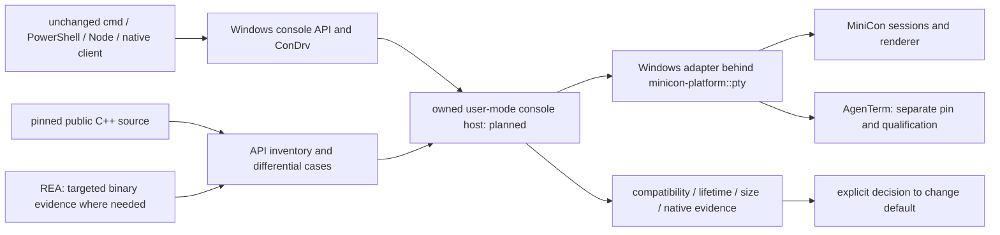

# minicon-console: owned Rust Windows console backend

Parent: [product index](../PRD.md). Existing PTY behavior remains owned by
[terminal](PRD_02_24_con_terminal.md); reusable boundaries by
[shared core](PRD_02_28_shared_core.md). Research reviewed 2026-10-19.

The owner authorizes development of `minicon-console`, an owned Rust replacement
for the Windows console host and ConPTY-facing backend. Independence means control of the user-mode API
server implementation, lifecycle and servicing, rather than changing a process
name. The hypothesis that the system host causes reported instability still
needs a reproducible failure and attribution; process counts do not prove it.

Legend: `[v]` verified research, `[-]` partial, `[_]` implementation planned.

## Tree

```text
Outcome: own the Windows console backend with measured compatibility
├── [v] Establish the implementation boundary
│   ├── existing minicon-platform::pty facade and two Windows adapters
│   ├── public Microsoft C++ host, API dispatch and ConDrv transport sources
│   └── REA 6.7.0 release/source research; no decompilation execution claimed
├── [-] Rust crate: crates/minicon-console
│   ├── [v] actual ConDrv server, input event and non-inheritable reference
│   ├── [v] bounded receive/cancellation and explicit unsupported completion
│   └── [v] kernel-delivered CONNECT from an unchanged cmd fixture; rejected
├── [_] Build an isolated, source-pinned reference host
│   ├── explicit selected-host launch; record actual image, hash and fallback
│   └── retain upstream notices and separate upstream baseline from our changes
├── [_] Replace behavior behind a reusable Windows adapter
│   ├── console API dispatch, handles and client attachment
│   ├── input records, processed/raw modes, Unicode and screen state
│   └── cancellation, process ownership, resize and bounded shutdown
└── [_] Qualify and integrate
    ├── differential clients, fault injection and current-user lifecycle evidence
    ├── Windows x86_64 and aarch64 separately; exact OS/build and feature scope
    └── explicit selection, package budget and rollback before default promotion
```

## Memory palace



## Verified findings and source identities

Microsoft describes OpenConsole as the open-source console host. Its public
server source contains API dispatch and driver transport; this is a better
starting point than reconstructing those modules from decompiler output.
Public source and the locally installed Windows binary are separate identities:
no exact version or behavioral equivalence has been established.

Reference revision: `microsoft/terminal`
`9fd41b2baec77d25b8cfb584070d5998eab7df81`. Relevant source entry points:

- [README](https://github.com/microsoft/terminal/blob/9fd41b2baec77d25b8cfb584070d5998eab7df81/README.md),
  [license](https://github.com/microsoft/terminal/blob/9fd41b2baec77d25b8cfb584070d5998eab7df81/LICENSE)
  and [organization](https://github.com/microsoft/terminal/blob/9fd41b2baec77d25b8cfb584070d5998eab7df81/doc/ORGANIZATION.md).
- [API dispatch](https://github.com/microsoft/terminal/blob/9fd41b2baec77d25b8cfb584070d5998eab7df81/src/server/ApiDispatchers.cpp)
  and [ConDrv transport](https://github.com/microsoft/terminal/blob/9fd41b2baec77d25b8cfb584070d5998eab7df81/src/server/ConDrvDeviceComm.cpp).
- [ConPTY launch](https://github.com/microsoft/terminal/blob/9fd41b2baec77d25b8cfb584070d5998eab7df81/src/winconpty/winconpty.cpp)
  selects a host executable and carries native handles. Side-by-side launch is
  a feasibility reference, not proof our own host works on every supported OS.

REA official repository: [morluto/rea](https://github.com/morluto/rea).
Latest GitHub release observed on the research date:
[rea-agents-6.7.0](https://github.com/morluto/rea/releases/tag/rea-agents-6.7.0),
published 2026-10-18; tag target
`27dc42d10249f0410904a75c0997842eb03b931c`, package version `6.7.0`.
Its [Windows guide](https://github.com/morluto/rea/blob/27dc42d10249f0410904a75c0997842eb03b931c/docs/windows-ghidra-p0.md)
describes experimental native analysis; its
[CLI evidence contract](https://github.com/morluto/rea/blob/27dc42d10249f0410904a75c0997842eb03b931c/docs/cli.md)
is the operating reference. Native pseudocode and assembly are observations,
not an automatically recovered, buildable C++ project. Use REA for specific
unresolved binary/source differences, with symbols and differential execution.

Ten pinned reference files were downloaded and SHA-256 inventoried locally in
`target/conhost-research/source-inventory.json` (ignored). The observed system
host is file version `10.0.20348.1`, size `987136`, SHA-256
`b925ac56deef971ad6f83aed9eb8328568002c2b033917b70debc7f12e2e3553`.
No REA/Ghidra analysis or reference-host build was executed. REA, Java and
Ghidra were not discovered on the current command search path; that observation
does not establish absence from the machine.

## Ownership and architecture

Keep the public PTY facade stable. Windows-specific driver/bootstrap/ABI code
belongs in `minicon-console`, now a workspace member, behind the Windows
adapter when integration is qualified. Its initial Rust APIs are experimental;
no product yet depends on this crate. AgenTerm can reuse the
mechanism, with its own explicit dependency and qualification.

The implementation language is Rust, as explicitly directed by the owner.
Microsoft C++ source and optional reference builds are specification and
differential evidence, not the new implementation. The component is named
`minicon-console`: it owns console service semantics; `minicon-platform::pty`
owns product-facing platform adaptation. If a C ABI is introduced, it must
bound ownership, buffer lengths, cancellation, errors and panic/exception
containment. Share host-neutral rules only after their behavior is understood.

The intended owned host still uses Windows kernel facilities, including ConDrv
where needed. Replacing that kernel driver is outside this user-mode project.
Raw redirected pipes alone cannot establish compatibility with console clients.
An initial build of upstream OpenConsole is a reference baseline, not a new
backend or a fix. Renaming that build proves neither independence nor stability.

## Delivery leaves

| Leaf | Invariant and observable evidence | Safe failure / dependency / non-goal |
|---|---|---|
| SOURCE | Pin source, toolchain and notices; map the required native structures and bootstrap contract into Rust. Optional reference builds record dependencies, binary hashes and actual imports. | Report missing tools explicitly; do not modify the installed system host. No binary/source equivalence claim from matching names. |
| BOOTSTRAP | A child built against the ordinary console API attaches to the selected host; record actual host image/hash and driver/bootstrap calls. Disabling custom-host selection must fail the identity assertion. | Refuse unsupported combinations or explicitly report fallback. Needs SOURCE; no silent system-host fallback satisfying an independence test. |
| SEMANTICS | Inventory implemented/unimplemented APIs and observed return codes, handles, text, cursor, events and exit behavior against reference and system hosts. | Unsupported behavior is explicit and session-local. Needs BOOTSTRAP; an echo-only demo is not shell/TUI compatibility. |
| LIFETIME | Current-user/SID-scoped launch identities survive PID-reuse checks; close-tab, close-window, crash, EOF, blocked I/O and resize races have bounded cleanup and sibling isolation. Mutating cleanup must fail. | Kill only owned fixture processes. Needs SEMANTICS; no cross-user process-count inference or global conhost termination. |
| PROMOTION | Per-OS-build and per-ISA runtime evidence, representative client journeys, host-inclusive resource accounting and artifact checks precede changing defaults. | Retain explicit compatibility backend; identify which backend actually ran. Needs prior leaves; no untested all-Windows claim. |

Required client cases include cmd, Windows PowerShell, PowerShell 7, Node-based
agent CLIs and native Console API probes. Cover raw/processed input, mouse,
Ctrl+C/Break, UTF-8/UTF-16, CJK, alternate screen, resize/reflow, redirected
handles, nested children, attach/free console and termination. Keep the matrix
small enough to diagnose individual differences before expanding it.

Single-file delivery remains an unresolved integration obligation: a sidecar
reference build may be used only for research. In-image host mode or embedded
extraction require an explicit packaging decision, size/signature/scan evidence
and cleanup contract. Neither is implemented or approved as the shipping form
by this research document. Retain current supported systems until the owner
chooses a separately evidenced compatibility boundary.

## Status and next executable milestone

[v] Source and REA research with pinned references. [-] Rust native transport
and custom-host bootstrap; [_] connection acceptance, API semantics, optional
binary analysis, remaining replacement modules and integration.
Sequence: [backend research plan](../plan/plan-windows-console-backend.md).
This work has no assigned release version and does not replace the approved
0.2.16 test-orchestration plan. No production backend or default changed.

### Initial Windows x86_64 native evidence

`scripts/build.sh test rust_console_driver -- --nocapture` executes five tests
in the new crate. The canonical wrapper also visits workspace/fork suites;
those are filtered out by this selector, not a full regression pass.

- `rust_console_driver_registers_noninheritable_server_and_reference`: real
  driver registration/reference creation; kernel handle flags checked.
- `rust_console_driver_rejects_a_non_console_handle` and
  `rust_console_driver_rejects_truncated_registration`: kernel rejects the
  invalid handle and incomplete registration, respectively.
- `rust_console_driver_receive_timeout_cancels_and_settles_io`: two real
  asynchronous waits time out and settle; no stale first read blocks the next.
- `rust_console_driver_receives_and_rejects_a_real_cmd_connection`: an
  unchanged cmd fixture receives our private pseudoconsole reference through
  native process attributes. Rust receives CONNECT with the actual child PID,
  completes it as unsupported, and observes non-successful client exit.
  This is not proof cmd commands work. The fixture never invokes the system
  `CreatePseudoConsole`; it is terminated by its owned process handle on failure.

Runtime negatives: making native handles inheritable fails the handle-ownership
assertion; removing the selected reference from process startup fails CONNECT
reception. Both mutations are restored before the positive run. Local logs
remain under ignored `target/conhost-research/`.

An earlier attempt to query `IOCTL_CONDRV_GET_SERVER_PID` returned Win32 error 1
on the observed driver. That attempted identity mechanism is not shipped or
silently treated as supported; the bootstrap proof instead observes a real
kernel-delivered client request on our private server. No kernel-driver rewrite,
Windows aarch64 native pass, complete host implementation or improved stability
is claimed by these initial tests.
