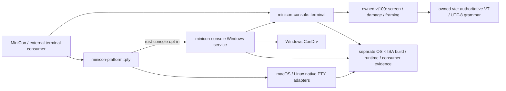

# Reusable terminal library: minicon-console

Parent: [product index](../PRD.md). Accepted direction: keep `minicon-console`
as an independent terminal-specific library, with reusable common mechanisms
and explicit native adapters. A possible later merge into `minicon-platform`
is a separate design decision, not a prerequisite or a current migration.

## Outcome and delivery tree

```text
Outcome: another application can embed our terminal without MiniCon product state
├── [-] Common terminal state and streaming facade — terminal::TerminalStream / Utf16Decoder
│   invariant: one owned parser/framer pair; no OS handles or ISA assumptions
│   evidence: public facade unit, shared parser/framer units, target build receipts
│   safe failure: bounded-frame error or explicit I/O failure; no silent truncation
│   dependency: owned vt100/vte; non-goal: GUI/event loop or process spawning
├── [v] Windows host adopts the common stream facade
│   invariant: native projections preserve client grammar and commit after sink success
│   evidence: public projection unit plus SDK mixed-output and existing host/screen courts
│   safe failure: reject unfinished projections; preserve state on pre-write failure
│   dependency: common stream; non-goal: GUI migration or native Job policy changes
├── [-] Windows native console service — PRD 02.34
│   invariant: owned user-mode host; existing platform PTY integration
│   evidence: actual console programs, SDK receipts and private-Job lifecycle
│   safe failure: explicit unsupported/invalid/native errors; no system-host fallback
│   dependency: ConDrv and Windows adapters; non-goal: replacing the Windows kernel
├── [_] Portable session composition and input vocabulary
│   invariant: shared terminal semantics; OS-specific capabilities stay explicit
│   evidence: same external consumer and scenarios on macOS/Linux/Windows
│   safe failure: typed unsupported capabilities, bounded shutdown/backpressure
│   dependency: stable common contracts; non-goal: copying all platform facilities
└── [_] Cross-ISA and external-consumer qualification
    invariant: portable API does not imply native ABI/runtime certification
    evidence: minimal consumer, enabled features, exact source, OS/ISA build + runtime
    safe failure: unavailable cells remain unqualified, never implicit passes
    dependency: native courts; non-goal: premature stable ABI or platform merger
```



## Dependency and public API boundary

`minicon-console` must not depend on `minicon-platform` while platform's optional
Windows provider depends on it. Common screen/stream mechanisms depend only on
the owned parsers and Rust standard library. Native console exports remain
Windows-gated; `terminal` is available on other operating systems. The current
facade owns parser and framer together and exposes cells/styles, damage,
callbacks and bounded output, with consuming finalization. Low-level grammar
semantics remain owned by [terminal state](PRD_02_24_con_terminal.md).

The Windows host now owns `terminal::TerminalStream` instead of separate
low-level parser/framer fields. Client output and complete native screen
commands use the facade; readback, fills, resize and mode queries use its screen
accessors. Win32 mode conversion, legacy error mapping and private-Job lifecycle
remain in their native owners. This is an actual service consumer of the public
library boundary, not only a parallel export. MiniCon's GUI parser remains a
direct shared-parser consumer; portable process/session composition is open.

`write_projection()` interprets generated complete commands with a transient
screen decoder, commits only after sink success, and preserves pending client
VT/UTF-8 and callback state. Projection events do not invoke client callbacks;
this path is for generated cursor/style/mode commands, not general client output.
Unfinished projections fail with InvalidInput before publication. Public
`finish()` consumes the stream. The service alone retains a crate-private
borrowed tail flush for its existing final-Job lifecycle; it does not expose
mutable client decoder state.

The next abstractions require explicit contracts for terminal size versus pixel
size, input events/encoding, capability reporting, read/write ownership,
backpressure, explicit-close versus natural EOF, and errors portable across OSes.
Native process and Job/foreground-group authority must remain in one owner.
POSIX PTY consolidation is tracked in [reuse map](PRD_02_28_shared_core.md).
Do not move general filesystem/network/window APIs into this terminal library.

## Evidence frontier

The facade test is
`rust_console_terminal_stream_preserves_pending_grammar_across_screen_edits`,
run through `scripts/build.sh test`. It exercises fragmented output, a public
screen edit, retained decoding and final accepted tail through public library
calls. Runtime mutation and target-build receipts must accompany portability
claims. macOS runtime, Windows ARM64 native behavior, portable session composition,
external consumer migration, packaging and stable API guarantees remain open.

Local qualification for the initial common facade: `cargo check --locked -p
minicon-console --lib --target <target>` passed for
`x86_64-unknown-linux-gnu`, `aarch64-unknown-linux-gnu`,
`aarch64-pc-windows-msvc` and `x86_64-apple-darwin`. Native Windows x86_64
library checks and strict all-target Clippy also passed. These are build
receipts, not runtime claims for the four cross targets. The ignored
`terminal-library-negative-audit.json` records four observed runtime failures
and restored source hashes: bypassed public framing, relaxed pending budget,
disabled grammar reset and omitted UTF-8 boundary tracking. The focused
`mixed-output-library-positive.log` records nine passing shared/native tests.

Host-adoption evidence is the public
`rust_console_terminal_projection_is_transactional_and_preserves_client_events`
unit plus the existing native SDK mixed-output, fill/readback/mode and final-tail
courts. `terminal-host-adoption-positive.log` records the focused positive run.
Runtime negative evidence and the final selected suite are recorded separately;
these checks do not extend platform/ISA runtime scope beyond the actual host.

`terminal-host-negative-audit.json` records three runtime failures with restored
source hashes: accepting an unfinished projection, committing before sink
success, and bypassing the common projection API in the actual Windows host.
The last mutation fails the native SDK mixed-output scenario, establishing that
the service really exercises the shared public boundary.

The host-adoption final selected suite passed 176 tests (including 17 alignment
checks), recorded in `terminal-host-adoption-final-suite.log`. Workspace default
and experimental all-target strict Clippy and root fmt checks passed. Updated
library checks passed for Linux x86_64/aarch64, Windows aarch64 and macOS x86_64;
these are compile-only receipts, not new native runtime certification. Detailed
hashes and remaining scope are in ignored `terminal-host-adoption-final-receipt.json`.

## Independent text producers

`terminal::Utf16Decoder` is the common incremental UTF-16 mechanism. Each
producer owns one decoder; `push()` yields zero to two owned Unicode scalars,
retaining an unmatched high surrogate and replacing invalid pairings. Its
iterator does not borrow the decoder, so a caller can publish immediately.
`discard_pending()` lets a line editor delete an undisplayed high unit without
erasing a screen cell. This library mechanism has no native handles or ISA
branches. The Windows client's output decoder and each pending cooked read's
echo decoder are concrete, independent consumers. Native interruption/drop
also drops the read's private echo state. GUI migration remains separate.

The accepted cooked-echo behavior, its actual SDK and system reference scope,
and remaining mode/editing/performance qualification belong to
[the native backend](PRD_02_34_windows_console_backend.md).
