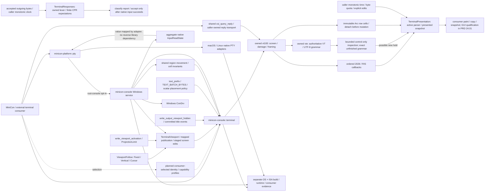

# Reusable terminal library: minicon-console

Parent: [product index](../PRD.md). Accepted direction: keep `minicon-console`
as an independent terminal-specific library, with reusable common mechanisms
and explicit native adapters. A possible later merge into `minicon-platform`
is a separate design decision, not a prerequisite or a current migration.
Implementation sequencing belongs to
[the terminal-library plan](../plan/plan-terminal-library.md); Windows service
compatibility continues in its own backend plan.
Modern TUI protocol and presentation acceptance belongs to
[PRD 24.01](PRD_02_24_01_tui_compatibility.md); library reuse alone does not
certify an interactive application.

## Outcome and delivery tree

```text
Outcome: another application can embed our terminal without MiniCon product state
├── [-] Common terminal state and streaming facade — terminal::TerminalStream / Utf16Decoder
│   invariant: one owned parser/framer pair; no OS handles or ISA assumptions
│   evidence: public facade unit, shared parser/framer units, target build receipts
│   safe failure: bounded-frame error or explicit I/O failure; no silent truncation
│   dependency: owned vt100/vte; non-goal: GUI/event loop or process spawning
│   └── bounded encoded runs / read-only lexer text_prefix / shared scalar width
│       └── invalid UTF-8 prefixes recover before native edits; new grammar stays pending
│       └── absolute drawing-cursor edits preserve client modes and pending grammar
│   └── [v] shared CSI query replies from live screen state; no transport ownership
│       invariant: one bounded reply per recognized query; unknown capability is not advertised
│       evidence: common mode oracle, actual GUI callback and native child round trip
│       safe failure: malformed/non-query metadata produces no reply; caller owns I/O failure
│       dependency: shared validated grammar; non-goal: presenting synchronized frames
│   └── [v] bounded status-response tracking and CPR/key ambiguity window
│       invariant: only committed outgoing CPR queries admit ambiguous replies; state expires
│       evidence: split grammar, numeric bounds, timeout/quota, native DA/DSR/CPR and F3 records
│       safe failure: explicit tracking quota failure; no permanent CPR key interception
│       dependency: owned lexer + caller clock/transport; non-goal: distinguishing simultaneous identical keys/reports
├── [-] Shared cell operations — terminal::CellRect / Screen region and literal spans
│   invariant: overlap reads a snapshot; clipping limits writes; no OS/ISA branching
│   evidence: shared grapheme/overlap/span units, native SDK and actual managed consumers
│   safe failure: typed move error or clipped span count; native sink-before-commit
│   dependency: common cell model; non-goal: Win32 ABI or incidental history scroll
├── [-] Independent drawing buffer / terminal viewport
│   invariant: one authoritative parser/screen; transient snapshots for output
│   evidence: common viewport unit, native geometry/wrap/parent-resize SDK and real properties
│   safe failure: staged grammar/view commit after sink success; explicit output budget
│   dependency: shared exact lexer fork/framer; non-goal: duplicating a Windows shadow grid
│   └── explicit Fixed / Vertical / Cursor policy; bool callers remain compatible
│       └── displayed-stream activation / logical layer / portable projection quota
│       └── independent bounded title publication; native metadata stays in adapter
│       └── hidden stream publication: recognized effects without painting another stream
├── [v] Windows host adopts the common stream facade
│   invariant: native projections preserve client grammar and commit after sink success
│   evidence: public projection unit plus SDK mixed-output and existing host/screen courts
│   safe failure: reject unfinished projections; preserve state on pre-write failure
│   dependency: common stream; non-goal: GUI migration or native Job policy changes
├── [-] Windows native console service — PRD 02.34
│   invariant: owned user-mode host; existing platform PTY integration
│   evidence: actual console programs, SDK receipts and private-Job lifecycle
│   safe failure: explicit unsupported/invalid/native errors; no system-host fallback
│   dependency: ConDrv and Windows adapters; non-goal: replacing the Windows kernel
│   └── [v] scoped read-only read-state inventory; native admission versus retained output queue
│       invariant: classify actual retained requests; metadata calls are not input waiters
│       evidence: native SDK states, opened PTY controls and gated lifecycle courts
│       safe failure: Unsupported/error rather than fabricated idle; no future/PID authority
│       dependency: Windows host ledger; non-goal: a portable session implementation
├── [v] Bounded synchronized presentation — terminal::TerminalPresentation; standalone consumer scope
│   invariant: one active parser continues callbacks while an immutable presented frame is held
│   evidence: synchronized_presentation integration court; literal frames/replies, 10 runtime faults
│   safe failure: finite monotonic deadline and byte budget; repeated begin cannot renew a held frame
│   dependency: owned parser event ordering; non-goal: positive GUI capability or native transport gating
│   └── [v] scoped borrowed active frames; bounded control preflight and incremental damage
│       invariant: copy a screen only for a possible new hold; preserve pre-batch frame and exact decoder state
│       evidence: ordinary/rearm/inspection/allocation courts, native regressions and standalone std consumer
│       safe failure: conservative preflight may copy early; no false-negative begin or retained OSC payload
│       dependency: owned grammar inspection; non-goal: GUI/pixel adoption or a general performance claim
│       └── [v] snapshot rows share immutable cells; first write detaches only the touched row
│           invariant: active edits never mutate held/forked/history snapshots
│           evidence: measured allocation budgets, literal frozen cells and native cell/geometry oracles
│           safe failure: owned Arc copy-on-write; no unchecked shared mutation
│           dependency: owned vt100 row storage; non-goal: zero metadata copies or universal latency bounds
├── [_] Portable session composition and input vocabulary
│   invariant: shared terminal semantics; OS-specific capabilities stay explicit
│   evidence: same external consumer and scenarios on macOS/Linux/Windows
│   safe failure: typed unsupported capabilities, bounded shutdown/backpressure
│   dependency: stable common contracts; non-goal: copying all platform facilities
│   └── [_] terminal identity/capability profiles, consumer-selected TERM and independent native provider
└── [-] Cross-ISA and external-consumer qualification
    invariant: portable API does not imply native ABI/runtime certification
    evidence: minimal consumer, enabled features, exact source, OS/ISA build + runtime
    safe failure: unavailable cells remain unqualified, never implicit passes
    dependency: native courts; non-goal: premature stable ABI or platform merger
```



## Bounded synchronized presentation

`terminal::TerminalPresentation<CB>` is an opt-in OS/ISA-neutral consumer
mechanism. It owns one authoritative active parser and an optional held `Screen`.
The owned parser emits validated mode-2026 events in private-parameter order
and a reset event after RIS; the default callbacks preserve the raw consumer's
unhandled-query path. This is independent of the unused `vte::ansi` processor.
The protocol's [synchronized-output semantics](https://github.com/contour-terminal/vt-extensions/blob/master/synchronized-output.md)
require continued parsing while rendering retains its prior frame. The
specific timeout is a consumer policy, not a protocol-mandated duration.

`process(bytes, now)` always advances the active parser and all callbacks.
Queries therefore see current cursor/modes even during a hold. Drawing, copy
and structured snapshots must use `presented_screen`; input encoding uses
`active_screen`. Internal parsing spans do not constitute presented frames.
Publication happens after the supplied batch, unless a prior phase expired
when polling at entry. Ordinary presented state borrows the active screen and
forwards its incremental damage. A possible new hold snapshots the pre-batch
screen once; releasing that snapshot conservatively reports full damage.
Damage is retained in the active model during a hold. There is no queued output
or persistent second lexer. Snapshot metadata cost and actual GUI latency still
need workload-specific qualification.

Consumers supply monotonic elapsed time and schedule `poll` at `deadline` even
without incoming output. Backwards observations clamp to the latest time.
The first begin establishes an absolute deadline and finite byte budget;
repeated begins do not renew either. Quota accounting conservatively charges
whole bounded parsing spans, including marker bytes, so it may release early.
Parsing spans shrink to the remaining quota. Timeout/quota recovery releases
presentation but ignores further begins until an explicit end or RIS, preventing
a broken producer from immediately rearming the same unfinished phase. Zero
timeout or zero quota disables holding. Recovery preserves unfinished VT/UTF-8
grammar; `edit_screen` explicitly releases a hold for geometry/viewport edits,
and `finish` releases the latest complete model on EOF without inventing missing
input. The caller still owns producer shutdown, transport and timer scheduling.

The public-library integration court is
`crates/minicon-console/tests/synchronized_presentation.rs`. Its six cases cover:

- split begin/body/end, literal CJK/RGB cells and cursor, live CPR/negative
  2026 reply/title callbacks, damage isolation and no internal-span publication;
- exact idle deadline, repeated begin, post-recovery suppression and clock clamping;
- finite byte recovery, large bursts and a UTF-8 scalar split at the quota;
- ordered combined private modes, invalid intermediates/subparameters and OSC cancellation;
- explicit resize preserving partial CSI, RIS, and EOF with an unfinished command;
- independent zero timeout/quota disablement and the default-callback constructor.

Frozen-source evidence under `target/conhost-research/`: `presentation-source.json`
binds 14 source/guard files; `presentation-regression.log` passes 110 selected
cases, including these six and six existing owned-native query/redraw/pressure/
read-state/retirement cases. `presentation-negative-audit.json` binds ten
compiling runtime faults, each restored byte-for-byte in `finally` with SHA
checks. All six new courts detect their assigned faults. The faults expose a
held frame, miss the exact deadline, renew begin, rewind time, disable quota,
discard UTF-8 at recovery, accept a malformed marker, ignore RIS, discard CSI
on resize, and hold with zero timeout. `presentation-restored-focused.log`
passes the new six plus those six native regressions after restoration.
Ten checks cover workspace/fork format, default/enabled workspace Clippy,
owned-parser Clippy, common-library Linux x64/ARM64, Windows ARM64 and macOS
x64 compilation, and enabled-platform Windows ARM64 compilation. Runtime
evidence is Windows x64 build 20348 only; other OS/ISA cells are compilation
evidence. Those native tests remain regression evidence for existing transport,
not a native producer feeding the new presentation gate. The subsequent
[native synchronized-output consumer court](PRD_02_34_windows_console_backend.md#native-synchronized-output-consumer-court)
owns actual SDK-to-presented-frame evidence and its scripted-clock/runtime scope.

The GUI now consumes this helper through a product-private clock adapter;
[its integration and evidence scope](PRD_02_24_01_tui_compatibility.md#gui-presentation-consumer)
are owned by PRD 24.01. `screen_mut` recovers a hold before an explicit
caller-owned edit, preserves unfinished input and retains the screen API's
incremental damage; releasing a held snapshot reports full damage. The
existing `edit_screen` convenience method still requests full damage.
Common `TerminalStream` and platform PTY transport do not acquire presentation
policy. Shared query replies still report mode 2026 as unrecognized. Positive
capability replies, compositor qualification, real Claude Code
and other OS/ISA runtime qualification remain open.
The native-window consumer's own event/render/query/close journey is recorded
separately in PRD 24.01; it does not promote the backend or capability reply.

### Borrowed frames, shared row cells and control inspection

The follow-up optimization keeps the same active/presented protocol contract.
`presented_screen` aliases `active_screen` while no hold exists, avoiding a
screen/history clone on ordinary output. Before a possible new hold,
`vt100::Parser::inspect_control_sequences` delegates to the owned VTE decoder's
control-only inspection API. It starts from exact unfinished CSI/ESC/UTF-8
grammar, forwards only CSI/ESC to a transient observer, and does not call live
screen callbacks. OSC payload and offsets are omitted from the fork and discarded
after spans of at most 64 bytes (smaller for tiny const buffers). This avoids
copying retained titles/clipboard strings, including for std-feature consumers.
Only the lexical continuation is inspected; no speculative screen is constructed.

The presentation observer models private mode 2026 end/begin and RIS in stream
order, including recovery followed by another begin in one batch. Ground input
without ESC/C1 candidates bypasses inspection. Disabled holding also bypasses
it. Repeated begin in an expired phase does not allocate a fresh held screen.
A conservative positive inspection can snapshot unnecessarily if the phase ends
inside the same batch; it cannot publish an intermediate internal parser span.

Owned `vt100::Row` cell storage now uses private Arc copy-on-write. Screen/fork
snapshots copy row/history metadata and share immutable cell vectors; every
mutable access detaches the affected row first. Wrapped flags and grid/cursor/
mode metadata remain independently owned. This applies to native stream forks
as well as presentation snapshots. It is not a zero-copy claim: metadata still
scales with retained rows, and a changed shared row copies its cells. Atomic
reference counting and additional row-allocation overhead need representative
throughput/latency measurements before broad performance conclusions.

The public allocation workload uses a thread-local
System allocator counter, 24×80 cells and over 3000 retained history rows. It
checks ordinary output allocation traffic, bounded snapshot metadata and touched-
row copies, and literal frozen-cell independence. Timing samples have no CI
threshold and do not prove GUI latency. A standalone Windows source consumer
enables VTE std independently and runs the same workload through a real binary;
it does not infer external reuse from a workspace-only build. GUI rendering,
selection, snapshots and timers have their own consumer court in PRD 24.01.

Frozen-source qualification is under ignored `target/conhost-research/`.
`presentation-borrow-source.json` binds 31 source/manifest/guard files; the staged
change has four implementation files and three test/SDK-court files. The
composed selection is 379 distinct tests in three required invocations:
`presentation-borrow-composed-suite.log` (377), `presentation-borrow-isolated-reference.log`
(one system queued-read reference), and `presentation-borrow-isolated-mode-reference.log`
(one system pending-mode reference). This retains all 375 identities from the
preceding three relevant selections and adds four tests. It is not the full
workspace suite or proof of single-invocation system-reference stability.
The default/experimental workspace and owned-parser paths are exercised.

`presentation-borrow-negative-audit.json` records 12 compiling runtime faults,
all byte-restored in `finally` with source SHA checks. They force ordinary full
damage, eagerly clone frames, miss RIS/end phase transitions, lose unfinished
parameters, forward non-control effects, deep-copy row cells, omit row detach,
corrupt each owned/system retirement snapshot, copy the live OSC payload, and
remove the incoming-OSC span bound. All four new and both affected retirement
courts fail their assigned faults; an existing held-frame court also verifies
row-detach behavior. A fixed-64-byte-span variant survived because it remained
bounded; its diagnostic is excluded from the defect count. The direct incoming-
OSC allocation measurement now distinguishes genuinely unbounded retention.

Thirteen checks cover workspace and both fork formats, default/enabled workspace
Clippy, both fork Clippy paths, VTE no_std compilation, console all-target Linux
x64/ARM64, Windows ARM64 and macOS x64 compilation, and enabled-platform Windows
ARM64 compilation. The inspection court also runs with no default VTE features.
After restoration the focused selection passes 17 tests (nine common presentation/
allocation cases, one inspection case and seven native/retirement cases), plus
the no_std inspection invocation. The standalone std consumer is rebuilt and
executed after restoration; its separate manifest/lock/main and std feature graph
are retained. Cross-target cells prove compilation, not runtime.

In the measured Windows x64 build-20348 debug workload, both workspace and
standalone std consumers retain 3177 history rows. Each performs 500 ordinary
ASCII and 500 ordinary CSI updates with zero allocation traffic. One snapshot
allocates two metadata blocks / 51,216 bytes; editing one shared row allocates
two blocks / 2,600 bytes and leaves held cells unchanged. Large incoming-OSC
inspection uses no heap in the workspace configuration and four small std Vec
growth requests / 120 bytes in the standalone configuration. The byte cap is
256; canceling span disposal in a fault requests 131,064 bytes and fails. These
are requested allocation bytes, not peak/RSS, release throughput or GUI latency.
Timing samples are recorded without a pass/fail latency threshold; ordinary CSI
inspection adds CPU work compared with the raw-parser baseline.

The [retirement transport-close ordering](PRD_02_34_windows_console_backend.md#disconnect-retirement-and-native-file-closes)
was corrected during this qualification. The pre-fix system reference had the
right native result but stale `A>ab` output. The queued-read system reference
also failed once in isolation before passing on the same frozen source; its
GetThreadIOPendingFlag precondition still does not prove host admission. Both
diagnostics remain separate from positive receipts. Neither system assertion
was weakened, and the latter observation is not attributed to shared row storage.

`presentation-borrow-final-receipt.json` binds the staged tree, source/consumer/
image/log identities, composed selection, faults and allocation samples. A fresh
opened-PTY run retains 12 synchronized SDK sessions / 46 phase checkpoints /
208 source-wire-native-frame and case/reply files. Those files are reread against
literal oracles, not merely inventoried. Seven exercised x64 images are recorded
for focused allocation/presentation/native courts, SDK, std/no_std inspection and
the standalone consumer. Runtime scope is Windows x64 build 20348. The later
GUI consumer is qualified separately in PRD 24.01. Release/scroll-heavy
throughput, other allocators, wider native
compatibility, real Claude Code, other OS/ISA runtime and default promotion remain
open; shared query replies still advertise mode 2026 as unrecognized.

## Shared terminal query replies

`terminal::csi_query_reply` consumes validated CSI callback metadata plus a
borrowed live `Screen`. It returns one optional reply of at most 16 bytes,
without mutating terminal state, owning a queue, writing a PTY or depending on
an OS/ISA. The GUI now directly depends on `minicon-console` and uses this
helper for its existing DA1, status and cursor reports as well as private
DECRQM. Native Windows hosting remains an explicit separate provider choice.
The parser ignores CSI marked invalid by its bounded parameter/intermediate
inventory; truncated metadata must not execute an abbreviated command or query.
Numeric parameter normalization remains the shared lexer's existing policy.

Single scalar DECRQM (`CSI ? Ps $ p`) uses the
[xterm control sequence contract](https://invisible-island.net/xterm/ctlseqs/ctlseqs.html):
status 1 means set, 2 reset and 0 unrecognized. The helper reports live modes
1, 6, 7, 9, 25, 47, 1049, 1000, 1002, 1003, 1005, 1006 and 2004. Origin
mode comes from the current grid, not the cursor position or a duplicate flag.
Mouse mode/encoding follows the shared screen's active protocol. This is a
qualified query subset, not complete xterm conformance. Mode 2026 remains
unrecognized because complete-frame presentation has not been implemented.
Unknown modes also report zero; unrelated, subparameter or multi-mode commands
are unanswered. Primary DA accepts only default/zero, and DSR/CPR accepts one
scalar 5/6. Consumers retain transport, queue and failure policy.

Named courts: `terminal_query_replies_follow_live_modes_and_reject_nonqueries`
checks literal replies and every listed mode's set/reset transitions;
`private_mode_queries_use_shared_truthful_replies_across_split_and_invalid_csi`
checks the actual GUI callback at every two-way byte split, malformed queries
and parser inventory overflow. Native return transport and its independent SDK
expectations belong to [PRD 34](PRD_02_34_windows_console_backend.md#private-mode-query-return-transport).
Gate/fault receipts and native-runtime limitations are recorded with that
return-transport court. User-selectable identity profiles remain
planned; this helper does not implement that settings/API surface.

## Status response grammar and query windows

`terminal::TerminalResponses` observes accepted outgoing bytes with the same
owned `vte` grammar as the screen. It owns no screen, PTY, clock or OS handle;
the caller supplies monotonic elapsed `Duration` values and a timeout. The
crate names the owned lexer by a direct path dependency so external consumers
cannot accidentally resolve incompatible grammar. `reply_length` classifies
one complete report without consuming state; `accept_reply` spends a CPR
expectation only after the input sink accepts that span. Backpressure/retry
must not spend it. Other bytes retain the caller's keyboard path.

The common grammar admits primary DA reports (`CSI ? ... c`), status OK
(`CSI 0 n`), the preceding private-mode reports and positive row/column CPR
(`CSI r ; c R`). Report scanning is bounded to 64 body bytes; scalar numeric
fields have at most five digits. Mode/attribute numbers fit u16 and CPR
coordinates allow 1..65536, matching the shared query helper's one-based
cursor conversion. Malformed/incomplete reports are not guessed at. The
preceding private-report classifier/unit moves from the Windows adapter into
this common owner without changing its named evidence identity.

[xterm's DSR description](https://invisible-island.net/xterm/ctlseqs/ctlseqs.html)
explicitly identifies the collision between CPR and modified F3 bytes. The
tracker therefore admits CPR only after a complete valid outgoing `CSI 6 n`,
for one response and only until that query's timeout. Each query has its own
deadline; inspecting a response does not renew it. At most 64 expectations
are retained. Overflow yields `ResponseTrackingError`, clears expectations
and permanently fails the observer; the caller must retire that transport.
A zero timeout disables CPR admission. This is finite contextual routing,
not a proof of identity: an identical physical key during the live response
window, a late reply crossing a newer query, nested consumers and correlation
with a specific process still need a richer ownership contract.

`terminal_responses_track_split_queries_acknowledgement_expiry_and_quota`
checks literal reports, split queries, no-response defaults, repeated peeks,
acknowledgement, independent deadlines, malformed requests/replies, limits
and irreversible overflow. Native clock, output admission, F3 identity and
owned-session retirement are qualified separately by
[PRD 34](PRD_02_34_windows_console_backend.md#status-response-routing-and-cpr-key-boundary).
Gate/fault receipts and composed-versus-single-suite limitations are recorded
with that native court. Synchronization/profile settings remain separate work.

## Native read inventory and optional PTY observation

The Windows service exports `InputReadState` through
`ConsoleHost::input_read_state()`. Its four u32 counters distinguish admitted
text/record waiters from supported text/record requests retained behind output
admission. The former have validated their arguments and selected their input
kind; the latter have not yet become logical waiters. Ordinary mode queries,
keyboard data/events and unrelated I/O are not counted as waiting reads.
This aggregate covers the hosted console and its attached descendants, without
process, request or file identifiers. Empty read inventory does not establish
that a process has no other work or I/O. The non-exhaustive value type permits
future observation fields without exposing native handles or an ISA ABI.

The platform owner maps that value into its independent, non-exhaustive
`NativeInputReadState` contract. `PtyChild::native_input_read_state()` queries
the opened Rust provider through its existing bounded control channel. The
adapter owns the transport, timeout and supported-backend decision; it does
not attach to a process's console. Installed-system/mirror and shared POSIX
adapters return Unsupported rather than zero counters. The library adds no
dependency on platform, clock, GUI or application policy.

Neither value is a lock or authority over a future request. A test that holds
one known SDK reader before supplying input or releasing a lifecycle action
can use the observation as a phase acknowledgement. Arbitrary applications
may finish or start another read after a snapshot. Native phase/runtime courts
and their limitations belong to
[PRD 34](PRD_02_34_windows_console_backend.md#native-read-retention-and-admission-observation).
This native observation does not implement the planned portable session API.

## Dependency and public API boundary

Terminal type is a planned user/consumer choice, not the `vt100` crate name.
The common library should expose bounded identity and implemented-capability
contracts independently of the OS provider. A modern VT/xterm-style baseline
is the intended default; qualified compatibility profiles and an advanced TERM
override remain selectable. Changing TERM selects an application description;
it does not load a different parser or implement new protocols. Query replies
must reflect implemented capabilities and the applicable profile, even when an
override names a richer terminal. Selectable VT220/kitty/etc. emulation claims
need their own evidence. These contracts are planned, not existing public APIs.
Product settings and new-session application belong to
[workspace configuration](PRD_02_25_con_workspace.md#configuration).

The integration boundary is the terminal domain: applications should eventually
compose terminal state, input, a native session and output publication through
this library. Cross-ISA reuse and cross-OS adaptation are separate requirements;
neither changes the meaning of the common terminal API.

| Layer | Public responsibility | Current implementation and remaining work |
| --- | --- | --- |
| Common terminal mechanisms | State, streaming, Unicode, cells, damage and viewport publication | Implemented common facade; compatibility and evidence remain scoped below |
| Portable session contract | Input events, capabilities, size, I/O ownership, backpressure and close/EOF | Planned; define contracts before relocating PTY implementations |
| Native terminal adapters | OS handles, console/PTY protocols, process ownership and native errors | Windows service is experimental; macOS/Linux PTY implementations remain in platform pending consolidation |
| Internal ISA adaptation | Native ABI/layout or measured acceleration behind the same semantic contract | Keep target-specific details internal; qualify each OS/ISA combination separately |
| Application integration | Rendering, event loops, tabs and product policy consume terminal APIs | Remain outside the library; migrating a consumer requires its own evidence |

The intended dependency direction is application to terminal contracts to native
adapter. Existing platform PTY entry points remain compatibility consumers during
consolidation. Do not introduce a reverse library dependency or relocate unrelated
platform facilities to achieve a single terminal entry point.

`minicon-console` must not depend on `minicon-platform` while platform's optional
Windows provider depends on it. Common screen/stream mechanisms depend only on
the owned parsers and Rust standard library. Native console exports remain
Windows-gated; `terminal` is available on other operating systems. The current
facade owns parser and framer together and exposes cells/styles, damage,
callbacks and bounded output, with consuming finalization. Low-level grammar
semantics remain owned by [terminal state](PRD_02_24_con_terminal.md).

The implemented wiring has three distinct edges:

| Edge | Current authority | Verification boundary |
| --- | --- | --- |
| MiniCon GUI -> `minicon-console::terminal` | Shared parser, screen and presentation; GUI owns raster, tabs and policy | Common units and real-window product tests |
| MiniCon -> `minicon-platform::pty` | Stable product PTY facade, backend selection, child/session lifetime and errors | Default workspace and actual selected-backend tests |
| `minicon-platform::pty` -> `minicon-console` Windows service | Optional `rust-console` provider adapts `ConsoleHost`/`DriverSession`/`ConsoleChild` into the PTY facade | Feature-enabled native PTY and GUI courts; default ConPTY remains a separate provider |

This is a one-way optional dependency, not a claim that the common terminal
facade already owns a portable session. The native service is Windows-only;
macOS/Linux PTY adapters still live in platform. A test named for a backend
must select that backend explicitly: process environment may otherwise select
the console agent and produce misleading evidence. The October 2026 Windows
x64 local court ran the feature-enabled `rust_console_` suite (95 native PTY
cases), the owned-window screenshot/cleanup journey, and real Node, PowerShell
7 and Windows PowerShell Unicode TTY roundtrips. These local receipts do not
qualify other OS/ISA cells or a signed release artifact.

The Windows host now owns `terminal::TerminalStream` instead of separate
low-level parser/framer fields. Client output and complete native screen
commands use the facade; readback, fills, resize and mode queries use its screen
accessors. Win32 mode conversion, legacy error mapping and private-Job lifecycle
remain in their native owners. This is an actual service consumer of the public
library boundary, not only a parallel export. MiniCon's GUI now consumes
`TerminalPresentation` for active/presented state; product raster and selection
still consume shared screen/cell types. Portable process/session composition
is open.

`write_projection()` interprets generated complete commands with a transient
screen decoder, commits only after sink success, and preserves pending client
VT/UTF-8 and callback state. Projection events do not invoke client callbacks;
this path is for generated cursor/style/mode commands, not general client output.
Unfinished projections fail with InvalidInput before publication. Public
`finish()` consumes the stream. The service alone retains a crate-private
borrowed tail flush for its existing final-Job lifecycle; it does not expose
mutable client decoder state.

The next abstractions require explicit contracts for terminal size versus pixel
size, input events/encoding, capability reporting, read/write ownership,
backpressure, explicit-close versus natural EOF, and errors portable across OSes.
Native process and Job/foreground-group authority must remain in one owner.
POSIX PTY consolidation is tracked in [reuse map](PRD_02_28_shared_core.md).
Do not move general filesystem/network/window APIs into this terminal library.

The facade's shared Screen also exposes absolute drawing-cursor mutation;
its coordinate, delayed-wrap and damage contract belongs to
[terminal state](PRD_02_24_con_terminal.md#absolute-drawing-cursor).
The Windows cooked editor uses it to stage text/cursor publication while
retaining client grammar. Native editing policy and compatibility remain in
the Windows owner, rather than becoming portable session semantics by accident.

### Integration acceptance contract

The target is one independently consumable terminal library, not merely a
Windows service with portable helper exports. Keep the `minicon-console` name
while state/stream, session/input and native adapters converge. A future platform
merger needs a separate dependency, consumer and maintenance review after those
boundaries have actual consumers.

Before publishing a portable session interface, resolve these requirements with
both the existing Windows and POSIX implementations:

| Contract | Required observable behavior |
| --- | --- |
| Dimensions | Cell rows/columns have one meaning; optional pixel size is distinct; invalid or unsupported resize fails explicitly |
| Input | Text, paste, encoded bytes and native key/control capabilities are distinguishable; unsupported events cannot report success |
| Ownership | Exactly one owner controls the child/session lifetime; readers/writers have explicit concurrency and cancellation rules |
| Flow control | Input/output budgets, saturation behavior and shutdown bounds are stated; slow consumers cannot create unbounded queues |
| Completion | Natural child exit, output EOF, explicit close and forced termination remain distinguishable; accepted final output can be drained |
| Native differences | Provider identity, foreground control and cleanup capabilities remain queryable; Windows Job and POSIX process-group semantics are not conflated |
| Errors | Portable categories retain actionable native context without exposing native handles as common types |

Move mechanisms only after a working consumer demonstrates the contract. Reuse
the existing POSIX implementation for macOS and Linux; do not create a second
copy for the new crate. The platform facade may forward to console-owned
contracts/adapters, but the console library must never import platform to reuse
them. Migrate neutral dependencies first or keep the adapter in place until
that dependency can be resolved. General process-management policy stays with
its existing owner; session-specific authority must not gain a second owner.

Each delivered slice needs a direct library consumer without MiniCon GUI state,
positive behavior and an observed behavior-changing runtime negative. Record
source/features, OS, ISA and provider separately for build and execution.
Windows x86_64 evidence cannot certify Windows ARM64, and either Linux target's
compilation cannot certify macOS runtime. A common API is the reuse boundary;
these individual receipts determine its supported implementation scope.

### Independent title publication

`TerminalStream::write_window_title` publishes a complete OSC 0 title with ST
termination, independent of client grammar, callbacks and viewport projection.
It borrows the stream read-only and does not change screen cells, layers or
pending CSI/UTF-8. The caller owns title metadata and commits it only after
publication succeeds. Partial sink failure still requires retiring the transport.

Input is a Rust string without control characters; C0, DEL and C1 are rejected
before any output. A caller-owned encoded-byte limit includes the six framing
bytes and uses the common typed `ProjectionLimit` error. Native character
conversion and display policy stay in the adapter, not the portable formatter.
Client VT titles use the separate committed-event API described below. The
owned receiving parser now preserves title payload semicolons; its grammar and
framing contract belongs to [terminal state](PRD_02_24_con_terminal.md).

## Evidence frontier

The facade test is
`rust_console_terminal_stream_preserves_pending_grammar_across_screen_edits`,
run through `scripts/build.sh test`. It exercises fragmented output, a public
screen edit, retained decoding and final accepted tail through public library
calls. Runtime mutation and target-build receipts must accompany portability
claims. macOS runtime, Windows ARM64 native behavior, portable session composition,
external consumer migration, packaging and stable API guarantees remain open.

Local qualification for the initial common facade: `cargo check --locked -p
minicon-console --lib --target <target>` passed for
`x86_64-unknown-linux-gnu`, `aarch64-unknown-linux-gnu`,
`aarch64-pc-windows-msvc` and `x86_64-apple-darwin`. Native Windows x86_64
library checks and strict all-target Clippy also passed. These are build
receipts, not runtime claims for the four cross targets. The ignored
`terminal-library-negative-audit.json` records four observed runtime failures
and restored source hashes: bypassed public framing, relaxed pending budget,
disabled grammar reset and omitted UTF-8 boundary tracking. The focused
`mixed-output-library-positive.log` records nine passing shared/native tests.

Host-adoption evidence is the public
`rust_console_terminal_projection_is_transactional_and_preserves_client_events`
unit plus the existing native SDK mixed-output, fill/readback/mode and final-tail
courts. `terminal-host-adoption-positive.log` records the focused positive run.
Runtime negative evidence and the final selected suite are recorded separately;
these checks do not extend platform/ISA runtime scope beyond the actual host.

`terminal-host-negative-audit.json` records three runtime failures with restored
source hashes: accepting an unfinished projection, committing before sink
success, and bypassing the common projection API in the actual Windows host.
The last mutation fails the native SDK mixed-output scenario, establishing that
the service really exercises the shared public boundary.

The host-adoption final selected suite passed 176 tests (including 17 alignment
checks), recorded in `terminal-host-adoption-final-suite.log`. Workspace default
and experimental all-target strict Clippy and root fmt checks passed. Updated
library checks passed for Linux x86_64/aarch64, Windows aarch64 and macOS x86_64;
these are compile-only receipts, not new native runtime certification. Detailed
hashes and remaining scope are in ignored `terminal-host-adoption-final-receipt.json`.

## Independent text producers

`terminal::Utf16Decoder` is the common incremental UTF-16 mechanism. Each
producer owns one decoder; `push()` yields zero to two owned Unicode scalars,
retaining an unmatched high surrogate and replacing invalid pairings. Its
iterator does not borrow the decoder, so a caller can publish immediately.
`discard_pending()` lets a line editor delete an undisplayed high unit without
erasing a screen cell. This library mechanism has no native handles or ISA
branches. The Windows client's output decoder and each pending cooked read's
echo decoder are concrete, independent consumers. Native interruption/drop
also drops the read's private echo state. GUI migration remains separate.

The accepted cooked-echo behavior, its actual SDK and system reference scope,
and remaining mode/editing/performance qualification belong to
[the native backend](PRD_02_34_windows_console_backend.md).

The common screen/parser now preserves U+FFFD as visible text and in literal
full/diff projection. The display contract and callback migration note are
owned by [terminal state](PRD_02_24_con_terminal.md); native SDK evidence is in
PRD 02.34. It is one shared OS/ISA-neutral implementation, consumed by GUI
parsing and the owned service; native runtime qualification remains scoped.

## Accepted consolidation sequence

1. Keep common stream, text producers, cells/styles, damage and region operations
   behind the terminal namespace. The native service is a real consumer of this
   boundary. Native wire errors and structures do not become common types.
2. Define portable session/input/capability and shutdown contracts before moving
   existing PTY code. Retain one process-lifecycle authority and an acyclic
   dependency graph; no platform-to-console-to-platform dependency cycle.
3. Consolidate the existing macOS/Linux PTY implementation with native runtime
   evidence for each OS. Its current platform ownership is not changed by the
   common screen API. Renderers, product tabs and settings remain consumers.
4. Qualify external consumers and OS × ISA feature combinations separately.
   Reconsider a merger with minicon-platform only after these boundaries and
   actual consumers provide evidence; no merger is authorized by this plan.

The library name is retained: console denotes the integrated terminal domain,
not an assertion that every export is Windows-only. Common modules contain no
architecture-specific native ABI. Native modules remain explicitly gated; a
portable build is not a native runtime guarantee. Shared region semantics belong
to [terminal state](PRD_02_24_con_terminal.md), with native compatibility evidence
in [the Windows backend](PRD_02_34_windows_console_backend.md).

Shared cursor appearance restoration is now carried by the same exposed Screen
full/diff/cursor formatting methods. Its common contract and replay migration
note belong to [terminal state](PRD_02_24_con_terminal.md); Windows percentage
metadata remains native and is not part of the portable appearance vocabulary.
The scoped service consumer and actual property clients are recorded in PRD 02.34.

## Viewport rendering facade

terminal::TerminalViewport describes a signed source region and an independently
sized output surface. The default-callback TerminalStream can write_output_viewport
through exact lexer/screen forks, forward complete nonvisual/extension frames,
project cells/modes and commit after sink success. Alternate-grid transitions
forward their original control frame followed by a full projected image. The
native host is its actual consumer after a native geometry change; ordinary
sessions keep raw framed output. Custom callback streams retain raw operation;
the new default-callback mapped path does not pretend to transact arbitrary
external callback side effects.

commit_viewport_screen and write_viewport_projection provide staged cell edits
and independent-decoder native commands without resetting unfinished client
input. Entering viewport mode neutralizes physical origin/margins and publishes
a complete image. Viewport operation continues until session close, including
when source/output dimensions later match. Each projection is transient and
read-only; native readback uses the authoritative drawing buffer.

rust_console_terminal_viewport_preserves_buffer_grammar_effects_and_commit
covers cropped rendering, native commands between UTF-8 fragments, C0 effects
inside CSI, title forwarding, alternate-grid transitions and failed/budgeted
publication. Input bytes and projection output have distinct caller budgets.
Non-ASCII/control-heavy large-buffer performance, richer callback consumers and
portable session/process composition remain separate qualification work.

The service exercises this public boundary through native geometry and expanded
buffer rendering, not a Windows-only duplicate. Shared/native SDK and real-client
positive runs, runtime guard failures, exact-source identities and the distinction
between cross-target compilation and native execution are recorded by
[native geometry qualification](PRD_02_34_windows_console_backend.md#accepted-native-geometry-leaf).
Portable session composition and independent external consumers remain planned
in the consolidation sequence above.

Native multiple-buffer support composes independent instances of the same
TerminalStream and shared viewport renderer. Buffer identities, Win32 handle
sharing/closure, cursor percentages and native output-mode metadata remain
Windows-private; there is one parser/screen authority for each logical buffer,
not a second native cell model. Input/Job ownership is not duplicated per buffer.
ViewportFollow is public common policy; the Windows adapter chooses vertical
movement for ordinary stream output and both axes for native cursor commands.
Its mechanics belong to [terminal state](PRD_02_24_con_terminal.md#explicit-viewport-follow-policy),
with native scrolling/viewport evidence owned by PRD 02.34.
Displayed-stream activation and typed projection-budget failures are common
mechanisms as well; Windows buffer IDs and native status translation stay in its
adapter. The boundary is owned by [terminal state](PRD_02_24_con_terminal.md#displayed-stream-activation-and-projection-budgets).
The contracts, measured compatibility and remaining lifecycle scope belong to
[native buffers](PRD_02_34_windows_console_backend.md#accepted-multiple-buffer-leaf).
Process-family retirement and the native connected-process query remain
Windows-private; their SDK/PTY lifetime evidence is owned by the same module's
[process-family leaf](PRD_02_34_windows_console_backend.md#accepted-buffer-process-family-lifetime-leaf).

The public terminal facade now exposes text_prefix and TEXT_BATCH_BYTES for
bounded encoded producers. Native UTF-16/UTF-8 text output is an actual consumer
in both raw and mapped sessions; Windows newline/margin/code-page policy remains
in its adapter. Low-level lexer, publication and scalar-width contracts belong
to [terminal state](PRD_02_24_con_terminal.md#bounded-unicode-text-publication).
Native bulk clients, system-layout differences and remaining compatibility scope
belong to [Unicode publication](PRD_02_34_windows_console_backend.md#accepted-unicode-publication-leaf).

Invalid UTF-8 prefix recovery also runs through the common facade in raw and
mapped sessions. Rejected prefixes use canonical U+FFFD before the new input;
valid frames retain their wire bytes. The mechanism and failure invariants belong
to [shared recovery](PRD_02_24_con_terminal.md#invalid-utf-8-prefix-recovery), with
native SDK interleaving/final-tail evidence owned by PRD 02.34.


Title publication is exercised by
`rust_console_terminal_title_publication_preserves_grammar_and_rejects_injection`.
Its actual native consumer is guarded by
`rust_console_native_title_commits_after_sink_and_retains_raw_metadata` and
`rust_console_pty_native_wide_titles_publish_independently_of_client_grammar`.
Runtime mutation, selected-suite and cross-target qualification for this leaf
are recorded by [the native owner](PRD_02_34_windows_console_backend.md#native-wide-title-publication-leaf).


## Committed title events and undisplayed streams

`TerminalStream::take_window_title_update` takes the latest committed OSC 0/2
window-title event without exposing mutable decoder state. It coalesces events;
callback consumers can observe each intermediate event. The facade enables
tracking under its frame budget; raw Parser consumers must opt in separately,
so consumers that do not request tracking incur no event copies. Native metadata remains
caller-owned: consuming applications interpret the returned raw title bytes
(normally UTF-8) using their own validation policy. Drain the slot before
consuming `finish` if the final title is required without callbacks; the returned
Screen is drawing state. Low-level raw OSC, parser-event and framing semantics belong
to [terminal state](PRD_02_24_con_terminal.md#osc-payloads-parser-events-and-framed-commit).

The default-callback stream also supports `write_output_viewport_hidden` with
the same viewport, follow policy, pending and wire budgets as visible mapped
output. It commits the undisplayed stream's cells, modes, layers and grammar,
while forwarding only recognized nonvisual effects: titles/icons, bells and
clipboard operations. Drawing, alternate-layer transitions, resize requests and
unknown extensions do not reach the displayed stream. Native activation can
later publish the stored logical image. The API is not a general sanitizer for
unknown extension protocols or a transaction for external custom callbacks.

The publisher uses the same sink-before-parser/view transaction as visible
output. Rejected effect publication and projection quota leave the event and
view uncommitted. Pure hidden painting requires no transport write. Activation
is read-only and does not replay consumed metadata. Native Windows producers
are concrete consumers; the common implementation has no OS handles, code-page
policy or ISA branches. Portable process/session composition remains open.

Named common evidence is
`rust_console_terminal_title_events_commit_complete_frames_and_survive_screen_reset`,
`rust_console_terminal_hidden_output_preserves_effects_and_isolates_paint` and
`stream_boundary_raw_osc_preserves_payload_beyond_parameter_limit`. The native
owner records precise SDK, runtime-guard and cross-target scope. Clipboard,
custom callbacks and unknown extension behavior require their own broader
consumer qualification; the new hidden scenario specifically asserts titles,
bells, painting/layer isolation, quota and failed-sink transaction.

Committed title events also inherit shared OSC cancellation/termination rules;
no native-only abort filter is added to this facade. Callback migration and
UTF-8 ST bounds belong to
[terminal state](PRD_02_24_con_terminal.md#osc-cancellation-and-termination),
with actual Windows/reference evidence in PRD 02.34's termination leaf.
