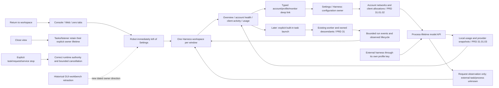

# Harness dashboard and operational workspace

Parent: [MiniCon product index](../PRD.md). Product boundary:
[charter](PRD_02_23_minicon.md). Settings:
[Harness connection experience](PRD_02_31_01_01_harness_experience.md).
Sequence: [Harness workspace plan](../plan/plan-harness-workspace.md).
Status: `[_]` product design selected by the owner on 2026-10-25; no robot
button, workspace or task-operation delivery is claimed by this document.

The owner's direction makes visual Harness operation/monitoring a future core
MiniCon experience. Console and Web remain maintained foundations. This is a
new product direction after the earlier GUI-workbench retraction; its limited
initial entry/overview and later local task operation have explicit stages.
It does not resurrect the historical AgenTerm/Fleet proposals wholesale.

This module owns the robot entry, full-window Harness presentation, operational
navigation, task-view UX and data/authority distinctions. Settings forms stay
with PRD 31.01.01; account allocation with PRD 31.01.02; measurements with
PRD 31.01.03; the file/exec worker with PRD 31. The host tab/focus mechanisms
remain with PRD 25 and public observations with PRD 26.

## Outcome tree DAG

```text
Outcome: use MiniCon as the place to operate and understand local harness work
├── [_] ENTRY — robot icon immediately left of Settings in the host toolbar
│   invariant: one reversible entry is available in Console, Web and zero-tab states
│   evidence: HW-01 click/key/pressed-state/compact geometry and no startup side effects
│   safe failure: preserve the original tab, page and input drafts; show local unavailable state
│   dependency: PRD 25 header geometry, hit testing, painting and focus contract
│   non-goal: launching a task or listener merely by entering the workspace
├── [_] HOME — actionable overview, accounts, clients, usage and activity
│   invariant: every value/action comes from the owning runtime and names stale/unknown data
│   evidence: HW-02/03 empty/partial/working/error journeys and typed deep links to Settings
│   safe failure: usable empty/recovery state without fictional charts or active clients
│   dependency: pool/profile identities and measurement projection
│   non-goal: duplicating the configuration editor or provider billing system
├── [_] TASKS — future local built-in Harness operation and run detail
│   invariant: explicit task start reuses worker file/exec policy and process ownership
│   evidence: HW-04/05 actual streaming/task lifecycle, cancellation and descendant cleanup
│   safe failure: retain the observed final state; pending cancel is not completed cancellation
│   dependency: versioned worker event/lifecycle seam and existing limits
│   non-goal: a new agent loop, automatic teams, remote execution or arbitrary client process control
└── [_] FOUNDATION — responsive, accessible, bounded host workspace
    invariant: focus, paint, pointer hits and observations describe the same active view
    evidence: HW-06/07 native keyboard/IME/scale and bounded hidden/visible resource behavior
    safe failure: readable stacked layout, bounded history and retained return context
    dependency: existing native/shared UI mechanisms and delivery scope
    non-goal: bundled browser runtime or automatic adoption of ujs/tinyvm
```

## Memory palace



## Product structure and navigation

Two persistent host destinations are **Console/Web workspace** and **Harness**.
Harness is a host content view, with one instance per window; it is not another
PTY tab, Browser root, floating window, or settings popup. Store the previous
tab ID, sidebar/composer context and focus owner when entering. Returning restores
that context if it still exists, otherwise a valid nearest tab or zero-tab state.
Never send Harness navigation or task text to the hidden terminal/page.

Harness uses a navigation list: **Overview, Tasks, Accounts, Clients, Usage,
Activity**. Tasks is omitted from executable navigation until its delivery stage;
a roadmap note can describe it without a dead Start button. Accounts/Clients
are operational read views with named actions into the single Settings owner.
Usage is the larger view of the same metrics shown compactly in Settings.
Activity contains bounded lifecycle/failure events, not an unbounded debug log.

Settings remains the global gear entry. Its Harness route is for configuring
accounts, networks, allocations and monitoring. From the operational workspace,
**Configure account**, **Edit allocation** and **Monitoring settings** open the
matching section and stable entity ID. Returning closes the settings chrome
and restores the workspace's selection/filter/scroll. Never copy an entire
second set of form logic into the large screen.

## Robot entry and host interaction

- Use a small code/native-drawn robot outline matching the existing header
  icon stroke and theme. No emoji/font dependency or remote image. Tooltip and
  accessible name: localized **Harness — operation and monitoring**.
- The robot is immediately to the left of Settings with no intervening button:
  `... [Robot] [Settings] ...`. It remains in that order in expanded and compact
  layouts. The robot receives the selected fill only while Harness is active;
  the gear retains its independent open-settings state.
- Reserve a paired group with at least 32-DIP hit targets and a 4-DIP gap.
  The compact rail must allocate at least 80 DIP to retain the pair horizontally;
  other rail controls can stack. In a narrow expanded header, wrap the pair as
  a unit rather than shrink targets, overlap New, hide the robot in overflow or
  vertically swap its promised left-of-Settings position. This is a proposed
  geometry contract requiring native acceptance, not a measured pass.
- One click enters Harness. Clicking the selected robot returns to the previous
  workspace; **Back to workspace** is also visible inside Harness. Normal keyboard
  focus traversal, Enter and Space activate it. Do not invent an unqualified
  global shortcut that could steal an existing terminal/IME chord.
- Opening Harness closes transient menus/settings chrome while preserving
  their unapplied drafts. A composed Escape first cancels/closes the nearest
  transient control; bare Escape alone must not abandon a task or leave the
  full workspace unexpectedly.
- No account login, key creation, network refresh, listener start or task spawn
  occurs merely because the robot is opened. Read cached runtime state. Hidden
  tabs and an explicitly running service continue under their existing lifetime.
- A small static attention dot may represent an unresolved actionable account/
  service failure. It is not a busy animation or unread-message counter. Hover
  and accessible text explain it; stale/unknown readings are labeled in content
  rather than styled as an emergency. Opening the view does not clear failures.

## Dashboard structure from the owner's reference

The owner supplied an AIGC production-observation dashboard on 2026-10-25.
The useful pattern is its vertical operational hierarchy: global state/control,
outcome KPIs, control-path explanation, resource allowance cards, active work,
then pending work and details. The original image stays outside the repository;
do not copy its private amounts, machine identities or product-specific actions.

Use that hierarchy for the **Harness dashboard**, distinct from Settings /
Harness. A broad central canvas is the default overview; view navigation can
be compact and the inspector opens on selection. Do not turn the overview into
a wall of configuration tables. Both a desk-sized dashboard and a narrow stacked
view must answer the same operational questions.

| Reference pattern | Harness dashboard interpretation |
| --- | --- |
| Production header and global controls | Explicit local API state, current allocation mode, update/coverage time, Refresh local view, Open settings; later New task only when delivered |
| Outcome cards | Active model requests, today's request outcomes/tokens, accounts needing attention; later actual built-in task outcomes, kept separate from request counts |
| Control-path summary | Selected client alias -> account/model -> network policy, with verified/unknown route state and recovery link |
| Resource/credit cards | DeepSeek A, DeepSeek B and OpenCode Go account balance/allowance, freshness, proxy status and scoped attention |
| Active production cards | Observed client requests now; later owned built-in task cards with actual stage/events/elapsed and scoped Stop |
| Pending/results and drilldown | Real drafts/queued states only when implemented, recent terminal outcomes, bounded activity and selected-run/request detail |

Do not port automatic dispatch, repair-priority modes, scheduled publishing,
credit claiming, machine-fleet health or fabricated task queues. Those controls
have no current Harness authority. Manual account allocations remain labeled
as such; later scheduling gets its own validated engine stage.

## Wide overview wireframe

```text
Host tools: [+ New] ... [Robot:selected] [Settings] [other existing tools]
┌──────────────────────────────────────────────────────────────────────────────┐
│ [Back to workspace]  Harness                Local API: Running   [Configure] │
│ Overview / Accounts / Clients / Usage / Activity              time / coverage│
├──────────────────────────────────────────────────────────────────────────────┤
│ [Active requests] [Today's outcomes] [Input/output tokens] [Needs attention] │
├──────────────────────────────────────────────────────────────────────────────┤
│ Allocation path · Manual · selected client -> account/model -> network      │
│ Partial failure/unknown state with precise recovery, not a global false OK  │
├───────────────────────┬────────────────────────┬─────────────────────────────┤
│ DeepSeek A            │ DeepSeek B             │ OpenCode Go C               │
│ balance / timestamp   │ balance / proxy state  │ allowance / reset / freshness│
├───────────────────────┴────────────────────────┴─────────────────────────────┤
│ Current request activity · client-profile cards / actual active request IDs │
│ Later owned tasks: stage, elapsed, real output and Stop only when delivered │
├───────────────────────────────────────────┬──────────────────────────────────┤
│ Recent outcomes / actionable pending work │ Selected item detail / attention │
│ Real state only; no fabricated queue      │ Configure / inspect / safe action│
└───────────────────────────────────────────┴──────────────────────────────────┘
```

The first useful screen answers: what is usable, what is happening now, which
account each client uses, and what needs action. KPI cards are limited to those
questions. The account list keeps cash balance, plan allowance and their unknown/
stale states separate; it never displays a combined pool cash total in mixed
currencies. Trend charts are secondary to readable numbers and real activity.

An account row shows local label, provider, enabled/auth/model/network state,
available balance/allowance with freshness and affected client count. A client
row shows profile label, its aliases/allocations, active requests and last activity.
The inspector follows an explicit selection and does not steal focus as new
events arrive. Stable IDs retain selection through sorting and refresh.

## States, actions and information honesty

| Situation | Screen and meaningful action |
| --- | --- |
| No account configured | Explain the pool outcome with **Connect account** -> Settings / Harness / Accounts; no fake graph or task activity |
| Account stored, no verified allocation | Setup checklist with **Choose account/model for a client**; do not show it as usable |
| Usable allocation, listener stopped | Show saved connections with **Enable local connection** under the existing explicit-start contract |
| Running service, no requests | **Ready for local tools**, recipes and current allocations; no claim that an external process is online |
| One failed proxy/account | Keep healthy accounts and their client activity visible; **Inspect account network** with the affected account preselected |
| Unknown/stale balance | Last reading, timestamp and reason; explicit Refresh or monitor configuration, never a zero balance |
| One live request | Actual profile/account/model, elapsed and available usage; request completion is not completion of the client's entire task |
| Missing runtime/observation | Local unavailable reason and route to repair/settings; do not leave a blank screen or invent data |

The model API can observe requests made with a client key. It cannot infer that
an external harness is installed, its process is alive, or its task finished.
Show **Active requests** / **Last request**, not **Agent online** / **Task done**
without a separately delivered integration. Later request cancellation controls
cancel that gateway request only; they never pretend to stop an external tool
or its descendant processes. The gateway remains inference-only.

Runtime changes wake the view through existing host mechanisms. Coalesce
frequent metric updates to at most one presentation update per second; lifecycle
changes may be immediate. Preserve scroll/selection, do not auto-scroll while
the user reads older events, and label stale snapshots. Hiding the workspace
suspends its expensive presentation work; independently enabled monitoring
retains its explicit process-lifetime schedule.

## 未来构想 — cluster view

[PRD 37](PRD_02_37_cluster_horizon.md#未来构想) owns the requested cross-machine
direction. Its first dashboard extension adds an explicit node filter and a
node-state row before account supply and work cards. Drilldown retains the
origin node through account/client/request/task and usage views. The node row
shows actual paired identity, connection freshness and supported capability,
not an inferred machine-fleet health badge from API activity.

Read-only peers expose inspection/configuration guidance, not pretend remote
Run/Stop controls. Remote operations appear only when their later contract is
delivered. Current H0/H1 needs stable observation identities and extension space;
it does not need a fake Nodes page or automatic network discovery.

## Later built-in task operation

This is a separately staged product capability, not part of merely reserving
the robot button. **New task** chooses a project root, task text, client profile/
model alias and explicit allowed commands. Show the resolved provider/account,
existing worker limits and invocation summary before Start. File-root and exec
policy retain their existing meanings; no sandbox or new permission layer is
implied by this form. Start cannot silently increase the command allowlist.

The run view owns: task summary, immutable connection binding, lifecycle,
bounded text/tool activity, elapsed time, available token/usage and scoped Stop.
Use the existing worker and an explicit typed event seam; do not build a second
agent loop. Worker output retained for the interactive task is separately bounded
and private, not silently copied into the model gateway's metrics/history.
Durable transcript/search, arbitrary external harness adapters and automatic
teams require their own later decisions.

Task states: `draft -> starting -> running -> completed | failed`, with
`cancelling -> cancelled` only after the owned worker/descendant cleanup is
observed. Connection validation failures keep an editable draft. An error from
one tool/request is not automatically a terminal task failure; worker final
result determines that. Resume/Retry is an explicit operation with the existing
session/binding rules, never automatic replay of ambiguous tool effects.

Keep **Stop this task**, **Cancel this model request** and **Stop local API**
distinct. Each action identifies its owner and actual affected work. Navigation
away never stops a task. Closing the GUI retains the existing owned-process
shutdown rules; a finished task view does not certify remote billing stopped.

## Responsive, visual and accessibility contract

Use the current native palette, typography, bounded editors and menu mechanisms.
The default hierarchy is connection status, primary action, working content,
then secondary diagnostics. Good/busy/attention/error states pair a word/icon
with color; no color-only status, flashing alert or constant animated chart.

Proposed DIP breakpoints, to qualify rather than claim now: at least 1120 wide
uses a broad dashboard with multi-column KPI/resource/work cards and optional
detail inspector; 760..1119 reduces card columns and uses an explicit detail
drawer; below 760 uses a view selector and one stacked content column.
Below 480 keep a scrollable single column with full labels and reachable back/
settings controls. Short windows scroll content while navigation/close actions
stay reachable. No nested independent scroll traps for account rows.

Localize labels and recovery alongside the rest of the host. Keyboard traversal
follows visible order; editors retain IME ownership, Escape does not double-submit,
focus returns to the invoking row after a drawer closes. Secret controls remain
masked in pixels, accessibility and public snapshots. Prototype colors and demo
data are not native/theme/scale evidence.

## Delivery and acceptance

The local interaction study is
`target-six/v0.2.23-design/harness-product-prototype.html`. It renders the
owner-reference dashboard hierarchy and the separate Settings/Harness forms;
its scenarios include first use, stopped service, one failed proxy and unknown
allowance. Preview images and `preview-render-receipt.json` in that ignored
directory record only the synthetic HTML render, not a native product pass.

The [workspace plan](../plan/plan-harness-workspace.md) owns sequencing. The
initial reservation delivers a working entry, truthful overview/empty states,
back navigation and Settings deep links. Future task-operation controls appear
only with their actual lifecycle evidence. This avoids promising full task
operation as part of 0.2.23's entry reservation.

| Status / journey | Observable evidence |
| --- | --- |
| `[_]` HW-01 | Robot left of gear, pointer/key single activation, selected/attention states, compact/zero-tab behavior; no start/login/paid/clipboard side effects |
| `[_]` HW-02 | Empty/partial/running/failed/unknown scenarios show the actual next action and data coverage using PP/UM identities |
| `[_]` HW-03 | Settings deep links return to the same account/profile/view/filter; hidden Console/Web drafts, page state and native focus survive |
| `[_]` HW-04 | Later built-in task launch produces real model/tool/events/final output through the existing worker; unavailable capabilities cannot appear executable |
| `[_]` HW-05 | Later Stop/failed-start/resume/exit observe real owned-process cleanup and binding rules; external request controls make no external-process claim |
| `[_]` HW-06 | Same-frame hit/state/pixel/native keyboard/IME at selected OS/ISA/scales and viewport sizes, with readable translated labels |
| `[_]` HW-07 | Idle unopened/visible/hidden and active-task resource/retention bounds measured; metrics rendering cannot block terminal input or streaming |
