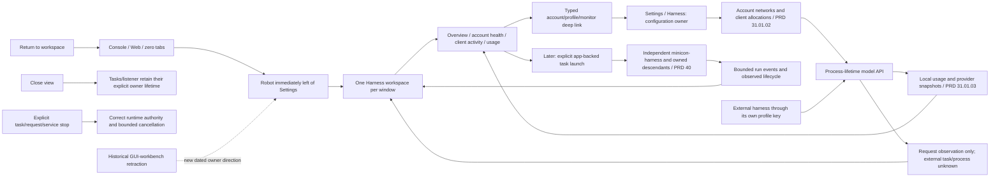
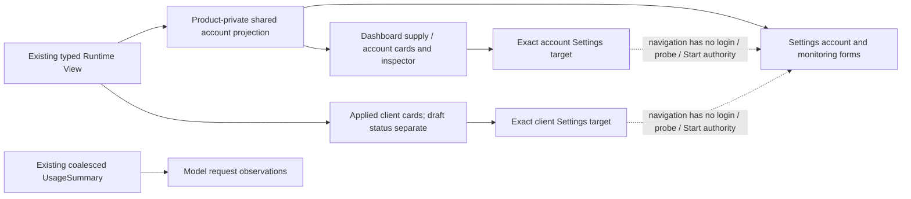

# Harness dashboard and operational workspace

Parent: [MiniCon product index](../PRD.md). Product boundary:
[charter](PRD_02_23_minicon.md). Settings:
[Harness connection experience](PRD_02_31_01_01_harness_experience.md).
Sequence: [Harness workspace plan](../plan/plan-harness-workspace.md) and
[selected 0.2.25 slice](../plan/plan-v0.2.25.md).
Status: `[-]` H0 robot/overview and cached H1 projections in development with a local
Windows injected-host checkpoint. Native input, live-page, selected artifact
and remaining operational projection acceptance stay open; task operation is
a later stage.

The owner's direction makes visual Harness operation/monitoring a future core
MiniCon experience. Console and Web remain maintained foundations. This is a
new product direction after the earlier GUI-workbench retraction; its limited
initial entry/overview and later local task operation have explicit stages.
It does not resurrect the historical AgenTerm/Fleet proposals wholesale.

This module owns the robot entry, full-window Harness presentation, operational
navigation, task-view UX and data/authority distinctions. Settings forms stay
with PRD 31.01.01; account allocation with PRD 31.01.02; measurements with
PRD 31.01.03; released worker history with PRD 31 and future app worker with
PRD 40. The host tab/focus mechanisms
remain with PRD 25 and public observations with PRD 26.
The newer [Plugins and Apps owner](PRD_02_40_plugins_apps.md) places future
file/exec task execution in the independent `minicon-harness` application;
this workspace observes and controls only app runs that publish the accepted
typed lifecycle. The released embedded worker remains the historical baseline.

## Outcome tree DAG

```text
Outcome: use MiniCon as the place to operate and understand local harness work
├── [-] ENTRY — robot icon immediately left of Settings in the host toolbar
│   invariant: one reversible entry is available in Console, Web and zero-tab states
│   evidence: HW-01 click/key/pressed-state/compact geometry and no startup side effects
│   safe failure: preserve the original tab, page and input drafts; show local unavailable state
│   dependency: PRD 25 header geometry, hit testing, painting and focus contract
│   non-goal: launching a task or listener merely by entering the workspace
├── [-] HOME — actionable overview, accounts, clients, usage and activity
│   invariant: every value/action comes from the owning runtime and names stale/unknown data
│   evidence: HW-02/03 empty/partial/working/error journeys and typed deep links to Settings
│   safe failure: usable empty/recovery state without fictional charts or active clients
│   dependency: pool/profile identities and measurement projection
│   non-goal: duplicating the configuration editor or provider billing system
├── [_] TASKS — future local minicon-harness app operation and run detail
│   invariant: explicit task start uses the app's file/exec policy and owned process lifecycle
│   evidence: HW-04/05 actual app streaming/task lifecycle, cancellation and descendant cleanup
│   safe failure: offline app is unknown/unavailable; pending cancel is not completed cancellation
│   dependency: PRD 40 app seam, versioned events and existing limits
│   non-goal: an embedded second agent loop, automatic teams, remote execution or arbitrary client process control
└── [-] FOUNDATION — responsive, accessible, bounded host workspace
    invariant: focus, paint, pointer hits and observations describe the same active view
    evidence: HW-06/07 native keyboard/IME/scale and bounded hidden/visible resource behavior
    safe failure: readable stacked layout, bounded history and retained return context
    dependency: existing native/shared UI mechanisms and delivery scope
    non-goal: bundled browser runtime or automatic adoption of ujs/tinyvm
```

## Memory palace



## Product structure and navigation

### Cached account and client projection (2026-10-26)

```text
Outcome: operational cards describe the same cached accounts and applied clients as Settings
├── [-] Account supply and resource cards
│   invariant: reuse account-policy and reading projections; never replace known readings with a fixed placeholder
│   evidence: mixed disabled/stored/tested pool, stale resources and public Dashboard-to-account navigation
│   safe failure: missing/loading stays unknown; currencies and allowance remain distinct
│   dependency: existing View and Settings pool projection; non-goal: new reads, polling or rotation
└── [-] Applied client cards and exact configuration handoff
    invariant: show applied mappings independently of drafts and external-process liveness
    evidence: multiple profiles, dirty draft and exact-profile Settings link
    safe failure: missing profile is explicit and cannot silently edit another profile
    dependency: connection profile View and typed Settings target; non-goal: controlling external agents
```

Account cards show provider/state, applied login/service network modes and a
freshness-labeled resource preview. Their inspector uses the same source/time,
latest-attempt and resource lines as Settings; a multi-resource preview says
that more values exist rather than inventing a total. The supply card counts
cached account states and reading attention. Client cards use stable profile
IDs and applied labels/mappings, with unapplied drafts clearly separate. An
Edit allocation link selects that exact profile; a removed profile leaves an
explicit unavailable result. Current request counters remain model API request
observations, not external process/task health.



Hot files: the existing Dashboard and Settings modules plus the account
projection moved to the binary-private `harness_account_ui.rs` for these actual
consumers. No shared platform crate, transport, writer or task runtime changes.
The three-line card preview remains bounded; full lines belong to its inspector
and the existing Settings/usage views. Native, real-account and final-artifact
acceptance remain selected.

Windows development evidence: `h1_cached_cards_keep_stale_wallets_and_applied_client_identity`
retains exact stale wallet values after denied reads, applied labels/models
despite dirty edits, draft-only distinction and disabled account presentation.
`client_deeplink_reports_removed_profile_after_delayed_hydration` retains the
previous binding and explicitly reports a removed target after loading.
`browser_windows::host_harness_dashboard_reuses_account_state_and_targets_named_client`
uses isolated synthetic accounts and two persisted profiles through the public
CLI. It compares disabled state with Settings, inspects the named card and opens
that exact client without login/Start or applied-binding changes. Its actual
client-card PNG was visually reviewed. An initial fixture with a non-opaque
profile ID was refused as Corrupt; the corrected32-hex identity is used for
the actual pass, without weakening configuration validation.

`target-six/v0.2.23-provider/dashboard-cached-controls/receipt.json` records
three actual production faults rejected by original assertions (replace a
known reading with a placeholder; hide a missing target error; navigate to the
default client instead), exact source restoration and passing5 Dashboard,
29 Settings,1 shared account and9 public Harness subjects, zero ignored.
The binary inventory grows872 -> 874; control integration37 -> 38. The shared
account subject moves with its production module and is not a second copy.
These are cached/synthetic Windows development observations, not real provider,
physical input, all-platform/language/scale or signed-artifact qualification.
The existing development-court workflow retains the moved account subject and
adds the cached-card and exact-client public subjects to its explicit Harness
selection and receipt/log inventory. YAML and the changed suite shell block
parse locally; no cross-platform job is dispatched for this checkpoint.

Two persistent host destinations are **Console/Web workspace** and **Harness**.
Harness is a host content view, with one instance per window; it is not another
PTY tab, Browser root, floating window, or settings popup. Store the previous
tab ID, sidebar/composer context and focus owner when entering. Returning restores
that context if it still exists, otherwise a valid nearest tab or zero-tab state.
Never send Harness navigation or task text to the hidden terminal/page.

Harness uses a navigation list: **Overview, Tasks, Accounts, Clients, Usage,
Activity**. Tasks is omitted from executable navigation until its delivery stage;
a roadmap note can describe it without a dead Start button. Accounts/Clients
are operational read views with named actions into the single Settings owner.
Usage is the larger view of the same metrics shown compactly in Settings.
Activity contains bounded lifecycle/failure events, not an unbounded debug log.

Settings remains the global gear entry. Its Harness route is for configuring
accounts, networks, allocations and monitoring. From the operational workspace,
**Configure account**, **Edit allocation** and **Monitoring settings** open the
matching section and stable entity ID. Returning closes the settings chrome
and restores the workspace's selection/filter/scroll. Never copy an entire
second set of form logic into the large screen.

## Robot entry and host interaction

- Use a small code/native-drawn robot outline matching the existing header
  icon stroke and theme. No emoji/font dependency or remote image. Tooltip and
  accessible name: localized **Harness — operation and monitoring**.
- The robot is immediately to the left of Settings with no intervening button:
  `... [Robot] [Settings] ...`. It remains in that order in expanded and compact
  layouts. The robot receives the selected fill only while Harness is active;
  the gear retains its independent open-settings state.
- Reserve a paired group with at least 32-DIP hit targets and a 4-DIP gap.
  The compact rail must allocate at least 80 DIP to retain the pair horizontally;
  other rail controls can stack. In a narrow expanded header, wrap the pair as
  a unit rather than shrink targets, overlap New, hide the robot in overflow or
  vertically swap its promised left-of-Settings position. This is a proposed
  geometry contract requiring native acceptance, not a measured pass.
- One click enters Harness. Clicking the selected robot returns to the previous
  workspace; **Back to workspace** is also visible inside Harness. Normal keyboard
  focus traversal, Enter and Space activate it. Do not invent an unqualified
  global shortcut that could steal an existing terminal/IME chord.
  With Browser chrome focus, the complete cycle is New -> address -> active
  proxy -> proxy-menu trigger -> Robot -> Settings -> New; Shift+Tab reverses
  those edges. Closing the group with Escape restores its entry owner. A
  forward exit from Settings must reach New, not return to proxy and trap the
  user in the header group. Console/zero-tab return keeps its existing owner.
  The actual native court exposed this join after the robot was introduced;
  integration hot files are the existing header router and its public native
  fixture. Browser editing/menu semantics retain PRD25.02 ownership.
- Opening Harness closes transient menus/settings chrome while preserving
  their unapplied drafts. A composed Escape first cancels/closes the nearest
  transient control; bare Escape alone must not abandon a task or leave the
  full workspace unexpectedly.

The forward/reverse Browser-header join now has an extended public control
journey, including exact visible `header_focus` observations and no activation
during traversal. Restoring the old forward exit to proxy breaks its original
`forward header exit must reach New rather than loop back to proxy` assertion;
exact restoration passes again. The source-bound receipt is
`target-six/v0.2.23-provider/presentation-header-controls/receipt.json`.
This is a no-activate, public injected-input development journey, not physical
keyboard/IME or final signed-artifact evidence. PRD32 owns its hosted replay.
- No account login, key creation, network refresh, listener start or task spawn
  occurs merely because the robot is opened. Read cached runtime state. Hidden
  tabs and an explicitly running service continue under their existing lifetime.
- A small static attention dot may represent an unresolved actionable account/
  service failure. It is not a busy animation or unread-message counter. Hover
  and accessible text explain it; stale/unknown readings are labeled in content
  rather than styled as an emergency. Opening the view does not clear failures.

## Dashboard structure from the owner's reference

The owner supplied an AIGC production-observation dashboard on 2026-10-25.
The useful pattern is its vertical operational hierarchy: global state/control,
outcome KPIs, control-path explanation, resource allowance cards, active work,
then pending work and details. The original image stays outside the repository;
do not copy its private amounts, machine identities or product-specific actions.

Use that hierarchy for the **Harness dashboard**, distinct from Settings /
Harness. A broad central canvas is the default overview; view navigation can
be compact and the inspector opens on selection. Do not turn the overview into
a wall of configuration tables. Both a desk-sized dashboard and a narrow stacked
view must answer the same operational questions.

| Reference pattern | Harness dashboard interpretation |
| --- | --- |
| Production header and global controls | Explicit local API state, current allocation mode, update/coverage time, Refresh local view, Open settings; later New task only when delivered |
| Outcome cards | Active model requests, today's request outcomes/tokens, accounts needing attention; later actual app task outcomes, kept separate from request counts |
| Control-path summary | Selected client alias -> account/model -> network policy, with verified/unknown route state and recovery link |
| Resource/credit cards | DeepSeek A, DeepSeek B and OpenCode Go account balance/allowance, freshness, proxy status and scoped attention |
| Active production cards | Observed client requests now; later owned app task cards with actual stage/events/elapsed and scoped Stop |
| Pending/results and drilldown | Real drafts/queued states only when implemented, recent terminal outcomes, bounded activity and selected-run/request detail |

Do not port automatic dispatch, repair-priority modes, scheduled publishing,
credit claiming, machine-fleet health or fabricated task queues. Those controls
have no current Harness authority. Manual account allocations remain labeled
as such; later scheduling gets its own validated engine stage.

## Wide overview wireframe

```text
Host tools: [+ New] ... [Robot:selected] [Settings] [other existing tools]
┌──────────────────────────────────────────────────────────────────────────────┐
│ [Back to workspace]  Harness                Local API: Running   [Configure] │
│ Overview / Accounts / Clients / Usage / Activity              time / coverage│
├──────────────────────────────────────────────────────────────────────────────┤
│ [Active requests] [Today's outcomes] [Input/output tokens] [Needs attention] │
├──────────────────────────────────────────────────────────────────────────────┤
│ Allocation path · Manual · selected client -> account/model -> network      │
│ Partial failure/unknown state with precise recovery, not a global false OK  │
├───────────────────────┬────────────────────────┬─────────────────────────────┤
│ DeepSeek A            │ DeepSeek B             │ OpenCode Go C               │
│ balance / timestamp   │ balance / proxy state  │ allowance / reset / freshness│
├───────────────────────┴────────────────────────┴─────────────────────────────┤
│ Current request activity · client-profile cards / actual active request IDs │
│ Later owned tasks: stage, elapsed, real output and Stop only when delivered │
├───────────────────────────────────────────┬──────────────────────────────────┤
│ Recent outcomes / actionable pending work │ Selected item detail / attention │
│ Real state only; no fabricated queue      │ Configure / inspect / safe action│
└───────────────────────────────────────────┴──────────────────────────────────┘
```

The first useful screen answers: what is usable, what is happening now, which
account each client uses, and what needs action. KPI cards are limited to those
questions. The account list keeps cash balance, plan allowance and their unknown/
stale states separate; it never displays a combined pool cash total in mixed
currencies. Trend charts are secondary to readable numbers and real activity.

An account row shows local label, provider, enabled/auth/model/network state,
available balance/allowance with freshness and affected client count. A client
row shows profile label, its aliases/allocations, active requests and last activity.
The inspector follows an explicit selection and does not steal focus as new
events arrive. Stable IDs retain selection through sorting and refresh.

## States, actions and information honesty

| Situation | Screen and meaningful action |
| --- | --- |
| No account configured | Explain the pool outcome with **Connect account** -> Settings / Harness / Accounts; no fake graph or task activity |
| Account stored, no verified allocation | Setup checklist with **Choose account/model for a client**; do not show it as usable |
| Usable allocation, listener stopped | Show saved connections with **Enable local connection** under the existing explicit-start contract |
| Running service, no requests | **Ready for local tools**, recipes and current allocations; no claim that an external process is online |
| One failed proxy/account | Keep healthy accounts and their client activity visible; **Inspect account network** with the affected account preselected |
| Unknown/stale balance | Last reading, timestamp and reason; explicit Refresh or monitor configuration, never a zero balance |
| One live request | Actual profile/account/model, elapsed and available usage; request completion is not completion of the client's entire task |
| Missing runtime/observation | Local unavailable reason and route to repair/settings; do not leave a blank screen or invent data |

The model API can observe requests made with a client key. It cannot infer that
an external harness is installed, its process is alive, or its task finished.
Show **Active requests** / **Last request**, not **Agent online** / **Task done**
without a separately delivered integration. Later request cancellation controls
cancel that gateway request only; they never pretend to stop an external tool
or its descendant processes. The gateway remains inference-only.

Runtime changes wake the view through existing host mechanisms. Coalesce
frequent metric updates to at most one presentation update per second; lifecycle
changes may be immediate. Preserve scroll/selection, do not auto-scroll while
the user reads older events, and label stale snapshots. Hiding the workspace
suspends its expensive presentation work; independently enabled monitoring
retains its explicit process-lifetime schedule.

## 未来构想 — cluster view

[PRD 37](PRD_02_37_cluster_horizon.md#未来构想) owns the requested cross-machine
direction. Its first dashboard extension adds an explicit node filter and a
node-state row before account supply and work cards. Drilldown retains the
origin node through account/client/request/task and usage views. The node row
shows actual paired identity, connection freshness and supported capability,
not an inferred machine-fleet health badge from API activity.

Read-only peers expose inspection/configuration guidance, not pretend remote
Run/Stop controls. Remote operations appear only when their later contract is
delivered. Current H0/H1 needs stable observation identities and extension space;
it does not need a fake Nodes page or automatic network discovery.

## Later app-backed task operation

This is a separately staged product capability, not part of merely reserving
the robot button. **New task** chooses a project root, task text, client profile/
model alias and explicit allowed commands. Show the resolved provider/account,
app worker limits and invocation summary before Start. File-root and exec
policy retain their existing meanings; no sandbox or new permission layer is
implied by this form. Start cannot silently increase the command allowlist.

### H2 first local journey design for 0.2.24

The first selected journey is one explicitly started local task: choose an
existing project root, enter a task such as reading a named file and running one
allowlisted command, select one applied client/model binding, inspect the
resolved account/network and worker limits, then press **Start task**. A missing
root, disallowed command, unavailable account or changed applied binding blocks
Start with an editable draft. Start creates one opaque local run ID and pins
the root, command list, profile revision, account/model, worker budget and
selected logic version for that run. The GUI cannot retarget a live run when a
profile or pool setting changes.

The released `minicon harness --root --task` invocation is a bounded
single-task worker, but it does not yet publish a typed, host-consumable run
event/lifecycle stream. H2 implementation first needs the independent app seam:
ordered bounded events with `run_id`, monotonically increasing `sequence`,
`stage`, source time and typed progress/tool/final outcomes; a separate private
bounded output channel; and one cancel acknowledgement after model/owned child
cleanup. The GUI derives the task card from those events and a final worker
receipt, never from model API request counts or captured terminal pixels.
Restart after ambiguous output must reconcile the same run ID before offering
an explicit new invocation; it cannot silently repeat a file write or command.

**Stop this task** targets only that run. Pressing it moves the view to
Cancelling; Cancelled appears only after the worker reports final cleanup.
Closing the task view preserves a live run; closing the GUI follows the current
owned-process shutdown rules. These choices form the HW-04/05 acceptance
scenarios for a later implementation release. The 0.2.24 result is the design
and the named missing worker seam, not an executable Start control.

The run view owns: task summary, immutable connection binding, lifecycle,
bounded text/tool activity, elapsed time, available token/usage and scoped Stop.
Use the independent app worker and an explicit typed event seam; do not build a
second embedded agent loop. Worker output retained for the interactive task is separately bounded
and private, not silently copied into the model gateway's metrics/history.
Durable transcript/search, arbitrary external harness adapters and automatic
teams require their own later decisions.

Task states: `draft -> starting -> running -> completed | failed`, with
`cancelling -> cancelled` only after the owned worker/descendant cleanup is
observed. Connection validation failures keep an editable draft. An error from
one tool/request is not automatically a terminal task failure; worker final
result determines that. Resume/Retry is an explicit operation with the existing
session/binding rules, never automatic replay of ambiguous tool effects.

Keep **Stop this task**, **Cancel this model request** and **Stop local API**
distinct. Each action identifies its owner and actual affected work. Navigation
away never stops a task. Closing the GUI retains the existing owned-process
shutdown rules; a finished task view does not certify remote billing stopped.

## Responsive, visual and accessibility contract

Use the current native palette, typography, bounded editors and menu mechanisms.
The default hierarchy is connection status, primary action, working content,
then secondary diagnostics. Good/busy/attention/error states pair a word/icon
with color; no color-only status, flashing alert or constant animated chart.

Proposed DIP breakpoints, to qualify rather than claim now: at least 1120 wide
uses a broad dashboard with multi-column KPI/resource/work cards and optional
detail inspector; 760..1119 reduces card columns and uses an explicit detail
drawer; below 760 uses a view selector and one stacked content column.
Below 480 keep a scrollable single column with full labels and reachable back/
settings controls. Short windows scroll content while navigation/close actions
stay reachable. No nested independent scroll traps for account rows.

Localize labels and recovery alongside the rest of the host. Keyboard traversal
follows visible order; editors retain IME ownership, Escape does not double-submit,
focus returns to the invoking row after a drawer closes. Secret controls remain
masked in pixels, accessibility and public snapshots. Prototype colors and demo
data are not native/theme/scale evidence.

## Delivery and acceptance

The local interaction study is
`target-six/v0.2.23-design/harness-product-prototype.html`. It renders the
owner-reference dashboard hierarchy and the separate Settings/Harness forms;
its scenarios include first use, stopped service, one failed proxy and unknown
allowance. Preview images and `preview-render-receipt.json` in that ignored
directory record only the synthetic HTML render, not a native product pass.

The [workspace plan](../plan/plan-harness-workspace.md) owns sequencing. The
initial reservation delivers a working entry, truthful overview/empty states,
back navigation and Settings deep links. Future task-operation controls appear
only with their actual lifecycle evidence. This avoids promising full task
operation as part of 0.2.23's entry reservation.

| Status / journey | Observable evidence |
| --- | --- |
| `[-]` HW-01 | Robot left of gear, pointer/key single activation, selected/attention states, compact/zero-tab behavior; no start/login/paid/clipboard side effects |
| `[-]` HW-02 | Empty/partial/running/failed/unknown scenarios show the actual next action and data coverage using PP/UM identities |
| `[-]` HW-03 | Settings deep links return to the same account/profile/view/filter; hidden Console/Web drafts, page state and native focus survive |
| `[_]` HW-04 | Later app task launch produces real model/tool/events/final output through the independent worker; unavailable capabilities cannot appear executable |
| `[_]` HW-05 | Later Stop/failed-start/resume/exit observe real owned-process cleanup and binding rules; external request controls make no external-process claim |
| `[-]` HW-06 | Same-frame hit/state/pixel/native keyboard/IME at selected OS/ISA/scales and viewport sizes, with readable translated labels |
| `[_]` HW-07 | Idle unopened/visible/hidden and active-task resource/retention bounds measured; metrics rendering cannot block terminal input or streaming |

### H0 local implementation checkpoint

- [v] The injected Windows host journey renders the Harness overview and preserves hidden workspace drafts.

Evidence identity:
`minicon_control::h0_harness_destination_preserves_console_and_web_drafts_and_observes_only`.
Its first successful run is retained in
`target-six/v0.2.23-provider/h0-public-initial.log`. This actual isolated
`--no-activate` GUI uses a missing-browser-runtime fixture and public CLI input;
it uses its own configuration/profile and does not navigate the owner's login
profile or write the clipboard. Later integration removes redundant H0 window
activation calls; the initial run alone did not measure foreground retention.
The journey checks actual rendered-frame PNG card/gap pixels over a live
Console, resize/clamped card identity, independent Console/Web host drafts,
header input ownership, Settings return focus and zero/exited-tab IME routing.
It also observes that merely opening the robot does not create the Harness
runtime directory. The six local `h0_` mechanism tests pass, including actual
private-load failure publication and explicit Loading/Loaded/Unavailable
projection. Busy alone never establishes that account/listener data is loaded.

`src/harness_workspace_ui.rs` owns the destination, cached cards, inspector,
bounded navigation and return context. It consumes the existing provider view
without starting a runtime or sending a provider action on entry. A successfully
installed, matching authorization presentation temporarily suspends the view;
failed/pending auth creation cannot falsely suspend or resume it. Existing
native visibility checks must succeed before hiding an ordinary page. Header
Settings and nested Settings retain their invoking focus and restore it once
after a real close; no simultaneous header/composer owner is permitted.

The initial compile failure (root-module visibility, shared font-helper
visibility and non-exhaustive wheel matching) is retained in `h0-initial-bin.log`;
it is not runtime counterevidence. The corrected bin run is
`h0-bin-fixed-visibility.log`. Static two-pass review and apply checks preceded
these executions but are not substituted for them.

Broader native WebView DOM/history/focus retention, actual keyboard/IME,
cross-platform input/scales, resource bounds and exact signed/public artifacts
remain open. Profile/client/usage/balance/activity data absent from the owning
runtime stays explicitly unavailable. The injected journey does not certify
those data sources or the later app-backed task-operation stage.

The first extended Windows development smoke passed the existing fifteen host
checks plus seven H0 checks using binary SHA-256
`f803694bfd998df7387b29cb72b0f280eca8b427b152df087f2087c8d73733a1`:
`target-six/v0.2.23-provider/h0-artifact-local-v2/receipt.json`.
The fixture's fresh post-return challenge observes the same native document
nonce, unsaved DOM input and history state, with one page GET throughout;
`h0-live-document.json` retains both reports. Actual host-frame PNGs distinguish
the visible Harness from an explicitly selected Console pane and observe
Browser restoration. Four Settings card links use published row positions,
not merely a row that happens to be visible. Zero-tab/narrow navigation is also
exercised. This is local development, not signed/public artifact or physical
keyboard/IME/scale qualification. It does not establish native child pixels.

That smoke first exposed reverse menu traversal being intercepted by the new
header; the retained initial failure is
`h0-artifact-local-initial/failure-final.json` under the same output root.
The corrected public menu/H0 journeys pass in `h0-checkpoint-public.log`.
The broader UI checkpoint then failed four existing assertions
(`h0-checkpoint-h0-ui.log`): creation-label width, two extreme geometry cases
and a saved proxy row in a short collapsed window. The repair preserves every
assertion: secondary tools retain 24-DIP targets, New retains its expanded
label width, the 80-DIP rail uses two rows, and Robot/Settings retain 32 DIP
with a 4-DIP gap. A rejected tiny target keeps its clamped proposed anchor with
zero area. Checked/saturating geometry prevents overflow. The focused CI now
explicitly selects that product UI suite as well as H0 tests.

The restored integration passes 267 selected Rust executions, with one
unselected opt-in Pi test ignored, required fmt/default+dedicated-feature
all-target Clippy, and all 22 browser-smoke checks:
`target-six/v0.2.23-provider/h0-final-gate-receipt.json`.
The final native Windows ordinary-page smoke binds binary SHA-256
`cd904718fb66c8e4f16c6eff8e92968ee0529fd20f756517944912b6805f1dda`;
its receipt, PNGs and fresh before/after document reports are under
`h0-artifact-local-final/`. The menu/H0 public regressions also pass after
exact restoration (`h0-runtime-controls-remaining/restored-public.log`).

The subsequent exact-source `5344921a770a373f29dc517aad5a550ca1f6b8ef`
native development run `40176995112` has five successful cells and one failed
Mac ARM cell. Every canonical browser smoke passes 22 checks. The Mac ARM H0
public journey fails after requesting a larger window: observed scroll is 1,
while the assertion assumes 0. That failure does not retain the actual resized
viewport; a requested size alone cannot establish native card capacity. Pure
geometry clamping remains qualified locally. The native journey must observe
actual viewport capacity and verify the first visible card's paint/hit identity
before this cross-platform regression closes. Independent raw/API/archive audit:
`target-six/v0.2.23-provider/ci-5344921-native/verification-index.json`.
This is a retained failed development run, not a six-cell release pass.

The subsequent local repair exposes actual viewport capacity through the
[public geometry contract](PRD_02_26_con_control_cli.md). The journey waits for
an enlarged, settled observed frame, checks the clamped continuous visible
card range and clicks the actual first visible card by its published identity.
It still requires zero scroll whenever all overview cards fit; the pure
1400-by-900 geometry assertion is unchanged. Removing the production clamp
produces an actual public runtime assertion failure, followed by exact source
restoration and one pure plus one public passing execution:
`target-six/v0.2.23-provider/h0-native-resize-controls/receipt.json`.
This is isolated Windows host-input evidence, not the missing new-source Mac
native result, physical pointer/IME qualification or a release-artifact pass.

The subsequent restored-source integration again passes both public menu/H0
journeys and the 22-check native-browser smoke, after the account-catalogue join:
`target-six/v0.2.23-provider/cs01-final-gate-receipt.json`.
The actual default dev executable SHA-256 is
`6ae33ed2b5f1ed045c0dd962d6d0de08671bb5c6df8574a4328f8a19d1fbbe3a`;
its native host PNGs and fresh live-document reports are retained in
`cs01-artifact-local-final/` under the same output root. The cross-platform
failed-source result above remains retained until a new matching-source run.

The exact-source `5a64ca4c1c3a5668f6c74dc9ec082f73120f814d` native development
run `40179668925` also ends with five successful cells and one Mac ARM failure.
All six canonical browser smokes pass 22 checks; the Mac ARM H0 public journey
panics on unsigned subtraction in the `card_pixels` closure. The raw failure
does not identify which invocation or retain its card/frame, so the explanation
that later Browser-entry sampling selected a hidden first card remains an
inference. Terminal job/API/archive-digest audit:
`target-six/v0.2.23-provider/ci-5a64ca4-native/verification-index.json`.
The subsequent test-only repair samples the actual first visible card, requires
its index to equal published scroll, checks dimensions before inset subtraction
and bounds the PNG probes with card/snapshot diagnostics. Product scroll is
unchanged. The repaired public journey passes locally; removing the actual
production pane-capture guard makes its explicit Console pixel assertion fail,
then the same journey passes after byte-exact restoration:
`target-six/v0.2.23-provider/h0-visible-sampling-controls/receipt.json`.
That local repair required subsequent matching-source Mac feedback; neither
failed run is a release six-cell or native physical-input pass.

The subsequent restored-source local integration passes both public H0/menu
journeys and all 22 canonical native-browser checks with default executable
SHA-256 `d7957c21b78d1d19e4b59148f0e52ab5529527f122c8c15df5de345ba32a34bc`.
Receipt: `target-six/v0.2.23-provider/cs02-final-gate-receipt.json`; native host
PNGs and fresh live-document reports are under `cs02-artifact-local-final/` in
that output root. This remains Windows local development evidence.
The subsequent matching-source native development run at `5411903` passes the
H0 public journey on Mac ARM and the other selected cells;
[PRD 32](PRD_02_32_dev_loop_crosscheck.md#version-3-compatibility-and-h0-native-feedback)
owns the exact run/source/archive audit. This closes the earlier development
sampler regression; physical-input/scales and release-artifact qualification
remain open.

Sixteen actual runtime assertion failures cover projection, attempt identity,
geometry, loading, host/pane capture, Browser restoration, scratch-frame discard,
input/return focus and both menu traversal boundaries. Nine accepted controls
are retained in `h0-runtime-controls/receipt.json`; its overall FAIL remains
because an inner-branch mutation was unreachable and passed. That variant is
rejected. `h0-runtime-controls-remaining/receipt.json` binds the unchanged
guarded source hashes, reuses only those nine valid failures, completes seven
valid failures and records initial/restored passing checks. Compilation/setup
errors, timeouts and the passing variant count as no RED.

H0 no longer requests top-level window activation on entry, return or Settings
close. Existing native child/parent focus and logical input owners retain their
own duties. Actual physical focus/IME, other OS/ISA/scales, resource bounds and
exact signed/public delivery remain separate open acceptance work.

## Future computer-use presentation

[PRD 38](PRD_02_38_computer_use.md) owns the future CU product contract and
[its plan](../plan/plan-minicon-cu.md) owns candidate sequencing. When selected,
this workspace owns the inspection/run presentation: target selection and age,
capability/permission guidance, private observation preview, explicit operation/
disclosure scope, actual step result and Stop. Reuse H2 run identity/events and
return context; do not add another model loop or operate desktop tasks inside
Settings / Harness forms. No CU navigation/action is executable in current H0.

## Usage H1 projection owner (design proposal)

[Local usage reports](PRD_02_31_01_03_03_usage_reports.md) owns the proposed full
Usage read-only selectors/qualified rows and compact Monitoring Settings link.
This module continues owning workspace entry/return, shared chrome and bounded
presentation lifetime. No new report consumer/native evidence is claimed by the
existing H0 receipts; metadata policy remains configured only in Settings.
