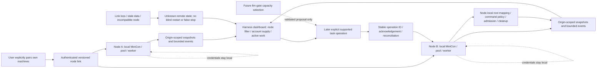

# MiniCon cluster and cross-machine coordination

Parent: [product index](../PRD.md). Operational surface:
[Harness dashboard](PRD_02_36_harness_workspace.md). Sequence:
[cluster horizon plan](../plan/plan-cluster-horizon.md).
Status: `[_]` future product direction requested by the owner, 2026-10-25.
This is a planned cross-machine extension, not current remote authority or a
0.2.23 delivery claim. Console/Web and local Harness work remain usable alone.

## Outcome tree DAG

```text
Outcome: understand and explicitly coordinate Harness work on the user's own machines
├── [_] IDENTIFY — explicitly pair independent MiniCon nodes
│   invariant: stable authenticated identity and declared capabilities, not hostname/IP trust
│   evidence: CL-01 pairing/revoke/wrong-peer/version/identity-change journeys
│   safe failure: refuse unknown or changed identity; retain local operation
│   dependency: versioned node contract, private identity and explicit connection ownership
│   non-goal: unsolicited discovery, cloud registration or trusting every LAN process
├── [_] OBSERVE — aggregate node/account/client/request/task observations
│   invariant: origin, observation time, freshness and coverage stay attached
│   evidence: CL-02/03 two real machines, reconnect, missing fields and duplicate data
│   safe failure: disconnected/stale/unknown rather than failed task or zero usage
│   dependency: IDENTIFY and PRD 36 / PP / UM projections
│   non-goal: inferring external harness process health from API traffic
├── [_] CONTROL — later explicitly dispatch/cancel supported owned work
│   invariant: execution node owns admission, file/exec policy, lifetime and final result
│   evidence: CL-04/05 duplicate delivery, lost acknowledgement, cancellation and reconnect
│   safe failure: unknown outcome requires reconciliation; never blind replay or duplicate execution
│   dependency: OBSERVE and the local H2 worker lifecycle/event contract
│   non-goal: remote shell authority, arbitrary process kill or transferring local path assumptions
└── [_] COORDINATE — future model supply, capacity and selection across paired nodes
    invariant: credentials remain local; validated allocation preserves conversation ownership
    evidence: CL-06 declared capacity and explicit cross-node model/task routes
    safe failure: local accounts/tasks remain available; no hidden account/machine failover
    dependency: CONTROL feedback, pool/network contracts and future llm-gate seam
    non-goal: automatic teams, public model exposure or introducing ujs/tinyvm now
```

## Memory palace



## 未来构想

Make the Harness dashboard grow from a single-machine observation desk into a
view of explicitly paired personal machines: for example, a development desktop,
a laptop and a Linux machine. Start with seeing real node state and work; then
add deliberate task handoff and cancellation; finally consider allocation across
node/model capacity. Cross-machine work must be an early subsequent design
track, with its own staged release selection, rather than an unnamed distant idea.

### C0 — node and observation design, next design milestone

Define node identity, pairing, capability/version negotiation, snapshot/event
envelopes, stale/offline presentation and dashboard extension points. Inventory
which existing local worker, pool, metric and shutdown contracts can actually be
reused. A design review must resolve the bootstrap channel, identity verification,
credential storage, process lifetime and authorization scopes before C1 code.
Do not treat the local model key or existing GUI control endpoint as a complete
cross-machine trust protocol.

### C1 — explicit pairing and read-only observation

Pair machines deliberately; label them locally and expose read-only local
service, account capability/allowance, client-request and delivered built-in task
state. The dashboard adds All nodes / This machine / Selected node filtering
and node cards with connection freshness and compatibility. Account balances,
usage and attention can be filtered by node, with currency and coverage intact.

Every account/profile/request/task reference is origin-scoped. Keep node identity
separate from a mutable label, address or OS description. Reconnect resumes from
a bounded event cursor or obtains a fresh snapshot; duplicate observations cannot
double-count usage. Out-of-order events cannot rewind a later final state.
Use source time plus local receipt age to tolerate clock differences; disconnected
does not mean a remote task failed or stopped. An old quota snapshot is not zero.

The initial topology is an explicitly connected observer and its selected nodes;
full mesh, permanent leader election, public relay/cloud hosting and unsolicited
LAN discovery are separate decisions. Nodes remain independently usable when
the observer closes. Opening the dashboard does not silently enable networking
or enroll the machine as an execution worker.

### C2 — deliberate cross-machine task operation

After local H2 task operation is qualified, allow a user to choose an execution
node and one of its advertised project/root mappings and allowed task profiles.
Show the target node, account/model allocation and effective local policy before
dispatch. A local absolute path is never assumed to exist or mean the same thing
on another machine. File transfer, repository checkout and artifact movement
are explicit separate capabilities; first handoff may require an already
prepared project on the target machine.

Use an operation ID and a persisted admission/result receipt on the execution
node. A retried submission of the same operation reconciles the existing work;
it must not start another copy. Lost acknowledgement means Outcome unknown,
not safe to retry as new. Multi-step model/tool effects do not become exactly-once
merely because submission is deduplicated.

The execution node owns budgets, files/exec, credential use, descendants and
final lifecycle. Cancel remains Cancelling / Awaiting node confirmation until
that node acknowledges the actual outcome. A disconnected observer cannot show
Stopped merely because its socket closed. Reconnect queries observed state;
it never blindly restarts work. A node crash exposes interrupted/unknown work
until a supported recovery contract resolves it.

### C3 — model/account supply and later capacity-aware coordination

Keep the default topology node-local: each node owns its accounts, private keys,
proxies, client profiles and limits. The dashboard aggregates metadata, not raw
OAuth grants, browser stores or upstream keys. Model access from another machine
requires a separately authorized route over the authenticated node transport;
do not change today's loopback API into a wildcard/LAN bind to make it work.

Future llm-gate selection can consider declared node capability, current load,
account readiness and known quota while preserving stable conversation and
execution ownership. A stale balance is not scheduling truth. Moving a task,
model session, tool result or provider binding between nodes requires an explicit
handoff contract; no transparent migration after partial output or ambiguous
execution. ujs/tinyvm remains an optional later selector implementation.

## Dashboard and Settings extension boundary

PRD 36 owns the screen: later node summary before account supply, node filters
through request/task/usage drilldown, and origin labels on actions. PRD 31.01.01
continues account/client configuration for the selected node only when a supported
management capability exists. C1 read-only peers have Inspect, not fake Edit,
Run or Stop buttons. Pairing/connection management gets its own later Settings
section when its contract is selected; do not hide trust setup in a proxy field.

The account and usage owners retain their semantics and privacy boundaries.
Aggregate only the reported coverage; unlike currencies, duplicated cumulative
snapshots and local-vs-provider totals cannot be merged into a false cluster
balance or bill. Do not import another product's Fleet or session authority.

## Acceptance and open decisions

| Status / journey | Required evidence |
| --- | --- |
| `[_]` CL-01 | Real two-node identity verification, revoke, wrong/changed identity and protocol compatibility; no implicit trust from network location |
| `[_]` CL-02 | Source-scoped snapshots/events survive reconnect/reordering without cross-node entity confusion or duplicate metrics |
| `[_]` CL-03 | Stale/offline/clock-difference/missing-capability views remain truthful and preserve local work |
| `[_]` CL-04 | Later task dispatch deduplicates the same operation and reconciles lost acknowledgements without duplicate file/exec effects |
| `[_]` CL-05 | Later cancel, disconnect, observer exit and node crash name the actual remote lifecycle; unconfirmed cancellation stays unconfirmed |
| `[_]` CL-06 | Later explicit model/task allocation respects node-local credentials, proxy, capacity and session binding; no silent LAN exposure or migration |

Before C1 implementation, resolve transport/bootstrap, mutual identity and
read/control capability scopes, version negotiation, retention/backpressure,
explicit run lifetime and upgrade compatibility. Before C2, resolve durable
operation receipts, project mapping and restart reconciliation. Name each missing
prerequisite BLOCKED for its exact delivery; the future direction itself remains
planned rather than silently expanding current release scope.
