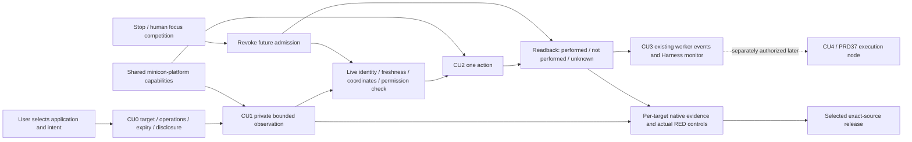

# MiniCon computer use

Parent: [product index](../PRD.md). Status: `[_]` future product design,
requested by the owner on 2026-10-25; no CU implementation or native
qualification is claimed. Candidate version selection belongs exclusively to
[the CU plan](../plan/plan-minicon-cu.md).

## Outcome tree DAG

```text
Outcome: deliberately inspect and operate a selected application, with visible scope and accountable results
├── [_] CU0 — target, observation, operation and disclosure contracts
├── [_] CU1 — bounded, user-requested local window observation
├── [_] CU2 — explicit, verified single operation
├── [_] CU3 — bounded invocation from the existing Harness and its monitor
└── [_] CU4 — later paired-node observation and explicitly authorized operation
```

Each row is a delivery leaf. An incremented version number does not satisfy
its dependencies.

| Leaf | Invariant | Observable evidence | Safe failure | Dependency | Explicit non-goal |
| --- | --- | --- | --- | --- | --- |
| CU0 | Observe, act and disclose are separate target-bound choices; OS permission alone grants no product authority | CU-01 public contract refuses absent scope, stale identities, oversized requests and capability mismatch before native effects; actual removed-guard failures | Typed refused, unsupported or permission denied; no automatic permission grant | Charter/reuse review and native capability inventory | Importing AgenTerm grants or a general permission engine |
| CU1 | A selected-window image/tree retains identity, age, source, coverage and private artifact ownership | CU-02 actual synthetic native windows: bounded PNG/tree, resizing, DPI, closed/replaced targets, denied capture and truncated trees on every advertised target | Unavailable, stale or truncated; no fabricated empty success | CU0 and shared capture, accessibility, identity and private publication mechanisms | Whole-desktop recording, automatic model upload or continuous polling |
| CU2 | One operation revalidates the observed target and prerequisites immediately before the effect | CU-03 actual invoke, text, pointer/key/scroll journeys; replacement, competing focus, lost acknowledgement, Stop and no-duplicate controls | Distinguish not performed, performed and outcome unknown; ambiguous effects are not replayed | CU1, semantic action support and owned native cancellation/admission | Autonomous multi-step agent, universal background input or privilege escalation |
| CU3 | The existing worker receives only the explicitly selected target/operation budget; scope and Stop remain visible | CU-04 real Harness observation/action/events and admission/cancellation races with no call outside scope | Revoke future admission, reconcile in-flight effects and preserve uncertain results | CU2, explicit PRD 31 third-tool decision and PRD 36 H2 lifecycle | A second model loop, plugin/MCP host or a daemon |
| CU4 | Execution node owns its desktop/session authority and actual final result | CU-05 two actual paired machines: wrong peer/session, disconnect, duplicate request and reconciliation | Disconnected or unknown; no fresh-ID replay or hidden migration | CU1 plus PRD 37 observation; CU3 plus PRD 37 control for actions | Desktop authority from pairing alone or exposing today's local endpoint |

## Memory palace



## Product experience

### Product priority and first pilot

The first product problem is the gap between a harness's file/command results
and the application a user can actually see: inspect the selected application's
current state, then verify one deliberate interaction. Start with developer
inspection and application checks. General personal-assistant desktop tasks,
unattended workflows and a marketplace of application recipes are later product
decisions, not prerequisites for a useful preview.

The initial pilot has two distinct acceptance steps:

| Step | User outcome | Evidence and scope |
| --- | --- | --- |
| Deterministic native fixture | Discover, select and inspect one owned application; CU2 later changes one known control and verifies its effect | CU-02/03 establish target, coverage and failure behavior against an independently known expected state |
| Explicitly selected real development application | Inspect a scratch document or test page, explain any missing controls, and later perform one supported reversible operation | A named application/version and OS/ISA journey demonstrates usefulness; it does not certify other applications or substitute for the fixture |

Choose the real pilot application during CU0 from actual user work and available
native courts. Use prepared scratch content, not account login or private
production data. Do not lock the product to one application's titles, geometry
or accessibility shape merely to make the pilot pass. The real-application
observation journey is part of CU1 acceptance; its action extension belongs to
CU2. Public claims name the application coverage actually exercised.

Review the pilot by outcome: can the caller identify the right window, understand
what was and was not observed, consume/delete the result, and recognize a lost
target without guessing? For CU2, can the caller distinguish a verified effect
from an unconfirmed input? Record bounded-result size, observation latency,
startup/idle resource cost and required human setup alongside correctness.
CU0 proposes numerical acceptance budgets from these measurements and the
delivery owner's constraints; this design does not invent measured thresholds.

If a pilot cannot complete that journey, reduce the advertised platforms or
action families before adding a dashboard, service transport or agent loop.
Model task-success benchmarks become relevant at CU3; local observation must
already be useful and testable without them.

### Product role and first-preview acceptance

Planning refinement, 2026-10-26: `minicon-cu` is the MiniCon family's selected
application observation/action capability. Its initial users are developers
and harness authors who need to inspect a real application before operating
it. MiniCon supplies the native capability and accountable result; the existing
worker or an external harness supplies the task and model loop. An optional
standalone entry must remain useful without MiniCon's GUI, provider pool or
model listener running.

The first preview is complete when a user can discover support, choose one
window, request an observation, understand its coverage and privately consume
or delete the result. A screenshot command alone does not complete that journey.

| Step | User-visible result | Acceptance boundary |
| --- | --- | --- |
| Check support | Separate capture/accessibility/action availability and permission state for this native session | A source facade or successful build cannot label a capability available |
| Select a target | Application/window identity and current geometry, with an explicit choice when several windows match | Discovery does not capture each candidate or choose the foreground window implicitly |
| Observe once | A bounded result with per-source status, times and private artifacts | Missing accessibility can produce a clearly labeled pixels-only result; unavailable pixels must not be shown as a successful visual observation |
| Inspect or export | Preview/tree coverage, omitted content and a caller-owned result usable by a script | No model account or upload is needed to use CU1; export is an explicit disclosure choice |
| Finish | Delete owned artifacts or retain them under the stated bounded policy | Retained evidence is not a live target or permission to act later |

Use one synthetic owned application journey for preview acceptance: select its
window, inspect a known label/control and image, resize and re-observe, close
it and observe an honest target-lost result. Reopening an application with the
same title must not revive the old target. CU2 extends this same journey with
one declared control effect and readback, so observation and action cannot be
qualified against unrelated fixtures. Detailed target/effect invariants remain
in the lifecycle contract below.

### First users and useful journeys

| User | First useful journey | Delivery owner |
| --- | --- | --- |
| A developer diagnosing an unfamiliar application | Select one window, inspect its preview and accessible controls, export one privately owned observation | CU1; useful without a model account |
| A script or external harness author | Submit one versioned CLI request and consume a bounded typed result/artifact; explicitly request a qualified single action later | CU1 then CU2; the caller retains its model loop |
| A MiniCon Harness user | See the chosen application and scope beside the current step, inspect the result, and stop further actions | CU3 and PRD 36 H2 |
| A user operating another paired machine | Identify the execution node and desktop session before observation or action | CU4 and PRD 37; independently gated |

CU1 acceptance is a complete selection-to-observation journey, not a collection
of exposed OS APIs. Show which parts came from pixels versus accessibility,
what was omitted, and where the private artifacts live. A browser window may
be observed as an application window; DOM/CDP/browser-flow automation is a
separate capability decision. Capture permission does not promise input support.

### Preview scope and model compatibility

The first product slice supports inspecting a development application: choose
its window, read a known control and image, resize it, and inspect the changed
state. It must also work through an external caller without a MiniCon model
account. CU1 does not require a task runner or a visual dashboard to be useful.

| Increment | Required product experience | Deferred from this increment |
| --- | --- | --- |
| CU1 observation preview | Capability discovery, explicit unambiguous selection, one bounded observation, coverage/freshness explanation, private artifact consumption and disposal | Native actions, model-driven operation, continuous capture, remote desktop |
| CU2 single operation | One supported action with target validation, observable readback and an honest uncertain result when acknowledgement is insufficient | Autonomous task completion, recording/replay and unattended retries |
| CU3 Harness experience | A selected tool route, compatible model input, visible target/step/budget, controlled disclosure and Stop | New model loop, dynamic orchestration or dependence on a future engine |

Model connectivity and computer-use compatibility are separate capabilities.
A ready account or a successful OpenAI/Anthropic request does not establish
image input or reliable tool calling for its selected upstream model. Before
CU3 discloses an observation, the integration must check the actual route's
supported input modalities, payload limits and tool-result representation.
Image forwarding requires an explicitly supported image path through the
provider adapter; never infer it from an endpoint or protocol name.

An accessibility-text-only route may be offered when deliberately selected
and labeled with its coverage limits. It must not silently replace a requested
visual task or claim to inspect controls absent from that tree. If the selected
task requires images and its model route cannot consume them, report an
incompatible route with a model-selection recovery path. Keep private local
inspection available. A supplied image or tree remains untrusted task data;
it cannot change the selected target, action budget or disclosure scope.

CU-04 must include a compatible image/tool-result round trip where supported,
an explicitly selected text-only journey and an incompatible-route refusal
before disclosure. Provider-specific evidence stays with the provider owner;
CU-04 owns the end-to-end integration. No current DeepSeek or OpenCode account
is labeled vision-capable by this design.

The first useful outcome is **inspect this window**, even without a model or
provider account. A user chooses a currently available application/window,
sees capture/accessibility support and any required OS permission, then asks
for one observation. Show the selected target, capture age, preview, bounded
accessibility content and coverage together. A secure/unsupported surface is
an explained limitation, not an empty successful result. A changed or closed
target requires selection/re-observation; never silently select a similarly
titled window. Do not ship action controls before CU2 exists.

For CU2, the user chooses one supported action against that observation.
Present the target and effect, perform the admission check, then show actual
readback and a local result. Prefer semantic invoke/set-text to coordinates.
Pointer/key/scroll support is enabled only where its native target/focus
contract is qualified. A confirmation authorizes its stated operation and
budget, not unrestricted future desktop access.

The visual route belongs in the **Harness operational workspace**, through a
Computer use inspection/run view. Initial CLI preview can precede that view;
the GUI must use the same typed product contract when selected. Later run
detail presents target, scope, pending/current step, observation preview,
disclosure, result and Stop. Settings owns capability/permission guidance and
retention preferences; it is not the place to operate a desktop task or another
copy of Settings / Harness account forms. PRD 36 owns navigation and rendering.

Observation remains private and local by default, with bounded retention and
explicit deletion. Before a model receives pixels or text, the user can see
the target, data coverage and selected model route and authorize that disclosure.
Local observation, native action and model disclosure have distinct budgets.
Opening the robot view or possessing a provider/client key authorizes none of
them. Do not capture clipboard contents, hidden login stores or real account
profiles as fixtures. Captured application/page content is data, not authority
to expand scope or issue grants.

## Target, effect and lifecycle contract

A versioned observation binds desktop/session generation, process lifetime,
native window generation, capture ID/time, backend/coverage, geometry, scale
and coordinate-space tag, PNG dimensions/hash and tree snapshot/budget/
truncation. Titles, PIDs, handles and node-index paths alone cannot bind a
target safely. Opaque IDs establish equality, not authentication.

Screenshot and accessibility samples are not an atomic desktop frame: retain
their individual times and sampling skew. Re-resolve a selected node's live
identity/role before action. Coordinate requests identify their source capture
and physical/logical, screen/client space; stale geometry, changed displays or
ambiguous targets require re-observation rather than guessed conversion.

Admission starts as explicit per-invocation/session scope: selected window,
allowed operations, expiry and count. Persistent grants require a later
decision. OS permissions remain real prerequisites; missing capability never
triggers automatic escalation. Permission/setup guidance is available only
when requested. Focus competition stops further admission without repeatedly
stealing focus back. Some native input APIs are global and foreground-sensitive;
never describe them as window-local or background-safe.

Posting input does not prove consumption. Report performed only against the
declared observable result; otherwise distinguish not performed from outcome
unknown. Stop prevents further admissions and reconciles in-flight work; it
cannot undo a consumed click. Operation IDs support reconciliation, not
exactly-once external effects. Uncertain clicks/writes are not automatically
repeated. Bounded observation retries retain explicit freshness semantics.

CU admission bounds this tool's own operations. Existing unrestricted commands
are not an OS sandbox: do not claim the file/exec worker cannot use other
desktop tools. A future confined-run promise needs its own threat model and
enforcement rather than a CU flag.

## Repository, interface and reuse decision

**Start in this repository as `crates/minicon-cu`**, a separate product library
with versioned typed requests/results and an optional thin `minicon-cu` CLI.
This is a design reservation: no empty crate or dependency is added now.
MiniCon's ordinary startup and one-executable usability stay independent of CU;
an optional companion is not a required bundled runtime. Account for any later
feature's actual artifact size and idle resources before selecting packaging.

Repository, code ownership, distribution and transport are separate decisions:

| Decision | Initial recommendation | Reason / reconsideration gate |
| --- | --- | --- |
| Source repository | This MiniCon repository | Native contracts, CU consumers and their regressions can change and be reviewed in one source revision; repository extraction has its own gate below |
| Product module | `crates/minicon-cu`, with native mechanisms in `minicon-platform` | A separate library bounds CU dependencies and semantics while preserving the existing native mechanism owners |
| Distribution | Prefer an optional native `minicon-cu` CLI for the observation preview; select the actual asset only after size/startup measurements | A separate executable can ship from the same repository; default terminal startup must not launch or load CU merely because the asset exists |
| Internal consumer | Typed library calls from a selected MiniCon integration | One target/result contract; GUI and worker adapters do not duplicate native logic |
| External consumer | Versioned CLI requests/results first | An external harness can own its model loop; a concrete retained-session/event requirement is needed before choosing a service transport |

Initially align companion releases with the selected MiniCon source/release
train while versioning the request/result schema explicitly. A package version
alone is not an interoperability contract. Discovery must let a caller check
schema and actual native capabilities before capture or action. CU0 must
resolve cross-invocation target references, expiry and private artifact ownership
before the CLI schema is frozen; a raw window handle is not that contract.
The base terminal must remain usable when the optional CU asset is absent.
Packaging budgets and exact artifact qualification remain with
[delivery](PRD_02_27_con_delivery.md).

Use typed calls inside the workspace. Start external consumers with a bounded
versioned CLI: a command is one request/result with explicit artifact ownership,
limits and exit status. This gives scripts and other harnesses a usable entry
without introducing another server. Later, if an actual consumer needs retained
sessions/events or transport, design a separate authenticated local CU service
contract. The OpenAI/Anthropic model gateway does not execute CU and is not the
desktop control endpoint. No listener or background process starts implicitly.

Keep native mechanisms in `minicon-platform`, with the ownership and capability
map in [PRD 28](PRD_02_28_shared_core.md). Existing source seams include
`screenshot::capture_native_window_png`,
`accessibility_tree::tree_for_window_bounded` / `perform_node_action`,
`input_inject`, `process_window`, `window_enumerate`, `window_op` and
`window_placement`. Their presence is not per-OS qualification. In particular,
the current macOS capture path can report Unsupported if its dynamically
resolved capture API is unavailable. Inventory actual target support before
promising macOS/Windows/Linux parity; unsupported desktop protocols remain
explicit. Browser-native semantics/CDP need a separate selected scope.

Native reference check (2026-10-26): Windows
[UI Automation](https://learn.microsoft.com/en-us/windows/win32/winauto/uiauto-uiautomationoverview)
exposes an element tree and control patterns; the actual application's provider
determines available semantics. Linux's
[RemoteDesktop portal](https://flatpak.github.io/xdg-desktop-portal/docs/doc-org.freedesktop.portal.RemoteDesktop.html)
has explicit session/device selection and user-approved start, with stream-relative
coordinates. These references inform the capability inventory; they do not prove
MiniCon implements those adapters or qualifies a particular desktop protocol.

CU owns target/admission/observation/action meaning. PRD 26 owns automation of
MiniCon's own GUI. PRD 25.04 owns shortcuts for its own window; minicon-winmgr
owns window management product behavior. A window-placement mechanism may be
shared without making either product the CU coordinator.

AgenTerm CU is a design reference, not a runtime dependency: do not inherit
its dynamic library, control server, grants, persistent owners or receipts.
MiniCon's native fixes and evidence stay in its own shared crates and courts.

Consider a separate repository only when a stable contract has a real external
consumer and an independently maintained release/security/packaging cadence
that same-source integration obstructs. Before moving, establish ownership,
pinned shared dependencies and both consumer compatibility gates. Binary count
or module size alone does not justify a split. This module remains the decision
owner until an explicit migration assigns a successor.

## Evidence and delivery boundary

All CU-01..05 are `[_]`; no native court has run for this proposed product.
Use fresh synthetic owned applications through public CLI/GUI black boxes.
Evidence names exact source/artifact, schema, enabled capability, OS/ISA/native
runtime and actual permission state. Mechanism tests do not replace end-to-end
target/effect journeys, nor do another product's receipts. Each guard needs an
actual intended assertion failure followed by exact restore and passing replay.
Unavailable desktop, permission or native evidence is BLOCKED for that claim.

The current file/exec worker remains governed by
[PRD 31](PRD_02_31_v0_2_horizon.md). CU3 requires a separately selected tool
amendment; planning does not silently add a third tool. Task monitoring and
Stop integrate through [PRD 36](PRD_02_36_harness_workspace.md); remote trust,
transport and authority remain with [PRD 37](PRD_02_37_cluster_horizon.md).
This design grants no desktop access, input, persistent agent or remote service.
