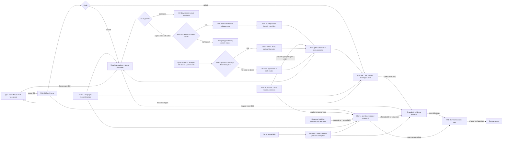

# @0 tab-agent watch floor

Parent: [@0 destination and tab boundary](PRD_02_39_home_dashboard.md).
Operational facts and exact Settings links: [PRD 36](PRD_02_36_harness_workspace.md).
Optional worker/event authority: [PRD 40](PRD_02_40_plugins_apps.md).
Delivery sequence: [0.2.26 design plan](../plan/plan-v0.2.26.md).

Status: `[-]` 0.2.26 design and partial development, refined for the owner's 2026-10-28
direction: @0 manages agents working **inside MiniCon tabs** and local system
health through two modes. **List is the default management view**; a separate
visual drag/drop view grows in explicit stages. The public 0.2.25
@0 implementation is a static brand/office card with host-chrome navigation;
it supplies a truthful starting point, not this canvas's acceptance.

The current 0.2.26 development tree routes closing the last real tab to @0
and paints **New Terminal / New Web** actions there, with shared geometry in
public snapshots. The Windows native Home court passed the close and both
creation actions. New Web must not be described as independent
per-tab browsing in a public release until [PRD 25's W26](PRD_02_25_con_workspace.md)
host/context lifecycle has its remaining native authorization and platform
evidence. The 0.2.26 development tree creates distinct Web IDs and has a
Windows native two-page navigation/proxy court; its qualification scope and
open gates are owned by PRD 25, with the context-release mechanism in
[PRD 28.01](PRD_02_28_01_browser_context_lifecycle.md).
The tab-office design below uses only observed Web facts in the accepted host.

The development tree now has a first real List slice: @0 paints stable @ID
rows from the current Workspace, reports observed Console child exit separately
from unknown agent work, and scrolls its own viewport. A row click selects its
exact @ID and keeps @0 visible; the inspector's Focus tab button or Enter opens
that tab. Escape clears the selection. Closing an inspected tab leaves its @ID
in a disabled **Tab no longer exists** inspector, without selecting a surviving
row. The Windows native `native_home_fleet_rows_target_exact_tab_ids` court
passed on three same-named Console tabs; restoring direct row activation made
it fail. `ui-snapshot` publishes visible row IDs, selection/staleness and hit
rectangles. `native_home_inspector_captures_wide_and_narrow_layouts` produced
native 960x600 and 500x650 Home captures; the latter exposed a resize repaint
gap that was corrected. The 210-pixel inspector also clipped its status copy;
shorter child/agent labels are fully visible in the recaptured wide window.
The geometry sweep proves list and inspector targets do
not overlap at its sampled sizes. Search, grouping, attention, scoped system
status, visual mode, 256 mixed-tab overflow and other-platform native captures
remain open. `screenshot-pane` captures the underlying Console pane while @0
is visible, so it is not Home visual evidence.
The Windows `native_home_fleet_wheel_keeps_scrolled_row_target_exact` court
also passed with 17 Console tabs: a real window wheel moved the list viewport,
and the first newly visible row selected and then focused its published @ID.
Disabling the Home wheel route made this court fail. This proves native overflow navigation
at that size, not the planned 256 mixed-tab or other-platform courts.

## Outcome tree DAG

```text
Outcome: @0 lets one person manage and watch tab-contained agents and local health in list or visual mode
├── [_] HC-01 — two-mode information architecture
│   invariant: List opens by default; Visual is explicit; both render one @ID/observer/attention projection
│   evidence: initial/reopen/mode-switch snapshots and native 16:9, 4:3, short-window captures
│   safe failure: unavailable data leaves the composition intact with a clear empty explanation
│   dependency: PRD 39 fixed destination and shared host theme/font metrics
│   non-goal: divergent mode-specific task truth, a second Settings page or animated wallpaper
├── [_] HC-02 — truthful tab, agent and system projection
│   invariant: tab/process facts, typed agent work and system telemetry remain separate, each with scope/source/freshness
│   evidence: public snapshots and mixed active/exited/unreported/stale/error native journeys
│   safe failure: lost owner data removes claims and preserves explicit routes to inspection/retry
│   dependency: PRD 25 tab/session state, host telemetry owner and PRD 36 typed run/request projection
│   non-goal: detecting agents from title/PTY text, polling providers or exposing private output
├── [_] HC-03 — focused, reversible navigation
│   invariant: every clickable region has one target and opening @0 does not mutate a service, account, task or tab
│   evidence: pointer, keyboard, focus and no-activation journeys across Home, real tab, robot and Settings
│   safe failure: unavailable destination remains explained and Home remains usable
│   dependency: PRD 39 @0 routing and PRD 36 typed deep links
│   non-goal: task Start/Stop, account editing or direct PTY input on Home
├── [_] HC-04 — responsive and accessible canvas
│   invariant: identity, primary action and status retain order and full targets at every supported window size
│   evidence: 1x/1.5x/2x native captures, narrow/short scroll and tab-order/readout courts
│   safe failure: condensed one-column view replaces decorative scene detail before essential controls clip
│   dependency: host font scaling, language/theme choices and native input focus
│   non-goal: color-only status or animation-only meaning
├── [-] HC-06 — default list management and exact drill-down
│   invariant: filters/sorts/groups change presentation only; each row/inspector targets its stable @ID
│   evidence: 0/1/many/256 tabs, duplicate names, filter/sort/group and exact focus/inspect journeys
│   safe failure: hidden-by-filter alerts remain counted; closed/moved target never redirects to a row index
│   dependency: PRD 25 tab tree and public stable IDs; non-goal: reading hidden tab text or controlling arbitrary child processes
├── [_] HC-07 — attention queue and scoped system status
│   invariant: each item names its cause, affected @ID or component, observed time and one safe repair route
│   evidence: mixed exited tab, stale observer, failed provider and host pressure; sorting/dedupe/recovery journeys
│   safe failure: collector loss says Unknown, never healthy; a missing reading is not an alarm storm
│   dependency: tab lifecycle, PRD 36 attention projection and measured host telemetry
│   non-goal: unmeasured OS-wide health claims, automatic remediation or duplicate provider billing UI
├── [_] HC-08 — staged visual drag/drop management
│   invariant: visual placement never silently mutates the tab tree or an agent's working state
│   evidence: mode parity, exact @ID drag/cancel/stale-revision/capture-loss and list-accessible alternative
│   safe failure: invalid/stale drops leave topology and layout unchanged with a reason; no phantom station
│   dependency: HC-06 shared projection and PRD 25.03 atomic subtree-move rules for an explicit topology action
│   non-goal: persistent workspace restoration, cross-window transfer or drag-to-run/stop semantics
└── [_] HC-05 — office characters only after typed runs
    invariant: one character maps to one observed run ID, stage and source time; request counts never become people
    evidence: real event start/tool/wait/cancel/final traces plus stale/restart/no-run states
    safe failure: empty desks and static labels when events are absent, stale or app unavailable
    dependency: PRD 36 H2/PRD 40 worker events or an accepted tab-bound typed agent-observer seam
    non-goal: 0.2.26 release gate, autonomous launch, remote agents or simulated productivity
```

## Memory palace



## Product role and first-glance questions

@0 is the **window's watch floor** for work spread across real @1+ tabs. It
opens in a compact **List** mode because management of many tabs must remain
fast, searchable and legible before the visual scene is mature. The person can
switch to **Visual** mode for spatial monitoring and staged drag/drop
organization. Both modes answer: (1) which tab needs me, (2) what was actually
observed there, (3) whether this MiniCon instance and its model gateway are
healthy, and (4) where one click takes me to inspect or repair the exact
entity. A Console tab running Codex, Cursor, Grok, pi or another CLI/TUI agent
is still a terminal tab. MiniCon can observe its own tab and child-process
lifecycle; it cannot infer the agent's task stage, intent, success or whether
the external service is online from a title, PTY pixels, output silence or a
model request alone. An explicit tab-bound event contract is required for
those claims. A Web tab remains a Web tab unless a separately accepted adapter
supplies equally scoped evidence.

The list is the **primary tab fleet**: one row per real @ID, including the
Console tabs that host most current agents. The visual scene represents the
same fleet as spatial stations; it never owns a second status cache. A station
is useful before agent telemetry exists: it can show label, kind, observed
child state and an exact route. A character appears only for a typed agent run
joined to that tab. Both modes share attention, system status and the same
tab inspector. The robot view remains the detailed operation surface for
account, client, request and owned worker activity. Settings remains the
configuration editor. Home does not acquire their authority.

Only Console and accepted Web tab kinds enter the current source set. A future
**Harness tab** joins the same list/visual model only after PRD 25 owns a real
Harness TabId and PRD 36/40 owns its lifecycle. The current robot workspace
is a window-level view, not a Harness tab and not a row that can be dragged.

### Default List mode, content area excluding the existing tab tree

```text
┌──────────────────────────────────────────────────────────────────────────────┐
│ MiniCon @0 · N tabs · M actionable alerts       [List ●] [Visual] [New +]  │
│ Search name / @ID     Kind: Console | Web     Attention only     Clear filters│
│ Group: Tree ▾    Sort: Tree order ▾     X visible / N total   updated at time │
├──────────────────────────────────────────────────────┬───────────────────────┤
│ ▾ Project A                                            │ Needs attention       │
│   @3  Console · Build agent    child alive   agent ?   │ @7 child exited       │
│        Last observed: 10:25 · source: PTY    [Inspect] │ @3 observer stale     │
│   @7  Console · Review agent   child exited  agent ?   │ gateway error         │
│        Last observed: 10:21 · source: PTY    [Inspect] │ exact inspect route   │
│ @9  Web · Docs                page state     agent —   ├───────────────────────┤
│        source: Web owner                  [Open tab]   │ This MiniCon instance │
│                                                      │ process / PTY / API   │
├──────────────────────────────────────────────────────┴───────────────────────┤
│ Selected @ID inspector · Focus tab · observed facts · exact linked run only │
└──────────────────────────────────────────────────────────────────────────────┘
```

List is the launch and restart default. Its left pane has bounded virtualized
rows in stable @ID-backed tree order, not a fixed number of decorative cards.
The right rail keeps the first actionable alert and a distinct **This MiniCon
instance** card visible. Search and filters never hide the global alert count;
the visible/total tally explains a filtered list. With zero tabs, the list
area shows the existing New Terminal and New Web routes instead of an empty
grid. The inspector is shared with Visual mode.

### Optional Visual mode, same source and inspector

```text
┌──────────────────────────────────────────────────────────────────────────────┐
│ MiniCon @0 · N tabs · M actionable alerts       [List] [Visual ●] [New +]  │
├──────────────────────────────────────────────────────┬───────────────────────┤
│ TAB OFFICE / spatial view of the same @IDs           │ Needs attention       │
│  @3 Console station      @7 Console station          │ @7 / @3 / component   │
│  child alive · agent ?   child exited · agent ?       ├───────────────────────┤
│  @9 Web station          [More tabs → List]           │ This MiniCon instance │
│  characters only for fresh typed runs bound to @ID  │ source + time         │
├──────────────────────────────────────────────────────┴───────────────────────┤
│ Selected @ID inspector · Focus tab · visual arrangement is view-only       │
└──────────────────────────────────────────────────────────────────────────────┘
```

Visual mode may devote most content width to the scene. Its spatial grouping
is a user view of the same tab fleet, never a measure of agent progress. An
explicit mode switch preserves selected @ID and inspector; if a filter hides
that tab, show a hidden-by-filter chip with **Reveal @ID**. The attention rail
and system card do not change facts on mode switch. No generic zero KPI tiles
or simulated workers fill unused space.

### Visual language and copy

- Use the current theme palette and font scaling. Warm, architectural shapes
  (floor, desks, lights and windows) provide a distinct @0 identity while
  status text and controls retain the host's high-contrast tokens. No raster
  scene is required for acceptance; native shapes/text keep the one-file
  distribution and scaling contract.
- A desk is an **available place**, not a person. Before an accepted typed
  event source, there are no
  humanoid silhouettes, walking loops, fake status bubbles, avatars or
  elapsed timers. Request activity can appear as a labelled signal or light
  on a machine, explicitly named **model requests**, never **agent online**.
- Brand copy remains provisional as PRD 39 says. Avoid an unmeasured speed or
  uptime guarantee. A short localized title and one sentence of current state
  outrank decorative slogans on small windows.
- State words accompany color and icon: Ready, Needs attention, Unknown,
  Offline, Stale, Running (for an observed run only). Source and last observed
  time sit adjacent to a mutable value; a tooltip alone is insufficient.
- Stage motion is optional and event-driven. No idle animation, blinking,
  chart treadmill or periodic redraw merely to look busy. Respect OS reduced
  motion, pause when Home is hidden, and provide the same state in static text.

## State and source contract

The scene and inspector use an explicit evidence ladder. **Observed tab**
means MiniCon owns a stable @ID, kind and label. **Observed child** means the
PTY/browser owner reports a running or exited child; it does not mean a CLI
agent is working. **Observed request** means the local model gateway saw a
request, not that any particular tab made it unless an exact correlation ID
exists. **Observed agent run** requires an accepted typed event source bound
to one @ID, run identity, ordered stage and source time. No weaker rung is
silently promoted to the next. Display the rung in copy and public snapshots.

| State on @0 | Station/rail treatment | Safe route and claim | Proof owner |
| --- | --- | --- | --- |
| No real tabs | Still empty office; no zero-valued agent statistic | New Terminal primary, New Web secondary | PRD 39 workspace |
| One or many tabs, no agent observer | Stable @ID/kind/label station; child state if known; no character | Focus exact tab; agent work **Unknown / not connected** | PRD 25 tab/session lifecycle |
| Terminal child exits | Keep station with exited marker and observed code if available | Inspect/focus exact @ID; exit is not agent-task failure | PRD 25 PTY lifecycle |
| Typed run begins in @ID | One character on that tab's stable station | Open exact run inspector; show stage/time | Accepted tab-bound event owner |
| Typed observer stalls or disconnects | Freeze/clear actor motion, retain last observation time | **Lost contact / last known**, not Running or Completed; inspect @ID/source | Accepted observer heartbeat/sequence |
| Web tab without adapter | Web station with its own available page state | Open exact @ID; no agent status | PRD 25 Web owner |
| Model API request without tab correlation | Small gateway/request signal outside agent station | Inspect gateway request; no claimed tab or worker | PRD 36 model API |
| Applied profile, API stopped | System rail states listener stopped; office tabs unaffected | Open Harness; no claim that external clients stopped | PRD 36 applied/listener view |
| Partial/stale account or system reading | Keep unaffected stations; affected row names source/time | Last known/Unknown and exact inspect link | Each measured owner |
| Host collector unavailable | System rail uses Unknown rather than healthy/zero | Retry/inspect collector when available; tabs remain usable | Native host telemetry owner |

### What the screen may observe

| Surface | Present source or required seam | Scope shown to user | Prohibited inference |
| --- | --- | --- | --- |
| Tab count/order, @ID, label, kind, selected tab | PRD 25 workspace tree | This MiniCon window; complete current tree | Number of agents or task successes |
| PTY child running/exited, exit code where known | PRD 25 terminal session | Named terminal child, not all descendants | CLI/TUI agent's goal, stage, liveness or success |
| Output activity | Only if a bounded timestamp is intentionally instrumented at PTY drain | Last bytes observed at @ID, not user activity | Silence means idle, hung or waiting for model |
| Model API listener/request/usage | PRD 36 projection | This local API and its recorded window | External client process online or exact tab without correlation |
| App or tab-contained agent stage | PRD 36/40 H2 or future accepted tab-bound observer | Exact run ID + @ID + event source/time | Guessing from process name, OSC title, colors or terminal text |
| MiniCon system health | Native measured host process/queue owner | **This MiniCon instance**; metric, unit, window and sample time | Whole OS/cluster health, provider availability or unmeasured CPU/RSS |

The system rail has two visibly separated scopes. **This MiniCon instance**
starts with host-owned window/tab count, terminal child exits, bounded queue
pressure/drop counters when published and local API listener state. Its
resource section targets process CPU and resident memory through an
OS-qualified, bounded sampler. **This computer** may show whole-machine CPU
and memory only from a separately qualified OS sampler; otherwise it says
Unavailable. Every resource number needs unit, sampling window, source and
time. MiniCon-process memory is never labelled as total-machine memory.
Sampler work must stop or lower frequency while @0 is hidden and stay within
an observed idle cost; the canvas alone does not justify continuous polling.
Public snapshots omit hostnames, addresses and raw process command lines.

The Home adapter reads bounded projections from the owning workspace, PRD 36
and any accepted telemetry seam. It must not copy credentials, proxy addresses,
raw PTY lines, private task output, unrestricted model text or page URLs into
scene labels, public snapshots or screenshots. Values from different freshness
windows cannot be silently summed. An aggregate or rate needs a named unit,
window and complete source coverage. Entering Home never starts the API,
refreshes an account, sends inference, wakes an app or probes a child process.

### Attention and recovery

An attention item has a stable source/key, severity, affected @ID or component,
short observed fact, source time, freshness and **one exact next action**.
The default order is urgent actionable failures, then degraded/stale sources,
then informational changes; within a level, newest first. Coalesce repeated
notices from the same source/key and keep the count/last time. A status changing
back to healthy resolves its notice with a bounded recent trace, rather than
leaving a permanent red card. A missing collector reading is an Unknown row,
not an explosion of per-tab alarms. A global badge counts unresolved,
actionable items only; it does not equate every exited shell with a failure.

Examples: @7 child exited → **Open @7**; @3 agent observer lost contact →
**Inspect @3 observer**; applied account proxy failure → **Inspect exact
account in Harness**; measured PTY queue pressure → **Inspect this MiniCon
instance**. The first two are tab-scoped, the latter two component-scoped.
Home may focus or inspect; it does not kill an arbitrary CLI agent, restart a
provider login or silently dismiss an error. Notification dismissal, if later
added, is only a local view choice and does not change the underlying state.

## Default List mode: management contract

Each row has a stable @ID, user/derived label, kind, parent depth, observed
child or page state, typed agent stage **only if registered**, latest source
time, attention count and **Inspect / Focus tab** actions. Source and freshness
remain visible when a row is selected; color never carries the only status.
Console tabs are first-class and the initial primary use case. Web rows show
their own page state; Harness rows appear only after a real Harness tab kind
has an accepted owner. A CLI agent name in a title is searchable text, not a
recognized agent identity.

| Control | Default and options | Invariant |
| --- | --- | --- |
| Search | Empty; match normalized visible label and exact/partial `@ID` | Never searches private PTY output, URL, task text or credentials |
| Kind filter | All; Console, accepted Web, later Harness | Only actually supported kinds are selectable; filtering does not close tabs |
| Observation filter | All; Needs attention, Child exited, Observer connected/stale/unreported | Unreported is Unknown, not idle or healthy; source-specific failures remain distinct |
| Sort | Tree order; Attention; Last observed; Label | Stable @ID tie-break; sort changes view only, never Workspace topology |
| Group | Parent branch; Kind; Observer state; None | Branch grouping preserves parent context; collapsed groups retain alert count |

The initial row order is the real tree preorder with parent indentation. The
attention rail remains globally visible even when filters show zero rows;
**X visible / N total** and a Clear filters action explain why. A filtered
alert can reveal its @ID by temporarily clearing the obstructing filter,
without changing the user's saved tab or underlying alert. The selected @ID
survives sorting, grouping, mode changes and ordinary refresh. If its tab
closes, the inspector becomes a bounded **Tab no longer exists** state and
does not jump to the row now occupying the same position. A 256-tab workspace
uses a bounded scroll/virtualization window, keyboard Home/End/Page navigation
and a visible scrollbar; no 256-row paint storm or unbounded a11y tree.

## Visual mode: staged drag/drop contract

The Visual mode shares the same tab/observer projection and inspector as List.
Its first available stage must be labelled according to actual capability:

| Stage | Visible affordance | What may change |
| --- | --- | --- |
| V0 — inspectable scene | Stable @ID stations, selection, exact Focus tab and List return | Selection only; no drag handle or “Arrange” promise |
| V1 — arrange this view | Dedicated card drag handle and drop preview; keyboard Move before/after alternative | Window-session **visual position only**, keyed by @ID; no tab tree, agent status or process effect |
| V2 — explicit Move tab | Separate clearly named topology handle/drop zones, after PRD 25.03 validation | One atomic Workspace subtree move with current topology revision, kind/depth rules and no page/PTY recreation |

Spatial position and tree hierarchy are different facts. Dropping a station
onto a desk or lane in V1 does not imply that an agent became Running,
Paused or assigned new work. Avoid state-named lanes unless they are merely
filters over observed state and cannot accept drops. V2 uses a distinct
**Move tab in tree** intent and the existing PRD 25.03 source/target/revision
rules. A hover preview never commits. Escape, pointer capture loss, switching
modes, closing either tab or a stale topology revision cancel the gesture
without changing position or topology. Browser-root nesting, cycles and any
future Harness-kind rule are validated by the owning Workspace and display
the rejection reason. A below-threshold press remains selection.
Keyboard users can select a station and invoke the same view arrangement or
explicit tree move from a named action, with the same validation and feedback.

The mode choice starts at List on a new window/restart. Within one window it
may retain the chosen mode and V1 arrangement while @0 is hidden and reopened.
That arrangement is scoped to the current live @IDs; a closed tab's slot is
removed, and a new tab never inherits it. The tab tree and any future
persistent workspace remain the only topology owner. No V1 coordinates are
written to persistent config while tab identity is process-lifetime only;
persisting a layout across launches first requires a separately accepted
durable workspace identity and collision policy. A genuine V2 move follows
the Workspace revision/atomicity contract and persists only to the extent
that Workspace itself does; Visual does not create a second persisted tree.

## Interaction and responsive behavior

One click/Enter on **Focus @ID** selects that exact real tab without changing
its ID, text, page, proxy or process. Selecting a row or station first opens a compact
**tab inspector** on @0, with stable @ID and label, kind, child lifecycle,
last measured activity and time, agent-observer state, linked run/request only
when exactly correlated, and one Focus tab action. It shows Unknown explicitly
for missing agent data. A second explicit action opens the exact run in the
robot view when the typed seam provides one. The scene background is inert;
hover cannot be the sole way to discover a target. Clicking an attention item
selects the exact station/inspector or the owning component. A tab closed
between alert creation and click yields **Tab no longer exists** and retains
Home; it never retargets another tab by tree row position.
Existing rename/close/tree actions remain in the PRD 25 tab tree; the inspector
can route to that real tab's management affordances without silently closing
its child or starting a new task from Home.

The visual stage shows a deterministic subset: selected tab, actionable tabs,
then recently observed tabs, without duplicating @IDs; the List view always
retains the full bounded fleet. A rename/reorder updates the same @ID row and
station rather than replacing it. Keyboard order follows visual reading
order: mode switch, search/filter, attention, rows or stations, inspector,
system. Arrow movement inside a row/station group must not steal terminal
keys while @0 is hidden. Escape cancels a drag first, closes an inspector
next, then returns through the existing Home navigation; the tab tree remains
an independent direct route.
Visible focus, status text and screen-reader labels include the @ID so two
identically named tabs remain distinguishable.

The layout responds to **available content width and height after the tab
tree**, not the physical monitor size. Proposed cutoffs are design targets to
measure with real font metrics, not prequalified constants:

| Available content width | Composition | Required retention |
| --- | --- | --- |
| >= 1080 DIP | List: rows + right attention/system; Visual: broad scene + right rail | List density stays readable; Visual scene is largest; first alert and @ID remain labelled |
| 720–1079 DIP | List: full-width rows with compact attention above; Visual: scene above attention/system | First actionable tab and exact route remain visible; no horizontal scroll |
| 480–719 DIP | One column: summary/mode, attention, list rows or simplified scene, system | Alerts precede decoration; no status text overlays art |
| < 480 DIP | List remains scrollable; Visual offers List return and minimal station preview | Stable @IDs, first action, first alert and system Unknown remain reachable |

At short heights, content scrolls vertically while the host's global creation,
Settings and robot routes remain reachable. At 1x/1.5x/2x and all three UI
languages, no hit target overlaps another; text wraps within its card or moves
below it. The first viewport exposes identity, tab count, first attention
item or explicit none, and a Focus/New route. A wide 16:9 window uses the
visual mode's full composition; 4:3 and narrow windows retain the same facts
with fewer objects. One screen-reader/a11y label describes each actionable
@ID row or station, alert and
system state without announcing decorative desks.

The design follows the general responsive principle of reflowing around the
window's available space and keeping essential information accessible; see
[Microsoft's Windows layout guidance](https://learn.microsoft.com/windows/apps/design/layout/responsive-design).
For motion and color, use static equivalents and explicit text, consistent
with [WCAG 2.2's color and pause principles](https://www.w3.org/TR/wcag/).
These are design references, not a claim that a native MiniCon build has
passed web conformance.

## Office staging and release boundary

When PRD 36/40 H2 or a separately accepted tab-bound observer supplies typed
events, the visual office uses a bounded stage grammar. An external CLI/TUI
agent inside a terminal is eligible only through that tab-bound observer;
the worker app is one possible source, not the only product subject.

| Observed agent-run state | Office treatment | Text and interaction |
| --- | --- | --- |
| Starting | Character arrives at a stable assigned station | Starting; exact run opens robot inspector |
| Running with tool event | Character works at that station; one small tool cue | Running + last typed stage; no private tool output on Home |
| Waiting for model or allowed child | Character pauses at the same station | Waiting; no artificial progress percentage |
| Cancelling | Character remains visible, with a pending cue | Cancelling until cleanup receipt; Stop is not claimed complete |
| Completed/failed/cancelled | Character rests or leaves; bounded final marker remains | Exact final outcome and time, then inspect in robot view |
| Stale or disconnected event source | Freeze or remove animation and dim the station | Last observed at time / Unknown; never silently Running |

Station assignment is deterministic from stable @ID; a run may occupy only its
bound tab's station. Several runs in one tab appear as a labelled stack/count,
never several uncorrelated figures. Additional visible-tab overflow goes to
All tabs, and additional observed runs link to the exact robot/observer list.
The scene never invents characters or rearranges live identities on resize.
Visual mapping does not replace text or the source's final receipt. A playful
transition is allowed only on a real state change, under the reduced-motion
rule above.

**0.2.26 target:** deliver HC-01 through HC-04 and HC-06/07, with HC-08 V0
as an honest second mode. List is the default complete management surface;
Visual V0 is an inspectable representation of the same data. V1 card
arrangement can enter the cut only after pointer/capture/keyboard and
session-lifetime evidence passes; until then label the view **Visual preview**
and show no drag affordance. V2 topology drag is a later explicit decision.
HC-05 characters remain `[_]` unless their event seam passes. The application
must never ship character movement backed by a timer, request count, terminal
pixel, fixture or unverified worker claim.

**Later typed-agent stage:** accept an explicit event contract with stable
`@ID`, `run_id`, ordered stage transitions, source time, observer health and
final/cancel receipt. The presentation join also needs the window/session
incarnation and event-source identity so a tab close/reopen or PID reuse cannot
transfer events to a new station. Event payloads and retained history stay
bounded; private task text remains in its owning inspector. This module owns
the required visual join, while the observer's wire/lifecycle protocol must
be accepted by its own implementation owner.
The app worker's own runs use PRD 36/40; arbitrary inside-tab agents need a
separately accepted observer/adapter owner before their stages appear. The
event source remains the sole lifecycle authority. A temporary redraw or
window resize never moves a run's station identity.

**Later network stage:** PRD 37 may add node origin only after explicit pairing
and observation. Remote-looking characters, cross-machine movement and team
coordination have no authority in this canvas today.

## Acceptance scenarios

1. From a fresh zero-tab window, @0 opens List with a clear empty explanation
   and New Terminal/Web. Visual shows the same zero-tab state on request;
   neither mode invents an agent or zero-valued resource.
2. With one terminal and a parked Web page, @0 shows two distinct @IDs. Focus
   each exact station and return; PTY/browser state, drafts and proxy choice
   survive. An agent-name-like title alone never creates a character.
3. With many tabs including duplicate labels, reordered children and one
   exited terminal, List and Visual retain exact @IDs. Search `@ID`, filter
   attention, sort by last observation and group by branch; none changes
   topology or hides the global alert tally. Selecting an alert after its tab
   closes reports missing tab rather than opening a
   different row. At 256 tabs, bounded list/visual overflow stays navigable.
4. With an applied profile and running listener but no typed agent runs, the
   system card says ready, while every tab's agent state is Unknown. A model
   request changes only its labelled gateway signal unless an exact tab/run
   correlation is supplied.
5. Combine one exited tab, one stale tab observer, a failed account and an
   unavailable host metric. Attention deduplicates by source, points to each
   exact target and resolves when its owner recovers; Unknown never reads as
   healthy, zero or a global failure of unaffected tabs.
6. On each platform that claims process CPU/RSS or machine capacity, compare
   a timestamped display sample with a separate OS observation under a known
   load. Scope, units and sampling interval agree; an unsupported or failed
   sampler produces Unavailable without taking down the tab fleet.
7. Resize both modes across wide, medium, narrow and short windows at
   1x/1.5x/2x in English and both Chinese variants. The first alert, @ID route
   and scoped system status stay reachable; Visual yields to a List return
   before text clips or target geometry overlaps.
8. In V1, drag @3's visual card, cancel by Escape/capture loss, switch modes
   and reopen @0: its session-local position remains only after a valid drop.
   The tab tree, process and agent state are byte-equivalent; a stale/closed
   source refuses the drop. An explicit V2 tree move uses PRD 25.03's revision
   and kind rejection tests and remains a separate action.
9. When a typed source exists later, run one exact-tab agent through start,
   tool, wait, observer loss, cancel/final and restart reconciliation. A
   character appears only at its bound station; a closed/reused tab ID cannot
   inherit that actor or its final state.

Use public `ui-snapshot`/CLI journeys plus native window captures on each
claimed OS/scale. Pixel review checks hierarchy and clipping; event/protocol
receipts establish truth. A pretty screenshot alone proves neither navigation
nor a real worker. Development observations and exact release-artifact courts
retain their separate scopes under PRD 27 and PRD 33.
