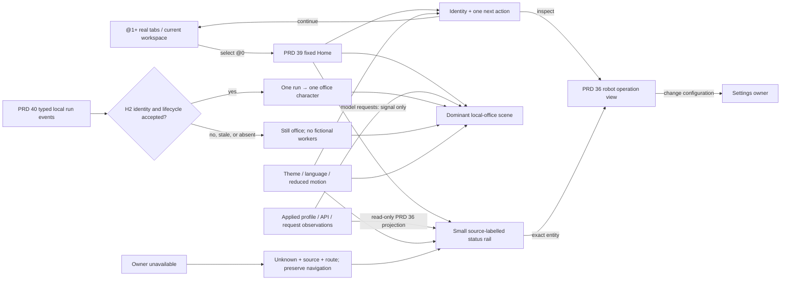

# @0 visual home canvas

Parent: [@0 destination and tab boundary](PRD_02_39_home_dashboard.md).
Operational facts and exact Settings links: [PRD 36](PRD_02_36_harness_workspace.md).
Optional worker/event authority: [PRD 40](PRD_02_40_plugins_apps.md).
Delivery sequence: [0.2.26 design plan](../plan/plan-v0.2.26.md).

Status: `[_]` 0.2.26 design target. The 0.2.25 @0 implementation is a static
brand/office card with navigation in the host chrome; it supplies a truthful
starting point, not this canvas's acceptance.

## Outcome tree DAG

```text
Outcome: opening @0 makes local work legible at a glance and gives a safe next action
├── [_] HC-01 — scene-first visual hierarchy
│   invariant: a stable central scene and a visible action answer orientation before detailed metrics
│   evidence: native 16:9, 4:3 and short-window captures; five-second task reading with English/Chinese labels
│   safe failure: unavailable data leaves the composition intact with a clear empty explanation
│   dependency: PRD 39 fixed destination and shared host theme/font metrics
│   non-goal: a second Harness Settings page or an always-running wallpaper animation
├── [_] HC-02 — truthful state projection
│   invariant: each status is a read-only projection of an owner, with source and freshness; unknown is never zero
│   evidence: public snapshots and mixed idle/loading/partial/stale/error/working native journeys
│   safe failure: lost owner data removes claims and preserves explicit routes to inspection/retry
│   dependency: PRD 36 account/client/request projection and existing tab/session state
│   non-goal: polling providers, inferring external client health or exposing private credentials
├── [_] HC-03 — focused, reversible navigation
│   invariant: every clickable region has one target and opening @0 does not mutate a service, account, task or tab
│   evidence: pointer, keyboard, focus and no-activation journeys across Home, real tab, robot and Settings
│   safe failure: unavailable destination remains explained and Home remains usable
│   dependency: PRD 39 @0 routing and PRD 36 typed deep links
│   non-goal: task Start/Stop, account editing or direct PTY input on Home
├── [_] HC-04 — responsive and accessible canvas
│   invariant: identity, primary action and status retain order and full targets at every supported window size
│   evidence: 1x/1.5x/2x native captures, narrow/short scroll and tab-order/readout courts
│   safe failure: condensed one-column view replaces decorative scene detail before essential controls clip
│   dependency: host font scaling, language/theme choices and native input focus
│   non-goal: color-only status or animation-only meaning
└── [_] HC-05 — office characters only after typed runs
    invariant: one character maps to one observed run ID, stage and source time; request counts never become people
    evidence: real event start/tool/wait/cancel/final traces plus stale/restart/no-run states
    safe failure: empty desks and static labels when events are absent, stale or app unavailable
    dependency: PRD 36 H2 + PRD 40 ordered worker event seam and owned lifecycle
    non-goal: 0.2.26 release gate, autonomous launch, remote agents or simulated productivity
```

## Memory palace



## Product role and first-glance questions

@0 is the **foyer and visual overview** of the current MiniCon window. In the
first few seconds it should answer: (1) where am I, (2) what local work is
actually available or observed, (3) what can I do next, and (4) where can I
inspect the evidence. The robot view remains the operational console with
account, client, request and monitoring detail. Settings remains the only
configuration editor. The Home canvas never introduces another task, account
or service authority.

The composition should feel like a small, welcoming office without claiming
that an agent exists merely because the user owns an account or has an open
terminal. Its visual stage takes the majority of the content area. Data cards
are subordinate to the stage and the primary action; they explain observed
work instead of filling the screen with equal-weight counters.

### Wide-window wireframe, content area excluding the existing tab tree

```text
┌──────────────────────────────────────────────────────────────────────────────┐
│ MiniCon  ·  provisional short brand line             Local status · source/time │
│ Continue @last real tab           Open Harness           New Terminal / Web    │
├──────────────────────────────────────────────────────┬───────────────────────┤
│                                                      │ What needs attention  │
│     LOCAL OFFICE SCENE / dominant quiet stage        │ exact account/client  │
│     desk zones, light, routes, no pretend workers     │ source + freshness    │
│     real task actors only after H2 typed events       │ Inspect in Harness    │
│                                                      ├───────────────────────┤
│     empty: "No observed tasks" + safe next step       │ Current local work    │
│     request-only: small signal, never an actor        │ applied / requests    │
│                                                      │ unknown ≠ zero        │
├──────────────────────────────────────────────────────┴───────────────────────┤
│ Recent observed change (bounded)  ·  source  ·  age       View operation       │
└──────────────────────────────────────────────────────────────────────────────┘
```

The scene should occupy roughly three fifths of a wide content column and
remain the largest single shape. The first row gives one primary **Continue**
action when a real tab exists; otherwise **New Terminal** is primary. The robot
is the clear secondary path to details. A single attention item may be elevated
to the right rail; its label links to the exact owning account/client/request.
Do not show a row of generic zero KPI tiles above the scene. Keep the header
and scene visible before the activity rail when height is limited.

### Visual language and copy

- Use the current theme palette and font scaling. Warm, architectural shapes
  (floor, desks, lights and windows) provide a distinct @0 identity while
  status text and controls retain the host's high-contrast tokens. No raster
  scene is required for acceptance; native shapes/text keep the one-file
  distribution and scaling contract.
- A desk is an **available place**, not a person. Before H2, there are no
  humanoid silhouettes, walking loops, fake status bubbles, avatars or
  elapsed timers. Request activity can appear as a labelled signal or light
  on a machine, explicitly named **model requests**, never **agent online**.
- Brand copy remains provisional as PRD 39 says. Avoid an unmeasured speed or
  uptime guarantee. A short localized title and one sentence of current state
  outrank decorative slogans on small windows.
- State words accompany color and icon: Ready, Needs attention, Unknown,
  Offline, Stale, Running (for an observed run only). Source and last observed
  time sit adjacent to a mutable value; a tooltip alone is insufficient.
- Stage motion is optional and event-driven. No idle animation, blinking,
  chart treadmill or periodic redraw merely to look busy. Respect OS reduced
  motion, pause when Home is hidden, and provide the same state in static text.

## State and source contract

| State on @0 | Scene | Status/action | Proof source |
| --- | --- | --- | --- |
| First launch, no real tabs | Quiet empty desks and a welcome caption | New Terminal primary; New Web secondary; no fake counts | PRD 39 workspace state |
| Real tabs, no Harness setup | Quiet scene; recent real tab visible in route | Continue real tab primary; Configure Harness as an explicit route | Workspace IDs and PRD 36 setup state |
| Account configured, API stopped | Scene stays quiet | Local API stopped, with exact source and Open Harness | Applied profile and listener state, not saved draft |
| Running API, zero observed requests | Quiet scene with a labelled ready signal | Ready for local requests; zero only when the owner reports a complete measured window | PRD 36 service/request projection |
| Request active, no H2 run | Labelled request signal; no office character | Active model request and inspect link; no task-completion claim | PRD 36 request identity and observation time |
| One or more H2 runs, after typed seam | One stable station/character per observed run | Stage, elapsed, final/cleanup outcome from exact run | PRD 36 H2 + PRD 40 ordered events |
| Data loading, stale or partial | Retain scene; show source-specific quiet placeholders | Loading, Last known at time, or Unknown; direct inspect/retry | Each owning projection's freshness/error |
| Runtime/app unavailable | Empty scene with no actor | Unavailable reason and route; real tabs remain usable | Runtime/app availability owner |

The Home adapter may read and aggregate only the bounded public projections
already owned by the workspace and PRD 36. It must not copy credentials,
proxy addresses, task private output or unrestricted model text into scene
labels, screenshots or public snapshots. Values from different freshness
windows cannot be silently summed. An aggregate or rate needs a named unit,
window and complete source coverage. When that is unavailable, prefer one
specific observed fact or a typed Unknown state. Entering Home never starts
the API, refreshes an account, sends an inference request or wakes an app.

## Interaction and responsive behavior

One click/Enter on **Continue** selects the last real tab without changing
its tab ID, text, page, proxy or process. The scene itself is not a giant
button. Only labelled stations, cards and actions are targets; a selected
observed run opens its exact inspector in the robot view. A stale/unavailable
station is inert with an explanation. Back returns to Home, and the existing
tab tree stays an independent direct route. Keyboard order follows the visual
reading order: Continue/New, Harness, secondary routes, attention, scene
targets, activity. Visible focus and Escape/back behavior are consistent with
existing host chrome. Hover cannot be the sole way to discover a target.

The layout responds to **available content width and height after the tab
tree**, not the physical monitor size. Proposed cutoffs are design targets to
measure with real font metrics, not prequalified constants:

| Available content width | Composition | Required retention |
| --- | --- | --- |
| >= 1080 DIP | Hero + broad scene + right attention/operation rail + bounded activity strip | Scene is largest, exact detail links remain labelled |
| 720–1079 DIP | Scene above two compact status cards; activity below | Primary/secondary routes stay visible; no horizontal scrolling |
| 480–719 DIP | One vertical column: identity/actions, scene, status, activity | Scene simplifies to a still vignette; status text never overlays art |
| < 480 DIP | One scrollable column with reduced decorative stage | Identity, one primary action, current state and inspect route remain reachable |

At short heights, content scrolls vertically while the host's global creation,
Settings and robot routes remain reachable. At 1x/1.5x/2x and all three UI
languages, no hit target overlaps another; text either wraps within its card
or moves below it. The first viewport must still expose identity, primary
action and one state sentence. 16:9 is the hero composition; 4:3 and narrow
windows retain the same meaning with fewer decorative objects. One screen
reader/a11y label should describe each actionable region and state without
announcing every decorative desk.

The design follows the general responsive principle of reflowing around the
window's available space and keeping essential information accessible; see
[Microsoft's Windows layout guidance](https://learn.microsoft.com/windows/apps/design/layout/responsive-design).
For motion and color, use static equivalents and explicit text, consistent
with [WCAG 2.2's color and pause principles](https://www.w3.org/TR/wcag/).
These are design references, not a claim that a native MiniCon build has
passed web conformance.

## Office staging and release boundary

When the typed H2 seam exists, the visual office uses a bounded stage grammar:

| Observed worker state | Office treatment | Text and interaction |
| --- | --- | --- |
| Starting | Character arrives at a stable assigned station | Starting; exact run opens robot inspector |
| Running with tool event | Character works at that station; one small tool cue | Running + last typed stage; no private tool output on Home |
| Waiting for model or allowed child | Character pauses at the same station | Waiting; no artificial progress percentage |
| Cancelling | Character remains visible, with a pending cue | Cancelling until cleanup receipt; Stop is not claimed complete |
| Completed/failed/cancelled | Character rests or leaves; bounded final marker remains | Exact final outcome and time, then inspect in robot view |
| Stale or disconnected event source | Freeze or remove animation and dim the station | Last observed at time / Unknown; never silently Running |

Station assignment is deterministic from run identity within a bounded visible
capacity. Additional real runs become an explicit “more observed runs” count
that links to the robot list; the scene never invents extra characters or
rearranges live identities on a resize. The visual mapping conveys status but
does not replace text or the worker's final receipt. A playful transition is
allowed only on a real state change, under the reduced-motion rule above.

**0.2.26 target:** deliver HC-01 through HC-04 as a polished, truthful native
Home canvas. A still office scene, useful routes and bounded real status are
complete even if no typed task events exist. If PRD 36/40 H2 has not passed,
HC-05 remains `[_]` with explicit empty-state copy. The application must never
ship character movement backed by a timer, request count, terminal pixel,
fixture or unverified worker claim.

**Later H2 stage:** accept the typed event contract and one local run with
stable `run_id`, ordered stage transitions, source time and final/cancel
receipt. Map one run to one station deterministically; a temporary redraw or
window resize never moves its identity. Selection opens the robot inspector;
the worker remains the sole lifecycle authority.

**Later network stage:** PRD 37 may add node origin only after explicit pairing
and observation. Remote-looking characters, cross-machine movement and team
coordination have no authority in this canvas today.

## Acceptance scenarios

1. From a fresh window, @0 shows identity, still empty office, one usable
   primary action and no synthetic agent or zero-valued resource claims.
2. With a terminal and parked Web page, Home and return preserve both real tab
   IDs, PTY/browser state and proxy selection; selecting Home starts no service
   or authorization. Keyboard and pointer routes reach the same targets.
3. With applied profile and running listener but no requests, the state says
   ready and the office remains empty. An observed model request changes the
   labelled request signal, not the number of characters.
4. Mix one healthy account with one stale/failed resource reading. The Home
   card names source/freshness and links to the exact entity; it never renders
   stale as zero or healthy as globally broken.
5. Resize across wide, medium, narrow and short windows at 1x/1.5x/2x in
   English and both Chinese variants; read the same primary action and state,
   with no clipped target or hidden recovery route.
6. When H2 exists later, run one real local task through start, tool, wait,
   cancel/final and restart reconciliation. A character appears only for the
   matching run and disappears or becomes explicitly stale when its source
   ceases to be authoritative.

Use public `ui-snapshot`/CLI journeys plus native window captures on each
claimed OS/scale. Pixel review checks hierarchy and clipping; event/protocol
receipts establish truth. A pretty screenshot alone proves neither navigation
nor a real worker. Development observations and exact release-artifact courts
retain their separate scopes under PRD 27 and PRD 33.
