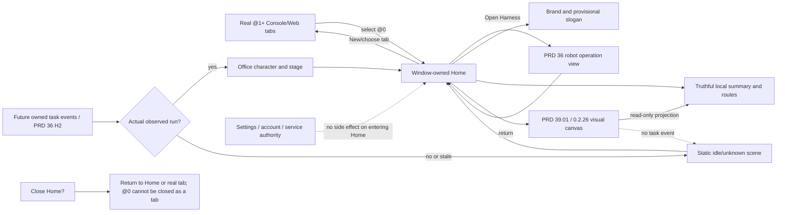

# @0 home dashboard

Parent: [MiniCon product index](../PRD.md). Window and tab interaction:
[workspace](PRD_02_25_con_workspace.md). Harness operation and monitoring:
[PRD 36](PRD_02_36_harness_workspace.md). Selected sequence:
[archived 0.2.25 plan](../plan/archive/plan-v0.2.25.md). The next visual canvas is owned by
[PRD 39.01](PRD_02_39_01_home_canvas.md) and sequenced by the
[0.2.26 design plan](../plan/plan-v0.2.26.md).

Status: `[-]` owner-selected 2026-10-27 direction. The @0 shell is the next
visible slice; agent-office behavior depends on real task lifecycle evidence.

## Outcome tree DAG

```text
Outcome: return to a welcoming, truthful MiniCon home without losing work
├── [v] HOME — fixed @0 window destination
│   invariant: @0 is not a TabId, Console/Web tab, Harness operation view or PTY
│   evidence: public open/return/select/close journey with stable real @1+ IDs
│   safe failure: missing tab or service still leaves a usable Home and New action
│   dependency: workspace host navigation and native page visibility; non-goal: persisting a fake tab
├── [_] BRAND — clear identity and provisional slogan
│   invariant: slogan is local presentation, labeled as provisional in design ownership
│   evidence: English/Simplified/Traditional captures at normal and narrow scale
│   safe failure: no clipped/overlapping text or unsupported performance claim
│   dependency: current language/theme/font metrics; non-goal: finalizing a brand promise without owner review
├── [_] ROUTES — useful next actions and truthful local summary
│   invariant: Console/Web/Harness entry does not start a service, login, task or network call
│   evidence: public pointer/keyboard navigation, unchanged session IDs/drafts and no-activate traces
│   safe failure: unavailable destination says why and keeps @0 usable
│   dependency: existing tab creation and PRD 36 route; non-goal: duplicating Settings/Harness controls
├── [_] CANVAS — 0.2.26 visual overview and truthful scene → PRD_02_39_01_home_canvas.md
│   invariant: @0 gives orientation, next action and source-labelled local state without acquiring owner authority
│   evidence: public navigation/state journeys and native wide/narrow/short captures
│   safe failure: useful static scene when task events or service data are unavailable
│   dependency: fixed @0 shell and PRD 36 read-only projection; non-goal: fake agent operation
└── [_] OFFICE — later animated agent workplace
    invariant: each character/action maps to an observed owned task/event and its source/freshness
    evidence: real run start/tool/wait/stop/final traces and idle/stale/error presentations
    safe failure: static empty office when there are no observed runs; no fictional workers
    dependency: PRD 36 H2 typed worker events and owned run lifecycle; non-goal: agent execution or remote control in @0
```

## Memory palace



## Product structure

`@0` is a fixed, always available destination above the real tab tree. It
does not consume the 256-tab limit, appear in `list-tabs` as a terminal or
browser, accept rename/drag/close/child actions, or become a control target for
terminal input. Existing `@1+` handles and their hierarchy remain stable.
Selecting @0 parks the visible browser child and input focus without changing
its URL, history, proxy or a terminal's process. Choosing a real tab restores
the existing session. Opening/closing Settings preserves @0 as the destination.
When the final real tab closes, the same @0 Home becomes active automatically.
The old zero-tab greeting with its separate New Terminal and Quit buttons is
retired; Home owns the empty-workspace explanation and New Terminal/New Web
routes. Quit remains available through the window close action. This avoids
two different start screens for the same zero-tab workspace state.
The robot still leads to the separate Harness operation view; the three
settings routes remain Console/Web/Harness configuration.

The first shell presents MiniCon identity, a provisional localized short
line expressing steadiness and speed, and obvious actions to return to a real
tab, open a Web tab, or inspect Harness. The slogan wording is a replaceable
copy decision, not a measured performance claim. A large central canvas is
reserved for the future office. Before task events exist, it shows a designed
idle scene and a short explanation rather than moving pretend agents. Any
account/request counts on @0 must come from the same read-only runtime view as
PRD 36, with unknown/stale states. The detailed pool and activity stay there.

The office is a future presentation layer over owned local runs, not an
engine. A character may represent a task only after the worker exposes a
bounded typed identity, stage, elapsed time and final/cancel outcome. Animations
must pause while hidden and remain optional for reduced motion. Cross-machine
characters require the later explicit node identity and authority in PRD 37.

## Acceptance and version boundary

Development evidence for HOME: the public native GUI journey
`native_home_is_a_fixed_destination_and_restores_real_tabs` passed on Windows
after both terminal and Web selection. `@0` remained outside `list-tabs`, and
selecting the prior real ID restored its surface. The exact public 0.2.25
artifact chain and downloaded-asset scope are recorded in the
[release history](archive/v0.2.25-release-history.md). The shipped HOME shell
does not close the larger BRAND, ROUTES or OFFICE visual/interaction acceptance
above.

0.2.25 selects the @0 navigation and honest static shell after the current
connection slice's shared host prerequisites are stable. Native pointer,
keyboard/focus, narrow/large layout, page parking and public snapshot tests
must agree; a painted-only mock is not acceptance. The animated office and
new task authority remain `[_]` until PRD 36 H2's real lifecycle seam passes.

## Next visual slice

The 0.2.26 design request places particular weight on the @0 screen's visual
hierarchy and daily-use experience. [PRD 39.01](PRD_02_39_01_home_canvas.md)
owns its canvas, states, interaction and evidence. This module continues to own
the fixed @0 identity, tab boundary and navigation invariants above. The
separate [plan](../plan/plan-v0.2.26.md) sequences the next version without
turning an unobserved worker into a displayed agent.
