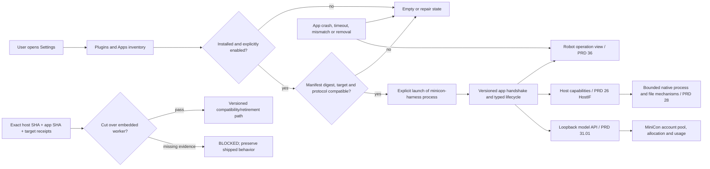

# Plugins and Apps extension layer

Parent: [MiniCon product index](../PRD.md). Product boundary:
[charter](PRD_02_23_minicon.md). Existing worker history:
[0.2.x horizon](PRD_02_31_v0_2_horizon.md). Model capability:
[gateway](PRD_02_31_01_provider_gateway.md). Operation surface:
[Harness workspace](PRD_02_36_harness_workspace.md). Sequence:
[extraction plan](../plan/plan-minicon-harness-extraction.md).

Status: `[-]` owner direction, 2026-10-27. The separate
`partnernetsoftware/minicon-harness` repository exists and is under parallel
development; no cross-repository contract or MiniCon Settings management is
accepted yet. This module owns the **Plugins and Apps layer** in MiniCon: the
optional application boundary, local registration/management experience and
host/application compatibility. The other repository owns its worker code,
tools, sessions, packaging and releases.

## Outcome tree DAG

```text
Outcome: add optional agent applications to MiniCon without binding their release pace to the host
├── [-] EXTRACT — move the file/exec worker into minicon-harness
│   invariant: one active owner of worker behavior; MiniCon's shipped path remains usable until an accepted replacement or explicit versioned retirement
│   evidence: old/new CLI matrix for root, tools, budgets, sessions, backends, cancel and errors on named OS/ISA; exact host/app SHAs
│   safe failure: missing/incompatible app is visible and cannot silently start an embedded or different worker
│   dependency: new-repo implementation and shared contract; non-goal: copying provider-pool or GUI state into the app
├── [_] CONTRACT — versioned out-of-process application seam
│   invariant: manifest identity, executable digest, target, protocol range and requested host capabilities are checked before launch
│   evidence: matching/mismatching manifests, handshake, crash, timeout and revoked-install public journeys
│   safe failure: refuse unknown capabilities or version mismatch without opening a PTY, listener or task
│   dependency: PRD 26 HostIF and PRD 28 native process mechanisms; non-goal: in-process Rust ABI or arbitrary code loading
├── [_] SETTINGS — Plugins and Apps route for local management
│   invariant: installed, enabled, compatible and running are distinct states; install/start/stop/remove are explicit actions
│   evidence: native Console/Web/Harness/Plugins and Apps navigation, empty/install/error/restart and retained-draft journeys
│   safe failure: corrupt or missing installation stays disabled with repair path; no startup fetch or automatic launch
│   dependency: CONTRACT and workspace Settings geometry; non-goal: a marketplace, payment or broad permission framework
├── [_] OPERATION — robot view observes the selected app's real runs
│   invariant: task controls and activity come only from a connected app's typed events and owned lifecycle
│   evidence: real start/tool/final/cancel and app-exit/restart traces with source and freshness
│   safe failure: unknown/offline replaces active-looking workers; pending cancel is not completed cleanup
│   dependency: CONTRACT, PRD 36 and minicon-harness event publication; non-goal: managing arbitrary external agent processes
└── [_] DELIVERY — independent versioning and installation
    invariant: native MiniCon stays usable as one file without an installed app; app bytes and updates are separately selected
    evidence: clean install/uninstall on each selected target, size/RSS receipts and exact compatible artifact pair
    safe failure: failed app update retains the prior working version or disables that app without damaging host data
    dependency: PRD 27 artifact policy and new-repo release receipts; non-goal: bundling the app into every MiniCon artifact
```

## Memory palace



## Product boundary and user experience

`minicon-harness` is an **application**, delivered independently as a local
executable. It owns the agent loop, `file` and `exec` tools, task/session
lifecycle, its own configuration and app release. MiniCon owns windows, tabs,
native capabilities, the versioned HostIF contract, the optional app registry,
process supervision for apps it explicitly starts, and the user-visible
management route. App-to-host calls must name capabilities and versions; a
separate process cannot inherit MiniCon's memory or private configuration.
The first app seam can use a small manifest plus a bounded local control/event
protocol. A dynamic library ABI, WASM plugin host and arbitrary package loader
are outside this first delivery.

**Settings gains a future fourth route, Plugins and Apps.** Its list shows
identity, installed version, source/path, compatibility, enabled state, process
state and the next action. The `minicon-harness` detail shows what host
capabilities it requests, the configured local model connection, recent
app-owned run state and explicit Open/Start/Stop/Remove actions. Removing an app
never removes MiniCon's account pool or profile keys. The existing Harness
settings route continues to own MiniCon's model gateway, provider accounts,
network policy, allocations and usage; a later rename to Models/API needs its
own navigation decision. The robot remains the operation view and shows the
app as offline/unavailable until it provides observed events. No installation,
login, model listener or task starts merely by visiting Settings or the robot.

The first management action is **Add local app**: the user selects an existing
manifest and executable, then sees identity, target, digest and requested host
capabilities before registering it. Registration records a private digest and
path; it does not copy, download or run the executable. **Remove** unregisters
that entry and stops only a process MiniCon owns; it does not delete the
original executable or unrelated app data. A changed executable requires an
explicit recheck and re-enable. An app MiniCon starts is tied to that host
process lifetime; a separately started CLI remains independently owned and is
never shown as a managed live run without an explicit attachment contract.

The app may consume the process-lifetime loopback inference API through an
explicit client profile. MiniCon's provider credentials remain private to the
gateway; the app receives no provider bearer or account-store path. Key
handoff follows the finite private delivery contract in
[profile keys](PRD_02_31_01_02_02_profile_keys.md). The gateway returns model
text/tool descriptions and usage; the app alone executes its tools. A standalone
app can use its own model configuration without claiming MiniCon account state.

The earlier 2026-10-11 placement rule put all plugins/apps in AgenTerm. The
owner's 2026-10-27 decision admits this **narrow MiniCon extension layer** and
an optional `minicon-harness` app. MiniCon can manage installed local apps and
expose bounded host capabilities; it does not thereby acquire AgenTerm's
Fleet, orchestration, market, payment or general Agent permission policy.
Future plugins may be designed after this one app proves the contract; their
code is not silently loaded into the base executable.

## Migration and acceptance boundary

The current `minicon harness` worker and associated historical evidence are
facts about released MiniCon sources. Source extraction is not acceptance of a
replacement. Compare the actual public behaviors: explicit root, read/write
limits and traversal refusal, allowlisted argv execution, invocation budgets,
DeepSeek/OpenCode backends, session start/continue and corrupt-state failure,
completion protocol, cancellation and descendant cleanup. A difference must
be intentionally specified and surfaced to users; it cannot be hidden by a
passing new-repo unit test. Select one cutover version only after the app's
artifact, MiniCon's host artifact and their protocol pairing pass on the
claimed targets. Until then, keep the shipped command path or a documented
compatibility shim. After cutover, the shim must report missing/incompatible
app clearly and must not retain a second embedded worker implementation.

Evidence needs both repository SHAs, the app version and digest, MiniCon
HostIF/protocol version, OS/ISA, selected profile and public black-box trace.
Unfinished work in the parallel repository is `BLOCKED` for this pairing,
without changing its independently owned source here.
