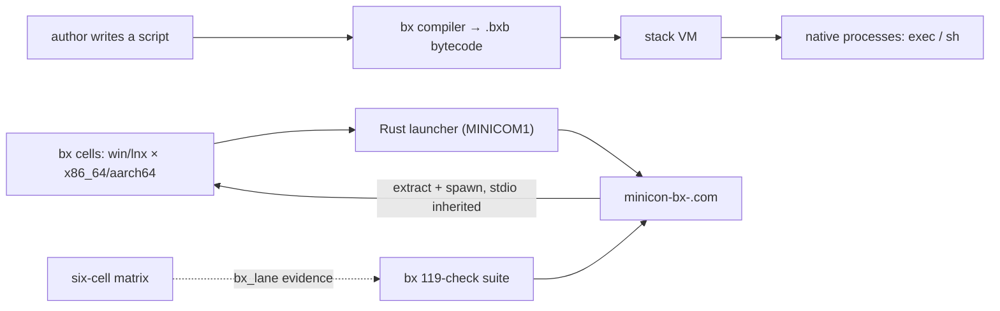

# `bx` binary-scripting surface

Owner of the `bx` runtime vendored at `bx/`, its per-OS `.com` delivery through
the Rust launcher lane, and the evidence that the packed artifact still behaves
like bx. MiniCon's own packaging stays with [delivery](PRD_02_27_con_delivery.md);
bx is a sibling product that ships from this repository.

## Product outcome

An agent writes a short JS-like script; bx compiles it to bytecode (`.bxb`) and
runs it in a stack VM whose primitives are native processes (`exec`/`sh`). It
ships as one file per platform, next to MiniCon, with no Node install and no
runtime dependency. A failed runtime operation is either a value (`attempt`) or
an exact nonzero exit, never a mangled status.

## Tree DAG

```text
bx — binary scripting surface
├── language and VM → bx/README.md
│   ├── [v] compile-to-bytecode + `.bxcache`
│   ├── [v] iteration protocol: array | string | object keys, plus `for k, v in`
│   ├── [v] `attempt(fn)` error capture
│   ├── [v] closures share mutable locals at any nesting depth (per-call cells; per-iteration loop captures)
│   ├── [v] `c ? a : b` and `"${expr}"` interpolation (`\$` escapes a literal dollar)
│   ├── [v] `test(name, fn)` blocks and the `bx test` runner
│   └── [no] try/catch, regex, module exports (roadmap, not claimed)
├── delivery → ../loader/bx/README.md
│   ├── [v] `MINICOM1` launcher lane (Rust; no cosmocc, no C)
│   ├── [v] `--com-info`: launcher answers the container metadata itself (no unpack, no payload run)
│   ├── [v] four cells packed locally: {win,lnx} × {x86_64,aarch64}
│   ├── [v] native processes: `exec`/`exec_all`/`spawn` (+ output redirection)
│   └── [-] six-cell execution evidence (CI `bx_lane`)
└── qualification
    ├── [v] 119-check suite passes through the packed win-x86_64 artifact
    ├── [v] `bx/tools/verify.bxs`: 16 bx tests, run by CI on every runner
    │   process cases pick cmd/sh by host OS, so the same suite runs on the
    │   macos-15 CI pack host (2026-11-16; six cmd-only cases failed there first)
    └── [-] the same suite on the five remaining runners
```

## Memory palace



## Boundary

- bx is its own workspace (`bx/Cargo.toml` carries an empty `[workspace]`): it
  does not join MiniCon's workspace members and no MiniCon crate is linked into
  it. The terminal binary never contains bx code.
- Delivered artifacts are **per-OS** (`minicon-bx-<cell>.com`). The single
  six-OS polyglot stays MiniCon's `.com` concern
  ([APE join](PRD_02_27_con_delivery.md)); a compiled launcher cannot be one
  file for six kernels.
- No package manager, no runtime install, no background service, no bundled
  agent policy.

## Evidence

- 2026-11-16, Windows x86_64 host:
  `minicon-bx-{win-x86_64,win-aarch64,lnx-x86_64,lnx-aarch64}.com` packed from
  the vendored source; `com-pack verify` matches PE `0x8664`/`0xaa64` and ELF
  `0x3e`/`0xb7` for all four.
- `minicon-bx-win-x86_64.com`: `version` → `bx 0.2.0`; `eval "6*7"` → `42`;
  `exit(3)` → `3` (verbatim, not `(128+3)<<8`); a parent `exec` captures
  `[0,"42\n"]`.
- `BX_BIN=minicon-bx-win-x86_64.com bx run bx/tests/suite.bxs` → **PASS 119
  checks** (ternary, interpolation and its escape, CLI flags, stdin, argv with
  spaces/unicode, and include-aware cache invalidation).
- 2026-11-16 review pass: the container now carries `__meta__` metadata
  (`com-pack info` → product/cell/version/source_sha), publishes atomically,
  extracts into a private 0700 directory on Unix, cleans up on spawn failure,
  and validates the launcher's executable magic before appending. Measured cost
  of the model on Windows x86_64: native cell 18.6 ms min / 20.3 ms median vs
  packed artifact 44.3 / 54.9 — one extra process creation, so a packed `.com`
  is the distribution form and a native cell is the hot-path form.
- 2026-11-16 round 1: container reads now validate every entry against the table
  and footer bounds (a truncated file is refused, not read out of range), a
  killed launcher's extract is swept at most hourly, and `com-pack inspect`
  reports launcher format/subsystem, cells and metadata. Re-measured with 20
  interleaved runs: native cell p50 20.0 ms, packed p50 48.3 ms, launcher-only
  about 21 ms — the rest is the second process creation plus the ~1.1 MB write.
- 2026-11-16 round 2: the `.bxcache` key now covers every recursively included
  file, so editing a `use` dependency rebuilds the program (a stale-cache bug:
  the key used to hash only the main script). The suite grew to 65 checks and
  covers `--version`/`--help`, `eval -` stdin, and argv with spaces/unicode.
- 2026-11-16 round 3: nested functions capture the enclosing function's visible
  locals by value (`GET_UPVALUE`/`MAKE_CLOSURE`); captured names are read-only,
  which is enforced at compile time. Factories and callback captures now work
  (`adder(10)(5)`, `map` with a captured base). Suite: 70 checks.
- 2026-11-16 round 4: `for k, v in` binds key/value for objects and index/value
  for arrays and strings through `ITER_KEYS`; a pre-existing stack residue after
  a loop used as the last statement is fixed and covered. Suite: 74 checks.
- 2026-11-16 round 5: function locals and parameters are boxed per call, so
  closures share mutable state (counters, two closures over one binding), writes
  reach the creator, and loop-created closures keep their own iteration value.
  Suite: 77 checks.
- 2026-11-16 round 6: a closure now sees every name visible at its creation
  point, forwarding further-out locals through the creator's own upvalues
  (`GET_UPVALUE_RAW`), so reads and writes work two or three levels up. Suite:
  80 checks.
- 2026-11-16 round 7: runtime errors now name the failing function
  (`script(line) in fn(): message`) and no longer duplicate the location prefix
  when they cross a call boundary; both are covered by suite cases. Suite: 82
  checks.
- 2026-11-16 round 8: only locals that a nested function references are boxed
  (`captured_names` analysis), so ordinary function calls no longer allocate
  cells; suite covers three-level writes and a local captured only by a
  grandchild. Suite: 84 checks.
- 2026-11-16 round 9: a reproducible baseline lives in `bx/scripts/bench.sh`
  (internal timing, packed-artifact mode); bytecode for `fib`/`loop`/`calls` is
  identical to the pre-closure build, and the remaining call-path cost
  (8-15%) is VM-implementation level, documented in the bx README.
- 2026-11-16 round 10: `bx check <script>` compiles (and caches) without
  executing, so an agent can gate a run on syntax/compile errors; covered for
  good, broken and missing files. Suite: 87 checks.
- 2026-11-17 round 106: the wasm target caches emitted modules beside the source
  as `.bxcache/<hash>.wasm`; the key mixes `VERSION`, an emitter tag, the source
  and recursive `use` includes, a corrupt or stale entry is recompiled, and
  `BX_CACHE_DIR` still overrides the location. A 301-line script measured
  52 ms cold vs 33 ms warm (median, process start included); verifier case
  `wasm source runs reuse a module cache`.
- 2026-11-18 round 186: 静态数组 + 混合返回回调的 `map` 现在产出动态数组（i64 循环/单元格装载修正了上一轮的验证失败）；`map([1,2], fn(v){ if(v>1){return "s"} return v })`、bool/字符串数组、空数组与 `.map` 方法形式全部对齐 VM。单测 160、suite 247。- 2026-11-18 round 185: 混合返回类型函数推断为动态结果——各 `return` 路径装箱成 Dyn 单元，调用方看到 Dyn（`f(2) + "!"` 可用）；静态数组上的 `map` 若回调混合返回仍是边界（尝试过动态结果映射，验证阶段发现栈类型问题后回退，记录为后续）。单测 160、suite 246。- 2026-11-18 round 184: CLI 收口——默认 target 演练下 `.bxb` chunk 仍走 VM（显式 `--target wasm`/`BX_TARGET=wasm` 时给出"重新编译"错误）；`bx check --target wasm xxx.bxb` 给出面向源码的提示；`bx build --wasm --html` 也做 `use` 预展开（共享模块的浏览器 demo 可生成）。suite 245。- 2026-11-18 round 183: `let xs = []` 的混合 kind push 现在推断为动态数组（顶层与函数内都生效；单 kind 仍静态快路径），`push` 混合值/数组/记录均可；差分新增 growable 类（3×60 例 PASS）。单测 159、suite 244。- 2026-11-18 round 182: 静态异构字面量降级为动态单元——`["a",1]`、`[1,"x",true,null]`、不同 shape 的记录行都按 `parse` 一样的动态数组构造，print/json/索引/迭代/相等与 VM 一致；同构字面量仍走静态快路径，`let xs=[]` 多 kind push 仍是边界。单测 158、suite 243，差分 3×60 + 2×150 全 PASS。- 2026-11-18 round 181: G2 默认翻转演练开关 `BX_DEFAULT_TARGET=wasm|bxb`——未显式指定 target 时作为默认引擎并在 stderr 公告一行；`--target bxb` / `BX_TARGET=bxb` 仍可回滚；`bx build/run/check` 均生效，suite 覆盖默认与回滚两条路径。单测 157、suite 242。- 2026-11-18 round 180: wasm 目标的 VM-only 内建给出可执行迁移提示（`test()` → `bx test`/`--target bxb`，`patch()`/`spawn*` → `write_file`/`exec` 或 VM），PRD_02_42 兼容性边界表按 P2a/P2b 现状重写、M2/M3 标记 `[v]`。单测 156、suite 241。- 2026-11-18 round 179: wasm 目标预展开 `use "file"`（相对被包含文件解析、循环/深度>16 报错），`bx build/run/check --target wasm` 与 VM 一样能跑共享 `use` 模块；soak 语料 10 脚本 9 命中、1 条非确定跳过。单测 155、suite 241。- 2026-11-18 round 178: `bx check --target wasm|bxb [--json]` gives a compile-only gate for the wasm subset (ok line + bytes/imports/functions, or the checker reason); `bx/scripts/soak-wasm.sh` runs the local corpus compile+output diff (nondeterministic scripts are skipped); `print`/`eprint` accept multiple arguments with VM display formatting (space-joined, zero args = empty line).- 2026-11-18 round 175: `bx run --target wasm|bxb` selects the engine explicitly (`--target` wins over `BX_TARGET`, so `bx run` matches `bx build`); `--wasm` remains the legacy alias and conflicts with `--target bxb`; usage text and a unit test cover it.- 2026-11-17 round 105: `bx run --wasm script.bxs` forces the wasm target for a
  source script (the flag wins over `BX_TARGET`); unit test
  `run_flag_selects_the_wasm_target`. The engine under that target is now the
  vendored tinyvm core (PRD_02_44 P1), not the retired interpreter.
- 2026-11-16 round 11: `bx run`/`eval` accept `--max-steps N` and `--timeout MS`
  (wall clock checked every 4096 instructions); flags after the script stay in
  `argv`. A runaway script is stopped with a clear message and exit 1. Suite: 90
  checks.
- 2026-11-16 round 12: `read("-")` drains stdin to EOF, so `git log | bx run
  summarize.bxs` works; the packed-artifact selftest now also covers `check`,
  `--max-steps` and the stdin filter. Suite: 93 checks.
- 2026-11-16 round 13: compile errors inside `use` include the include file
  (nested includes do not stack prefixes), a missing include names the file
  that referenced it, and `bx check --json` prints one machine-readable line in
  both outcomes. Suite: 98 checks.
- 2026-11-16 round 15: chunk names and source files are shared via `Rc<String>`,
  so a call frame clones pointers instead of allocating two strings; `fib(24)`
  went from ~137 ms back to ~80 ms with bytecode unchanged. Suite: 108 checks.
- 2026-11-16 round 16: frame slot buffers are recycled through a pool capped at
  256 (max depth 220), removing the per-call `vec!` allocation; `fib(24)` is now
  ~71 ms vs ~137 ms at round 21 start. Suite: 108 checks.
- 2026-11-16 round 17: the CALL fast path drains arguments straight from the
  operand stack into the new frame instead of `split_off`-ing a Vec; `fib(24)` is
  now ~56 ms (from ~137 ms before the allocation work began). Suite: 108 checks.
- 2026-11-16 round 18: builtin callbacks (`map`/`filter`/`each`/`reduce`/`sort`)
  push their arguments on the operand stack via `call_value1`/`call_value2`, so
  per-element `Vec`s are gone; 200k `map` callbacks went from ~46 ms to ~29 ms.
  Suite: 108 checks.
- 2026-11-16 round 19: global names live in an FNV-1a `HashMap` instead of a
  `BTreeMap`; top-level `let` is a global, so hot loops pay this lookup. `loop`
  1e6 from ~1.14 s to ~0.85 s, 200k calls from ~205 ms to ~173 ms. Suite: 108
  checks.
- 2026-11-16 round 20: `GET_GLOBAL`/`SET_GLOBAL` borrow the name from the
  constant pool instead of cloning a `String` (and `SET_GLOBAL` updates in place
  for existing bindings). `loop` 1e6 from ~0.85 s to ~0.29 s, 200k calls from
  ~173 ms to ~72 ms, `fib(24)` from ~52 ms to ~39 ms. Suite: 108 checks.
- 2026-11-16 round 21: globals live in a slot vector; a per-chunk cache maps
  each name constant to its slot once, so hot `GET_GLOBAL`/`SET_GLOBAL` are plain
  array indexes. `loop` 1e6 from ~0.29 s to ~0.22 s, 200k calls to ~66 ms.
  Suite: 108 checks.
- 2026-11-16 round 22: `bx/tools/verify.bxs` (bx-native, cross-platform) is now
  part of the CI bx lane; every runner executes its own `minicon-bx-<cell>.com`
  against the verifier, and launcher detection is behavioural so renamed
  launchers (`.exe` on Windows) still take the container path.
- 2026-11-16 round 23: the bx-native verifier grew to 16 checks, adding `.bxb`
  round-trip, include error attribution (compile and runtime), and a language
  smoke for closures/pair iteration/interpolation; it passes against the native
  binary, the packed `.com`, and a renamed launcher.
- 2026-11-16 round 24: `bx/tools/verify.bxs` is written as `test()` blocks, so
  `bx test tools/verify.bxs <artifact>` owns reporting and exit code; the CI bx
  lane and the suite both call it that way (16 tests on every runner).
- 2026-11-16 round 25: 14 Rust unit tests cover the container codec (round-trip,
  bad magic), patch parsing/application (multi-hunk, mismatch, CRLF), JSON and VM
  comparison/len; `bx/scripts/test.sh` runs them before the self-hosted suite, so
  the CI build job runs both.
- 2026-11-16 round 26: a deterministic container property test encodes 20 random
  multi-chunk containers, asserts `encode(decode(x)) == x`, and rejects every
  strict prefix (no panic on truncation). 15 Rust unit tests now back the format.
- Open: execution on Linux x86_64/aarch64 and Windows ARM64 belongs to the
  six-runner matrix (`minicon-com.yml`, `bx_lane`), not the Windows host.

## Build

`bash bx/scripts/build-cells.sh` builds the cells this host can produce and then
calls the shared `loader/pack-rust-all.sh`; CI runs the same script in the build
job and each runner executes only its own artifact.

## Non-goals

- Replacing MiniCon's polyglot asset or merging bx into the terminal binary.
- A Node compatibility layer or an npm-style package registry.
- Producing macOS or ARM64 cells from a Windows host (the pack host or CI does).
