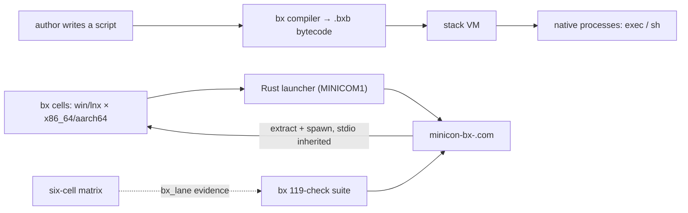

# `bx` binary-scripting surface

Owner of the `bx` runtime vendored at `bx/`, its per-OS `.com` delivery through
the Rust launcher lane, and the evidence that the packed artifact still behaves
like bx. MiniCon's own packaging stays with [delivery](PRD_02_27_con_delivery.md);
bx is a sibling product that ships from this repository.

## Product outcome

An agent writes a short JS-like script; bx compiles it to bytecode (`.bxb`) and
runs it in a stack VM whose primitives are native processes (`exec`/`sh`). It
ships as one file per platform, next to MiniCon, with no Node install and no
runtime dependency. A failed runtime operation is either a value (`attempt`) or
an exact nonzero exit, never a mangled status.

## Tree DAG

```text
bx — binary scripting surface
├── language and VM → bx/README.md
│   ├── [v] compile-to-bytecode + `.bxcache`
│   ├── [v] iteration protocol: array | string | object keys, plus `for k, v in`
│   ├── [v] `attempt(fn)` error capture
│   ├── [v] closures share mutable locals at any nesting depth (per-call cells; per-iteration loop captures)
│   ├── [v] `c ? a : b` and `"${expr}"` interpolation (`\$` escapes a literal dollar)
│   ├── [v] `test(name, fn)` blocks and the `bx test` runner
│   └── [no] try/catch, regex, module exports (roadmap, not claimed)
├── delivery → ../loader/bx/README.md
│   ├── [v] `MINICOM1` launcher lane (Rust; no cosmocc, no C)
│   ├── [v] `--com-info`: launcher answers the container metadata itself (no unpack, no payload run)
│   ├── [v] four cells packed locally: {win,lnx} × {x86_64,aarch64}
│   ├── [v] native processes: `exec`/`exec_all`/`spawn` (+ output redirection)
│   └── [-] six-cell execution evidence (CI `bx_lane`)
└── qualification
    ├── [v] 119-check suite passes through the packed win-x86_64 artifact
    ├── [v] `bx/tools/verify.bxs`: 16 bx tests, run by CI on every runner
    │   process cases pick cmd/sh by host OS, so the same suite runs on the
    │   macos-15 CI pack host (2026-11-16; six cmd-only cases failed there first)
    └── [-] the same suite on the five remaining runners
```

## Memory palace



## Boundary

- bx is its own workspace (`bx/Cargo.toml` carries an empty `[workspace]`): it
  does not join MiniCon's workspace members and no MiniCon crate is linked into
  it. The terminal binary never contains bx code.
- Delivered artifacts are **per-OS** (`minicon-bx-<cell>.com`). The single
  six-OS polyglot stays MiniCon's `.com` concern
  ([APE join](PRD_02_27_con_delivery.md)); a compiled launcher cannot be one
  file for six kernels.
- No package manager, no runtime install, no background service, no bundled
  agent policy.

## Evidence

- 2026-11-16, Windows x86_64 host:
  `minicon-bx-{win-x86_64,win-aarch64,lnx-x86_64,lnx-aarch64}.com` packed from
  the vendored source; `com-pack verify` matches PE `0x8664`/`0xaa64` and ELF
  `0x3e`/`0xb7` for all four.
- `minicon-bx-win-x86_64.com`: `version` → `bx 0.2.0`; `eval "6*7"` → `42`;
  `exit(3)` → `3` (verbatim, not `(128+3)<<8`); a parent `exec` captures
  `[0,"42\n"]`.
- `BX_BIN=minicon-bx-win-x86_64.com bx run bx/tests/suite.bxs` → **PASS 119
  checks** (ternary, interpolation and its escape, CLI flags, stdin, argv with
  spaces/unicode, and include-aware cache invalidation).
- 2026-11-16 review pass: the container now carries `__meta__` metadata
  (`com-pack info` → product/cell/version/source_sha), publishes atomically,
  extracts into a private 0700 directory on Unix, cleans up on spawn failure,
  and validates the launcher's executable magic before appending. Measured cost
  of the model on Windows x86_64: native cell 18.6 ms min / 20.3 ms median vs
  packed artifact 44.3 / 54.9 — one extra process creation, so a packed `.com`
  is the distribution form and a native cell is the hot-path form.
- 2026-11-16 round 1: container reads now validate every entry against the table
  and footer bounds (a truncated file is refused, not read out of range), a
  killed launcher's extract is swept at most hourly, and `com-pack inspect`
  reports launcher format/subsystem, cells and metadata. Re-measured with 20
  interleaved runs: native cell p50 20.0 ms, packed p50 48.3 ms, launcher-only
  about 21 ms — the rest is the second process creation plus the ~1.1 MB write.
- 2026-11-16 round 2: the `.bxcache` key now covers every recursively included
  file, so editing a `use` dependency rebuilds the program (a stale-cache bug:
  the key used to hash only the main script). The suite grew to 65 checks and
  covers `--version`/`--help`, `eval -` stdin, and argv with spaces/unicode.
- 2026-11-16 round 3: nested functions capture the enclosing function's visible
  locals by value (`GET_UPVALUE`/`MAKE_CLOSURE`); captured names are read-only,
  which is enforced at compile time. Factories and callback captures now work
  (`adder(10)(5)`, `map` with a captured base). Suite: 70 checks.
- 2026-11-16 round 4: `for k, v in` binds key/value for objects and index/value
  for arrays and strings through `ITER_KEYS`; a pre-existing stack residue after
  a loop used as the last statement is fixed and covered. Suite: 74 checks.
- 2026-11-16 round 5: function locals and parameters are boxed per call, so
  closures share mutable state (counters, two closures over one binding), writes
  reach the creator, and loop-created closures keep their own iteration value.
  Suite: 77 checks.
- 2026-11-16 round 6: a closure now sees every name visible at its creation
  point, forwarding further-out locals through the creator's own upvalues
  (`GET_UPVALUE_RAW`), so reads and writes work two or three levels up. Suite:
  80 checks.
- 2026-11-16 round 7: runtime errors now name the failing function
  (`script(line) in fn(): message`) and no longer duplicate the location prefix
  when they cross a call boundary; both are covered by suite cases. Suite: 82
  checks.
- 2026-11-16 round 8: only locals that a nested function references are boxed
  (`captured_names` analysis), so ordinary function calls no longer allocate
  cells; suite covers three-level writes and a local captured only by a
  grandchild. Suite: 84 checks.
- 2026-11-16 round 9: a reproducible baseline lives in `bx/scripts/bench.sh`
  (internal timing, packed-artifact mode); bytecode for `fib`/`loop`/`calls` is
  identical to the pre-closure build, and the remaining call-path cost
  (8-15%) is VM-implementation level, documented in the bx README.
- 2026-11-16 round 10: `bx check <script>` compiles (and caches) without
  executing, so an agent can gate a run on syntax/compile errors; covered for
  good, broken and missing files. Suite: 87 checks.
- 2026-11-17 round 106: the wasm target caches emitted modules beside the source
  as `.bxcache/<hash>.wasm`; the key mixes `VERSION`, an emitter tag, the source
  and recursive `use` includes, a corrupt or stale entry is recompiled, and
  `BX_CACHE_DIR` still overrides the location. A 301-line script measured
  52 ms cold vs 33 ms warm (median, process start included); verifier case
  `wasm source runs reuse a module cache`.
- 2026-11-19 round 247: **浏览器 demo 覆盖扩展**——suite 的 `--html` 用例升级为三组：简单脚本、静态综合脚本（sum/map/记录增长/attempt 越界/Unicode len，node 输出 `6/[2,4,6]/{...}/false/5`）、动态脚本（`parse` 在 JS host 不可用，node 报清晰错误 `runtime parse is not available in the browser demo` 且非零退出）；边界表新增 B11（浏览器 demo 仅静态子集）。无代码变更，单测 203 / suite 324 保持。- 2026-11-19 round 246: 闭包/递归真实脚本探测——捕获计数、循环内捕获、组合函数、尾递归、互递归均与 VM 一致；唯一缺口是**函数字面量作参数**（同一参数收到两个不同闭包）此前报模糊的 "called with both function and function values"，现改为可操作错误 "parameters cannot receive different function literals; ... pass one concrete closure, return the closure instead, or use BX_TARGET=bxb"，并写入边界 B10。单测 203、suite 324。- 2026-11-19 round 245: **attempt 返回容器值**——`attempt(fn(){ return [1,2] })`/`exec` 记录等容器结果现按动态单元装箱（value 打印 `[1,2]`、`type` 为 `array`/`object`），此前 attempt 仅接受数字/字符串/布尔；同时**动态成员访问 null** 与索引 null 一致，抛出 VM 风格 panic `cannot index null (missing value?)`（可被 attempt 捕获，消息带路径/行号）。单测 202、suite 323。- 2026-11-19 round 244: **构建前校验**——`bx build --wasm` 与 `--html` 在写文件前调用 `wasm_target::validate`，校验失败即报错退出、不再产出无效模块；新增不变量单测 `every_emitted_module_validates`（18 个代表性程序全部编译并校验通过），单测 201。`bx` suite 322 / verifier 86 保持。- 2026-11-19 round 243: **大规模随机差分扫描**（固定种子）——`wasm-diff` 120、`wasm-diff-dyn` 150×2、`wasm-diff-coll` 100、`wasm-diff-methods` 100、`wasm-diff-attempt` 30，共 650 个生成程序全部 VM/wasm 输出一致（exit 0）；结果写入 PRD_02_44 证据表。无代码变更，单测 200 / suite 322 保持。- 2026-11-19 round 242: **边界文档去重与纠偏**——PRD_02_42 在 Compatibility boundary 下新增 "Current boundaries (2026-11-19)" 权威表（B1 整体容器窄化 / B2 静态越界 panic vs VM null / B3 参数与容器内别名 / B4 别名捕获记录提升限制 / B5 maps / B6 VM-only 内建 / B7 未捕获 host trap / B8 混合类型拼接 / B9 函数与 map 键打印），并清理历史遗留陈述（attempt error 空串→null 单元、attempt 消息缺前缀→已带 `file(line): `、IO 返回 0/-1→null、记录字段仅标量→kind 8 动态单元、运行时键写入 VM-only→提升机制）与重复表格行。无代码变更，单测 200 / suite 322 保持。- 2026-11-19 round 241: 证据整理与最后边界复核——PRD_02_44 新增 "Current evidence (2026-11-19)"（单测 200 / suite 322 / verifier 86 / 五个差异工具 24+24+20+24+12 / soak 9+1 / 真实脚本全等 / 基准时间表：loop 295→205ms、fib 61→160ms、calls 102→192ms），G2 状态更新为 `[-]`（共享 16 字节单元表示，`dyn_*` 仅用于非局部操作，import 上限 146；静态 element-kind 矩阵税由 P2d 消除）；复核确认记录数组/嵌套数组拼接（`[{...}]+[{...}]`、`[[1]]+[[2]]`、解析数组+静态数组）已与 VM 一致，P2b/P2c 的剩余说明同步修正。unit 200、suite 322 不回归。- 2026-11-19 round 240: 差异工具全量复核（wasm-diff 24、dyn 24、methods 20、coll 24、attempt 12）发现 dyn case4 回归：**空动态数组无初值 reduce** 返回 null 而非 VM 的 panic；在两个动态 reduce 发射路径加入 `count == 0` 检查并抛出 `reduce() of an empty array needs an initial value`（attempt-aware，消息带 `file(line)` 前缀）。全部差异工具通过。单测 200、suite 322。- 2026-11-19 round 239: 函数与动态值互操作——静态值（记录/数组/字符串/数字）作为实参传给 `Dyn` 形参时在调用点装箱（`emit_box_dyn_stack` + `coerce_arg`/`arg_ok` 放宽）；函数体返回动态值时结果类型收敛为 `Dyn`（`unify_result` 不再坚持静态结果），`fn pick(o,k)`、`fn twice(xs)`、`fn lineTotal(it)` 等同时接受解析值与静态值。函数/记录互操作脚本与 VM 一致。单测 200、suite 322。- 2026-11-19 round 238: 文本/矩阵/记录真实脚本探测发现三个缺口并修复——(1) `text += str(i)` 字符串复合拼接（checker/emitter 支持 `+=` 到 Str）；(2) 空数组 push 容器/未知类型操作数时改为**动态数组**（`transposed.push(col)`、记录数组可工作；算术表达式仍推断为数值数组）；(3) 动态容器的方法调用（`rec.scores.push(9)`）此前因先要求数组变量而失败，现先走动态分支。矩阵转置、记录数组排序、字符串拼接脚本与 VM 逐行一致。单测 199、suite 321。- 2026-11-19 round 237: 真实脚本探测（JSON 配置 + 动态记录数组 + 排序 + attempt）发现 `attempt` 回调返回 `Dyn` 时 attempt 值槽以 i64 存储 i32 单元 → 无效模块，已修（Dyn 值走 i32 存储）；同时**动态索引 null** 现在产生 VM 风格 panic `cannot index null (missing value?)`（新增 `env.dyn_tag` 宿主做标签检查，`attempt` 可捕获，消息带 `file(line) in <lambda>() [path]`）。真实脚本逐行与 VM 一致并纳入 suite。单测 198、suite 320。- 2026-11-19 round 236: **复合赋值动态值**——`total += x`（x 为 Dyn）、`rc.n += q`、`arr[0] += q`、`prod *= x` 均按目标数值类型拆箱（`DYN_TO_INT`/`DYN_TO_FLOAT`），动态数组累加/乘积循环与 VM 一致。单测 197、suite 319。- 2026-11-19 round 235: **动态 push 提升**——`push(bs, dyn)`/`bs.push(dyn)` 对 bool/string 静态数组同样提升为动态数组（`dyn_from_array` → `dyn_push` → 写回），`[true]` push 7 → `[true,7]`，`len`/索引一致；int/float 数组保持拆箱路径。限制：别名/捕获数组不可提升，提升前已有静态元素写入提示重排。单测 196、suite 318。- 2026-11-19 round 234: **静态数组元素动态替换**——向 int/float/bool/string 静态数组元素写入 `Dyn` 值时，数组变量提升为动态数组（`dyn_from_array` → `dyn_set_at` → 写回），`[true,false]` → `[7,false]`、`["a","b"]` → `["a",7]` 与 VM 一致；限制：别名/捕获数组不可提升，提升前已有静态元素写入则提示先写动态值。单测 195、suite 317。- 2026-11-19 round 233: bool/string 记录字段的**动态值替换**——`r.b = dyn`/`r.s = dyn` 按 VM 语义把整个记录变量提升为动态对象（`dyn_from_record` → `dyn_set_member` → 写回），`{"b":7,"s":7}` 与 VM 一致；bool/string **数组元素**仍拒绝动态值。复用 round 230 的提升机制并加"原地字段更新后不可提升"约束。单测 194、suite 316。- 2026-11-19 round 232: 动态值**写入静态容器**——`xs[1] = dyn`、`r.n = dyn`（int/float 槽）、`push(xs, dyn)` 均按目标类型拆箱（`DYN_TO_INT`/`DYN_TO_FLOAT`）；bool/string 槽继续拒绝动态值（VM 会把字段替换成异类型，静态槽无法表达）；`emit_f64` 支持 Dyn 输入。单测 193、suite 315。- 2026-11-19 round 231: 动态值**自动拆箱**——把 `Dyn` 赋给静态标量变量（`total = total + x`）或作为函数实参时，按目标类型拆箱（`DYN_TO_INT`/`DYN_TO_FLOAT`/`DYN_TRUTHY`/`DYN_STR`）；动态数组方法链（`v.sort()`/`v.map(...)`/`v.join("-")`）与 `for x in 动态数组` 累加、break/continue 全部与 VM 一致。单测 192、suite 314。- 2026-11-19 round 230: **运行时键插入打通**——`o[k] = 3`（新键）现在把静态记录变量提升为动态对象（`dyn_from_record` → `dyn_set_member` → 写回变量），后续读写走动态路径；`tests/cases/loops.bxs` 全链路与 VM 一致并纳入 suite 差分。限制：仅支持普通变量（别名/捕获记录拒绝），且插入点之前不能有原地字段更新（否则提示重排）。单测 191、suite 313。- 2026-11-19 round 229: 静态记录**字面量键增长**——`o.b = 2`（含空记录 `let e = {}; e.z = 5`）现在检查期记录增长点与新旧 shape，发射期重新分配记录、复制既有槽位、写回变量与全部别名；`len(record)` 返回编译期字段数（含方法形式）；运行时键插入 `o[k] = 3`（新键）仍显式失败，`loops.bxs` 因此保持 VM-only。单测 190、suite 312。- 2026-11-19 round 228: 真实脚本覆盖与边界 DX——`tests/bench-wasm` 6 个脚本（boolarr/calls/coll/fib/loop/recs）全部与 VM 输出一致并纳入 suite 差分；`tests/cases/loops.bxs` 暴露 `o.b = 2` 新字段增长缺口，wasm 对静态记录新字段现给出**可操作错误**（"cannot add a new field 'b' to a static record; declare it in the record literal"），并把 loops.bxs 记录为 VM-only 边界。单测 189、suite 310。- 2026-11-19 round 227: **`data.bxs` 全链路打通**——软推断只把"含动态元素"的数组字面量（如 `[it.score, it.name]`）判为 `Dyn`（不再按混合 kind 一刀切，随机差分用例不受影响），`map` 结果因此保持 Dyn，嵌套数组比较器 `sort(byScore, fn(a,b){ return b[0]-a[0] })` 正常编译运行；suite 由"干净拒绝"改为与 VM 逐行对比 `tests/cases/data.bxs`。单测 189、suite 306。- 2026-11-19 round 226: 排查 `data.bxs` 嵌套数组比较器时发现**通用动态 `reduce` 回调返回值未装箱**——当回调参数为 Dyn 而返回值是标量（`int(b)`/`float(b)`/`str(b)` 等）时，直接以 i64/f64/i32 当作动态单元写回 acc，生成无效模块；现按回调结果类型装箱（int/float/bool/string/null，`emit_dyn_box_local` 支持 null），`reduce(map(dyn,...), fn(a,b){return int(b)},0)` 等与 VM 一致。软的 map 结果回退保留（Dyn 回调结果 → Dyn 数组）；`data.bxs` 边界仍为干净拒绝（无谓的软化数组字面量改动会破坏大量随机用例，已回退）。单测 189、suite 306。- 2026-11-19 round 225: 落空函数语义对齐 VM——函数若**部分路径返回值、其余路径落空**，结果类型提升为 `Dyn`，落空路径返回 null 动态单元（此前静态 Int 直接返回 0）；`maybe(true)/maybe(false)`、混合返回值+落空的函数、`type()` 均与 VM 一致。单测 188、suite 303。- 2026-11-19 round 224: 内置方法语法与函数调用统一——`a.sum()`、`a.min()`、`a.join("-")`、`s.split(",")`、`s.upper()`、`r.get("x")`、`r.has()`、`a.sort()`、`a.reverse()` 等一律改写为同名函数调用（checker `infer`/`check_stmt` 与 emitter `emit_expr`/`emit_stmt` 四个入口统一），`push`/`pop` 保留专用增长路径，`sort(cmp)` 保留比较器专用降级；数值/字符串/集合内置探测全部匹配 VM。单测 187、suite 300。- 2026-11-19 round 223: 支持**无返回值函数/lambda**（VM 语义）：未显式返回值的函数/字面量结果类型映射为 `Null`，调用得到 `null`；裸 `return` 允许；`attempt` 回调无返回时记录 null 值；顺带修复**语句位置调用变量持有的 lambda** 未压入闭包 env 参数导致的无效模块（`g()` 语句）。残余：条件分支后落空（部分路径返回值）的函数 wasm 返回 0，VM 返回 null。单测 186、suite 298。- 2026-11-19 round 222: 内置函数/集合能力普查（substr/char_at/unique/flatten/map_* 为 wasm 扩展、VM 未定义，`reverse(str)` 双方都拒绝）后，修复真实缺陷：**函数返回的记录若含数组/对象字段**，soft 推断用 `field_kind` 把容器字段误标为 int（0），`r.y[0]` 报 "indexes arrays and strings only"；改用 `field_kind_for_ty`（容器 → kind 8 动态单元）后 `r.y`/`r.y[0]`/`type(r.y)` 与 VM 一致。单测 185、suite 296。- 2026-11-19 round 221: panic 消息补 VM 的**函数帧描述**——顶层 `file(line): msg`，函数/lambda 内为 `file(line) in name() [path]: msg`（路径按输入原文，不 canonicalize；剥离 `\\?\` 已不再需要）;区分 VM 的 error（assert/error()/转换失败 → 无帧描述）与 panic（除零/越界 → 带帧描述），转换失败改走新 `emit_error`。探测发现静态数组越界 wasm 会 panic 而 VM 返回 `null`（记录为已知分歧）。单测 184、suite 294（新增 wasm panic 消息格式对比）。- 2026-11-19 round 220: attempt/panic 错误消息补 VM 风格 **`文件(行号): ` 前缀**——编译期记住输入文件（basename）与当前语句行号；常量错误（除零/float 转换）直接拼前缀，运行时错误（assert/`error()`/IO 软失败）经新增宿主 `env.text_concat` 拼前缀；`int("x")` 文案改为 VM 风格的 `cannot convert 'x' to int`。残余：lambda 内错误缺 VM 的 `in <lambda>() [完整路径]` 描述。单测 184、suite 292、verifier 86。- 2026-11-19 round 219: `attempt()` 现在能捕获更多 VM 错误——`assert` 失败（语句/表达式两个发射点都改为 attempt-aware）、除零、`int()/float()` 解析失败（宿主改为哨兵值：i64::MIN / NaN，guest 侧走 `emit_panic` 的 attempt-aware 路径，错误文案与 VM 对齐为 `cannot convert str to int/float`）；残余：错误文本缺 VM 的 `file(line):` 前缀。单测 184、suite 292。- 2026-11-19 round 218: 动态/静态记录混合探测发现 `merge` 的重复键沿用**左记录**字段 kind——`merge({k: 动态值}, {k: 2})` 打印 `{"k":null}`；改为**右记录胜出（含字段 kind）**，`merge({k:1},{k:动态值})` 也正确；混合记录/动态字段的 json/keys/len/覆盖写等一并对齐 VM。单测 183、suite 290。- 2026-11-19 round 217: 再次尝试软化推断以打通 `data.bxs` 的嵌套数组比较器（混合数组字面量/`map` 结果推断 Dyn）——`sort` 可工作，但 `reduce`（数字回调）回落到通用动态路径后仍生成无效模块，故整体回退（HEAD 保持 round 216 行为）；改为在 suite 中**锁定该边界**：对 `tests/cases/data.bxs` 断言 build 失败且错误含 `dynamic sort comparators`。单测 182、suite 288。- 2026-11-19 round 216: 文件 IO 返回值对齐 VM——`write/write_file/append/mkdir/remove` 现在返回 `null`（此前为状态码 0）；直写失败会按 VM 语义报错，`attempt()` 能捕获消息。根因修复：`attempt` 的 Null 值路径此前**没有求值表达式**（`emit_box_dyn` 对 null 不读取），导致 `attempt(fn(){write(...)})` 的写副作用被跳过、软错误检测失效；现改为"先求值（丢弃结果）再装箱 null 单元"。verify.bxs/suite 期望同步为 null。单测 182、suite 286、verifier 86。- 2026-11-19 round 215: 别名感知的 `push` 重分配——编译期记录 `let b = a` 这类数组别名组，重分配后把新指针回写到组内全部变量，`let a2=[1,2]; let b2=a2; let c=[9]; push(a2,3)` 后 `a2`/`b2` 均见增长（此前 b2 分叉）；经函数参数/容器形成的别名仍不追踪（残余）。单测 182、suite 286。- 2026-11-19 round 214: 数组别名/就地增长——`push` 在数组仍是 bump 分配器顶端时**原地追加**（更新计数并前进 heap），因此 `let b=a; push(b,x)` 后 `a` 与 VM 一样可见增长；`push` 需要重分配（heap 顶端已被其他分配占据）时别名仍会分叉，已记录残余。单测 182、suite 286。- 2026-11-19 round 213: 数字/JSON 格式化探测（float 边界、1e300、负数取模、`json` 转义、`parse` 混合 JSON）发现 `parse("字面量含 null")` 直接报错；改为**能折叠则折叠、否则回退运行时解析**（null/异构值 → 动态单元），`parse("[1,null]")[1]`、混合对象 JSON、`1e3` 类型等与 VM 一致。单测 181、suite 284。- 2026-11-19 round 212: 条件真值语义对齐 VM——`if`/`while`/`for`/三元/`&&`/`||` 接受数字（非零）、字符串（非空）、动态单元（`DYN_TRUTHY`），短路副作用保持一致（`false && f()` 不执行 f）；`if (0)`、`if ("")`、动态 0 全部与 VM 一致。发现数组别名残余：`let b = a; push(b,4)` 后 VM 共享数组、wasm 为拷贝（已记录边界）。单测 180、suite 282。- 2026-11-19 round 211: `attempt()` 记录的 **error 字段**也改为动态单元——成功时打印 `null`、失败时把宿主消息盒成文本单元（VM 还会带源码位置前缀，wasm 消息省略该前缀）；`attempt` 记录 shape 变为 `[error:Dyn, ok:Bool, value:<result>]`，新增 `env.dyn_text_cell` 宿主与 demo 桩。单测 179、suite 280。- 2026-11-19 round 210: `attempt()` 支持 **null 结果**——`attempt(fn(){ return null })` 的 `value` 用动态 null 单元承载（`print(value)`/`type(value)` 与 VM 一致）；`attempt` 记录 value 字段允许 kind 8。顺带尝试把 `write/append/mkdir/remove` 返回值对齐 VM 的 null，但 error 字段与软 IO 盒化链路复杂，整体回退并保留 round 209 的残余边界说明。单测 179、suite 280。- 2026-11-19 round 209: 文件 IO 边界探测——`remove(path)` 现在同时删除**空目录**（此前报 os error 5）；`write/append/mkdir/remove` 返回值仍为 0 而 VM 为 `null`（打印结果有差异，已作为残余边界记录，未改返回值以免破坏 `attempt` 记录类型与既有用例）。单测 178、suite 280。- 2026-11-19 round 208: 格式/边界探测发现 `split(text, "")` 差异——VM 按 **Unicode 字符**切分（`"héllo"` → 5 段、空串 → `[]`），wasm 侧原先直接拒绝；宿主 `str_split` 现支持空分隔符（静/动态字符串均走同一宿主）。期间对推断的再次软化尝试会破坏 round 205-207 的成员回调路径，已回退。单测 177、suite 278。- 2026-11-19 round 207: 差分工具新增第 22 类场景（成员回调 `reduce`：`map(data["items"], fn(it){ it["score"] })` + 数字/动态 identity 归约 + `len`/`json`），本机 3×80 + 2×200 例全 PASS，覆盖 round 205-206 的数字拆箱路径。`data.bxs` 仍止步嵌套数组比较器（已知边界）。suite 276。- 2026-11-19 round 206: 复核数字拆箱路径并补回归覆盖——`reduce(map(data["items"], fn(it){ it["score"] }), 数字回调)`（成员回调场景）在 HEAD 正确工作（5/2/[2,3] 与 VM 一致），此前只有 identity 回调用例；新增单测与 suite 锁定。`data.bxs` 仍止步于嵌套数组比较器（`[Arr,Arr]` 参数）这一已知边界（检查期干净拒绝）；期间尝试软化推断（混合数组字面量/`map` 结果推断 Dyn）会引入无效模块，已全部回退，HEAD 保持健康。单测 176、suite 276。- 2026-11-19 round 205: 根因修复 `map` 产出动态数组的 `reduce`/`sort` —— 关键是 `env.dyn_len` 返回 **i64**（此前数字 helper 误按 i32 声明计数，导致无效模块）；现数字参数回调自动拆箱后调用，`map(parse(...))` 后的 `reduce`/`sort(xs, fn(a,b){a-b})` 与 VM 一致。嵌套数组比较器（`[Arr,Arr]` 参数）仍干净拒绝。单测 175、suite 274。- 2026-11-19 round 204: 复核 round 203 结论——`map` 产出的动态数组再 `reduce`（数字回调）现在在 **检查期** 就干净拒绝（`dynamic reduce callbacks take two dynamic values`），不再生成无效模块；PRD_02_42 边界措辞修正、PRD_02_44 G1 证据补入全仓 25 个 `.bxs` 扫描结果（10 匹配 / 10 计时跳过 / 4 目标不支持 / 0 无效产物）。suite 274。- 2026-11-19 round 203: 全仓 `.bxs` 扫描（25 个）暴露两处真实问题并修复——动态值字符串下标（`it["score"]`/`a["0"]`）走 `DYN_GET`（数组数字字符串键按下标、对象按键名），以及 float 数组 + int init 的 `reduce` 提升累加器（`reduce(parse("[1.5,2.5]"), fn(a,b){return a+b}, 0)` → 4）。记录一处既有缺陷：`map` 产出的动态数组再 `reduce` 可能生成无效模块（已写入边界）。单测 174、suite 272。- 2026-11-19 round 202: 运行时键写入的"插入新字段"不再静默丢弃——静态记录存储无法增长，`env.dyn_write_record` 检测到对象条目数超记录字段数时明确报错 `cannot insert a new field in the wasm target`（更新已有字段不受影响）；VM 能插入属已知边界。suite 270。- 2026-11-19 round 201: 混合字段类型的静态记录迭代 `for k,v`——值按字段 kind 装箱为动态单元（`env.dyn_record_values` 一次性转换 + `dyn_index` 取值），字符串/数组/嵌套动态字段打印与 VM 一致；全 int 记录保持静态快路径。单测 173、suite 268（顺带修复 suite 中 `wasmFnBad` 笔误）。- 2026-11-19 round 200: 无 init 的混合返回 `reduce`（首元素播种）——`reduce([1,2], fn(a,b){ if(b==2){return a+"y"} return a+b })` → `1y`（int/float/str 元素与方法形式均对齐）；空数组按 VM 报错。实现：`env.dyn_from_array` + `dyn_index(0)` 播种累加器。单测 172、suite 266。- 2026-11-18 round 199: 静态数组 + 混合返回回调的 `reduce`（带 init）——累加器提升为动态单元，`reduce([1,2], fn(a,b){ if(b==1){return a+"x"} return a+b }, "")` → `x2`（含 `str(a)+"x"`/数组返回与方法形式）；推断修复：动态结果改为**粘性**（不再被单类型 return 回退），修复推断震荡。单测 171、suite 264、差分 2×100 PASS。无 init 的混合返回仍为 VM-only。- 2026-11-18 round 198: 静态记录运行时键**写入**落地——`r[k]=v` 走"记录→动态对象→DYN_SET_MEMBER→回写"（新宿主 `env.dyn_write_record`，按字段 kind 校验/转换）；同时修复 emitter `type_of(Index)` 未把记录索引识别为 Dyn 导致 `r[k]+1` 生成的无效 wasm。跨类型赋值（int 字段写字符串）仍为 VM-only。单测 170、suite 262。- 2026-11-18 round 197: 运行时索引补齐——静态记录 `r[运行时键]` 按动态对象读取（`DYN_FROM_RECORD` + `DYN_GET`，返回 Dyn）；动态数组索引支持字符串/布尔下标（字符串经 `STR_TO_INT`，修复此前类型不匹配的无效 wasm）。记录运行时键**写入**仍为 VM-only 边界。单测 169、suite 260。- 2026-11-18 round 196: 混合数字/字符串动态数组的排序语义对齐 VM——`sort` 保持原序（比较器视为相等）、`min`/`max` 跳过不可比元素；`<`/`>` 运算符仍按 VM 抛错。单测 168、suite 258。- 2026-11-18 round 195: `get(record, runtimeKey[,default])` 支持异构记录——运行时键把记录视为动态对象（`DYN_FROM_RECORD` + `DYN_GET`），返回 Dyn；字面量键仍走静态快路径。单测 167、suite 256。- 2026-11-18 round 194: 静态记录 `values()` 统一改为动态数组——`values({a:[1,2],b:7})` → `[[1,2],7]`、`values({a:1,b:"x"})` → `[1,"x"]`（此前 kind 8 字段指针被当整数打印，属真实分歧，已修）。单测 166、suite 254。- 2026-11-18 round 193: 动态字符串操作补齐——`replace`/`split`/`repeat`/`starts_with`/`ends_with` 的函数与方法形式接受 Dyn（经 `dyn_text_block` 转 `[len][utf8]` 后复用静态宿主）。单测 165、suite 252。- 2026-11-18 round 192: 动态数值/字符串内建对齐——`abs/floor/ceil/round/sqrt`、`upper/lower/trim` 接受 Dyn（`env.dyn_math`/`dyn_text_block`）；修正真实分歧：`has`/`get` 数字键在数组/对象上应恒为 false/null（之前按下标返回 true/值）。单测 164、suite 251。- 2026-11-18 round 191: 动态差分工具覆盖扩展到 21 类场景（对象方法、动态/dyn-init reduce、混合返回 map、truthy filter、混合字面量），本机 3×80 + 2×150 例全 PASS；据此把新特性证据写入 PRD_02_42/02_44。- 2026-11-18 round 190: 动态对象补齐 `keys()`/`values()`（函数与方法形式，返回动态数组）、方法形式 `get`/`has`/`len`；新宿主 `env.dyn_keys`/`dyn_values`（注意 import 顺序与常量对齐）；浏览器 demo 桩同步。单测 163、suite 250。- 2026-11-18 round 189: 静态数组 + 动态 init 的 `reduce`（`reduce([1,2], cb, parse("10"))` → 13；null init 按 VM 从 0 起算；函数/方法两形式）。单测 162、suite 249。- 2026-11-18 round 188: 动态输入 `reduce`（含可选 init、无 init 用首元素播种；函数与方法形式）在 wasm 上走动态单元累加，`reduce(parse(...), fn(a,b){ return a+b }, 0)` 等与 VM 一致；回调参数推断按 [Dyn,Dyn] 收敛。单测 162、suite 249。- 2026-11-18 round 187: `filter` 回调按 VM 真值语义接受任意标量/动态结果（bool、非零数字、非空字符串、Dyn 单元），静态与动态输入、函数与方法形式都对齐；混合返回回调的 `map` 继续走动态结果路径。单测 161、suite 248。- 2026-11-18 round 186: 静态数组 + 混合返回回调的 `map` 现在产出动态数组（i64 循环/单元格装载修正了上一轮的验证失败）；`map([1,2], fn(v){ if(v>1){return "s"} return v })`、bool/字符串数组、空数组与 `.map` 方法形式全部对齐 VM。单测 160、suite 247。- 2026-11-18 round 185: 混合返回类型函数推断为动态结果——各 `return` 路径装箱成 Dyn 单元，调用方看到 Dyn（`f(2) + "!"` 可用）；静态数组上的 `map` 若回调混合返回仍是边界（尝试过动态结果映射，验证阶段发现栈类型问题后回退，记录为后续）。单测 160、suite 246。- 2026-11-18 round 184: CLI 收口——默认 target 演练下 `.bxb` chunk 仍走 VM（显式 `--target wasm`/`BX_TARGET=wasm` 时给出"重新编译"错误）；`bx check --target wasm xxx.bxb` 给出面向源码的提示；`bx build --wasm --html` 也做 `use` 预展开（共享模块的浏览器 demo 可生成）。suite 245。- 2026-11-18 round 183: `let xs = []` 的混合 kind push 现在推断为动态数组（顶层与函数内都生效；单 kind 仍静态快路径），`push` 混合值/数组/记录均可；差分新增 growable 类（3×60 例 PASS）。单测 159、suite 244。- 2026-11-18 round 182: 静态异构字面量降级为动态单元——`["a",1]`、`[1,"x",true,null]`、不同 shape 的记录行都按 `parse` 一样的动态数组构造，print/json/索引/迭代/相等与 VM 一致；同构字面量仍走静态快路径，`let xs=[]` 多 kind push 仍是边界。单测 158、suite 243，差分 3×60 + 2×150 全 PASS。- 2026-11-18 round 181: G2 默认翻转演练开关 `BX_DEFAULT_TARGET=wasm|bxb`——未显式指定 target 时作为默认引擎并在 stderr 公告一行；`--target bxb` / `BX_TARGET=bxb` 仍可回滚；`bx build/run/check` 均生效，suite 覆盖默认与回滚两条路径。单测 157、suite 242。- 2026-11-18 round 180: wasm 目标的 VM-only 内建给出可执行迁移提示（`test()` → `bx test`/`--target bxb`，`patch()`/`spawn*` → `write_file`/`exec` 或 VM），PRD_02_42 兼容性边界表按 P2a/P2b 现状重写、M2/M3 标记 `[v]`。单测 156、suite 241。- 2026-11-18 round 179: wasm 目标预展开 `use "file"`（相对被包含文件解析、循环/深度>16 报错），`bx build/run/check --target wasm` 与 VM 一样能跑共享 `use` 模块；soak 语料 10 脚本 9 命中、1 条非确定跳过。单测 155、suite 241。- 2026-11-18 round 178: `bx check --target wasm|bxb [--json]` gives a compile-only gate for the wasm subset (ok line + bytes/imports/functions, or the checker reason); `bx/scripts/soak-wasm.sh` runs the local corpus compile+output diff (nondeterministic scripts are skipped); `print`/`eprint` accept multiple arguments with VM display formatting (space-joined, zero args = empty line).- 2026-11-18 round 175: `bx run --target wasm|bxb` selects the engine explicitly (`--target` wins over `BX_TARGET`, so `bx run` matches `bx build`); `--wasm` remains the legacy alias and conflicts with `--target bxb`; usage text and a unit test cover it.- 2026-11-17 round 105: `bx run --wasm script.bxs` forces the wasm target for a
  source script (the flag wins over `BX_TARGET`); unit test
  `run_flag_selects_the_wasm_target`. The engine under that target is now the
  vendored tinyvm core (PRD_02_44 P1), not the retired interpreter.
- 2026-11-16 round 11: `bx run`/`eval` accept `--max-steps N` and `--timeout MS`
  (wall clock checked every 4096 instructions); flags after the script stay in
  `argv`. A runaway script is stopped with a clear message and exit 1. Suite: 90
  checks.
- 2026-11-16 round 12: `read("-")` drains stdin to EOF, so `git log | bx run
  summarize.bxs` works; the packed-artifact selftest now also covers `check`,
  `--max-steps` and the stdin filter. Suite: 93 checks.
- 2026-11-16 round 13: compile errors inside `use` include the include file
  (nested includes do not stack prefixes), a missing include names the file
  that referenced it, and `bx check --json` prints one machine-readable line in
  both outcomes. Suite: 98 checks.
- 2026-11-16 round 15: chunk names and source files are shared via `Rc<String>`,
  so a call frame clones pointers instead of allocating two strings; `fib(24)`
  went from ~137 ms back to ~80 ms with bytecode unchanged. Suite: 108 checks.
- 2026-11-16 round 16: frame slot buffers are recycled through a pool capped at
  256 (max depth 220), removing the per-call `vec!` allocation; `fib(24)` is now
  ~71 ms vs ~137 ms at round 21 start. Suite: 108 checks.
- 2026-11-16 round 17: the CALL fast path drains arguments straight from the
  operand stack into the new frame instead of `split_off`-ing a Vec; `fib(24)` is
  now ~56 ms (from ~137 ms before the allocation work began). Suite: 108 checks.
- 2026-11-16 round 18: builtin callbacks (`map`/`filter`/`each`/`reduce`/`sort`)
  push their arguments on the operand stack via `call_value1`/`call_value2`, so
  per-element `Vec`s are gone; 200k `map` callbacks went from ~46 ms to ~29 ms.
  Suite: 108 checks.
- 2026-11-16 round 19: global names live in an FNV-1a `HashMap` instead of a
  `BTreeMap`; top-level `let` is a global, so hot loops pay this lookup. `loop`
  1e6 from ~1.14 s to ~0.85 s, 200k calls from ~205 ms to ~173 ms. Suite: 108
  checks.
- 2026-11-16 round 20: `GET_GLOBAL`/`SET_GLOBAL` borrow the name from the
  constant pool instead of cloning a `String` (and `SET_GLOBAL` updates in place
  for existing bindings). `loop` 1e6 from ~0.85 s to ~0.29 s, 200k calls from
  ~173 ms to ~72 ms, `fib(24)` from ~52 ms to ~39 ms. Suite: 108 checks.
- 2026-11-16 round 21: globals live in a slot vector; a per-chunk cache maps
  each name constant to its slot once, so hot `GET_GLOBAL`/`SET_GLOBAL` are plain
  array indexes. `loop` 1e6 from ~0.29 s to ~0.22 s, 200k calls to ~66 ms.
  Suite: 108 checks.
- 2026-11-16 round 22: `bx/tools/verify.bxs` (bx-native, cross-platform) is now
  part of the CI bx lane; every runner executes its own `minicon-bx-<cell>.com`
  against the verifier, and launcher detection is behavioural so renamed
  launchers (`.exe` on Windows) still take the container path.
- 2026-11-16 round 23: the bx-native verifier grew to 16 checks, adding `.bxb`
  round-trip, include error attribution (compile and runtime), and a language
  smoke for closures/pair iteration/interpolation; it passes against the native
  binary, the packed `.com`, and a renamed launcher.
- 2026-11-16 round 24: `bx/tools/verify.bxs` is written as `test()` blocks, so
  `bx test tools/verify.bxs <artifact>` owns reporting and exit code; the CI bx
  lane and the suite both call it that way (16 tests on every runner).
- 2026-11-16 round 25: 14 Rust unit tests cover the container codec (round-trip,
  bad magic), patch parsing/application (multi-hunk, mismatch, CRLF), JSON and VM
  comparison/len; `bx/scripts/test.sh` runs them before the self-hosted suite, so
  the CI build job runs both.
- 2026-11-16 round 26: a deterministic container property test encodes 20 random
  multi-chunk containers, asserts `encode(decode(x)) == x`, and rejects every
  strict prefix (no panic on truncation). 15 Rust unit tests now back the format.
- Open: execution on Linux x86_64/aarch64 and Windows ARM64 belongs to the
  six-runner matrix (`minicon-com.yml`, `bx_lane`), not the Windows host.

## Build

`bash bx/scripts/build-cells.sh` builds the cells this host can produce and then
calls the shared `loader/pack-rust-all.sh`; CI runs the same script in the build
job and each runner executes only its own artifact.

## Non-goals

- Replacing MiniCon's polyglot asset or merging bx into the terminal binary.
- A Node compatibility layer or an npm-style package registry.
- Producing macOS or ARM64 cells from a Windows host (the pack host or CI does).
