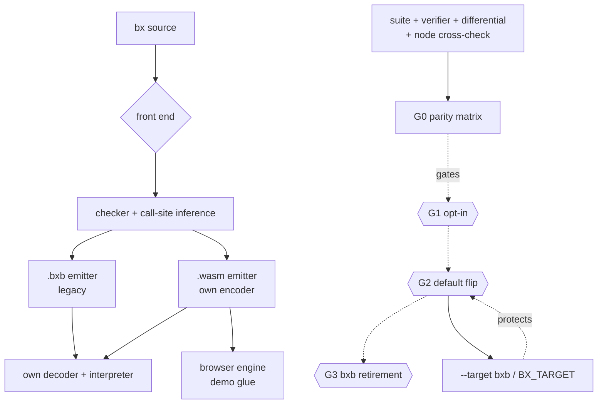

# `bx` migration to `.wasm` (M6)

Owner of the **switchover** from the private `.bxb` container to standard
`.wasm` as bx's default execution format: decision gates, parity matrix,
deprecation of `.bxb`, opt-in/rollback mechanics and the evidence policy for
each gate. The backend itself (encoder, decoder, interpreter, host ABI,
milestones) is owned by
[PRD_02_42_bx_wasm_target.md](PRD_02_42_bx_wasm_target.md); this module never
restates its feature details, only the migration state derived from them.

## Product outcome

A bx user can run `bx build script.bxs` and receive a standard `.wasm` module
that bx's own runtime (and any browser engine) executes; the private `.bxb`
container is gone from the default path and eventually from the codebase, with
no regression in the scripting surface the product documents. The inverse —
`.bxb` as the fallback — exists only as a time-boxed escape hatch during the
flip, never as the long-term default.

## Decision gates

| Gate | Meaning | Evidence required | Status |
| --- | --- | --- | --- |
| G0 | Core scripting parity is green | parity matrix "core" rows `[v]`, unit tests + self-hosted suite + verifier + differential all green on four native cells | `[-]` |
| G1 | Opt-in default | `BX_TARGET=wasm` (and `--target wasm`) accepted by `bx build`/`bx run`; one release of soak with the env override | `[_]` |
| G2 | Default flip | no env set builds `.wasm`; `.bxb` reachable only via `--target bxb`; docs/CHANGELOG announce the flip | `[_]` |
| G3 | `.bxb` retirement | chunk container/emitter/cache-key code deleted; `--target bxb` rejected with a migration message | `[_]` |

A gate may not be skipped. G0 evidence is re-run on the exact candidate before
G1, G2 and G3; stale green from an earlier source revision is `BLOCKED`, not
"passed".

## Tree DAG

```text
bx .wasm migration (M6)
├── G0 core parity
│   ├── [v] language core: numbers, strings+compare, arrays, records, bools,
│   │   ternary, functions (all types), recursion, non-capturing literals
│   ├── [v] control flow: if/else, while, for, for-in (array+map), break/continue
│   ├── [v] native ABI: argv/arg, read/write_file, run/capture, fs/time/cwd/env
│   │   utilities, `exists()`
│   ├── [v] budgets: --max-steps / --timeout parity with the VM
│   ├── [v] evidence: suite (152 checks), verifier (49 tests), differential
│   │   generator, node/independent-engine cross-checks
│   └── [-] remaining core gaps: capturing closures, arrays of strings/records,
│       `attempt`, method surface beyond push/pop/len, dynamic-object syntax
├── G1 opt-in default
│   └── [_] --target flag + BX_TARGET env; cache key includes target
├── G2 default flip
│   ├── [_] docs/CHANGELOG announce; `.bxb` behind --target bxb
│   └── [_] rollback: one release with BX_TARGET=bxb accepted
└── G3 .bxb retirement
    ├── [_] delete container/emitter/cache-key paths
    └── [_] release note + migration error text
```

## Memory palace



## Parity matrix

Legend: `[v]` supported and covered by evidence, `[-]` missing but planned,
`ext` wasm-target extension that the VM does not have (additive only).

| Area | Item | VM | wasm | Evidence |
| --- | --- | --- | --- | --- |
| values | int, float arithmetic | `[v]` | `[v]` | unit + differential |
| values | string literals, concat, compare, len, str/int conversions | `[v]` | `[v]` | unit + differential + node |
| values | bool, `&&`/`||`/`!`, ternary, str(bool)/print(bool) | `[v]` | `[v]` | unit + differential + node |
| values | int arrays, index, len, push/pop | `[v]` | `[v]` | unit + differential |
| values | fixed-layout records, member read/write | `[v]` | `[v]` | unit |
| values | dynamic string-keyed maps (`map_*`, for-in) | — | `ext` | unit + node |
| values | arrays of strings/records, dynamic object literals | `[v]` | `[-]` | gap |
| control | if/else, while, for, for-in, break/continue | `[v]` | `[v]` | unit + differential |
| functions | named functions, all-type params/results, recursion | `[v]` | `[v]` | unit + differential |
| functions | non-capturing function literals, passed to functions | `[v]` | `[v]` | unit + node |
| functions | capturing closures, nested named functions | `[v]` | `[-]` | gap |
| errors | `attempt`, throwing conversion errors surfaced | `[v]` | `[-]` | gap |
| native | argv/arg, read_file/write_file, run/capture | `[v]` | `[v]` | suite + verifier |
| native | now/sleep/cwd/env/mkdir/file_exists/exists | `[v]` | `[v]` | suite + verifier |
| host | web console/performance, WebGL clear/pixel/png | `[v]` | `[v]` | suite + node |
| runtime | --max-steps / --timeout budgets | `[v]` | `[v]` | suite + unit |
| tooling | `bx check --json` introspection, `--html` demo | `[v]` | `[v]` | suite |
| tooling | deterministic module bytes | `[v]` | `[v]` | unit |

Core-parity definition for G0: every row marked `[v]` in both columns, plus the
rows currently `[-]` that the product's documented scripting surface actually
uses (`capturing closures` and `attempt` are the two blockers; arrays of
strings/records is the third if a shipped example needs it). The matrix is
updated in the same change as the capability that moves a row.

## Opt-in and rollback mechanics

- Today: `bx build --wasm source.bxs -o out.wasm` (explicit) and `bx run
  file.wasm` (auto-detected). `.bxb` remains the default for plain `bx build`.
- G1: add `--target wasm|bxb` to `bx build` (default unchanged) and `BX_TARGET`
  for `bx run`/cache selection; cache keys gain the target discriminator so a
  stale `.bxb` cache never serves a `.wasm` request.
- G2: flip the default; `--target bxb` and `BX_TARGET=bxb` keep working for one
  release and print a deprecation note.
- G3: delete the `.bxb` emitter/container/cache path; a request for `bxb`
  fails with a short migration message pointing at this module.

## Non-goals and kill paths

- Wasm modules are not signed or provenance-stamped by this migration; release
  packaging keeps owning provenance.
- The browser ABI is not required to reach full Web APIs for G0; it must keep
  compiling the same core language and the documented `web.*`/`webgl.*` demo
  surface.
- Kill path: if a G0 blocker turns out to be semantically unbridgeable without
  a runtime table/GC design, stop before G2, keep `.bxb` as documented legacy,
  and reopen the decision here with the measured blocker — never flip the
  default on a "mostly green" matrix.

## Open questions

- Capturing closures by reference (shared cells) versus by value: the VM shares
  cells, so by-value captures would diverge silently; any implementation must
  either box captured locals for shared semantics or be documented as a
  non-parity extension.
- Whether `attempt` needs an unwinding mechanism in the interpreter (trap +
  handler frames) or can be lowered to error-returning host calls.
