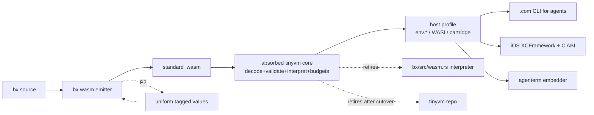

# `minicon-bx` absorbing the `tinyvm` core

Owner of the decision to replace the `bx` wasm runtime with the `tinyvm`
engine, and of the migration that lets `tinyvm` be retired with `minicon-bx`
carrying its needs. Status: `[-]` decision accepted; P0 completed 2026-11-17; P1 started the same
day — the vendored core is now the CLI's wasm engine and the in-tree
interpreter is retained only for one release of differential.

Related: [bx surface](PRD_02_41_bx.md) · [wasm target](PRD_02_42_bx_wasm_target.md) ·
[wasm migration](PRD_02_43_bx_wasm_migration.md). `tinyvm` facts below are owned
by the `tinyvm` repo (`prd/PRD.md` there); this module owns only the absorption
plan and its gates.

## Decision

Absorb `tinyvm`'s **interpreter core and host boundary**, not its product skin:

- Execution format becomes **standard WebAssembly**, executed by the absorbed
  `tinyvm` core (decode / validate / instantiate / interpret, step and memory
  budgets, host import table, replay, C ABI).
- `bx` becomes a **language skin over wasm** (it already emits standard modules);
  the in-tree interpreter `bx/src/wasm.rs` is retired in favor of the core.
- The `.com` CLI stays the product face for agents; the **embeddable core**
  (static lib / XCFramework / C ABI) is what replaces `tinyvm` for iOS and
  `agenterm`.
- The typed-subset matrix in `bx/src/wasm_target.rs` (one `Ty` variant and one
  host import per element kind) is replaced by a **uniform tagged value ABI**;
  new container kinds stop costing a matrix.

This is a product-sentence change: from "a scripting tool with an experimental
wasm backend" to "a portable programmable core (standard wasm) with `bx` as one
language skin and a `.com` CLI". It corrects the road that the 2026-11-17
review exposed: a dynamic language compiled through a combinatorial static type
matrix costs a matrix per feature (float arrays alone: ~400 emitter lines, four
host imports, and an invalid-module bug our own interpreter did not catch).

## Evidence for feasibility (2026-11-17 inventory)

| Fact | Number |
| --- | --- |
| `tinyvm` core interpreter (`crates/tinyvm/src/wasm.rs`) | 11,513 lines |
| `tinyvm` crate test files | 54 |
| `tinyvm` suite reported in its PRD | 314 / 1 |
| default stripped static core | 101,256 B (< 100 KiB gate) |
| accepted standard feature families (independent fixtures + WABT/JSC oracles) | 10 |
| opt-in SIMD core | 117,800 B |
| iOS arm64 / x86_64 consumers (default) | 1,791,960 / 1,897,232 B |
| `tinyvm-qjs` (second language skin) | 29,940 lines |
| `minicon-bx` source today | 21,471 lines (wasm target 9,829; own interpreter 3,662) |
| `tinyvm` host boundary | `HostBackend` (WASI-shaped) **plus** arbitrary registered host functions (`Fn(&[i32], &mut [u8])` / typed `Val`), so `bx`'s `env.*` imports can be served without changing the ABI first |
| portability | `no_std` + `alloc`, no `fmt`, no `unsafe`, runs on iOS and `wasm32` |
| toolchain | `tinyvm` is Rust 2024 / 1.97; the `minicon` workspace is Rust 2024 / 1.97 |

The decisive compatibility question is answered: the core executes arbitrary
imports through a host registration table, so it can host `bx`'s `env.*`
surface; `bx` already emits standard modules (`\0asm`, version 1).

## Tree DAG

```text
minicon-bx owns a standard wasm core and one language skin      [-]
│
├── P0 decisive experiment                                      [v]
│   ├── core linked into an ignored harness (path crate)         [v]  not yet a workspace member
│   ├── `env.*` host profile over the core's host table         [~]  ~45 of 68 imports bound
│   ├── bx differential run on the core                          [v]  300 cases
│   ├── module accepted by an independent engine (node)          [v]  existing demo already proves the emitter
│   └── core-inside-wasm + `.com` size/startup measurement       [_]  linked std delta measured only
│
├── P1 engine swap                                              [~]
│   ├── `bx run --wasm` executes through the core                [v]  2026-11-17
│   ├── validation errors surface with function name/line        [v]  `bx check`/`bx run` reject with site
│   ├── `bx/src/wasm.rs` interpreter retired                     [_]  next: delete + move unit tests to the core
│   ├── step/memory budgets owned by the core                    [v]  steps, interrupt, memory pages
│   └── core vendored as a workspace member                      [v]  `bx/vendor/tinyvm` (no crates.io wasm crate)
│
├── P2 language front end simplification                        [_]
│   ├── uniform tagged value ABI (containers hold values)        [_]
│   ├── element-kind matrix and its host imports deleted         [_]
│   ├── `.bxb` default flip and retirement (PRD_02_43)           [_]
│   └── float/nested/mixed containers from the uniform layout    [_]
│
├── P3 embeddable product face                                  [_]
│   ├── static lib + C ABI built in the minicon repo             [_]
│   ├── XCFramework / Swift package scripts moved over           [_]
│   ├── `tinyvm`-named compatibility shim for one release        [_]
│   ├── agenterm embedder switched                               [_]
│   └── TinyArcade app switched                                 [_]
│
└── P4 tinyvm retirement                                        [_]
    ├── downstream cutover evidence for both embedders           [_]
    ├── CI moved into minicon (wasm cells, iOS budgets)          [_]
    └── tinyvm repo archived, docs ownership transferred         [_]
```

## Memory palace



## P0 results (2026-11-17)

Experiment shape: the `tinyvm` clone at `D:\dev\partnernetsoftware\tinyvm`
(`f476cd2`) was linked into an ignored harness
(`bx/target/p0/harness`, not committed). It registers the `env.*` imports the
probe programs call through `Module::bind_import_typed`, instantiates the
module, and invokes the exported `_start`. A `bx-shim` binary delegates
everything that is not `run <module>.wasm` to the real `bx`, so the existing
`bx/tools/wasm-diff.bxs` differential could run unchanged with the core as the
wasm runner.

| Evidence | Result |
| --- | --- |
| feature matrix (closures/records/strings/maps/arrays/floats/nested/sorts/control) | 7/7 modules byte-identical between the core and bx's interpreter |
| 300-case generated differential (`wasm-diff.bxs` via shim) | `PASS 300 differential cases`; no rejected module |
| `bx` gates after the fix below | unit 91, suite 180, verifier 76, native differential 300 |
| linked size (std harness) | 523,776 B vs 121,344 B control ⇒ ~402 KB delta on `.com` (published static core in tinyvm: 101,256 B) |

Findings that change the plan:

1. **The validator pays for itself immediately.** It rejected the differential's
   first case with `validation: type mismatch in function #68`. Delta-reducing
   the 183-chunk program found `grow.push(8)`: the int-array `push` path loaded
   the value into an `i64` local and then wrote it through an `i32` local
   (i32/i64 store mismatch). bx's own interpreter accepted it and printed the
   right answer; node had also been validating less strictly than tinyvm here
   for method-form pushes. Fixed in the emitter
   (`bx wasm: fix int push local types`), after which the 300-case differential
   ran clean.
2. **The host ABI was under-specified.** Porting the host surfaced two implicit
   contracts: `print_record`/`print_arr_obj` take `(table, count, pointer)` (not
   pointer-first), and `str_char_at` accepts a negative index meaning "count
   from the end" (bx's native host and the JS demo both normalize it; a naive
   host returns an empty string). Both are now written into
   [PRD_02_42_bx_wasm_target.md](PRD_02_42_bx_wasm_target.md) as the host
   contract every host must satisfy.
3. **Do not ship two engines.** The invalid module passed every existing bx gate
   because the in-tree interpreter does not type-check locals. P1's first
   safety rule is therefore: once the core executes the module, delete the
   in-tree interpreter rather than keeping it as a lenient fallback.
4. **Host coverage is the real P1 work.** The shim binds ~45 of 68 imports;
   `web.*`/`webgl.*`, `bx.run`/`bx.capture`, and some container printers were not
   exercised. P1 must port the whole surface as one Rust host profile and prove
   it with the differential plus the browser demo.
## P1 progress (2026-11-17)

- `bx/vendor/tinyvm` is the owned core crate (the `tinyvm` name is kept so a
  future upstream drift check can diff it), `std` feature only, provenance in
  its README. `cargo tree -p bx` now shows `bx → tinyvm → libm`; there is still
  no third-party WebAssembly runtime crate.
- `bx run <module.wasm>` and `bx run <source>` (wasm target) execute through the
  core by default. `BX_WASM_OWN=1` still reaches the in-tree interpreter for one
  release of engine differential; unit tests keep using it for now.
- The host surface is **not duplicated**: the core adapter (`bx/src/wasm_core.rs`)
  converts `tinyvm::Val` to bx's `WVal` and calls the existing `PrintHost` arms,
  so the ABI keeps one implementation. This answers the P0 ABI-drift finding
  structurally instead of by documentation.
- Validation is now a product surface: `bx check file.wasm` and `bx run
  file.wasm` reject the P0 invalid-module class with `wasm module rejected:
  validation: type mismatch in function #0`; budgets map to core limits
  (`--max-steps` → step budget, `--timeout` → interrupt).
- Evidence: unit 93 (91 + two core tests: reject-invalid, run-compiled), suite
  180, verifier 76, local differential 300 and packed-product differential 300
  all on the core; corpus (floats/nested/sortstr/maps) is byte-identical across
  core engine, own interpreter and VM. `.com` grew from ~1.92 MB to ~2.17 MB
  (win-x64; +243 KB with LTO+strip).
- Remaining P1 work: delete the interpreter and its decoder, move the unit tests
  that use `execute` onto the core, then remove `BX_WASM_OWN` and the
  `#[allow(dead_code)]` exceptions.
## Gates

| Gate | Meaning | Evidence required | Status |
| --- | --- | --- | --- |
| G0 | absorption is worth it | 300-case differential and a 7-case feature matrix run byte-identically through the core with a shim host; the core's validator caught one real emitter bug (int-array `push` local types) | `[v]` |
| G1 | one engine | `bx/src/wasm.rs` interpreter deleted; no dual semantics in the product | `[_]` |
| G2 | no matrix tax | a new container kind is added by one representation change, no per-operation host imports | `[_]` |
| G3 | embeddable parity | static lib + C ABI passes `tinyvm`'s C-ABI smoke shapes; XCFramework + Swift smoke exit 0 in CI | `[_]` |
| G4 | downstream cutover | `agenterm` and the TinyArcade app consume `minicon-bx` artifacts, both suites green | `[_]` |
| G5 | retirement | `tinyvm` repo archived; any remaining feature is explicitly dropped with a recorded reason | `[_]` |

Safe failure: P0 is a decisive experiment, not a promise. If the core cannot
host the `env.*` profile or the wasm32/`.com` shape regresses badly, the fallback
is to absorb only the **validator + budgets + replay discipline** into the
existing interpreter and stop the plan, with the measurements recorded here.

## Open decision

"Replace `tinyvm`'s needs" has two possible scopes:

- **A — engine + embedding** (recommended first): the core, host profile,
  budgets, replay, C ABI, iOS build scripts. TinyArcade-specific modules
  (cartridge, catalog, media, game runtime) stay in a feature layer or remain
  owned by the downstream app.
- **B — full platform**: also absorb cartridge/catalog/trust/media/game runtime
  and `tinyvm-qjs`. This is a product-boundary change ("minicon-bx becomes the
  game/agent platform") and roughly doubles the absorbed surface (game.rs 1,458
  lines, ios_c_api.rs 3,661 lines, qjs 29,940 lines).

P0 does not depend on the answer; G3 onward does.

## Non-goals

- No JIT/AOT. The core stays an interpreter; iOS forbids generated code.
- No third-party wasm runtime crate. The core is owned source either way.
- No new language. `bx` remains the language; `qjs` is a migration question
  (compatibility shim vs rewrite) decided before P4, not silently dropped.
- No byte-budget regression of the `.com` product beyond the measured core cost.
