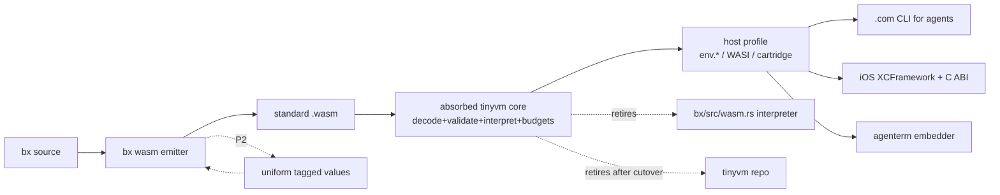

# `minicon-bx` absorbing the `tinyvm` core

Owner of the decision to replace the `bx` wasm runtime with the `tinyvm`
engine, and of the migration that lets `tinyvm` be retired with `minicon-bx`
carrying its needs. Status: `[-]` decision accepted, P0 decisive experiment not
started.

Related: [bx surface](PRD_02_41_bx.md) · [wasm target](PRD_02_42_bx_wasm_target.md) ·
[wasm migration](PRD_02_43_bx_wasm_migration.md). `tinyvm` facts below are owned
by the `tinyvm` repo (`prd/PRD.md` there); this module owns only the absorption
plan and its gates.

## Decision

Absorb `tinyvm`'s **interpreter core and host boundary**, not its product skin:

- Execution format becomes **standard WebAssembly**, executed by the absorbed
  `tinyvm` core (decode / validate / instantiate / interpret, step and memory
  budgets, host import table, replay, C ABI).
- `bx` becomes a **language skin over wasm** (it already emits standard modules);
  the in-tree interpreter `bx/src/wasm.rs` is retired in favor of the core.
- The `.com` CLI stays the product face for agents; the **embeddable core**
  (static lib / XCFramework / C ABI) is what replaces `tinyvm` for iOS and
  `agenterm`.
- The typed-subset matrix in `bx/src/wasm_target.rs` (one `Ty` variant and one
  host import per element kind) is replaced by a **uniform tagged value ABI**;
  new container kinds stop costing a matrix.

This is a product-sentence change: from "a scripting tool with an experimental
wasm backend" to "a portable programmable core (standard wasm) with `bx` as one
language skin and a `.com` CLI". It corrects the road that the 2026-11-17
review exposed: a dynamic language compiled through a combinatorial static type
matrix costs a matrix per feature (float arrays alone: ~400 emitter lines, four
host imports, and an invalid-module bug our own interpreter did not catch).

## Evidence for feasibility (2026-11-17 inventory)

| Fact | Number |
| --- | --- |
| `tinyvm` core interpreter (`crates/tinyvm/src/wasm.rs`) | 11,513 lines |
| `tinyvm` crate test files | 54 |
| `tinyvm` suite reported in its PRD | 314 / 1 |
| default stripped static core | 101,256 B (< 100 KiB gate) |
| accepted standard feature families (independent fixtures + WABT/JSC oracles) | 10 |
| opt-in SIMD core | 117,800 B |
| iOS arm64 / x86_64 consumers (default) | 1,791,960 / 1,897,232 B |
| `tinyvm-qjs` (second language skin) | 29,940 lines |
| `minicon-bx` source today | 21,471 lines (wasm target 9,829; own interpreter 3,662) |
| `tinyvm` host boundary | `HostBackend` (WASI-shaped) **plus** arbitrary registered host functions (`Fn(&[i32], &mut [u8])` / typed `Val`), so `bx`'s `env.*` imports can be served without changing the ABI first |
| portability | `no_std` + `alloc`, no `fmt`, no `unsafe`, runs on iOS and `wasm32` |
| toolchain | `tinyvm` is Rust 2024 / 1.97; the `minicon` workspace is Rust 2024 / 1.97 |

The decisive compatibility question is answered: the core executes arbitrary
imports through a host registration table, so it can host `bx`'s `env.*`
surface; `bx` already emits standard modules (`\0asm`, version 1).

## Tree DAG

```text
minicon-bx owns a standard wasm core and one language skin      [-]
│
├── P0 decisive experiment                                      [_]
│   ├── core vendored into the bx workspace as a path crate      [_]
│   ├── `env.*` host profile over the core's host table          [_]
│   ├── bx suite / verifier / differential run on the core       [_]
│   ├── module accepted by an independent engine (node)          [_]  existing demo already proves the emitter
│   └── core-inside-wasm + `.com` size/startup measurement       [_]
│
├── P1 engine swap                                              [_]
│   ├── `bx run --wasm` executes through the core                [_]
│   ├── validation errors surface with function name/line        [_]
│   ├── `bx/src/wasm.rs` interpreter retired                     [_]
│   └── step/memory budgets owned by the core                    [_]
│
├── P2 language front end simplification                        [_]
│   ├── uniform tagged value ABI (containers hold values)        [_]
│   ├── element-kind matrix and its host imports deleted         [_]
│   ├── `.bxb` default flip and retirement (PRD_02_43)           [_]
│   └── float/nested/mixed containers from the uniform layout    [_]
│
├── P3 embeddable product face                                  [_]
│   ├── static lib + C ABI built in the minicon repo             [_]
│   ├── XCFramework / Swift package scripts moved over           [_]
│   ├── `tinyvm`-named compatibility shim for one release        [_]
│   ├── agenterm embedder switched                               [_]
│   └── TinyArcade app switched                                 [_]
│
└── P4 tinyvm retirement                                        [_]
    ├── downstream cutover evidence for both embedders           [_]
    ├── CI moved into minicon (wasm cells, iOS budgets)          [_]
    └── tinyvm repo archived, docs ownership transferred         [_]
```

## Memory palace



## Gates

| Gate | Meaning | Evidence required | Status |
| --- | --- | --- | --- |
| G0 | absorption is worth it | `bx` suite (180 checks), verifier (76 tests) and 300-case differential pass through the core; one deliberate emitter bug is caught by the core's validator (the 2026-11-17 invalid local-type class) | `[_]` |
| G1 | one engine | `bx/src/wasm.rs` interpreter deleted; no dual semantics in the product | `[_]` |
| G2 | no matrix tax | a new container kind is added by one representation change, no per-operation host imports | `[_]` |
| G3 | embeddable parity | static lib + C ABI passes `tinyvm`'s C-ABI smoke shapes; XCFramework + Swift smoke exit 0 in CI | `[_]` |
| G4 | downstream cutover | `agenterm` and the TinyArcade app consume `minicon-bx` artifacts, both suites green | `[_]` |
| G5 | retirement | `tinyvm` repo archived; any remaining feature is explicitly dropped with a recorded reason | `[_]` |

Safe failure: P0 is a decisive experiment, not a promise. If the core cannot
host the `env.*` profile or the wasm32/`.com` shape regresses badly, the fallback
is to absorb only the **validator + budgets + replay discipline** into the
existing interpreter and stop the plan, with the measurements recorded here.

## Open decision

"Replace `tinyvm`'s needs" has two possible scopes:

- **A — engine + embedding** (recommended first): the core, host profile,
  budgets, replay, C ABI, iOS build scripts. TinyArcade-specific modules
  (cartridge, catalog, media, game runtime) stay in a feature layer or remain
  owned by the downstream app.
- **B — full platform**: also absorb cartridge/catalog/trust/media/game runtime
  and `tinyvm-qjs`. This is a product-boundary change ("minicon-bx becomes the
  game/agent platform") and roughly doubles the absorbed surface (game.rs 1,458
  lines, ios_c_api.rs 3,661 lines, qjs 29,940 lines).

P0 does not depend on the answer; G3 onward does.

## Non-goals

- No JIT/AOT. The core stays an interpreter; iOS forbids generated code.
- No third-party wasm runtime crate. The core is owned source either way.
- No new language. `bx` remains the language; `qjs` is a migration question
  (compatibility shim vs rewrite) decided before P4, not silently dropped.
- No byte-budget regression of the `.com` product beyond the measured core cost.
